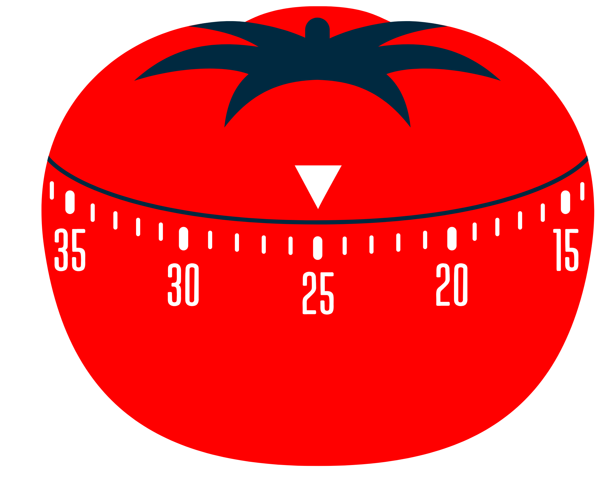

# 2025 B2 Super Curation — line-by-line source guide

This guide follows the 2025 B2 reader from its HTML entry point through all five teaching chapters. The source snapshot is `work/pages-streamlined-live-20261104/paper3/2025-b2/` in the Astra workspace. The listening audit supplied with the request identifies this snapshot. Its listening notes are incorporated where applicable.

## How the lesson runs

1. **Boss Letter.** The reader turns source text into addressable sentences before Super Curation starts. The controller requires the benchmark records, the sentence helper and a wrapped sentence on page 4. It builds instruction steps from those sentences, marks phrases by teaching role, and inserts visits to the referenced documents. The return path brings the learner back into the letter sequence.
2. **Data Categorization.** The learner first inspects the note sheet and document headings. Initial guesses can differ from the tasks discovered during close reading. The page stamps and category choices project what the learner has reached so far.
3. **Podcast.** The base listening script attaches one recording to the page-3 note sheet. Curation uses that audio for its floating controls. Nineteen cue endpoints drive automatic stops, generated notes and the Next button. The English sentences in each speech receive estimated times within that speech. A deep clone retains the Chinese transcript. Normal Play resumes from the current position, while the explicit replay action seeks to the cue start. The floating transcript allows free scrolling during cue playback. A subsequent transcript-review step scrolls its selected sentence into view.
4. **Data File / Fact File.** The current sequence follows the document being read, even when the relevant writing task changes. Email ordering, later confirmations, explicit page visits and returns are built into the step list. Exact benchmark phrases and inferred task marks have separate roles. Bank entries retain their originating step so the learner can revisit the evidence.
5. **Writing.** Prompts lead into the three model essays. The controller pairs model units with the teaching guide by task and position. Page-and-phrase references connect an essay point to a specific source passage. The essay preview, phrase marks and bank distinguish evidence reached at the current position from evidence used later in the model. The separately mounted submission form reads answer-book fields through the writing bridge.

## State and re-entry

The ordinary reader stores its editable fields and translation preference under its own key. Curation maintains a separate five-slot store containing chapter positions, completed and visited step IDs, heard cues, evidence, bookmarks, categories, essay positions, drafts and display options. A step ID identifies evidence across visits. An index locates it in the current chapter sequence. Rebuilding visible marks from the current position lets a learner go backwards without displaying later answers prematurely.

In `super-curation.js` L469–471, check the actual version ladder when diagnosing restores. The general fallback selects historical Boss/Data ID lists even when the incoming sequence version is 4. Where those lists are selected, the code maps the saved index through an old ID before clamping the result. The stored position and the restored visible step can consequently differ. The audio element’s playback time is outside the slot schema.

## Reading the reference

Each file has a source fingerprint and a numbered listing. Every physical line, including whitespace and delimiters, has a corresponding explanation. Long lines retain their original number. For the minified HTML the notes additionally walk individual elements, text nodes and inline CSS declarations in document order. Images embedded in markup remain intact in the source listing. Array indexes in the notes start at zero.

The scope includes every file in the 2025 B2 directory, the shared scripts and styles directly included by its HTML, the linked app manifest, and the writing bridge, stylesheet and topics used by the reader. The shared shell also calls site-wide services and loads infrastructure such as the service worker and companion. Their internal implementations sit outside the B2 lesson. The recording is inventoried as binary media. This is a source reading, without a browser playback or submission test.

## Source index

- [super-curation.js](#file-1) · 1,015 lines
- [super-curation.css](#file-2) · 313 lines
- [reader.js](#file-3) · 95 lines
- [sentence-analysis-core.js](#file-4) · 44 lines
- [sentence-analysis-data.js](#file-5) · 2,784 lines
- [sentence-analysis.js](#file-6) · 212 lines
- [sentence-analysis.css](#file-7) · 22 lines
- [listening-notes.js](#file-8) · 81 lines
- [listening-notes.css](#file-9) · 24 lines
- [super-curation-highlights.js](#file-10) · 395 lines
- [model-essays.js](#file-11) · 47 lines
- [model-essay-guides.js](#file-12) · 57 lines
- [index.html](#file-13) · 11 lines
- [sentence-analysis-notes.json](#file-14) · 19 lines
- [recording-provenance.json](#file-15) · 10 lines
- [paper3-writing-reader.mjs](#file-16) · 15 lines
- [paper3-writing-bridge.mjs](#file-17) · 41 lines
- [paper3-writing-bridge.css](#file-18) · 1 lines
- [paper3-writing-topics.mjs](#file-19) · 5 lines
- [pwa-ui.css](#file-20) · 190 lines
- [pwa-register.js](#file-21) · 682 lines
- [eddy-global-dialogues.css](#file-22) · 16 lines
- [eddy-global-dialogues.js](#file-23) · 548 lines
- [shared-system-nav.js](#file-24) · 1,427 lines
- [dse-paper3-analysis.webmanifest](#file-25) · 45 lines

**Recording.** `part-b-meeting.m4a` contains 6,473,115 bytes. SHA-256 `c3c3f34e7085c784f5dbf994a7c49e6fe2168d6c55203cc465f4d58efe5a0d7e`. Its extraction settings and section offsets are documented in `recording-provenance.json`.

## super-curation.js

The five-chapter controller owns the step graph, saved slots, progressive annotations, floating controls and navigation.

Source `work/pages-streamlined-live-20261104/paper3/2025-b2/super-curation.js` · 1,015 physical lines · SHA-256 `220937e6b0f78e70299e1edbce13d82a90725783922524fb56832790ea727fef`.

### Startup and teaching configuration

**L1–L25**

~~~~text
   1 | (() => {
   2 |   'use strict';
   3 |   const core = window.EdmundSentenceAnalysis;
   4 |   const benchmark = window.EDMUND_B2_SENTENCE_ANALYSIS?.records;
   5 |   const referenceHighlights = window.EDMUND_B2_CURATION_HIGHLIGHTS || {};
   6 |   if (!core || !benchmark || !document.querySelector('#page-4 .sentence-item')) return;
   7 | 
   8 |   const VERSION = '2025-b2-super-curation-v1';
   9 |   const STORAGE = 'edmund-paper3-2025-b2-curation-v1';
  10 |   const chapters = [
  11 |     {id:'boss', name:'1 · Boss letter', short:'任務指示', description:'先找寫作身分、文類、讀者、內容要求和指定來源。'},
  12 |     {id:'categorize', name:'2 · Data categorization', short:'資料分類', description:'先按題目與文件標題作暫定分類，再在閱讀後修正。'},
  13 |     {id:'podcast', name:'3 · Podcast', short:'聆聽錄音', description:'聽到應記的答案後暫停，逐項寫入筆記，再看逐句稿。'},
  14 |     {id:'data', name:'4 · Data File / Fact file', short:'逐句取證', description:'按資料頁連續閱讀；讀到跨任務線索，就換相應顏色並追加標記。'},
  15 |     {id:'writing', name:'5 · Three writing tasks', short:'三篇寫作', description:'先組織自己的內容與草稿，再按任務要求校對。'}
  16 |   ];
  17 |   const labels = {1:'Task A · 可用內容',2:'Task B · 可用內容',3:'Task C · 可用內容',4:'語義相關 / 語氣',5:'提示 / 更新線索',6:'噪音 / 不採用'};
  18 |   const provisionalNotes={
  19 |     'duncan-henley-emails-8':'這是較早一封回覆。由寄件人和時間判斷位置；仍要讀最新回覆。',
  20 |     'duncan-henley-emails-9':'Henley 此刻贊成 Crafting Session，並建議 Wellness Fair。先記兩個候選活動；仍要看 Duncan 的最新確認。',
  21 |     'duncan-henley-emails-10':'「上次受歡迎」可作理由，但它單獨不能證明今年確定再辦。',
  22 |     'duncan-henley-emails-11':'新設 interactive booths 是今年的建議細節。先記下，等後續決定。',
  23 |     'duncan-henley-emails-12':'營養師未能到場，原本的 talk 暫時不可照抄；留意活動是否仍保留其他部分。',
  24 |     'duncan-henley-emails-13':'Henley 提議不再辦 Fitness Challenge 和 Gardening & Plant Care。先標為更新線索，等待最新回覆確認。',
  25 |     'duncan-henley-emails-14':'Sports Day at the Beach 是新構想；先留給 Task B，不可直接混入已確定再辦的 Task A 活動。',
~~~~

- **L1.** Invoke the setup function immediately.
- **L2.** Enable strict JavaScript semantics.
- **L3.** Bind core to window.EdmundSentenceAnalysis.
- **L4.** Bind benchmark to window.EDMUND_B2_SENTENCE_ANALYSIS?.records.
- **L5.** Bind referenceHighlights to use window.EDMUND_B2_CURATION_HIGHLIGHTS with a falsy fallback of {}.
- **L6.** Abort before adding any curation UI if a prerequisite is absent. The wrapped page-4 sentence also acts as a readiness check for the earlier sentence-analysis script. Test !core || !benchmark || !document.querySelector('#page-4 .sentence-item') before entering this branch. Find the first matching element via document.querySelector('#page-4 .sentence-item'). Exit the current function here.
- **L7.** Blank separator between source lines.
- **L8.** Bind VERSION to '2025-b2-super-curation-v1'.
- **L9.** Bind STORAGE to 'edmund-paper3-2025-b2-curation-v1'.
- **L10.** Bind chapters to an ordered list of 5 entries.
- **L11.** Entry chapters[0] supplies a record with id, name, short, description. Stable lookup key in chapters[0].id to 'boss'. Set name in chapters[0].name to '1 · Boss letter'. Set short in chapters[0].short to '任務指示'. Set description in chapters[0].description to '先找寫作身分、文類、讀者、內容要求和指定來源。'.
- **L12.** Entry chapters[1] supplies a record with id, name, short, description. Stable lookup key in chapters[1].id to 'categorize'. Set name in chapters[1].name to '2 · Data categorization'. Set short in chapters[1].short to '資料分類'. Set description in chapters[1].description to '先按題目與文件標題作暫定分類，再在閱讀後修正。'.
- **L13.** Declares Chapter 3 as `podcast / 聆聽錄音`. Entry chapters[2] supplies a record with id, name, short, description. Stable lookup key in chapters[2].id to 'podcast'. Set name in chapters[2].name to '3 · Podcast'. Set short in chapters[2].short to '聆聽錄音'. Set description in chapters[2].description to '聽到應記的答案後暫停，逐項寫入筆記，再看逐句稿。'.
- **L14.** Entry chapters[3] supplies a record with id, name, short, description. Stable lookup key in chapters[3].id to 'data'. Set name in chapters[3].name to '4 · Data File / Fact file'. Set short in chapters[3].short to '逐句取證'. Set description in chapters[3].description to '按資料頁連續閱讀；讀到跨任務線索，就換相應顏色並追加標記。'.
- **L15.** Entry chapters[4] supplies a record with id, name, short, description. Stable lookup key in chapters[4].id to 'writing'. Set name in chapters[4].name to '5 · Three writing tasks'. Set short in chapters[4].short to '三篇寫作'. Set description in chapters[4].description to '先組織自己的內容與草稿，再按任務要求校對。'.
- **L16.** Close the enclosing array expression.
- **L17.** Types 1–3 label usable material for Tasks A–C. Type 4 marks relevant meaning or tone, Type 5 an instruction or update, and Type 6 a distraction to discard. Bind labels to a record with 1, 2, 3, 4, 5, 6. Set 1 in labels.1 to 'Task A · 可用內容'. Set 2 in labels.2 to 'Task B · 可用內容'. Set 3 in labels.3 to 'Task C · 可用內容'. Set 4 in labels.4 to '語義相關 / 語氣'. Set 5 in labels.5 to '提示 / 更新線索'. Set 6 in labels.6 to '噪音 / 不採用'.
- **L18.** Bind provisionalNotes to a record with 'duncan-henley-emails-8', 'duncan-henley-emails-9', 'duncan-henley-emails-10', 'duncan-henley-emails-11', 'duncan-henley-emails-12', 'duncan-henley-emails-13', 'duncan-henley-emails-14', 'duncan-henley-emails-15', 'duncan-henley-emails-16', 'duncan-henley-emails-17', 'duncan-henley-emails-18', 'duncan-henley-emails-19', 'duncan-henley-emails-20'.
- **L19.** Set duncan-henley-emails-8 in provisionalNotes.duncan-henley-emails-8 to '這是較早一封回覆。由寄件人和時間判斷位置；仍要讀最新回覆。'.
- **L20.** Set duncan-henley-emails-9 in provisionalNotes.duncan-henley-emails-9 to 'Henley 此刻贊成 Crafting Session，並建議 Wellness Fair。先記兩個候選活動；仍要看 Duncan 的最新確認。'.
- **L21.** Set duncan-henley-emails-10 in provisionalNotes.duncan-henley-emails-10 to '「上次受歡迎」可作理由，但它單獨不能證明今年確定再辦。'.
- **L22.** Set duncan-henley-emails-11 in provisionalNotes.duncan-henley-emails-11 to '新設 interactive booths 是今年的建議細節。先記下，等後續決定。'.
- **L23.** Set duncan-henley-emails-12 in provisionalNotes.duncan-henley-emails-12 to '營養師未能到場，原本的 talk 暫時不可照抄；留意活動是否仍保留其他部分。'.
- **L24.** Set duncan-henley-emails-13 in provisionalNotes.duncan-henley-emails-13 to 'Henley 提議不再辦 Fitness Challenge 和 Gardening &amp; Plant Care。先標為更新線索，等待最新回覆確認。'.
- **L25.** Set duncan-henley-emails-14 in provisionalNotes.duncan-henley-emails-14 to 'Sports Day at the Beach 是新構想；先留給 Task B，不可直接混入已確定再辦的 Task A 活動。'.

**L26–L50**

~~~~text
  26 |     'duncan-henley-emails-15':'這是此電郵串較早的一封。時間順序決定我們如何理解後續更新。',
  27 |     'duncan-henley-emails-16':'Duncan 正徵求活動選項；此時仍未知道最後選哪三項。',
  28 |     'duncan-henley-emails-17':'去年的海報是候選清單，不是今年的確認清單。',
  29 |     'duncan-henley-emails-18':'Fitness Challenge 在此刻只是 Duncan 的初步建議。先記候選，不要當成已確定。',
  30 |     'duncan-henley-emails-19':'Crafting Session 及改為亞洲國家題材是此刻的建議。先記下細節，稍後對照回覆。',
  31 |     'duncan-henley-emails-20':'這是請對方回應的問句；下一封電郵可能更改活動選擇。'
  32 |   };
  33 |   const pageSections = {4:'boss-letter',5:'duncan-henley-emails',6:'wellness-poster',7:'student-interview',8:'whatsapp-chat',9:'duncan-singh-emails',10:'influator-blog',11:'sports-article'};
  34 |   const categoryPages = [
  35 |     {page:5,title:'活動篩選電郵',initial:'Boss letter 指向這串電郵，先標 Task A；只把它當來源路線，未讀完前別抄活動名。',revision:'從最早一封往最新一封讀。Task A 的舊活動要受最新決定約束；新活動的線索則留給 Task B。',tasks:['A','B']},
  36 |     {page:6,title:'2024 健康月原海報',initial:'標 Task A 的候選資料。這是 2024 年海報，不能假定每項活動在 2025 年都再辦。',revision:'逐項和第 5 頁最新電郵及錄音核對。保留獲確認活動，刪除取消或改動的細節。',tasks:['A']},
  37 |     {page:7,title:'校園電視完整訪問',initial:'Boss letter 要 student feedback；先標 Task A，留意訪談的說話者。',revision:'學生的評價支援 Task A；家長義工與親子互動的經驗可轉給 Task C。分類可在讀到後半段時追加。',tasks:['A','C']},
  38 |     {page:8,title:'WhatsApp 完整對話',initial:'Boss letter 指向 WhatsApp 作 proposal 起點，先標 Task B。',revision:'圈出活動目的與運動篩選條件；校長仍待看 proposal，不能寫成已批准。',tasks:['B']},
  39 |     {page:9,title:'家長職責與交通安排',initial:'Boss letter 指向 Singh 電郵處理家長義工，先標 Task C。',revision:'讀下去才會發現交通與海灘選擇也支援 Task B；將資料分別存入兩個任務。',tasks:['C','B']},
  40 |     {page:10,title:'網誌、原圖表與運動電郵',initial:'先看各文件標題：家長參與網誌指向 Task C，運動電郵指向 Task B。',revision:'網誌的社會／氣氛理由須轉述；運動電郵提供排除條件。圖表不要不加解釋地當成健康月校內數據。',tasks:['C','B']},
  41 |     {page:11,title:'運動雜誌完整文章',initial:'按 WhatsApp 的選項條件，先標 Task B；不是所有介紹的運動都合適。',revision:'把每項運動與新鮮感、活動量、初學者難度、水上風險和交通條件逐一對照，排除不合者。',tasks:['B']},
  42 |     {page:3,title:'聆聽筆記表',initial:'先看筆記表的欄目。Wellness Month 及家長參與分別指向 Task A 和 Task C；Asian Games Week 是這三篇作文的干擾。',revision:'錄音核對後，把健康月活動寫進 Task A，把家長義工、簡介會及報名方式寫進 Task C。',tasks:['A','C']}
  43 |   ];
  44 |   const categoryInitialTasks=entry=>entry.page===3?[]:entry.page===10?['B','C']:[entry.tasks[0]];
  45 |   // Answer endpoints aligned to the supplied 8:37.5 recording with word-level speech timing.
  46 |   const podcastCues = [
  47 |     {id:'slogan',at:69.8,page:12,quote:'One Games, One Asia',title:'記下最後口號',field:'slogan',note:'One Games, One Asia',help:'口號中間有逗號。Passion, Pride, Performance 是先提出、後來沒有採用的版本。'},
  48 |     {id:'opening-date',at:122.4,page:13,quote:'the 13th of October',title:'開幕日期改為 10 月 13 日',field:'opening',note:'13 October',help:'6 October 是先前提議；因 7 日假期而改成 13 October。'},
  49 |     {id:'opening-time',at:138.6,page:13,quote:'just an afternoon',title:'記開幕時段',field:'opening',note:'Guest speaker; afternoon',help:'嘉賓活動只需一個下午，不是全日。'},
  50 |     {id:'opening-venue',at:167.5,page:14,quote:'Hold it in the Main Hall',title:'場地最後選禮堂',field:'opening',note:'Main Hall',help:'sports ground 是早期想法；最後為免天氣影響，改在 Main Hall。'},
~~~~

- **L26.** Set duncan-henley-emails-15 in provisionalNotes.duncan-henley-emails-15 to '這是此電郵串較早的一封。時間順序決定我們如何理解後續更新。'.
- **L27.** Set duncan-henley-emails-16 in provisionalNotes.duncan-henley-emails-16 to 'Duncan 正徵求活動選項；此時仍未知道最後選哪三項。'.
- **L28.** Set duncan-henley-emails-17 in provisionalNotes.duncan-henley-emails-17 to '去年的海報是候選清單，不是今年的確認清單。'.
- **L29.** Set duncan-henley-emails-18 in provisionalNotes.duncan-henley-emails-18 to 'Fitness Challenge 在此刻只是 Duncan 的初步建議。先記候選，不要當成已確定。'.
- **L30.** Set duncan-henley-emails-19 in provisionalNotes.duncan-henley-emails-19 to 'Crafting Session 及改為亞洲國家題材是此刻的建議。先記下細節，稍後對照回覆。'.
- **L31.** Set duncan-henley-emails-20 in provisionalNotes.duncan-henley-emails-20 to '這是請對方回應的問句；下一封電郵可能更改活動選擇。'.
- **L32.** Finish provisionalNotes.
- **L33.** Bind pageSections to a record with 4, 5, 6, 7, 8, 9, 10, 11. Set 4 in pageSections.4 to 'boss-letter'. Set 5 in pageSections.5 to 'duncan-henley-emails'. Set 6 in pageSections.6 to 'wellness-poster'. Set 7 in pageSections.7 to 'student-interview'. Set 8 in pageSections.8 to 'whatsapp-chat'. Set 9 in pageSections.9 to 'duncan-singh-emails'. Set 10 in pageSections.10 to 'influator-blog'. Set 11 in pageSections.11 to 'sports-article'.
- **L34.** Bind categoryPages to an ordered list of 8 entries.
- **L35.** Entry categoryPages[0] supplies a record with page, title, initial, revision, tasks. Set page in categoryPages[0].page to 5. Display title in categoryPages[0].title to '活動篩選電郵'. Set initial in categoryPages[0].initial to 'Boss letter 指向這串電郵，先標 Task A；只把它當來源路線，未讀完前別抄活動名。'. Set revision in categoryPages[0].revision to '從最早一封往最新一封讀。Task A 的舊活動要受最新決定約束；新活動的線索則留給 Task B。'. Associated writing tasks in categoryPages[0].tasks to an ordered list of 2 entries. Entry categoryPages[0].tasks[0] supplies 'A'. Entry categoryPages[0].tasks[1] supplies 'B'.
- **L36.** Entry categoryPages[1] supplies a record with page, title, initial, revision, tasks. Set page in categoryPages[1].page to 6. Display title in categoryPages[1].title to '2024 健康月原海報'. Set initial in categoryPages[1].initial to '標 Task A 的候選資料。這是 2024 年海報，不能假定每項活動在 2025 年都再辦。'. Set revision in categoryPages[1].revision to '逐項和第 5 頁最新電郵及錄音核對。保留獲確認活動，刪除取消或改動的細節。'. Associated writing tasks in categoryPages[1].tasks to an ordered list of 1 entries. Entry categoryPages[1].tasks[0] supplies 'A'.
- **L37.** Entry categoryPages[2] supplies a record with page, title, initial, revision, tasks. Set page in categoryPages[2].page to 7. Display title in categoryPages[2].title to '校園電視完整訪問'. Set initial in categoryPages[2].initial to 'Boss letter 要 student feedback；先標 Task A，留意訪談的說話者。'. Set revision in categoryPages[2].revision to '學生的評價支援 Task A；家長義工與親子互動的經驗可轉給 Task C。分類可在讀到後半段時追加。'. Associated writing tasks in categoryPages[2].tasks to an ordered list of 2 entries. Entry categoryPages[2].tasks[0] supplies 'A'. Entry categoryPages[2].tasks[1] supplies 'C'.
- **L38.** Entry categoryPages[3] supplies a record with page, title, initial, revision, tasks. Set page in categoryPages[3].page to 8. Display title in categoryPages[3].title to 'WhatsApp 完整對話'. Set initial in categoryPages[3].initial to 'Boss letter 指向 WhatsApp 作 proposal 起點，先標 Task B。'. Set revision in categoryPages[3].revision to '圈出活動目的與運動篩選條件；校長仍待看 proposal，不能寫成已批准。'. Associated writing tasks in categoryPages[3].tasks to an ordered list of 1 entries. Entry categoryPages[3].tasks[0] supplies 'B'.
- **L39.** Entry categoryPages[4] supplies a record with page, title, initial, revision, tasks. Set page in categoryPages[4].page to 9. Display title in categoryPages[4].title to '家長職責與交通安排'. Set initial in categoryPages[4].initial to 'Boss letter 指向 Singh 電郵處理家長義工，先標 Task C。'. Set revision in categoryPages[4].revision to '讀下去才會發現交通與海灘選擇也支援 Task B；將資料分別存入兩個任務。'. Associated writing tasks in categoryPages[4].tasks to an ordered list of 2 entries. Entry categoryPages[4].tasks[0] supplies 'C'. Entry categoryPages[4].tasks[1] supplies 'B'.
- **L40.** Entry categoryPages[5] supplies a record with page, title, initial, revision, tasks. Set page in categoryPages[5].page to 10. Display title in categoryPages[5].title to '網誌、原圖表與運動電郵'. Set initial in categoryPages[5].initial to '先看各文件標題：家長參與網誌指向 Task C，運動電郵指向 Task B。'. Set revision in categoryPages[5].revision to '網誌的社會／氣氛理由須轉述；運動電郵提供排除條件。圖表不要不加解釋地當成健康月校內數據。'. Associated writing tasks in categoryPages[5].tasks to an ordered list of 2 entries. Entry categoryPages[5].tasks[0] supplies 'C'. Entry categoryPages[5].tasks[1] supplies 'B'.
- **L41.** Entry categoryPages[6] supplies a record with page, title, initial, revision, tasks. Set page in categoryPages[6].page to 11. Display title in categoryPages[6].title to '運動雜誌完整文章'. Set initial in categoryPages[6].initial to '按 WhatsApp 的選項條件，先標 Task B；不是所有介紹的運動都合適。'. Set revision in categoryPages[6].revision to '把每項運動與新鮮感、活動量、初學者難度、水上風險和交通條件逐一對照，排除不合者。'. Associated writing tasks in categoryPages[6].tasks to an ordered list of 1 entries. Entry categoryPages[6].tasks[0] supplies 'B'.
- **L42.** Identifies page 3 as Task A + Task C after recording verification. Entry categoryPages[7] supplies a record with page, title, initial, revision, tasks. Set page in categoryPages[7].page to 3. Display title in categoryPages[7].title to '聆聽筆記表'. Set initial in categoryPages[7].initial to '先看筆記表的欄目。Wellness Month 及家長參與分別指向 Task A 和 Task C；Asian Games Week 是這三篇作文的干擾。'. Set revision in categoryPages[7].revision to '錄音核對後，把健康月活動寫進 Task A，把家長義工、簡介會及報名方式寫進 Task C。'. Associated writing tasks in categoryPages[7].tasks to an ordered list of 2 entries. Entry categoryPages[7].tasks[0] supplies 'A'. Entry categoryPages[7].tasks[1] supplies 'C'.
- **L43.** Close the enclosing array expression.
- **L44.** Page 3 starts without a task stamp. Page 10 initially proposes B and C. Other entries initially take only the first suggested task. Bind categoryInitialTasks to a function of entry, returning choose [] when entry.page===3 is true, otherwise entry.page===10?['B','C']:[entry.tasks[0]]. Entry categoryInitialTasks[0] supplies 'B'. Entry categoryInitialTasks[1] supplies 'C'.
- **L45.** States that cue endpoints were word-aligned to the 8:37.5 recording. Author’s implementation note.
- **L46.** Begins the cue ledger. Bind podcastCues to an ordered list of 19 entries.
- **L47.** Cue 1: stop at 69.8s; write final slogan. Entry podcastCues[0] supplies a record with id, at, page, quote, title, field, note, help. Stable lookup key in podcastCues[0].id to 'slogan'. Set at in podcastCues[0].at to 69.8. Set page in podcastCues[0].page to 12. Source wording matched to the reader in podcastCues[0].quote to 'One Games, One Asia'. Display title in podcastCues[0].title to '記下最後口號'. Set field in podcastCues[0].field to 'slogan'. Note text in podcastCues[0].note to 'One Games, One Asia'. Set help in podcastCues[0].help to '口號中間有逗號。Passion, Pride, Performance 是先提出、後來沒有採用的版本。'.
- **L48.** Cue 2: stop at 122.4s; write 13 October. Entry podcastCues[1] supplies a record with id, at, page, quote, title, field, note, help. Stable lookup key in podcastCues[1].id to 'opening-date'. Set at in podcastCues[1].at to 122.4. Set page in podcastCues[1].page to 13. Source wording matched to the reader in podcastCues[1].quote to 'the 13th of October'. Display title in podcastCues[1].title to '開幕日期改為 10 月 13 日'. Set field in podcastCues[1].field to 'opening'. Note text in podcastCues[1].note to '13 October'. Set help in podcastCues[1].help to '6 October 是先前提議；因 7 日假期而改成 13 October。'.
- **L49.** Cue 3: stop at 138.6s; write afternoon. Entry podcastCues[2] supplies a record with id, at, page, quote, title, field, note, help. Stable lookup key in podcastCues[2].id to 'opening-time'. Set at in podcastCues[2].at to 138.6. Set page in podcastCues[2].page to 13. Source wording matched to the reader in podcastCues[2].quote to 'just an afternoon'. Display title in podcastCues[2].title to '記開幕時段'. Set field in podcastCues[2].field to 'opening'. Note text in podcastCues[2].note to 'Guest speaker; afternoon'. Set help in podcastCues[2].help to '嘉賓活動只需一個下午，不是全日。'.
- **L50.** Cue 4: stop at 167.5s; write Main Hall. Entry podcastCues[3] supplies a record with id, at, page, quote, title, field, note, help. Stable lookup key in podcastCues[3].id to 'opening-venue'. Set at in podcastCues[3].at to 167.5. Set page in podcastCues[3].page to 14. Source wording matched to the reader in podcastCues[3].quote to 'Hold it in the Main Hall'. Display title in podcastCues[3].title to '場地最後選禮堂'. Set field in podcastCues[3].field to 'opening'. Note text in podcastCues[3].note to 'Main Hall'. Set help in podcastCues[3].help to 'sports ground 是早期想法；最後為免天氣影響，改在 Main Hall。'.

**L51–L75**

~~~~text
  51 |     {id:'july',at:174.6,page:14,quote:'Wellness Month starts in July',title:'先搵月份',field:'wellness',note:'July',task:'A',help:'健康月在七月，亞運週在十月；不要把兩件活動的日期合併。'},
  52 |     {id:'after-exams',at:212.2,page:14,quote:'Wellness Month is just after the students finish their exams',title:'記舉辦時機',field:'wellness',note:'After students finish exams',task:'A',help:'「考試後」支援文章引入與放鬆的需要。'},
  53 |     {id:'theme',at:226.4,page:14,quote:'Relax and Recover fits in well',title:'主題最後確定',field:'wellness',note:'Theme: Relax and Recover',task:'A',help:'Hiking 因七月炎熱被否定；Relax and Recover 才是最後決定。'},
  54 |     {id:'yoga',at:239.4,page:14,quote:'Yoga and Meditation sessions were a big hit',title:'瑜伽與冥想再辦',field:'wellness',note:'Yoga and Meditation sessions again',task:'A',help:'這裡確認今年再辦，可用於 Task A。'},
  55 |     {id:'focus',at:257.4,page:15,quote:'Yoga can improve your focus and attention span',title:'記新宣傳好處',field:'wellness',note:'Yoga: improves focus and attention span',task:'A',help:'這項好處可放進校刊文章，但要自然轉述。'},
  56 |     {id:'instructors',at:299.6,page:15,quote:'I can get two famous instructors for sure',title:'記已確認導師數目',field:'wellness',note:'Two famous instructors; names not confirmed',task:'A',help:'只可寫兩位知名導師；姓名仍未確認。'},
  57 |     {id:'speech-topic',at:346.5,page:15,quote:'why they think their sport should be added to the Asian Games',title:'記嘉賓演講方向',field:'topic',note:'Athlete: why their sport should be added to the Asian Games',help:'嘉賓姓名未定；確定的是演講方向。'},
  58 |     {id:'topic-survey',at:365.1,page:15,quote:'set up a survey',title:'記學生問卷',field:'topic',note:'Survey students about sports they want to hear about',help:'校長會調查學生希望聽哪種運動，之後才選嘉賓。'},
  59 |     {id:'discussion',at:381.4,page:16,quote:'holding a discussion about the sport',title:'記演講後討論',field:'after',note:'Discussion about the sport after the speech',help:'演講之後安排討論，增加互動。'},
  60 |     {id:'questions',at:403.2,page:16,quote:'plenty of time for students to ask questions',title:'記學生提問時間',field:'after',note:'Allow plenty of time for student questions',help:'除了討論，還要給學生充足時間提問。'},
  61 |     {id:'parent-records',at:434.3,page:16,quote:'check our records and see what responsibilities the parents had',title:'義工職責先待核對',field:'parents',note:'Check Mr Singh’s email for actual parent responsibilities',task:'C',help:'錄音此時沒有列出具體職責；稍後要回看 Singh 電郵。'},
  62 |     {id:'briefing',at:447.9,page:16,quote:'parents were asked to attend a briefing session',title:'記義工簡介會',field:'parents',note:'Parents attend a briefing session before helping',task:'C',help:'曾有簡介會，這年也同意安排類似做法。'},
  63 |     {id:'app',at:472.2,page:17,quote:'through the school app',title:'報名方法被更正',field:'parents',note:'Sign up through the school app (not website)',task:'C',help:'school website 隨即被更正；最後方法是 school app。'},
  64 |     {id:'letter',at:487.7,page:17,quote:'Nico Lin, president of the Healthy Living Club, to write the letter',title:'確認家長信作者',field:'parents',note:'Nico Lin writes the invitation letter to parents',task:'C',help:'Nico 的身份及信件目的可幫助你掌握 Task C 的文類和語氣。'},
  65 |     {id:'end',at:517.2,page:17,quote:'See you later',title:'錄音完結 · 核對筆記',field:null,note:null,help:'六個欄目已按錄音順序完成。現在可在逐句稿核對取證與淘汰內容。'}
  66 |   ];
  67 |   const writingPrompts = {
  68 |     A:[
  69 |       ['拆解校刊任務','讀者是全校學生。寫 2025 年健康月的宣傳文章；只選已確認再辦的三個 2024 活動，並加入學生回饋。','先列三個活動及每項的最終版本，再從訪問選 2–3 個學生感受。不要把仍待批准的海灘運動日寫成確定活動。'],
  70 |       ['列內容骨架','用標題、引入、三個活動、學生回饋及號召結尾組成文章。','每段放一個目的；用證據庫核對活動名稱、更新和來源。'],
  71 |       ['寫自己的校刊文章','先完成自己的草稿。右邊的 Task A 證據是可用素材，不是可整段照抄的範文。','寫得像校刊，讓學生明白活動內容和參與價值。'],
  72 |       ['校對 Task A','核對年份、主題、三個已確認活動、學生回饋及校刊語氣。','刪除 2024 年已過時的南美洲內容、被取消的項目，以及未批的新活動。']
  73 |     ],
  74 |     B:[
  75 |       ['拆解 proposal','讀者是校長。你要提出理由、兩種運動的基本資料及選擇理由，並請求批准。','把 WhatsApp 的篩選條件和文章的運動特徵逐一對照，切勿假設校長已批准。'],
~~~~

- **L51.** Cue 5: stop at 174.6s; write July to Task A. Entry podcastCues[4] supplies a record with id, at, page, quote, title, field, note, task, help. Stable lookup key in podcastCues[4].id to 'july'. Set at in podcastCues[4].at to 174.6. Set page in podcastCues[4].page to 14. Source wording matched to the reader in podcastCues[4].quote to 'Wellness Month starts in July'. Display title in podcastCues[4].title to '先搵月份'. Set field in podcastCues[4].field to 'wellness'. Note text in podcastCues[4].note to 'July'. Set task in podcastCues[4].task to 'A'. Set help in podcastCues[4].help to '健康月在七月，亞運週在十月；不要把兩件活動的日期合併。'.
- **L52.** Cue 6: stop at 212.2s; write after exams. Entry podcastCues[5] supplies a record with id, at, page, quote, title, field, note, task, help. Stable lookup key in podcastCues[5].id to 'after-exams'. Set at in podcastCues[5].at to 212.2. Set page in podcastCues[5].page to 14. Source wording matched to the reader in podcastCues[5].quote to 'Wellness Month is just after the students finish their exams'. Display title in podcastCues[5].title to '記舉辦時機'. Set field in podcastCues[5].field to 'wellness'. Note text in podcastCues[5].note to 'After students finish exams'. Set task in podcastCues[5].task to 'A'. Set help in podcastCues[5].help to '「考試後」支援文章引入與放鬆的需要。'.
- **L53.** Cue 7: stop at 226.4s; write Relax and Recover. Entry podcastCues[6] supplies a record with id, at, page, quote, title, field, note, task, help. Stable lookup key in podcastCues[6].id to 'theme'. Set at in podcastCues[6].at to 226.4. Set page in podcastCues[6].page to 14. Source wording matched to the reader in podcastCues[6].quote to 'Relax and Recover fits in well'. Display title in podcastCues[6].title to '主題最後確定'. Set field in podcastCues[6].field to 'wellness'. Note text in podcastCues[6].note to 'Theme: Relax and Recover'. Set task in podcastCues[6].task to 'A'. Set help in podcastCues[6].help to 'Hiking 因七月炎熱被否定；Relax and Recover 才是最後決定。'.
- **L54.** Cue 8: stop at 239.4s; write Yoga and Meditation again. Entry podcastCues[7] supplies a record with id, at, page, quote, title, field, note, task, help. Stable lookup key in podcastCues[7].id to 'yoga'. Set at in podcastCues[7].at to 239.4. Set page in podcastCues[7].page to 14. Source wording matched to the reader in podcastCues[7].quote to 'Yoga and Meditation sessions were a big hit'. Display title in podcastCues[7].title to '瑜伽與冥想再辦'. Set field in podcastCues[7].field to 'wellness'. Note text in podcastCues[7].note to 'Yoga and Meditation sessions again'. Set task in podcastCues[7].task to 'A'. Set help in podcastCues[7].help to '這裡確認今年再辦，可用於 Task A。'.
- **L55.** Cue 9: stop at 257.4s; write the focus/attention benefit. Entry podcastCues[8] supplies a record with id, at, page, quote, title, field, note, task, help. Stable lookup key in podcastCues[8].id to 'focus'. Set at in podcastCues[8].at to 257.4. Set page in podcastCues[8].page to 15. Source wording matched to the reader in podcastCues[8].quote to 'Yoga can improve your focus and attention span'. Display title in podcastCues[8].title to '記新宣傳好處'. Set field in podcastCues[8].field to 'wellness'. Note text in podcastCues[8].note to 'Yoga: improves focus and attention span'. Set task in podcastCues[8].task to 'A'. Set help in podcastCues[8].help to '這項好處可放進校刊文章，但要自然轉述。'.
- **L56.** Cue 10: stop at 299.6s; write two famous instructors and the name restriction. Entry podcastCues[9] supplies a record with id, at, page, quote, title, field, note, task, help. Stable lookup key in podcastCues[9].id to 'instructors'. Set at in podcastCues[9].at to 299.6. Set page in podcastCues[9].page to 15. Source wording matched to the reader in podcastCues[9].quote to 'I can get two famous instructors for sure'. Display title in podcastCues[9].title to '記已確認導師數目'. Set field in podcastCues[9].field to 'wellness'. Note text in podcastCues[9].note to 'Two famous instructors; names not confirmed'. Set task in podcastCues[9].task to 'A'. Set help in podcastCues[9].help to '只可寫兩位知名導師；姓名仍未確認。'.
- **L57.** Cue 11: stop at 346.5s; write the athlete’s speech topic. Entry podcastCues[10] supplies a record with id, at, page, quote, title, field, note, help. Stable lookup key in podcastCues[10].id to 'speech-topic'. Set at in podcastCues[10].at to 346.5. Set page in podcastCues[10].page to 15. Source wording matched to the reader in podcastCues[10].quote to 'why they think their sport should be added to the Asian Games'. Display title in podcastCues[10].title to '記嘉賓演講方向'. Set field in podcastCues[10].field to 'topic'. Note text in podcastCues[10].note to 'Athlete: why their sport should be added to the Asian Games'. Set help in podcastCues[10].help to '嘉賓姓名未定；確定的是演講方向。'.
- **L58.** Cue 12: stop at 365.1s; write the student survey. Entry podcastCues[11] supplies a record with id, at, page, quote, title, field, note, help. Stable lookup key in podcastCues[11].id to 'topic-survey'. Set at in podcastCues[11].at to 365.1. Set page in podcastCues[11].page to 15. Source wording matched to the reader in podcastCues[11].quote to 'set up a survey'. Display title in podcastCues[11].title to '記學生問卷'. Set field in podcastCues[11].field to 'topic'. Note text in podcastCues[11].note to 'Survey students about sports they want to hear about'. Set help in podcastCues[11].help to '校長會調查學生希望聽哪種運動，之後才選嘉賓。'.
- **L59.** Cue 13: stop at 381.4s; write post-speech discussion. Entry podcastCues[12] supplies a record with id, at, page, quote, title, field, note, help. Stable lookup key in podcastCues[12].id to 'discussion'. Set at in podcastCues[12].at to 381.4. Set page in podcastCues[12].page to 16. Source wording matched to the reader in podcastCues[12].quote to 'holding a discussion about the sport'. Display title in podcastCues[12].title to '記演講後討論'. Set field in podcastCues[12].field to 'after'. Note text in podcastCues[12].note to 'Discussion about the sport after the speech'. Set help in podcastCues[12].help to '演講之後安排討論，增加互動。'.
- **L60.** Cue 14: stop at 403.2s; write student-question time. Entry podcastCues[13] supplies a record with id, at, page, quote, title, field, note, help. Stable lookup key in podcastCues[13].id to 'questions'. Set at in podcastCues[13].at to 403.2. Set page in podcastCues[13].page to 16. Source wording matched to the reader in podcastCues[13].quote to 'plenty of time for students to ask questions'. Display title in podcastCues[13].title to '記學生提問時間'. Set field in podcastCues[13].field to 'after'. Note text in podcastCues[13].note to 'Allow plenty of time for student questions'. Set help in podcastCues[13].help to '除了討論，還要給學生充足時間提問。'.
- **L61.** Cue 15: stop at 434.3s; direct the learner to Singh’s email. Entry podcastCues[14] supplies a record with id, at, page, quote, title, field, note, task, help. Stable lookup key in podcastCues[14].id to 'parent-records'. Set at in podcastCues[14].at to 434.3. Set page in podcastCues[14].page to 16. Source wording matched to the reader in podcastCues[14].quote to 'check our records and see what responsibilities the parents had'. Display title in podcastCues[14].title to '義工職責先待核對'. Set field in podcastCues[14].field to 'parents'. Note text in podcastCues[14].note to 'Check Mr Singh’s email for actual parent responsibilities'. Set task in podcastCues[14].task to 'C'. Set help in podcastCues[14].help to '錄音此時沒有列出具體職責；稍後要回看 Singh 電郵。'.
- **L62.** Cue 16: stop at 447.9s; write the parent briefing. Entry podcastCues[15] supplies a record with id, at, page, quote, title, field, note, task, help. Stable lookup key in podcastCues[15].id to 'briefing'. Set at in podcastCues[15].at to 447.9. Set page in podcastCues[15].page to 16. Source wording matched to the reader in podcastCues[15].quote to 'parents were asked to attend a briefing session'. Display title in podcastCues[15].title to '記義工簡介會'. Set field in podcastCues[15].field to 'parents'. Note text in podcastCues[15].note to 'Parents attend a briefing session before helping'. Set task in podcastCues[15].task to 'C'. Set help in podcastCues[15].help to '曾有簡介會，這年也同意安排類似做法。'.
- **L63.** Cue 17: stop at 472.2s; write school app, not website. Entry podcastCues[16] supplies a record with id, at, page, quote, title, field, note, task, help. Stable lookup key in podcastCues[16].id to 'app'. Set at in podcastCues[16].at to 472.2. Set page in podcastCues[16].page to 17. Source wording matched to the reader in podcastCues[16].quote to 'through the school app'. Display title in podcastCues[16].title to '報名方法被更正'. Set field in podcastCues[16].field to 'parents'. Note text in podcastCues[16].note to 'Sign up through the school app (not website)'. Set task in podcastCues[16].task to 'C'. Set help in podcastCues[16].help to 'school website 隨即被更正；最後方法是 school app。'.
- **L64.** Cue 18: stop at 487.7s; write Nico as the letter author. Entry podcastCues[17] supplies a record with id, at, page, quote, title, field, note, task, help. Stable lookup key in podcastCues[17].id to 'letter'. Set at in podcastCues[17].at to 487.7. Set page in podcastCues[17].page to 17. Source wording matched to the reader in podcastCues[17].quote to 'Nico Lin, president of the Healthy Living Club, to write the letter'. Display title in podcastCues[17].title to '確認家長信作者'. Set field in podcastCues[17].field to 'parents'. Note text in podcastCues[17].note to 'Nico Lin writes the invitation letter to parents'. Set task in podcastCues[17].task to 'C'. Set help in podcastCues[17].help to 'Nico 的身份及信件目的可幫助你掌握 Task C 的文類和語氣。'.
- **L65.** Cue 19: stop at 517.2s; end recording without writing a field. Entry podcastCues[18] supplies a record with id, at, page, quote, title, field, note, help. Stable lookup key in podcastCues[18].id to 'end'. Set at in podcastCues[18].at to 517.2. Set page in podcastCues[18].page to 17. Source wording matched to the reader in podcastCues[18].quote to 'See you later'. Display title in podcastCues[18].title to '錄音完結 · 核對筆記'. Set field in podcastCues[18].field to null. Note text in podcastCues[18].note to null. Set help in podcastCues[18].help to '六個欄目已按錄音順序完成。現在可在逐句稿核對取證與淘汰內容。'.
- **L66.** Closes the cue ledger. Close the enclosing array expression.
- **L67.** Bind writingPrompts to a record with A, B, C.
- **L68.** Set A in writingPrompts.A to an ordered list of 4 entries.
- **L69.** Entry writingPrompts.A[0] supplies an ordered list of 3 entries. Entry writingPrompts.A[0][0] supplies '拆解校刊任務'. Entry writingPrompts.A[0][1] supplies '讀者是全校學生。寫 2025 年健康月的宣傳文章；只選已確認再辦的三個 2024 活動，並加入學生回饋。'. Entry writingPrompts.A[0][2] supplies '先列三個活動及每項的最終版本，再從訪問選 2–3 個學生感受。不要把仍待批准的海灘運動日寫成確定活動。'.
- **L70.** Entry writingPrompts.A[1] supplies an ordered list of 3 entries. Entry writingPrompts.A[1][0] supplies '列內容骨架'. Entry writingPrompts.A[1][1] supplies '用標題、引入、三個活動、學生回饋及號召結尾組成文章。'. Entry writingPrompts.A[1][2] supplies '每段放一個目的；用證據庫核對活動名稱、更新和來源。'.
- **L71.** Entry writingPrompts.A[2] supplies an ordered list of 3 entries. Entry writingPrompts.A[2][0] supplies '寫自己的校刊文章'. Entry writingPrompts.A[2][1] supplies '先完成自己的草稿。右邊的 Task A 證據是可用素材，不是可整段照抄的範文。'. Entry writingPrompts.A[2][2] supplies '寫得像校刊，讓學生明白活動內容和參與價值。'.
- **L72.** Entry writingPrompts.A[3] supplies an ordered list of 3 entries. Entry writingPrompts.A[3][0] supplies '校對 Task A'. Entry writingPrompts.A[3][1] supplies '核對年份、主題、三個已確認活動、學生回饋及校刊語氣。'. Entry writingPrompts.A[3][2] supplies '刪除 2024 年已過時的南美洲內容、被取消的項目，以及未批的新活動。'.
- **L73.** Close the enclosing array expression.
- **L74.** Set B in writingPrompts.B to an ordered list of 4 entries.
- **L75.** Entry writingPrompts.B[0] supplies an ordered list of 3 entries. Entry writingPrompts.B[0][0] supplies '拆解 proposal'. Entry writingPrompts.B[0][1] supplies '讀者是校長。你要提出理由、兩種運動的基本資料及選擇理由，並請求批准。'. Entry writingPrompts.B[0][2] supplies '把 WhatsApp 的篩選條件和文章的運動特徵逐一對照，切勿假設校長已批准。'.

**L76–L87**

~~~~text
  76 |       ['選兩項運動與場地','先寫選擇表：新鮮感、活動量、初學者友善、是否入水及交通。','用 source evidence 排除不合條件的選項，場地要引用最新交通資料。'],
  77 |       ['寫自己的建議書','用清楚的小標題組織目的、理由、運動、場地與結論。','所有細節都應可回指原卷或錄音。'],
  78 |       ['校對 Task B','核對兩項運動、基本特徵、選擇原因、場地及批准狀態。','proposal 應提出建議，不應寫成已批准或已舉行。']
  79 |     ],
  80 |     C:[
  81 |       ['拆解家長信','讀者是家長。邀請他們做義工，交代好處、職責及參與方式。','以學生 Nico 的校內身份寫，保留禮貌而有說服力的語氣。'],
  82 |       ['整合三種來源','從訪問取家長經驗、從 Singh 電郵核對職責、從網誌取可轉述的效益，再用錄音核對簡介會與 app。','不要把被更正的「家長替學生準備活動」或 school website 當成最終答案。'],
  83 |       ['寫自己的家長信','寫稱呼、邀請、好處、職責、報名方式及得體結語。','讀者是家長；用清楚的行動呼籲收尾。'],
  84 |       ['校對 Task C','核對得益、義工實際工作、簡介會、school app，以及沒有偷換教師與家長的責任。','確認所有細節都是在相應來源出現後才採用。']
  85 |     ]
  86 |   };
  87 | 
~~~~

- **L76.** Entry writingPrompts.B[1] supplies an ordered list of 3 entries. Entry writingPrompts.B[1][0] supplies '選兩項運動與場地'. Entry writingPrompts.B[1][1] supplies '先寫選擇表：新鮮感、活動量、初學者友善、是否入水及交通。'. Entry writingPrompts.B[1][2] supplies '用 source evidence 排除不合條件的選項，場地要引用最新交通資料。'.
- **L77.** Entry writingPrompts.B[2] supplies an ordered list of 3 entries. Entry writingPrompts.B[2][0] supplies '寫自己的建議書'. Entry writingPrompts.B[2][1] supplies '用清楚的小標題組織目的、理由、運動、場地與結論。'. Entry writingPrompts.B[2][2] supplies '所有細節都應可回指原卷或錄音。'.
- **L78.** Entry writingPrompts.B[3] supplies an ordered list of 3 entries. Entry writingPrompts.B[3][0] supplies '校對 Task B'. Entry writingPrompts.B[3][1] supplies '核對兩項運動、基本特徵、選擇原因、場地及批准狀態。'. Entry writingPrompts.B[3][2] supplies 'proposal 應提出建議，不應寫成已批准或已舉行。'.
- **L79.** Close the enclosing array expression.
- **L80.** Set C in writingPrompts.C to an ordered list of 4 entries.
- **L81.** Entry writingPrompts.C[0] supplies an ordered list of 3 entries. Entry writingPrompts.C[0][0] supplies '拆解家長信'. Entry writingPrompts.C[0][1] supplies '讀者是家長。邀請他們做義工，交代好處、職責及參與方式。'. Entry writingPrompts.C[0][2] supplies '以學生 Nico 的校內身份寫，保留禮貌而有說服力的語氣。'.
- **L82.** Entry writingPrompts.C[1] supplies an ordered list of 3 entries. Entry writingPrompts.C[1][0] supplies '整合三種來源'. Entry writingPrompts.C[1][1] supplies '從訪問取家長經驗、從 Singh 電郵核對職責、從網誌取可轉述的效益，再用錄音核對簡介會與 app。'. Entry writingPrompts.C[1][2] supplies '不要把被更正的「家長替學生準備活動」或 school website 當成最終答案。'.
- **L83.** Entry writingPrompts.C[2] supplies an ordered list of 3 entries. Entry writingPrompts.C[2][0] supplies '寫自己的家長信'. Entry writingPrompts.C[2][1] supplies '寫稱呼、邀請、好處、職責、報名方式及得體結語。'. Entry writingPrompts.C[2][2] supplies '讀者是家長；用清楚的行動呼籲收尾。'.
- **L84.** Entry writingPrompts.C[3] supplies an ordered list of 3 entries. Entry writingPrompts.C[3][0] supplies '校對 Task C'. Entry writingPrompts.C[3][1] supplies '核對得益、義工實際工作、簡介會、school app，以及沒有偷換教師與家長的責任。'. Entry writingPrompts.C[3][2] supplies '確認所有細節都是在相應來源出現後才採用。'.
- **L85.** Close the enclosing array expression.
- **L86.** Finish writingPrompts.
- **L87.** Blank separator between source lines.

### Source matching and task inference

**L88–L100**

~~~~text
  88 |   const $ = (sel,root=document) => root.querySelector(sel);
  89 |   const $$ = (sel,root=document) => [...root.querySelectorAll(sel)];
  90 |   const el = (tag,className,text) => {const n=document.createElement(tag);if(className)n.className=className;if(text!=null)n.textContent=text;return n;};
  91 |   const normalize = core.normalize;
  92 |   const recordFor = (text,section,context='') => core.matchRecords(text,section,benchmark,context)[0] || (/^(?:dear |hi |hey |thanks,|good luck with|mr duncan$|john$|melissa$|manraj$)/i.test(text.trim())?{id:'courtesy',section,quote:text,blocks:['類型：6 禮貌及行政語','這是電郵稱呼、禮貌結語或署名，用來辨認說話者與關係，不是三篇作文的內容點。']} : null);
  93 |   const typeOf = record => {const line=record?.blocks?.find(block=>block.startsWith('類型：')) || '';return Number(line.match(/^類型：([1-6])/)?.[1] || 0);};
  94 |   const canBank = record => {
  95 |     const line=record?.blocks?.find(block=>block.startsWith('類型：')) || '';
  96 |     return /^[1-3]$/.test(String(typeOf(record))) && /直接可用/.test(line) && !/淘汰|前半|部分/.test(line);
  97 |   };
  98 |   const sourceSection = span => {
  99 |     const page=Number(span.closest('.page')?.id?.replace('page-',''));
 100 |     return page===10 && span.closest('.email') ? 'sports-email' : pageSections[page];
~~~~

- **L88.** `$()` is a shorthand for `querySelector`. Bind $ to a function of sel, root=document, returning find the first matching element via root.querySelector(sel). Find the first matching element via root.querySelector(sel).
- **L89.** `$$()` returns an array from `querySelectorAll`. Bind $$ to a function of sel, root=document, returning an ordered list of 1 entries. Collect all matching elements via root.querySelectorAll(sel).
- **L90.** `el()` creates an element and optionally gives it class/text. Bind el to a function of tag, className, text. Bind n to create a DOM element via document.createElement(tag). Test className before entering this branch. Set n.className to className. Test text!=null before entering this branch. Set n.textContent to text. Return n.
- **L91.** Reuses the shared normaliser. Bind normalize to core.normalize.
- **L92.** Bind recordFor to a function of text, section, context='', returning use core.matchRecords(text,section,benchmark,context)[0] with a falsy fallback of /^(?:dear |hi |hey |thanks,|good luck with|mr duncan$|john$|melissa$|manraj$)/i.test(text.trim()…. Call core.matchRecords(text, section, benchmark, context). Call /^(?:dear |hi |hey |thanks,|good luck with|mr duncan$|john$|melissa$|manraj$)/i.test(text.trim()). Stable lookup key in recordFor.id to 'courtesy'. Source section used for matching in recordFor.section to section. Source wording matched to the reader in recordFor.quote to text. Ordered teaching commentary in recordFor.blocks to an ordered list of 2 entries. Entry recordFor.blocks[0] supplies '類型：6 禮貌及行政語'. Entry recordFor.blocks[1] supplies '這是電郵稱呼、禮貌結語或署名，用來辨認說話者與關係，不是三篇作文的內容點。'.
- **L93.** Bind typeOf to a function of record. Bind line to use record?.blocks?.find(block=&gt;block.startsWith('類型：')) with a falsy fallback of ''. Take the first matching entry via record?.blocks?.find(block=&gt;block.startsWith('類型：')). Call block.startsWith('類型：'). Return call Number(line.match(/^類型：([1-6])/)?.[1] || 0). Match the pattern via line.match(/^類型：([1-6])/).
- **L94.** Bind canBank to a function of record.
- **L95.** Bind line to use record?.blocks?.find(block=&gt;block.startsWith('類型：')) with a falsy fallback of ''. Take the first matching entry via record?.blocks?.find(block=&gt;block.startsWith('類型：')). Call block.startsWith('類型：').
- **L96.** Return evaluate !/淘汰|前半|部分/.test(line) only if /^[1-3]$/.test(String(typeOf(record))) &amp;&amp; /直接可用/.test(line) is truthy. Call /^[1-3]$/.test(String(typeOf(record))). Call /直接可用/.test(line). Call /淘汰|前半|部分/.test(line).
- **L97.** End the canBank function.
- **L98.** Bind sourceSection to a function of span.
- **L99.** Bind page to call Number(span.closest('.page')?.id?.replace('page-','')). Substitute matching text via span.closest('.page')?.id?.replace('page-', ''). Call span.closest('.page').
- **L100.** Return choose 'sports-email' when page===10 &amp;&amp; span.closest('.email') is true, otherwise pageSections[page]. Call span.closest('.email').

**L101–L112**

~~~~text
 101 |   };
 102 |   function inferTask(page,section,record,text) {
 103 |     const type=typeOf(record);
 104 |     if(type===1) return 'A'; if(type===2) return 'B'; if(type===3) return 'C';
 105 |     if(section==='sports-email'||section==='sports-article'||section==='whatsapp-chat')return 'B';
 106 |     if(section==='influator-blog')return 'C';
 107 |     if(section==='wellness-poster')return 'A';
 108 |     if(section==='duncan-henley-emails')return /beach|Dr Chan.*approv|new event/i.test(text)?'B':'A';
 109 |     if(section==='duncan-singh-emails')return /bus|traffic|beach|parking|transport/i.test(text)?'B':'C';
 110 |     if(section==='student-interview')return /parent|volunteer|mum|dad|helping out/i.test(text)?'C':'A';
 111 |     return page===7?'A':page===9?'C':'B';
 112 |   }
~~~~

- **L101.** End the sourceSection function.
- **L102.** Define inferTask(page, section, record, text).
- **L103.** Bind type to call typeOf(record).
- **L104.** Test type===1 before entering this branch. Return 'A'. Test type===2 before entering this branch. Return 'B'. Test type===3 before entering this branch. Return 'C'.
- **L105.** Test section==='sports-email'||section==='sports-article'||section==='whatsapp-chat' before entering this branch. Return 'B'.
- **L106.** Test section==='influator-blog' before entering this branch. Return 'C'.
- **L107.** Test section==='wellness-poster' before entering this branch. Return 'A'.
- **L108.** Test section==='duncan-henley-emails' before entering this branch. Return choose 'B' when /beach|Dr Chan.*approv|new event/i.test(text) is true, otherwise 'A'. Call /beach|Dr Chan.*approv|new event/i.test(text).
- **L109.** Test section==='duncan-singh-emails' before entering this branch. Return choose 'B' when /bus|traffic|beach|parking|transport/i.test(text) is true, otherwise 'C'. Call /bus|traffic|beach|parking|transport/i.test(text).
- **L110.** Test section==='student-interview' before entering this branch. Return choose 'C' when /parent|volunteer|mum|dad|helping out/i.test(text) is true, otherwise 'A'. Call /parent|volunteer|mum|dad|helping out/i.test(text).
- **L111.** Return choose 'A' when page===7 is true, otherwise page===9?'C':'B'.
- **L112.** End the inferTask function.

### Build transcript, note-sheet and chapter steps

**L113–L125**

~~~~text
 113 |   const steps = {boss:[],categorize:[],podcast:[],data:[],writing:[]};
 114 |   // A transcript speech can contain several sentences. Wrap each sentence so the spotlight has an exact target.
 115 |   const transcriptSentences=[];const v3TranscriptTargets=[];
 116 |   // Speech endpoints were aligned against the supplied 8:37 recording. Individual
 117 |   // sentences are placed proportionally within each speech, so marks follow playback.
 118 |   const speechEnds={
 119 |     12:[4.1,5.8,8.6,25.3,34.7,42.1,50.2,53.7,57.5,62.1,69.7,73.6],
 120 |     13:[77.9,79.6,87.6,89.9,94.3,98.8,106.5,110.6,119.3,122.3,130.3,138.5,141.4,148.4],
 121 |     14:[149.3,157.3,167.4,174.5,185.2,192.8,201.5,212.1,217.6,226.3,239.3,248.6],
 122 |     15:[249.4,257.3,265.4,286.6,299.5,307.5,310.6,322.5,327.6,339.1,346.4,365.0],
 123 |     16:[375.3,381.3,388.2,397.2,403.1,419.3,426.7,434.2,440.8,447.9,454.0,460.4],
 124 |     17:[463.5,465.0,472.1,479.7,481.7,494.9,505.1,507.3,514.0,516.0,517.0]
 125 |   };
~~~~

- **L113.** Creates the five chapter step arrays. Bind steps to a record with boss, categorize, podcast, data, writing. Set boss in steps.boss to an ordered list of 0 entries. Set categorize in steps.categorize to an ordered list of 0 entries. Set podcast in steps.podcast to an ordered list of 0 entries. Set data in steps.data to an ordered list of 0 entries. Set writing in steps.writing to an ordered list of 0 entries.
- **L114.** Documents sentence-level transcript targeting. Author’s implementation note.
- **L115.** Creates the transcript-sentence and legacy-target arrays. Bind transcriptSentences to an ordered list of 0 entries. Bind v3TranscriptTargets to an ordered list of 0 entries.
- **L116.** Author’s implementation note.
- **L117.** Author’s implementation note.
- **L118.** Begins the per-page speech endpoint ledger. Bind speechEnds to a record with 12, 13, 14, 15, 16, 17.
- **L119.** Page 12 endpoints. Set 12 in speechEnds.12 to an ordered list of 12 entries. Entry speechEnds.12[0] supplies 4.1. Entry speechEnds.12[1] supplies 5.8. Entry speechEnds.12[2] supplies 8.6. Entry speechEnds.12[3] supplies 25.3. Entry speechEnds.12[4] supplies 34.7. Entry speechEnds.12[5] supplies 42.1. Entry speechEnds.12[6] supplies 50.2. Entry speechEnds.12[7] supplies 53.7. Entry speechEnds.12[8] supplies 57.5. Entry speechEnds.12[9] supplies 62.1. Entry speechEnds.12[10] supplies 69.7. Entry speechEnds.12[11] supplies 73.6.
- **L120.** Page 13 endpoints. Set 13 in speechEnds.13 to an ordered list of 14 entries. Entry speechEnds.13[0] supplies 77.9. Entry speechEnds.13[1] supplies 79.6. Entry speechEnds.13[2] supplies 87.6. Entry speechEnds.13[3] supplies 89.9. Entry speechEnds.13[4] supplies 94.3. Entry speechEnds.13[5] supplies 98.8. Entry speechEnds.13[6] supplies 106.5. Entry speechEnds.13[7] supplies 110.6. Entry speechEnds.13[8] supplies 119.3. Entry speechEnds.13[9] supplies 122.3. Entry speechEnds.13[10] supplies 130.3. Entry speechEnds.13[11] supplies 138.5. Entry speechEnds.13[12] supplies 141.4. Entry speechEnds.13[13] supplies 148.4.
- **L121.** Page 14 endpoints. Set 14 in speechEnds.14 to an ordered list of 12 entries. Entry speechEnds.14[0] supplies 149.3. Entry speechEnds.14[1] supplies 157.3. Entry speechEnds.14[2] supplies 167.4. Entry speechEnds.14[3] supplies 174.5. Entry speechEnds.14[4] supplies 185.2. Entry speechEnds.14[5] supplies 192.8. Entry speechEnds.14[6] supplies 201.5. Entry speechEnds.14[7] supplies 212.1. Entry speechEnds.14[8] supplies 217.6. Entry speechEnds.14[9] supplies 226.3. Entry speechEnds.14[10] supplies 239.3. Entry speechEnds.14[11] supplies 248.6.
- **L122.** Page 15 endpoints. Set 15 in speechEnds.15 to an ordered list of 12 entries. Entry speechEnds.15[0] supplies 249.4. Entry speechEnds.15[1] supplies 257.3. Entry speechEnds.15[2] supplies 265.4. Entry speechEnds.15[3] supplies 286.6. Entry speechEnds.15[4] supplies 299.5. Entry speechEnds.15[5] supplies 307.5. Entry speechEnds.15[6] supplies 310.6. Entry speechEnds.15[7] supplies 322.5. Entry speechEnds.15[8] supplies 327.6. Entry speechEnds.15[9] supplies 339.1. Entry speechEnds.15[10] supplies 346.4. Entry speechEnds.15[11] supplies 365.0.
- **L123.** Page 16 endpoints. Set 16 in speechEnds.16 to an ordered list of 12 entries. Entry speechEnds.16[0] supplies 375.3. Entry speechEnds.16[1] supplies 381.3. Entry speechEnds.16[2] supplies 388.2. Entry speechEnds.16[3] supplies 397.2. Entry speechEnds.16[4] supplies 403.1. Entry speechEnds.16[5] supplies 419.3. Entry speechEnds.16[6] supplies 426.7. Entry speechEnds.16[7] supplies 434.2. Entry speechEnds.16[8] supplies 440.8. Entry speechEnds.16[9] supplies 447.9. Entry speechEnds.16[10] supplies 454.0. Entry speechEnds.16[11] supplies 460.4.
- **L124.** Page 17 endpoints. Set 17 in speechEnds.17 to an ordered list of 11 entries. Entry speechEnds.17[0] supplies 463.5. Entry speechEnds.17[1] supplies 465.0. Entry speechEnds.17[2] supplies 472.1. Entry speechEnds.17[3] supplies 479.7. Entry speechEnds.17[4] supplies 481.7. Entry speechEnds.17[5] supplies 494.9. Entry speechEnds.17[6] supplies 505.1. Entry speechEnds.17[7] supplies 507.3. Entry speechEnds.17[8] supplies 514.0. Entry speechEnds.17[9] supplies 516.0. Entry speechEnds.17[10] supplies 517.0.
- **L125.** Closes the ledger. Finish speechEnds.

**L126–L150**

~~~~text
 126 |   const speechPositions={};let previousSpeechEnd=0;
 127 |   $$('.page[data-kind="transcript"] .recording-script .speech').forEach(speech=>{
 128 |     const line=$('p[lang="en"]',speech);if(!line)return;
 129 |     const page=Number(speech.closest('.page').id.replace('page-',''));
 130 |     const speaker=$('.speaker',speech)?.textContent||'';
 131 |     const speechIndex=speechPositions[page]||0;speechPositions[page]=speechIndex+1;
 132 |     const speechStart=previousSpeechEnd,speechEnd=speechEnds[page]?.[speechIndex]??speechStart+3;
 133 |     previousSpeechEnd=speechEnd;
 134 |     const text=line.textContent;
 135 |     const legacyRichLine=line.childElementCount>0;
 136 |     const parts=core.sentences(text);
 137 |     const wrapped=[];
 138 |     for(const part of parts.slice().reverse()){
 139 |       const walker=document.createTreeWalker(line,NodeFilter.SHOW_TEXT),nodes=[];let node,offset=0;
 140 |       while((node=walker.nextNode())){nodes.push({node,start:offset,end:offset+node.length});offset+=node.length;}
 141 |       const first=nodes.find(item=>item.end>part.start),last=nodes.find(item=>item.end>=part.end);if(!first||!last)continue;
 142 |       const range=document.createRange();range.setStart(first.node,part.start-first.start);range.setEnd(last.node,part.end-last.start);
 143 |       const span=el('span','curation-transcript-sentence');span.append(range.extractContents());range.insertNode(span);wrapped.unshift(span);
 144 |     }
 145 |     let elapsed=0;for(const [index,span] of wrapped.entries()){
 146 |       elapsed+=span.textContent.length;
 147 |       const at=speechStart+(speechEnd-speechStart)*Math.min(1,elapsed/Math.max(1,text.length));
 148 |       transcriptSentences.push({span,page,speaker,speech,at});
 149 |       if(!legacyRichLine||index===0)v3TranscriptTargets.push(span);
 150 |     }
~~~~

- **L126.** Creates per-page speech counters and previous-end state. Bind speechPositions to a record with . Bind previousSpeechEnd to 0.
- **L127.** Loops through every supplied transcript speech. Visit each entry via $$('.page[data-kind="transcript"] .recording-script .speech').forEach(speech=&gt;{ const line=$('p[lang="en"]',speech);if(!line)return; const page=Number(speech.closest(…). Call $$('.page[data-kind="transcript"] .recording-script .speech').
- **L128.** Finds its English paragraph and skips missing text. Bind line to call $('p[lang="en"]', speech). Test !line before entering this branch. Exit the current function here.
- **L129.** Gets its transcript page. Bind page to call Number(speech.closest('.page').id.replace('page-','')). Call speech.closest('.page').
- **L130.** Reads the speaker name. Bind speaker to use $('.speaker',speech)?.textContent with a falsy fallback of ''. Call $('.speaker', speech).
- **L131.** Gets and increments the speech index on that page. Bind speechIndex to use speechPositions[page] with a falsy fallback of 0. Set speechPositions[page] to speechIndex+1.
- **L132.** Defines the speech start/end times. Bind speechStart to previousSpeechEnd. Bind speechEnd to use speechEnds[page]?.[speechIndex] with a nullish fallback of speechStart+3.
- **L133.** Makes the next speech start at this speech’s end. Set previousSpeechEnd to speechEnd.
- **L134.** Reads the full English text. Bind text to line.textContent.
- **L135.** Records whether that text already contained nested markup. Bind legacyRichLine to line.childElementCount&gt;0.
- **L136.** Splits it into sentences. Bind parts to call core.sentences(text).
- **L137.** Creates a wrapped-sentence array. Bind wrapped to an ordered list of 0 entries.
- **L138.** Processes sentences backwards so DOM offsets remain valid. Iterate const part over parts.slice().reverse(). Bind part for later assignment. Call parts.slice().reverse(). Take a slice via parts.slice().
- **L139.** Creates a text-node walker. Bind walker to call document.createTreeWalker(line, NodeFilter.SHOW_TEXT). Bind nodes to an ordered list of 0 entries. Bind node for later assignment. Bind offset to 0.
- **L140.** Records every text node’s absolute character offsets. Repeat while node=walker.nextNode(). set node to call walker.nextNode(). Call walker.nextNode(). Append to the array via nodes.push({node,start:offset,end:offset+node.length}). Set node in record.node to node. Set start in record.start to offset. Stopping time in record.end to offset+node.length. Update offset using += node.length.
- **L141.** Identifies the first and last text node for one sentence. Bind first to take the first matching entry via nodes.find(item=&gt;item.end&gt;part.start). Bind last to take the first matching entry via nodes.find(item=&gt;item.end&gt;=part.end). Test !first||!last before entering this branch. Skip the rest of this iteration.
- **L142.** Creates the DOM range for that sentence. Bind range to call document.createRange(). Call range.setStart(first.node, part.start-first.start). Call range.setEnd(last.node, part.end-last.start).
- **L143.** Extracts the sentence into `.curation-transcript-sentence`. Bind span to call el('span', 'curation-transcript-sentence'). Append children via span.append(range.extractContents()). Call range.insertNode(span). Call wrapped.unshift(span).
- **L144.** Ends the reverse loop. End the statement block.
- **L145.** Begins estimated sentence-time calculation. Bind elapsed to 0. Iterate const [index,span] over wrapped.entries(). Bind [index,span] for later assignment. Call wrapped.entries().
- **L146.** Accumulates sentence character length. Update elapsed using += span.textContent.length.
- **L147.** Estimates the sentence endpoint proportionally within the speech duration. Bind at to speechStart+(speechEnd-speechStart)*Math.min(1,elapsed/Math.max(1,text.length)). Call Math.min(1, elapsed/Math.max(1,text.length)). Call Math.max(1, text.length).
- **L148.** Stores the span, page, speaker, speech and estimated time. Append to the array via transcriptSentences.push({span,page,speaker,speech,at}). Set span in record.span to span. Set page in record.page to page. Set speaker in record.speaker to speaker. Set speech in record.speech to speech. Set at in record.at to at.
- **L149.** Adds a compatible review target. Test !legacyRichLine||index===0 before entering this branch. Append to the array via v3TranscriptTargets.push(span).
- **L150.** Ends sentence timing. End the statement block.

**L151–L175**

~~~~text
 151 |   });
 152 |   const noteSheet=$('#page-3 .note-sheet');
 153 |   const noteSheetMarks=[
 154 |     {id:'asian-week',selector:'h3:first-of-type',title:'亞運週欄目',kind:'noise',help:'這欄要按錄音完成聆聽筆記；它不提供 B2 三篇健康月寫作的內容。'},
 155 |     {id:'slogan',selector:'label[for="notes-slogan"]',title:'口號欄',kind:'noise',help:'仍要聽清楚最後口號並填進筆記表；對三篇 B2 作文則不取證。'},
 156 |     {id:'opening',selector:'label[for="notes-opening"]',title:'開幕活動欄',kind:'noise',help:'日期、時段和場地需要在錄音中核對並寫在這裡；不要混進健康月作文。'},
 157 |     {id:'wellness',selector:'h3:nth-of-type(2)',title:'健康月欄目',kind:'task',task:'A',help:'健康月的時間、主題、活動和宣傳賣點支援 Task A。聽到更新時才逐項寫下。'},
 158 |     {id:'guest',selector:'h3:nth-of-type(3)',title:'亞運嘉賓欄目',kind:'noise',help:'嘉賓演講內容要記在聆聽筆記；不屬三篇 B2 健康月寫作。'},
 159 |     {id:'topic',selector:'label[for="notes-topic"]',title:'演講主題欄',kind:'noise',help:'仍要記下最後確定的演講方向；B2 作文不採用。'},
 160 |     {id:'after',selector:'label[for="notes-after"]',title:'演講之後欄',kind:'noise',help:'仍要記下演講後的討論和提問安排；B2 作文不採用。'},
 161 |     {id:'parents',selector:'h3:nth-of-type(4)',title:'家長參與欄目',kind:'task',task:'C',help:'義工簡介會、報名方法與家長信相關。職責要再核對 Singh 電郵。'}
 162 |   ];
 163 |   if(noteSheet)for(const mark of noteSheetMarks){
 164 |     const item=$(mark.selector,noteSheet);if(!item)continue;mark.target=item;item.dataset.noteMark=mark.id;
 165 |     if(mark.kind==='task'){item.classList.add('curation-note-task',`curation-note-task-${mark.task}`);item.dataset.task=mark.task;}
 166 |     else {const ink=el('span','curation-pen-line');while(item.firstChild)ink.append(item.firstChild);item.append(ink);item.classList.add('curation-note-noise');}
 167 |   }
 168 |   const sourceItems = $$('.page[data-kind="data"] .sentence-item');
 169 |   sourceItems.forEach((span,index) => {
 170 |     const page=Number(span.closest('.page')?.id?.replace('page-',''));
 171 |     if(page<4||page>11) return;
 172 |     const section=sourceSection(span);
 173 |     const text=span.textContent.trim();
 174 |     const record=recordFor(text,section,span.parentElement?.textContent||'');
 175 |     const emailIndex=page===5?$$('#page-5 .email').indexOf(span.closest('.email')):-1;const base={id:`source-${page}-${index}`,target:span,page,quote:text,record,type:typeOf(record),order:index,section,provisional:emailIndex>0 && typeOf(record)===1};
~~~~

- **L151.** Closes the speech loop. End the callback function.
- **L152.** Locates the authentic page-3 note sheet. Bind noteSheet to call $('#page-3 .note-sheet').
- **L153.** Starts per-heading classification metadata. Bind noteSheetMarks to an ordered list of 8 entries.
- **L154.** Marks the overall Asian Games heading as non-B2 evidence. Entry noteSheetMarks[0] supplies a record with id, selector, title, kind, help. Stable lookup key in noteSheetMarks[0].id to 'asian-week'. Set selector in noteSheetMarks[0].selector to 'h3:first-of-type'. Display title in noteSheetMarks[0].title to '亞運週欄目'. Set kind in noteSheetMarks[0].kind to 'noise'. Set help in noteSheetMarks[0].help to '這欄要按錄音完成聆聽筆記；它不提供 B2 三篇健康月寫作的內容。'.
- **L155.** Marks slogan as non-B2 evidence but still required listening work. Entry noteSheetMarks[1] supplies a record with id, selector, title, kind, help. Stable lookup key in noteSheetMarks[1].id to 'slogan'. Set selector in noteSheetMarks[1].selector to 'label[for="notes-slogan"]'. Display title in noteSheetMarks[1].title to '口號欄'. Set kind in noteSheetMarks[1].kind to 'noise'. Set help in noteSheetMarks[1].help to '仍要聽清楚最後口號並填進筆記表；對三篇 B2 作文則不取證。'.
- **L156.** Marks opening event similarly. Entry noteSheetMarks[2] supplies a record with id, selector, title, kind, help. Stable lookup key in noteSheetMarks[2].id to 'opening'. Set selector in noteSheetMarks[2].selector to 'label[for="notes-opening"]'. Display title in noteSheetMarks[2].title to '開幕活動欄'. Set kind in noteSheetMarks[2].kind to 'noise'. Set help in noteSheetMarks[2].help to '日期、時段和場地需要在錄音中核對並寫在這裡；不要混進健康月作文。'.
- **L157.** Classifies Wellness Month as Task A. Entry noteSheetMarks[3] supplies a record with id, selector, title, kind, task, help. Stable lookup key in noteSheetMarks[3].id to 'wellness'. Set selector in noteSheetMarks[3].selector to 'h3:nth-of-type(2)'. Display title in noteSheetMarks[3].title to '健康月欄目'. Set kind in noteSheetMarks[3].kind to 'task'. Set task in noteSheetMarks[3].task to 'A'. Set help in noteSheetMarks[3].help to '健康月的時間、主題、活動和宣傳賣點支援 Task A。聽到更新時才逐項寫下。'.
- **L158.** Marks guest speaker as non-B2 evidence. Entry noteSheetMarks[4] supplies a record with id, selector, title, kind, help. Stable lookup key in noteSheetMarks[4].id to 'guest'. Set selector in noteSheetMarks[4].selector to 'h3:nth-of-type(3)'. Display title in noteSheetMarks[4].title to '亞運嘉賓欄目'. Set kind in noteSheetMarks[4].kind to 'noise'. Set help in noteSheetMarks[4].help to '嘉賓演講內容要記在聆聽筆記；不屬三篇 B2 健康月寫作。'.
- **L159.** Marks speech topic as non-B2 evidence. Entry noteSheetMarks[5] supplies a record with id, selector, title, kind, help. Stable lookup key in noteSheetMarks[5].id to 'topic'. Set selector in noteSheetMarks[5].selector to 'label[for="notes-topic"]'. Display title in noteSheetMarks[5].title to '演講主題欄'. Set kind in noteSheetMarks[5].kind to 'noise'. Set help in noteSheetMarks[5].help to '仍要記下最後確定的演講方向；B2 作文不採用。'.
- **L160.** Marks after-the-speech as non-B2 evidence. Entry noteSheetMarks[6] supplies a record with id, selector, title, kind, help. Stable lookup key in noteSheetMarks[6].id to 'after'. Set selector in noteSheetMarks[6].selector to 'label[for="notes-after"]'. Display title in noteSheetMarks[6].title to '演講之後欄'. Set kind in noteSheetMarks[6].kind to 'noise'. Set help in noteSheetMarks[6].help to '仍要記下演講後的討論和提問安排；B2 作文不採用。'.
- **L161.** Classifies parent involvement as Task C. Entry noteSheetMarks[7] supplies a record with id, selector, title, kind, task, help. Stable lookup key in noteSheetMarks[7].id to 'parents'. Set selector in noteSheetMarks[7].selector to 'h3:nth-of-type(4)'. Display title in noteSheetMarks[7].title to '家長參與欄目'. Set kind in noteSheetMarks[7].kind to 'task'. Set task in noteSheetMarks[7].task to 'C'. Set help in noteSheetMarks[7].help to '義工簡介會、報名方法與家長信相關。職責要再核對 Singh 電郵。'.
- **L162.** Closes the map. Close the enclosing array expression.
- **L163.** Loops over those authentic headings. Test noteSheet before entering this branch. Iterate const mark over noteSheetMarks. Bind mark for later assignment.
- **L164.** Finds each actual DOM heading and stores its ID. Bind item to call $(mark.selector, noteSheet). Test !item before entering this branch. Skip the rest of this iteration. Set mark.target to item. Set item.dataset.noteMark to mark.id.
- **L165.** Assigns task classes and task letter for useful headings. Test mark.kind==='task' before entering this branch. Add an entry via item.classList.add('curation-note-task', `curation-note-task-${mark.task}`). Set item.dataset.task to mark.task.
- **L166.** Wraps excluded headings in the red pen-line layer. Bind ink to call el('span', 'curation-pen-line'). Repeat while item.firstChild. Append children via ink.append(item.firstChild). Append children via item.append(ink). Add an entry via item.classList.add('curation-note-noise').
- **L167.** Closes classification setup. End the statement block.
- **L168.** Bind sourceItems to call $$('.page[data-kind="data"] .sentence-item').
- **L169.** Visit each entry via sourceItems.forEach((span,index) =&gt; { const page=Number(span.closest('.page')?.id?.replace('page-','')); if(page&lt;4||…).
- **L170.** Bind page to call Number(span.closest('.page')?.id?.replace('page-','')). Substitute matching text via span.closest('.page')?.id?.replace('page-', ''). Call span.closest('.page').
- **L171.** Test page&lt;4||page&gt;11 before entering this branch. Exit the current function here.
- **L172.** Bind section to call sourceSection(span).
- **L173.** Bind text to strip surrounding whitespace via span.textContent.trim().
- **L174.** Bind record to call recordFor(text, section, span.parentElement?.textContent||'').
- **L175.** Capture the source sentence, matched benchmark and original order once. On page 5, Type 1 material from email cards after the first enters as provisional evidence. Bind emailIndex to choose $$('#page-5 .email').indexOf(span.closest('.email')) when page===5 is true, otherwise -1. Call $$('#page-5 .email').indexOf(span.closest('.email')). Call $$('#page-5 .email'). Bind base to a record with id, target, page, quote, record, type, order, section, provisional. Stable lookup key in base.id to `source-${page}-${index}`. Set target in base.target to span. Set page in base.page to page. Source wording matched to the reader in base.quote to text. Set record in base.record to record. Set type in base.type to call typeOf(record). Call typeOf(record). Set order in base.order to index. Source section used for matching in base.section to section. Set provisional in base.provisional to evaluate typeOf(record)===1 only if emailIndex&gt;0 is truthy.

**L176–L184**

~~~~text
 176 |     if(page===4) steps.boss.push({...base,chapter:'boss',title:'Boss letter · 讀任務與來源',task:null});
 177 |     else steps.data.push({...base,chapter:'data',title:'Data File · 逐句判讀',task:inferTask(page,section,record,text)});
 178 |   });
 179 |   categoryPages.forEach((entry,index)=>steps.categorize.push({id:`category-${entry.page}`,chapter:'categorize',title:entry.title,page:entry.page,quote:entry.title,target:$(`#page-${entry.page} .page-heading h2`),entry,order:index}));
 180 |   for(const mark of noteSheetMarks){if(!mark.target)continue;steps.categorize.push({id:`category-note-${mark.id}`,chapter:'categorize',title:`聆聽筆記表 · ${mark.title}`,page:3,quote:mark.target.textContent.trim(),target:mark.target,noteMark:mark,order:steps.categorize.length});}
 181 |   podcastCues.forEach((cue,index)=>{const transcriptTarget=transcriptSentences.find(item=>item.page===cue.page&&normalize(item.span.textContent).includes(normalize(cue.quote)))?.span;const target=cue.field?$(`#notes-${cue.field}`):$('#page-3 .notes-audio audio');steps.podcast.push({id:`cue-${cue.id}`,chapter:'podcast',title:cue.title,page:cue.page,quote:transcriptTarget?.textContent.trim()||cue.quote,target:target||transcriptTarget,transcriptTarget,cue:{...cue,from:index?podcastCues[index-1].at:0},bankTask:['parent-records','letter'].includes(cue.id)?null:cue.task,order:index});});
 182 |   const parentCue=steps.podcast.findIndex(step=>step.id==='cue-parent-records');
 183 |   if(parentCue>=0){const route={page:9,task:'C',name:'Mr Singh 家長職責電郵'};const cue=steps.podcast[parentCue];cue.route=route;steps.podcast.splice(parentCue+1,0,{id:'podcast-parent-source-visit',chapter:'podcast',routeVisit:true,routeFrom:cue.id,route,page:9,quote:'第 9 頁 · Mr Singh 家長職責電郵',title:'跟紅箭頭核對家長職責',target:$('#page-9 .page-heading h2'),task:'C'},{id:'podcast-parent-source-return',chapter:'podcast',routeReturn:true,routeFrom:cue.id,route,page:3,quote:cue.quote,title:'回到聆聽筆記 · 繼續錄音',target:cue.target,task:'C'});}
 184 |   for(const task of ['A','B','C']) writingPrompts[task].forEach(([title,lead,hint],index)=>steps.writing.push({id:`writing-${task}-${index}`,chapter:'writing',title:`Task ${task} · ${title}`,quote:title,lead,hint,task,order:index,target:$('#practice')}));
~~~~

- **L176.** Test page===4 before entering this branch. Append to the array via steps.boss.push({...base,chapter:'boss',title:'Boss letter · 讀任務與來源',task:null}). Set chapter in record.chapter to 'boss'. Display title in record.title to 'Boss letter · 讀任務與來源'. Set task in record.task to null.
- **L177.** Append to the array via steps.data.push({...base,chapter:'data',title:'Data File · 逐句判讀',task:inferTask(page,section,record,text)}). Set chapter in record.chapter to 'data'. Display title in record.title to 'Data File · 逐句判讀'. Set task in record.task to call inferTask(page, section, record, text). Call inferTask(page, section, record, text).
- **L178.** End the callback function.
- **L179.** Visit each entry via categoryPages.forEach((entry,index)=&gt;steps.categorize.push({id:`category-${entry.page}`,chapter:'categorize',title:ent…). Append to the array via steps.categorize.push({id:`category-${entry.page}`,chapter:'categorize',title:entry.title,page:entry.page,quote:entry.…). Stable lookup key in record.id to `category-${entry.page}`. Set chapter in record.chapter to 'categorize'. Display title in record.title to entry.title. Set page in record.page to entry.page. Source wording matched to the reader in record.quote to entry.title. Set target in record.target to call $(`#page-${entry.page} .page-heading h2`). Call $(`#page-${entry.page} .page-heading h2`). Set entry in record.entry to entry. Set order in record.order to index.
- **L180.** Adds each heading as a separate categorisation step. Iterate const mark over noteSheetMarks. Bind mark for later assignment. Test !mark.target before entering this branch. Skip the rest of this iteration. Append to the array via steps.categorize.push({id:`category-note-${mark.id}`,chapter:'categorize',title:`聆聽筆記表 · ${mark.title}`,page:3,quote:m…). Stable lookup key in record.id to `category-note-${mark.id}`. Set chapter in record.chapter to 'categorize'. Display title in record.title to `聆聽筆記表 · ${mark.title}`. Set page in record.page to 3. Source wording matched to the reader in record.quote to strip surrounding whitespace via mark.target.textContent.trim(). Strip surrounding whitespace via mark.target.textContent.trim(). Set target in record.target to mark.target. Set noteMark in record.noteMark to mark. Set order in record.order to steps.categorize.length.
- **L181.** Visit each entry via podcastCues.forEach((cue,index)=&gt;{const transcriptTarget=transcriptSentences.find(item=&gt;item.page===cue.page&amp;&amp;normal…). Bind transcriptTarget to transcriptSentences.find(item=&gt;item.page===cue.page&amp;&amp;normalize(item.span.textContent).includes(n…. Take the first matching entry via transcriptSentences.find(item=&gt;item.page===cue.page&amp;&amp;normalize(item.span.textContent).includes(normalize(cue.quote))). Test membership via normalize(item.span.textContent).includes(normalize(cue.quote)). Call normalize(item.span.textContent). Bind target to choose $(`#notes-${cue.field}`) when cue.field is true, otherwise $('#page-3 .notes-audio audio'). Call $(`#notes-${cue.field}`). Call $('#page-3 .notes-audio audio'). Append to the array via steps.podcast.push({id:`cue-${cue.id}`,chapter:'podcast',title:cue.title,page:cue.page,quote:transcriptTarget?.text…). Stable lookup key in record.id to `cue-${cue.id}`. Set chapter in record.chapter to 'podcast'. Display title in record.title to cue.title. Set page in record.page to cue.page. Source wording matched to the reader in record.quote to use transcriptTarget?.textContent.trim() with a falsy fallback of cue.quote. Strip surrounding whitespace via transcriptTarget?.textContent.trim(). Set target in record.target to use target with a falsy fallback of transcriptTarget. Set transcriptTarget in record.transcriptTarget to transcriptTarget. Set cue in record.cue to a record with ...cue, from. Set from in record.cue.from to choose podcastCues[index-1].at when index is true, otherwise 0. Set bankTask in record.bankTask to choose null when ['parent-records','letter'].includes(cue.id) is true, otherwise cue.task. Test membership via ['parent-records','letter'].includes(cue.id). Entry record.bankTask[0] supplies 'parent-records'. Entry record.bankTask[1] supplies 'letter'. Set order in record.order to index.
- **L182.** Finds the “check parent responsibilities” cue. Bind parentCue to call steps.podcast.findIndex(step=&gt;step.id==='cue-parent-records').
- **L183.** Insert a visit to Singh’s email immediately after the parent-records cue so the learner can verify the parents’ duties at their written source. Test parentCue&gt;=0 before entering this branch. Bind route to a record with page, task, name. Set page in route.page to 9. Set task in route.task to 'C'. Set name in route.name to 'Mr Singh 家長職責電郵'. Bind cue to steps.podcast[parentCue]. Set cue.route to route. Insert or remove entries in place via steps.podcast.splice(parentCue+1, 0, {id:'podcast-parent-source-visit',chapter:'podcast',routeVisit:true,routeFrom:cue.id,route,page:…, {id:'podcast-parent-source-return',chapter:'podcast',routeReturn:true,routeFrom:cue.id,route,pag…). Stable lookup key in record.id to 'podcast-parent-source-visit'. Set chapter in record.chapter to 'podcast'. Set routeVisit in record.routeVisit to true. Set routeFrom in record.routeFrom to cue.id. Set route in record.route to route. Set page in record.page to 9. Source wording matched to the reader in record.quote to '第 9 頁 · Mr Singh 家長職責電郵'. Display title in record.title to '跟紅箭頭核對家長職責'. Set target in record.target to call $('#page-9 .page-heading h2'). Call $('#page-9 .page-heading h2'). Set task in record.task to 'C'. Stable lookup key in record.id to 'podcast-parent-source-return'. Set routeReturn in record.routeReturn to true. Set page in record.page to 3. Source wording matched to the reader in record.quote to cue.quote. Display title in record.title to '回到聆聽筆記 · 繼續錄音'. Set target in record.target to cue.target.
- **L184.** Iterate const task over ['A','B','C']. Bind task for later assignment. Entry list[0] supplies 'A'. Entry list[1] supplies 'B'. Entry list[2] supplies 'C'. Visit each entry via writingPrompts[task].forEach(([title,lead,hint],index)=&gt;steps.writing.push({id:`writing-${task}-${index}`,chapter:'writing',t…). Append to the array via steps.writing.push({id:`writing-${task}-${index}`,chapter:'writing',title:`Task ${task} · ${title}`,quote:title,lea…). Stable lookup key in record.id to `writing-${task}-${index}`. Set chapter in record.chapter to 'writing'. Display title in record.title to `Task ${task} · ${title}`. Source wording matched to the reader in record.quote to title. Set lead in record.lead to lead. Set hint in record.hint to hint. Set task in record.task to task. Set order in record.order to index. Set target in record.target to call $('#practice'). Call $('#practice').

### Historical sequence and current Data File order

**L185–L200**

~~~~text
 185 |   // Preserve the old order only to migrate existing save-slot positions.
 186 |   const pageRank={A:[5,6,7,8,9,10,11],B:[8,9,10,11,5,6,7],C:[9,10,7,5,6,8,11]};
 187 |   const legacyTaskOrder=(a,b)=>{
 188 |     if(a.task!==b.task)return 'ABC'.indexOf(a.task)-'ABC'.indexOf(b.task);
 189 |     const pd=pageRank[a.task].indexOf(a.page)-pageRank[b.task].indexOf(b.page);if(pd)return pd;
 190 |     if([5,9].includes(a.page)){
 191 |       const emails=$$(`#page-${a.page} .email`);
 192 |       const ai=emails.indexOf(a.target.closest('.email')),bi=emails.indexOf(b.target.closest('.email'));
 193 |       if(ai>=0&&bi>=0&&ai!==bi)return bi-ai;
 194 |     }
 195 |     return a.order-b.order;
 196 |   };
 197 |   const candidateIds=new Set(['duncan-henley-emails-9','duncan-henley-emails-11','duncan-henley-emails-12','duncan-henley-emails-19']);
 198 |   const legacyDataSteps=steps.data.slice().sort(legacyTaskOrder);
 199 |   const legacyConfirmed=legacyDataSteps.filter(step=>step.task==='A'&&step.page===5&&candidateIds.has(step.record?.id)).map(step=>({...step,id:`${step.id}-confirmed`}));
 200 |   const legacyLastA=legacyDataSteps.findLastIndex(step=>step.task==='A'&&step.page===5);
~~~~

- **L185.** Author’s implementation note.
- **L186.** Bind pageRank to a record with A, B, C. Set A in pageRank.A to an ordered list of 7 entries. Entry pageRank.A[0] supplies 5. Entry pageRank.A[1] supplies 6. Entry pageRank.A[2] supplies 7. Entry pageRank.A[3] supplies 8. Entry pageRank.A[4] supplies 9. Entry pageRank.A[5] supplies 10. Entry pageRank.A[6] supplies 11. Set B in pageRank.B to an ordered list of 7 entries. Entry pageRank.B[0] supplies 8. Entry pageRank.B[1] supplies 9. Entry pageRank.B[2] supplies 10. Entry pageRank.B[3] supplies 11. Entry pageRank.B[4] supplies 5. Entry pageRank.B[5] supplies 6. Entry pageRank.B[6] supplies 7. Set C in pageRank.C to an ordered list of 7 entries. Entry pageRank.C[0] supplies 9. Entry pageRank.C[1] supplies 10. Entry pageRank.C[2] supplies 7. Entry pageRank.C[3] supplies 5. Entry pageRank.C[4] supplies 6. Entry pageRank.C[5] supplies 8. Entry pageRank.C[6] supplies 11.
- **L187.** Bind legacyTaskOrder to a function of a, b.
- **L188.** Test a.task!==b.task before entering this branch. Return 'ABC'.indexOf(a.task)-'ABC'.indexOf(b.task). Call 'ABC'.indexOf(a.task). Call 'ABC'.indexOf(b.task).
- **L189.** Bind pd to pageRank[a.task].indexOf(a.page)-pageRank[b.task].indexOf(b.page). Call pageRank[a.task].indexOf(a.page). Call pageRank[b.task].indexOf(b.page). Test pd before entering this branch. Return pd.
- **L190.** Test [5,9].includes(a.page) before entering this branch. Test membership via [5,9].includes(a.page). Entry legacyTaskOrder[0] supplies 5. Entry legacyTaskOrder[1] supplies 9.
- **L191.** Bind emails to call $$(`#page-${a.page} .email`).
- **L192.** Bind ai to call emails.indexOf(a.target.closest('.email')). Bind bi to call emails.indexOf(b.target.closest('.email')).
- **L193.** Test ai&gt;=0&amp;&amp;bi&gt;=0&amp;&amp;ai!==bi before entering this branch. Return bi-ai.
- **L194.** End the conditional branch.
- **L195.** Return a.order-b.order.
- **L196.** End the legacyTaskOrder function.
- **L197.** Bind candidateIds to construct Set with ['duncan-henley-emails-9','duncan-henley-emails-11','duncan-henley-emails-12','duncan-henley-ema…. Entry candidateIds[0] supplies 'duncan-henley-emails-9'. Entry candidateIds[1] supplies 'duncan-henley-emails-11'. Entry candidateIds[2] supplies 'duncan-henley-emails-12'. Entry candidateIds[3] supplies 'duncan-henley-emails-19'.
- **L198.** Construct a sorted copy for interpreting historical saves. The active lesson still uses its separate current order. Bind legacyDataSteps to order the entries via steps.data.slice().sort(legacyTaskOrder). Take a slice via steps.data.slice().
- **L199.** Bind legacyConfirmed to transform each entry via legacyDataSteps.filter(step=&gt;step.task==='A'&amp;&amp;step.page===5&amp;&amp;candidateIds.has(step.record?.id)).map(step=&gt;({...step,id:`${step.id}-confirmed`})). Keep matching entries via legacyDataSteps.filter(step=&gt;step.task==='A'&amp;&amp;step.page===5&amp;&amp;candidateIds.has(step.record?.id)). Call candidateIds.has(step.record?.id). Stable lookup key in legacyConfirmed.id to `${step.id}-confirmed`.
- **L200.** Bind legacyLastA to call legacyDataSteps.findLastIndex(step=&gt;step.task==='A'&amp;&amp;step.page===5).

**L201–L220**

~~~~text
 201 |   if(legacyLastA>=0)legacyDataSteps.splice(legacyLastA+1,0,...legacyConfirmed);
 202 |   const legacyDataIds=legacyDataSteps.map(step=>step.id);
 203 |   // Keep reading the current page when its evidence changes task; only email threads run oldest to newest.
 204 |   steps.data.sort((a,b)=>{
 205 |     if(a.page!==b.page)return a.page-b.page;
 206 |     if([5,9].includes(a.page)){
 207 |       const emails=$$(`#page-${a.page} .email`);
 208 |       const ai=emails.indexOf(a.target.closest('.email')),bi=emails.indexOf(b.target.closest('.email'));
 209 |       if(ai>=0&&bi>=0&&ai!==bi)return bi-ai;
 210 |     }
 211 |     return a.order-b.order;
 212 |   });
 213 |   // Revisit earlier proposals at the end of page 5 after the newest email confirms the choices.
 214 |   const confirmed=steps.data.filter(step=>step.page===5&&candidateIds.has(step.record?.id)).map(step=>({...step,id:`${step.id}-confirmed`,title:'回看舊電郵 · 核對後才取證',provisional:false,confirmed:true}));
 215 |   const lastPageFive=steps.data.findLastIndex(step=>step.page===5);
 216 |   if(lastPageFive>=0)steps.data.splice(lastPageFive+1,0,...confirmed);
 217 |   const v2DataIds=steps.data.map(step=>step.id);
 218 |   const v2CategoryIds=categoryPages.filter(entry=>entry.page!==3).map(entry=>`category-${entry.page}`);
 219 |   const v3CategoryIds=['category-3',...v2CategoryIds];
 220 |   const v3PodcastIds=['july','after-exams','theme','yoga','focus','instructors','briefing','app'].map(id=>`cue-${id}`);
~~~~

- **L201.** Test legacyLastA&gt;=0 before entering this branch. Insert or remove entries in place via legacyDataSteps.splice(legacyLastA+1, 0, ...legacyConfirmed).
- **L202.** Bind legacyDataIds to transform each entry via legacyDataSteps.map(step=&gt;step.id).
- **L203.** Author’s implementation note.
- **L204.** Order the entries via steps.data.sort((a,b)=&gt;{ if(a.page!==b.page)return a.page-b.page; if([5,9].includes(a.page)){ const emails=$$(`#…).
- **L205.** Test a.page!==b.page before entering this branch. Return a.page-b.page.
- **L206.** Test [5,9].includes(a.page) before entering this branch. Test membership via [5,9].includes(a.page). Entry list[0] supplies 5. Entry list[1] supplies 9.
- **L207.** Bind emails to call $$(`#page-${a.page} .email`).
- **L208.** Bind ai to call emails.indexOf(a.target.closest('.email')). Bind bi to call emails.indexOf(b.target.closest('.email')).
- **L209.** Test ai&gt;=0&amp;&amp;bi&gt;=0&amp;&amp;ai!==bi before entering this branch. Return bi-ai.
- **L210.** End the conditional branch.
- **L211.** Return a.order-b.order.
- **L212.** End the callback function.
- **L213.** Author’s implementation note.
- **L214.** Create confirmation steps for selected earlier page-5 candidates, keeping a distinct step ID for the second visit. Bind confirmed to transform each entry via steps.data.filter(step=&gt;step.page===5&amp;&amp;candidateIds.has(step.record?.id)).map(step=&gt;({...step,id:`${step.id}-confirmed`,title:'回看舊電郵 · 核對後才取證',provisional:false,confirmed:true})). Keep matching entries via steps.data.filter(step=&gt;step.page===5&amp;&amp;candidateIds.has(step.record?.id)). Call candidateIds.has(step.record?.id). Stable lookup key in confirmed.id to `${step.id}-confirmed`. Display title in confirmed.title to '回看舊電郵 · 核對後才取證'. Set provisional in confirmed.provisional to false. Set confirmed in confirmed.confirmed to true.
- **L215.** Bind lastPageFive to call steps.data.findLastIndex(step=&gt;step.page===5).
- **L216.** Test lastPageFive&gt;=0 before entering this branch. Insert or remove entries in place via steps.data.splice(lastPageFive+1, 0, ...confirmed).
- **L217.** Bind v2DataIds to transform each entry via steps.data.map(step=&gt;step.id).
- **L218.** Bind v2CategoryIds to transform each entry via categoryPages.filter(entry=&gt;entry.page!==3).map(entry=&gt;`category-${entry.page}`). Keep matching entries via categoryPages.filter(entry=&gt;entry.page!==3).
- **L219.** Bind v3CategoryIds to an ordered list of 2 entries. Entry v3CategoryIds[0] supplies 'category-3'.
- **L220.** Bind v3PodcastIds to transform each entry via ['july','after-exams','theme','yoga','focus','instructors','briefing','app'].map(id=&gt;`cue-${id}`). Entry v3PodcastIds[0] supplies 'july'. Entry v3PodcastIds[1] supplies 'after-exams'. Entry v3PodcastIds[2] supplies 'theme'. Entry v3PodcastIds[3] supplies 'yoga'. Entry v3PodcastIds[4] supplies 'focus'. Entry v3PodcastIds[5] supplies 'instructors'. Entry v3PodcastIds[6] supplies 'briefing'. Entry v3PodcastIds[7] supplies 'app'.

### Source detours and transcript review

**L221–L225**

~~~~text
 221 |   // A page cue is read in context, visited immediately, then returned to its original reading position.
 222 |   const sourceRoutes={
 223 |     'duncan-henley-emails-17':{page:6,task:'A',name:'2024 健康月原海報'},
 224 |     'whatsapp-chat-14':{page:9,task:'B',name:'交通與場地電郵'},
 225 |     'whatsapp-chat-16':{page:9,task:'B',name:'Manraj 電郵'},
~~~~

- **L221.** Author’s implementation note.
- **L222.** Bind sourceRoutes to a record with 'duncan-henley-emails-17', 'whatsapp-chat-14', 'whatsapp-chat-16', 'whatsapp-chat-17', 'duncan-singh-emails-8', 'duncan-singh-emails-11', 'sports-email-2', 'sports-email-7'.
- **L223.** Set duncan-henley-emails-17 in sourceRoutes.duncan-henley-emails-17 to a record with page, task, name. Set page in sourceRoutes.duncan-henley-emails-17.page to 6. Set task in sourceRoutes.duncan-henley-emails-17.task to 'A'. Set name in sourceRoutes.duncan-henley-emails-17.name to '2024 健康月原海報'.
- **L224.** Set whatsapp-chat-14 in sourceRoutes.whatsapp-chat-14 to a record with page, task, name. Set page in sourceRoutes.whatsapp-chat-14.page to 9. Set task in sourceRoutes.whatsapp-chat-14.task to 'B'. Set name in sourceRoutes.whatsapp-chat-14.name to '交通與場地電郵'.
- **L225.** Set whatsapp-chat-16 in sourceRoutes.whatsapp-chat-16 to a record with page, task, name. Set page in sourceRoutes.whatsapp-chat-16.page to 9. Set task in sourceRoutes.whatsapp-chat-16.task to 'B'. Set name in sourceRoutes.whatsapp-chat-16.name to 'Manraj 電郵'.

**L226–L250**

~~~~text
 226 |     'whatsapp-chat-17':{page:9,task:'B',name:'Manraj 電郵'},
 227 |     'duncan-singh-emails-8':{page:10,task:'C',name:'家長參與網誌'},
 228 |     'duncan-singh-emails-11':{page:8,task:'B',name:'三個候選海灘'},
 229 |     'sports-email-2':{page:11,task:'B',name:'運動雜誌完整文章'},
 230 |     'sports-email-7':{page:11,task:'B',name:'運動雜誌完整文章'}
 231 |   };
 232 |   for(let i=steps.data.length-1;i>=0;i--){
 233 |     const cue=steps.data[i],duplicate=(cue.section==='whatsapp-chat'&&/^I[’']ll get him to ask/i.test(cue.quote))||(cue.record?.id==='sports-email-7'&&/^Have a read through/i.test(cue.quote));
 234 |     const route=!cue.confirmed&&!duplicate&&(cue.quote.startsWith('Ask Manraj in the School Events Team')?sourceRoutes['whatsapp-chat-16']:cue.record?.id==='whatsapp-chat-16'?null:sourceRoutes[cue.record?.id]);if(!route)continue;
 235 |     cue.route=route;cue.target.dataset.curationRoutePage=String(route.page);
 236 |     steps.data.splice(i+1,0,
 237 |       {id:`route-visit-${cue.id}`,chapter:'data',routeVisit:true,routeFrom:cue.id,route,page:route.page,quote:`第 ${route.page} 頁 · ${route.name}`,title:`跟線索到第 ${route.page} 頁`,target:$(`#page-${route.page} .page-heading h2`),type:5},
 238 |       {id:`route-return-${cue.id}`,chapter:'data',routeReturn:true,routeFrom:cue.id,route,page:cue.page,quote:cue.quote,title:'回到原句 · 繼續閱讀',target:cue.target,type:5});
 239 |   }
 240 |   // After the guided answer pauses, every transcript sentence has its own optional review step.
 241 |   const transcriptKind=(page,quote)=>{
 242 |     if(page===12&&/Wellness Month in July/i.test(quote))return 'mixed';
 243 |     if((page===14&&/Wellness Month starts in July|students finish their exams|Relax and Recover fits|Let's go with that|Yoga and Meditation sessions were a big hit|run these again this year|focus on another benefit/i.test(quote))||(page===15&&/focus and attention span|Mention this benefit|two famous instructors|can't use their names just yet|names just yet|great selling point|students who struggle|help them out|celebrity Yoga instructors|popular last year/i.test(quote)))return 'A';
 244 |     if((page===16&&/Mr Singh on the Events Team|check our records|briefing session|similar arrangement this year|don’t quite remember exactly what their responsibilities were|don't quite remember exactly what their responsibilities were|need some help once the Wellness Month begins|parents involved in the events|difficult to get parents to sign up/i.test(quote))||(page===17&&/through the school app|Through the app|letter from one of the students|Nico Lin, president|write the letter/i.test(quote)))return 'C';
 245 |     if((page===12&&/One Games, One Asia|comma in between/i.test(quote))||(page===13&&/going with One Games|13th of October|just an afternoon/i.test(quote))||(page===14&&/Hold it in the Main Hall|better hold it in the Main Hall/i.test(quote))||(page===15&&/athlete who represents an interesting sport|sport should be added to the Asian Games|set up a survey/i.test(quote))||(page===16&&/discussion about the sport|time for students to ask questions|plenty of time for students to ask questions/i.test(quote)))return 'listening';
 246 |     return 'strike';
 247 |   };
 248 |   transcriptSentences.forEach(({span,page,speaker},index)=>{
 249 |     const quote=span.textContent.trim(),kind=transcriptKind(page,quote),bankTask='ABC'.includes(kind)?kind:null;
 250 |     span.classList.add(`curation-transcript-${kind}`);
~~~~

- **L226.** Set whatsapp-chat-17 in sourceRoutes.whatsapp-chat-17 to a record with page, task, name. Set page in sourceRoutes.whatsapp-chat-17.page to 9. Set task in sourceRoutes.whatsapp-chat-17.task to 'B'. Set name in sourceRoutes.whatsapp-chat-17.name to 'Manraj 電郵'.
- **L227.** Set duncan-singh-emails-8 in sourceRoutes.duncan-singh-emails-8 to a record with page, task, name. Set page in sourceRoutes.duncan-singh-emails-8.page to 10. Set task in sourceRoutes.duncan-singh-emails-8.task to 'C'. Set name in sourceRoutes.duncan-singh-emails-8.name to '家長參與網誌'.
- **L228.** Set duncan-singh-emails-11 in sourceRoutes.duncan-singh-emails-11 to a record with page, task, name. Set page in sourceRoutes.duncan-singh-emails-11.page to 8. Set task in sourceRoutes.duncan-singh-emails-11.task to 'B'. Set name in sourceRoutes.duncan-singh-emails-11.name to '三個候選海灘'.
- **L229.** Set sports-email-2 in sourceRoutes.sports-email-2 to a record with page, task, name. Set page in sourceRoutes.sports-email-2.page to 11. Set task in sourceRoutes.sports-email-2.task to 'B'. Set name in sourceRoutes.sports-email-2.name to '運動雜誌完整文章'.
- **L230.** Set sports-email-7 in sourceRoutes.sports-email-7 to a record with page, task, name. Set page in sourceRoutes.sports-email-7.page to 11. Set task in sourceRoutes.sports-email-7.task to 'B'. Set name in sourceRoutes.sports-email-7.name to '運動雜誌完整文章'.
- **L231.** Finish sourceRoutes.
- **L232.** Work from the end of the list towards the start so inserting visit/return pairs cannot shift the indexes still to be processed. Loop with let i=steps.data.length-1 / i&gt;=0 / i--. Bind i to steps.data.length-1.
- **L233.** Bind cue to steps.data[i]. Bind duplicate to use cue.section==='whatsapp-chat'&amp;&amp;/^I[’']ll get him to ask/i.test(cue.quote) with a falsy fallback of cue.record?.id==='sports-email-7'&amp;&amp;/^Have a read through/i.test(cue.quote). Call /^I[’']ll get him to ask/i.test(cue.quote). Call /^Have a read through/i.test(cue.quote).
- **L234.** Bind route to evaluate cue.quote.startsWith('Ask Manraj in the School Events Team')?sourceRoutes['whatsapp-chat-16']:cu… only if !cue.confirmed&amp;&amp;!duplicate is truthy. Call cue.quote.startsWith('Ask Manraj in the School Events Team'). Test !route before entering this branch. Skip the rest of this iteration.
- **L235.** Set cue.route to route. Set cue.target.dataset.curationRoutePage to call String(route.page). Call String(route.page).
- **L236.** Insert or remove entries in place via steps.data.splice(i+1, 0, {id:`route-visit-${cue.id}`,chapter:'data',routeVisit:true,routeFrom:cue.id,route,page:route.pag…, {id:`route-return-${cue.id}`,chapter:'data',routeReturn:true,routeFrom:cue.id,route,page:cue.pag…).
- **L237.** The first inserted step targets the other document’s heading. It retains the source cue’s ID so the route can be traced. Stable lookup key in record.id to `route-visit-${cue.id}`. Set chapter in record.chapter to 'data'. Set routeVisit in record.routeVisit to true. Set routeFrom in record.routeFrom to cue.id. Set route in record.route to route. Set page in record.page to route.page. Source wording matched to the reader in record.quote to `第 ${route.page} 頁 · ${route.name}`. Display title in record.title to `跟線索到第 ${route.page} 頁`. Set target in record.target to call $(`#page-${route.page} .page-heading h2`). Call $(`#page-${route.page} .page-heading h2`). Set type in record.type to 5.
- **L238.** The second inserted step points to the original sentence. Returning restores the learner’s place in the document. Stable lookup key in record.id to `route-return-${cue.id}`. Set chapter in record.chapter to 'data'. Set routeReturn in record.routeReturn to true. Set routeFrom in record.routeFrom to cue.id. Set route in record.route to route. Set page in record.page to cue.page. Source wording matched to the reader in record.quote to cue.quote. Display title in record.title to '回到原句 · 繼續閱讀'. Set target in record.target to cue.target. Set type in record.type to 5.
- **L239.** End the statement block.
- **L240.** Says sentence review occurs after guided cue stops. Author’s implementation note.
- **L241.** Begins sentence classification. Bind transcriptKind to a function of page, quote.
- **L242.** Identifies one mixed A/non-A sentence. Test page===12&amp;&amp;/Wellness Month in July/i.test(quote) before entering this branch. Call /Wellness Month in July/i.test(quote). Return 'mixed'.
- **L243.** Recognises Task A transcript patterns. Test (page===14&amp;&amp;/Wellness Month starts in July|students finish their exams|Relax and Recover fits|Le… before entering this branch. Call /Wellness Month starts in July|students finish their exams|Relax and Recover fits|Let's go with …(quote). Call /focus and attention span|Mention this benefit|two famous instructors|can't use their names just…(quote). Return 'A'.
- **L244.** Recognises Task C patterns. Test (page===16&amp;&amp;/Mr Singh on the Events Team|check our records|briefing session|similar arrangement … before entering this branch. Call /Mr Singh on the Events Team|check our records|briefing session|similar arrangement this year|do…(quote). Call /through the school app|Through the app|letter from one of the students|Nico Lin, president|writ…(quote). Return 'C'.
- **L245.** Recognises useful listening notes that are not B2 writing evidence. Test (page===12&amp;&amp;/One Games, One Asia|comma in between/i.test(quote))||(page===13&amp;&amp;/going with One Ga… before entering this branch. Call /One Games, One Asia|comma in between/i.test(quote). Call /going with One Games|13th of October|just an afternoon/i.test(quote). Call /Hold it in the Main Hall|better hold it in the Main Hall/i.test(quote). Call /athlete who represents an interesting sport|sport should be added to the Asian Games|set up a s…(quote). Call /discussion about the sport|time for students to ask questions|plenty of time for students to as…(quote). Return 'listening'.
- **L246.** Treats everything else as rejected/noise. Return 'strike'.
- **L247.** Closes classification. End the transcriptKind function.
- **L248.** Loops over every transcript sentence. Visit each entry via transcriptSentences.forEach(({span,page,speaker},index)=&gt;{ const quote=span.textContent.trim(),kind=transcriptKind(page,quot…).
- **L249.** Determines its kind and possible evidence-bank task. Bind quote to strip surrounding whitespace via span.textContent.trim(). Bind kind to call transcriptKind(page, quote). Bind bankTask to choose kind when 'ABC'.includes(kind) is true, otherwise null. Test membership via 'ABC'.includes(kind).
- **L250.** Applies the corresponding class. Add an entry via span.classList.add(`curation-transcript-${kind}`).

**L251–L254**

~~~~text
 251 |     if(kind==='mixed'){const walker=document.createTreeWalker(span,NodeFilter.SHOW_TEXT);let node;while((node=walker.nextNode())){const at=node.textContent.indexOf('Wellness Month in July');if(at<0)continue;const range=document.createRange();range.setStart(node,at);range.setEnd(node,at+'Wellness Month in July'.length);const mark=el('mark','curation-transcript-inline-A');mark.append(range.extractContents());range.insertNode(mark);break;}}
 252 |     if(kind==='strike'){const ink=el('span','curation-pen-line');while(span.firstChild)ink.append(span.firstChild);span.append(ink);}
 253 |     steps.podcast.push({id:`transcript-${page}-${index}`,chapter:'podcast',title:`逐句錄音稿 · ${speaker}`,page,quote,target:span,transcript:true,bankTask,kind,order:index,speaker});
 254 |   });
~~~~

- **L251.** In a mixed sentence, wraps only `Wellness Month in July` in Task A colour. Test kind==='mixed' before entering this branch. Bind walker to call document.createTreeWalker(span, NodeFilter.SHOW_TEXT). Bind node for later assignment. Repeat while node=walker.nextNode(). set node to call walker.nextNode(). Call walker.nextNode(). Bind at to call node.textContent.indexOf('Wellness Month in July'). Test at&lt;0 before entering this branch. Skip the rest of this iteration. Bind range to call document.createRange(). Call range.setStart(node, at). Call range.setEnd(node, at+'Wellness Month in July'.length). Bind mark to call el('mark', 'curation-transcript-inline-A'). Append children via mark.append(range.extractContents()). Call range.insertNode(mark). Leave this loop or switch.
- **L252.** Wraps rejected sentence text in a red pen-line layer. Test kind==='strike' before entering this branch. Bind ink to call el('span', 'curation-pen-line'). Repeat while span.firstChild. Append children via ink.append(span.firstChild). Append children via span.append(ink).
- **L253.** Creates one later review step per transcript sentence. Append to the array via steps.podcast.push({id:`transcript-${page}-${index}`,chapter:'podcast',title:`逐句錄音稿 · ${speaker}`,page,quote,target…). Stable lookup key in record.id to `transcript-${page}-${index}`. Set chapter in record.chapter to 'podcast'. Display title in record.title to `逐句錄音稿 · ${speaker}`. Set page in record.page to page. Source wording matched to the reader in record.quote to quote. Set target in record.target to span. Set transcript in record.transcript to true. Set bankTask in record.bankTask to bankTask. Set kind in record.kind to kind. Set order in record.order to index. Set speaker in record.speaker to speaker.
- **L254.** Closes the loop. End the callback function.

### Model writing and evidence references

**L255–L275**

~~~~text
 255 |   const essayGuides=window.EDMUND_B2_ESSAY_GUIDES||{};
 256 |   const essaySourceSteps=new Map();
 257 |   function markEssayKeyword(unit,phrase,task){
 258 |     const walker=document.createTreeWalker(unit,NodeFilter.SHOW_TEXT);let node;
 259 |     while((node=walker.nextNode())){
 260 |       if(node.parentElement.closest('.curation-essay-keyword'))continue;
 261 |       const at=node.textContent.toLocaleLowerCase().indexOf(phrase.toLocaleLowerCase());if(at<0)continue;
 262 |       const range=document.createRange();range.setStart(node,at);range.setEnd(node,at+phrase.length);
 263 |       const mark=el('mark',`curation-essay-keyword curation-essay-keyword-${task}`);mark.append(range.extractContents());range.insertNode(mark);return;
 264 |     }
 265 |   }
 266 |   const canonical=value=>normalize(String(value).replace(/[’‘]/g,"'"));
 267 |   // These are the exact words whose construction is discussed by each guide.
 268 |   const essayStructurePhrases={
 269 |     A:{1:['A Relaxing and Rewarding Wellness Month'],2:['Three Returning Highlights'],3:['This July','with the theme'],4:['Three popular events will'],5:['instead of','making the activities more relevant'],6:['with new interactive booths'],7:['Meanwhile','while improving'],8:['What Students Said Last Year'],9:['Last year’s participants praised'],10:['They said'],11:['Some enjoyed','and picked up'],12:['Others found'],13:['With familiar favourites and fresh features'],14:['Get ready to']},
 270 |     B:{1:['Proposal on'],2:['Introduction'],3:['This proposal aims to explain why','should be included','to recommend'],4:['Suggested Activities'],5:['Firstly','would allow'],6:['It would also','while'],7:['Secondly','it is suggested that','be chosen'],8:['although'],9:['It is easy','and also'],10:['which comes from India','because'],11:['In this sport'],12:['Both sports'],13:['Venue'],14:['It is suggested that','be held'],15:['while'],16:['Conclusion'],17:['It is hoped that','will be found useful','will be approved']},
 271 |     C:{1:['Letter to Parents'],2:['Dear Parents'],3:['You are cordially invited to'],4:['Firstly','can bring many benefits'],5:['can help create','allow them to interact','help them feel'],6:['In addition'],7:['also had the opportunity to'],8:['Secondly','such as','in case'],9:['Please be assured','rather than'],10:['Lastly','if you are interested','would be most grateful'],11:['In addition','so that'],12:['Should you have any enquiries'],13:['would be more than happy to'],14:['Thank you very much','we look forward to'],15:['Yours faithfully'],16:['President, Healthy Living Club']}
 272 |   };
 273 |   function markEssayStructure(unit,phrase){
 274 |     const canonicalText=value=>String(value).replace(/[’‘]/g,"'").toLocaleLowerCase();
 275 |     const at=canonicalText(unit.textContent).indexOf(canonicalText(phrase));if(at<0)return false;
~~~~

- **L255.** Bind essayGuides to use window.EDMUND_B2_ESSAY_GUIDES with a falsy fallback of {}.
- **L256.** Bind essaySourceSteps to construct Map with no arguments.
- **L257.** Define markEssayKeyword(unit, phrase, task).
- **L258.** Bind walker to call document.createTreeWalker(unit, NodeFilter.SHOW_TEXT). Bind node for later assignment.
- **L259.** Repeat while node=walker.nextNode(). set node to call walker.nextNode(). Call walker.nextNode().
- **L260.** Test node.parentElement.closest('.curation-essay-keyword') before entering this branch. Call node.parentElement.closest('.curation-essay-keyword'). Skip the rest of this iteration.
- **L261.** Bind at to call node.textContent.toLocaleLowerCase().indexOf(phrase.toLocaleLowerCase()). Call node.textContent.toLocaleLowerCase(). Test at&lt;0 before entering this branch. Skip the rest of this iteration.
- **L262.** Bind range to call document.createRange(). Call range.setStart(node, at). Call range.setEnd(node, at+phrase.length).
- **L263.** Bind mark to call el('mark', `curation-essay-keyword curation-essay-keyword-${task}`). Append children via mark.append(range.extractContents()). Call range.insertNode(mark). Exit the current function here.
- **L264.** End the statement block.
- **L265.** End the markEssayKeyword function.
- **L266.** Bind canonical to a function of value, returning call normalize(String(value).replace(/[’‘]/g,"'")). Call normalize(String(value).replace(/[’‘]/g,"'")). Call String(value).
- **L267.** Author’s implementation note.
- **L268.** Bind essayStructurePhrases to a record with A, B, C.
- **L269.** Set A in essayStructurePhrases.A to a record with 1, 2, 3, 4, 5, 6, 7, 8, 9, 10, 11, 12, 13, 14. Set 1 in essayStructurePhrases.A.1 to an ordered list of 1 entries. Entry essayStructurePhrases.A.1[0] supplies 'A Relaxing and Rewarding Wellness Month'. Set 2 in essayStructurePhrases.A.2 to an ordered list of 1 entries. Entry essayStructurePhrases.A.2[0] supplies 'Three Returning Highlights'. Set 3 in essayStructurePhrases.A.3 to an ordered list of 2 entries. Entry essayStructurePhrases.A.3[0] supplies 'This July'. Entry essayStructurePhrases.A.3[1] supplies 'with the theme'. Set 4 in essayStructurePhrases.A.4 to an ordered list of 1 entries. Entry essayStructurePhrases.A.4[0] supplies 'Three popular events will'. Set 5 in essayStructurePhrases.A.5 to an ordered list of 2 entries. Entry essayStructurePhrases.A.5[0] supplies 'instead of'. Entry essayStructurePhrases.A.5[1] supplies 'making the activities more relevant'. Set 6 in essayStructurePhrases.A.6 to an ordered list of 1 entries. Entry essayStructurePhrases.A.6[0] supplies 'with new interactive booths'. Set 7 in essayStructurePhrases.A.7 to an ordered list of 2 entries. Entry essayStructurePhrases.A.7[0] supplies 'Meanwhile'. Entry essayStructurePhrases.A.7[1] supplies 'while improving'. Set 8 in essayStructurePhrases.A.8 to an ordered list of 1 entries. Entry essayStructurePhrases.A.8[0] supplies 'What Students Said Last Year'. Set 9 in essayStructurePhrases.A.9 to an ordered list of 1 entries. Entry essayStructurePhrases.A.9[0] supplies 'Last year’s participants praised'. Set 10 in essayStructurePhrases.A.10 to an ordered list of 1 entries. Entry essayStructurePhrases.A.10[0] supplies 'They said'. Set 11 in essayStructurePhrases.A.11 to an ordered list of 2 entries. Entry essayStructurePhrases.A.11[0] supplies 'Some enjoyed'. Entry essayStructurePhrases.A.11[1] supplies 'and picked up'. Set 12 in essayStructurePhrases.A.12 to an ordered list of 1 entries. Entry essayStructurePhrases.A.12[0] supplies 'Others found'. Set 13 in essayStructurePhrases.A.13 to an ordered list of 1 entries. Entry essayStructurePhrases.A.13[0] supplies 'With familiar favourites and fresh features'. Set 14 in essayStructurePhrases.A.14 to an ordered list of 1 entries. Entry essayStructurePhrases.A.14[0] supplies 'Get ready to'.
- **L270.** Set B in essayStructurePhrases.B to a record with 1, 2, 3, 4, 5, 6, 7, 8, 9, 10, 11, 12, 13, 14, 15, 16, 17. Set 1 in essayStructurePhrases.B.1 to an ordered list of 1 entries. Entry essayStructurePhrases.B.1[0] supplies 'Proposal on'. Set 2 in essayStructurePhrases.B.2 to an ordered list of 1 entries. Entry essayStructurePhrases.B.2[0] supplies 'Introduction'. Set 3 in essayStructurePhrases.B.3 to an ordered list of 3 entries. Entry essayStructurePhrases.B.3[0] supplies 'This proposal aims to explain why'. Entry essayStructurePhrases.B.3[1] supplies 'should be included'. Entry essayStructurePhrases.B.3[2] supplies 'to recommend'. Set 4 in essayStructurePhrases.B.4 to an ordered list of 1 entries. Entry essayStructurePhrases.B.4[0] supplies 'Suggested Activities'. Set 5 in essayStructurePhrases.B.5 to an ordered list of 2 entries. Entry essayStructurePhrases.B.5[0] supplies 'Firstly'. Entry essayStructurePhrases.B.5[1] supplies 'would allow'. Set 6 in essayStructurePhrases.B.6 to an ordered list of 2 entries. Entry essayStructurePhrases.B.6[0] supplies 'It would also'. Entry essayStructurePhrases.B.6[1] supplies 'while'. Set 7 in essayStructurePhrases.B.7 to an ordered list of 3 entries. Entry essayStructurePhrases.B.7[0] supplies 'Secondly'. Entry essayStructurePhrases.B.7[1] supplies 'it is suggested that'. Entry essayStructurePhrases.B.7[2] supplies 'be chosen'. Set 8 in essayStructurePhrases.B.8 to an ordered list of 1 entries. Entry essayStructurePhrases.B.8[0] supplies 'although'. Set 9 in essayStructurePhrases.B.9 to an ordered list of 2 entries. Entry essayStructurePhrases.B.9[0] supplies 'It is easy'. Entry essayStructurePhrases.B.9[1] supplies 'and also'. Set 10 in essayStructurePhrases.B.10 to an ordered list of 2 entries. Entry essayStructurePhrases.B.10[0] supplies 'which comes from India'. Entry essayStructurePhrases.B.10[1] supplies 'because'. Set 11 in essayStructurePhrases.B.11 to an ordered list of 1 entries. Entry essayStructurePhrases.B.11[0] supplies 'In this sport'. Set 12 in essayStructurePhrases.B.12 to an ordered list of 1 entries. Entry essayStructurePhrases.B.12[0] supplies 'Both sports'. Set 13 in essayStructurePhrases.B.13 to an ordered list of 1 entries. Entry essayStructurePhrases.B.13[0] supplies 'Venue'. Set 14 in essayStructurePhrases.B.14 to an ordered list of 2 entries. Entry essayStructurePhrases.B.14[0] supplies 'It is suggested that'. Entry essayStructurePhrases.B.14[1] supplies 'be held'. Set 15 in essayStructurePhrases.B.15 to an ordered list of 1 entries. Entry essayStructurePhrases.B.15[0] supplies 'while'. Set 16 in essayStructurePhrases.B.16 to an ordered list of 1 entries. Entry essayStructurePhrases.B.16[0] supplies 'Conclusion'. Set 17 in essayStructurePhrases.B.17 to an ordered list of 3 entries. Entry essayStructurePhrases.B.17[0] supplies 'It is hoped that'. Entry essayStructurePhrases.B.17[1] supplies 'will be found useful'. Entry essayStructurePhrases.B.17[2] supplies 'will be approved'.
- **L271.** Set C in essayStructurePhrases.C to a record with 1, 2, 3, 4, 5, 6, 7, 8, 9, 10, 11, 12, 13, 14, 15, 16. Set 1 in essayStructurePhrases.C.1 to an ordered list of 1 entries. Entry essayStructurePhrases.C.1[0] supplies 'Letter to Parents'. Set 2 in essayStructurePhrases.C.2 to an ordered list of 1 entries. Entry essayStructurePhrases.C.2[0] supplies 'Dear Parents'. Set 3 in essayStructurePhrases.C.3 to an ordered list of 1 entries. Entry essayStructurePhrases.C.3[0] supplies 'You are cordially invited to'. Set 4 in essayStructurePhrases.C.4 to an ordered list of 2 entries. Entry essayStructurePhrases.C.4[0] supplies 'Firstly'. Entry essayStructurePhrases.C.4[1] supplies 'can bring many benefits'. Set 5 in essayStructurePhrases.C.5 to an ordered list of 3 entries. Entry essayStructurePhrases.C.5[0] supplies 'can help create'. Entry essayStructurePhrases.C.5[1] supplies 'allow them to interact'. Entry essayStructurePhrases.C.5[2] supplies 'help them feel'. Set 6 in essayStructurePhrases.C.6 to an ordered list of 1 entries. Entry essayStructurePhrases.C.6[0] supplies 'In addition'. Set 7 in essayStructurePhrases.C.7 to an ordered list of 1 entries. Entry essayStructurePhrases.C.7[0] supplies 'also had the opportunity to'. Set 8 in essayStructurePhrases.C.8 to an ordered list of 3 entries. Entry essayStructurePhrases.C.8[0] supplies 'Secondly'. Entry essayStructurePhrases.C.8[1] supplies 'such as'. Entry essayStructurePhrases.C.8[2] supplies 'in case'. Set 9 in essayStructurePhrases.C.9 to an ordered list of 2 entries. Entry essayStructurePhrases.C.9[0] supplies 'Please be assured'. Entry essayStructurePhrases.C.9[1] supplies 'rather than'. Set 10 in essayStructurePhrases.C.10 to an ordered list of 3 entries. Entry essayStructurePhrases.C.10[0] supplies 'Lastly'. Entry essayStructurePhrases.C.10[1] supplies 'if you are interested'. Entry essayStructurePhrases.C.10[2] supplies 'would be most grateful'. Set 11 in essayStructurePhrases.C.11 to an ordered list of 2 entries. Entry essayStructurePhrases.C.11[0] supplies 'In addition'. Entry essayStructurePhrases.C.11[1] supplies 'so that'. Set 12 in essayStructurePhrases.C.12 to an ordered list of 1 entries. Entry essayStructurePhrases.C.12[0] supplies 'Should you have any enquiries'. Set 13 in essayStructurePhrases.C.13 to an ordered list of 1 entries. Entry essayStructurePhrases.C.13[0] supplies 'would be more than happy to'. Set 14 in essayStructurePhrases.C.14 to an ordered list of 2 entries. Entry essayStructurePhrases.C.14[0] supplies 'Thank you very much'. Entry essayStructurePhrases.C.14[1] supplies 'we look forward to'. Set 15 in essayStructurePhrases.C.15 to an ordered list of 1 entries. Entry essayStructurePhrases.C.15[0] supplies 'Yours faithfully'. Set 16 in essayStructurePhrases.C.16 to an ordered list of 1 entries. Entry essayStructurePhrases.C.16[0] supplies 'President, Healthy Living Club'.
- **L272.** Finish essayStructurePhrases.
- **L273.** Define markEssayStructure(unit, phrase).
- **L274.** Bind canonicalText to a function of value, returning call String(value).replace(/[’‘]/g,"'").toLocaleLowerCase(). Call String(value).replace(/[’‘]/g,"'").toLocaleLowerCase(). Substitute matching text via String(value).replace(/[’‘]/g, "'"). Call String(value).
- **L275.** Bind at to call canonicalText(unit.textContent).indexOf(canonicalText(phrase)). Call canonicalText(unit.textContent). Test at&lt;0 before entering this branch. Return false.

**L276–L300**

~~~~text
 276 |     const walker=document.createTreeWalker(unit,NodeFilter.SHOW_TEXT);const nodes=[];let node,offset=0;
 277 |     while((node=walker.nextNode())){nodes.push({node,start:offset,end:offset+node.length});offset+=node.length;}
 278 |     const first=nodes.find(item=>item.end>at),last=nodes.find(item=>item.end>=at+phrase.length);if(!first||!last)return false;
 279 |     const range=document.createRange();range.setStart(first.node,at-first.start);range.setEnd(last.node,at+phrase.length-last.start);
 280 |     const underline=el('span','curation-essay-structure');underline.append(range.extractContents());range.insertNode(underline);return true;
 281 |   }
 282 |   const sourceForRef=([page,phrase])=>{
 283 |     const pool=page===4?steps.boss:page<=11?steps.data:steps.podcast.filter(step=>step.transcript);
 284 |     return pool.find(step=>step.page===page&&canonical(step.quote).includes(canonical(phrase))&&!step.confirmed)||null;
 285 |   };
 286 |   for(const task of 'ABC'){
 287 |     const article=$(`#curation-model-${task} article`);if(!article)continue;
 288 |     let ordinal=0;
 289 |     for(const block of $$('h4,h5,p',article)){
 290 |       const fragments=block.matches('p')?(block.textContent.match(/[^.!?]+[.!?]+|[^.!?]+$/g)||[]):[block.textContent];
 291 |       block.replaceChildren();
 292 |       for(const fragment of fragments){
 293 |         const unit=el('span','curation-essay-unit',fragment);unit.dataset.essayTask=task;unit.dataset.essayNumber=String(++ordinal);block.append(unit);
 294 |         const guide=essayGuides[task]?.[ordinal-1]||{why:'這句交代本段的資訊，需與任務讀者、目的及已核實資料一致。',structure:'檢查句子在段落中的功能及銜接。'};
 295 |         for(const phrase of guide.keywords||[])markEssayKeyword(unit,phrase,task);
 296 |         for(const phrase of essayStructurePhrases[task]?.[ordinal]||[])markEssayStructure(unit,phrase);
 297 |         const sources=(guide.evidence||[]).map(sourceForRef).filter(Boolean);
 298 |         const base={chapter:'writing',essay:true,task,essayNumber:ordinal,quote:fragment.trim(),target:unit,guide,sources,order:ordinal};
 299 |         steps.writing.push({...base,id:`essay-${task}-${ordinal}`,title:`Task ${task} 範文 · 第 ${ordinal} 句`});
 300 |         sources.forEach((source,sourceIndex)=>{
~~~~

- **L276.** Bind walker to call document.createTreeWalker(unit, NodeFilter.SHOW_TEXT). Bind nodes to an ordered list of 0 entries. Bind node for later assignment. Bind offset to 0.
- **L277.** Repeat while node=walker.nextNode(). set node to call walker.nextNode(). Call walker.nextNode(). Append to the array via nodes.push({node,start:offset,end:offset+node.length}). Set node in markEssayStructure.node to node. Set start in markEssayStructure.start to offset. Stopping time in markEssayStructure.end to offset+node.length. Update offset using += node.length.
- **L278.** Bind first to take the first matching entry via nodes.find(item=&gt;item.end&gt;at). Bind last to take the first matching entry via nodes.find(item=&gt;item.end&gt;=at+phrase.length). Test !first||!last before entering this branch. Return false.
- **L279.** Bind range to call document.createRange(). Call range.setStart(first.node, at-first.start). Call range.setEnd(last.node, at+phrase.length-last.start).
- **L280.** Bind underline to call el('span', 'curation-essay-structure'). Append children via underline.append(range.extractContents()). Call range.insertNode(underline). Return true.
- **L281.** End the markEssayStructure function.
- **L282.** Resolve each model guide’s page-and-phrase pair into a concrete step that already has a DOM target. Bind sourceForRef to a function of [page,phrase].
- **L283.** Bind pool to choose steps.boss when page===4 is true, otherwise page&lt;=11?steps.data:steps.podcast.filter(step=&gt;step.transcript). Keep matching entries via steps.podcast.filter(step=&gt;step.transcript).
- **L284.** The first match must be on the requested page, include the normalized phrase and be an original step. A failed lookup yields null. Return use pool.find(step=&gt;step.page===page&amp;&amp;canonical(step.quote).includes(canonical(phrase))&amp;&amp;!step.confi… with a falsy fallback of null. Take the first matching entry via pool.find(step=&gt;step.page===page&amp;&amp;canonical(step.quote).includes(canonical(phrase))&amp;&amp;!step.confirmed). Test membership via canonical(step.quote).includes(canonical(phrase)). Call canonical(step.quote).
- **L285.** End the sourceForRef function.
- **L286.** Iterate const task over 'ABC'. Bind task for later assignment.
- **L287.** Bind article to call $(`#curation-model-${task} article`). Test !article before entering this branch. Skip the rest of this iteration.
- **L288.** Bind ordinal to 0.
- **L289.** Iterate const block over $$('h4,h5,p',article). Bind block for later assignment. Call $$('h4,h5,p', article).
- **L290.** Bind fragments to choose block.textContent.match(/[^.!?]+[.!?]+|[^.!?]+$/g)||[] when block.matches('p') is true, otherwise [block.textContent]. Call block.matches('p'). Match the pattern via block.textContent.match(/[^.!?]+[.!?]+|[^.!?]+$/g).
- **L291.** Replace the current children via block.replaceChildren().
- **L292.** Iterate const fragment over fragments. Bind fragment for later assignment.
- **L293.** Bind unit to call el('span', 'curation-essay-unit', fragment). Set unit.dataset.essayTask to task. Set unit.dataset.essayNumber to call String(++ordinal). Call String(++ordinal). Append children via block.append(unit).
- **L294.** Guide positions are zero-based while essay units are numbered from one. A missing guide receives generic writing advice. Bind guide to use essayGuides[task]?.[ordinal-1] with a falsy fallback of {why:'這句交代本段的資訊，需與任務讀者、目的及已核實資料一致。',structure:'檢查句子在段落中的功能及銜接。'}. Reason this model unit belongs here in guide.why to '這句交代本段的資訊，需與任務讀者、目的及已核實資料一致。'. Construction taught for this model unit in guide.structure to '檢查句子在段落中的功能及銜接。'.
- **L295.** Iterate const phrase over guide.keywords||[]. Bind phrase for later assignment. Call markEssayKeyword(unit, phrase, task).
- **L296.** Iterate const phrase over essayStructurePhrases[task]?.[ordinal]||[]. Bind phrase for later assignment. Call markEssayStructure(unit, phrase).
- **L297.** Drop unresolved evidence references before building visits, so missing references produce no broken navigation step. Bind sources to keep matching entries via (guide.evidence||[]).map(sourceForRef).filter(Boolean). Transform each entry via (guide.evidence||[]).map(sourceForRef).
- **L298.** Bind base to a record with chapter, essay, task, essayNumber, quote, target, guide, sources, order. Set chapter in base.chapter to 'writing'. Set essay in base.essay to true. Set task in base.task to task. Set essayNumber in base.essayNumber to ordinal. Source wording matched to the reader in base.quote to strip surrounding whitespace via fragment.trim(). Strip surrounding whitespace via fragment.trim(). Set target in base.target to unit. Set guide in base.guide to guide. Set sources in base.sources to sources. Set order in base.order to ordinal.
- **L299.** Add the model sentence itself before its supporting source visits. Append to the array via steps.writing.push({...base,id:`essay-${task}-${ordinal}`,title:`Task ${task} 範文 · 第 ${ordinal} 句`}). Stable lookup key in record.id to `essay-${task}-${ordinal}`. Display title in record.title to `Task ${task} 範文 · 第 ${ordinal} 句`.
- **L300.** Visit each entry via sources.forEach((source,sourceIndex)=&gt;{ essaySourceSteps.set(source.id,source); steps.writing.push({...base,id:`…).

**L301–L308**

~~~~text
 301 |           essaySourceSteps.set(source.id,source);
 302 |           steps.writing.push({...base,id:`essay-source-${task}-${ordinal}-${sourceIndex}`,essaySource:true,source,sourceIndex,page:source.page,target:source.target,quote:source.quote,title:`Task ${task} · 核對原文第 ${source.page} 頁`});
 303 |           steps.writing.push({...base,id:`essay-return-${task}-${ordinal}-${sourceIndex}`,essayReturn:true,source,sourceIndex,target:unit,title:`Task ${task} · 回到範文第 ${ordinal} 句`});
 304 |         });
 305 |       }
 306 |     }
 307 |   }
 308 | 
~~~~

- **L301.** Call essaySourceSteps.set(source.id, source).
- **L302.** Move to the matched source passage and keep the model unit’s guide, task and ordinal on the visit step. Append to the array via steps.writing.push({...base,id:`essay-source-${task}-${ordinal}-${sourceIndex}`,essaySource:true,source,sourceIndex…). Stable lookup key in record.id to `essay-source-${task}-${ordinal}-${sourceIndex}`. Set essaySource in record.essaySource to true. Source evidence or attribution in record.source to source. Set sourceIndex in record.sourceIndex to sourceIndex. Set page in record.page to source.page. Set target in record.target to source.target. Source wording matched to the reader in record.quote to source.quote. Display title in record.title to `Task ${task} · 核對原文第 ${source.page} 頁`.
- **L303.** Add a return step targeting the same model unit after each evidence visit. A sentence supported by two passages therefore has two visit/return pairs. Append to the array via steps.writing.push({...base,id:`essay-return-${task}-${ordinal}-${sourceIndex}`,essayReturn:true,source,sourceIndex…). Stable lookup key in record.id to `essay-return-${task}-${ordinal}-${sourceIndex}`. Set essayReturn in record.essayReturn to true. Source evidence or attribution in record.source to source. Set sourceIndex in record.sourceIndex to sourceIndex. Set target in record.target to unit. Display title in record.title to `Task ${task} · 回到範文第 ${ordinal} 句`.
- **L304.** End the callback function.
- **L305.** End the statement block.
- **L306.** End the statement block.
- **L307.** End the statement block.
- **L308.** Blank separator between source lines.

### Boss Letter annotations and return routes

**L309–L325**

~~~~text
 309 |   // Strike the foreground text itself; a line on the source container can sit
 310 |   // underneath nested coloured highlights and be almost invisible.
 311 |   function prepareEssayInk(target){
 312 |     const walker=document.createTreeWalker(target,NodeFilter.SHOW_TEXT);const nodes=[];let node;
 313 |     while((node=walker.nextNode()))if(node.textContent.trim()&&!node.parentElement.closest('.curation-navy-ink'))nodes.push(node);
 314 |     for(const textNode of nodes){const ink=el('span','curation-navy-ink');ink.textContent=textNode.textContent;textNode.replaceWith(ink);}
 315 |   }
 316 |   const legacyBossIds=steps.boss.map(step=>step.id);
 317 |   const bossAnnotations=[
 318 |     {find:'draft an article',marks:[['an article','A'],['the Wellness Month','A']]},
 319 |     {find:'The article should give',marks:[['basic information about the three events from 2024','A','1'],['decided to include again','A']]},
 320 |     {find:'Make sure to include student feedback',marks:[['student feedback on the 2024 Wellness Month','A','2']]},
 321 |     {find:'refer to the emails between',marks:[['emails between Ms Henley and I to begin with','hint']]},
 322 |     {find:'draft a proposal',marks:[['a proposal','B'],['Sports Day at the Beach','B']]},
 323 |     {find:'brand-new event',marks:[['Dr Chan’s approval first','hint']]},
 324 |     {find:'Make sure you explain why',marks:[['explain why we are proposing this new event','B','1'],['which two sports we’ve chosen','B','2'],['some basic information about them','B','3'],['why we included these sports','B','4']]},
 325 |     {find:'included screenshots of a WhatsApp',marks:[['screenshots of a WhatsApp chat between Ms Henley and Dr Chan, which would be a good place to start','hint']]},
~~~~

- **L309.** Author’s implementation note.
- **L310.** Author’s implementation note.
- **L311.** Define prepareEssayInk(target).
- **L312.** Bind walker to call document.createTreeWalker(target, NodeFilter.SHOW_TEXT). Bind nodes to an ordered list of 0 entries. Bind node for later assignment.
- **L313.** Repeat while node=walker.nextNode(). set node to call walker.nextNode(). Call walker.nextNode(). Test node.textContent.trim()&amp;&amp;!node.parentElement.closest('.curation-navy-ink') before entering this branch. Strip surrounding whitespace via node.textContent.trim(). Call node.parentElement.closest('.curation-navy-ink'). Append to the array via nodes.push(node).
- **L314.** Iterate const textNode over nodes. Bind textNode for later assignment. Bind ink to call el('span', 'curation-navy-ink'). Set ink.textContent to textNode.textContent. Call textNode.replaceWith(ink).
- **L315.** End the prepareEssayInk function.
- **L316.** Bind legacyBossIds to transform each entry via steps.boss.map(step=&gt;step.id).
- **L317.** Bind bossAnnotations to an ordered list of 13 entries.
- **L318.** Entry bossAnnotations[0] supplies a record with find, marks. Set find in bossAnnotations[0].find to 'draft an article'. Set marks in bossAnnotations[0].marks to an ordered list of 2 entries. Entry bossAnnotations[0].marks[0] supplies an ordered list of 2 entries. Entry bossAnnotations[0].marks[0][0] supplies 'an article'. Entry bossAnnotations[0].marks[0][1] supplies 'A'. Entry bossAnnotations[0].marks[1] supplies an ordered list of 2 entries. Entry bossAnnotations[0].marks[1][0] supplies 'the Wellness Month'. Entry bossAnnotations[0].marks[1][1] supplies 'A'.
- **L319.** Entry bossAnnotations[1] supplies a record with find, marks. Set find in bossAnnotations[1].find to 'The article should give'. Set marks in bossAnnotations[1].marks to an ordered list of 2 entries. Entry bossAnnotations[1].marks[0] supplies an ordered list of 3 entries. Entry bossAnnotations[1].marks[0][0] supplies 'basic information about the three events from 2024'. Entry bossAnnotations[1].marks[0][1] supplies 'A'. Entry bossAnnotations[1].marks[0][2] supplies '1'. Entry bossAnnotations[1].marks[1] supplies an ordered list of 2 entries. Entry bossAnnotations[1].marks[1][0] supplies 'decided to include again'. Entry bossAnnotations[1].marks[1][1] supplies 'A'.
- **L320.** Entry bossAnnotations[2] supplies a record with find, marks. Set find in bossAnnotations[2].find to 'Make sure to include student feedback'. Set marks in bossAnnotations[2].marks to an ordered list of 1 entries. Entry bossAnnotations[2].marks[0] supplies an ordered list of 3 entries. Entry bossAnnotations[2].marks[0][0] supplies 'student feedback on the 2024 Wellness Month'. Entry bossAnnotations[2].marks[0][1] supplies 'A'. Entry bossAnnotations[2].marks[0][2] supplies '2'.
- **L321.** Entry bossAnnotations[3] supplies a record with find, marks. Set find in bossAnnotations[3].find to 'refer to the emails between'. Set marks in bossAnnotations[3].marks to an ordered list of 1 entries. Entry bossAnnotations[3].marks[0] supplies an ordered list of 2 entries. Entry bossAnnotations[3].marks[0][0] supplies 'emails between Ms Henley and I to begin with'. Entry bossAnnotations[3].marks[0][1] supplies 'hint'.
- **L322.** Entry bossAnnotations[4] supplies a record with find, marks. Set find in bossAnnotations[4].find to 'draft a proposal'. Set marks in bossAnnotations[4].marks to an ordered list of 2 entries. Entry bossAnnotations[4].marks[0] supplies an ordered list of 2 entries. Entry bossAnnotations[4].marks[0][0] supplies 'a proposal'. Entry bossAnnotations[4].marks[0][1] supplies 'B'. Entry bossAnnotations[4].marks[1] supplies an ordered list of 2 entries. Entry bossAnnotations[4].marks[1][0] supplies 'Sports Day at the Beach'. Entry bossAnnotations[4].marks[1][1] supplies 'B'.
- **L323.** Entry bossAnnotations[5] supplies a record with find, marks. Set find in bossAnnotations[5].find to 'brand-new event'. Set marks in bossAnnotations[5].marks to an ordered list of 1 entries. Entry bossAnnotations[5].marks[0] supplies an ordered list of 2 entries. Entry bossAnnotations[5].marks[0][0] supplies 'Dr Chan’s approval first'. Entry bossAnnotations[5].marks[0][1] supplies 'hint'.
- **L324.** Entry bossAnnotations[6] supplies a record with find, marks. Set find in bossAnnotations[6].find to 'Make sure you explain why'. Set marks in bossAnnotations[6].marks to an ordered list of 4 entries. Entry bossAnnotations[6].marks[0] supplies an ordered list of 3 entries. Entry bossAnnotations[6].marks[0][0] supplies 'explain why we are proposing this new event'. Entry bossAnnotations[6].marks[0][1] supplies 'B'. Entry bossAnnotations[6].marks[0][2] supplies '1'. Entry bossAnnotations[6].marks[1] supplies an ordered list of 3 entries. Entry bossAnnotations[6].marks[1][0] supplies 'which two sports we’ve chosen'. Entry bossAnnotations[6].marks[1][1] supplies 'B'. Entry bossAnnotations[6].marks[1][2] supplies '2'. Entry bossAnnotations[6].marks[2] supplies an ordered list of 3 entries. Entry bossAnnotations[6].marks[2][0] supplies 'some basic information about them'. Entry bossAnnotations[6].marks[2][1] supplies 'B'. Entry bossAnnotations[6].marks[2][2] supplies '3'. Entry bossAnnotations[6].marks[3] supplies an ordered list of 3 entries. Entry bossAnnotations[6].marks[3][0] supplies 'why we included these sports'. Entry bossAnnotations[6].marks[3][1] supplies 'B'. Entry bossAnnotations[6].marks[3][2] supplies '4'.
- **L325.** Entry bossAnnotations[7] supplies a record with find, marks. Set find in bossAnnotations[7].find to 'included screenshots of a WhatsApp'. Set marks in bossAnnotations[7].marks to an ordered list of 1 entries. Entry bossAnnotations[7].marks[0] supplies an ordered list of 2 entries. Entry bossAnnotations[7].marks[0][0] supplies 'screenshots of a WhatsApp chat between Ms Henley and Dr Chan, which would be a good place to start'. Entry bossAnnotations[7].marks[0][1] supplies 'hint'.

**L326–L350**

~~~~text
 326 |     {find:'write a letter to parents',marks:[['a letter to parents','C']]},
 327 |     {find:'highlight the benefits',marks:[['highlight the benefits','C','1'],['outline the responsibilities','C','2'],['how they can get involved','C','3']]},
 328 |     {find:'discussing this over email',marks:[['discussing this over email with Mr Singh','hint']]},
 329 |     {find:'sent you this exchange',marks:[['this exchange to read','hint']]},
 330 |     {find:'recording of our meeting',marks:[['recording of our meeting with Ms Henley','hint']]}
 331 |   ];
 332 |   function markPhrase(root,phrase,kind,point,stepId){
 333 |     const text=root.textContent;const canonical=value=>value.replace(/[’‘]/g,"'");const at=canonical(text).indexOf(canonical(phrase));if(at<0)return;
 334 |     const walker=document.createTreeWalker(root,NodeFilter.SHOW_TEXT);const nodes=[];let node;let offset=0;
 335 |     while((node=walker.nextNode())){nodes.push({node,start:offset,end:offset+node.length});offset+=node.length;}
 336 |     const first=nodes.find(n=>n.end>at),last=nodes.find(n=>n.end>=at+phrase.length);
 337 |     if(!first||!last)return;
 338 |     const range=document.createRange();range.setStart(first.node,at-first.start);range.setEnd(last.node,at+phrase.length-last.start);
 339 |     const mark=el('mark',`curation-mark curation-mark-${kind}`);if(phrase.length<=25)mark.classList.add('curation-short-phrase');mark.dataset.stepId=stepId;if(point)mark.dataset.point=point;
 340 |     mark.append(range.extractContents());range.insertNode(mark);
 341 |   }
 342 |   function highlightPanelPhrase(root,phrase,color){
 343 |     const canonical=value=>value.replace(/[’‘]/g,"'");
 344 |     const walker=document.createTreeWalker(root,NodeFilter.SHOW_TEXT);let node;
 345 |     while((node=walker.nextNode())){
 346 |       if(node.parentElement.closest('.curation-reference-mark'))continue;
 347 |       const at=canonical(node.textContent).toLocaleLowerCase().indexOf(canonical(phrase).toLocaleLowerCase());if(at<0)continue;
 348 |       const range=document.createRange();range.setStart(node,at);range.setEnd(node,at+phrase.length);
 349 |       const mark=el('mark',`curation-reference-mark curation-reference-${color}`);mark.append(range.extractContents());range.insertNode(mark);return true;
 350 |     }
~~~~

- **L326.** Entry bossAnnotations[8] supplies a record with find, marks. Set find in bossAnnotations[8].find to 'write a letter to parents'. Set marks in bossAnnotations[8].marks to an ordered list of 1 entries. Entry bossAnnotations[8].marks[0] supplies an ordered list of 2 entries. Entry bossAnnotations[8].marks[0][0] supplies 'a letter to parents'. Entry bossAnnotations[8].marks[0][1] supplies 'C'.
- **L327.** Entry bossAnnotations[9] supplies a record with find, marks. Set find in bossAnnotations[9].find to 'highlight the benefits'. Set marks in bossAnnotations[9].marks to an ordered list of 3 entries. Entry bossAnnotations[9].marks[0] supplies an ordered list of 3 entries. Entry bossAnnotations[9].marks[0][0] supplies 'highlight the benefits'. Entry bossAnnotations[9].marks[0][1] supplies 'C'. Entry bossAnnotations[9].marks[0][2] supplies '1'. Entry bossAnnotations[9].marks[1] supplies an ordered list of 3 entries. Entry bossAnnotations[9].marks[1][0] supplies 'outline the responsibilities'. Entry bossAnnotations[9].marks[1][1] supplies 'C'. Entry bossAnnotations[9].marks[1][2] supplies '2'. Entry bossAnnotations[9].marks[2] supplies an ordered list of 3 entries. Entry bossAnnotations[9].marks[2][0] supplies 'how they can get involved'. Entry bossAnnotations[9].marks[2][1] supplies 'C'. Entry bossAnnotations[9].marks[2][2] supplies '3'.
- **L328.** Entry bossAnnotations[10] supplies a record with find, marks. Set find in bossAnnotations[10].find to 'discussing this over email'. Set marks in bossAnnotations[10].marks to an ordered list of 1 entries. Entry bossAnnotations[10].marks[0] supplies an ordered list of 2 entries. Entry bossAnnotations[10].marks[0][0] supplies 'discussing this over email with Mr Singh'. Entry bossAnnotations[10].marks[0][1] supplies 'hint'.
- **L329.** Entry bossAnnotations[11] supplies a record with find, marks. Set find in bossAnnotations[11].find to 'sent you this exchange'. Set marks in bossAnnotations[11].marks to an ordered list of 1 entries. Entry bossAnnotations[11].marks[0] supplies an ordered list of 2 entries. Entry bossAnnotations[11].marks[0][0] supplies 'this exchange to read'. Entry bossAnnotations[11].marks[0][1] supplies 'hint'.
- **L330.** Entry bossAnnotations[12] supplies a record with find, marks. Set find in bossAnnotations[12].find to 'recording of our meeting'. Set marks in bossAnnotations[12].marks to an ordered list of 1 entries. Entry bossAnnotations[12].marks[0] supplies an ordered list of 2 entries. Entry bossAnnotations[12].marks[0][0] supplies 'recording of our meeting with Ms Henley'. Entry bossAnnotations[12].marks[0][1] supplies 'hint'.
- **L331.** Close the enclosing array expression.
- **L332.** Define markPhrase(root, phrase, kind, point, stepId).
- **L333.** Bind text to root.textContent. Bind canonical to a function of value, returning substitute matching text via value.replace(/[’‘]/g, "'"). Substitute matching text via value.replace(/[’‘]/g, "'"). Bind at to call canonical(text).indexOf(canonical(phrase)). Call canonical(text). Test at&lt;0 before entering this branch. Exit the current function here.
- **L334.** Bind walker to call document.createTreeWalker(root, NodeFilter.SHOW_TEXT). Bind nodes to an ordered list of 0 entries. Bind node for later assignment. Bind offset to 0.
- **L335.** Repeat while node=walker.nextNode(). set node to call walker.nextNode(). Call walker.nextNode(). Append to the array via nodes.push({node,start:offset,end:offset+node.length}). Set node in markPhrase.node to node. Set start in markPhrase.start to offset. Stopping time in markPhrase.end to offset+node.length. Update offset using += node.length.
- **L336.** Bind first to take the first matching entry via nodes.find(n=&gt;n.end&gt;at). Bind last to take the first matching entry via nodes.find(n=&gt;n.end&gt;=at+phrase.length).
- **L337.** Test !first||!last before entering this branch. Exit the current function here.
- **L338.** Bind range to call document.createRange(). Call range.setStart(first.node, at-first.start). Call range.setEnd(last.node, at+phrase.length-last.start).
- **L339.** Bind mark to call el('mark', `curation-mark curation-mark-${kind}`). Test phrase.length&lt;=25 before entering this branch. Add an entry via mark.classList.add('curation-short-phrase'). Set mark.dataset.stepId to stepId. Test point before entering this branch. Set mark.dataset.point to point.
- **L340.** Append children via mark.append(range.extractContents()). Call range.insertNode(mark).
- **L341.** End the markPhrase function.
- **L342.** Define highlightPanelPhrase(root, phrase, color).
- **L343.** Bind canonical to a function of value, returning substitute matching text via value.replace(/[’‘]/g, "'"). Substitute matching text via value.replace(/[’‘]/g, "'").
- **L344.** Bind walker to call document.createTreeWalker(root, NodeFilter.SHOW_TEXT). Bind node for later assignment.
- **L345.** Repeat while node=walker.nextNode(). set node to call walker.nextNode(). Call walker.nextNode().
- **L346.** Test node.parentElement.closest('.curation-reference-mark') before entering this branch. Call node.parentElement.closest('.curation-reference-mark'). Skip the rest of this iteration.
- **L347.** Bind at to call canonical(node.textContent).toLocaleLowerCase().indexOf(canonical(phrase).toLocaleLowerCase()). Call canonical(node.textContent).toLocaleLowerCase(). Call canonical(node.textContent). Call canonical(phrase). Test at&lt;0 before entering this branch. Skip the rest of this iteration.
- **L348.** Bind range to call document.createRange(). Call range.setStart(node, at). Call range.setEnd(node, at+phrase.length).
- **L349.** Bind mark to call el('mark', `curation-reference-mark curation-reference-${color}`). Append children via mark.append(range.extractContents()). Call range.insertNode(mark). Return true.
- **L350.** End the statement block.

**L351–L375**

~~~~text
 351 |     return false;
 352 |   }
 353 |   function syncDataMarks(){
 354 |     const limit=progressCutoff('data');
 355 |     const seen=new Set(steps.data.slice(0,limit+1).map(step=>step.target));
 356 |     const noteLimit=progressCutoff('categorize');
 357 |     for(const mark of noteSheetMarks){const visible=steps.categorize.find(item=>item.noteMark===mark)?.index<=noteLimit;mark.target?.classList.toggle('is-revealed',visible);}
 358 |     $$('.curation-source-mark').forEach(mark=>mark.classList.toggle('is-revealed',seen.has(mark.closest('.sentence-item'))));
 359 |     $$('.curation-source-fallback').forEach(sentence=>sentence.classList.toggle('is-revealed',seen.has(sentence)));
 360 |     const latestReply=steps.data.findIndex(step=>step.record?.id==='duncan-henley-emails-2');
 361 |     $$('.curation-strike').forEach(sentence=>{
 362 |       const step=steps.data.find(item=>item.target===sentence&&item.record)||steps.boss.find(item=>item.target===sentence&&item.record);
 363 |       const boss=step?.chapter==='boss';const visible=boss?steps.boss.indexOf(step)<=progressCutoff('boss'):seen.has(sentence);
 364 |       const provisional=step?.record?.id==='duncan-henley-emails-18'||step?.record?.id==='duncan-henley-emails-13';
 365 |       sentence.classList.toggle('is-revealed',visible&&(!provisional||limit>=latestReply));
 366 |     });
 367 |   }
 368 |   function protectBossTail(root){
 369 |     const match=root.textContent.match(/(?:[A-Za-z][\w’'-]*\s+){2}[A-Za-z][\w’'-]*[.!?]?$/);
 370 |     if(!match)return;
 371 |     const walker=document.createTreeWalker(root,NodeFilter.SHOW_TEXT);let node;
 372 |     while((node=walker.nextNode())){
 373 |       if(node.parentElement.closest('.curation-mark'))continue;
 374 |       const index=node.textContent.lastIndexOf(match[0]);if(index<0)continue;
 375 |       const range=document.createRange();range.setStart(node,index);range.setEnd(node,index+match[0].length);
~~~~

- **L351.** Return false.
- **L352.** End the highlightPanelPhrase function.
- **L353.** Define syncDataMarks().
- **L354.** Bind limit to call progressCutoff('data').
- **L355.** Bind seen to construct Set with steps.data.slice(0,limit+1).map(step=&gt;step.target). Transform each entry via steps.data.slice(0,limit+1).map(step=&gt;step.target). Take a slice via steps.data.slice(0, limit+1).
- **L356.** Bind noteLimit to call progressCutoff('categorize').
- **L357.** Iterate const mark over noteSheetMarks. Bind mark for later assignment. Bind visible to steps.categorize.find(item=&gt;item.noteMark===mark)?.index&lt;=noteLimit. Take the first matching entry via steps.categorize.find(item=&gt;item.noteMark===mark). Mark.target?.classList.toggle('is-revealed',visible). Toggle membership or visibility via mark.target?.classList.toggle('is-revealed', visible).
- **L358.** Visit each entry via $$('.curation-source-mark').forEach(mark=&gt;mark.classList.toggle('is-revealed',seen.has(mark.closest('.sentence-item')))). Call $$('.curation-source-mark'). Toggle membership or visibility via mark.classList.toggle('is-revealed', seen.has(mark.closest('.sentence-item'))).
- **L359.** Visit each entry via $$('.curation-source-fallback').forEach(sentence=&gt;sentence.classList.toggle('is-revealed',seen.has(sentence))). Call $$('.curation-source-fallback'). Toggle membership or visibility via sentence.classList.toggle('is-revealed', seen.has(sentence)).
- **L360.** Bind latestReply to call steps.data.findIndex(step=&gt;step.record?.id==='duncan-henley-emails-2').
- **L361.** Visit each entry via $$('.curation-strike').forEach(sentence=&gt;{ const step=steps.data.find(item=&gt;item.target===sentence&amp;&amp;item.record)||steps.boss.fi…). Call $$('.curation-strike').
- **L362.** Bind step to use steps.data.find(item=&gt;item.target===sentence&amp;&amp;item.record) with a falsy fallback of steps.boss.find(item=&gt;item.target===sentence&amp;&amp;item.record). Take the first matching entry via steps.data.find(item=&gt;item.target===sentence&amp;&amp;item.record). Take the first matching entry via steps.boss.find(item=&gt;item.target===sentence&amp;&amp;item.record).
- **L363.** Bind boss to step?.chapter==='boss'. Bind visible to choose steps.boss.indexOf(step)&lt;=progressCutoff('boss') when boss is true, otherwise seen.has(sentence). Call steps.boss.indexOf(step). Call progressCutoff('boss'). Call seen.has(sentence).
- **L364.** Bind provisional to use step?.record?.id==='duncan-henley-emails-18' with a falsy fallback of step?.record?.id==='duncan-henley-emails-13'.
- **L365.** Toggle membership or visibility via sentence.classList.toggle('is-revealed', visible&amp;&amp;(!provisional||limit&gt;=latestReply)).
- **L366.** End the syncDataMarks function.
- **L367.** End the syncDataMarks function.
- **L368.** Define protectBossTail(root).
- **L369.** Bind match to match the pattern via root.textContent.match(/(?:[A-Za-z][\w’'-]*\s+){2}[A-Za-z][\w’'-]*[.!?]?$/).
- **L370.** Test !match before entering this branch. Exit the current function here.
- **L371.** Bind walker to call document.createTreeWalker(root, NodeFilter.SHOW_TEXT). Bind node for later assignment.
- **L372.** Repeat while node=walker.nextNode(). set node to call walker.nextNode(). Call walker.nextNode().
- **L373.** Test node.parentElement.closest('.curation-mark') before entering this branch. Call node.parentElement.closest('.curation-mark'). Skip the rest of this iteration.
- **L374.** Bind index to call node.textContent.lastIndexOf(match[0]). Test index&lt;0 before entering this branch. Skip the rest of this iteration.
- **L375.** Bind range to call document.createRange(). Call range.setStart(node, index). Call range.setEnd(node, index+match[0].length).

**L376–L400**

~~~~text
 376 |       const nowrap=el('span','curation-no-orphan');nowrap.append(range.extractContents());range.insertNode(nowrap);return;
 377 |     }
 378 |   }
 379 |   function protectBossHead(root){
 380 |     const match=root.textContent.match(/^(?:[A-Za-z][\w’'-]*\s+){2}[A-Za-z][\w’'-]*/);
 381 |     if(!match)return;
 382 |     const walker=document.createTreeWalker(root,NodeFilter.SHOW_TEXT);let node;
 383 |     while((node=walker.nextNode())){
 384 |       if(node.parentElement.closest('.curation-mark'))continue;
 385 |       const index=node.textContent.indexOf(match[0]);if(index<0)continue;
 386 |       const range=document.createRange();range.setStart(node,index);range.setEnd(node,index+match[0].length);
 387 |       const nowrap=el('span','curation-no-orphan');nowrap.append(range.extractContents());range.insertNode(nowrap);return;
 388 |     }
 389 |   }
 390 |   for(const step of steps.boss){
 391 |     const spec=bossAnnotations.find(entry=>step.quote.includes(entry.find));if(!spec)continue;
 392 |     step.task=spec.marks.find(mark=>/[ABC]/.test(mark[1]))?.[1]||null;
 393 |     for(const [phrase,kind,point] of spec.marks)markPhrase(step.target,phrase,kind,point,step.id);
 394 |     protectBossHead(step.target);
 395 |     protectBossTail(step.target);
 396 |     const paragraph=step.target.closest('p[lang="en"]');if(paragraph&&step.task)paragraph.dataset.curationTask=step.task;
 397 |   }
 398 |   // A green source cue is followed immediately by a visit to that source, then the next boss sentence.
 399 |   const bossRoutes=[
 400 |     {find:'refer to the emails between',page:5,task:'A',name:'Duncan ↔ Henley 電郵',note:'Boss letter 指向這串電郵。立即在第 5 頁標 Task A；稍後逐封核對才取內容點。'},
~~~~

- **L376.** Bind nowrap to call el('span', 'curation-no-orphan'). Append children via nowrap.append(range.extractContents()). Call range.insertNode(nowrap). Exit the current function here.
- **L377.** End the statement block.
- **L378.** End the protectBossTail function.
- **L379.** Define protectBossHead(root).
- **L380.** Bind match to match the pattern via root.textContent.match(/^(?:[A-Za-z][\w’'-]*\s+){2}[A-Za-z][\w’'-]*/).
- **L381.** Test !match before entering this branch. Exit the current function here.
- **L382.** Bind walker to call document.createTreeWalker(root, NodeFilter.SHOW_TEXT). Bind node for later assignment.
- **L383.** Repeat while node=walker.nextNode(). set node to call walker.nextNode(). Call walker.nextNode().
- **L384.** Test node.parentElement.closest('.curation-mark') before entering this branch. Call node.parentElement.closest('.curation-mark'). Skip the rest of this iteration.
- **L385.** Bind index to call node.textContent.indexOf(match[0]). Test index&lt;0 before entering this branch. Skip the rest of this iteration.
- **L386.** Bind range to call document.createRange(). Call range.setStart(node, index). Call range.setEnd(node, index+match[0].length).
- **L387.** Bind nowrap to call el('span', 'curation-no-orphan'). Append children via nowrap.append(range.extractContents()). Call range.insertNode(nowrap). Exit the current function here.
- **L388.** End the statement block.
- **L389.** End the protectBossHead function.
- **L390.** Iterate const step over steps.boss. Bind step for later assignment.
- **L391.** Bind spec to take the first matching entry via bossAnnotations.find(entry=&gt;step.quote.includes(entry.find)). Test membership via step.quote.includes(entry.find). Test !spec before entering this branch. Skip the rest of this iteration.
- **L392.** Set step.task to use spec.marks.find(mark=&gt;/[ABC]/.test(mark[1]))?.[1] with a falsy fallback of null. Take the first matching entry via spec.marks.find(mark=&gt;/[ABC]/.test(mark[1])). Call /[ABC]/.test(mark[1]).
- **L393.** Iterate const [phrase,kind,point] over spec.marks. Bind [phrase,kind,point] for later assignment. Call markPhrase(step.target, phrase, kind, point, step.id).
- **L394.** Call protectBossHead(step.target).
- **L395.** Call protectBossTail(step.target).
- **L396.** Bind paragraph to call step.target.closest('p[lang="en"]'). Test paragraph&amp;&amp;step.task before entering this branch. Set paragraph.dataset.curationTask to step.task.
- **L397.** End the statement block.
- **L398.** Author’s implementation note.
- **L399.** Bind bossRoutes to an ordered list of 6 entries.
- **L400.** Entry bossRoutes[0] supplies a record with find, page, task, name, note. Set find in bossRoutes[0].find to 'refer to the emails between'. Set page in bossRoutes[0].page to 5. Set task in bossRoutes[0].task to 'A'. Set name in bossRoutes[0].name to 'Duncan ↔ Henley 電郵'. Note text in bossRoutes[0].note to 'Boss letter 指向這串電郵。立即在第 5 頁標 Task A；稍後逐封核對才取內容點。'.

**L401–L413**

~~~~text
 401 |     {find:'brand-new event',page:8,task:'B',name:'WhatsApp 對話',note:'新活動仍待 Dr Chan 批准。先把相關對話暫標 Task B，不可當成已獲批准。'},
 402 |     {find:'included screenshots of a WhatsApp',page:8,task:'B',name:'WhatsApp 對話',note:'這句直接指定 WhatsApp 作 proposal 起點；在第 8 頁標 Task B。'},
 403 |     {find:'discussing this over email with Mr Singh',page:9,task:'C',name:'Duncan ↔ Singh 電郵',note:'Boss letter 指向 Singh 電郵。先在第 9 頁標 Task C，後續讀到交通線索再追加 Task B。'},
 404 |     {find:'sent you this exchange',page:9,task:'C',name:'Duncan ↔ Singh 電郵',note:'這封往來電郵是家長信的來源線索。確認第 9 頁已有 Task C 標記。'},
 405 |     {find:'recording of our meeting',page:3,task:null,tasks:[],name:'會議錄音',note:'這句指定會議錄音。立即找到第 3 頁的播放器；錄音會在 Podcast 章節逐段處理。'}
 406 |   ];
 407 |   for(let i=steps.boss.length-1;i>=0;i--){
 408 |     const cue=steps.boss[i],route=bossRoutes.find(item=>cue.quote.includes(item.find));if(!route)continue;
 409 |     const target=route.page===3?$('#page-3 .notes-audio')||$('#page-3 .page-heading h2'):$(`#page-${route.page} .page-heading h2`);
 410 |     steps.boss.splice(i+1,0,{id:`source-route-${cue.id}`,chapter:'boss',sourceJump:true,sourceFrom:cue.id,title:`即時標記來源 · ${route.name}`,page:route.page,tagTask:route.task,tagTasks:route.tasks,quote:route.note,target});
 411 |   }
 412 |   const v2BossIds=steps.boss.map(step=>step.id);
 413 |   for(const ch of chapters)steps[ch.id].forEach((step,index)=>{step.index=index;step.total=steps[ch.id].length;});
~~~~

- **L401.** Entry bossRoutes[1] supplies a record with find, page, task, name, note. Set find in bossRoutes[1].find to 'brand-new event'. Set page in bossRoutes[1].page to 8. Set task in bossRoutes[1].task to 'B'. Set name in bossRoutes[1].name to 'WhatsApp 對話'. Note text in bossRoutes[1].note to '新活動仍待 Dr Chan 批准。先把相關對話暫標 Task B，不可當成已獲批准。'.
- **L402.** Entry bossRoutes[2] supplies a record with find, page, task, name, note. Set find in bossRoutes[2].find to 'included screenshots of a WhatsApp'. Set page in bossRoutes[2].page to 8. Set task in bossRoutes[2].task to 'B'. Set name in bossRoutes[2].name to 'WhatsApp 對話'. Note text in bossRoutes[2].note to '這句直接指定 WhatsApp 作 proposal 起點；在第 8 頁標 Task B。'.
- **L403.** Entry bossRoutes[3] supplies a record with find, page, task, name, note. Set find in bossRoutes[3].find to 'discussing this over email with Mr Singh'. Set page in bossRoutes[3].page to 9. Set task in bossRoutes[3].task to 'C'. Set name in bossRoutes[3].name to 'Duncan ↔ Singh 電郵'. Note text in bossRoutes[3].note to 'Boss letter 指向 Singh 電郵。先在第 9 頁標 Task C，後續讀到交通線索再追加 Task B。'.
- **L404.** Entry bossRoutes[4] supplies a record with find, page, task, name, note. Set find in bossRoutes[4].find to 'sent you this exchange'. Set page in bossRoutes[4].page to 9. Set task in bossRoutes[4].task to 'C'. Set name in bossRoutes[4].name to 'Duncan ↔ Singh 電郵'. Note text in bossRoutes[4].note to '這封往來電郵是家長信的來源線索。確認第 9 頁已有 Task C 標記。'.
- **L405.** Entry bossRoutes[5] supplies a record with find, page, task, tasks, name, note. Set find in bossRoutes[5].find to 'recording of our meeting'. Set page in bossRoutes[5].page to 3. Set task in bossRoutes[5].task to null. Associated writing tasks in bossRoutes[5].tasks to an ordered list of 0 entries. Set name in bossRoutes[5].name to '會議錄音'. Note text in bossRoutes[5].note to '這句指定會議錄音。立即找到第 3 頁的播放器；錄音會在 Podcast 章節逐段處理。'.
- **L406.** Close the enclosing array expression.
- **L407.** Loop with let i=steps.boss.length-1 / i&gt;=0 / i--. Bind i to steps.boss.length-1.
- **L408.** Bind cue to steps.boss[i]. Bind route to take the first matching entry via bossRoutes.find(item=&gt;cue.quote.includes(item.find)). Test membership via cue.quote.includes(item.find). Test !route before entering this branch. Skip the rest of this iteration.
- **L409.** Bind target to choose $('#page-3 .notes-audio')||$('#page-3 .page-heading h2') when route.page===3 is true, otherwise $(`#page-${route.page} .page-heading h2`). Call $('#page-3 .notes-audio'). Call $('#page-3 .page-heading h2'). Call $(`#page-${route.page} .page-heading h2`).
- **L410.** Insert or remove entries in place via steps.boss.splice(i+1, 0, {id:`source-route-${cue.id}`,chapter:'boss',sourceJump:true,sourceFrom:cue.id,title:`即時標記來源 · ${…). Stable lookup key in record.id to `source-route-${cue.id}`. Set chapter in record.chapter to 'boss'. Set sourceJump in record.sourceJump to true. Set sourceFrom in record.sourceFrom to cue.id. Display title in record.title to `即時標記來源 · ${route.name}`. Set page in record.page to route.page. Set tagTask in record.tagTask to route.task. Set tagTasks in record.tagTasks to route.tasks. Source wording matched to the reader in record.quote to route.note. Set target in record.target to target.
- **L411.** End the statement block.
- **L412.** Bind v2BossIds to transform each entry via steps.boss.map(step=&gt;step.id).
- **L413.** Assign final indexes and chapter lengths after inserting routes. Controls and progress counts use this expanded order. Iterate const ch over chapters. Bind ch for later assignment. Visit each entry via steps[ch.id].forEach((step,index)=&gt;{step.index=index;step.total=steps[ch.id].length;}). Set step.index to index. Set step.total to steps[ch.id].length.

### Data File highlights and progressive reveal

**L414–L425**

~~~~text
 414 |   // Preserve the PDF's exact phrase colors, then fill Type 1–4 gaps from the author's bullet points.
 415 |   const isElimination=step=>step.record?.blocks?.some(block=>block.startsWith('類型：')&&/淘汰線索|不應直接採用/.test(block));
 416 |   const attachStrike=step=>{if(!step.target||step.target.classList.contains('curation-strike'))return;const ink=el('span','curation-pen-line');while(step.target.firstChild)ink.append(step.target.firstChild);step.target.append(ink);step.target.classList.add('curation-strike');};
 417 |   for(const step of [...steps.boss,...steps.data]){
 418 |     if(!step.record)continue;
 419 |     step.target.dataset.curationType=String(step.type);
 420 |     if(step.type===6||isElimination(step))attachStrike(step);
 421 |   }
 422 |   const colorForStep=step=>({1:'cyan',2:'yellow',3:'rose',4:'green'}[step.type]||(isElimination(step)?({A:'cyan',B:'yellow',C:'rose'}[step.task]||'yellow'):null));
 423 |   const markedTargets=new WeakSet();
 424 |   function wrapSourcePhrase(root,id,phrase,color){
 425 |     const canonical=value=>value.replace(/[’‘]/g,"'");
~~~~

- **L414.** Author’s implementation note.
- **L415.** Bind isElimination to a function of step, returning step.record?.blocks?.some(block=&gt;block.startsWith('類型：')&amp;&amp;/淘汰線索|不應直接採用/.test(block)). Test whether any entry matches via step.record?.blocks?.some(block=&gt;block.startsWith('類型：')&amp;&amp;/淘汰線索|不應直接採用/.test(block)). Call block.startsWith('類型：'). Call /淘汰線索|不應直接採用/.test(block).
- **L416.** Bind attachStrike to a function of step. Test !step.target||step.target.classList.contains('curation-strike') before entering this branch. Test membership via step.target.classList.contains('curation-strike'). Exit the current function here. Bind ink to call el('span', 'curation-pen-line'). Repeat while step.target.firstChild. Append children via ink.append(step.target.firstChild). Append children via step.target.append(ink). Add an entry via step.target.classList.add('curation-strike').
- **L417.** Iterate const step over [...steps.boss,...steps.data]. Bind step for later assignment.
- **L418.** Test !step.record before entering this branch. Skip the rest of this iteration.
- **L419.** Set step.target.dataset.curationType to call String(step.type). Call String(step.type).
- **L420.** Test step.type===6||isElimination(step) before entering this branch. Call isElimination(step). Call attachStrike(step).
- **L421.** End the statement block.
- **L422.** Bind colorForStep to a function of step, returning use {1:'cyan',2:'yellow',3:'rose',4:'green'}[step.type] with a falsy fallback of isElimination(step)?({A:'cyan',B:'yellow',C:'rose'}[step.task]||'yellow'):null. Set 1 in colorForStep.1 to 'cyan'. Set 2 in colorForStep.2 to 'yellow'. Set 3 in colorForStep.3 to 'rose'. Set 4 in colorForStep.4 to 'green'. Call isElimination(step). Set A in colorForStep.A to 'cyan'. Set B in colorForStep.B to 'yellow'. Set C in colorForStep.C to 'rose'.
- **L423.** Bind markedTargets to construct WeakSet with no arguments.
- **L424.** Define wrapSourcePhrase(root, id, phrase, color).
- **L425.** Bind canonical to a function of value, returning substitute matching text via value.replace(/[’‘]/g, "'"). Substitute matching text via value.replace(/[’‘]/g, "'").

**L426–L450**

~~~~text
 426 |     const walker=document.createTreeWalker(root,NodeFilter.SHOW_TEXT);let node;
 427 |     while((node=walker.nextNode())){
 428 |       if(node.parentElement.closest('.curation-source-mark'))continue;
 429 |       const at=canonical(node.textContent).toLocaleLowerCase().indexOf(canonical(phrase).toLocaleLowerCase());if(at<0)continue;
 430 |       const range=document.createRange();range.setStart(node,at);range.setEnd(node,at+phrase.length);
 431 |       const mark=el('mark',`curation-source-mark curation-reference-${color}`);mark.dataset.recordId=id;mark.append(range.extractContents());range.insertNode(mark);return true;
 432 |     }
 433 |     return false;
 434 |   }
 435 |   for(const step of steps.data){
 436 |     const id=step.record?.id;if(!id||markedTargets.has(step.target)||(!colorForStep(step)))continue;
 437 |     markedTargets.add(step.target);
 438 |     for(const item of referenceHighlights[id]?.source||[])wrapSourcePhrase(step.target,id,item.text,colorForStep(step));
 439 |     if(!$('.curation-source-mark',step.target)){
 440 |       const color=colorForStep(step);
 441 |       const bullets=(step.record.blocks||[]).filter(block=>/^●\s*/.test(block)).map(block=>block.replace(/^●\s*/,''));
 442 |       for(const phrase of bullets)wrapSourcePhrase(step.target,id,phrase,color);
 443 |       if(!$('.curation-source-mark',step.target)){
 444 |         step.target.classList.add('curation-source-fallback',`curation-reference-${color}`);
 445 |         step.target.dataset.curationRecordId=id;
 446 |       }
 447 |     }
 448 |   }
 449 |   for(const source of essaySourceSteps.values())prepareEssayInk(source.target);
 450 |   function progressCutoff(chapter){
~~~~

- **L426.** Bind walker to call document.createTreeWalker(root, NodeFilter.SHOW_TEXT). Bind node for later assignment.
- **L427.** Repeat while node=walker.nextNode(). set node to call walker.nextNode(). Call walker.nextNode().
- **L428.** Test node.parentElement.closest('.curation-source-mark') before entering this branch. Call node.parentElement.closest('.curation-source-mark'). Skip the rest of this iteration.
- **L429.** Bind at to call canonical(node.textContent).toLocaleLowerCase().indexOf(canonical(phrase).toLocaleLowerCase()). Call canonical(node.textContent).toLocaleLowerCase(). Call canonical(node.textContent). Call canonical(phrase). Test at&lt;0 before entering this branch. Skip the rest of this iteration.
- **L430.** Bind range to call document.createRange(). Call range.setStart(node, at). Call range.setEnd(node, at+phrase.length).
- **L431.** Bind mark to call el('mark', `curation-source-mark curation-reference-${color}`). Set mark.dataset.recordId to id. Append children via mark.append(range.extractContents()). Call range.insertNode(mark). Return true.
- **L432.** End the statement block.
- **L433.** Return false.
- **L434.** End the wrapSourcePhrase function.
- **L435.** Iterate const step over steps.data. Bind step for later assignment.
- **L436.** Bind id to step.record?.id. Test !id||markedTargets.has(step.target)||(!colorForStep(step)) before entering this branch. Call markedTargets.has(step.target). Call colorForStep(step). Skip the rest of this iteration.
- **L437.** Add an entry via markedTargets.add(step.target).
- **L438.** Iterate const item over referenceHighlights[id]?.source||[]. Bind item for later assignment. Call wrapSourcePhrase(step.target, id, item.text, colorForStep(step)).
- **L439.** Test !$('.curation-source-mark',step.target) before entering this branch. Call $('.curation-source-mark', step.target).
- **L440.** Bind color to call colorForStep(step).
- **L441.** Bind bullets to transform each entry via (step.record.blocks||[]).filter(block=&gt;/^●\s*/.test(block)).map(block=&gt;block.replace(/^●\s*/,'')). Keep matching entries via (step.record.blocks||[]).filter(block=&gt;/^●\s*/.test(block)). Call /^●\s*/.test(block). Substitute matching text via block.replace(/^●\s*/, '').
- **L442.** Iterate const phrase over bullets. Bind phrase for later assignment. Call wrapSourcePhrase(step.target, id, phrase, color).
- **L443.** Test !$('.curation-source-mark',step.target) before entering this branch. Call $('.curation-source-mark', step.target).
- **L444.** Add an entry via step.target.classList.add('curation-source-fallback', `curation-reference-${color}`).
- **L445.** Set step.target.dataset.curationRecordId to id.
- **L446.** End the conditional branch.
- **L447.** End the conditional branch.
- **L448.** End the statement block.
- **L449.** Iterate const source over essaySourceSteps.values(). Bind source for later assignment. Call essaySourceSteps.values(). Call prepareEssayInk(source.target).
- **L450.** Define progressCutoff(chapter).

**L451–L459**

~~~~text
 451 |     const active=chapters.findIndex(item=>item.id===state.chapter),target=chapters.findIndex(item=>item.id===chapter);
 452 |     return active<target?-1:active>target?steps[chapter].length-1:state.positions[chapter];
 453 |   }
 454 |   function syncBossMarks(){
 455 |     const visible=new Set(steps.boss.slice(0,progressCutoff('boss')+1).map(step=>step.id));
 456 |     $$('#page-4 .curation-mark').forEach(mark=>mark.classList.toggle('is-revealed',visible.has(mark.dataset.stepId)));
 457 |     $$('#page-4 [data-curation-task]').forEach(paragraph=>paragraph.classList.toggle('curation-task-revealed',!!$('.curation-mark.is-revealed',paragraph)));
 458 |   }
 459 |   v3PodcastIds.push(...v3TranscriptTargets.map(span=>steps.podcast.find(step=>step.transcript&&step.target===span)?.id).filter(Boolean));
~~~~

- **L451.** Bind active to call chapters.findIndex(item=&gt;item.id===state.chapter). Bind target to call chapters.findIndex(item=&gt;item.id===chapter).
- **L452.** Return choose -1 when active&lt;target is true, otherwise active&gt;target?steps[chapter].length-1:state.positions[chapter].
- **L453.** End the progressCutoff function.
- **L454.** Define syncBossMarks().
- **L455.** Bind visible to construct Set with steps.boss.slice(0,progressCutoff('boss')+1).map(step=&gt;step.id). Transform each entry via steps.boss.slice(0,progressCutoff('boss')+1).map(step=&gt;step.id). Take a slice via steps.boss.slice(0, progressCutoff('boss')+1). Call progressCutoff('boss').
- **L456.** Visit each entry via $$('#page-4 .curation-mark').forEach(mark=&gt;mark.classList.toggle('is-revealed',visible.has(mark.dataset.stepId))). Call $$('#page-4 .curation-mark'). Toggle membership or visibility via mark.classList.toggle('is-revealed', visible.has(mark.dataset.stepId)).
- **L457.** Visit each entry via $$('#page-4 [data-curation-task]').forEach(paragraph=&gt;paragraph.classList.toggle('curation-task-revealed',!!$('.curation-mark.is-revealed',…). Call $$('#page-4 [data-curation-task]'). Toggle membership or visibility via paragraph.classList.toggle('curation-task-revealed', !!$('.curation-mark.is-revealed',paragraph)). Call $('.curation-mark.is-revealed', paragraph).
- **L458.** End the syncBossMarks function.
- **L459.** Append to the array via v3PodcastIds.push(...v3TranscriptTargets.map(span=&gt;steps.podcast.find(step=&gt;step.transcript&amp;&amp;step.target===span)?.…). Keep matching entries via v3TranscriptTargets.map(span=&gt;steps.podcast.find(step=&gt;step.transcript&amp;&amp;step.target===span)?.id)…(Boolean). Transform each entry via v3TranscriptTargets.map(span=&gt;steps.podcast.find(step=&gt;step.transcript&amp;&amp;step.target===span)?.id). Take the first matching entry via steps.podcast.find(step=&gt;step.transcript&amp;&amp;step.target===span).

### Saved runs and sequence migration

**L460–L475**

~~~~text
 460 |   const allSteps=chapters.flatMap(ch=>steps[ch.id]);
 461 |   const stepsById=new Map(allSteps.map(step=>[step.id,step]));
 462 |   const allIds=new Set(stepsById.keys());
 463 |   const blank=()=>({sequenceVersion:4,chapter:'boss',visited:[],positions:Object.fromEntries(chapters.map(ch=>[ch.id,0])),essayPositions:{A:-1,B:-1,C:-1},completed:[],bookmarks:[],evidence:{A:[],B:[],C:[]},drafts:{A:'',B:'',C:''},categories:{},heard:[],spotlight:true,dialogue:false,updated:Date.now()});
 464 |   const sanitize=raw=>{
 465 |     const state=blank();if(!raw||typeof raw!=='object')return state;
 466 |     if(chapters.some(ch=>ch.id===raw.chapter))state.chapter=raw.chapter;
 467 |     for(const ch of chapters){
 468 |       const previous=Math.max(Number(raw.positions?.[ch.id])||0,0);
 469 |       const oldIds=raw.sequenceVersion===2?({boss:v2BossIds,categorize:v2CategoryIds,data:v2DataIds}[ch.id]||null):raw.sequenceVersion===3&&ch.id==='categorize'?v3CategoryIds:raw.sequenceVersion===3&&ch.id==='podcast'?v3PodcastIds:raw.sequenceVersion===3?null:ch.id==='boss'?legacyBossIds:ch.id==='data'?legacyDataIds:null;
 470 |       const migrated=oldIds?steps[ch.id].findIndex(step=>step.id===oldIds[Math.min(previous,oldIds.length-1)]):previous;
 471 |       state.positions[ch.id]=Math.min(Math.max(migrated,0),Math.max(0,steps[ch.id].length-1));
 472 |     }
 473 |     state.completed=[...new Set((Array.isArray(raw.completed)?raw.completed:[]).filter(id=>allIds.has(id)))];
 474 |     for(const task of 'ABC'){
 475 |       const reviewed=Math.max(-1,...steps.writing.filter(step=>step.essaySource&&step.task===task&&state.completed.includes(step.id)).map(step=>step.index));
~~~~

- **L460.** Bind allSteps to call chapters.flatMap(ch=&gt;steps[ch.id]).
- **L461.** Build the ID-to-step lookup shared by save validation, bank links and navigation. Bind stepsById to construct Map with allSteps.map(step=&gt;[step.id,step]). Transform each entry via allSteps.map(step=&gt;[step.id,step]).
- **L462.** Bind allIds to construct Set with stepsById.keys(). Call stepsById.keys().
- **L463.** Bind blank to a function of no arguments, returning a record with sequenceVersion, chapter, visited, positions, essayPositions, completed, bookmarks, evidence, drafts, categories, heard, spotlight, dialogue, updated. Set sequenceVersion in blank.sequenceVersion to 4. Set chapter in blank.chapter to 'boss'. Set visited in blank.visited to an ordered list of 0 entries. Set positions in blank.positions to call Object.fromEntries(chapters.map(ch=&gt;[ch.id,0])). Call Object.fromEntries(chapters.map(ch=&gt;[ch.id,0])). Entry blank.positions[1] supplies 0. Set essayPositions in blank.essayPositions to a record with A, B, C. Set A in blank.essayPositions.A to -1. Set B in blank.essayPositions.B to -1. Set C in blank.essayPositions.C to -1. Set completed in blank.completed to an ordered list of 0 entries. Set bookmarks in blank.bookmarks to an ordered list of 0 entries. Page and phrase used to locate supporting evidence in blank.evidence to a record with A, B, C. Set A in blank.evidence.A to an ordered list of 0 entries. Set B in blank.evidence.B to an ordered list of 0 entries. Set C in blank.evidence.C to an ordered list of 0 entries. Set drafts in blank.drafts to a record with A, B, C. Set A in blank.drafts.A to ''. Set B in blank.drafts.B to ''. Set C in blank.drafts.C to ''. Set categories in blank.categories to a record with . Set heard in blank.heard to an ordered list of 0 entries. Set spotlight in blank.spotlight to true. Set dialogue in blank.dialogue to false. Set updated in blank.updated to call Date.now(). Call Date.now().
- **L464.** Bind sanitize to a function of raw.
- **L465.** Bind state to call blank(). Test !raw||typeof raw!=='object' before entering this branch. Return state.
- **L466.** Test chapters.some(ch=&gt;ch.id===raw.chapter) before entering this branch. Test whether any entry matches via chapters.some(ch=&gt;ch.id===raw.chapter). Set state.chapter to raw.chapter.
- **L467.** Iterate const ch over chapters. Bind ch for later assignment.
- **L468.** Bind previous to call Math.max(Number(raw.positions?.[ch.id])||0, 0). Call Number(raw.positions?.[ch.id]).
- **L469.** Choose the ID sequence that interprets the stored index. Check the version-4 fallback described in State and re-entry. Bind oldIds to choose {boss:v2BossIds,categorize:v2CategoryIds,data:v2DataIds}[ch.id]||null when raw.sequenceVersion===2 is true, otherwise raw.sequenceVersion===3&amp;&amp;ch.id==='categorize'?v3CategoryIds:raw.sequenceVersion===3&amp;&amp;ch.id==='po…. Set boss in oldIds.boss to v2BossIds. Set categorize in oldIds.categorize to v2CategoryIds. Set data in oldIds.data to v2DataIds.
- **L470.** Bind migrated to choose steps[ch.id].findIndex(step=&gt;step.id===oldIds[Math.min(previous,oldIds.length-1)]) when oldIds is true, otherwise previous. Call steps[ch.id].findIndex(step=&gt;step.id===oldIds[Math.min(previous,oldIds.length-1)]). Call Math.min(previous, oldIds.length-1).
- **L471.** Set state.positions[ch.id] to call Math.min(Math.max(migrated,0), Math.max(0,steps[ch.id].length-1)). Call Math.min(Math.max(migrated,0), Math.max(0,steps[ch.id].length-1)).
- **L472.** End the statement block.
- **L473.** Remove duplicate completion IDs and discard IDs that no longer exist in the rebuilt lesson. Set state.completed to an ordered list of 1 entries. Keep matching entries via (Array.isArray(raw.completed)?raw.completed:[]).filter(id=&gt;allIds.has(id)). Call Array.isArray(raw.completed). Call allIds.has(id).
- **L474.** Iterate const task over 'ABC'. Bind task for later assignment.
- **L475.** Bind reviewed to call Math.max(-1, ...steps.writing.filter(step=&gt;step.essaySource&amp;&amp;step.task===task&amp;&amp;state.completed.includes(step.…). Transform each entry via steps.writing.filter(step=&gt;step.essaySource&amp;&amp;step.task===task&amp;&amp;state.completed.includes(step.id)…(step=&gt;step.index). Keep matching entries via steps.writing.filter(step=&gt;step.essaySource&amp;&amp;step.task===task&amp;&amp;state.completed.includes(step.id)). Test membership via state.completed.includes(step.id).

**L476–L492**

~~~~text
 476 |       const saved=Number(raw.essayPositions?.[task]);state.essayPositions[task]=Math.min(steps.writing.length-1,Number.isFinite(saved)&&saved>=-1?saved:reviewed);
 477 |     }
 478 |     const writingStep=steps.writing[state.positions.writing];
 479 |     if(state.chapter==='writing'&&writingStep?.essay)state.essayPositions[writingStep.task]=state.positions.writing;
 480 |     state.heard=[...new Set((Array.isArray(raw.heard)?raw.heard:[]).filter(id=>allIds.has(id)))];
 481 |     state.visited=[...new Set((Array.isArray(raw.visited)?raw.visited:state.completed).filter(id=>allIds.has(id)))];
 482 |     state.bookmarks=[...new Set((Array.isArray(raw.bookmarks)?raw.bookmarks:[]).filter(id=>allIds.has(id)))];
 483 |     for(const t of 'ABC'){
 484 |       state.evidence[t]=[...new Set((Array.isArray(raw.evidence?.[t])?raw.evidence[t]:[]).filter(id=>allIds.has(id)))];
 485 |       state.drafts[t]=typeof raw.drafts?.[t]==='string'?raw.drafts[t].slice(0,30000):'';
 486 |     }
 487 |     if(raw.categories&&typeof raw.categories==='object')for(const key of Object.keys(raw.categories)){if(/^category-(3|5|6|7|8|9|10|11)$/.test(key))state.categories[key]=Array.isArray(raw.categories[key])?raw.categories[key].filter(x=>'ABC'.includes(x)):[];}state.spotlight=raw.sequenceVersion>=3?raw.spotlight!==false:true;state.dialogue=raw.dialogue===true;return state;
 488 |   };
 489 |   let slots={};let activeSlot='1';let state=blank();
 490 |   try {const stored=JSON.parse(localStorage.getItem(STORAGE)||'{}');if(stored.version===VERSION){slots=stored.slots||{};activeSlot=/^[1-5]$/.test(stored.activeSlot)?stored.activeSlot:'1';state=sanitize(slots[activeSlot]);}}catch{}
 491 |   function persist(){state.updated=Date.now();slots[activeSlot]=state;try{localStorage.setItem(STORAGE,JSON.stringify({version:VERSION,activeSlot,slots}));$('#curation-save-status').textContent=`儲存格 ${activeSlot} · 已保存在這部裝置`;}catch{$('#curation-save-status').textContent='儲存失敗，請匯出存檔。';}}
 492 | 
~~~~

- **L476.** Bind saved to call Number(raw.essayPositions?.[task]). Set state.essayPositions[task] to call Math.min(steps.writing.length-1, Number.isFinite(saved)&amp;&amp;saved&gt;=-1?saved:reviewed). Call Math.min(steps.writing.length-1, Number.isFinite(saved)&amp;&amp;saved&gt;=-1?saved:reviewed). Call Number.isFinite(saved).
- **L477.** End the statement block.
- **L478.** Bind writingStep to steps.writing[state.positions.writing].
- **L479.** Test state.chapter==='writing'&amp;&amp;writingStep?.essay before entering this branch. Set state.essayPositions[writingStep.task] to state.positions.writing.
- **L480.** Set state.heard to an ordered list of 1 entries. Keep matching entries via (Array.isArray(raw.heard)?raw.heard:[]).filter(id=&gt;allIds.has(id)). Call Array.isArray(raw.heard). Call allIds.has(id).
- **L481.** Set state.visited to an ordered list of 1 entries. Keep matching entries via (Array.isArray(raw.visited)?raw.visited:state.completed).filter(id=&gt;allIds.has(id)). Call Array.isArray(raw.visited). Call allIds.has(id).
- **L482.** Set state.bookmarks to an ordered list of 1 entries. Keep matching entries via (Array.isArray(raw.bookmarks)?raw.bookmarks:[]).filter(id=&gt;allIds.has(id)). Call Array.isArray(raw.bookmarks). Call allIds.has(id).
- **L483.** Iterate const t over 'ABC'. Bind t for later assignment.
- **L484.** Set state.evidence[t] to an ordered list of 1 entries. Keep matching entries via (Array.isArray(raw.evidence?.[t])?raw.evidence[t]:[]).filter(id=&gt;allIds.has(id)). Call Array.isArray(raw.evidence?.[t]). Call allIds.has(id).
- **L485.** Set state.drafts[t] to choose raw.drafts[t].slice(0,30000) when typeof raw.drafts?.[t]==='string' is true, otherwise ''. Take a slice via raw.drafts[t].slice(0, 30000).
- **L486.** End the statement block.
- **L487.** Test raw.categories&amp;&amp;typeof raw.categories==='object' before entering this branch. Iterate const key over Object.keys(raw.categories). Bind key for later assignment. Call Object.keys(raw.categories). Test /^category-(3|5|6|7|8|9|10|11)$/.test(key) before entering this branch. Call /^category-(3|5|6|7|8|9|10|11)$/.test(key). Set state.categories[key] to choose raw.categories[key].filter(x=&gt;'ABC'.includes(x)) when Array.isArray(raw.categories[key]) is true, otherwise []. Call Array.isArray(raw.categories[key]). Keep matching entries via raw.categories[key].filter(x=&gt;'ABC'.includes(x)). Test membership via 'ABC'.includes(x). Set state.spotlight to choose raw.spotlight!==false when raw.sequenceVersion&gt;=3 is true, otherwise true. Set state.dialogue to raw.dialogue===true. Return state.
- **L488.** End the sanitize function.
- **L489.** Bind slots to a record with . Bind activeSlot to '1'. Bind state to call blank().
- **L490.** Attempt the guarded operations. Bind stored to parse input via JSON.parse(localStorage.getItem(STORAGE)||'{}'). Read from browser storage via localStorage.getItem(STORAGE). Test stored.version===VERSION before entering this branch. Set slots to use stored.slots with a falsy fallback of {}. Set activeSlot to choose stored.activeSlot when /^[1-5]$/.test(stored.activeSlot) is true, otherwise '1'. Call /^[1-5]$/.test(stored.activeSlot). Set state to call sanitize(slots[activeSlot]). Call sanitize(slots[activeSlot]). Handle a thrown error.
- **L491.** Update the slot in memory first, then serialize every slot and the active slot number together. A storage error changes the visible status and offers export. Define persist(). Set state.updated to call Date.now(). Call Date.now(). Set slots[activeSlot] to state. Attempt the guarded operations. Write to browser storage via localStorage.setItem(STORAGE, JSON.stringify({version:VERSION,activeSlot,slots})). Set version in persist.version to VERSION. Set activeSlot in persist.activeSlot to activeSlot. Set slots in persist.slots to slots. Set $('#curation-save-status').textContent to `儲存格 ${activeSlot} · 已保存在這部裝置`. Call $('#curation-save-status'). Handle a thrown error. Set $('#curation-save-status').textContent to '儲存失敗，請匯出存檔。'.
- **L492.** Blank separator between source lines.

### Build dock, stage bar, bank, spotlight and preview windows

**L493–L500**

~~~~text
 493 |   const toggle=el('button','action-btn curation-launch','✦ Super Curation');toggle.type='button';toggle.id='curation-toggle';toggle.setAttribute('aria-pressed','false');$('.toolbar').append(toggle);
 494 |   const dock=el('aside','curation-dock');dock.id='curation-dock';dock.hidden=true;dock.setAttribute('aria-label','Super Curation 指導卡');
 495 |   dock.innerHTML=`
SUPER CURATION · 2025 B2 PILOT<button type="button" id="curation-close" aria-label="離開導覽模式">×</button>

<button type="button" id="curation-prev">← 上一步</button><button type="button" id="curation-help">需要更多協助</button><button type="button" id="curation-next">下一步 →</button>

<button type="button" id="curation-bookmark" aria-label="將本步加入書籤">☆</button>

跳至步驟<button type="button" id="curation-step-jump" aria-haspopup="dialog" aria-controls="curation-picker"></button>

書籤<button type="button" id="curation-bookmark-jump" aria-haspopup="dialog" aria-controls="curation-picker">選擇書籤</button>

ABC語氣 / Type 4備用

<label><input type="checkbox" id="curation-spotlight"> 聚光燈</label><label><input type="checkbox" id="curation-dialogue"> Eddy 對話</label>

<h2 id="curation-title"></h2><blockquote id="curation-quote" lang="en"></blockquote>
Eddy · 導讀

遊戲存檔 · 自動儲存 / 匯出 / 匯入

<label for="curation-slot">遊戲存檔</label><select id="curation-slot" aria-label="選擇存檔格"></select><button type="button" id="curation-save-now">儲存</button>

<button type="button" id="curation-export">匯出存檔</button><label class="curation-import">匯入存檔<input id="curation-import" type="file" accept="application/json,.json"></label>
<small id="curation-save-status" role="status"></small>
`;
 496 |   const stage=el('nav','curation-stage');stage.id='curation-stage';stage.hidden=true;stage.setAttribute('aria-label','Super Curation 五個階段');
 497 |   stage.innerHTML='

';
 498 |   const picker=el('dialog','curation-picker');picker.id='curation-picker';picker.setAttribute('aria-label','選擇導覽步驟');picker.innerHTML='

<small>SUPER CURATION</small><h2 id="curation-picker-title">選擇步驟</h2>
<button type="button" id="curation-picker-close" aria-label="關閉">×</button>
<input id="curation-picker-search" type="search" placeholder="搜尋步驟或原文…" aria-label="搜尋步驟">

';
 499 |   const bank=el('aside','curation-bank');bank.id='curation-bank';bank.hidden=true;bank.setAttribute('aria-label','三項寫作證據庫');bank.innerHTML='<h2>三項寫作證據庫</h2>
紅線＝範文已使用的內容點，不代表淘汰。範文內淡紫色＝可學的句式；Data File 的 Type 6 紅線才表示不採用。

';
 500 |   const masks=['top','left','right','bottom'].map(side=>{const m=el('div',`curation-mask curation-mask-${side}`);m.hidden=true;document.body.append(m);return m;});
~~~~

- **L493.** Bind toggle to call el('button', 'action-btn curation-launch', '✦ Super Curation'). Set toggle.type to 'button'. Set toggle.id to 'curation-toggle'. Set an HTML attribute via toggle.setAttribute('aria-pressed', 'false'). Append children via $('.toolbar').append(toggle). Call $('.toolbar').
- **L494.** Bind dock to call el('aside', 'curation-dock'). Set dock.id to 'curation-dock'. Set dock.hidden to true. Set an HTML attribute via dock.setAttribute('aria-label', 'Super Curation 指導卡').
- **L495.** Construct the dock’s fixed markup. Later handlers locate controls by these IDs. The template includes navigation, bookmarks, explanation and action regions, display preferences and save controls. Set dock.innerHTML to `&lt;div class="curation-top"&gt;&lt;span class="curation-kicker"&gt;SUPER CURATION · 2025 B2 PILOT&lt;/span&gt;&lt;b….
  - Group content for layout or scripting ` div class=curation-top `.
  - Mark an inline passage ` span class=curation-kicker `.
  - Supply ` span ` text ` SUPER CURATION · 2025 B2 PILOT `.
  - Close ` span `.
  - Create an action control ` button type=button, id=curation-close, aria-label=離開導覽模式 `.
  - Supply ` button ` text ` × `.
  - Close ` button `.
  - Close ` div `.
  - Group content for layout or scripting ` div class=curation-actions `.
  - Create an action control ` button type=button, id=curation-prev `.
  - Supply ` button ` text ` ← 上一步 `.
  - Close ` button `.
  - Create an action control ` button type=button, id=curation-help `.
  - Supply ` button ` text ` 需要更多協助 `.
  - Close ` button `.
  - Create an action control ` button type=button, id=curation-next `.
  - Supply ` button ` text ` 下一步 → `.
  - Close ` button `.
  - Close ` div `.
  - Group content for layout or scripting ` div class=curation-header `.
  - Mark an inline passage ` span id=curation-chapter `.
  - Close ` span `.
  - Create an action control ` button type=button, id=curation-bookmark, aria-label=將本步加入書籤 `.
  - Supply ` button ` text ` ☆ `.
  - Close ` button `.
  - Close ` div `.
  - Group content for layout or scripting ` div class=curation-jump `.
  - Group content for layout or scripting ` div `.
  - Mark an inline passage ` span `.
  - Supply ` span ` text ` 跳至步驟 `.
  - Close ` span `.
  - Create an action control ` button type=button, id=curation-step-jump, aria-haspopup=dialog, aria-controls=curation-picker `.
  - Close ` button `.
  - Close ` div `.
  - Group content for layout or scripting ` div `.
  - Mark an inline passage ` span `.
  - Supply ` span ` text ` 書籤 `.
  - Close ` span `.
  - Create an action control ` button type=button, id=curation-bookmark-jump, aria-haspopup=dialog, aria-controls=curation-picker `.
  - Supply ` button ` text ` 選擇書籤 `.
  - Close ` button `.
  - Close ` div `.
  - Close ` div `.
  - Group content for layout or scripting ` div id=curation-task-jump, class=curation-task-jump, hidden `.
  - Close ` div `.
  - Group content for layout or scripting ` div class=curation-legend, aria-label=資料標記顏色 `.
  - Mark an inline passage ` span class=color-A `.
  - Supply ` span ` text ` A `.
  - Close ` span `.
  - Mark an inline passage ` span class=color-B `.
  - Supply ` span ` text ` B `.
  - Close ` span `.
  - Mark an inline passage ` span class=color-C `.
  - Supply ` span ` text ` C `.
  - Close ` span `.
  - Mark an inline passage ` span class=color-hint `.
  - Supply ` span ` text ` 語氣 / Type 4 `.
  - Close ` span `.
  - Mark an inline passage ` span class=color-spare `.
  - Supply ` span ` text ` 備用 `.
  - Close ` span `.
  - Close ` div `.
  - Group content for layout or scripting ` div class=curation-local-progress `.
  - Mark an inline passage ` span id=curation-step-count `.
  - Close ` span `.
  - Close ` div `.
  - Group content for layout or scripting ` div class=curation-options `.
  - Label a form control ` label `.
  - Create an input control ` input type=checkbox, id=curation-spotlight `.
  - Supply ` label ` text ` 聚光燈 `.
  - Close ` label `.
  - Label a form control ` label `.
  - Create an input control ` input type=checkbox, id=curation-dialogue `.
  - Supply ` label ` text ` Eddy 對話 `.
  - Close ` label `.
  - Close ` div `.
  - Group content for layout or scripting ` div class=curation-content `.
  - Present a paragraph ` p id=curation-source `.
  - Close ` p `.
  - Open the h2 element ` h2 id=curation-title `.
  - Close ` h2 `.
  - Open the blockquote element ` blockquote id=curation-quote, lang=en `.
  - Close ` blockquote `.
  - Group content for layout or scripting ` div class=curation-character, hidden `.
  - Mark an inline passage ` span class=curation-eddy, role=img, aria-label=Eddy `.
  - Close ` span `.
  - Mark an inline passage ` span `.
  - Supply ` span ` text ` Eddy · 導讀 `.
  - Close ` span `.
  - Close ` div `.
  - Group content for layout or scripting ` div id=curation-explanation `.
  - Close ` div `.
  - Group content for layout or scripting ` div id=curation-step-actions `.
  - Close ` div `.
  - Close ` div `.
  - Create an expandable disclosure ` details class=curation-save `.
  - Label the disclosure control ` summary `.
  - Supply ` summary ` text ` 遊戲存檔 · 自動儲存 / 匯出 / 匯入 `.
  - Close ` summary `.
  - Group content for layout or scripting ` div `.
  - Label a form control ` label for=curation-slot `.
  - Supply ` label ` text ` 遊戲存檔 `.
  - Close ` label `.
  - Open the select element ` select id=curation-slot, aria-label=選擇存檔格 `.
  - Close ` select `.
  - Create an action control ` button type=button, id=curation-save-now `.
  - Supply ` button ` text ` 儲存 `.
  - Close ` button `.
  - Close ` div `.
  - Group content for layout or scripting ` div `.
  - Create an action control ` button type=button, id=curation-export `.
  - Supply ` button ` text ` 匯出存檔 `.
  - Close ` button `.
  - Label a form control ` label class=curation-import `.
  - Supply ` label ` text ` 匯入存檔 `.
  - Create an input control ` input id=curation-import, type=file, accept=application/json,.json `.
  - Close ` label `.
  - Close ` div `.
  - Open the small element ` small id=curation-save-status, role=status `.
  - Close ` small `.
  - Close ` details `.
- **L496.** Bind stage to call el('nav', 'curation-stage'). Set stage.id to 'curation-stage'. Set stage.hidden to true. Set an HTML attribute via stage.setAttribute('aria-label', 'Super Curation 五個階段').
- **L497.** Set stage.innerHTML to '&lt;div class="curation-stage-line" aria-hidden="true"&gt;&lt;/div&gt;&lt;div class="curation-stage-fill" aria….
  - Group content for layout or scripting ` div class=curation-stage-line, aria-hidden=true `.
  - Close ` div `.
  - Group content for layout or scripting ` div class=curation-stage-fill, aria-hidden=true `.
  - Close ` div `.
  - Group content for layout or scripting ` div class=curation-stage-items `.
  - Close ` div `.
- **L498.** Bind picker to call el('dialog', 'curation-picker'). Set picker.id to 'curation-picker'. Set an HTML attribute via picker.setAttribute('aria-label', '選擇導覽步驟'). Set picker.innerHTML to '&lt;div class="curation-picker-head"&gt;&lt;div&gt;&lt;small&gt;SUPER CURATION&lt;/small&gt;&lt;h2 id="curation-picker-tit….
  - Group content for layout or scripting ` div class=curation-picker-head `.
  - Group content for layout or scripting ` div `.
  - Open the small element ` small `.
  - Supply ` small ` text ` SUPER CURATION `.
  - Close ` small `.
  - Open the h2 element ` h2 id=curation-picker-title `.
  - Supply ` h2 ` text ` 選擇步驟 `.
  - Close ` h2 `.
  - Close ` div `.
  - Create an action control ` button type=button, id=curation-picker-close, aria-label=關閉 `.
  - Supply ` button ` text ` × `.
  - Close ` button `.
  - Close ` div `.
  - Create an input control ` input id=curation-picker-search, type=search, placeholder=搜尋步驟或原文…, aria-label=搜尋步驟 `.
  - Group content for layout or scripting ` div id=curation-picker-list, class=curation-picker-list `.
  - Close ` div `.
- **L499.** Bind bank to call el('aside', 'curation-bank'). Set bank.id to 'curation-bank'. Set bank.hidden to true. Set an HTML attribute via bank.setAttribute('aria-label', '三項寫作證據庫'). Set bank.innerHTML to '&lt;h2&gt;三項寫作證據庫&lt;/h2&gt;&lt;p&gt;紅線＝範文已使用的內容點，不代表淘汰。範文內淡紫色＝可學的句式；Data File 的 Type 6 紅線才表示不採用。&lt;/p&gt;&lt;div id="cur….
  - Open the h2 element ` h2 `.
  - Supply ` h2 ` text ` 三項寫作證據庫 `.
  - Close ` h2 `.
  - Present a paragraph ` p `.
  - Supply ` p ` text ` 紅線＝範文已使用的內容點，不代表淘汰。範文內淡紫色＝可學的句式；Data File 的 Type 6 紅線才表示不採用。 `.
  - Close ` p `.
  - Group content for layout or scripting ` div id=curation-bank-groups `.
  - Close ` div `.
- **L500.** Bind masks to transform each entry via ['top','left','right','bottom'].map(side=&gt;{const m=el('div',`curation-mask curation-mask-${side}`);m.hidden=true;document.body.appen…). Entry masks[0] supplies 'top'. Entry masks[1] supplies 'left'. Entry masks[2] supplies 'right'. Entry masks[3] supplies 'bottom'. Bind m to call el('div', `curation-mask curation-mask-${side}`). Set m.hidden to true. Append children via document.body.append(m). Return m.

**L501–L525**

~~~~text
 501 |   const routeArrow=document.createElementNS('http://www.w3.org/2000/svg','svg');routeArrow.id='curation-route-arrow';routeArrow.setAttribute('aria-hidden','true');routeArrow.innerHTML='<defs><marker id="curation-route-tip" markerWidth="8" markerHeight="8" refX="7" refY="4" orient="auto"><path d="M 1 1 L 7 4 L 1 7" fill="none" stroke="#d0282d" stroke-width="1.6" stroke-linecap="round" stroke-linejoin="round"/></marker></defs><path class="curation-route-path" pathLength="1" marker-end="url(#curation-route-tip)"/>';
 502 |   const routeCallout=el('div','curation-route-callout');routeCallout.setAttribute('aria-live','polite');routeArrow.setAttribute('hidden','');routeCallout.hidden=true;
 503 |   document.body.append(stage,dock,bank,picker,routeArrow,routeCallout);
 504 |   const sourcePreview=el('aside','curation-source-preview');sourcePreview.id='curation-source-preview';sourcePreview.hidden=true;sourcePreview.setAttribute('role','dialog');sourcePreview.setAttribute('aria-modal','false');sourcePreview.setAttribute('aria-label','原頁取證視窗');
 505 |   sourcePreview.innerHTML='
<strong>原頁取證</strong>拖曳移動 · 四角調整大小 · 藍線：已用於範文<button type="button" aria-label="關閉原頁取證視窗">×</button>

';
 506 |   const sourcePreviewBody=$('.curation-source-preview-body',sourcePreview);
 507 |   $('.curation-source-preview-head button',sourcePreview).addEventListener('click',()=>{sourcePreview.hidden=true;});
 508 |   for(const corner of ['nw','ne','sw','se']){const handle=el('span',`curation-resize-handle curation-resize-${corner}`);handle.dataset.resize=corner;handle.setAttribute('aria-label',`調整原頁取證視窗大小 · ${corner}`);sourcePreview.append(handle);}
 509 |   document.body.append(sourcePreview);
 510 |   let previewPointer=null;
 511 |   sourcePreview.addEventListener('pointerdown',event=>{
 512 |     const corner=event.target.dataset.resize,head=event.target.closest('.curation-source-preview-head');
 513 |     if((!corner&&!head)||event.target.closest('button,select,input'))return;
 514 |     event.preventDefault();const r=sourcePreview.getBoundingClientRect();
 515 |     previewPointer={corner,move:!!head,x:event.clientX,y:event.clientY,left:r.left,top:r.top,width:r.width,height:r.height};
 516 |     sourcePreview.setPointerCapture(event.pointerId);
 517 |   });
 518 |   sourcePreview.addEventListener('pointermove',event=>{
 519 |     if(!previewPointer)return;
 520 |     const p=previewPointer,dx=event.clientX-p.x,dy=event.clientY-p.y;
 521 |     let left=p.left,top=p.top,width=p.width,height=p.height;
 522 |     if(p.move){left+=dx;top+=dy;}else{
 523 |       if(p.corner.includes('w')){left+=dx;width-=dx;}else width+=dx;
 524 |       if(p.corner.includes('n')){top+=dy;height-=dy;}else height+=dy;
 525 |       const minWidth=Math.min(320,innerWidth-8),minHeight=Math.min(200,innerHeight-8);
~~~~

- **L501.** Bind routeArrow to call document.createElementNS('http://www.w3.org/2000/svg', 'svg'). Set routeArrow.id to 'curation-route-arrow'. Set an HTML attribute via routeArrow.setAttribute('aria-hidden', 'true'). Set routeArrow.innerHTML to '&lt;defs&gt;&lt;marker id="curation-route-tip" markerWidth="8" markerHeight="8" refX="7" refY="4" orient….
  - Open the defs element ` defs `.
  - Open the marker element ` marker id=curation-route-tip, markerwidth=8, markerheight=8, refx=7, refy=4, orient=auto `.
  - Draw a vector path ` path d=M 1 1 L 7 4 L 1 7, fill=none, stroke=#d0282d, stroke-width=1.6, stroke-linecap=round, stroke-linejoin=round `.
  - Close ` path `.
  - Close ` marker `.
  - Close ` defs `.
  - Draw a vector path ` path class=curation-route-path, pathlength=1, marker-end=url(#curation-route-tip) `.
  - Close ` path `.
- **L502.** Bind routeCallout to call el('div', 'curation-route-callout'). Set an HTML attribute via routeCallout.setAttribute('aria-live', 'polite'). Set an HTML attribute via routeArrow.setAttribute('hidden', ''). Set routeCallout.hidden to true.
- **L503.** Append children via document.body.append(stage, dock, bank, picker, routeArrow, routeCallout).
- **L504.** Bind sourcePreview to call el('aside', 'curation-source-preview'). Set sourcePreview.id to 'curation-source-preview'. Set sourcePreview.hidden to true. Set an HTML attribute via sourcePreview.setAttribute('role', 'dialog'). Set an HTML attribute via sourcePreview.setAttribute('aria-modal', 'false'). Set an HTML attribute via sourcePreview.setAttribute('aria-label', '原頁取證視窗').
- **L505.** Set sourcePreview.innerHTML to '&lt;div class="curation-source-preview-head"&gt;&lt;strong&gt;原頁取證&lt;/strong&gt;&lt;span&gt;拖曳移動 · 四角調整大小 · 藍線：已用於範文&lt;/….
  - Group content for layout or scripting ` div class=curation-source-preview-head `.
  - Mark important text ` strong `.
  - Supply ` strong ` text ` 原頁取證 `.
  - Close ` strong `.
  - Mark an inline passage ` span `.
  - Supply ` span ` text ` 拖曳移動 · 四角調整大小 · 藍線：已用於範文 `.
  - Close ` span `.
  - Create an action control ` button type=button, aria-label=關閉原頁取證視窗 `.
  - Supply ` button ` text ` × `.
  - Close ` button `.
  - Close ` div `.
  - Group content for layout or scripting ` div class=curation-source-preview-body `.
  - Close ` div `.
- **L506.** Bind sourcePreviewBody to call $('.curation-source-preview-body', sourcePreview).
- **L507.** Listen for 'click' on $('.curation-source-preview-head button',sourcePreview). Call $('.curation-source-preview-head button', sourcePreview). Set sourcePreview.hidden to true.
- **L508.** Iterate const corner over ['nw','ne','sw','se']. Bind corner for later assignment. Entry list[0] supplies 'nw'. Entry list[1] supplies 'ne'. Entry list[2] supplies 'sw'. Entry list[3] supplies 'se'. Bind handle to call el('span', `curation-resize-handle curation-resize-${corner}`). Set handle.dataset.resize to corner. Set an HTML attribute via handle.setAttribute('aria-label', `調整原頁取證視窗大小 · ${corner}`). Append children via sourcePreview.append(handle).
- **L509.** Append children via document.body.append(sourcePreview).
- **L510.** Bind previewPointer to null.
- **L511.** Listen for 'pointerdown' on sourcePreview.
- **L512.** Bind corner to event.target.dataset.resize. Bind head to call event.target.closest('.curation-source-preview-head').
- **L513.** Test (!corner&amp;&amp;!head)||event.target.closest('button,select,input') before entering this branch. Call event.target.closest('button,select,input'). Exit the current function here.
- **L514.** Suppress the default action via event.preventDefault(). Bind r to call sourcePreview.getBoundingClientRect().
- **L515.** Set previewPointer to a record with corner, move, x, y, left, top, width, height. Set corner in record.corner to corner. Set move in record.move to !!head. Set x in record.x to event.clientX. Set y in record.y to event.clientY. Set left in record.left to r.left. Set top in record.top to r.top. Set width in record.width to r.width. Set height in record.height to r.height.
- **L516.** Call sourcePreview.setPointerCapture(event.pointerId).
- **L517.** End the callback function.
- **L518.** Listen for 'pointermove' on sourcePreview.
- **L519.** Test !previewPointer before entering this branch. Exit the current function here.
- **L520.** Bind p to previewPointer. Bind dx to event.clientX-p.x. Bind dy to event.clientY-p.y.
- **L521.** Bind left to p.left. Bind top to p.top. Bind width to p.width. Bind height to p.height.
- **L522.** Test p.move before entering this branch. Update left using += dx. Update top using += dy.
- **L523.** Test p.corner.includes('w') before entering this branch. Test membership via p.corner.includes('w'). Update left using += dx. Update width using -= dx. Update width using += dx.
- **L524.** Test p.corner.includes('n') before entering this branch. Test membership via p.corner.includes('n'). Update top using += dy. Update height using -= dy. Update height using += dy.
- **L525.** Bind minWidth to call Math.min(320, innerWidth-8). Bind minHeight to call Math.min(200, innerHeight-8).

**L526–L550**

~~~~text
 526 |       if(width<minWidth){if(p.corner.includes('w'))left-=minWidth-width;width=minWidth;}
 527 |       if(height<minHeight){if(p.corner.includes('n'))top-=minHeight-height;height=minHeight;}
 528 |     }
 529 |     width=Math.min(width,innerWidth-8);height=Math.min(height,innerHeight-8);
 530 |     left=Math.max(4,Math.min(left,innerWidth-width-4));top=Math.max(4,Math.min(top,innerHeight-height-4));
 531 |     Object.assign(sourcePreview.style,{left:`${left}px`,top:`${top}px`,width:`${width}px`,height:`${height}px`,right:'auto'});
 532 |   });
 533 |   sourcePreview.addEventListener('pointerup',()=>{previewPointer=null;});
 534 |   sourcePreview.addEventListener('lostpointercapture',()=>{previewPointer=null;});
 535 |   function fitSourcePreview(){
 536 |     if(sourcePreview.hidden||!sourcePreview.style.width)return;
 537 |     const r=sourcePreview.getBoundingClientRect(),width=Math.min(r.width,innerWidth-8),height=Math.min(r.height,innerHeight-8);
 538 |     Object.assign(sourcePreview.style,{left:`${Math.max(4,Math.min(r.left,innerWidth-width-4))}px`,top:`${Math.max(4,Math.min(r.top,innerHeight-height-4))}px`,width:`${width}px`,height:`${height}px`});
 539 |   }
 540 |   const nav=$('.curation-stage-items',stage);for(const [index,chapter] of chapters.entries()){const b=el('button','curation-stage-item');b.type='button';b.dataset.chapter=chapter.id;b.innerHTML=`${index+1}${chapter.short}<small class="curation-stage-count"></small>`;nav.append(b);}
 541 |   const slotSel=$('#curation-slot');for(let i=1;i<=5;i++){const opt=el('option','',`Slot ${i}`);opt.value=String(i);slotSel.append(opt);}slotSel.value=activeSlot;
 542 |   const bankGroups=$('#curation-bank-groups');for(const t of 'ABC'){const d=el('details',`curation-bank-${t}`);d.dataset.task=t;d.innerHTML=`
Task ${t}<strong data-count>0 句</strong>
<ol></ol>`;bankGroups.append(d);}
 543 |   let open=false;let helpOpen=false;let animation=null;let cueArmed=false;let playbackCue=null;let noteTyping=false;let noteTimer=null;
 544 |   // Editable note fields cannot style one line at a time. Mirror their visible ink
 545 |   // while the student is reading, and leave the original textarea fully editable.
 546 |   const noteMirrors=new Map();let usedPodcastNoteIds=new Set();let currentPodcastNoteId=null;
 547 |   const sameNote=(a,b)=>a.trim().replace(/[’‘]/g,"'").replace(/\s+/g,' ')===b.trim().replace(/[’‘]/g,"'").replace(/\s+/g,' ');
 548 |   for(const fieldId of ['wellness','parents']){
 549 |     const field=$(`#notes-${fieldId}`);if(!field)continue;
 550 |     const frame=el('div','curation-note-ink-frame'),mirror=el('div','curation-note-ink-layer');mirror.setAttribute('aria-hidden','true');
~~~~

- **L526.** Test width&lt;minWidth before entering this branch. Test p.corner.includes('w') before entering this branch. Test membership via p.corner.includes('w'). Update left using -= minWidth-width. Set width to minWidth.
- **L527.** Test height&lt;minHeight before entering this branch. Test p.corner.includes('n') before entering this branch. Test membership via p.corner.includes('n'). Update top using -= minHeight-height. Set height to minHeight.
- **L528.** End the conditional branch.
- **L529.** Set width to call Math.min(width, innerWidth-8). Call Math.min(width, innerWidth-8). Set height to call Math.min(height, innerHeight-8). Call Math.min(height, innerHeight-8).
- **L530.** Set left to call Math.max(4, Math.min(left,innerWidth-width-4)). Call Math.max(4, Math.min(left,innerWidth-width-4)). Set top to call Math.max(4, Math.min(top,innerHeight-height-4)). Call Math.max(4, Math.min(top,innerHeight-height-4)).
- **L531.** Copy properties into the destination via Object.assign(sourcePreview.style, {left:`${left}px`,top:`${top}px`,width:`${width}px`,height:`${height}px`,right:'auto'}). Set left in record.left to `${left}px`. Set top in record.top to `${top}px`. Set width in record.width to `${width}px`. Set height in record.height to `${height}px`. Set right in record.right to 'auto'.
- **L532.** End the callback function.
- **L533.** Listen for 'pointerup' on sourcePreview. Set previewPointer to null.
- **L534.** Listen for 'lostpointercapture' on sourcePreview. Set previewPointer to null.
- **L535.** Define fitSourcePreview().
- **L536.** Test sourcePreview.hidden||!sourcePreview.style.width before entering this branch. Exit the current function here.
- **L537.** Bind r to call sourcePreview.getBoundingClientRect(). Bind width to call Math.min(r.width, innerWidth-8). Bind height to call Math.min(r.height, innerHeight-8).
- **L538.** Copy properties into the destination via Object.assign(sourcePreview.style, {left:`${Math.max(4,Math.min(r.left,innerWidth-width-4))}px`,top:`${Math.max(4,Math.min(r.top,in…). Set left in fitSourcePreview.left to `${Math.max(4,Math.min(r.left,innerWidth-width-4))}px`. Call Math.max(4, Math.min(r.left,innerWidth-width-4)). Set top in fitSourcePreview.top to `${Math.max(4,Math.min(r.top,innerHeight-height-4))}px`. Call Math.max(4, Math.min(r.top,innerHeight-height-4)). Set width in fitSourcePreview.width to `${width}px`. Set height in fitSourcePreview.height to `${height}px`.
- **L539.** End the fitSourcePreview function.
- **L540.** Bind nav to call $('.curation-stage-items', stage). Iterate const [index,chapter] over chapters.entries(). Bind [index,chapter] for later assignment. Call chapters.entries(). Bind b to call el('button', 'curation-stage-item'). Set b.type to 'button'. Set b.dataset.chapter to chapter.id. Set b.innerHTML to `&lt;span class="curation-stage-dot"&gt;${index+1}&lt;/span&gt;&lt;span class="curation-stage-label"&gt;${chapter.…. Append children via nav.append(b).
  - Mark an inline passage ` span class=curation-stage-dot `.
  - Supply ` span ` text ` ${index+1} `.
  - Close ` span `.
  - Mark an inline passage ` span class=curation-stage-label `.
  - Supply ` span ` text ` ${chapter.short} `.
  - Close ` span `.
  - Open the small element ` small class=curation-stage-count `.
  - Close ` small `.
- **L541.** Bind slotSel to call $('#curation-slot'). Loop with let i=1 / i&lt;=5 / i++. Bind i to 1. Bind opt to call el('option', '', `Slot ${i}`). Set opt.value to call String(i). Call String(i). Append children via slotSel.append(opt). Set slotSel.value to activeSlot.
- **L542.** Bind bankGroups to call $('#curation-bank-groups'). Iterate const t over 'ABC'. Bind t for later assignment. Bind d to call el('details', `curation-bank-${t}`). Set d.dataset.task to t. Set d.innerHTML to `&lt;summary&gt;&lt;span&gt;Task ${t}&lt;/span&gt;&lt;strong data-count&gt;0 句&lt;/strong&gt;&lt;/summary&gt;&lt;ol&gt;&lt;/ol&gt;`. Append children via bankGroups.append(d).
  - Label the disclosure control ` summary `.
  - Mark an inline passage ` span `.
  - Supply ` span ` text ` Task ${t} `.
  - Close ` span `.
  - Mark important text ` strong data-count `.
  - Supply ` strong ` text ` 0 句 `.
  - Close ` strong `.
  - Close ` summary `.
  - Open the ol element ` ol `.
  - Close ` ol `.
- **L543.** Bind open to false. Bind helpOpen to false. Bind animation to null. Bind cueArmed to false. Bind playbackCue to null. Bind noteTyping to false. Bind noteTimer to null.
- **L544.** Author’s implementation note.
- **L545.** Author’s implementation note.
- **L546.** Creates mirror storage and used-note state. Bind noteMirrors to construct Map with no arguments. Bind usedPodcastNoteIds to construct Set with no arguments. Bind currentPodcastNoteId to null.
- **L547.** Normalises note text for comparison. Bind sameNote to a function of a, b, returning a.trim().replace(/[’‘]/g,"'").replace(/\s+/g,' ')===b.trim().replace(/[’‘]/g,"'").replace(/\s+/g…. Substitute matching text via a.trim().replace(/[’‘]/g,"'").replace(/\s+/g, ' '). Substitute matching text via a.trim().replace(/[’‘]/g, "'"). Strip surrounding whitespace via a.trim(). Substitute matching text via b.trim().replace(/[’‘]/g,"'").replace(/\s+/g, ' '). Substitute matching text via b.trim().replace(/[’‘]/g, "'"). Strip surrounding whitespace via b.trim().
- **L548.** Mirrors only Task A Wellness and Task C parent fields. Iterate const fieldId over ['wellness','parents']. Bind fieldId for later assignment. Entry list[0] supplies 'wellness'. Entry list[1] supplies 'parents'.
- **L549.** Finds the authentic textarea. Bind field to call $(`#notes-${fieldId}`). Test !field before entering this branch. Skip the rest of this iteration.
- **L550.** Creates frame and mirror layer. Bind frame to call el('div', 'curation-note-ink-frame'). Bind mirror to call el('div', 'curation-note-ink-layer'). Set an HTML attribute via mirror.setAttribute('aria-hidden', 'true').

**L551–L553**

~~~~text
 551 |     field.parentNode.insertBefore(frame,field);frame.append(field,mirror);noteMirrors.set(fieldId,{field,frame,mirror});
 552 |     field.addEventListener('input',refreshNoteMirrors);field.addEventListener('scroll',()=>{mirror.scrollTop=field.scrollTop;});
 553 |   }
~~~~

- **L551.** Wraps the real textarea without replacing it. Call field.parentNode.insertBefore(frame, field). Append children via frame.append(field, mirror). Call noteMirrors.set(fieldId, {field,frame,mirror}). Set field in record.field to field. Set frame in record.frame to frame. Set mirror in record.mirror to mirror.
- **L552.** Updates the mirror on input and scrolling. Listen for 'input' on field. Listen for 'scroll' on field. Set mirror.scrollTop to field.scrollTop.
- **L553.** Closes mirror creation. End the statement block.

### Note mirrors and listening controls

**L554–L575**

~~~~text
 554 |   function refreshNoteMirrors(){
 555 |     for(const [fieldId,{field,frame,mirror}] of noteMirrors){
 556 |       const style=getComputedStyle(field);
 557 |       Object.assign(mirror.style,{font:style.font,padding:style.padding,letterSpacing:style.letterSpacing,textAlign:style.textAlign});
 558 |       mirror.replaceChildren();let hasUsed=false;
 559 |       for(const line of field.value.split('\n')){
 560 |         const row=el('div','curation-note-ink-row'),cue=podcastCues.find(item=>item.field===fieldId&&item.note&&sameNote(item.note,line));
 561 |         if(cue&&usedPodcastNoteIds.has(cue.id)){
 562 |           const ink=el('span','curation-note-ink-used',line||' ');if(cue.id===currentPodcastNoteId)ink.classList.add('curation-note-ink-new');row.append(ink);hasUsed=true;
 563 |         }else row.textContent=line||'\u00a0';
 564 |         mirror.append(row);
 565 |       }
 566 |       frame.classList.toggle('has-essay-use',hasUsed);mirror.scrollTop=field.scrollTop;
 567 |     }
 568 |   }
 569 |   const audio=$('#page-3 .notes-audio audio');
 570 |   const current=()=>steps[state.chapter][state.positions[state.chapter]];
 571 |   const audioBar=el('div','curation-player');audioBar.id='curation-player';audioBar.hidden=true;
 572 |   audioBar.innerHTML='會議錄音 · Podcast<button type="button" class="curation-player-play" aria-label="播放錄音">▶</button><button type="button" class="curation-player-pins-toggle" aria-pressed="false" aria-controls="curation-player-pins">顯示停頓點</button><input class="curation-player-seek" type="range" min="0" max="518" step="0.1" value="0" aria-label="錄音進度"><output class="curation-player-time">0:00 / 8:38</output><label class="curation-player-speed">速度 <select aria-label="播放速度"></select></label>';
 573 |   const speedSelect=$('.curation-player-speed select',audioBar);
 574 |   for(const rate of [0.5,0.75,1,1.25,1.5,1.75,2,2.25,2.5,2.75,3]){const option=el('option','',`${rate}×`);option.value=String(rate);speedSelect.append(option);}
 575 |   speedSelect.value='1';
~~~~

- **L554.** Begins mirror refresh. Define refreshNoteMirrors().
- **L555.** Loops over mirrors. Iterate const [fieldId,{field,frame,mirror}] over noteMirrors. Bind [fieldId,{field,frame,mirror}] for later assignment.
- **L556.** Reads the textarea’s computed typography. Bind style to call getComputedStyle(field).
- **L557.** Copies typography into the mirror. Copy properties into the destination via Object.assign(mirror.style, {font:style.font,padding:style.padding,letterSpacing:style.letterSpacing,textAlign:style.textAlign}). Set font in refreshNoteMirrors.font to style.font. Set padding in refreshNoteMirrors.padding to style.padding. Set letterSpacing in refreshNoteMirrors.letterSpacing to style.letterSpacing. Set textAlign in refreshNoteMirrors.textAlign to style.textAlign.
- **L558.** Clears the mirror. Replace the current children via mirror.replaceChildren(). Bind hasUsed to false.
- **L559.** Loops through textarea lines. Iterate const line over field.value.split('\n'). Bind line for later assignment. Split into parts via field.value.split('\n').
- **L560.** Checks whether a line matches a known podcast note. Bind row to call el('div', 'curation-note-ink-row'). Bind cue to take the first matching entry via podcastCues.find(item=&gt;item.field===fieldId&amp;&amp;item.note&amp;&amp;sameNote(item.note,line)). Call sameNote(item.note, line).
- **L561.** Checks whether that note was used in an essay. Test cue&amp;&amp;usedPodcastNoteIds.has(cue.id) before entering this branch. Call usedPodcastNoteIds.has(cue.id).
- **L562.** Draws the used-note line and marks newly used evidence. Bind ink to call el('span', 'curation-note-ink-used', line||' '). Test cue.id===currentPodcastNoteId before entering this branch. Add an entry via ink.classList.add('curation-note-ink-new'). Append children via row.append(ink). Set hasUsed to true.
- **L563.** Otherwise copies ordinary learner text. End the conditional branch. Set row.textContent to use line with a falsy fallback of '\u00a0'.
- **L564.** Inserts the mirrored row. Append children via mirror.append(row).
- **L565.** Closes the line loop. End the statement block.
- **L566.** Marks the frame when it contains used evidence and synchronises scrolling. Toggle membership or visibility via frame.classList.toggle('has-essay-use', hasUsed). Set mirror.scrollTop to field.scrollTop.
- **L567.** End the statement block.
- **L568.** End the refreshNoteMirrors function.
- **L569.** Finds the one `<audio>` created earlier by `listening-notes.js`. Bind audio to call $('#page-3 .notes-audio audio').
- **L570.** Returns the current curation step. Bind current to a function of no arguments, returning steps[state.chapter][state.positions[state.chapter]].
- **L571.** Creates the fixed curation player, initially hidden. Bind audioBar to call el('div', 'curation-player'). Set audioBar.id to 'curation-player'. Set audioBar.hidden to true.
- **L572.** Creates title, play button, pin toggle, slider, pin layer, time and speed selector. Set audioBar.innerHTML to '&lt;span class="curation-player-title"&gt;會議錄音 · Podcast&lt;/span&gt;&lt;button type="button" class="curation-….
  - Mark an inline passage ` span class=curation-player-title `.
  - Supply ` span ` text ` 會議錄音 · Podcast `.
  - Close ` span `.
  - Create an action control ` button type=button, class=curation-player-play, aria-label=播放錄音 `.
  - Supply ` button ` text ` ▶ `.
  - Close ` button `.
  - Create an action control ` button type=button, class=curation-player-pins-toggle, aria-pressed=false, aria-controls=curation-player-pins `.
  - Supply ` button ` text ` 顯示停頓點 `.
  - Close ` button `.
  - Mark an inline passage ` span class=curation-player-timeline `.
  - Create an input control ` input class=curation-player-seek, type=range, min=0, max=518, step=0.1, value=0, aria-label=錄音進度 `.
  - Mark an inline passage ` span class=curation-player-pins, id=curation-player-pins, hidden `.
  - Close ` span `.
  - Close ` span `.
  - Expose a calculated result ` output class=curation-player-time `.
  - Supply ` output ` text ` 0:00 / 8:38 `.
  - Close ` output `.
  - Label a form control ` label class=curation-player-speed `.
  - Supply ` label ` text ` 速度 `.
  - Open the select element ` select aria-label=播放速度 `.
  - Close ` select `.
  - Close ` label `.
- **L573.** Finds the speed selector. Bind speedSelect to call $('.curation-player-speed select', audioBar).
- **L574.** Adds playback rates from 0.5× to 3×. Iterate const rate over [0.5,0.75,1,1.25,1.5,1.75,2,2.25,2.5,2.75,3]. Bind rate for later assignment. Entry list[0] supplies 0.5. Entry list[1] supplies 0.75. Entry list[2] supplies 1. Entry list[3] supplies 1.25. Entry list[4] supplies 1.5. Entry list[5] supplies 1.75. Entry list[6] supplies 2. Entry list[7] supplies 2.25. Entry list[8] supplies 2.5. Entry list[9] supplies 2.75. Entry list[10] supplies 3. Bind option to call el('option', '', `${rate}×`). Set option.value to call String(rate). Call String(rate). Append children via speedSelect.append(option).
- **L575.** Defaults to 1×. Set speedSelect.value to '1'.

**L576–L600**

~~~~text
 576 |   const cuePins=$('.curation-player-pins',audioBar);
 577 |   podcastCues.forEach((cue,index)=>{const pin=el('span','curation-player-pin');pin.dataset.cueId=cue.id;pin.setAttribute('role','img');pin.setAttribute('aria-label',`${index+1}. ${cue.title} · ${Math.floor(cue.at/60)}:${String(Math.floor(cue.at%60)).padStart(2,'0')}`);pin.title=pin.getAttribute('aria-label');cuePins.append(pin);});
 578 |   $('.curation-player-pins-toggle',audioBar).addEventListener('click',event=>{const showing=cuePins.hidden;cuePins.hidden=!showing;event.currentTarget.setAttribute('aria-pressed',String(showing));event.currentTarget.textContent=showing?'隱藏停頓點':'顯示停頓點';});
 579 |   const transcriptWindow=el('aside','curation-transcript-window');transcriptWindow.id='curation-transcript-window';transcriptWindow.hidden=true;transcriptWindow.setAttribute('aria-label','浮動錄音稿');
 580 |   transcriptWindow.innerHTML='
<strong>錄音稿 · 自由捲動</strong><button type="button" class="curation-transcript-translate" aria-pressed="false">中文對照</button>拖曳移動 · 四角調整大小

';
 581 |   const transcriptBody=$('.curation-transcript-window-body',transcriptWindow);
 582 |   $('.curation-transcript-translate',transcriptWindow).addEventListener('click',event=>{const show=transcriptWindow.classList.toggle('show-translation');event.currentTarget.setAttribute('aria-pressed',String(show));event.currentTarget.textContent=show?'隱藏中文':'中文對照';});
 583 |   transcriptSentences.forEach(({span},index)=>{span.dataset.curationTranscriptIndex=String(index);});
 584 |   for(let page=12;page<=17;page++){
 585 |     const source=$(`#page-${page} .recording-script`);if(!source)continue;
 586 |     const section=el('section','curation-transcript-window-page');
 587 |     section.append(el('h3','',`錄音稿 ${page-11} / 6 · ${$(`#page-${page} .page-heading h2`)?.textContent||''}`),source.cloneNode(true));
 588 |     transcriptBody.append(section);
 589 |   }
 590 |   for(const corner of ['nw','ne','sw','se']){const handle=el('span',`curation-resize-handle curation-resize-${corner}`);handle.dataset.resize=corner;handle.setAttribute('aria-label',`調整錄音稿大小 · ${corner}`);transcriptWindow.append(handle);}
 591 |   document.body.append(audioBar,transcriptWindow);
 592 |   const floatingSentences=$$('.curation-transcript-window .curation-transcript-sentence');
 593 |   function fmtTime(value){const n=Math.max(0,Math.floor(Number.isFinite(value)?value:0));return `${Math.floor(n/60)}:${String(n%60).padStart(2,'0')}`;}
 594 |   function syncPlayer(){
 595 |     if(!audio)return;
 596 |     $('.curation-player-play',audioBar).textContent=audio.paused?'▶':'❚❚';
 597 |     $('.curation-player-play',audioBar).setAttribute('aria-label',audio.paused?'播放錄音':'暫停錄音');
 598 |     const seek=$('.curation-player-seek',audioBar);seek.max=String(Number.isFinite(audio.duration)?audio.duration:518);seek.value=String(Math.min(audio.currentTime,Number(seek.max)));
 599 |     const duration=Number(seek.max);for(const [index,pin] of $$('.curation-player-pin',cuePins).entries()){pin.style.left=`${Math.min(100,podcastCues[index].at/duration*100)}%`;pin.classList.toggle('is-heard',state.heard.includes(`cue-${podcastCues[index].id}`)&&podcastCues[index].at<=audio.currentTime+.12);}
 600 |     $('.curation-player-time',audioBar).textContent=`${fmtTime(audio.currentTime)} / ${fmtTime(audio.duration||518)}`;
~~~~

- **L576.** Finds the pin container. Bind cuePins to call $('.curation-player-pins', audioBar).
- **L577.** Creates one stop marker for every podcast cue. Visit each entry via podcastCues.forEach((cue,index)=&gt;{const pin=el('span','curation-player-pin');pin.dataset.cueId=cue.id;pin.setAttribu…). Bind pin to call el('span', 'curation-player-pin'). Set pin.dataset.cueId to cue.id. Set an HTML attribute via pin.setAttribute('role', 'img'). Set an HTML attribute via pin.setAttribute('aria-label', `${index+1}. ${cue.title} · ${Math.floor(cue.at/60)}:${String(Math.floor(cue.at%60)).padStart(2,…). Call Math.floor(cue.at/60). Call String(Math.floor(cue.at%60)).padStart(2, '0'). Call String(Math.floor(cue.at%60)). Set pin.title to call pin.getAttribute('aria-label'). Call pin.getAttribute('aria-label'). Append children via cuePins.append(pin).
- **L578.** Toggles marker visibility, `aria-pressed` and button wording. Listen for 'click' on $('.curation-player-pins-toggle',audioBar). Call $('.curation-player-pins-toggle', audioBar). Bind showing to cuePins.hidden. Set cuePins.hidden to !showing. Set an HTML attribute via event.currentTarget.setAttribute('aria-pressed', String(showing)). Set event.currentTarget.textContent to choose '隱藏停頓點' when showing is true, otherwise '顯示停頓點'.
- **L579.** Creates the floating transcript window. Bind transcriptWindow to call el('aside', 'curation-transcript-window'). Set transcriptWindow.id to 'curation-transcript-window'. Set transcriptWindow.hidden to true. Set an HTML attribute via transcriptWindow.setAttribute('aria-label', '浮動錄音稿').
- **L580.** Creates its header, translation button and body. The title explicitly says `自由捲動`. Set transcriptWindow.innerHTML to '&lt;div class="curation-transcript-window-head"&gt;&lt;strong&gt;錄音稿 · 自由捲動&lt;/strong&gt;&lt;button type="button" c….
  - Group content for layout or scripting ` div class=curation-transcript-window-head `.
  - Mark important text ` strong `.
  - Supply ` strong ` text ` 錄音稿 · 自由捲動 `.
  - Close ` strong `.
  - Create an action control ` button type=button, class=curation-transcript-translate, aria-pressed=false `.
  - Supply ` button ` text ` 中文對照 `.
  - Close ` button `.
  - Mark an inline passage ` span `.
  - Supply ` span ` text ` 拖曳移動 · 四角調整大小 `.
  - Close ` span `.
  - Close ` div `.
  - Group content for layout or scripting ` div class=curation-transcript-window-body `.
  - Close ` div `.
- **L581.** Finds its scrolling body. Bind transcriptBody to call $('.curation-transcript-window-body', transcriptWindow).
- **L582.** Toggles `.show-translation`, button state and wording. Listen for 'click' on $('.curation-transcript-translate',transcriptWindow). Call $('.curation-transcript-translate', transcriptWindow). Bind show to toggle membership or visibility via transcriptWindow.classList.toggle('show-translation'). Set an HTML attribute via event.currentTarget.setAttribute('aria-pressed', String(show)). Set event.currentTarget.textContent to choose '隱藏中文' when show is true, otherwise '中文對照'.
- **L583.** Numbers original transcript sentences. Visit each entry via transcriptSentences.forEach(({span},index)=&gt;{span.dataset.curationTranscriptIndex=String(index);}). Set span.dataset.curationTranscriptIndex to call String(index). Call String(index).
- **L584.** Loops through transcript pages 12–17. Loop with let page=12 / page&lt;=17 / page++. Bind page to 12.
- **L585.** Finds each original page’s recording script. Bind source to call $(`#page-${page} .recording-script`). Test !source before entering this branch. Skip the rest of this iteration.
- **L586.** Creates one floating transcript section. Bind section to call el('section', 'curation-transcript-window-page').
- **L587.** Inserts a heading and deep clone of the original transcript. Append children via section.append(el('h3','',`錄音稿 ${page-11} / 6 · ${$(`#page-${page} .page-heading h2`)?.textContent||''}`), source.cloneNode(true)). Call $(`#page-${page} .page-heading h2`).
- **L588.** Inserts the section. Append children via transcriptBody.append(section).
- **L589.** Closes the page loop. End the statement block.
- **L590.** Creates four resize handles. Iterate const corner over ['nw','ne','sw','se']. Bind corner for later assignment. Entry list[0] supplies 'nw'. Entry list[1] supplies 'ne'. Entry list[2] supplies 'sw'. Entry list[3] supplies 'se'. Bind handle to call el('span', `curation-resize-handle curation-resize-${corner}`). Set handle.dataset.resize to corner. Set an HTML attribute via handle.setAttribute('aria-label', `調整錄音稿大小 · ${corner}`). Append children via transcriptWindow.append(handle).
- **L591.** Adds player and transcript to `document.body`. Append children via document.body.append(audioBar, transcriptWindow).
- **L592.** Collects the cloned sentence spans. Bind floatingSentences to call $$('.curation-transcript-window .curation-transcript-sentence').
- **L593.** Formats seconds as `m:ss`. Define fmtTime(value). Bind n to call Math.max(0, Math.floor(Number.isFinite(value)?value:0)). Call Number.isFinite(value). Return `${Math.floor(n/60)}:${String(n%60).padStart(2,'0')}`. Call Math.floor(n/60). Call String(n%60).padStart(2, '0'). Call String(n%60).
- **L594.** Begins player-state projection. Define syncPlayer().
- **L595.** Stops if base audio is unavailable. Test !audio before entering this branch. Exit the current function here.
- **L596.** Changes play/pause symbol. Set $('.curation-player-play',audioBar).textContent to choose '▶' when audio.paused is true, otherwise '❚❚'. Call $('.curation-player-play', audioBar).
- **L597.** Changes accessible play/pause wording. Set an HTML attribute via $('.curation-player-play',audioBar).setAttribute('aria-label', audio.paused?'播放錄音':'暫停錄音'). Call $('.curation-player-play', audioBar).
- **L598.** Synchronises slider duration and value. Bind seek to call $('.curation-player-seek', audioBar). Set seek.max to call String(Number.isFinite(audio.duration)?audio.duration:518). Call String(Number.isFinite(audio.duration)?audio.duration:518). Call Number.isFinite(audio.duration). Set seek.value to call String(Math.min(audio.currentTime,Number(seek.max))). Call String(Math.min(audio.currentTime,Number(seek.max))).
- **L599.** Positions pins and colours already-heard pins. Bind duration to call Number(seek.max). Iterate const [index,pin] over $$('.curation-player-pin',cuePins).entries(). Bind [index,pin] for later assignment. Call $$('.curation-player-pin',cuePins).entries(). Call $$('.curation-player-pin', cuePins). Set pin.style.left to `${Math.min(100,podcastCues[index].at/duration*100)}%`. Call Math.min(100, podcastCues[index].at/duration*100). Toggle membership or visibility via pin.classList.toggle('is-heard', state.heard.includes(`cue-${podcastCues[index].id}`)&amp;&amp;podcastCues[index].at&lt;=audio.currentTime+.12). Test membership via state.heard.includes(`cue-${podcastCues[index].id}`).
- **L600.** Displays current and total time. Set $('.curation-player-time',audioBar).textContent to `${fmtTime(audio.currentTime)} / ${fmtTime(audio.duration||518)}`. Call $('.curation-player-time', audioBar). Call fmtTime(audio.currentTime). Call fmtTime(audio.duration||518).

**L601–L625**

~~~~text
 601 |     speedSelect.value=String(audio.playbackRate);
 602 |   }
 603 |   function positionAudioBar(){
 604 |     if(audioBar.hidden)return;
 605 |     const r=stage.getBoundingClientRect(),narrow=innerWidth<1100;
 606 |     const left=narrow?8:Math.max(8,dock.getBoundingClientRect().right+12);
 607 |     const right=narrow?8:Math.max(8,innerWidth-bank.getBoundingClientRect().left+12);
 608 |     const top=narrow?Math.max(r.bottom+8,bank.getBoundingClientRect().bottom+8):r.bottom+8;
 609 |     Object.assign(audioBar.style,{top:`${Math.ceil(top)}px`,left:`${left}px`,right:`${right}px`});
 610 |     if(!transcriptWindow.dataset.moved)transcriptWindow.style.top=`${Math.min(innerHeight-220,Math.ceil(top+audioBar.getBoundingClientRect().height+10))}px`;
 611 |   }
 612 |   function syncAudioBar(){
 613 |     const visible=open&&state.chapter==='podcast';
 614 |     audioBar.hidden=!visible;transcriptWindow.hidden=!visible;
 615 |     document.body.classList.toggle('curation-podcast-active',visible);
 616 |     if(visible){positionAudioBar();syncPlayer();}
 617 |   }
 618 |   $('.curation-player-play',audioBar).addEventListener('click',()=>{if(audio.paused)audio.play().catch(()=>{$('#curation-save-status').textContent='錄音未能播放，請重新載入頁面再試。';});else audio.pause();});
 619 |   $('.curation-player-seek',audioBar).addEventListener('input',event=>{if(audio.readyState>=1)audio.currentTime=Number(event.target.value);syncPlayer();});
 620 |   speedSelect.addEventListener('change',()=>{audio.playbackRate=Number(speedSelect.value);syncPlayer();});
 621 |   function fitTranscriptWindow(){
 622 |     if(transcriptWindow.hidden)return;
 623 |     if(!transcriptWindow.dataset.moved){transcriptWindow.style.left='';transcriptWindow.style.right='';positionAudioBar();return;}
 624 |     const r=transcriptWindow.getBoundingClientRect();
 625 |     transcriptWindow.style.left=`${Math.max(4,Math.min(r.left,innerWidth-r.width-4))}px`;
~~~~

- **L601.** Reflects the current playback rate. Set speedSelect.value to call String(audio.playbackRate). Call String(audio.playbackRate).
- **L602.** Closes player synchronisation. End the syncPlayer function.
- **L603.** Begins player positioning. Define positionAudioBar().
- **L604.** Stops when player is hidden. Test audioBar.hidden before entering this branch. Exit the current function here.
- **L605.** Measures the stage and responsive layout. Bind r to call stage.getBoundingClientRect(). Bind narrow to innerWidth&lt;1100.
- **L606.** Calculates the left boundary. Bind left to choose 8 when narrow is true, otherwise Math.max(8,dock.getBoundingClientRect().right+12). Call Math.max(8, dock.getBoundingClientRect().right+12). Call dock.getBoundingClientRect().
- **L607.** Calculates the right boundary. Bind right to choose 8 when narrow is true, otherwise Math.max(8,innerWidth-bank.getBoundingClientRect().left+12). Call Math.max(8, innerWidth-bank.getBoundingClientRect().left+12). Call bank.getBoundingClientRect().
- **L608.** Calculates the top position. Bind top to choose Math.max(r.bottom+8,bank.getBoundingClientRect().bottom+8) when narrow is true, otherwise r.bottom+8. Call Math.max(r.bottom+8, bank.getBoundingClientRect().bottom+8). Call bank.getBoundingClientRect().
- **L609.** Positions the player. Copy properties into the destination via Object.assign(audioBar.style, {top:`${Math.ceil(top)}px`,left:`${left}px`,right:`${right}px`}). Set top in positionAudioBar.top to `${Math.ceil(top)}px`. Call Math.ceil(top). Set left in positionAudioBar.left to `${left}px`. Set right in positionAudioBar.right to `${right}px`.
- **L610.** Places an unmoved transcript below the player. Test !transcriptWindow.dataset.moved before entering this branch. Set transcriptWindow.style.top to `${Math.min(innerHeight-220,Math.ceil(top+audioBar.getBoundingClientRect().height+10))}px`. Call Math.min(innerHeight-220, Math.ceil(top+audioBar.getBoundingClientRect().height+10)). Call audioBar.getBoundingClientRect().
- **L611.** Closes positioning. End the positionAudioBar function.
- **L612.** Begins player visibility synchronisation. Define syncAudioBar().
- **L613.** Shows it only when curation is open in the Podcast chapter. Bind visible to evaluate state.chapter==='podcast' only if open is truthy.
- **L614.** Shows/hides both player and transcript. Set audioBar.hidden to !visible. Set transcriptWindow.hidden to !visible.
- **L615.** Adds/removes the podcast layout class. Toggle membership or visibility via document.body.classList.toggle('curation-podcast-active', visible).
- **L616.** Positions and synchronises visible controls. Test visible before entering this branch. Call positionAudioBar(). Call syncPlayer().
- **L617.** Closes visibility synchronisation. End the syncAudioBar function.
- **L618.** Play button simply calls `audio.play()` when paused or `audio.pause()` when playing. It does not reset time. Listen for 'click' on $('.curation-player-play',audioBar). Call $('.curation-player-play', audioBar). Test audio.paused before entering this branch. Call audio.play().catch(()=&gt;{$('#curation-save-status').textContent='錄音未能播放，請重新載入頁面再試。';}). Start or resume playback via audio.play(). Set $('#curation-save-status').textContent to '錄音未能播放，請重新載入頁面再試。'. Call $('#curation-save-status'). Pause playback via audio.pause().
- **L619.** The slider directly changes `audio.currentTime`. Listen for 'input' on $('.curation-player-seek',audioBar). Call $('.curation-player-seek', audioBar). Test audio.readyState&gt;=1 before entering this branch. Set audio.currentTime to call Number(event.target.value). Call Number(event.target.value). Call syncPlayer().
- **L620.** Speed selection directly changes `audio.playbackRate`. Listen for 'change' on speedSelect. Set audio.playbackRate to call Number(speedSelect.value). Call Number(speedSelect.value). Call syncPlayer().
- **L621.** Begins window-boundary correction. Define fitTranscriptWindow().
- **L622.** Stops if transcript is hidden. Test transcriptWindow.hidden before entering this branch. Exit the current function here.
- **L623.** Restores default placement when the user has not moved it. Test !transcriptWindow.dataset.moved before entering this branch. Set transcriptWindow.style.left to ''. Set transcriptWindow.style.right to ''. Call positionAudioBar(). Exit the current function here.
- **L624.** Measures a moved transcript. Bind r to call transcriptWindow.getBoundingClientRect().
- **L625.** Keeps its horizontal position inside the viewport. Set transcriptWindow.style.left to `${Math.max(4,Math.min(r.left,innerWidth-r.width-4))}px`. Call Math.max(4, Math.min(r.left,innerWidth-r.width-4)).

**L626–L650**

~~~~text
 626 |     transcriptWindow.style.top=`${Math.max(4,Math.min(r.top,innerHeight-r.height-4))}px`;
 627 |   }
 628 |   let pointerOperation=null;
 629 |   transcriptWindow.addEventListener('pointerdown',event=>{
 630 |     const corner=event.target.dataset.resize,head=event.target.closest('.curation-transcript-window-head');
 631 |     if(!corner&&!head||event.target.closest('button,select,input'))return;
 632 |     event.preventDefault();const r=transcriptWindow.getBoundingClientRect();
 633 |     pointerOperation={corner,move:!!head,x:event.clientX,y:event.clientY,left:r.left,top:r.top,width:r.width,height:r.height};
 634 |     transcriptWindow.dataset.moved='1';transcriptWindow.setPointerCapture(event.pointerId);
 635 |   });
 636 |   transcriptWindow.addEventListener('pointermove',event=>{
 637 |     if(!pointerOperation)return;const p=pointerOperation,dx=event.clientX-p.x,dy=event.clientY-p.y;
 638 |     let left=p.left,top=p.top,width=p.width,height=p.height;
 639 |     if(p.move){left+=dx;top+=dy;}else{
 640 |       if(p.corner.includes('w')){left+=dx;width-=dx;}else width+=dx;
 641 |       if(p.corner.includes('n')){top+=dy;height-=dy;}else height+=dy;
 642 |       if(width<300){if(p.corner.includes('w'))left-=300-width;width=300;}
 643 |       if(height<180){if(p.corner.includes('n'))top-=180-height;height=180;}
 644 |     }
 645 |     width=Math.min(width,innerWidth-8);height=Math.min(height,innerHeight-8);
 646 |     left=Math.max(4,Math.min(left,innerWidth-width-4));top=Math.max(4,Math.min(top,innerHeight-height-4));
 647 |     Object.assign(transcriptWindow.style,{left:`${left}px`,top:`${top}px`,width:`${width}px`,height:`${height}px`,right:'auto'});
 648 |   });
 649 |   transcriptWindow.addEventListener('pointerup',()=>{pointerOperation=null;});
 650 |   transcriptWindow.addEventListener('lostpointercapture',()=>{pointerOperation=null;});
~~~~

- **L626.** Keeps its vertical position inside the viewport. Set transcriptWindow.style.top to `${Math.max(4,Math.min(r.top,innerHeight-r.height-4))}px`. Call Math.max(4, Math.min(r.top,innerHeight-r.height-4)).
- **L627.** Closes fit logic. End the fitTranscriptWindow function.
- **L628.** Creates pointer-operation state. Bind pointerOperation to null.
- **L629.** Starts pointer handling. Listen for 'pointerdown' on transcriptWindow.
- **L630.** Detects a resize corner or the draggable header. Bind corner to event.target.dataset.resize. Bind head to call event.target.closest('.curation-transcript-window-head').
- **L631.** Ignores unrelated targets and controls. Test !corner&amp;&amp;!head||event.target.closest('button,select,input') before entering this branch. Call event.target.closest('button,select,input'). Exit the current function here.
- **L632.** Prevents native dragging and measures the window. Suppress the default action via event.preventDefault(). Bind r to call transcriptWindow.getBoundingClientRect().
- **L633.** Records initial drag/resize geometry. Set pointerOperation to a record with corner, move, x, y, left, top, width, height. Set corner in record.corner to corner. Set move in record.move to !!head. Set x in record.x to event.clientX. Set y in record.y to event.clientY. Set left in record.left to r.left. Set top in record.top to r.top. Set width in record.width to r.width. Set height in record.height to r.height.
- **L634.** Marks the window as user-moved and captures the pointer. Set transcriptWindow.dataset.moved to '1'. Call transcriptWindow.setPointerCapture(event.pointerId).
- **L635.** Closes pointer-down. End the callback function.
- **L636.** Begins pointer movement. Listen for 'pointermove' on transcriptWindow.
- **L637.** Stops without an active operation; calculates movement. Test !pointerOperation before entering this branch. Exit the current function here. Bind p to pointerOperation. Bind dx to event.clientX-p.x. Bind dy to event.clientY-p.y.
- **L638.** Copies initial geometry. Bind left to p.left. Bind top to p.top. Bind width to p.width. Bind height to p.height.
- **L639.** Moves the entire window when dragging the header. Test p.move before entering this branch. Update left using += dx. Update top using += dy.
- **L640.** Adjusts width from east/west handles. Test p.corner.includes('w') before entering this branch. Test membership via p.corner.includes('w'). Update left using += dx. Update width using -= dx. Update width using += dx.
- **L641.** Adjusts height from north/south handles. Test p.corner.includes('n') before entering this branch. Test membership via p.corner.includes('n'). Update top using += dy. Update height using -= dy. Update height using += dy.
- **L642.** Enforces 300px minimum width. Test width&lt;300 before entering this branch. Test p.corner.includes('w') before entering this branch. Test membership via p.corner.includes('w'). Update left using -= 300-width. Set width to 300.
- **L643.** Enforces 180px minimum height. Test height&lt;180 before entering this branch. Test p.corner.includes('n') before entering this branch. Test membership via p.corner.includes('n'). Update top using -= 180-height. Set height to 180.
- **L644.** Closes resize calculations. End the conditional branch.
- **L645.** Caps size at viewport size. Set width to call Math.min(width, innerWidth-8). Call Math.min(width, innerWidth-8). Set height to call Math.min(height, innerHeight-8). Call Math.min(height, innerHeight-8).
- **L646.** Keeps position inside the viewport. Set left to call Math.max(4, Math.min(left,innerWidth-width-4)). Call Math.max(4, Math.min(left,innerWidth-width-4)). Set top to call Math.max(4, Math.min(top,innerHeight-height-4)). Call Math.max(4, Math.min(top,innerHeight-height-4)).
- **L647.** Applies geometry. Copy properties into the destination via Object.assign(transcriptWindow.style, {left:`${left}px`,top:`${top}px`,width:`${width}px`,height:`${height}px`,right:'auto'}). Set left in record.left to `${left}px`. Set top in record.top to `${top}px`. Set width in record.width to `${width}px`. Set height in record.height to `${height}px`. Set right in record.right to 'auto'.
- **L648.** Closes pointer movement. End the callback function.
- **L649.** Clears operation on pointer release. Listen for 'pointerup' on transcriptWindow. Set pointerOperation to null.
- **L650.** Also clears it if pointer capture is lost. Listen for 'lostpointercapture' on transcriptWindow. Set pointerOperation to null.

### Time projection, generated notes and cue playback

**L651–L675**

~~~~text
 651 |   function podcastTime(){
 652 |     if(state.chapter==='podcast'){
 653 |       const step=current();
 654 |       if(step?.cue)return audio?.currentTime||0;
 655 |       if(step?.transcript){const match=transcriptSentences.find(item=>item.span===step.target);return match?.at??0;}
 656 |       return audio?.currentTime||0;
 657 |     }
 658 |     return chapters.findIndex(ch=>ch.id===state.chapter)>2
 659 |       ?Math.max(-1,...podcastCues.filter(cue=>state.heard.includes(`cue-${cue.id}`)).map(cue=>cue.at)):-1;
 660 |   }
 661 |   function syncGeneratedNotes(){
 662 |     if(noteTyping)return;
 663 |     const cutoff=podcastTime();
 664 |     const sameNote=(a,b)=>a.trim().replace(/[’‘]/g,"'").replace(/\s+/g,' ')===b.trim().replace(/[’‘]/g,"'").replace(/\s+/g,' ');
 665 |     for(const fieldId of new Set(podcastCues.map(cue=>cue.field).filter(Boolean))){
 666 |       const field=$(`#notes-${fieldId}`);if(!field)continue;
 667 |       const authored=field.value.split('\n').filter(line=>!podcastCues.some(cue=>cue.field===fieldId&&state.heard.includes(`cue-${cue.id}`)&&sameNote(line,cue.note)));
 668 |       const generated=podcastCues.filter(cue=>cue.field===fieldId&&cue.note&&state.heard.includes(`cue-${cue.id}`)&&cue.at<=cutoff+.15).map(cue=>cue.note);
 669 |       const value=[...authored.filter((line,index,arr)=>line||index<arr.length-1),...generated].join('\n').replace(/^\n+|\n+$/g,'');
 670 |       if(field.value!==value){field.value=value;field.dispatchEvent(new Event('input',{bubbles:true}));}
 671 |     }
 672 |   }
 673 |   function syncPodcastMarks(){
 674 |     const cutoff=podcastTime();
 675 |     transcriptSentences.forEach(({span,at},index)=>{const revealed=open&&at<=cutoff+.12;span.classList.toggle('is-revealed',revealed);floatingSentences[index]?.classList.toggle('is-revealed',revealed);});
~~~~

- **L651.** Begins calculation of the effective podcast time. Define podcastTime().
- **L652.** Handles Podcast chapter specially. Test state.chapter==='podcast' before entering this branch.
- **L653.** Gets the current step. Bind step to call current().
- **L654.** Cue steps use actual `audio.currentTime`. Test step?.cue before entering this branch. Return use audio?.currentTime with a falsy fallback of 0.
- **L655.** Transcript-review steps use the sentence’s estimated timestamp. Test step?.transcript before entering this branch. Bind match to take the first matching entry via transcriptSentences.find(item=&gt;item.span===step.target). Return use match?.at with a nullish fallback of 0.
- **L656.** Other podcast steps use current audio time. Return use audio?.currentTime with a falsy fallback of 0.
- **L657.** Closes the Podcast branch. End the conditional branch.
- **L658.** Return choose Math.max(-1,...podcastCues.filter(cue=&gt;state.heard.includes(`cue-${cue.id}`)).map(cue=&gt;cue.at)) when chapters.findIndex(ch=&gt;ch.id===state.chapter)&gt;2 is true, otherwise -1. Call chapters.findIndex(ch=&gt;ch.id===state.chapter).
- **L659.** Call Math.max(-1, ...podcastCues.filter(cue=&gt;state.heard.includes(`cue-${cue.id}`)).map(cue=&gt;cue.at)). Transform each entry via podcastCues.filter(cue=&gt;state.heard.includes(`cue-${cue.id}`)).map(cue=&gt;cue.at). Keep matching entries via podcastCues.filter(cue=&gt;state.heard.includes(`cue-${cue.id}`)). Test membership via state.heard.includes(`cue-${cue.id}`).
- **L660.** Closes time calculation. End the podcastTime function.
- **L661.** Begins generated-note synchronisation. Define syncGeneratedNotes().
- **L662.** Does nothing while typewriter animation owns the field. Test noteTyping before entering this branch. Exit the current function here.
- **L663.** Calculates the effective cutoff time. Bind cutoff to call podcastTime().
- **L664.** Defines local note normalisation. Bind sameNote to a function of a, b, returning a.trim().replace(/[’‘]/g,"'").replace(/\s+/g,' ')===b.trim().replace(/[’‘]/g,"'").replace(/\s+/g…. Substitute matching text via a.trim().replace(/[’‘]/g,"'").replace(/\s+/g, ' '). Substitute matching text via a.trim().replace(/[’‘]/g, "'"). Strip surrounding whitespace via a.trim(). Substitute matching text via b.trim().replace(/[’‘]/g,"'").replace(/\s+/g, ' '). Substitute matching text via b.trim().replace(/[’‘]/g, "'"). Strip surrounding whitespace via b.trim().
- **L665.** Loops through every cue destination. Iterate const fieldId over new Set(podcastCues.map(cue=&gt;cue.field).filter(Boolean)). Bind fieldId for later assignment. Keep matching entries via podcastCues.map(cue=&gt;cue.field).filter(Boolean). Transform each entry via podcastCues.map(cue=&gt;cue.field).
- **L666.** Finds its authentic textarea. Bind field to call $(`#notes-${fieldId}`). Test !field before entering this branch. Skip the rest of this iteration.
- **L667.** Retains learner-authored lines while excluding already generated duplicates. Bind authored to keep matching entries via field.value.split('\n').filter(line=&gt;!podcastCues.some(cue=&gt;cue.field===fieldId&amp;&amp;state.heard.includes(`cue-${cue.id}`)&amp;&amp;sameNot…). Split into parts via field.value.split('\n'). Test whether any entry matches via podcastCues.some(cue=&gt;cue.field===fieldId&amp;&amp;state.heard.includes(`cue-${cue.id}`)&amp;&amp;sameNote(line,cue.note)). Test membership via state.heard.includes(`cue-${cue.id}`). Call sameNote(line, cue.note).
- **L668.** Collects generated notes that are heard and temporally reached. Bind generated to transform each entry via podcastCues.filter(cue=&gt;cue.field===fieldId&amp;&amp;cue.note&amp;&amp;state.heard.includes(`cue-${cue.id}`)&amp;&amp;cu…(cue=&gt;cue.note). Keep matching entries via podcastCues.filter(cue=&gt;cue.field===fieldId&amp;&amp;cue.note&amp;&amp;state.heard.includes(`cue-${cue.id}`)&amp;&amp;cue.at&lt;=cutoff+.15). Test membership via state.heard.includes(`cue-${cue.id}`).
- **L669.** Combines learner text and generated notes. Bind value to substitute matching text via [...authored.filter((line,index,arr)=&gt;line||index&lt;arr.length-1),...generated].join('\n').replace(/^\n+|\n+$/g, ''). Join entries as text via [...authored.filter((line,index,arr)=&gt;line||index&lt;arr.length-1),...generated].join('\n'). Keep matching entries via authored.filter((line,index,arr)=&gt;line||index&lt;arr.length-1).
- **L670.** Writes only when the result changed and emits an input event. Test field.value!==value before entering this branch. Set field.value to value. Dispatch an event via field.dispatchEvent(new Event('input',{bubbles:true})). Set bubbles in syncGeneratedNotes.bubbles to true.
- **L671.** End the statement block.
- **L672.** End the syncGeneratedNotes function.
- **L673.** Begins visual-mark synchronisation. Define syncPodcastMarks().
- **L674.** Calculates current cutoff time. Bind cutoff to call podcastTime().
- **L675.** Reveals original and floating transcript sentences whose estimated endpoints have been reached. Visit each entry via transcriptSentences.forEach(({span,at},index)=&gt;{const revealed=open&amp;&amp;at&lt;=cutoff+.12;span.classList.toggle('is-revealed',reve…). Bind revealed to evaluate at&lt;=cutoff+.12 only if open is truthy. Toggle membership or visibility via span.classList.toggle('is-revealed', revealed). FloatingSentences[index]?.classList.toggle('is-revealed',revealed). Toggle membership or visibility via floatingSentences[index]?.classList.toggle('is-revealed', revealed).

**L676–L700**

~~~~text
 676 |     for(const [task,fieldId] of [['A','wellness'],['C','parents']]){const field=$(`#notes-${fieldId}`);if(!field)continue;const reached=podcastCues.some(cue=>cue.task===task&&cue.at<=cutoff+.12&&state.heard.includes(`cue-${cue.id}`));field.classList.toggle(`curation-note-highlight-${task}`,reached&&!!field.value.trim());}
 677 |   }
 678 |   function writeCueNote(step){
 679 |     const cue=step.cue,field=cue?.field?$(`#notes-${cue.field}`):null;if(!field||!cue.note)return;
 680 |     const prior=field.value.trimEnd();if(prior.includes(cue.note))return;
 681 |     const prefix=prior?`${prior}\n`:'';const final=`${prefix}${cue.note}`;
 682 |     const commit=value=>{field.value=value;field.dispatchEvent(new Event('input',{bubbles:true}));field.scrollTop=field.scrollHeight;};
 683 |     if(matchMedia('(prefers-reduced-motion: reduce)').matches){commit(final);return;}
 684 |     if(noteTimer)clearInterval(noteTimer);noteTyping=true;let count=0;field.classList.add('curation-note-writing');
 685 |     const cancelOnUserInput=event=>{if(!event.isTrusted)return;if(noteTimer)clearInterval(noteTimer);noteTimer=null;noteTyping=false;field.classList.remove('curation-note-writing');field.removeEventListener('input',cancelOnUserInput);syncPodcastMarks();$('#curation-next').disabled=false;};
 686 |     field.addEventListener('input',cancelOnUserInput);
 687 |     noteTimer=setInterval(()=>{count=Math.min(cue.note.length,count+2);commit(prefix+cue.note.slice(0,count));if(count>=cue.note.length){clearInterval(noteTimer);noteTimer=null;noteTyping=false;field.classList.remove('curation-note-writing');field.removeEventListener('input',cancelOnUserInput);syncPodcastMarks();$('#curation-next').disabled=false;}},28);
 688 |   }
 689 |   function completeCue(step){
 690 |     if(!state.heard.includes(step.id))state.heard.push(step.id);
 691 |     cueArmed=false;playbackCue=null;audio.pause();audio.currentTime=step.cue.at;
 692 |     writeCueNote(step);syncGeneratedNotes();syncPodcastMarks();syncPlayer();persist();
 693 |     $('#curation-save-status').textContent=`錄音停在 ${step.title} · 筆記寫好後按下一步`;
 694 |     if(!noteTyping)$('#curation-next').disabled=false;
 695 |   }
 696 |   function playToCue(step,replay=false){
 697 |     if(!audio||!step?.cue)return;
 698 |     const play=()=>{audio.currentTime=replay?step.cue.from:Math.max(0,Math.min(audio.currentTime,step.cue.from));cueArmed=true;syncGeneratedNotes();syncPodcastMarks();$('#curation-next').disabled=true;audio.play().catch(()=>{cueArmed=false;$('#curation-next').disabled=false;$('#curation-save-status').textContent='錄音未能自動播放；請按播放器或「重聽」再試。';});};
 699 |     if(audio.readyState>=1)play();else{audio.addEventListener('loadedmetadata',play,{once:true});audio.load();}
 700 |   }
~~~~

- **L676.** Colours Wellness and parent fields only after corresponding task cues. Iterate const [task,fieldId] over [['A','wellness'],['C','parents']]. Bind [task,fieldId] for later assignment. Entry syncPodcastMarks[0] supplies an ordered list of 2 entries. Entry syncPodcastMarks[0][0] supplies 'A'. Entry syncPodcastMarks[0][1] supplies 'wellness'. Entry syncPodcastMarks[1] supplies an ordered list of 2 entries. Entry syncPodcastMarks[1][0] supplies 'C'. Entry syncPodcastMarks[1][1] supplies 'parents'. Bind field to call $(`#notes-${fieldId}`). Test !field before entering this branch. Skip the rest of this iteration. Bind reached to test whether any entry matches via podcastCues.some(cue=&gt;cue.task===task&amp;&amp;cue.at&lt;=cutoff+.12&amp;&amp;state.heard.includes(`cue-${cue.id}`)). Test membership via state.heard.includes(`cue-${cue.id}`). Toggle membership or visibility via field.classList.toggle(`curation-note-highlight-${task}`, reached&amp;&amp;!!field.value.trim()). Strip surrounding whitespace via field.value.trim().
- **L677.** Closes mark synchronisation. End the syncPodcastMarks function.
- **L678.** Begins note writing. Define writeCueNote(step).
- **L679.** Finds the cue and destination; stops when either is absent. Bind cue to step.cue. Bind field to choose $(`#notes-${cue.field}`) when cue?.field is true, otherwise null. Call $(`#notes-${cue.field}`). Test !field||!cue.note before entering this branch. Exit the current function here.
- **L680.** Prevents exact duplicate insertion. Bind prior to call field.value.trimEnd(). Test prior.includes(cue.note) before entering this branch. Test membership via prior.includes(cue.note). Exit the current function here.
- **L681.** Creates a newline prefix and final value. Bind prefix to choose `${prior}\n` when prior is true, otherwise ''. Bind final to `${prefix}${cue.note}`.
- **L682.** Defines writing, input dispatch and textarea scrolling. Bind commit to a function of value. Set field.value to value. Dispatch an event via field.dispatchEvent(new Event('input',{bubbles:true})). Set bubbles in commit.bubbles to true. Set field.scrollTop to field.scrollHeight.
- **L683.** Reduced-motion users get immediate insertion. Test matchMedia('(prefers-reduced-motion: reduce)').matches before entering this branch. Call matchMedia('(prefers-reduced-motion: reduce)'). Call commit(final). Exit the current function here.
- **L684.** Clears an older timer, locks note ownership and starts highlight state. Test noteTimer before entering this branch. Call clearInterval(noteTimer). Set noteTyping to true. Bind count to 0. Add an entry via field.classList.add('curation-note-writing').
- **L685.** Trusted learner editing cancels automatic typing safely. Bind cancelOnUserInput to a function of event. Test !event.isTrusted before entering this branch. Exit the current function here. Test noteTimer before entering this branch. Call clearInterval(noteTimer). Set noteTimer to null. Set noteTyping to false. Remove an entry or node via field.classList.remove('curation-note-writing'). Call field.removeEventListener('input', cancelOnUserInput). Call syncPodcastMarks(). Set $('#curation-next').disabled to false. Call $('#curation-next').
- **L686.** Attaches that cancellation handler. Listen for 'input' on field.
- **L687.** Writes two characters every 28ms and releases the field when complete. Set noteTimer to call setInterval(()=&gt;{count=Math.min(cue.note.length,count+2);commit(prefix+cue.note.slice(0,count));if(count&gt;=cu…, 28). Call setInterval(()=&gt;{count=Math.min(cue.note.length,count+2);commit(prefix+cue.note.slice(0,count));if(count&gt;=cu…, 28). Set count to call Math.min(cue.note.length, count+2). Call Math.min(cue.note.length, count+2). Call commit(prefix+cue.note.slice(0,count)). Take a slice via cue.note.slice(0, count). Test count&gt;=cue.note.length before entering this branch. Call clearInterval(noteTimer). Set noteTimer to null. Set noteTyping to false. Remove an entry or node via field.classList.remove('curation-note-writing'). Call field.removeEventListener('input', cancelOnUserInput). Call syncPodcastMarks(). Set $('#curation-next').disabled to false. Call $('#curation-next').
- **L688.** Closes note writing. End the writeCueNote function.
- **L689.** Begins cue completion. Define completeCue(step).
- **L690.** Records the cue as heard. Test !state.heard.includes(step.id) before entering this branch. Test membership via state.heard.includes(step.id). Append to the array via state.heard.push(step.id).
- **L691.** Disarms the cue, clears playback target, pauses, and snaps to the exact endpoint. Set cueArmed to false. Set playbackCue to null. Pause playback via audio.pause(). Set audio.currentTime to step.cue.at.
- **L692.** Writes/synchronises notes, marks, controls and persistence. Call writeCueNote(step). Call syncGeneratedNotes(). Call syncPodcastMarks(). Call syncPlayer(). Call persist().
- **L693.** Tells the learner where recording stopped. Set $('#curation-save-status').textContent to `錄音停在 ${step.title} · 筆記寫好後按下一步`. Call $('#curation-save-status').
- **L694.** Enables Next when no typewriter is running. Test !noteTyping before entering this branch. Set $('#curation-next').disabled to false. Call $('#curation-next').
- **L695.** Closes completion. End the completeCue function.
- **L696.** Begins play-to-cue. Define playToCue(step, replay=false).
- **L697.** Rejects invalid audio or steps. Test !audio||!step?.cue before entering this branch. Exit the current function here.
- **L698.** Explicit replay sets the time to the interval start. Ordinary continuation clamps the existing time to the interval start from above, so an earlier current time can remain earlier. A rejected play attempt releases the Next lock and reports the failure. Bind play to a function of no arguments. Set audio.currentTime to choose step.cue.from when replay is true, otherwise Math.max(0,Math.min(audio.currentTime,step.cue.from)). Call Math.max(0, Math.min(audio.currentTime,step.cue.from)). Set cueArmed to true. Call syncGeneratedNotes(). Call syncPodcastMarks(). Set $('#curation-next').disabled to true. Call $('#curation-next'). Call audio.play().catch(()=&gt;{cueArmed=false;$('#curation-next').disabled=false;$('#curation-save-status').textContent='錄…). Start or resume playback via audio.play(). Set cueArmed to false. Set $('#curation-next').disabled to false. Set $('#curation-save-status').textContent to '錄音未能自動播放；請按播放器或「重聽」再試。'. Call $('#curation-save-status').
- **L699.** Plays immediately when metadata exists, otherwise waits for metadata and reloads. Test audio.readyState&gt;=1 before entering this branch. Call play(). Listen for 'loadedmetadata' on audio. Set once in playToCue.once to true. Call audio.load().
- **L700.** Closes play-to-cue. End the playToCue function.

**L701**

~~~~text
 701 | 
~~~~

- **L701.** Blank separator between source lines.

### Explanations and per-step actions

**L702–L725**

~~~~text
 702 |   const pageLabel=step=>step.essaySource?`範文取證 · ${step.page<=11?`Data File 第 ${step.page} 頁`:`錄音稿 ${step.page-11}`}`:step.essay?`Task ${step.task} 參考範文 · 第 ${step.essayNumber} 句`:step.cue?'聆聽筆記表 · 會議錄音':step.sourceJump?(step.page===3?'錄音來源 · 第 3 頁':`Data File 第 ${step.page} 頁 · 暫標 Task ${step.tagTask}`):step.page?`Data File ${step.page<=11?`第 ${step.page} 頁`:`附加錄音稿 ${step.page-11}`} · ${step.chapter==='data'&&step.type>=4?`類型 ${step.type} · ${step.type===4?'語氣':step.type===5?'提示':'噪音'}`:step.task?`Task ${step.task}`:step.chapter==='podcast'?'Podcast':''}`:'寫作練習';
 703 |   function explanation(step){
 704 |     const box=$('#curation-explanation');box.replaceChildren();$('#curation-step-actions').replaceChildren();
 705 |     const add=(text,cls='')=>{const sentences=cls==='curation-translation'?[String(text)]:String(text).split(/(?<=。)(?![」』\]])/u).filter(Boolean);for(const sentence of sentences){const p=el('p',cls,sentence);box.append(p);}};
 706 |     if(step.sourceJump){
 707 |       add(step.quote,'curation-process');
 708 |       add(step.page===3?'先找到聆聽筆記表；下一步返回 Boss letter。完成 Data File 分類後，再逐欄標記並聆聽。':`看清第 ${step.page} 頁的標題，在左上角加 Task ${step.tagTask}。這是來源分類，尚未抄入任何內容點。下一步返回 Boss letter。`);
 709 |     }else if(step.routeVisit){add(`紅色箭頭指向第 ${step.route.page} 頁的「${step.route.name}」。先找到這一頁，暫標 Task ${step.route.task}；下一步返回原句。`,'curation-process');}
 710 |     else if(step.routeReturn){add('已回到剛才的線索。紅箭頭淡化保留，現在按資料原有順序繼續讀。','curation-process');}
 711 |     else if(step.chapter==='boss'){
 712 |       add('讀 boss letter 時，先辨認文類、讀者、指定內容與來源提示，再分類 Data File。這句是你目前真正可知道的資料。','curation-process');
 713 |       if(step.task)add(`Task ${step.task} 需記錄 ${({A:2,B:4,C:3})[step.task]} 類內容要求；原文上的圈號逐項對應。`,'curation-requirement-summary');
 714 |       if(step.record)for(const block of step.record.blocks){if(block==='分析：'||block.startsWith('[')||(step.task&&block.startsWith('類型：')))continue;add(block,block.startsWith('類型：')?`curation-type curation-type-${step.type}`:'');}
 715 |       else add('這句主要用來辨認寄件人、稱呼或任務語境；不必直接搬進作文。');
 716 |     }else if(step.noteMark){
 717 |       add(step.noteMark.help,'curation-process');
 718 |       add(step.noteMark.kind==='task'?`這一步才在筆記表加 Task ${step.noteMark.task}；下一步按欄目順序繼續。`:'紅筆表示這欄不供 B2 作文取證；聆聽時仍要把答案記在筆記表。');
 719 |     }else if(step.chapter==='categorize'){
 720 |       add(step.entry.initial,'curation-process');
 721 |       add('先作暫定標記；讀到新的決定後再修正。分類是會更新的工作假設。');
 722 |       const c=el('p','curation-revision',`讀後修正：${step.entry.revision}`);c.hidden=!helpOpen;box.append(c);
 723 |     }else if(step.chapter==='podcast'){
 724 |       if(step.cue){add(`聽到「${step.cue.quote}」後，錄音會暫停並寫入${step.cue.field?`「${$(`label[for=\"notes-${step.cue.field}\"]`)?.textContent.trim()}」`:'筆記表'}。`,'curation-process');add(step.cue.help);add('看清寫下的內容，再按「下一步」繼續播放到下一個關鍵點。');}
 725 |       else {add('完整錄音稿複習：先問這句是 Task A、B、C 的內容，還是更正、提示或干擾。','curation-process');const q=step.quote;if(step.bankTask)add(`這句經前後文確認，可支援 Task ${step.bankTask}。記下關鍵詞，按「下一步」才收入證據庫。`);else if(/hiking/i.test(q))add('這只是提議；後面以七月炎熱為由否定。不要採用。');else if(/school website/i.test(q))add('這是未更正的說法。繼續聽下一句，再決定報名途徑。');else if(/responsibilities|Mr Singh/i.test(q))add('這裡說話者尚未確認義工職責。先標記疑問，再去 Singh 電郵核對。');else if(/Asian Games|October|slogan|guest speaker/i.test(q))add('這句談亞運週。它在完整錄音中有用，但不是此 B2 三篇健康月寫作的內容點。');else add('暫時保留語境；核對說話者、時間和後面的更新。若沒有直接證明寫作要求，不要收入內容點。');}
~~~~

- **L702.** Calculates a source label for each step. Bind pageLabel to a function of step, returning choose `範文取證 · ${step.page&lt;=11?`Data File 第 ${step.page} 頁`:`錄音稿 ${step.page-11}`}` when step.essaySource is true, otherwise step.essay?`Task ${step.task} 參考範文 · 第 ${step.essayNumber} 句`:step.cue?'聆聽筆記表 · 會議錄音':step.sourc….
- **L703.** Begins explanation rendering. Define explanation(step).
- **L704.** Clears earlier explanation/actions. Bind box to call $('#curation-explanation'). Replace the current children via box.replaceChildren(). Replace the current children via $('#curation-step-actions').replaceChildren(). Call $('#curation-step-actions').
- **L705.** Creates explanation paragraphs. Bind add to a function of text, cls=''. Bind sentences to choose [String(text)] when cls==='curation-translation' is true, otherwise String(text).split(/(?&lt;=。)(?![」』\]])/u).filter(Boolean). Call String(text). Keep matching entries via String(text).split(/(?&lt;=。)(?![」』\]])/u).filter(Boolean). Split into parts via String(text).split(/(?&lt;=。)(?![」』\]])/u). Iterate const sentence over sentences. Bind sentence for later assignment. Bind p to call el('p', cls, sentence). Append children via box.append(p).
- **L706.** Test step.sourceJump before entering this branch.
- **L707.** Call add(step.quote, 'curation-process').
- **L708.** Call add(step.page===3?'先找到聆聽筆記表；下一步返回 Boss letter。完成 Data File 分類後，再逐欄標記並聆聽。':`看清第 ${step.page} 頁的標題，在左上…).
- **L709.** End the conditional branch. Test step.routeVisit before entering this branch. Call add(`紅色箭頭指向第 ${step.route.page} 頁的「${step.route.name}」。先找到這一頁，暫標 Task ${step.route.task}；下一步返回原句。`, 'curation-process').
- **L710.** Test step.routeReturn before entering this branch. Call add('已回到剛才的線索。紅箭頭淡化保留，現在按資料原有順序繼續讀。', 'curation-process').
- **L711.** Test step.chapter==='boss' before entering this branch.
- **L712.** Call add('讀 boss letter 時，先辨認文類、讀者、指定內容與來源提示，再分類 Data File。這句是你目前真正可知道的資料。', 'curation-process').
- **L713.** Test step.task before entering this branch. Call add(`Task ${step.task} 需記錄 ${({A:2,B:4,C:3})[step.task]} 類內容要求；原文上的圈號逐項對應。`, 'curation-requirement-summary'). Set A in explanation.A to 2. Set B in explanation.B to 4. Set C in explanation.C to 3.
- **L714.** Test step.record before entering this branch. Iterate const block over step.record.blocks. Bind block for later assignment. Test block==='分析：'||block.startsWith('[')||(step.task&amp;&amp;block.startsWith('類型：')) before entering this branch. Call block.startsWith('['). Call block.startsWith('類型：'). Skip the rest of this iteration. Call add(block, block.startsWith('類型：')?`curation-type curation-type-${step.type}`:'').
- **L715.** Call add('這句主要用來辨認寄件人、稱呼或任務語境；不必直接搬進作文。').
- **L716.** End the conditional branch. Test step.noteMark before entering this branch.
- **L717.** Call add(step.noteMark.help, 'curation-process').
- **L718.** Call add(step.noteMark.kind==='task'?`這一步才在筆記表加 Task ${step.noteMark.task}；下一步按欄目順序繼續。`:'紅筆表示這欄不供 B2 作文取證…).
- **L719.** End the conditional branch. Test step.chapter==='categorize' before entering this branch.
- **L720.** Call add(step.entry.initial, 'curation-process').
- **L721.** Call add('先作暫定標記；讀到新的決定後再修正。分類是會更新的工作假設。').
- **L722.** Bind c to call el('p', 'curation-revision', `讀後修正：${step.entry.revision}`). Set c.hidden to !helpOpen. Append children via box.append(c).
- **L723.** Enters Podcast-specific explanation. End the conditional branch. Test step.chapter==='podcast' before entering this branch.
- **L724.** Cue steps explain the exact quotation, destination and next-step behaviour. Test step.cue before entering this branch. Call add(`聽到「${step.cue.quote}」後，錄音會暫停並寫入${step.cue.field?`「${$(`label[for=\"notes-${step.cue.field}\"]`)…, 'curation-process'). Strip surrounding whitespace via $(`label[for=\"notes-${step.cue.field}\"]`)?.textContent.trim(). Call $(`label[for=\"notes-${step.cue.field}\"]`). Call add(step.cue.help). Call add('看清寫下的內容，再按「下一步」繼續播放到下一個關鍵點。').
- **L725.** Transcript-review steps explain whether a sentence is A, C, useful listening information or rejected. Call add('完整錄音稿複習：先問這句是 Task A、B、C 的內容，還是更正、提示或干擾。', 'curation-process'). Bind q to step.quote. Test step.bankTask before entering this branch. Call add(`這句經前後文確認，可支援 Task ${step.bankTask}。記下關鍵詞，按「下一步」才收入證據庫。`). Test /hiking/i.test(q) before entering this branch. Call /hiking/i.test(q). Call add('這只是提議；後面以七月炎熱為由否定。不要採用。'). Test /school website/i.test(q) before entering this branch. Call /school website/i.test(q). Call add('這是未更正的說法。繼續聽下一句，再決定報名途徑。'). Test /responsibilities|Mr Singh/i.test(q) before entering this branch. Call /responsibilities|Mr Singh/i.test(q). Call add('這裡說話者尚未確認義工職責。先標記疑問，再去 Singh 電郵核對。'). Test /Asian Games|October|slogan|guest speaker/i.test(q) before entering this branch. Call /Asian Games|October|slogan|guest speaker/i.test(q). Call add('這句談亞運週。它在完整錄音中有用，但不是此 B2 三篇健康月寫作的內容點。'). Call add('暫時保留語境；核對說話者、時間和後面的更新。若沒有直接證明寫作要求，不要收入內容點。').

**L726–L750**

~~~~text
 726 |     }else if(step.chapter==='data'){
 727 |       if(step.record){
 728 |         const earlyCandidate=['duncan-henley-emails-18','duncan-henley-emails-13'].includes(step.record.id)&&!step.confirmed;
 729 |         if(earlyCandidate){
 730 |           add(step.record.blocks.find(block=>block.startsWith('['))||step.quote,'curation-translation');
 731 |           add('類型：5 暫定更新線索',`curation-type curation-type-${step.type}`);
 732 |           add(provisionalNotes[step.record.id],'curation-process');
 733 |           add('目前只標為候選或待核對；讀到較新電郵確認後才畫淘汰線。','curation-caution');
 734 |         }else for(const block of step.record.blocks){
 735 |           const before=box.children.length;
 736 |           const cls=block.startsWith('類型：')?`curation-type curation-type-${step.type}`:block.startsWith('[')?'curation-translation':block==='分析：'||block.startsWith('分析 -')?'curation-analysis-heading':'';
 737 |           add(block,cls);
 738 |           for(const paragraph of [...box.children].slice(before))for(const item of referenceHighlights[step.record.id]?.analysis||[])highlightPanelPhrase(paragraph,item.text,step.type>=1&&step.type<=4?colorForStep(step):item.color);
 739 |         }
 740 |       }else add('現有逐句基準資料沒有這句的獨立定論。保留原文，按最新來源及任務要求判斷；不要猜成可用內容點。','curation-caution');
 741 |       if(step.provisional&&!step.confirmed){add('時間順序提醒：這是較早的活動建議。先保留原稿分析，但要等最新電郵核對，才把仍然成立的 Task A 細節收入證據庫。','curation-caution');}
 742 |       if(step.confirmed)add('你已讀到最新回覆。現在回看舊電郵，核對仍然成立的具體資料。','curation-process');
 743 |       if(step.page===6)add('這是去年的海報。與 2025 年最新決定交叉核對之前，所有活動都只是候選。','curation-caution');
 744 |       if(step.page===9 && /think I remember|hanging around|prepare/i.test(step.quote))add('問句或回憶不是事實確認。等 Singh 的回覆才定義家長職責。','curation-caution');
 745 |       if(step.record && canBank(step.record))add(step.provisional&&!step.confirmed?'核對最新回覆後再收入證據庫。':'下一步會收進右側證據庫。','curation-result');
 746 |     }else if(step.essay){
 747 |       if(step.essaySource){add(`這個內容點出自第 ${step.page} 頁。右側證據庫以紅線標示已用；原文以藍線標示已取用，與 Type 6 的紅色淘汰線分開。`,'curation-process');add(step.guide.why);add('先核對原句；下一步返回範文。');}
 748 |       else if(step.essayReturn){add('已回到範文。核對剛才的來源與句子表達，再讀下一句。','curation-process');add(step.guide.structure);}
 749 |       else{add(step.guide.why,'curation-process');add(step.guide.structure);if(step.sources.length)add(`這句使用 ${step.sources.length} 個來源點；按下一步逐一看證據庫與原文。`);else add('這句主要服務文類、段落組織或禮貌語氣，不當作新的事實證據。');}
 750 |     }else if(step.chapter==='writing'){
~~~~

- **L726.** End the conditional branch. Test step.chapter==='data' before entering this branch.
- **L727.** Test step.record before entering this branch.
- **L728.** Bind earlyCandidate to evaluate !step.confirmed only if ['duncan-henley-emails-18','duncan-henley-emails-13'].includes(step.record.id) is truthy. Test membership via ['duncan-henley-emails-18','duncan-henley-emails-13'].includes(step.record.id). Entry earlyCandidate[0] supplies 'duncan-henley-emails-18'. Entry earlyCandidate[1] supplies 'duncan-henley-emails-13'.
- **L729.** Test earlyCandidate before entering this branch.
- **L730.** Call add(step.record.blocks.find(block=&gt;block.startsWith('['))||step.quote, 'curation-translation'). Take the first matching entry via step.record.blocks.find(block=&gt;block.startsWith('[')). Call block.startsWith('[').
- **L731.** Call add('類型：5 暫定更新線索', `curation-type curation-type-${step.type}`).
- **L732.** Call add(provisionalNotes[step.record.id], 'curation-process').
- **L733.** Call add('目前只標為候選或待核對；讀到較新電郵確認後才畫淘汰線。', 'curation-caution').
- **L734.** End the conditional branch. Iterate const block over step.record.blocks. Bind block for later assignment.
- **L735.** Bind before to box.children.length.
- **L736.** Bind cls to choose `curation-type curation-type-${step.type}` when block.startsWith('類型：') is true, otherwise block.startsWith('[')?'curation-translation':block==='分析：'||block.startsWith('分析 -')?'curation-a…. Call block.startsWith('類型：'). Call block.startsWith('['). Call block.startsWith('分析 -').
- **L737.** Call add(block, cls).
- **L738.** Apply reference highlighting only to the newly appended paragraphs. For Types 1–4 the step’s task color takes precedence over the individual reference color. Iterate const paragraph over [...box.children].slice(before). Bind paragraph for later assignment. Take a slice via [...box.children].slice(before). Iterate const item over referenceHighlights[step.record.id]?.analysis||[]. Bind item for later assignment. Call highlightPanelPhrase(paragraph, item.text, step.type&gt;=1&amp;&amp;step.type&lt;=4?colorForStep(step):item.color). Call colorForStep(step).
- **L739.** End the statement block.
- **L740.** End the conditional branch. Call add('現有逐句基準資料沒有這句的獨立定論。保留原文，按最新來源及任務要求判斷；不要猜成可用內容點。', 'curation-caution').
- **L741.** Test step.provisional&amp;&amp;!step.confirmed before entering this branch. Call add('時間順序提醒：這是較早的活動建議。先保留原稿分析，但要等最新電郵核對，才把仍然成立的 Task A 細節收入證據庫。', 'curation-caution').
- **L742.** Test step.confirmed before entering this branch. Call add('你已讀到最新回覆。現在回看舊電郵，核對仍然成立的具體資料。', 'curation-process').
- **L743.** Test step.page===6 before entering this branch. Call add('這是去年的海報。與 2025 年最新決定交叉核對之前，所有活動都只是候選。', 'curation-caution').
- **L744.** Test step.page===9 &amp;&amp; /think I remember|hanging around|prepare/i.test(step.quote) before entering this branch. Call /think I remember|hanging around|prepare/i.test(step.quote). Call add('問句或回憶不是事實確認。等 Singh 的回覆才定義家長職責。', 'curation-caution').
- **L745.** Test step.record &amp;&amp; canBank(step.record) before entering this branch. Call canBank(step.record). Call add(step.provisional&amp;&amp;!step.confirmed?'核對最新回覆後再收入證據庫。':'下一步會收進右側證據庫。', 'curation-result').
- **L746.** End the conditional branch. Test step.essay before entering this branch.
- **L747.** Test step.essaySource before entering this branch. Call add(`這個內容點出自第 ${step.page} 頁。右側證據庫以紅線標示已用；原文以藍線標示已取用，與 Type 6 的紅色淘汰線分開。`, 'curation-process'). Call add(step.guide.why). Call add('先核對原句；下一步返回範文。').
- **L748.** Test step.essayReturn before entering this branch. Call add('已回到範文。核對剛才的來源與句子表達，再讀下一句。', 'curation-process'). Call add(step.guide.structure).
- **L749.** Call add(step.guide.why, 'curation-process'). Call add(step.guide.structure). Test step.sources.length before entering this branch. Call add(`這句使用 ${step.sources.length} 個來源點；按下一步逐一看證據庫與原文。`). Call add('這句主要服務文類、段落組織或禮貌語氣，不當作新的事實證據。').
- **L750.** End the conditional branch. Test step.chapter==='writing' before entering this branch.

**L751–L765**

~~~~text
 751 |       add(step.lead,'curation-process');add(step.hint);
 752 |       if(step.order===2)add('先獨立寫草稿，右側證據庫只供核對內容點。範文不會在寫之前代替你的構思。','curation-caution');
 753 |     }
 754 |     const extra=$('#curation-step-actions');extra.replaceChildren();
 755 |     if(step.chapter==='categorize'&&step.entry&&step.entry.page!==3){
 756 |       const b=el('button','curation-small','顯示讀後修正');b.type='button';b.addEventListener('click',()=>{helpOpen=!helpOpen;explanation(step);});extra.append(b);
 757 |       const choices=el('fieldset','curation-category-choices');choices.append(el('legend','',`你會先標哪個任務？`));for(const t of 'ABC'){const label=el('label');const input=el('input');input.type='checkbox';input.value=t;input.checked=(Object.hasOwn(state.categories,step.id)?state.categories[step.id]:categoryInitialTasks(step.entry)).includes(t);input.addEventListener('change',()=>{state.categories||={};state.categories[step.id]=$$('input:checked',choices).map(x=>x.value);syncFileStamps(input.checked?{page:step.page,task:t}:null);persist();});label.append(input,document.createTextNode(` Task ${t}`));choices.append(label);}extra.append(choices);const line=el('p','',`讀後分類：${step.entry.tasks.map(t=>`Task ${t}`).join(' + ')}`);if(helpOpen)extra.append(line);
 758 |     }
 759 |     if(step.cue && audio){const b=el('button','curation-small',`↻ 重聽至 ${Math.floor(step.cue.at/60)}:${String(Math.floor(step.cue.at%60)).padStart(2,'0')}`);b.type='button';b.addEventListener('click',()=>playToCue(step,true));extra.append(b);}
 760 |     if(step.chapter==='writing'&&!step.essay){
 761 |       const model=$(`#curation-model-${step.task}`);
 762 |       if(model){const view=el('button','curation-small',`查看 Task ${step.task} 參考範文`);view.type='button';view.addEventListener('click',()=>{model.open=true;openEssay(step.task);});extra.append(view);}
 763 |       const area=el('textarea','curation-draft');area.rows=step.order===2?10:5;area.placeholder=`Task ${step.task}：在這裡寫你的${step.order===1?'提綱':'草稿或修訂'}…`;area.value=state.drafts[step.task];area.setAttribute('aria-label',`Task ${step.task} 寫作草稿`);area.addEventListener('input',()=>{state.drafts[step.task]=area.value;count.textContent=`${area.value.trim()?area.value.trim().split(/\s+/).length:0} words`;persist();});extra.append(area);const count=el('small','curation-word-count',`${area.value.trim()?area.value.trim().split(/\s+/).length:0} words`);extra.append(count);
 764 |     }
 765 |   }
~~~~

- **L751.** Call add(step.lead, 'curation-process'). Call add(step.hint).
- **L752.** Test step.order===2 before entering this branch. Call add('先獨立寫草稿，右側證據庫只供核對內容點。範文不會在寫之前代替你的構思。', 'curation-caution').
- **L753.** End the conditional branch.
- **L754.** Bind extra to call $('#curation-step-actions'). Replace the current children via extra.replaceChildren().
- **L755.** Test step.chapter==='categorize'&amp;&amp;step.entry&amp;&amp;step.entry.page!==3 before entering this branch.
- **L756.** Bind b to call el('button', 'curation-small', '顯示讀後修正'). Set b.type to 'button'. Listen for 'click' on b. Set helpOpen to !helpOpen. Call explanation(step). Append children via extra.append(b).
- **L757.** Build one checkbox per task. An explicitly saved empty selection overrides the initial guess because the code tests whether the key exists. Bind choices to call el('fieldset', 'curation-category-choices'). Append children via choices.append(el('legend','',`你會先標哪個任務？`)). Iterate const t over 'ABC'. Bind t for later assignment. Bind label to call el('label'). Bind input to call el('input'). Set input.type to 'checkbox'. Set input.value to t. Set input.checked to test membership via (Object.hasOwn(state.categories,step.id)?state.categories[step.id]:categoryInitialTasks(step.ent…(t). Test membership via (Object.hasOwn(state.categories,step.id)?state.categories[step.id]:categoryInitialTasks(step.ent…(t). Call Object.hasOwn(state.categories, step.id). Call categoryInitialTasks(step.entry). Listen for 'change' on input. Update state.categories using ||= a record with . Set state.categories[step.id] to transform each entry via $$('input:checked',choices).map(x=&gt;x.value). Transform each entry via $$('input:checked',choices).map(x=&gt;x.value). Call $$('input:checked', choices). Call syncFileStamps(input.checked?{page:step.page,task:t}:null). Set page in explanation.page to step.page. Set task in explanation.task to t. Call persist(). Append children via label.append(input, document.createTextNode(` Task ${t}`)). Append children via choices.append(label). Append children via extra.append(choices). Bind line to call el('p', '', `讀後分類：${step.entry.tasks.map(t=&gt;`Task ${t}`).join(' + ')}`). Join entries as text via step.entry.tasks.map(t=&gt;`Task ${t}`).join(' + '). Transform each entry via step.entry.tasks.map(t=&gt;`Task ${t}`). Test helpOpen before entering this branch. Append children via extra.append(line).
- **L758.** End the conditional branch.
- **L759.** Adds an explicit “replay to timestamp” button; this is the only control intended to rewind to the cue interval’s start. Test step.cue &amp;&amp; audio before entering this branch. Bind b to call el('button', 'curation-small', `↻ 重聽至 ${Math.floor(step.cue.at/60)}:${String(Math.floor(step.cue.at%60)).padStart(2,'0')}`). Call Math.floor(step.cue.at/60). Call String(Math.floor(step.cue.at%60)).padStart(2, '0'). Call String(Math.floor(step.cue.at%60)). Set b.type to 'button'. Listen for 'click' on b. Call playToCue(step, true). Append children via extra.append(b).
- **L760.** Test step.chapter==='writing'&amp;&amp;!step.essay before entering this branch.
- **L761.** Bind model to call $(`#curation-model-${step.task}`).
- **L762.** Test model before entering this branch. Bind view to call el('button', 'curation-small', `查看 Task ${step.task} 參考範文`). Set view.type to 'button'. Listen for 'click' on view. Set model.open to true. Call openEssay(step.task). Append children via extra.append(view).
- **L763.** Use the current task’s draft for this textarea across writing prompts. Typing updates the saved text and visible count. Bind area to call el('textarea', 'curation-draft'). Set area.rows to choose 10 when step.order===2 is true, otherwise 5. Set area.placeholder to `Task ${step.task}：在這裡寫你的${step.order===1?'提綱':'草稿或修訂'}…`. Set area.value to state.drafts[step.task]. Set an HTML attribute via area.setAttribute('aria-label', `Task ${step.task} 寫作草稿`). Listen for 'input' on area. Set state.drafts[step.task] to area.value. Set count.textContent to `${area.value.trim()?area.value.trim().split(/\s+/).length:0} words`. Strip surrounding whitespace via area.value.trim(). Split into parts via area.value.trim().split(/\s+/). Call persist(). Append children via extra.append(area). Bind count to call el('small', 'curation-word-count', `${area.value.trim()?area.value.trim().split(/\s+/).length:0} words`). Append children via extra.append(count).
- **L764.** End the conditional branch.
- **L765.** End the explanation function.

### Evidence bank and model-source reveal

**L766–L775**

~~~~text
 766 |   function usedEssaySources(){
 767 |     // A saved essay position is a return point, not permission to show its answers
 768 |     // while the learner is reading an earlier chapter or an earlier essay step.
 769 |     if(state.chapter!=='writing')return new Set();
 770 |     return new Set(steps.writing.filter(step=>step.essaySource&&step.index<=state.positions.writing).map(step=>step.source.id));
 771 |   }
 772 |   function visibleEvidence(task){
 773 |     const chapterIndex=chapters.findIndex(ch=>ch.id===state.chapter);
 774 |     return state.evidence[task].filter(id=>{
 775 |       const step=stepsById.get(id);
~~~~

- **L766.** Define usedEssaySources().
- **L767.** Author’s implementation note.
- **L768.** Author’s implementation note.
- **L769.** Test state.chapter!=='writing' before entering this branch. Return construct Set with no arguments.
- **L770.** Only sources reached at or before the current writing index count as used. Going backwards removes later used marks from the projection. Return construct Set with steps.writing.filter(step=&gt;step.essaySource&amp;&amp;step.index&lt;=state.positions.writing).map(step=&gt;step…. Transform each entry via steps.writing.filter(step=&gt;step.essaySource&amp;&amp;step.index&lt;=state.positions.writing).map(step=&gt;step.source.id). Keep matching entries via steps.writing.filter(step=&gt;step.essaySource&amp;&amp;step.index&lt;=state.positions.writing).
- **L771.** End the usedEssaySources function.
- **L772.** Define visibleEvidence(task).
- **L773.** Bind chapterIndex to call chapters.findIndex(ch=&gt;ch.id===state.chapter).
- **L774.** Return keep matching entries via state.evidence[task].filter(id=&gt;{ const step=stepsById.get(id); const sourceChapterIndex=chapters.findIndex(ch=&gt;ch.id===step…).
- **L775.** Bind step to call stepsById.get(id).

**L776–L800**

~~~~text
 776 |       const sourceChapterIndex=chapters.findIndex(ch=>ch.id===step?.chapter);
 777 |       return sourceChapterIndex>=0&&(sourceChapterIndex<chapterIndex||sourceChapterIndex===chapterIndex&&step.index<=state.positions[state.chapter]);
 778 |     });
 779 |   }
 780 |   function renderBank(){
 781 |     const used=usedEssaySources(),currentStep=current();
 782 |     for(const t of 'ABC'){
 783 |       const group=$(`.curation-bank-${t}`),list=$('ol',group);list.replaceChildren();
 784 |       const ids=visibleEvidence(t);
 785 |       if(state.chapter==='writing')for(const step of steps.writing){if(step.essaySource&&step.task===t&&step.index<=state.positions.writing&&!ids.includes(step.source.id))ids.push(step.source.id);}
 786 |       for(const id of ids){
 787 |         const s=stepsById.get(id);if(!s)continue;
 788 |         const li=el('li');li.dataset.sourceId=id;
 789 |         if(used.has(id)){li.classList.add('curation-bank-used');if(currentStep?.essaySource&&currentStep.source.id===id)li.classList.add('curation-bank-used-new');}
 790 |         const b=el('button');b.append(el('span','curation-bank-ink',s.quote));b.type='button';b.addEventListener('click',()=>{state.chapter=s.chapter;state.positions[s.chapter]=s.index;render();});
 791 |         li.append(b,el('small','',s.chapter==='podcast'?`錄音稿 ${s.page-11}`:`Data File ${s.page}`));
 792 |         if(s.record?.id==='duncan-henley-emails-12')li.append(el('small','curation-bank-note','營養師講座已取消；只保留嘉年華其他已確認內容。'));
 793 |         if(s.record?.id==='duncan-singh-emails-5')li.append(el('small','curation-bank-note','這句用來釐清分工：準備學生的是老師。'));
 794 |         list.append(li);
 795 |       }
 796 |       $('[data-count]',group).textContent=`${ids.length} 句`;
 797 |       if(currentStep?.essaySource&&currentStep.task===t){const active=$$('li',list).find(li=>li.dataset.sourceId===currentStep.source.id);if(active)requestAnimationFrame(()=>{list.scrollTop=Math.max(0,active.offsetTop-list.offsetTop-list.clientHeight*.32);});}
 798 |     }
 799 |   }
 800 |   function syncEssayMarks(){
~~~~

- **L776.** Bind sourceChapterIndex to call chapters.findIndex(ch=&gt;ch.id===step?.chapter).
- **L777.** Show banked evidence from an earlier chapter, or from a reached index in the current chapter. Return evaluate sourceChapterIndex&lt;chapterIndex||sourceChapterIndex===chapterIndex&amp;&amp;step.index&lt;=state.positions[… only if sourceChapterIndex&gt;=0 is truthy.
- **L778.** End the visibleEvidence function.
- **L779.** End the visibleEvidence function.
- **L780.** Define renderBank().
- **L781.** Bind used to call usedEssaySources(). Bind currentStep to call current().
- **L782.** Iterate const t over 'ABC'. Bind t for later assignment.
- **L783.** Bind group to call $(`.curation-bank-${t}`). Bind list to call $('ol', group). Replace the current children via list.replaceChildren().
- **L784.** Bind ids to call visibleEvidence(t).
- **L785.** Test state.chapter==='writing' before entering this branch. Iterate const step over steps.writing. Bind step for later assignment. Test step.essaySource&amp;&amp;step.task===t&amp;&amp;step.index&lt;=state.positions.writing&amp;&amp;!ids.includes(step.source.id) before entering this branch. Test membership via ids.includes(step.source.id). Append to the array via ids.push(step.source.id).
- **L786.** Iterate const id over ids. Bind id for later assignment.
- **L787.** Bind s to call stepsById.get(id). Test !s before entering this branch. Skip the rest of this iteration.
- **L788.** Bind li to call el('li'). Set li.dataset.sourceId to id.
- **L789.** Test used.has(id) before entering this branch. Call used.has(id). Add an entry via li.classList.add('curation-bank-used'). Test currentStep?.essaySource&amp;&amp;currentStep.source.id===id before entering this branch. Add an entry via li.classList.add('curation-bank-used-new').
- **L790.** Bind b to call el('button'). Append children via b.append(el('span','curation-bank-ink',s.quote)). Set b.type to 'button'. Listen for 'click' on b. Set state.chapter to s.chapter. Set state.positions[s.chapter] to s.index. Call render().
- **L791.** Append children via li.append(b, el('small','',s.chapter==='podcast'?`錄音稿 ${s.page-11}`:`Data File ${s.page}`)).
- **L792.** Test s.record?.id==='duncan-henley-emails-12' before entering this branch. Append children via li.append(el('small','curation-bank-note','營養師講座已取消；只保留嘉年華其他已確認內容。')).
- **L793.** Test s.record?.id==='duncan-singh-emails-5' before entering this branch. Append children via li.append(el('small','curation-bank-note','這句用來釐清分工：準備學生的是老師。')).
- **L794.** Append children via list.append(li).
- **L795.** End the statement block.
- **L796.** Set $('[data-count]',group).textContent to `${ids.length} 句`. Call $('[data-count]', group).
- **L797.** Test currentStep?.essaySource&amp;&amp;currentStep.task===t before entering this branch. Bind active to take the first matching entry via $$('li',list).find(li=&gt;li.dataset.sourceId===currentStep.source.id). Call $$('li', list). Test active before entering this branch. Call requestAnimationFrame(()=&gt;{list.scrollTop=Math.max(0,active.offsetTop-list.offsetTop-list.clientHeight*.32);}). Set list.scrollTop to call Math.max(0, active.offsetTop-list.offsetTop-list.clientHeight*.32). Call Math.max(0, active.offsetTop-list.offsetTop-list.clientHeight*.32).
- **L798.** End the statement block.
- **L799.** End the renderBank function.
- **L800.** Define syncEssayMarks().

**L801–L825**

~~~~text
 801 |     const used=usedEssaySources(),step=current();
 802 |     for(const [id,source] of essaySourceSteps){source.target.classList.toggle('curation-essay-source-used',used.has(id));source.target.classList.toggle('curation-essay-source-new',step?.essaySource&&step.source.id===id);}
 803 |     usedPodcastNoteIds=new Set();currentPodcastNoteId=null;
 804 |     for(const [id,source] of essaySourceSteps){
 805 |       if(!used.has(id)||source.page<12)continue;
 806 |       for(const cueStep of steps.podcast){
 807 |         if(!cueStep.cue?.task||cueStep.transcriptTarget!==source.target)continue;
 808 |         usedPodcastNoteIds.add(cueStep.cue.id);
 809 |         if(step?.essaySource&&step.source.id===id)currentPodcastNoteId=cueStep.cue.id;
 810 |       }
 811 |     }
 812 |     refreshNoteMirrors();
 813 |     $$('.curation-essay-unit').forEach(unit=>{const task=unit.dataset.essayTask;const unitStep=steps.writing.find(item=>item.essay&&!item.essaySource&&!item.essayReturn&&item.task===task&&item.essayNumber===Number(unit.dataset.essayNumber));const visible=state.chapter==='writing'&&step?.essay&&step.task===task&&unitStep&&unitStep.index<=state.positions.writing;unit.classList.toggle('is-revealed',!!visible);unit.classList.toggle('is-current',step?.essay&&step.essayNumber===Number(unit.dataset.essayNumber)&&step.task===task);});
 814 |   }
 815 |   function syncEssayPreview(step){
 816 |     if(!step?.essaySource){sourcePreview.hidden=true;sourcePreviewBody.replaceChildren();return;}
 817 |     if(sourcePreview.dataset.sourceId===step.source.id&&!sourcePreview.hidden)return;
 818 |     sourcePreview.dataset.sourceId=step.source.id;
 819 |     const page=step.source.target.closest('.page');if(!page)return;
 820 |     const selector=step.page<=11?'.sentence-item':'.curation-transcript-sentence';
 821 |     const position=$$(selector,page).indexOf(step.source.target);
 822 |     const copy=page.cloneNode(true);copy.hidden=false;copy.classList.add('curation-preview-page');copy.removeAttribute('id');
 823 |     $$('[id]',copy).forEach(item=>item.removeAttribute('id'));
 824 |     const target=$$(selector,copy)[position];
 825 |     if(target){target.classList.add('curation-essay-source-used');target.classList.remove('curation-essay-source-new');}
~~~~

- **L801.** Bind used to call usedEssaySources(). Bind step to call current().
- **L802.** Iterate const [id,source] over essaySourceSteps. Bind [id,source] for later assignment. Toggle membership or visibility via source.target.classList.toggle('curation-essay-source-used', used.has(id)). Toggle membership or visibility via source.target.classList.toggle('curation-essay-source-new', step?.essaySource&amp;&amp;step.source.id===id).
- **L803.** Set usedPodcastNoteIds to construct Set with no arguments. Set currentPodcastNoteId to null.
- **L804.** Iterate const [id,source] over essaySourceSteps. Bind [id,source] for later assignment.
- **L805.** Test !used.has(id)||source.page&lt;12 before entering this branch. Call used.has(id). Skip the rest of this iteration.
- **L806.** Iterate const cueStep over steps.podcast. Bind cueStep for later assignment.
- **L807.** Test !cueStep.cue?.task||cueStep.transcriptTarget!==source.target before entering this branch. Skip the rest of this iteration.
- **L808.** Add an entry via usedPodcastNoteIds.add(cueStep.cue.id).
- **L809.** Test step?.essaySource&amp;&amp;step.source.id===id before entering this branch. Set currentPodcastNoteId to cueStep.cue.id.
- **L810.** End the statement block.
- **L811.** End the statement block.
- **L812.** Call refreshNoteMirrors().
- **L813.** Visit each entry via $$('.curation-essay-unit').forEach(unit=&gt;{const task=unit.dataset.essayTask;const unitStep=steps.writing.find(item=&gt;item.essay&amp;&amp;!it…). Call $$('.curation-essay-unit'). Bind task to unit.dataset.essayTask. Bind unitStep to take the first matching entry via steps.writing.find(item=&gt;item.essay&amp;&amp;!item.essaySource&amp;&amp;!item.essayReturn&amp;&amp;item.task===task&amp;&amp;item.essayNumber===Num…). Call Number(unit.dataset.essayNumber). Bind visible to evaluate unitStep.index&lt;=state.positions.writing only if state.chapter==='writing'&amp;&amp;step?.essay&amp;&amp;step.task===task&amp;&amp;unitStep is truthy. Toggle membership or visibility via unit.classList.toggle('is-revealed', !!visible). Toggle membership or visibility via unit.classList.toggle('is-current', step?.essay&amp;&amp;step.essayNumber===Number(unit.dataset.essayNumber)&amp;&amp;step.task===task).
- **L814.** End the syncEssayMarks function.
- **L815.** Define syncEssayPreview(step).
- **L816.** Test !step?.essaySource before entering this branch. Set sourcePreview.hidden to true. Replace the current children via sourcePreviewBody.replaceChildren(). Exit the current function here.
- **L817.** Test sourcePreview.dataset.sourceId===step.source.id&amp;&amp;!sourcePreview.hidden before entering this branch. Exit the current function here.
- **L818.** Set sourcePreview.dataset.sourceId to step.source.id.
- **L819.** Bind page to call step.source.target.closest('.page'). Test !page before entering this branch. Exit the current function here.
- **L820.** Bind selector to choose '.sentence-item' when step.page&lt;=11 is true, otherwise '.curation-transcript-sentence'.
- **L821.** Bind position to call $$(selector,page).indexOf(step.source.target). Call $$(selector, page).
- **L822.** Bind copy to copy the node via page.cloneNode(true). Set copy.hidden to false. Add an entry via copy.classList.add('curation-preview-page'). Remove an HTML attribute via copy.removeAttribute('id').
- **L823.** Visit each entry via $$('[id]',copy).forEach(item=&gt;item.removeAttribute('id')). Call $$('[id]', copy). Remove an HTML attribute via item.removeAttribute('id').
- **L824.** Bind target to $$(selector,copy)[position]. Call $$(selector, copy).
- **L825.** Test target before entering this branch. Add an entry via target.classList.add('curation-essay-source-used'). Remove an entry or node via target.classList.remove('curation-essay-source-new').

**L826–L836**

~~~~text
 826 |     copy.setAttribute('inert','');sourcePreviewBody.replaceChildren(copy);
 827 |     $('.curation-source-preview-head strong',sourcePreview).textContent=step.page<=11?`Data File 第 ${step.page} 頁 · 原文`:`錄音稿 ${step.page-11} / 6 · 原文`;
 828 |     sourcePreview.hidden=false;
 829 |     requestAnimationFrame(()=>{if(!sourcePreview.isConnected||sourcePreview.hidden||sourcePreview.dataset.sourceId!==step.source.id||!target)return;const a=target.getBoundingClientRect(),b=sourcePreviewBody.getBoundingClientRect();sourcePreviewBody.scrollTop+=a.top-b.top-90;target.classList.add('curation-essay-source-new');});
 830 |   }
 831 |   function openEssay(task){
 832 |     for(const other of 'ABC'){$(`#curation-model-${other}`).open=other===task;$(`.curation-bank-${other}`).open=other===task;}
 833 |     const first=steps.writing.find(step=>step.essay&&step.task===task&&!step.essaySource&&!step.essayReturn);
 834 |     if(first){state.chapter='writing';state.positions.writing=Math.max(first.index,state.essayPositions[task]);render();}
 835 |   }
 836 |   for(const task of 'ABC')$(`#curation-model-${task} summary`)?.addEventListener('click',()=>setTimeout(()=>{if($(`#curation-model-${task}`).open){if(!open)setOpen(true);openEssay(task);}},0));
~~~~

- **L826.** Set an HTML attribute via copy.setAttribute('inert', ''). Replace the current children via sourcePreviewBody.replaceChildren(copy).
- **L827.** Set $('.curation-source-preview-head strong',sourcePreview).textContent to choose `Data File 第 ${step.page} 頁 · 原文` when step.page&lt;=11 is true, otherwise `錄音稿 ${step.page-11} / 6 · 原文`. Call $('.curation-source-preview-head strong', sourcePreview).
- **L828.** Set sourcePreview.hidden to false.
- **L829.** Call requestAnimationFrame(()=&gt;{if(!sourcePreview.isConnected||sourcePreview.hidden||sourcePreview.dataset.sourceId!==step.…). Test !sourcePreview.isConnected||sourcePreview.hidden||sourcePreview.dataset.sourceId!==step.source.i… before entering this branch. Exit the current function here. Bind a to call target.getBoundingClientRect(). Bind b to call sourcePreviewBody.getBoundingClientRect(). Update sourcePreviewBody.scrollTop using += a.top-b.top-90. Add an entry via target.classList.add('curation-essay-source-new').
- **L830.** End the syncEssayPreview function.
- **L831.** Define openEssay(task).
- **L832.** Iterate const other over 'ABC'. Bind other for later assignment. Set $(`#curation-model-${other}`).open to other===task. Call $(`#curation-model-${other}`). Set $(`.curation-bank-${other}`).open to other===task. Call $(`.curation-bank-${other}`).
- **L833.** Bind first to take the first matching entry via steps.writing.find(step=&gt;step.essay&amp;&amp;step.task===task&amp;&amp;!step.essaySource&amp;&amp;!step.essayReturn).
- **L834.** Test first before entering this branch. Set state.chapter to 'writing'. Set state.positions.writing to call Math.max(first.index, state.essayPositions[task]). Call Math.max(first.index, state.essayPositions[task]). Call render().
- **L835.** End the openEssay function.
- **L836.** Iterate const task over 'ABC'. Bind task for later assignment. $(`#curation-model-${task} summary`)?.addEventListener('click',()=&gt;setTimeout(()=&gt;{if($(`#curati…. Listen for 'click' on $(`#curation-model-${task} summary`). Call $(`#curation-model-${task} summary`). Call setTimeout(()=&gt;{if($(`#curation-model-${task}`).open){if(!open)setOpen(true);openEssay(task);}}, 0). Test $(`#curation-model-${task}`).open before entering this branch. Call $(`#curation-model-${task}`). Test !open before entering this branch. Call setOpen(true). Call openEssay(task).

### Source stamps, route arrow and spotlight

**L837–L850**

~~~~text
 837 |   function bossSourceFile(step){return step.sourceJump&&(step.tagTask||step.tagTasks)?{page:step.page,task:step.tagTask,tasks:step.tagTasks}:null;}
 838 |   function discoveredPageTask(step){
 839 |     if(step.chapter!=='data')return null;
 840 |     if(step.page===7&&step.record?.id==='student-interview-5')return {page:7,task:'C'};
 841 |     if(step.type>=1&&step.type<=3)return {page:step.page,task:'ABC'[step.type-1]};
 842 |     return null;
 843 |   }
 844 |   function stampFromStep(step){
 845 |     if(step.noteMark)return step.noteMark.task?{page:3,task:step.noteMark.task}:null;
 846 |     if(step.chapter==='categorize')return {page:step.page,tasks:categoryInitialTasks(step.entry)};
 847 |     if(step.routeVisit)return {page:step.route.page,task:step.route.task};
 848 |     return bossSourceFile(step)||discoveredPageTask(step);
 849 |   }
 850 |   function syncFileStamps(animate=null){
~~~~

- **L837.** Define bossSourceFile(step). Return choose {page:step.page,task:step.tagTask,tasks:step.tagTasks} when step.sourceJump&amp;&amp;(step.tagTask||step.tagTasks) is true, otherwise null. Set page in bossSourceFile.page to step.page. Set task in bossSourceFile.task to step.tagTask. Associated writing tasks in bossSourceFile.tasks to step.tagTasks.
- **L838.** Define discoveredPageTask(step).
- **L839.** Test step.chapter!=='data' before entering this branch. Return null.
- **L840.** Test step.page===7&amp;&amp;step.record?.id==='student-interview-5' before entering this branch. Return a record with page, task. Set page in discoveredPageTask.page to 7. Set task in discoveredPageTask.task to 'C'.
- **L841.** Test step.type&gt;=1&amp;&amp;step.type&lt;=3 before entering this branch. Return a record with page, task. Set page in discoveredPageTask.page to step.page. Set task in discoveredPageTask.task to 'ABC'[step.type-1].
- **L842.** Return null.
- **L843.** End the discoveredPageTask function.
- **L844.** Define stampFromStep(step).
- **L845.** Test step.noteMark before entering this branch. Return choose {page:3,task:step.noteMark.task} when step.noteMark.task is true, otherwise null. Set page in stampFromStep.page to 3. Set task in stampFromStep.task to step.noteMark.task.
- **L846.** Test step.chapter==='categorize' before entering this branch. Return a record with page, tasks. Set page in stampFromStep.page to step.page. Associated writing tasks in stampFromStep.tasks to call categoryInitialTasks(step.entry). Call categoryInitialTasks(step.entry).
- **L847.** Test step.routeVisit before entering this branch. Return a record with page, task. Set page in stampFromStep.page to step.route.page. Set task in stampFromStep.task to step.route.task.
- **L848.** Return use bossSourceFile(step) with a falsy fallback of discoveredPageTask(step). Call bossSourceFile(step). Call discoveredPageTask(step).
- **L849.** End the stampFromStep function.
- **L850.** Define syncFileStamps(animate=null).

**L851–L875**

~~~~text
 851 |     const bossLimit=progressCutoff('boss'),categoryLimit=progressCutoff('categorize'),dataLimit=progressCutoff('data');
 852 |     for(const entry of categoryPages){
 853 |       const header=$(`#page-${entry.page} .page-heading`);if(!header)continue;
 854 |       let holder=$('.curation-file-stamps',header);
 855 |       if(!holder){holder=el('div','curation-file-stamps');holder.setAttribute('aria-label','這頁的暫定任務標記');header.prepend(holder);}
 856 |       let selected=steps.boss.slice(0,bossLimit+1).map(bossSourceFile).filter(link=>link?.page===entry.page).flatMap(link=>link.tasks||[link.task]);
 857 |       const categoryStep=steps.categorize.find(step=>step.page===entry.page);
 858 |       if(categoryStep?.index<=categoryLimit)selected=entry.page===3?[]:Object.hasOwn(state.categories,categoryStep.id)?state.categories[categoryStep.id].slice():categoryInitialTasks(entry);
 859 |       if(entry.page===3)selected.push(...steps.categorize.slice(0,categoryLimit+1).filter(item=>item.noteMark?.task).map(item=>item.noteMark.task));
 860 |       selected.push(...steps.data.slice(0,dataLimit+1).flatMap(item=>[discoveredPageTask(item),item.routeVisit?{page:item.route.page,task:item.route.task}:null]).filter(link=>link?.page===entry.page).map(link=>link.task));
 861 |       selected=[...new Set(selected.filter(task=>'ABC'.includes(task)))].sort();
 862 |       if($$('[data-task]',holder).map(x=>x.dataset.task).join('')!==selected.join('')){
 863 |         holder.replaceChildren();
 864 |         for(const task of selected){const badge=el('span',`curation-file-stamp curation-file-stamp-${task}`,task);badge.dataset.task=task;badge.setAttribute('role','img');badge.setAttribute('aria-label',`暫定標記：Task ${task}`);if(animate?.page===entry.page&&(animate.task===task||animate.tasks?.includes(task)))badge.classList.add('curation-file-stamp-enter');holder.append(badge);}
 865 |       }
 866 |       header.classList.toggle('curation-has-file-stamps',selected.length>0);
 867 |     }
 868 |   }
 869 |   let lastArrowKey='';
 870 |   function updateRouteArrow(){
 871 |     const step=current(),limit=progressCutoff('data');
 872 |     const cue=step?.routeFrom?steps[step.chapter].find(item=>item.id===step.routeFrom):steps.data.slice(0,limit+1).findLast(item=>item.route&&!item.routeVisit&&!item.routeReturn);
 873 |     const active=!!(open&&cue&&['data','podcast'].includes(step?.chapter)&&(step===cue||step.routeFrom===cue.id||step.page===cue.page));
 874 |     if(!active){routeArrow.setAttribute('hidden','');routeCallout.hidden=true;lastArrowKey='';return;}
 875 |     const anchor=step.routeVisit?step.target:cue.target,r=anchor?.getBoundingClientRect();
~~~~

- **L851.** Bind bossLimit to call progressCutoff('boss'). Bind categoryLimit to call progressCutoff('categorize'). Bind dataLimit to call progressCutoff('data').
- **L852.** Iterate const entry over categoryPages. Bind entry for later assignment.
- **L853.** Bind header to call $(`#page-${entry.page} .page-heading`). Test !header before entering this branch. Skip the rest of this iteration.
- **L854.** Bind holder to call $('.curation-file-stamps', header).
- **L855.** Test !holder before entering this branch. Set holder to call el('div', 'curation-file-stamps'). Call el('div', 'curation-file-stamps'). Set an HTML attribute via holder.setAttribute('aria-label', '這頁的暫定任務標記'). Call header.prepend(holder).
- **L856.** Bind selected to call steps.boss.slice(0,bossLimit+1).map(bossSourceFile).filter(link=&gt;link?.page===entry.page).flatMap(link=&gt;link.tasks||[link.task]). Keep matching entries via steps.boss.slice(0,bossLimit+1).map(bossSourceFile).filter(link=&gt;link?.page===entry.page). Transform each entry via steps.boss.slice(0,bossLimit+1).map(bossSourceFile). Take a slice via steps.boss.slice(0, bossLimit+1).
- **L857.** Bind categoryStep to take the first matching entry via steps.categorize.find(step=&gt;step.page===entry.page).
- **L858.** Test categoryStep?.index&lt;=categoryLimit before entering this branch. Set selected to choose [] when entry.page===3 is true, otherwise Object.hasOwn(state.categories,categoryStep.id)?state.categories[categoryStep.id].slice():catego…. Call Object.hasOwn(state.categories, categoryStep.id). Take a slice via state.categories[categoryStep.id].slice(). Call categoryInitialTasks(entry).
- **L859.** Test entry.page===3 before entering this branch. Append to the array via selected.push(...steps.categorize.slice(0,categoryLimit+1).filter(item=&gt;item.noteMark?.task).map(item=&gt;item.no…). Transform each entry via steps.categorize.slice(0,categoryLimit+1).filter(item=&gt;item.noteMark?.task).map(item=&gt;item.noteMark.task). Keep matching entries via steps.categorize.slice(0,categoryLimit+1).filter(item=&gt;item.noteMark?.task). Take a slice via steps.categorize.slice(0, categoryLimit+1).
- **L860.** Append to the array via selected.push(...steps.data.slice(0,dataLimit+1).flatMap(item=&gt;[discoveredPageTask(item),item.routeVisit?{page…). Transform each entry via steps.data.slice(0,dataLimit+1).flatMap(item=&gt;[discoveredPageTask(item),item.routeVisit?{page:it…(link=&gt;link.task). Keep matching entries via steps.data.slice(0,dataLimit+1).flatMap(item=&gt;[discoveredPageTask(item),item.routeVisit?{page:it…(link=&gt;link?.page===entry.page). Call steps.data.slice(0,dataLimit+1).flatMap(item=&gt;[discoveredPageTask(item),item.routeVisit?{page:item.route.page,task:item.route.task}:null]). Take a slice via steps.data.slice(0, dataLimit+1). Call discoveredPageTask(item). Set page in syncFileStamps[1].page to item.route.page. Set task in syncFileStamps[1].task to item.route.task.
- **L861.** Set selected to order the entries via [...new Set(selected.filter(task=&gt;'ABC'.includes(task)))].sort(). Order the entries via [...new Set(selected.filter(task=&gt;'ABC'.includes(task)))].sort(). Keep matching entries via selected.filter(task=&gt;'ABC'.includes(task)). Test membership via 'ABC'.includes(task).
- **L862.** Test $$('[data-task]',holder).map(x=&gt;x.dataset.task).join('')!==selected.join('') before entering this branch. Join entries as text via $$('[data-task]',holder).map(x=&gt;x.dataset.task).join(''). Transform each entry via $$('[data-task]',holder).map(x=&gt;x.dataset.task). Call $$('[data-task]', holder). Join entries as text via selected.join('').
- **L863.** Replace the current children via holder.replaceChildren().
- **L864.** Iterate const task over selected. Bind task for later assignment. Bind badge to call el('span', `curation-file-stamp curation-file-stamp-${task}`, task). Set badge.dataset.task to task. Set an HTML attribute via badge.setAttribute('role', 'img'). Set an HTML attribute via badge.setAttribute('aria-label', `暫定標記：Task ${task}`). Test animate?.page===entry.page&amp;&amp;(animate.task===task||animate.tasks?.includes(task)) before entering this branch. Test membership via animate.tasks?.includes(task). Add an entry via badge.classList.add('curation-file-stamp-enter'). Append children via holder.append(badge).
- **L865.** End the conditional branch.
- **L866.** Toggle membership or visibility via header.classList.toggle('curation-has-file-stamps', selected.length&gt;0).
- **L867.** End the statement block.
- **L868.** End the syncFileStamps function.
- **L869.** Bind lastArrowKey to ''.
- **L870.** Define updateRouteArrow().
- **L871.** Bind step to call current(). Bind limit to call progressCutoff('data').
- **L872.** Bind cue to choose steps[step.chapter].find(item=&gt;item.id===step.routeFrom) when step?.routeFrom is true, otherwise steps.data.slice(0,limit+1).findLast(item=&gt;item.route&amp;&amp;!item.routeVisit&amp;&amp;!item.routeReturn). Take the first matching entry via steps[step.chapter].find(item=&gt;item.id===step.routeFrom). Call steps.data.slice(0,limit+1).findLast(item=&gt;item.route&amp;&amp;!item.routeVisit&amp;&amp;!item.routeReturn). Take a slice via steps.data.slice(0, limit+1).
- **L873.** Bind active to !!(open&amp;&amp;cue&amp;&amp;['data','podcast'].includes(step?.chapter)&amp;&amp;(step===cue||step.routeFrom===cue.id||…. Test membership via ['data','podcast'].includes(step?.chapter). Entry active[0] supplies 'data'. Entry active[1] supplies 'podcast'.
- **L874.** Test !active before entering this branch. Set an HTML attribute via routeArrow.setAttribute('hidden', ''). Set routeCallout.hidden to true. Set lastArrowKey to ''. Exit the current function here.
- **L875.** Bind anchor to choose step.target when step.routeVisit is true, otherwise cue.target. Bind r to anchor?.getBoundingClientRect(). Call anchor?.getBoundingClientRect().

**L876–L900**

~~~~text
 876 |     if(!r||r.bottom<148||r.top>innerHeight-85){routeArrow.setAttribute('hidden','');routeCallout.hidden=true;return;}
 877 |     const faded=step!==cue&&!step.routeVisit;
 878 |     const key=`${cue.id}:${step.routeVisit?'visit':faded?'faded':'new'}`;
 879 |     routeArrow.removeAttribute('hidden');routeCallout.hidden=false;
 880 |     routeArrow.classList.toggle('is-faded',faded);routeCallout.classList.toggle('is-faded',faded);
 881 |     routeCallout.replaceChildren(el('strong','',`第 ${cue.route.page} 頁`),el('span','',cue.route.name));routeCallout.dataset.cueId=cue.id;routeCallout.dataset.stepId=step.id;
 882 |     routeArrow.setAttribute('viewBox',`0 0 ${innerWidth} ${innerHeight}`);
 883 |     const labelWidth=Math.min(248,Math.max(170,routeCallout.scrollWidth));
 884 |     const bankLeft=bank.hidden?innerWidth-12:bank.getBoundingClientRect().left-14;
 885 |     const safeRight=Math.max(180,Math.min(innerWidth-12,bankLeft));
 886 |     const safeLeft=innerWidth<=620?12:Math.max(12,dock.getBoundingClientRect().right+16);
 887 |     const rightward=r.right+labelWidth+54<safeRight;
 888 |     const leftward=!rightward&&r.left-labelWidth-54>safeLeft;
 889 |     const labelX=rightward?r.right+42:leftward?r.left-labelWidth-42:Math.max(12,Math.min(safeRight-labelWidth,Math.max(safeLeft,r.left+30)));
 890 |     const labelY=Math.max(155,Math.min(innerHeight-75,rightward||leftward?r.top+Math.min(r.height/2,26)-24:r.bottom+76));
 891 |     Object.assign(routeCallout.style,{left:`${labelX}px`,top:`${labelY}px`});
 892 |     let startX,startY,endX,endY,path;
 893 |     if(rightward||leftward){
 894 |       startX=rightward?r.right+5:r.left-5;endX=rightward?labelX-7:labelX+labelWidth+7;
 895 |       startY=Math.min(innerHeight-70,Math.max(155,r.top+Math.min(r.height/2,26)));endY=labelY+routeCallout.offsetHeight/2;
 896 |       const bend=Math.min(35,Math.abs(endX-startX)*.3)*(rightward?1:-1);
 897 |       path=`M ${startX} ${startY} C ${startX+bend} ${startY}, ${endX-bend} ${endY}, ${endX} ${endY}`;
 898 |     }else{
 899 |       startX=r.left+Math.min(r.width*.65,180);startY=r.bottom+4;endX=labelX+labelWidth/2;endY=labelY-7;
 900 |       path=`M ${startX} ${startY} C ${startX} ${startY+14}, ${endX} ${endY-14}, ${endX} ${endY}`;
~~~~

- **L876.** Test !r||r.bottom&lt;148||r.top&gt;innerHeight-85 before entering this branch. Set an HTML attribute via routeArrow.setAttribute('hidden', ''). Set routeCallout.hidden to true. Exit the current function here.
- **L877.** Bind faded to evaluate !step.routeVisit only if step!==cue is truthy.
- **L878.** Bind key to `${cue.id}:${step.routeVisit?'visit':faded?'faded':'new'}`.
- **L879.** Remove an HTML attribute via routeArrow.removeAttribute('hidden'). Set routeCallout.hidden to false.
- **L880.** Toggle membership or visibility via routeArrow.classList.toggle('is-faded', faded). Toggle membership or visibility via routeCallout.classList.toggle('is-faded', faded).
- **L881.** Replace the current children via routeCallout.replaceChildren(el('strong','',`第 ${cue.route.page} 頁`), el('span','',cue.route.name)). Set routeCallout.dataset.cueId to cue.id. Set routeCallout.dataset.stepId to step.id.
- **L882.** Set an HTML attribute via routeArrow.setAttribute('viewBox', `0 0 ${innerWidth} ${innerHeight}`).
- **L883.** Bind labelWidth to call Math.min(248, Math.max(170,routeCallout.scrollWidth)).
- **L884.** Bind bankLeft to choose innerWidth-12 when bank.hidden is true, otherwise bank.getBoundingClientRect().left-14. Call bank.getBoundingClientRect().
- **L885.** Bind safeRight to call Math.max(180, Math.min(innerWidth-12,bankLeft)).
- **L886.** Bind safeLeft to choose 12 when innerWidth&lt;=620 is true, otherwise Math.max(12,dock.getBoundingClientRect().right+16). Call Math.max(12, dock.getBoundingClientRect().right+16). Call dock.getBoundingClientRect().
- **L887.** Bind rightward to r.right+labelWidth+54&lt;safeRight.
- **L888.** Bind leftward to evaluate r.left-labelWidth-54&gt;safeLeft only if !rightward is truthy.
- **L889.** Bind labelX to choose r.right+42 when rightward is true, otherwise leftward?r.left-labelWidth-42:Math.max(12,Math.min(safeRight-labelWidth,Math.max(safeLeft,r.left…. Call Math.max(12, Math.min(safeRight-labelWidth,Math.max(safeLeft,r.left+30))).
- **L890.** Bind labelY to call Math.max(155, Math.min(innerHeight-75,rightward||leftward?r.top+Math.min(r.height/2,26)-24:r.bottom+76)). Call Math.min(r.height/2, 26).
- **L891.** Copy properties into the destination via Object.assign(routeCallout.style, {left:`${labelX}px`,top:`${labelY}px`}). Set left in updateRouteArrow.left to `${labelX}px`. Set top in updateRouteArrow.top to `${labelY}px`.
- **L892.** Bind startX for later assignment. Bind startY for later assignment. Bind endX for later assignment. Bind endY for later assignment. Bind path for later assignment.
- **L893.** Test rightward||leftward before entering this branch.
- **L894.** Set startX to choose r.right+5 when rightward is true, otherwise r.left-5. Set endX to choose labelX-7 when rightward is true, otherwise labelX+labelWidth+7.
- **L895.** Set startY to call Math.min(innerHeight-70, Math.max(155,r.top+Math.min(r.height/2,26))). Call Math.min(innerHeight-70, Math.max(155,r.top+Math.min(r.height/2,26))). Call Math.min(r.height/2, 26). Set endY to labelY+routeCallout.offsetHeight/2.
- **L896.** Bind bend to Math.min(35,Math.abs(endX-startX)*.3)*(rightward?1:-1). Call Math.min(35, Math.abs(endX-startX)*.3). Call Math.abs(endX-startX).
- **L897.** Set path to `M ${startX} ${startY} C ${startX+bend} ${startY}, ${endX-bend} ${endY}, ${endX} ${endY}`.
- **L898.** End the conditional branch.
- **L899.** Set startX to r.left+Math.min(r.width*.65,180). Call Math.min(r.width*.65, 180). Set startY to r.bottom+4. Set endX to labelX+labelWidth/2. Set endY to labelY-7.
- **L900.** Set path to `M ${startX} ${startY} C ${startX} ${startY+14}, ${endX} ${endY-14}, ${endX} ${endY}`.

**L901–L914**

~~~~text
 901 |     }
 902 |     if(step.routeVisit){const fromX=labelX+labelWidth/2,fromY=labelY-6,toX=r.left+Math.min(r.width*.65,180),toY=r.bottom+5;path=`M ${fromX} ${fromY} C ${fromX} ${fromY-14}, ${toX} ${toY+14}, ${toX} ${toY}`;}
 903 |     routeArrow.querySelector('.curation-route-path').setAttribute('d',path);
 904 |     if(lastArrowKey!==key){routeArrow.classList.remove('is-drawing');void routeArrow.getBoundingClientRect();if(!faded)routeArrow.classList.add('is-drawing');lastArrowKey=key;}
 905 |   }
 906 |   function shouldHighlight(step){
 907 |     if(step?.chapter==='podcast')return false;
 908 |     if(step?.chapter==='data'||step?.chapter==='boss'||step?.chapter==='categorize')return true;
 909 |     return false;
 910 |   }
 911 |   function setMaskRect(mask,top,left,width,height){Object.assign(mask.style,{top:`${Math.max(0,top)}px`,left:`${Math.max(0,left)}px`,width:`${Math.max(0,width)}px`,height:`${Math.max(0,height)}px`});}
 912 |   function spotlight(){updateRouteArrow();const step=current();const target=step?.target;if(!open||!state.spotlight||!shouldHighlight(step)||!target?.isConnected){masks.forEach(m=>m.hidden=true);return;}const r=target.getBoundingClientRect();if(!r.width||!r.height){masks.forEach(m=>m.hidden=true);return;}const pad=9,w=innerWidth,h=innerHeight,l=Math.max(0,r.left-pad),t=Math.max(0,r.top-pad),right=Math.min(w,r.right+pad),bottom=Math.min(h,r.bottom+pad);masks.forEach(m=>m.hidden=false);setMaskRect(masks[0],0,0,w,t);setMaskRect(masks[1],t,0,l,bottom-t);setMaskRect(masks[2],t,right,w-right,bottom-t);setMaskRect(masks[3],bottom,0,w,h-bottom);}
 913 |   function focusSource(step){if(!step?.target)return;if(step.essaySource){spotlight();return;}if(step.chapter==='podcast'&&step.transcript){const index=transcriptSentences.findIndex(item=>item.span===step.target);const floating=floatingSentences[index];if(floating){const r=floating.getBoundingClientRect(),box=transcriptBody.getBoundingClientRect();transcriptBody.scrollTo({top:transcriptBody.scrollTop+r.top-box.top-40,behavior:'smooth'});}spotlight();return;}const page=step.target.closest('.page');if(page?.hidden){const kind=page.dataset.kind;const filter=$(`[data-filter="${kind}"]`);filter?.click();}const behavior=step.sourceJump||step.routeVisit||step.route||matchMedia('(prefers-reduced-motion: reduce)').matches?'instant':'smooth';if(step.sourceJump||step.routeVisit||step.route){const r=step.target.getBoundingClientRect();window.scrollTo({top:Math.max(0,window.scrollY+r.top-(step.route&&!step.routeVisit?(innerWidth<=620?190:Math.min(410,innerHeight*.42)):(innerWidth<=620?160:180))),behavior:'instant'});}else if(innerWidth<=620){const r=step.target.getBoundingClientRect();window.scrollTo({top:window.scrollY+r.top-200,behavior});}else step.target.scrollIntoView({block:'center',behavior});let until=performance.now()+900;const track=()=>{spotlight();if(performance.now()<until)requestAnimationFrame(track);};requestAnimationFrame(track);}
 914 |   let lastRenderedStepId='';
~~~~

- **L901.** End the conditional branch.
- **L902.** Test step.routeVisit before entering this branch. Bind fromX to labelX+labelWidth/2. Bind fromY to labelY-6. Bind toX to r.left+Math.min(r.width*.65,180). Call Math.min(r.width*.65, 180). Bind toY to r.bottom+5. Set path to `M ${fromX} ${fromY} C ${fromX} ${fromY-14}, ${toX} ${toY+14}, ${toX} ${toY}`.
- **L903.** Set an HTML attribute via routeArrow.querySelector('.curation-route-path').setAttribute('d', path). Find the first matching element via routeArrow.querySelector('.curation-route-path').
- **L904.** Test lastArrowKey!==key before entering this branch. Remove an entry or node via routeArrow.classList.remove('is-drawing'). Void routeArrow.getBoundingClientRect(). Call routeArrow.getBoundingClientRect(). Test !faded before entering this branch. Add an entry via routeArrow.classList.add('is-drawing'). Set lastArrowKey to key.
- **L905.** End the updateRouteArrow function.
- **L906.** Define shouldHighlight(step).
- **L907.** Test step?.chapter==='podcast' before entering this branch. Return false.
- **L908.** Test step?.chapter==='data'||step?.chapter==='boss'||step?.chapter==='categorize' before entering this branch. Return true.
- **L909.** Return false.
- **L910.** End the shouldHighlight function.
- **L911.** Define setMaskRect(mask, top, left, width, height). Copy properties into the destination via Object.assign(mask.style, {top:`${Math.max(0,top)}px`,left:`${Math.max(0,left)}px`,width:`${Math.max(0,width)}px`,height:`…). Set top in setMaskRect.top to `${Math.max(0,top)}px`. Call Math.max(0, top). Set left in setMaskRect.left to `${Math.max(0,left)}px`. Call Math.max(0, left). Set width in setMaskRect.width to `${Math.max(0,width)}px`. Call Math.max(0, width). Set height in setMaskRect.height to `${Math.max(0,height)}px`. Call Math.max(0, height).
- **L912.** Define spotlight(). Call updateRouteArrow(). Bind step to call current(). Bind target to step?.target. Test !open||!state.spotlight||!shouldHighlight(step)||!target?.isConnected before entering this branch. Call shouldHighlight(step). Visit each entry via masks.forEach(m=&gt;m.hidden=true). set m.hidden to true. Exit the current function here. Bind r to call target.getBoundingClientRect(). Test !r.width||!r.height before entering this branch. Bind pad to 9. Bind w to innerWidth. Bind h to innerHeight. Bind l to call Math.max(0, r.left-pad). Bind t to call Math.max(0, r.top-pad). Bind right to call Math.min(w, r.right+pad). Bind bottom to call Math.min(h, r.bottom+pad). Visit each entry via masks.forEach(m=&gt;m.hidden=false). set m.hidden to false. Call setMaskRect(masks[0], 0, 0, w, t). Call setMaskRect(masks[1], t, 0, l, bottom-t). Call setMaskRect(masks[2], t, right, w-right, bottom-t). Call setMaskRect(masks[3], bottom, 0, w, h-bottom).
- **L913.** `focusSource()` scrolls the floating transcript only when the current step is a later `step.transcript` review step. Define focusSource(step). Test !step?.target before entering this branch. Exit the current function here. Test step.essaySource before entering this branch. Call spotlight(). Test step.chapter==='podcast'&amp;&amp;step.transcript before entering this branch. Bind index to call transcriptSentences.findIndex(item=&gt;item.span===step.target). Bind floating to floatingSentences[index]. Test floating before entering this branch. Bind r to call floating.getBoundingClientRect(). Bind box to call transcriptBody.getBoundingClientRect(). Call transcriptBody.scrollTo({top:transcriptBody.scrollTop+r.top-box.top-40,behavior:'smooth'}). Set top in focusSource.top to transcriptBody.scrollTop+r.top-box.top-40. Set behavior in focusSource.behavior to 'smooth'. Bind page to call step.target.closest('.page'). Test page?.hidden before entering this branch. Bind kind to page.dataset.kind. Bind filter to call $(`[data-filter="${kind}"]`). Filter?.click(). Call filter?.click(). Bind behavior to choose 'instant' when step.sourceJump||step.routeVisit||step.route||matchMedia('(prefers-reduced-motion: reduce)').matches is true, otherwise 'smooth'. Call matchMedia('(prefers-reduced-motion: reduce)'). Test step.sourceJump||step.routeVisit||step.route before entering this branch. Bind r to call step.target.getBoundingClientRect(). Call window.scrollTo({top:Math.max(0,window.scrollY+r.top-(step.route&amp;&amp;!step.routeVisit?(innerWidth&lt;=620?190:Math.min…). Set top in focusSource.top to call Math.max(0, window.scrollY+r.top-(step.route&amp;&amp;!step.routeVisit?(innerWidth&lt;=620?190:Math.min(410,innerHeight…). Call Math.max(0, window.scrollY+r.top-(step.route&amp;&amp;!step.routeVisit?(innerWidth&lt;=620?190:Math.min(410,innerHeight…). Call Math.min(410, innerHeight*.42). Set behavior in focusSource.behavior to 'instant'. Test innerWidth&lt;=620 before entering this branch. Call window.scrollTo({top:window.scrollY+r.top-200,behavior}). Set top in focusSource.top to window.scrollY+r.top-200. Set behavior in focusSource.behavior to behavior. Bring the element into view via step.target.scrollIntoView({block:'center',behavior}). Set block in focusSource.block to 'center'. Bind until to performance.now()+900. Call performance.now(). Bind track to a function of no arguments. Test performance.now()&lt;until before entering this branch. Call requestAnimationFrame(track).
- **L914.** Bind lastRenderedStepId to ''.

### Render, navigate and persist

**L915–L925**

~~~~text
 915 |   function render(focus=true,preserveAudio=false){if(!open)return;const step=current();if(!step)return;if(step.essay)state.essayPositions[step.task]=state.positions.writing;const stepChanged=lastRenderedStepId!==step.id;helpOpen=false;if(stepChanged&&!preserveAudio)audio?.pause();
 916 |     if(step.essay)for(const task of 'ABC'){$(`#curation-model-${task}`).open=task===step.task;$(`.curation-bank-${task}`).open=task===step.task;}
 917 |     if((state.chapter==='boss'||state.chapter==='data')&&!state.visited.includes(step.id))state.visited.push(step.id);
 918 |     if(stepChanged&&!preserveAudio&&step.chapter==='podcast'&&step.cue&&audio)audio.currentTime=step.cue.from;
 919 |     syncAudioBar();syncBossMarks();syncDataMarks();syncGeneratedNotes();syncPodcastMarks();syncFileStamps(stampFromStep(step));syncEssayMarks();syncEssayPreview(step);
 920 |     $$('.curation-target').forEach(x=>{x.classList.remove('curation-target');x.removeAttribute('data-curation-current');});
 921 |     if(step.target&&step.chapter!=='categorize'&&(step.chapter!=='writing'||step.essay&&!step.essaySource)){step.target.classList.add('curation-target');step.target.dataset.curationCurrent=step.chapter==='data'&&step.type===4?'type-4':step.chapter==='data'&&step.type>=5?'neutral':step.task||step.bankTask||step.cue?.task||'neutral';}
 922 |     const stageIndex=chapters.findIndex(ch=>ch.id===state.chapter);
 923 |     $$('#curation-stage [data-chapter]').forEach((b,index)=>{const active=index===stageIndex;const done=steps[chapters[index].id].every(s=>state.completed.includes(s.id));b.classList.toggle('active',active);b.classList.toggle('done',done);b.setAttribute('aria-current',active?'step':'false');b.querySelector('.curation-stage-dot').textContent=done?'✓':String(index+1);b.querySelector('.curation-stage-count').textContent=active?`${state.positions[state.chapter]+1}/${steps[state.chapter].length}`:done?'完成':'';});
 924 |     $('.curation-stage-fill').style.width=`${stageIndex*20}%`;
 925 |     const chapterHeader=$('#curation-chapter');const description=chapters[stageIndex]?.description||'';const tail=description.slice(-7);chapterHeader.replaceChildren(document.createTextNode(description.slice(0,-7)),el('span','curation-nowrap',tail));
~~~~

- **L915.** Begins rendering; changing steps normally pauses audio. Define render(focus=true, preserveAudio=false). Test !open before entering this branch. Exit the current function here. Bind step to call current(). Test !step before entering this branch. Test step.essay before entering this branch. Set state.essayPositions[step.task] to state.positions.writing. Bind stepChanged to lastRenderedStepId!==step.id. Set helpOpen to false. Test stepChanged&amp;&amp;!preserveAudio before entering this branch. Audio?.pause(). Pause playback via audio?.pause().
- **L916.** Test step.essay before entering this branch. Iterate const task over 'ABC'. Bind task for later assignment. Set $(`#curation-model-${task}`).open to task===step.task. Call $(`#curation-model-${task}`). Set $(`.curation-bank-${task}`).open to task===step.task. Call $(`.curation-bank-${task}`).
- **L917.** Test (state.chapter==='boss'||state.chapter==='data')&amp;&amp;!state.visited.includes(step.id) before entering this branch. Test membership via state.visited.includes(step.id). Append to the array via state.visited.push(step.id).
- **L918.** Entering a cue step resets audio to that cue’s `from` unless `preserveAudio=true`. Test stepChanged&amp;&amp;!preserveAudio&amp;&amp;step.chapter==='podcast'&amp;&amp;step.cue&amp;&amp;audio before entering this branch. Set audio.currentTime to step.cue.from.
- **L919.** Synchronises player, marks, generated notes and other UI. Call syncAudioBar(). Call syncBossMarks(). Call syncDataMarks(). Call syncGeneratedNotes(). Call syncPodcastMarks(). Call syncFileStamps(stampFromStep(step)). Call syncEssayMarks(). Call syncEssayPreview(step).
- **L920.** Visit each entry via $$('.curation-target').forEach(x=&gt;{x.classList.remove('curation-target');x.removeAttribute('data-curation-current');}). Call $$('.curation-target'). Remove an entry or node via x.classList.remove('curation-target'). Remove an HTML attribute via x.removeAttribute('data-curation-current').
- **L921.** Marks the current target. Test step.target&amp;&amp;step.chapter!=='categorize'&amp;&amp;(step.chapter!=='writing'||step.essay&amp;&amp;!step.essaySource) before entering this branch. Add an entry via step.target.classList.add('curation-target'). Set step.target.dataset.curationCurrent to choose 'type-4' when step.chapter==='data'&amp;&amp;step.type===4 is true, otherwise step.chapter==='data'&amp;&amp;step.type&gt;=5?'neutral':step.task||step.bankTask||step.cue?.task||'neutral'.
- **L922.** Bind stageIndex to call chapters.findIndex(ch=&gt;ch.id===state.chapter).
- **L923.** Updates stage completion/counts. Visit each entry via $$('#curation-stage [data-chapter]').forEach((b,index)=&gt;{const active=index===stageIndex;const done=steps[chapters[index].id].every(s=&gt;state.…). Call $$('#curation-stage [data-chapter]'). Bind active to index===stageIndex. Bind done to call steps[chapters[index].id].every(s=&gt;state.completed.includes(s.id)). Test membership via state.completed.includes(s.id). Toggle membership or visibility via b.classList.toggle('active', active). Toggle membership or visibility via b.classList.toggle('done', done). Set an HTML attribute via b.setAttribute('aria-current', active?'step':'false'). Set b.querySelector('.curation-stage-dot').textContent to choose '✓' when done is true, otherwise String(index+1). Find the first matching element via b.querySelector('.curation-stage-dot'). Call String(index+1). Set b.querySelector('.curation-stage-count').textContent to choose `${state.positions[state.chapter]+1}/${steps[state.chapter].length}` when active is true, otherwise done?'完成':''. Find the first matching element via b.querySelector('.curation-stage-count').
- **L924.** Set $('.curation-stage-fill').style.width to `${stageIndex*20}%`. Call $('.curation-stage-fill').
- **L925.** Bind chapterHeader to call $('#curation-chapter'). Bind description to use chapters[stageIndex]?.description with a falsy fallback of ''. Bind tail to take a slice via description.slice(-7). Replace the current children via chapterHeader.replaceChildren(document.createTextNode(description.slice(0,-7)), el('span','curation-nowrap',tail)).

**L926–L950**

~~~~text
 926 |     $('#curation-step-jump').textContent=`${step.index+1} / ${steps[state.chapter].length} · ${step.quote.slice(0,31)}${step.quote.length>31?'…':''}　⌄`;
 927 |     $('#curation-bookmark-jump').textContent=state.bookmarks.length?`${state.bookmarks.length} 個書籤　⌄`:'選擇書籤　⌄';
 928 |     const taskJump=$('#curation-task-jump');taskJump.replaceChildren();taskJump.hidden=!['data','writing'].includes(state.chapter);if(!taskJump.hidden)for(const t of 'ABC'){const first=steps[state.chapter].find(x=>x.task===t);if(!first)continue;const b=el('button','',`Task ${t}`);b.type='button';b.dataset.step=String(first.index);b.addEventListener('click',()=>go(first.index));taskJump.append(b);}
 929 |     $('#curation-step-count').textContent=`${state.positions[state.chapter]+1} / ${steps[state.chapter].length} · ${state.completed.filter(id=>steps[state.chapter].some(s=>s.id===id)).length} 已完成`;
 930 |     $('#curation-source').textContent=pageLabel(step);$('#curation-title').textContent=step.title;$('#curation-quote').textContent=step.quote;
 931 |     $('#curation-quote').hidden=step.chapter==='categorize'||step.sourceJump;
 932 |     $('#curation-bookmark').textContent=state.bookmarks.includes(step.id)?'★':'☆';$('#curation-bookmark').setAttribute('aria-pressed',String(state.bookmarks.includes(step.id)));
 933 |     $('#curation-prev').disabled=step.index===0;$('#curation-next').disabled=!!(step.cue&&!state.heard.includes(step.id));$('#curation-next').textContent=step.index===steps[state.chapter].length-1?(stageIndex===chapters.length-1?'返回第一章 ↺':'完成本章 ✓'):'下一步 →';
 934 |     $('#curation-spotlight').checked=state.spotlight;$('#curation-dialogue').checked=state.dialogue;dock.classList.toggle('dialogue',state.dialogue);$('.curation-character').hidden=!state.dialogue;
 935 |     explanation(step);if(stepChanged){$('.curation-content').scrollTop=0;lastRenderedStepId=step.id;}renderBank();positionAudioBar();if(step.cue&&audio&&!audio.paused&&audio.currentTime<step.cue.at)cueArmed=true;if(focus)focusSource(step);else spotlight();persist();
 936 |   }
 937 |   function setOpen(value){open=value;stage.hidden=!value;dock.hidden=!value;bank.hidden=!value;if(!value&&picker.open)picker.close();document.body.classList.toggle('curation-active',value);if(!value){$$('.curation-target').forEach(x=>x.classList.remove('curation-target'));routeArrow.setAttribute('hidden','');routeCallout.hidden=true;sourcePreview.hidden=true;}toggle.setAttribute('aria-pressed',String(value));toggle.textContent=value?'✦ 離開 Curation':'✦ Super Curation';if(value)render();else{masks.forEach(m=>m.hidden=true);audio?.pause();syncAudioBar();syncGeneratedNotes();syncPodcastMarks();}}
 938 |   async function flyToBank(step){if(!step.target||step.provisional)return;const t=step.bankTask||(canBank(step.record)?'ABC'[step.type-1]:null);if(!t||state.evidence[t].includes(step.id))return;const normalized=normalize(step.quote);if(state.evidence[t].some(id=>{const old=chapters.flatMap(c=>steps[c.id]).find(x=>x.id===id);return old&&normalize(old.quote)===normalized;}))return;
 939 |     const from=step.target.getBoundingClientRect(),to=$(`.curation-bank-${t} summary`).getBoundingClientRect();
 940 |     if(!matchMedia('(prefers-reduced-motion: reduce)').matches&&from.width&&to.width){const flying=el('div',`curation-flying curation-flying-${t}`,step.quote);document.body.append(flying);Object.assign(flying.style,{left:`${from.left}px`,top:`${from.top}px`,width:`${Math.min(from.width,420)}px`});await new Promise(resolve=>{requestAnimationFrame(()=>{flying.style.transform=`translate(${to.left-from.left}px,${to.top-from.top}px) scale(.3)`;flying.style.opacity='0';});flying.addEventListener('transitionend',resolve,{once:true});setTimeout(resolve,700);});flying.remove();}
 941 |     state.evidence[t].push(step.id);renderBank();persist();
 942 |   }
 943 |   function go(stepIndex){if(state.chapter==='podcast')audio?.pause();state.positions[state.chapter]=Math.min(Math.max(stepIndex,0),steps[state.chapter].length-1);render();}
 944 |   function showPicker(kind){
 945 |     const list=$('#curation-picker-list');list.replaceChildren();$('#curation-picker-title').textContent=kind==='step'?'跳至步驟':'已儲存的書籤';
 946 |     const source=kind==='step'?steps[state.chapter]:state.bookmarks.map(id=>chapters.flatMap(ch=>steps[ch.id]).find(s=>s.id===id)).filter(Boolean);
 947 |     for(const item of source){const b=el('button','curation-picker-option');b.type='button';b.dataset.search=`${item.title} ${item.quote} ${item.page||''}`.toLowerCase();b.append(el('strong','',`${item.index+1}. ${item.chapter==='boss'?item.quote.slice(0,62):item.title}`),el('span','',item.quote.length>110?item.quote.slice(0,110)+'…':item.quote));b.addEventListener('click',()=>{picker.close();state.chapter=item.chapter;state.positions[item.chapter]=item.index;render();});list.append(b);}
 948 |     if(!source.length)list.append(el('p','curation-picker-empty','暫時沒有書籤。按導覽卡右上角的星號新增。'));
 949 |     $('#curation-picker-search').value='';picker.showModal();(kind==='step'?$('#curation-step-jump'):$('#curation-bookmark-jump')).setAttribute('aria-expanded','true');$('#curation-picker-search').focus();
 950 |   }
~~~~

- **L926.** Set $('#curation-step-jump').textContent to `${step.index+1} / ${steps[state.chapter].length} · ${step.quote.slice(0,31)}${step.quote.length…. Call $('#curation-step-jump'). Take a slice via step.quote.slice(0, 31).
- **L927.** Set $('#curation-bookmark-jump').textContent to choose `${state.bookmarks.length} 個書籤 ⌄` when state.bookmarks.length is true, otherwise '選擇書籤 ⌄'. Call $('#curation-bookmark-jump').
- **L928.** Bind taskJump to call $('#curation-task-jump'). Replace the current children via taskJump.replaceChildren(). Set taskJump.hidden to !['data','writing'].includes(state.chapter). Test membership via ['data','writing'].includes(state.chapter). Entry render[0] supplies 'data'. Entry render[1] supplies 'writing'. Test !taskJump.hidden before entering this branch. Iterate const t over 'ABC'. Bind t for later assignment. Bind first to take the first matching entry via steps[state.chapter].find(x=&gt;x.task===t). Test !first before entering this branch. Skip the rest of this iteration. Bind b to call el('button', '', `Task ${t}`). Set b.type to 'button'. Set b.dataset.step to call String(first.index). Call String(first.index). Listen for 'click' on b. Call go(first.index). Append children via taskJump.append(b).
- **L929.** Updates completion totals. Set $('#curation-step-count').textContent to `${state.positions[state.chapter]+1} / ${steps[state.chapter].length} · ${state.completed.filter…. Call $('#curation-step-count'). Keep matching entries via state.completed.filter(id=&gt;steps[state.chapter].some(s=&gt;s.id===id)). Test whether any entry matches via steps[state.chapter].some(s=&gt;s.id===id).
- **L930.** Displays current source/title/quotation. Set $('#curation-source').textContent to call pageLabel(step). Call $('#curation-source'). Call pageLabel(step). Set $('#curation-title').textContent to step.title. Call $('#curation-title'). Set $('#curation-quote').textContent to step.quote. Call $('#curation-quote').
- **L931.** Set $('#curation-quote').hidden to use step.chapter==='categorize' with a falsy fallback of step.sourceJump. Call $('#curation-quote').
- **L932.** Set $('#curation-bookmark').textContent to choose '★' when state.bookmarks.includes(step.id) is true, otherwise '☆'. Call $('#curation-bookmark'). Test membership via state.bookmarks.includes(step.id). Set an HTML attribute via $('#curation-bookmark').setAttribute('aria-pressed', String(state.bookmarks.includes(step.id))).
- **L933.** Disables Next until the cue has been heard. Set $('#curation-prev').disabled to step.index===0. Call $('#curation-prev'). Set $('#curation-next').disabled to !!(step.cue&amp;&amp;!state.heard.includes(step.id)). Call $('#curation-next'). Test membership via state.heard.includes(step.id). Set $('#curation-next').textContent to choose stageIndex===chapters.length-1?'返回第一章 ↺':'完成本章 ✓' when step.index===steps[state.chapter].length-1 is true, otherwise '下一步 →'.
- **L934.** Set $('#curation-spotlight').checked to state.spotlight. Call $('#curation-spotlight'). Set $('#curation-dialogue').checked to state.dialogue. Call $('#curation-dialogue'). Toggle membership or visibility via dock.classList.toggle('dialogue', state.dialogue). Set $('.curation-character').hidden to !state.dialogue. Call $('.curation-character').
- **L935.** Positions the player; if audio is already playing below the endpoint, arms the cue. Call explanation(step). Test stepChanged before entering this branch. Set $('.curation-content').scrollTop to 0. Call $('.curation-content'). Set lastRenderedStepId to step.id. Call renderBank(). Call positionAudioBar(). Test step.cue&amp;&amp;audio&amp;&amp;!audio.paused&amp;&amp;audio.currentTime&lt;step.cue.at before entering this branch. Set cueArmed to true. Test focus before entering this branch. Call focusSource(step). Call spotlight(). Call persist().
- **L936.** End the render function.
- **L937.** Closing curation pauses audio and synchronises state. Define setOpen(value). Set open to value. Set stage.hidden to !value. Set dock.hidden to !value. Set bank.hidden to !value. Test !value&amp;&amp;picker.open before entering this branch. Call picker.close(). Toggle membership or visibility via document.body.classList.toggle('curation-active', value). Test !value before entering this branch. Visit each entry via $$('.curation-target').forEach(x=&gt;x.classList.remove('curation-target')). Call $$('.curation-target'). Remove an entry or node via x.classList.remove('curation-target'). Set an HTML attribute via routeArrow.setAttribute('hidden', ''). Set routeCallout.hidden to true. Set sourcePreview.hidden to true. Set an HTML attribute via toggle.setAttribute('aria-pressed', String(value)). Set toggle.textContent to choose '✦ 離開 Curation' when value is true, otherwise '✦ Super Curation'. Test value before entering this branch. Call render(). Visit each entry via masks.forEach(m=&gt;m.hidden=true). set m.hidden to true. Audio?.pause(). Pause playback via audio?.pause(). Call syncAudioBar(). Call syncGeneratedNotes(). Call syncPodcastMarks().
- **L938.** Define flyToBank(step) as an asynchronous operation. Test !step.target||step.provisional before entering this branch. Exit the current function here. Bind t to use step.bankTask with a falsy fallback of canBank(step.record)?'ABC'[step.type-1]:null. Call canBank(step.record). Test !t||state.evidence[t].includes(step.id) before entering this branch. Test membership via state.evidence[t].includes(step.id). Bind normalized to call normalize(step.quote). Test state.evidence[t].some(id=&gt;{const old=chapters.flatMap(c=&gt;steps[c.id]).find(x=&gt;x.id===id);return… before entering this branch. Test whether any entry matches via state.evidence[t].some(id=&gt;{const old=chapters.flatMap(c=&gt;steps[c.id]).find(x=&gt;x.id===id);return old&amp;&amp;normalize(old.quo…). Bind old to take the first matching entry via chapters.flatMap(c=&gt;steps[c.id]).find(x=&gt;x.id===id). Call chapters.flatMap(c=&gt;steps[c.id]). Return evaluate normalize(old.quote)===normalized only if old is truthy. Call normalize(old.quote).
- **L939.** Bind from to call step.target.getBoundingClientRect(). Bind to to call $(`.curation-bank-${t} summary`).getBoundingClientRect(). Call $(`.curation-bank-${t} summary`).
- **L940.** Test !matchMedia('(prefers-reduced-motion: reduce)').matches&amp;&amp;from.width&amp;&amp;to.width before entering this branch. Call matchMedia('(prefers-reduced-motion: reduce)'). Bind flying to call el('div', `curation-flying curation-flying-${t}`, step.quote). Append children via document.body.append(flying). Copy properties into the destination via Object.assign(flying.style, {left:`${from.left}px`,top:`${from.top}px`,width:`${Math.min(from.width,420)}px`}). Set left in flyToBank.left to `${from.left}px`. Set top in flyToBank.top to `${from.top}px`. Set width in flyToBank.width to `${Math.min(from.width,420)}px`. Call Math.min(from.width, 420). Wait for construct Promise with resolve=&gt;{requestAnimationFrame(()=&gt;{flying.style.transform=`translate(${to.left-from.left}px,${…. Call requestAnimationFrame(()=&gt;{flying.style.transform=`translate(${to.left-from.left}px,${to.top-from.top}px) scale(.3)`;f…). Set flying.style.transform to `translate(${to.left-from.left}px,${to.top-from.top}px) scale(.3)`. Set flying.style.opacity to '0'. Listen for 'transitionend' on flying. Set once in flyToBank.once to true. Call setTimeout(resolve, 700). Remove an entry or node via flying.remove().
- **L941.** Append to the array via state.evidence[t].push(step.id). Call renderBank(). Call persist().
- **L942.** End the flyToBank function.
- **L943.** Jumping steps in Podcast pauses audio. Define go(stepIndex). Test state.chapter==='podcast' before entering this branch. Audio?.pause(). Pause playback via audio?.pause(). Set state.positions[state.chapter] to call Math.min(Math.max(stepIndex,0), steps[state.chapter].length-1). Call Math.min(Math.max(stepIndex,0), steps[state.chapter].length-1). Call render().
- **L944.** Define showPicker(kind).
- **L945.** Bind list to call $('#curation-picker-list'). Replace the current children via list.replaceChildren(). Set $('#curation-picker-title').textContent to choose '跳至步驟' when kind==='step' is true, otherwise '已儲存的書籤'. Call $('#curation-picker-title').
- **L946.** Bind source to choose steps[state.chapter] when kind==='step' is true, otherwise state.bookmarks.map(id=&gt;chapters.flatMap(ch=&gt;steps[ch.id]).find(s=&gt;s.id===id)).filter(Boolean). Keep matching entries via state.bookmarks.map(id=&gt;chapters.flatMap(ch=&gt;steps[ch.id]).find(s=&gt;s.id===id)).filter(Boolean). Transform each entry via state.bookmarks.map(id=&gt;chapters.flatMap(ch=&gt;steps[ch.id]).find(s=&gt;s.id===id)). Take the first matching entry via chapters.flatMap(ch=&gt;steps[ch.id]).find(s=&gt;s.id===id). Call chapters.flatMap(ch=&gt;steps[ch.id]).
- **L947.** Iterate const item over source. Bind item for later assignment. Bind b to call el('button', 'curation-picker-option'). Set b.type to 'button'. Set b.dataset.search to call `${item.title} ${item.quote} ${item.page||''}`.toLowerCase(). Call `${item.title} ${item.quote} ${item.page||''}`.toLowerCase(). Append children via b.append(el('strong','',`${item.index+1}. ${item.chapter==='boss'?item.quote.slice(0,62):item.title}`), el('span','',item.quote.length&gt;110?item.quote.slice(0,110)+'…':item.quote)). Take a slice via item.quote.slice(0, 62). Take a slice via item.quote.slice(0, 110). Listen for 'click' on b. Call picker.close(). Set state.chapter to item.chapter. Set state.positions[item.chapter] to item.index. Call render(). Append children via list.append(b).
- **L948.** Test !source.length before entering this branch. Append children via list.append(el('p','curation-picker-empty','暫時沒有書籤。按導覽卡右上角的星號新增。')).
- **L949.** Set $('#curation-picker-search').value to ''. Call $('#curation-picker-search'). Call picker.showModal(). Set an HTML attribute via (kind==='step'?$('#curation-step-jump'):$('#curation-bookmark-jump')).setAttribute('aria-expanded', 'true'). Call $('#curation-step-jump'). Call $('#curation-bookmark-jump'). Move keyboard focus via $('#curation-picker-search').focus().
- **L950.** End the showPicker function.

**L951–L975**

~~~~text
 951 |   $('#curation-step-jump').addEventListener('click',()=>showPicker('step'));
 952 |   $('#curation-bookmark-jump').addEventListener('click',()=>showPicker('bookmark'));
 953 |   $('#curation-picker-close').addEventListener('click',()=>picker.close());
 954 |   $('#curation-picker-search').addEventListener('input',e=>{const query=e.target.value.trim().toLowerCase();$$('.curation-picker-option',picker).forEach(b=>b.hidden=!b.dataset.search.includes(query));});
 955 |   picker.addEventListener('click',e=>{if(e.target===picker)picker.close();});
 956 |   picker.addEventListener('close',()=>{$('#curation-step-jump').setAttribute('aria-expanded','false');$('#curation-bookmark-jump').setAttribute('aria-expanded','false');});
 957 |   toggle.addEventListener('click',()=>setOpen(!open));$('#curation-close').addEventListener('click',()=>setOpen(false));
 958 |   nav.addEventListener('click',e=>{const id=e.target.closest('[data-chapter]')?.dataset.chapter;if(!id)return;state.chapter=id;render();});
 959 |   $('#curation-prev').addEventListener('click',()=>go(state.positions[state.chapter]-1));
 960 |   $('#curation-next').addEventListener('click',async()=>{if(animation||noteTyping)return;animation=true;const step=current();if(step.chapter==='data'||step.chapter==='podcast')await flyToBank(step);if(!state.completed.includes(step.id))state.completed.push(step.id);if(step.index<steps[state.chapter].length-1)go(step.index+1);else{const nextIndex=(chapters.findIndex(ch=>ch.id===state.chapter)+1)%chapters.length;state.chapter=chapters[nextIndex].id;render();$('#curation-save-status').textContent=nextIndex===0?'已返回第一章 · 可重溫整個導覽。':`已進入第 ${nextIndex+1} 章 · ${chapters[nextIndex].short}`;}animation=false;if(current()?.cue)playToCue(current());else if(state.chapter!=='podcast')audio?.pause();});
 961 |   const selectSourceSentence=(target,event)=>{
 962 |     if(!open||!target?.matches('.page[data-kind="data"] .sentence-item'))return false;
 963 |     const matches=[...steps.boss,...steps.data].filter(step=>step.target===target);
 964 |     if(!matches.length)return false;
 965 |     const step=matches.find(item=>item.chapter===state.chapter&&item.index===state.positions[state.chapter])||matches.find(item=>!item.confirmed)||matches[0];
 966 |     event.preventDefault();event.stopImmediatePropagation();
 967 |     state.chapter=step.chapter;state.positions[step.chapter]=step.index;render(false);
 968 |     return true;
 969 |   };
 970 |   document.addEventListener('click',event=>selectSourceSentence(event.target.closest?.('.sentence-item'),event),true);
 971 |   document.addEventListener('keydown',event=>{if((event.key==='Enter'||event.key===' ')&&event.target.matches?.('.sentence-item'))selectSourceSentence(event.target,event);},true);
 972 |   $('#curation-help').addEventListener('click',()=>{let attempts=0;const openQuestion=()=>{const launcher=$('.learning-question-launcher');if(launcher){launcher.click();return;}if(attempts++<50)setTimeout(openQuestion,100);else $('#curation-save-status').textContent='提問功能未能載入，請重新整理頁面再試。';};openQuestion();});
 973 |   $('#curation-bookmark').addEventListener('click',()=>{const id=current().id;state.bookmarks=state.bookmarks.includes(id)?state.bookmarks.filter(x=>x!==id):[...state.bookmarks,id];render(false);});
 974 |   $('#curation-spotlight').addEventListener('change',e=>{state.spotlight=e.target.checked;spotlight();persist();});$('#curation-dialogue').addEventListener('change',e=>{state.dialogue=e.target.checked;render(false);});
 975 |   slotSel.addEventListener('change',()=>{persist();activeSlot=slotSel.value;state=sanitize(slots[activeSlot]);render();});$('#curation-save-now').addEventListener('click',persist);
~~~~

- **L951.** Listen for 'click' on $('#curation-step-jump'). Call $('#curation-step-jump'). Call showPicker('step').
- **L952.** Listen for 'click' on $('#curation-bookmark-jump'). Call $('#curation-bookmark-jump'). Call showPicker('bookmark').
- **L953.** Listen for 'click' on $('#curation-picker-close'). Call $('#curation-picker-close'). Call picker.close().
- **L954.** Listen for 'input' on $('#curation-picker-search'). Call $('#curation-picker-search'). Bind query to call e.target.value.trim().toLowerCase(). Strip surrounding whitespace via e.target.value.trim(). Visit each entry via $$('.curation-picker-option',picker).forEach(b=&gt;b.hidden=!b.dataset.search.includes(query)). Call $$('.curation-picker-option', picker). set b.hidden to !b.dataset.search.includes(query). Test membership via b.dataset.search.includes(query).
- **L955.** Listen for 'click' on picker. Test e.target===picker before entering this branch. Call picker.close().
- **L956.** Listen for 'close' on picker. Set an HTML attribute via $('#curation-step-jump').setAttribute('aria-expanded', 'false'). Call $('#curation-step-jump'). Set an HTML attribute via $('#curation-bookmark-jump').setAttribute('aria-expanded', 'false'). Call $('#curation-bookmark-jump').
- **L957.** Listen for 'click' on toggle. Call setOpen(!open). Listen for 'click' on $('#curation-close'). Call $('#curation-close'). Call setOpen(false).
- **L958.** Listen for 'click' on nav. Bind id to e.target.closest('[data-chapter]')?.dataset.chapter. Call e.target.closest('[data-chapter]'). Test !id before entering this branch. Exit the current function here. Set state.chapter to id. Call render().
- **L959.** Listen for 'click' on $('#curation-prev'). Call $('#curation-prev'). Call go(state.positions[state.chapter]-1).
- **L960.** Next waits for evidence banking, records completion, then advances within the chapter or wraps to the next chapter. Entering a cue starts guided playback. Leaving Podcast pauses the audio. Listen for 'click' on $('#curation-next'). Call $('#curation-next'). Test animation||noteTyping before entering this branch. Exit the current function here. Set animation to true. Bind step to call current(). Test step.chapter==='data'||step.chapter==='podcast' before entering this branch. Wait for call flyToBank(step). Call flyToBank(step). Test !state.completed.includes(step.id) before entering this branch. Test membership via state.completed.includes(step.id). Append to the array via state.completed.push(step.id). Test step.index&lt;steps[state.chapter].length-1 before entering this branch. Call go(step.index+1). Bind nextIndex to (chapters.findIndex(ch=&gt;ch.id===state.chapter)+1)%chapters.length. Call chapters.findIndex(ch=&gt;ch.id===state.chapter). Set state.chapter to chapters[nextIndex].id. Call render(). Set $('#curation-save-status').textContent to choose '已返回第一章 · 可重溫整個導覽。' when nextIndex===0 is true, otherwise `已進入第 ${nextIndex+1} 章 · ${chapters[nextIndex].short}`. Call $('#curation-save-status'). Set animation to false. Test current()?.cue before entering this branch. Call current(). Call playToCue(current()). Test state.chapter!=='podcast' before entering this branch. Audio?.pause(). Pause playback via audio?.pause().
- **L961.** Bind selectSourceSentence to a function of target, event.
- **L962.** Test !open||!target?.matches('.page[data-kind="data"] .sentence-item') before entering this branch. Call target?.matches('.page[data-kind="data"] .sentence-item'). Return false.
- **L963.** Bind matches to keep matching entries via [...steps.boss,...steps.data].filter(step=&gt;step.target===target).
- **L964.** Test !matches.length before entering this branch. Return false.
- **L965.** Bind step to use matches.find(item=&gt;item.chapter===state.chapter&amp;&amp;item.index===state.positions[state.chapter])||m… with a falsy fallback of matches[0]. Take the first matching entry via matches.find(item=&gt;item.chapter===state.chapter&amp;&amp;item.index===state.positions[state.chapter]). Take the first matching entry via matches.find(item=&gt;!item.confirmed).
- **L966.** Suppress the default action via event.preventDefault(). Stop later handlers for this event via event.stopImmediatePropagation().
- **L967.** Set state.chapter to step.chapter. Set state.positions[step.chapter] to step.index. Call render(false).
- **L968.** Return true.
- **L969.** End the selectSourceSentence function.
- **L970.** Listen for 'click' on document. Call selectSourceSentence(event.target.closest?.('.sentence-item'), event). Call event.target.closest('.sentence-item').
- **L971.** Listen for 'keydown' on document. Test (event.key==='Enter'||event.key===' ')&amp;&amp;event.target.matches?.('.sentence-item') before entering this branch. Call event.target.matches('.sentence-item'). Call selectSourceSentence(event.target, event).
- **L972.** Help retries locating the shared question launcher. If it fails to appear, the dock gives the learner a status message. Listen for 'click' on $('#curation-help'). Call $('#curation-help'). Bind attempts to 0. Bind openQuestion to a function of no arguments. Bind launcher to call $('.learning-question-launcher'). Test launcher before entering this branch. Call launcher.click(). Exit the current function here. Test attempts++&lt;50 before entering this branch. Call setTimeout(openQuestion, 100). Set $('#curation-save-status').textContent to '提問功能未能載入，請重新整理頁面再試。'. Call $('#curation-save-status'). Call openQuestion().
- **L973.** Listen for 'click' on $('#curation-bookmark'). Call $('#curation-bookmark'). Bind id to current().id. Call current(). Set state.bookmarks to choose state.bookmarks.filter(x=&gt;x!==id) when state.bookmarks.includes(id) is true, otherwise [...state.bookmarks,id]. Test membership via state.bookmarks.includes(id). Keep matching entries via state.bookmarks.filter(x=&gt;x!==id). Call render(false).
- **L974.** Listen for 'change' on $('#curation-spotlight'). Call $('#curation-spotlight'). Set state.spotlight to e.target.checked. Call spotlight(). Call persist(). Listen for 'change' on $('#curation-dialogue'). Call $('#curation-dialogue'). Set state.dialogue to e.target.checked. Call render(false).
- **L975.** Listen for 'change' on slotSel. Call persist(). Set activeSlot to slotSel.value. Set state to call sanitize(slots[activeSlot]). Call sanitize(slots[activeSlot]). Call render(). Listen for 'click' on $('#curation-save-now'). Call $('#curation-save-now').

**L976–L977**

~~~~text
 976 |   $('#curation-export').addEventListener('click',()=>{persist();const data={version:VERSION,created:new Date().toISOString(),state};const url=URL.createObjectURL(new Blob([JSON.stringify(data,null,2)],{type:'application/json'}));const a=el('a');a.href=url;a.download=`paper3-2025-b2-curation-slot-${activeSlot}.json`;a.click();setTimeout(()=>URL.revokeObjectURL(url),1000);});
 977 |   $('#curation-import').addEventListener('change',async e=>{const file=e.target.files?.[0];if(!file)return;try{if(file.size>1024*1024)throw Error('存檔過大');const value=JSON.parse(await file.text());if(value.version!==VERSION||!value.state||typeof value.state!=='object')throw Error('這不是 2025 B2 的有效存檔');state=sanitize(value.state);persist();render();$('#curation-save-status').textContent=`已匯入至 Slot ${activeSlot}`;}catch(error){$('#curation-save-status').textContent=`匯入失敗：${error.message}`;}e.target.value='';});
~~~~

- **L976.** Listen for 'click' on $('#curation-export'). Call $('#curation-export'). Call persist(). Bind data to a record with version, created, state. Set version in data.version to VERSION. Set created in data.created to call new Date().toISOString(). Call new Date().toISOString(). Set state in data.state to state. Bind url to call URL.createObjectURL(new Blob([JSON.stringify(data,null,2)],{type:'application/json'})). Serialize data via JSON.stringify(data, null, 2). Set type in url.type to 'application/json'. Bind a to call el('a'). Set a.href to url. Set a.download to `paper3-2025-b2-curation-slot-${activeSlot}.json`. Call a.click(). Call setTimeout(()=&gt;URL.revokeObjectURL(url), 1000). Call URL.revokeObjectURL(url).
- **L977.** Reject an oversized or incompatible import before replacing the active run. Valid input passes through the same sanitizer as local slot restoration. Listen for 'change' on $('#curation-import'). Call $('#curation-import'). Bind file to e.target.files?.[0]. Test !file before entering this branch. Exit the current function here. Attempt the guarded operations. Test file.size&gt;1024*1024 before entering this branch. Raise call Error('存檔過大'). Call Error('存檔過大'). Bind value to parse input via JSON.parse(await file.text()). Call file.text(). Test value.version!==VERSION||!value.state||typeof value.state!=='object' before entering this branch. Raise call Error('這不是 2025 B2 的有效存檔'). Call Error('這不是 2025 B2 的有效存檔'). Set state to call sanitize(value.state). Call sanitize(value.state). Call persist(). Call render(). Set $('#curation-save-status').textContent to `已匯入至 Slot ${activeSlot}`. Call $('#curation-save-status'). Handle a thrown error as error. Set $('#curation-save-status').textContent to `匯入失敗：${error.message}`. Set e.target.value to ''.

### Audio event handling and final bindings

**L978–L1000**

~~~~text
 978 |   if(audio){
 979 |     function catchUpPodcast(){
 980 |       if(!open||state.chapter!=='podcast')return;
 981 |       syncPlayer();
 982 |       // A replay must pause at its next cue even if that answer was heard before.
 983 |       if(!audio.paused&&playbackCue&&audio.currentTime>=playbackCue.at-.08){
 984 |         const step=steps.podcast.find(item=>item.id===`cue-${playbackCue.id}`);playbackCue=null;
 985 |         if(step){state.positions.podcast=step.index;render(false,true);completeCue(step);if(step.cue.field)focusSource(step);return;}
 986 |       }
 987 |       // A normal play run must visit every answer boundary. Only an intentional
 988 |       // seek while paused may restore several already-passed notes at once.
 989 |       if(!audio.paused){syncGeneratedNotes();syncPodcastMarks();return;}
 990 |       const reached=podcastCues.filter(cue=>cue.at<=audio.currentTime+.06&&!state.heard.includes(`cue-${cue.id}`));
 991 |       if(reached.length===1){
 992 |         const step=steps.podcast.find(item=>item.id===`cue-${reached[0].id}`);
 993 |         if(step){if(current()!==step){state.positions.podcast=step.index;render(false,true);}completeCue(step);if(step.cue.field)focusSource(step);}
 994 |       }else if(reached.length>1){
 995 |         for(const cue of reached)state.heard.push(`cue-${cue.id}`);
 996 |         const step=steps.podcast.find(item=>item.id===`cue-${reached.at(-1).id}`);
 997 |         if(step){state.positions.podcast=step.index;render(false,true);}
 998 |         cueArmed=false;playbackCue=null;syncGeneratedNotes();syncPodcastMarks();syncPlayer();persist();
 999 |         $('#curation-save-status').textContent=`已手動跳至 ${fmtTime(audio.currentTime)}，補上先前 ${reached.length} 項筆記；播放時仍會在其餘停頓點逐點停下。`;
1000 |         $('#curation-next').disabled=false;
~~~~

- **L978.** Installs audio listeners only if the base audio exists. Test audio before entering this branch.
- **L979.** Begins boundary processing. Define catchUpPodcast().
- **L980.** Ignores audio outside open Podcast mode. Test !open||state.chapter!=='podcast' before entering this branch. Exit the current function here.
- **L981.** Synchronises the player. Call syncPlayer().
- **L982.** Documents that replay must still pause on already-heard cues. Author’s implementation note.
- **L983.** Detects when playback reaches the armed cue endpoint, with an 80ms tolerance. Test !audio.paused&amp;&amp;playbackCue&amp;&amp;audio.currentTime&gt;=playbackCue.at-.08 before entering this branch.
- **L984.** Finds the associated step and clears `playbackCue`. Bind step to take the first matching entry via steps.podcast.find(item=&gt;item.id===`cue-${playbackCue.id}`). Set playbackCue to null.
- **L985.** Renders that step while preserving audio position, completes it, and focuses its destination. Test step before entering this branch. Set state.positions.podcast to step.index. Call render(false, true). Call completeCue(step). Test step.cue.field before entering this branch. Call focusSource(step). Exit the current function here.
- **L986.** End the conditional branch.
- **L987.** Author’s implementation note.
- **L988.** Author’s implementation note.
- **L989.** While still playing, only synchronises notes/marks; it does not bulk-complete skipped cues. Test !audio.paused before entering this branch. Call syncGeneratedNotes(). Call syncPodcastMarks(). Exit the current function here.
- **L990.** After pause/seek, finds unheard endpoints already passed. Bind reached to keep matching entries via podcastCues.filter(cue=&gt;cue.at&lt;=audio.currentTime+.06&amp;&amp;!state.heard.includes(`cue-${cue.id}`)). Test membership via state.heard.includes(`cue-${cue.id}`).
- **L991.** Handles exactly one newly reached cue. Test reached.length===1 before entering this branch.
- **L992.** Finds its step. Bind step to take the first matching entry via steps.podcast.find(item=&gt;item.id===`cue-${reached[0].id}`).
- **L993.** Renders/completes/focuses it. Test step before entering this branch. Test current()!==step before entering this branch. Call current(). Set state.positions.podcast to step.index. Call render(false, true). Call completeCue(step). Test step.cue.field before entering this branch. Call focusSource(step).
- **L994.** Handles multiple passed cues. End the conditional branch. Test reached.length&gt;1 before entering this branch.
- **L995.** Records all of them as heard. Iterate const cue over reached. Bind cue for later assignment. Append to the array via state.heard.push(`cue-${cue.id}`).
- **L996.** Finds the last reached step. Bind step to take the first matching entry via steps.podcast.find(item=&gt;item.id===`cue-${reached.at(-1).id}`). Call reached.at(-1).
- **L997.** Moves the interface there. Test step before entering this branch. Set state.positions.podcast to step.index. Call render(false, true).
- **L998.** Disarms playback and synchronises/persists. Set cueArmed to false. Set playbackCue to null. Call syncGeneratedNotes(). Call syncPodcastMarks(). Call syncPlayer(). Call persist().
- **L999.** Tells the learner that an intentional manual jump restored multiple notes. Set $('#curation-save-status').textContent to `已手動跳至 ${fmtTime(audio.currentTime)}，補上先前 ${reached.length} 項筆記；播放時仍會在其餘停頓點逐點停下。`. Call $('#curation-save-status'). Call fmtTime(audio.currentTime).
- **L1000.** Re-enables Next. Set $('#curation-next').disabled to false. Call $('#curation-next').

**L1001–L1015**

~~~~text
1001 |         if(step?.cue.field)focusSource(step);
1002 |       }else{syncGeneratedNotes();syncPodcastMarks();}
1003 |     }
1004 |     audio.addEventListener('play',()=>{syncPlayer();if(!open||state.chapter!=='podcast')return;playbackCue=podcastCues.find(cue=>cue.at>audio.currentTime+.015)||null;});
1005 |     audio.addEventListener('pause',()=>{playbackCue=null;syncPlayer();});
1006 |     audio.addEventListener('loadedmetadata',syncPlayer);
1007 |     audio.addEventListener('ratechange',syncPlayer);
1008 |     audio.addEventListener('timeupdate',catchUpPodcast);
1009 |     audio.addEventListener('seeked',catchUpPodcast);
1010 |   }
1011 |   window.addEventListener('scroll',spotlight,{passive:true});window.addEventListener('resize',()=>{positionAudioBar();fitTranscriptWindow();fitSourcePreview();spotlight();if(open&&innerWidth<=620&&(state.chapter!=='podcast'||current()?.cue))setTimeout(()=>focusSource(current()),80);});window.visualViewport?.addEventListener('resize',()=>{positionAudioBar();fitTranscriptWindow();fitSourcePreview();spotlight();});
1012 |   document.addEventListener('keydown',e=>{if(!open)return;if(e.key==='Escape'&&picker.open){e.preventDefault();picker.close();return;}if(e.key==='Escape'&&$('.learning-question-dialog[open]'))return;if(e.key==='Escape'&&document.activeElement?.tagName!=='TEXTAREA')setOpen(false);});
1013 |   // Deep links allow teachers to send a chapter without exposing any unvisited evidence.
1014 |   if(new URLSearchParams(location.search).get('curation')==='1')setOpen(true);
1015 | })();
~~~~

- **L1001.** Focuses the final destination. Test step?.cue.field before entering this branch. Call focusSource(step).
- **L1002.** Otherwise just synchronises notes and marks. End the conditional branch. Call syncGeneratedNotes(). Call syncPodcastMarks().
- **L1003.** Closes boundary processing. End the catchUpPodcast function.
- **L1004.** Whenever audio starts, finds the next cue strictly after the current time. Listen for 'play' on audio. Call syncPlayer(). Test !open||state.chapter!=='podcast' before entering this branch. Exit the current function here. Set playbackCue to use podcastCues.find(cue=&gt;cue.at&gt;audio.currentTime+.015) with a falsy fallback of null. Take the first matching entry via podcastCues.find(cue=&gt;cue.at&gt;audio.currentTime+.015).
- **L1005.** Whenever audio pauses, clears the playback cue and synchronises controls. Listen for 'pause' on audio. Set playbackCue to null. Call syncPlayer().
- **L1006.** Metadata loading synchronises controls. Listen for 'loadedmetadata' on audio.
- **L1007.** Rate changes synchronise controls. Listen for 'ratechange' on audio.
- **L1008.** Every time update runs boundary processing. Listen for 'timeupdate' on audio.
- **L1009.** Seeking also runs boundary processing. Listen for 'seeked' on audio.
- **L1010.** Closes the audio-listener block. End the conditional branch.
- **L1011.** Listen for 'scroll' on window. Set passive in record.passive to true. Listen for 'resize' on window. Call positionAudioBar(). Call fitTranscriptWindow(). Call fitSourcePreview(). Call spotlight(). Test open&amp;&amp;innerWidth&lt;=620&amp;&amp;(state.chapter!=='podcast'||current()?.cue) before entering this branch. Call current(). Call setTimeout(()=&gt;focusSource(current()), 80). Call focusSource(current()). Window.visualViewport?.addEventListener('resize',()=&gt;{positionAudioBar();fitTranscriptWindow();f…. Listen for 'resize' on window.visualViewport.
- **L1012.** Listen for 'keydown' on document. Test !open before entering this branch. Exit the current function here. Test e.key==='Escape'&amp;&amp;picker.open before entering this branch. Suppress the default action via e.preventDefault(). Call picker.close(). Test e.key==='Escape'&amp;&amp;$('.learning-question-dialog[open]') before entering this branch. Call $('.learning-question-dialog[open]'). Test e.key==='Escape'&amp;&amp;document.activeElement?.tagName!=='TEXTAREA' before entering this branch. Call setOpen(false).
- **L1013.** Author’s implementation note.
- **L1014.** The curation=1 query flag opens the guided interface on load. Test new URLSearchParams(location.search).get('curation')==='1' before entering this branch. Call new URLSearchParams(location.search).get('curation'). Call setOpen(true).
- **L1015.** End the callback function.

## super-curation.css

Read rules in source order. Later rules override earlier layout and task-color declarations when specificity and importance allow.

Source `work/pages-streamlined-live-20261104/paper3/2025-b2/super-curation.css` · 313 physical lines · SHA-256 `1a498ea5978e86caaeb204c4a4f3d774ba8905ceeb72c1b9376220375963ffb0`.

**L1–L25**

~~~~text
   1 | /* The source stays native text; all curation furniture is a removable layer. */
   2 | .curation-launch{background:#174f44!important;color:white!important;border-color:#174f44!important;font-weight:800}
   3 | .curation-active .sentence-analysis-panel,.curation-active .sentence-analysis-instruction{display:none!important}
   4 | .curation-dock,.curation-bank{position:fixed;z-index:120;box-sizing:border-box;background:#fffdf8;color:#17332d;border:1px solid #b7c7b8;box-shadow:0 22px 65px #10292145,0 3px 9px #10292119;font:15px/1.45 system-ui,-apple-system,"Noto Sans TC",sans-serif}
   5 | .curation-dock[hidden],.curation-bank[hidden],.curation-mask[hidden]{display:none!important}
   6 | .curation-dock{top:72px;left:16px;width:340px;max-height:calc(100vh - 88px);display:flex;flex-direction:column;border-radius:18px;overflow:hidden}
   7 | .curation-bank{top:72px;right:16px;width:288px;max-height:calc(100vh - 88px);overflow:auto;border-radius:18px;padding:16px}
   8 | .curation-dock button,.curation-bank button,.curation-dock select{font:inherit;cursor:pointer}
   9 | .curation-dock button:focus-visible,.curation-bank button:focus-visible,.curation-dock select:focus-visible,.curation-dock textarea:focus-visible{outline:3px solid #0d8277;outline-offset:2px}
  10 | .curation-top{display:flex;align-items:center;justify-content:space-between;background:#133e38;color:#fff;padding:11px 14px}.curation-kicker{font-size:10px;font-weight:850;letter-spacing:.14em}.curation-top button{background:transparent;border:0;color:#fff;font-size:26px;line-height:1}
  11 | .curation-header{display:flex;justify-content:space-between;align-items:start;gap:8px;padding:11px 14px 5px;font-size:12px;color:#355c51}.curation-header button{border:0;background:transparent;color:#a96e20;font-size:26px;line-height:1}
  12 | .curation-chapters{display:flex;flex-wrap:wrap;gap:5px;padding:3px 12px 8px}.curation-chapters button{white-space:nowrap;font-size:11px;border:1px solid #c7d8cf;background:#f2f6f1;padding:6px 8px;border-radius:30px;color:#1d4d42}.curation-chapters button.active{background:#174f44;color:#fff;border-color:#174f44}
  13 | .curation-progress{padding:0 14px 8px;color:#51685e;font-size:11px;font-weight:700}.curation-progress progress{width:100%;height:8px;accent-color:#207d67;display:block;margin-top:5px}
  14 | .curation-options{padding:7px 14px;border-block:1px solid #e2e9df;display:flex;gap:15px;font-size:12px}.curation-options label{display:flex;align-items:center;gap:4px;cursor:pointer}
  15 | .curation-content{overflow:auto;padding:14px;min-height:160px}.curation-content #curation-source{margin:0 0 5px;color:#6b7e73;font-size:11px;font-weight:750;text-transform:uppercase;letter-spacing:.04em}.curation-content h2{font:800 17px/1.25 system-ui,sans-serif;margin:0 0 8px;color:#123b35}.curation-content blockquote{margin:0 0 12px;padding:8px 10px;background:#f5f0e2;border-left:3px solid #c89136;font:500 13px/1.5 Georgia,serif;max-height:112px;overflow:auto}.curation-content blockquote[hidden]{display:none}.curation-content p{margin:0 0 9px;font-size:12px;line-height:1.5}.curation-content .curation-process{font-weight:700;color:#174f44}.curation-type,.curation-result{padding:6px 8px;border-radius:7px;background:#e9f2ed;font-weight:750}.curation-caution{color:#86521f}.curation-revision{border-left:3px solid #3c897b;padding-left:8px}.curation-extra-help{background:#fbefcf;padding:8px;border-radius:8px}
  16 | .curation-dock.dialogue .curation-character{display:flex;gap:8px;align-items:center;margin:8px 0;padding:7px;background:#f2eacb;border:2px solid #3c6e53;border-radius:12px;font-weight:800;color:#22503e}.curation-character[hidden]{display:none!important}.curation-eddy{width:62px;height:62px;flex:none;background:url(/assets/speaking-system/mascots/v4/eddy-standing.png) 0 0 / 400% 400% no-repeat}.curation-dock.dialogue #curation-explanation{background:#fff9e8;border:2px solid #3c6e53;border-radius:12px;padding:10px;box-shadow:3px 4px 0 #b1bc9a}
  17 | .curation-actions{display:flex;gap:5px;padding:10px;border-top:1px solid #dfebdf;background:#f7faf5}.curation-actions button,.curation-save button,.curation-import,.curation-small{border:1px solid #8aa99a;background:#fff;color:#17483f;border-radius:8px;padding:7px;font-size:11px;font-weight:750}.curation-actions button{flex:1}.curation-actions #curation-next{background:#155747;color:#fff}.curation-actions button:disabled{opacity:.45;cursor:not-allowed}.curation-small{margin:4px 0 8px}
  18 | .curation-save{padding:8px 12px 11px;border-top:1px solid #e0e9df;background:#f2f6f1;font-size:11px}.curation-save>div{display:flex;align-items:center;gap:6px;margin-bottom:5px}.curation-save select{border:1px solid #a8beb0;background:white;border-radius:6px;padding:5px}.curation-save button,.curation-import{padding:5px 7px}.curation-import{display:inline-block;cursor:pointer}.curation-import input{position:absolute;width:1px;height:1px;opacity:0}#curation-save-status{display:block;color:#567063;font-size:10px}
  19 | .curation-bank h2{font:800 16px/1.2 system-ui,sans-serif;margin:0 0 7px;color:#163e34}.curation-bank>p{font-size:11px;color:#61776b;margin:0 0 14px}.curation-bank details{border:1px solid #bed2c8;border-radius:10px;margin:8px 0;background:#fff}.curation-bank summary{display:flex;justify-content:space-between;cursor:pointer;padding:10px;font-weight:800;list-style:none}.curation-bank summary::-webkit-details-marker{display:none}.curation-bank-A summary{border-left:7px solid #f3d84a}.curation-bank-B summary{border-left:7px solid #5bd2dc}.curation-bank-C summary{border-left:7px solid #e89a9e}.curation-bank ol{padding:0 8px 8px 25px;max-height:52vh;overflow:auto}.curation-bank li{margin-bottom:8px;border-top:1px solid #e9eee8;padding-top:7px}.curation-bank li button{background:none;border:0;text-align:left;color:#1c4d45;font-size:11px;line-height:1.3;padding:0}.curation-bank li small{display:block;color:#6d8175}
  20 | .curation-mask{position:fixed;z-index:105;pointer-events:none;background:rgba(5,19,22,.78);transition:top .48s cubic-bezier(.22,1,.36,1),left .48s cubic-bezier(.22,1,.36,1),width .48s cubic-bezier(.22,1,.36,1),height .48s cubic-bezier(.22,1,.36,1)}
  21 | .curation-active .sentence-item{transition:background .25s,box-shadow .25s}.curation-flying{position:fixed;z-index:150;pointer-events:none;background:#fff8d6;border:2px solid #bf892a;border-radius:8px;padding:7px;color:#1d3a32;box-shadow:0 12px 28px #0004;font-size:12px;line-height:1.35;max-height:90px;overflow:hidden;transition:transform .62s cubic-bezier(.2,.85,.15,1),opacity .62s ease}
  22 | .curation-draft{width:100%;box-sizing:border-box;resize:vertical;border:1px solid #aec8b7;border-radius:9px;padding:10px;font:13px/1.5 system-ui,sans-serif;background:#fff}.curation-word-count{display:block;text-align:right;color:#567265}
  23 | @media(min-width:1100px){.curation-active .layout{grid-template-columns:minmax(0,1fr);padding-left:350px;padding-right:298px}.curation-active .layout>.side{display:none}.curation-active .shell{max-width:none}}
  24 | @media(max-width:1099px){.curation-dock{top:auto;bottom:8px;left:8px;right:8px;width:auto;max-height:min(62vh,600px)}.curation-bank{top:68px;right:8px;width:min(280px,44vw);max-height:25vh}.curation-active .layout>.side{display:none}.curation-active .layout{display:block}.curation-content{min-height:70px}}
  25 | @media(max-width:620px){.curation-dock{max-height:65vh}.curation-bank{top:58px;left:8px;right:8px;width:auto;max-height:19vh}.curation-bank>p{display:none}.curation-bank details{display:inline-block;vertical-align:top;width:31%;margin:4px .5%}.curation-bank summary{font-size:11px;padding:5px}.curation-bank summary strong{display:none}.curation-bank ol{position:absolute;right:0;left:0;background:white;border:1px solid #aac8ba;box-shadow:0 12px 24px #0003;max-height:25vh;z-index:1}.curation-options{padding-block:4px}.curation-chapters{padding-bottom:5px}}
~~~~

- **L1.** Stylesheet author’s note.
- **L2.** Open the rule for ` .curation-launch `. For ` .curation-launch `, set background paint to ` #174f44!important `. For ` .curation-launch `, set foreground color to ` white!important `. For ` .curation-launch `, set border color to ` #174f44!important `. For ` .curation-launch `, set font weight to ` 800 `.
- **L3.** Open the rule for ` .curation-active .sentence-analysis-panel,.curation-active .sentence-analysis-instruction `. For ` .curation-active .sentence-analysis-panel,.curation-active .sentence-analysis-instruction `, set layout or visibility mode to ` none!important `.
- **L4.** Open the rule for ` .curation-dock,.curation-bank `. For ` .curation-dock,.curation-bank `, set positioning model to ` fixed `. For ` .curation-dock,.curation-bank `, set stacking order to ` 120 `. For ` .curation-dock,.curation-bank `, set size calculation to ` border-box `. For ` .curation-dock,.curation-bank `, set background paint to ` #fffdf8 `. For ` .curation-dock,.curation-bank `, set foreground color to ` #17332d `. For ` .curation-dock,.curation-bank `, set border to ` 1px solid #b7c7b8 `. For ` .curation-dock,.curation-bank `, set shadow layers to ` 0 22px 65px #10292145,0 3px 9px #10292119 `. For ` .curation-dock,.curation-bank `, set text appearance to ` 15px/1.45 system-ui,-apple-system,"Noto Sans TC",sans-serif `.
- **L5.** Open the rule for ` .curation-dock[hidden],.curation-bank[hidden],.curation-mask[hidden] `. For ` .curation-dock[hidden],.curation-bank[hidden],.curation-mask[hidden] `, set layout or visibility mode to ` none!important `.
- **L6.** Open the rule for ` .curation-dock `. For ` .curation-dock `, set top offset to ` 72px `. For ` .curation-dock `, set left offset to ` 16px `. For ` .curation-dock `, set width to ` 340px `. For ` .curation-dock `, set max height to ` calc(100vh - 88px) `. For ` .curation-dock `, set layout or visibility mode to ` flex `. For ` .curation-dock `, set flex direction to ` column `. For ` .curation-dock `, set corner radius to ` 18px `. For ` .curation-dock `, set overflow handling to ` hidden `.
- **L7.** Open the rule for ` .curation-bank `. For ` .curation-bank `, set top offset to ` 72px `. For ` .curation-bank `, set right offset to ` 16px `. For ` .curation-bank `, set width to ` 288px `. For ` .curation-bank `, set max height to ` calc(100vh - 88px) `. For ` .curation-bank `, set overflow handling to ` auto `. For ` .curation-bank `, set corner radius to ` 18px `. For ` .curation-bank `, set inner spacing to ` 16px `.
- **L8.** Open the rule for ` .curation-dock button,.curation-bank button,.curation-dock select `. For ` .curation-dock button,.curation-bank button,.curation-dock select `, set text appearance to ` inherit `. For ` .curation-dock button,.curation-bank button,.curation-dock select `, set pointer shape to ` pointer `.
- **L9.** Open the rule for ` .curation-dock button:focus-visible,.curation-bank button:focus-visible,.curation-dock select:focus-visible,.curation-dock textarea:focus-visible `. For ` .curation-dock button:focus-visible,.curation-bank button:focus-visible,.curation-dock select:focus-visible,.curation-dock textarea:focus-visible `, set outline to ` 3px solid #0d8277 `. For ` .curation-dock button:focus-visible,.curation-bank button:focus-visible,.curation-dock select:focus-visible,.curation-dock textarea:focus-visible `, set outline offset to ` 2px `.
- **L10.** Open the rule for ` .curation-top `. For ` .curation-top `, set layout or visibility mode to ` flex `. For ` .curation-top `, set cross-axis alignment to ` center `. For ` .curation-top `, set main-axis alignment to ` space-between `. For ` .curation-top `, set background paint to ` #133e38 `. For ` .curation-top `, set foreground color to ` #fff `. For ` .curation-top `, set inner spacing to ` 11px 14px `. Open the rule for ` .curation-kicker `. For ` .curation-kicker `, set font size to ` 10px `. For ` .curation-kicker `, set font weight to ` 850 `. For ` .curation-kicker `, set letter spacing to ` .14em `. Open the rule for ` .curation-top button `. For ` .curation-top button `, set background paint to ` transparent `. For ` .curation-top button `, set border to ` 0 `. For ` .curation-top button `, set foreground color to ` #fff `. For ` .curation-top button `, set font size to ` 26px `. For ` .curation-top button `, set line spacing to ` 1 `.
- **L11.** Open the rule for ` .curation-header `. For ` .curation-header `, set layout or visibility mode to ` flex `. For ` .curation-header `, set main-axis alignment to ` space-between `. For ` .curation-header `, set cross-axis alignment to ` start `. For ` .curation-header `, set child spacing to ` 8px `. For ` .curation-header `, set inner spacing to ` 11px 14px 5px `. For ` .curation-header `, set font size to ` 12px `. For ` .curation-header `, set foreground color to ` #355c51 `. Open the rule for ` .curation-header button `. For ` .curation-header button `, set border to ` 0 `. For ` .curation-header button `, set background paint to ` transparent `. For ` .curation-header button `, set foreground color to ` #a96e20 `. For ` .curation-header button `, set font size to ` 26px `. For ` .curation-header button `, set line spacing to ` 1 `.
- **L12.** Open the rule for ` .curation-chapters `. For ` .curation-chapters `, set layout or visibility mode to ` flex `. For ` .curation-chapters `, set flex wrap to ` wrap `. For ` .curation-chapters `, set child spacing to ` 5px `. For ` .curation-chapters `, set inner spacing to ` 3px 12px 8px `. Open the rule for ` .curation-chapters button `. For ` .curation-chapters button `, set whitespace handling to ` nowrap `. For ` .curation-chapters button `, set font size to ` 11px `. For ` .curation-chapters button `, set border to ` 1px solid #c7d8cf `. For ` .curation-chapters button `, set background paint to ` #f2f6f1 `. For ` .curation-chapters button `, set inner spacing to ` 6px 8px `. For ` .curation-chapters button `, set corner radius to ` 30px `. For ` .curation-chapters button `, set foreground color to ` #1d4d42 `. Open the rule for ` .curation-chapters button.active `. For ` .curation-chapters button.active `, set background paint to ` #174f44 `. For ` .curation-chapters button.active `, set foreground color to ` #fff `. For ` .curation-chapters button.active `, set border color to ` #174f44 `.
- **L13.** Open the rule for ` .curation-progress `. For ` .curation-progress `, set inner spacing to ` 0 14px 8px `. For ` .curation-progress `, set foreground color to ` #51685e `. For ` .curation-progress `, set font size to ` 11px `. For ` .curation-progress `, set font weight to ` 700 `. Open the rule for ` .curation-progress progress `. For ` .curation-progress progress `, set width to ` 100% `. For ` .curation-progress progress `, set height to ` 8px `. For ` .curation-progress progress `, set accent color to ` #207d67 `. For ` .curation-progress progress `, set layout or visibility mode to ` block `. For ` .curation-progress progress `, set margin top to ` 5px `.
- **L14.** Open the rule for ` .curation-options `. For ` .curation-options `, set inner spacing to ` 7px 14px `. For ` .curation-options `, set border block to ` 1px solid #e2e9df `. For ` .curation-options `, set layout or visibility mode to ` flex `. For ` .curation-options `, set child spacing to ` 15px `. For ` .curation-options `, set font size to ` 12px `. Open the rule for ` .curation-options label `. For ` .curation-options label `, set layout or visibility mode to ` flex `. For ` .curation-options label `, set cross-axis alignment to ` center `. For ` .curation-options label `, set child spacing to ` 4px `. For ` .curation-options label `, set pointer shape to ` pointer `.
- **L15.** Open the rule for ` .curation-content `. For ` .curation-content `, set overflow handling to ` auto `. For ` .curation-content `, set inner spacing to ` 14px `. For ` .curation-content `, set min height to ` 160px `. Open the rule for ` .curation-content #curation-source `. For ` .curation-content #curation-source `, set outer spacing to ` 0 0 5px `. For ` .curation-content #curation-source `, set foreground color to ` #6b7e73 `. For ` .curation-content #curation-source `, set font size to ` 11px `. For ` .curation-content #curation-source `, set font weight to ` 750 `. For ` .curation-content #curation-source `, set text transform to ` uppercase `. For ` .curation-content #curation-source `, set letter spacing to ` .04em `. Open the rule for ` .curation-content h2 `. For ` .curation-content h2 `, set text appearance to ` 800 17px/1.25 system-ui,sans-serif `. For ` .curation-content h2 `, set outer spacing to ` 0 0 8px `. For ` .curation-content h2 `, set foreground color to ` #123b35 `. Open the rule for ` .curation-content blockquote `. For ` .curation-content blockquote `, set outer spacing to ` 0 0 12px `. For ` .curation-content blockquote `, set inner spacing to ` 8px 10px `. For ` .curation-content blockquote `, set background paint to ` #f5f0e2 `. For ` .curation-content blockquote `, set border left to ` 3px solid #c89136 `. For ` .curation-content blockquote `, set text appearance to ` 500 13px/1.5 Georgia,serif `. For ` .curation-content blockquote `, set max height to ` 112px `. For ` .curation-content blockquote `, set overflow handling to ` auto `. Open the rule for ` .curation-content blockquote[hidden] `. For ` .curation-content blockquote[hidden] `, set layout or visibility mode to ` none `. Open the rule for ` .curation-content p `. For ` .curation-content p `, set outer spacing to ` 0 0 9px `. For ` .curation-content p `, set font size to ` 12px `. For ` .curation-content p `, set line spacing to ` 1.5 `. Open the rule for ` .curation-content .curation-process `. For ` .curation-content .curation-process `, set font weight to ` 700 `. For ` .curation-content .curation-process `, set foreground color to ` #174f44 `. Open the rule for ` .curation-type,.curation-result `. For ` .curation-type,.curation-result `, set inner spacing to ` 6px 8px `. For ` .curation-type,.curation-result `, set corner radius to ` 7px `. For ` .curation-type,.curation-result `, set background paint to ` #e9f2ed `. For ` .curation-type,.curation-result `, set font weight to ` 750 `. Open the rule for ` .curation-caution `. For ` .curation-caution `, set foreground color to ` #86521f `. Open the rule for ` .curation-revision `. For ` .curation-revision `, set border left to ` 3px solid #3c897b `. For ` .curation-revision `, set padding left to ` 8px `. Open the rule for ` .curation-extra-help `. For ` .curation-extra-help `, set background paint to ` #fbefcf `. For ` .curation-extra-help `, set inner spacing to ` 8px `. For ` .curation-extra-help `, set corner radius to ` 8px `.
- **L16.** Open the rule for ` .curation-dock.dialogue .curation-character `. For ` .curation-dock.dialogue .curation-character `, set layout or visibility mode to ` flex `. For ` .curation-dock.dialogue .curation-character `, set child spacing to ` 8px `. For ` .curation-dock.dialogue .curation-character `, set cross-axis alignment to ` center `. For ` .curation-dock.dialogue .curation-character `, set outer spacing to ` 8px 0 `. For ` .curation-dock.dialogue .curation-character `, set inner spacing to ` 7px `. For ` .curation-dock.dialogue .curation-character `, set background paint to ` #f2eacb `. For ` .curation-dock.dialogue .curation-character `, set border to ` 2px solid #3c6e53 `. For ` .curation-dock.dialogue .curation-character `, set corner radius to ` 12px `. For ` .curation-dock.dialogue .curation-character `, set font weight to ` 800 `. For ` .curation-dock.dialogue .curation-character `, set foreground color to ` #22503e `. Open the rule for ` .curation-character[hidden] `. For ` .curation-character[hidden] `, set layout or visibility mode to ` none!important `. Open the rule for ` .curation-eddy `. For ` .curation-eddy `, set width to ` 62px `. For ` .curation-eddy `, set height to ` 62px `. For ` .curation-eddy `, set flexible sizing to ` none `. For ` .curation-eddy `, set background paint to ` url(/assets/speaking-system/mascots/v4/eddy-standing.png) 0 0 / 400% 400% no-repeat `. Open the rule for ` .curation-dock.dialogue #curation-explanation `. For ` .curation-dock.dialogue #curation-explanation `, set background paint to ` #fff9e8 `. For ` .curation-dock.dialogue #curation-explanation `, set border to ` 2px solid #3c6e53 `. For ` .curation-dock.dialogue #curation-explanation `, set corner radius to ` 12px `. For ` .curation-dock.dialogue #curation-explanation `, set inner spacing to ` 10px `. For ` .curation-dock.dialogue #curation-explanation `, set shadow layers to ` 3px 4px 0 #b1bc9a `.
- **L17.** Open the rule for ` .curation-actions `. For ` .curation-actions `, set layout or visibility mode to ` flex `. For ` .curation-actions `, set child spacing to ` 5px `. For ` .curation-actions `, set inner spacing to ` 10px `. For ` .curation-actions `, set border top to ` 1px solid #dfebdf `. For ` .curation-actions `, set background paint to ` #f7faf5 `. Open the rule for ` .curation-actions button,.curation-save button,.curation-import,.curation-small `. For ` .curation-actions button,.curation-save button,.curation-import,.curation-small `, set border to ` 1px solid #8aa99a `. For ` .curation-actions button,.curation-save button,.curation-import,.curation-small `, set background paint to ` #fff `. For ` .curation-actions button,.curation-save button,.curation-import,.curation-small `, set foreground color to ` #17483f `. For ` .curation-actions button,.curation-save button,.curation-import,.curation-small `, set corner radius to ` 8px `. For ` .curation-actions button,.curation-save button,.curation-import,.curation-small `, set inner spacing to ` 7px `. For ` .curation-actions button,.curation-save button,.curation-import,.curation-small `, set font size to ` 11px `. For ` .curation-actions button,.curation-save button,.curation-import,.curation-small `, set font weight to ` 750 `. Open the rule for ` .curation-actions button `. For ` .curation-actions button `, set flexible sizing to ` 1 `. Open the rule for ` .curation-actions #curation-next `. For ` .curation-actions #curation-next `, set background paint to ` #155747 `. For ` .curation-actions #curation-next `, set foreground color to ` #fff `. Open the rule for ` .curation-actions button:disabled `. For ` .curation-actions button:disabled `, set opacity to ` .45 `. For ` .curation-actions button:disabled `, set pointer shape to ` not-allowed `. Open the rule for ` .curation-small `. For ` .curation-small `, set outer spacing to ` 4px 0 8px `.
- **L18.** Open the rule for ` .curation-save `. For ` .curation-save `, set inner spacing to ` 8px 12px 11px `. For ` .curation-save `, set border top to ` 1px solid #e0e9df `. For ` .curation-save `, set background paint to ` #f2f6f1 `. For ` .curation-save `, set font size to ` 11px `. Open the rule for ` .curation-save>div `. For ` .curation-save>div `, set layout or visibility mode to ` flex `. For ` .curation-save>div `, set cross-axis alignment to ` center `. For ` .curation-save>div `, set child spacing to ` 6px `. For ` .curation-save>div `, set margin bottom to ` 5px `. Open the rule for ` .curation-save select `. For ` .curation-save select `, set border to ` 1px solid #a8beb0 `. For ` .curation-save select `, set background paint to ` white `. For ` .curation-save select `, set corner radius to ` 6px `. For ` .curation-save select `, set inner spacing to ` 5px `. Open the rule for ` .curation-save button,.curation-import `. For ` .curation-save button,.curation-import `, set inner spacing to ` 5px 7px `. Open the rule for ` .curation-import `. For ` .curation-import `, set layout or visibility mode to ` inline-block `. For ` .curation-import `, set pointer shape to ` pointer `. Open the rule for ` .curation-import input `. For ` .curation-import input `, set positioning model to ` absolute `. For ` .curation-import input `, set width to ` 1px `. For ` .curation-import input `, set height to ` 1px `. For ` .curation-import input `, set opacity to ` 0 `. Open the rule for ` #curation-save-status `. For ` #curation-save-status `, set layout or visibility mode to ` block `. For ` #curation-save-status `, set foreground color to ` #567063 `. For ` #curation-save-status `, set font size to ` 10px `.
- **L19.** Open the rule for ` .curation-bank h2 `. For ` .curation-bank h2 `, set text appearance to ` 800 16px/1.2 system-ui,sans-serif `. For ` .curation-bank h2 `, set outer spacing to ` 0 0 7px `. For ` .curation-bank h2 `, set foreground color to ` #163e34 `. Open the rule for ` .curation-bank>p `. For ` .curation-bank>p `, set font size to ` 11px `. For ` .curation-bank>p `, set foreground color to ` #61776b `. For ` .curation-bank>p `, set outer spacing to ` 0 0 14px `. Open the rule for ` .curation-bank details `. For ` .curation-bank details `, set border to ` 1px solid #bed2c8 `. For ` .curation-bank details `, set corner radius to ` 10px `. For ` .curation-bank details `, set outer spacing to ` 8px 0 `. For ` .curation-bank details `, set background paint to ` #fff `. Open the rule for ` .curation-bank summary `. For ` .curation-bank summary `, set layout or visibility mode to ` flex `. For ` .curation-bank summary `, set main-axis alignment to ` space-between `. For ` .curation-bank summary `, set pointer shape to ` pointer `. For ` .curation-bank summary `, set inner spacing to ` 10px `. For ` .curation-bank summary `, set font weight to ` 800 `. For ` .curation-bank summary `, set list style to ` none `. Open the rule for ` .curation-bank summary::-webkit-details-marker `. For ` .curation-bank summary::-webkit-details-marker `, set layout or visibility mode to ` none `. Open the rule for ` .curation-bank-A summary `. For ` .curation-bank-A summary `, set border left to ` 7px solid #f3d84a `. Open the rule for ` .curation-bank-B summary `. For ` .curation-bank-B summary `, set border left to ` 7px solid #5bd2dc `. Open the rule for ` .curation-bank-C summary `. For ` .curation-bank-C summary `, set border left to ` 7px solid #e89a9e `. Open the rule for ` .curation-bank ol `. For ` .curation-bank ol `, set inner spacing to ` 0 8px 8px 25px `. For ` .curation-bank ol `, set max height to ` 52vh `. For ` .curation-bank ol `, set overflow handling to ` auto `. Open the rule for ` .curation-bank li `. For ` .curation-bank li `, set margin bottom to ` 8px `. For ` .curation-bank li `, set border top to ` 1px solid #e9eee8 `. For ` .curation-bank li `, set padding top to ` 7px `. Open the rule for ` .curation-bank li button `. For ` .curation-bank li button `, set background paint to ` none `. For ` .curation-bank li button `, set border to ` 0 `. For ` .curation-bank li button `, set text align to ` left `. For ` .curation-bank li button `, set foreground color to ` #1c4d45 `. For ` .curation-bank li button `, set font size to ` 11px `. For ` .curation-bank li button `, set line spacing to ` 1.3 `. For ` .curation-bank li button `, set inner spacing to ` 0 `. Open the rule for ` .curation-bank li small `. For ` .curation-bank li small `, set layout or visibility mode to ` block `. For ` .curation-bank li small `, set foreground color to ` #6d8175 `.
- **L20.** Open the rule for ` .curation-mask `. For ` .curation-mask `, set positioning model to ` fixed `. For ` .curation-mask `, set stacking order to ` 105 `. For ` .curation-mask `, set pointer hit testing to ` none `. For ` .curation-mask `, set background paint to ` rgba(5,19,22,.78) `. For ` .curation-mask `, set animated transition to ` top .48s cubic-bezier(.22,1,.36,1),left .48s cubic-bezier(.22,1,.36,1),width .48s cubic-bezier(.22,1,.36,1),height .48s cubic-bezier(.22,1,.36,1) `.
- **L21.** Open the rule for ` .curation-active .sentence-item `. For ` .curation-active .sentence-item `, set animated transition to ` background .25s,box-shadow .25s `. Open the rule for ` .curation-flying `. For ` .curation-flying `, set positioning model to ` fixed `. For ` .curation-flying `, set stacking order to ` 150 `. For ` .curation-flying `, set pointer hit testing to ` none `. For ` .curation-flying `, set background paint to ` #fff8d6 `. For ` .curation-flying `, set border to ` 2px solid #bf892a `. For ` .curation-flying `, set corner radius to ` 8px `. For ` .curation-flying `, set inner spacing to ` 7px `. For ` .curation-flying `, set foreground color to ` #1d3a32 `. For ` .curation-flying `, set shadow layers to ` 0 12px 28px #0004 `. For ` .curation-flying `, set font size to ` 12px `. For ` .curation-flying `, set line spacing to ` 1.35 `. For ` .curation-flying `, set max height to ` 90px `. For ` .curation-flying `, set overflow handling to ` hidden `. For ` .curation-flying `, set animated transition to ` transform .62s cubic-bezier(.2,.85,.15,1),opacity .62s ease `.
- **L22.** Open the rule for ` .curation-draft `. For ` .curation-draft `, set width to ` 100% `. For ` .curation-draft `, set size calculation to ` border-box `. For ` .curation-draft `, set resize to ` vertical `. For ` .curation-draft `, set border to ` 1px solid #aec8b7 `. For ` .curation-draft `, set corner radius to ` 9px `. For ` .curation-draft `, set inner spacing to ` 10px `. For ` .curation-draft `, set text appearance to ` 13px/1.5 system-ui,sans-serif `. For ` .curation-draft `, set background paint to ` #fff `. Open the rule for ` .curation-word-count `. For ` .curation-word-count `, set layout or visibility mode to ` block `. For ` .curation-word-count `, set text align to ` right `. For ` .curation-word-count `, set foreground color to ` #567265 `.
- **L23.** Apply the conditional block ` @media(min-width:1100px) `. Open the rule for ` .curation-active .layout `. For ` .curation-active .layout `, set grid column sizes to ` minmax(0,1fr) `. For ` .curation-active .layout `, set padding left to ` 350px `. For ` .curation-active .layout `, set padding right to ` 298px `. Open the rule for ` .curation-active .layout>.side `. For ` .curation-active .layout>.side `, set layout or visibility mode to ` none `. Open the rule for ` .curation-active .shell `. For ` .curation-active .shell `, set max width to ` none `.
- **L24.** Apply the conditional block ` @media(max-width:1099px) `. Open the rule for ` .curation-dock `. For ` .curation-dock `, set top offset to ` auto `. For ` .curation-dock `, set bottom offset to ` 8px `. For ` .curation-dock `, set left offset to ` 8px `. For ` .curation-dock `, set right offset to ` 8px `. For ` .curation-dock `, set width to ` auto `. For ` .curation-dock `, set max height to ` min(62vh,600px) `. Open the rule for ` .curation-bank `. For ` .curation-bank `, set top offset to ` 68px `. For ` .curation-bank `, set right offset to ` 8px `. For ` .curation-bank `, set width to ` min(280px,44vw) `. For ` .curation-bank `, set max height to ` 25vh `. Open the rule for ` .curation-active .layout>.side `. For ` .curation-active .layout>.side `, set layout or visibility mode to ` none `. Open the rule for ` .curation-active .layout `. For ` .curation-active .layout `, set layout or visibility mode to ` block `. Open the rule for ` .curation-content `. For ` .curation-content `, set min height to ` 70px `.
- **L25.** Apply the conditional block ` @media(max-width:620px) `. Open the rule for ` .curation-dock `. For ` .curation-dock `, set max height to ` 65vh `. Open the rule for ` .curation-bank `. For ` .curation-bank `, set top offset to ` 58px `. For ` .curation-bank `, set left offset to ` 8px `. For ` .curation-bank `, set right offset to ` 8px `. For ` .curation-bank `, set width to ` auto `. For ` .curation-bank `, set max height to ` 19vh `. Open the rule for ` .curation-bank>p `. For ` .curation-bank>p `, set layout or visibility mode to ` none `. Open the rule for ` .curation-bank details `. For ` .curation-bank details `, set layout or visibility mode to ` inline-block `. For ` .curation-bank details `, set vertical align to ` top `. For ` .curation-bank details `, set width to ` 31% `. For ` .curation-bank details `, set outer spacing to ` 4px .5% `. Open the rule for ` .curation-bank summary `. For ` .curation-bank summary `, set font size to ` 11px `. For ` .curation-bank summary `, set inner spacing to ` 5px `. Open the rule for ` .curation-bank summary strong `. For ` .curation-bank summary strong `, set layout or visibility mode to ` none `. Open the rule for ` .curation-bank ol `. For ` .curation-bank ol `, set positioning model to ` absolute `. For ` .curation-bank ol `, set right offset to ` 0 `. For ` .curation-bank ol `, set left offset to ` 0 `. For ` .curation-bank ol `, set background paint to ` white `. For ` .curation-bank ol `, set border to ` 1px solid #aac8ba `. For ` .curation-bank ol `, set shadow layers to ` 0 12px 24px #0003 `. For ` .curation-bank ol `, set max height to ` 25vh `. For ` .curation-bank ol `, set stacking order to ` 1 `. Open the rule for ` .curation-options `. For ` .curation-options `, set padding block to ` 4px `. Open the rule for ` .curation-chapters `. For ` .curation-chapters `, set padding bottom to ` 5px `.

**L26–L50**

~~~~text
  26 | @media(prefers-reduced-motion:reduce){.curation-mask,.curation-flying{transition:none!important}}
  27 | @media print{.curation-dock,.curation-bank,.curation-mask,.curation-launch{display:none!important}}
  28 | 
  29 | .curation-jump{display:flex;gap:7px;padding:0 12px 8px;font-size:11px;color:#416353}.curation-jump label{flex:1;min-width:0}.curation-jump select{display:block;width:100%;font-size:11px;border:1px solid #c1d3c6;border-radius:6px;background:#fff;padding:4px}.curation-task-jump{display:flex;gap:4px;padding:0 12px 6px}.curation-task-jump[hidden]{display:none}.curation-task-jump button{flex:1;border:1px solid #a9c8ba;background:#eff7f1;color:#23584c;border-radius:6px;padding:4px;font-size:11px;font-weight:800}.curation-legend{display:flex;gap:3px;flex-wrap:wrap;padding:0 12px 7px;font-size:10px}.curation-legend span{padding:2px 5px;border-radius:4px;border:1px solid #769486;color:#132f29;font-weight:750}.curation-legend .color-A{background:#f3d84a}.curation-legend .color-B{background:#5bd2dc}.curation-legend .color-C{background:#e89a9e}.curation-legend .color-hint{background:#a9d4a3}.curation-legend .color-spare{background:#d5c5df}.curation-category-choices{border:1px solid #b9cbbd;border-radius:8px;display:flex;gap:8px;padding:7px;margin:8px 0;font-size:11px}.curation-category-choices legend{font-weight:800}.curation-category-choices label{white-space:nowrap}.curation-target{background:#fff5bf!important;outline:3px solid #eabf43;outline-offset:4px;border-radius:3px}.curation-mask{background:rgba(5,19,22,.78)}
  30 | 
  31 | #curation-chapter-select{display:none}.curation-save summary{cursor:pointer;padding:7px 12px;font-size:11px;font-weight:800;color:#28584b}.curation-save[open] summary{border-bottom:1px solid #d4e1d7}.curation-save>div{padding-inline:12px}.curation-save{padding:0 0 7px}.curation-save>small{padding-inline:12px}
  32 | @media(max-width:620px){.curation-dock{max-height:66vh}.curation-chapters{display:none}#curation-chapter-select{display:block;margin:0 12px 7px;width:calc(100% - 24px);background:#eff7f0;border:1px solid #a9c7b2;border-radius:7px;padding:6px;font-size:12px;font-weight:750;color:#205747}.curation-legend{display:none}.curation-header{padding-block:6px}.curation-jump{padding-bottom:4px}.curation-options{padding-block:3px}.curation-save:not([open]){padding:0}.curation-content{padding:9px 12px}.curation-dock.dialogue .curation-character{margin:4px 0;padding:4px}.curation-eddy{width:48px;height:48px}}
  33 | 
  34 | .curation-bank-note{color:#966325!important;font-weight:700;margin-top:2px}
  35 | 
  36 | /* Five-stage journey, separate from the teaching card. */
  37 | .curation-stage{position:fixed;z-index:125;top:68px;left:16px;right:16px;height:88px;box-sizing:border-box;padding:9px 20px 8px;background:#fffdf8;border:1px solid #c3d2c7;border-radius:16px;box-shadow:0 12px 30px #12392c29;font:700 13px/1.25 system-ui,-apple-system,"Noto Sans TC",sans-serif;color:#214c40}
  38 | .curation-stage[hidden]{display:none!important}
  39 | .curation-stage-line,.curation-stage-fill{position:absolute;top:30px;left:10%;height:5px;width:80%;border-radius:6px;background:#d5ddd8;pointer-events:none}
  40 | .curation-stage-fill{background:#237b70;width:0;max-width:80%;transition:width .45s ease}
  41 | .curation-stage-items{position:relative;z-index:1;display:grid;grid-template-columns:repeat(5,minmax(0,1fr));height:100%;gap:4px}
  42 | .curation-stage-item{border:0;background:transparent;color:#65746d;display:flex;align-items:center;flex-direction:column;gap:4px;cursor:pointer;font:inherit;min-width:0}
  43 | .curation-stage-item .curation-stage-dot{display:grid;place-items:center;width:35px;height:35px;border-radius:50%;background:#d9dfda;border:3px solid #fffdf8;box-shadow:0 0 0 1px #c7d1c9;color:#45574d;font-size:15px;transition:background .3s,color .3s,transform .3s}
  44 | .curation-stage-item.active .curation-stage-dot{background:#efbf3a;color:#1f3e36;transform:scale(1.08);box-shadow:0 0 0 2px #c89131}
  45 | .curation-stage-item.done .curation-stage-dot{background:#287a70;color:white;box-shadow:0 0 0 2px #287a70}
  46 | .curation-stage-item.active,.curation-stage-item.done{color:#17463d}
  47 | .curation-stage-label{text-align:center;font-size:12px;text-wrap:balance;line-height:1.2}
  48 | .curation-stage-item:focus-visible{outline:3px solid #1a8b82;outline-offset:2px;border-radius:7px}
  49 | .curation-dock{top:166px;width:420px;max-height:calc(100vh - 178px)}
  50 | .curation-bank{top:166px;max-height:calc(100vh - 178px)}
~~~~

- **L26.** Apply the conditional block ` @media(prefers-reduced-motion:reduce) `. Open the rule for ` .curation-mask,.curation-flying `. For ` .curation-mask,.curation-flying `, set animated transition to ` none!important `.
- **L27.** Apply the conditional block ` @media print `. Open the rule for ` .curation-dock,.curation-bank,.curation-mask,.curation-launch `. For ` .curation-dock,.curation-bank,.curation-mask,.curation-launch `, set layout or visibility mode to ` none!important `.
- **L28.** Blank separator.
- **L29.** Open the rule for ` .curation-jump `. For ` .curation-jump `, set layout or visibility mode to ` flex `. For ` .curation-jump `, set child spacing to ` 7px `. For ` .curation-jump `, set inner spacing to ` 0 12px 8px `. For ` .curation-jump `, set font size to ` 11px `. For ` .curation-jump `, set foreground color to ` #416353 `. Open the rule for ` .curation-jump label `. For ` .curation-jump label `, set flexible sizing to ` 1 `. For ` .curation-jump label `, set min width to ` 0 `. Open the rule for ` .curation-jump select `. For ` .curation-jump select `, set layout or visibility mode to ` block `. For ` .curation-jump select `, set width to ` 100% `. For ` .curation-jump select `, set font size to ` 11px `. For ` .curation-jump select `, set border to ` 1px solid #c1d3c6 `. For ` .curation-jump select `, set corner radius to ` 6px `. For ` .curation-jump select `, set background paint to ` #fff `. For ` .curation-jump select `, set inner spacing to ` 4px `. Open the rule for ` .curation-task-jump `. For ` .curation-task-jump `, set layout or visibility mode to ` flex `. For ` .curation-task-jump `, set child spacing to ` 4px `. For ` .curation-task-jump `, set inner spacing to ` 0 12px 6px `. Open the rule for ` .curation-task-jump[hidden] `. For ` .curation-task-jump[hidden] `, set layout or visibility mode to ` none `. Open the rule for ` .curation-task-jump button `. For ` .curation-task-jump button `, set flexible sizing to ` 1 `. For ` .curation-task-jump button `, set border to ` 1px solid #a9c8ba `. For ` .curation-task-jump button `, set background paint to ` #eff7f1 `. For ` .curation-task-jump button `, set foreground color to ` #23584c `. For ` .curation-task-jump button `, set corner radius to ` 6px `. For ` .curation-task-jump button `, set inner spacing to ` 4px `. For ` .curation-task-jump button `, set font size to ` 11px `. For ` .curation-task-jump button `, set font weight to ` 800 `. Open the rule for ` .curation-legend `. For ` .curation-legend `, set layout or visibility mode to ` flex `. For ` .curation-legend `, set child spacing to ` 3px `. For ` .curation-legend `, set flex wrap to ` wrap `. For ` .curation-legend `, set inner spacing to ` 0 12px 7px `. For ` .curation-legend `, set font size to ` 10px `. Open the rule for ` .curation-legend span `. For ` .curation-legend span `, set inner spacing to ` 2px 5px `. For ` .curation-legend span `, set corner radius to ` 4px `. For ` .curation-legend span `, set border to ` 1px solid #769486 `. For ` .curation-legend span `, set foreground color to ` #132f29 `. For ` .curation-legend span `, set font weight to ` 750 `. Open the rule for ` .curation-legend .color-A `. For ` .curation-legend .color-A `, set background paint to ` #f3d84a `. Open the rule for ` .curation-legend .color-B `. For ` .curation-legend .color-B `, set background paint to ` #5bd2dc `. Open the rule for ` .curation-legend .color-C `. For ` .curation-legend .color-C `, set background paint to ` #e89a9e `. Open the rule for ` .curation-legend .color-hint `. For ` .curation-legend .color-hint `, set background paint to ` #a9d4a3 `. Open the rule for ` .curation-legend .color-spare `. For ` .curation-legend .color-spare `, set background paint to ` #d5c5df `. Open the rule for ` .curation-category-choices `. For ` .curation-category-choices `, set border to ` 1px solid #b9cbbd `. For ` .curation-category-choices `, set corner radius to ` 8px `. For ` .curation-category-choices `, set layout or visibility mode to ` flex `. For ` .curation-category-choices `, set child spacing to ` 8px `. For ` .curation-category-choices `, set inner spacing to ` 7px `. For ` .curation-category-choices `, set outer spacing to ` 8px 0 `. For ` .curation-category-choices `, set font size to ` 11px `. Open the rule for ` .curation-category-choices legend `. For ` .curation-category-choices legend `, set font weight to ` 800 `. Open the rule for ` .curation-category-choices label `. For ` .curation-category-choices label `, set whitespace handling to ` nowrap `. Open the rule for ` .curation-target `. For ` .curation-target `, set background paint to ` #fff5bf!important `. For ` .curation-target `, set outline to ` 3px solid #eabf43 `. For ` .curation-target `, set outline offset to ` 4px `. For ` .curation-target `, set corner radius to ` 3px `. Open the rule for ` .curation-mask `. For ` .curation-mask `, set background paint to ` rgba(5,19,22,.78) `.
- **L30.** Blank separator.
- **L31.** Open the rule for ` #curation-chapter-select `. For ` #curation-chapter-select `, set layout or visibility mode to ` none `. Open the rule for ` .curation-save summary `. For ` .curation-save summary `, set pointer shape to ` pointer `. For ` .curation-save summary `, set inner spacing to ` 7px 12px `. For ` .curation-save summary `, set font size to ` 11px `. For ` .curation-save summary `, set font weight to ` 800 `. For ` .curation-save summary `, set foreground color to ` #28584b `. Open the rule for ` .curation-save[open] summary `. For ` .curation-save[open] summary `, set border bottom to ` 1px solid #d4e1d7 `. Open the rule for ` .curation-save>div `. For ` .curation-save>div `, set padding inline to ` 12px `. Open the rule for ` .curation-save `. For ` .curation-save `, set inner spacing to ` 0 0 7px `. Open the rule for ` .curation-save>small `. For ` .curation-save>small `, set padding inline to ` 12px `.
- **L32.** Apply the conditional block ` @media(max-width:620px) `. Open the rule for ` .curation-dock `. For ` .curation-dock `, set max height to ` 66vh `. Open the rule for ` .curation-chapters `. For ` .curation-chapters `, set layout or visibility mode to ` none `. Open the rule for ` #curation-chapter-select `. For ` #curation-chapter-select `, set layout or visibility mode to ` block `. For ` #curation-chapter-select `, set outer spacing to ` 0 12px 7px `. For ` #curation-chapter-select `, set width to ` calc(100% - 24px) `. For ` #curation-chapter-select `, set background paint to ` #eff7f0 `. For ` #curation-chapter-select `, set border to ` 1px solid #a9c7b2 `. For ` #curation-chapter-select `, set corner radius to ` 7px `. For ` #curation-chapter-select `, set inner spacing to ` 6px `. For ` #curation-chapter-select `, set font size to ` 12px `. For ` #curation-chapter-select `, set font weight to ` 750 `. For ` #curation-chapter-select `, set foreground color to ` #205747 `. Open the rule for ` .curation-legend `. For ` .curation-legend `, set layout or visibility mode to ` none `. Open the rule for ` .curation-header `. For ` .curation-header `, set padding block to ` 6px `. Open the rule for ` .curation-jump `. For ` .curation-jump `, set padding bottom to ` 4px `. Open the rule for ` .curation-options `. For ` .curation-options `, set padding block to ` 3px `. Open the rule for ` .curation-save:not([open]) `. For ` .curation-save:not([open]) `, set inner spacing to ` 0 `. Open the rule for ` .curation-content `. For ` .curation-content `, set inner spacing to ` 9px 12px `. Open the rule for ` .curation-dock.dialogue .curation-character `. For ` .curation-dock.dialogue .curation-character `, set outer spacing to ` 4px 0 `. For ` .curation-dock.dialogue .curation-character `, set inner spacing to ` 4px `. Open the rule for ` .curation-eddy `. For ` .curation-eddy `, set width to ` 48px `. For ` .curation-eddy `, set height to ` 48px `.
- **L33.** Blank separator.
- **L34.** Open the rule for ` .curation-bank-note `. For ` .curation-bank-note `, set foreground color to ` #966325!important `. For ` .curation-bank-note `, set font weight to ` 700 `. For ` .curation-bank-note `, set margin top to ` 2px `.
- **L35.** Blank separator.
- **L36.** Stylesheet author’s note.
- **L37.** Open the rule for ` .curation-stage `. For ` .curation-stage `, set positioning model to ` fixed `. For ` .curation-stage `, set stacking order to ` 125 `. For ` .curation-stage `, set top offset to ` 68px `. For ` .curation-stage `, set left offset to ` 16px `. For ` .curation-stage `, set right offset to ` 16px `. For ` .curation-stage `, set height to ` 88px `. For ` .curation-stage `, set size calculation to ` border-box `. For ` .curation-stage `, set inner spacing to ` 9px 20px 8px `. For ` .curation-stage `, set background paint to ` #fffdf8 `. For ` .curation-stage `, set border to ` 1px solid #c3d2c7 `. For ` .curation-stage `, set corner radius to ` 16px `. For ` .curation-stage `, set shadow layers to ` 0 12px 30px #12392c29 `. For ` .curation-stage `, set text appearance to ` 700 13px/1.25 system-ui,-apple-system,"Noto Sans TC",sans-serif `. For ` .curation-stage `, set foreground color to ` #214c40 `.
- **L38.** Open the rule for ` .curation-stage[hidden] `. For ` .curation-stage[hidden] `, set layout or visibility mode to ` none!important `.
- **L39.** Open the rule for ` .curation-stage-line,.curation-stage-fill `. For ` .curation-stage-line,.curation-stage-fill `, set positioning model to ` absolute `. For ` .curation-stage-line,.curation-stage-fill `, set top offset to ` 30px `. For ` .curation-stage-line,.curation-stage-fill `, set left offset to ` 10% `. For ` .curation-stage-line,.curation-stage-fill `, set height to ` 5px `. For ` .curation-stage-line,.curation-stage-fill `, set width to ` 80% `. For ` .curation-stage-line,.curation-stage-fill `, set corner radius to ` 6px `. For ` .curation-stage-line,.curation-stage-fill `, set background paint to ` #d5ddd8 `. For ` .curation-stage-line,.curation-stage-fill `, set pointer hit testing to ` none `.
- **L40.** Open the rule for ` .curation-stage-fill `. For ` .curation-stage-fill `, set background paint to ` #237b70 `. For ` .curation-stage-fill `, set width to ` 0 `. For ` .curation-stage-fill `, set max width to ` 80% `. For ` .curation-stage-fill `, set animated transition to ` width .45s ease `.
- **L41.** Open the rule for ` .curation-stage-items `. For ` .curation-stage-items `, set positioning model to ` relative `. For ` .curation-stage-items `, set stacking order to ` 1 `. For ` .curation-stage-items `, set layout or visibility mode to ` grid `. For ` .curation-stage-items `, set grid column sizes to ` repeat(5,minmax(0,1fr)) `. For ` .curation-stage-items `, set height to ` 100% `. For ` .curation-stage-items `, set child spacing to ` 4px `.
- **L42.** Open the rule for ` .curation-stage-item `. For ` .curation-stage-item `, set border to ` 0 `. For ` .curation-stage-item `, set background paint to ` transparent `. For ` .curation-stage-item `, set foreground color to ` #65746d `. For ` .curation-stage-item `, set layout or visibility mode to ` flex `. For ` .curation-stage-item `, set cross-axis alignment to ` center `. For ` .curation-stage-item `, set flex direction to ` column `. For ` .curation-stage-item `, set child spacing to ` 4px `. For ` .curation-stage-item `, set pointer shape to ` pointer `. For ` .curation-stage-item `, set text appearance to ` inherit `. For ` .curation-stage-item `, set min width to ` 0 `.
- **L43.** Open the rule for ` .curation-stage-item .curation-stage-dot `. For ` .curation-stage-item .curation-stage-dot `, set layout or visibility mode to ` grid `. For ` .curation-stage-item .curation-stage-dot `, set place items to ` center `. For ` .curation-stage-item .curation-stage-dot `, set width to ` 35px `. For ` .curation-stage-item .curation-stage-dot `, set height to ` 35px `. For ` .curation-stage-item .curation-stage-dot `, set corner radius to ` 50% `. For ` .curation-stage-item .curation-stage-dot `, set background paint to ` #d9dfda `. For ` .curation-stage-item .curation-stage-dot `, set border to ` 3px solid #fffdf8 `. For ` .curation-stage-item .curation-stage-dot `, set shadow layers to ` 0 0 0 1px #c7d1c9 `. For ` .curation-stage-item .curation-stage-dot `, set foreground color to ` #45574d `. For ` .curation-stage-item .curation-stage-dot `, set font size to ` 15px `. For ` .curation-stage-item .curation-stage-dot `, set animated transition to ` background .3s,color .3s,transform .3s `.
- **L44.** Open the rule for ` .curation-stage-item.active .curation-stage-dot `. For ` .curation-stage-item.active .curation-stage-dot `, set background paint to ` #efbf3a `. For ` .curation-stage-item.active .curation-stage-dot `, set foreground color to ` #1f3e36 `. For ` .curation-stage-item.active .curation-stage-dot `, set geometric transform to ` scale(1.08) `. For ` .curation-stage-item.active .curation-stage-dot `, set shadow layers to ` 0 0 0 2px #c89131 `.
- **L45.** Open the rule for ` .curation-stage-item.done .curation-stage-dot `. For ` .curation-stage-item.done .curation-stage-dot `, set background paint to ` #287a70 `. For ` .curation-stage-item.done .curation-stage-dot `, set foreground color to ` white `. For ` .curation-stage-item.done .curation-stage-dot `, set shadow layers to ` 0 0 0 2px #287a70 `.
- **L46.** Open the rule for ` .curation-stage-item.active,.curation-stage-item.done `. For ` .curation-stage-item.active,.curation-stage-item.done `, set foreground color to ` #17463d `.
- **L47.** Open the rule for ` .curation-stage-label `. For ` .curation-stage-label `, set text align to ` center `. For ` .curation-stage-label `, set font size to ` 12px `. For ` .curation-stage-label `, set text wrap to ` balance `. For ` .curation-stage-label `, set line spacing to ` 1.2 `.
- **L48.** Open the rule for ` .curation-stage-item:focus-visible `. For ` .curation-stage-item:focus-visible `, set outline to ` 3px solid #1a8b82 `. For ` .curation-stage-item:focus-visible `, set outline offset to ` 2px `. For ` .curation-stage-item:focus-visible `, set corner radius to ` 7px `.
- **L49.** Open the rule for ` .curation-dock `. For ` .curation-dock `, set top offset to ` 166px `. For ` .curation-dock `, set width to ` 420px `. For ` .curation-dock `, set max height to ` calc(100vh - 178px) `.
- **L50.** Open the rule for ` .curation-bank `. For ` .curation-bank `, set top offset to ` 166px `. For ` .curation-bank `, set max height to ` calc(100vh - 178px) `.

**L51–L75**

~~~~text
  51 | .curation-local-progress{padding:0 15px 9px;color:#4d685b;font-size:12px;font-weight:750}
  52 | .curation-local-progress progress{display:block;width:100%;height:6px;accent-color:#237b70;margin-top:5px}
  53 | .curation-header{font-size:14px;padding:11px 16px 8px;line-height:1.5;text-wrap:pretty}
  54 | .curation-jump{display:grid;grid-template-columns:1fr 1fr;gap:10px;padding:0 15px 10px;font-size:12px;color:#416353}
  55 | .curation-jump>div{min-width:0}
  56 | .curation-jump>div>span{display:block;margin-bottom:4px;font-weight:700}
  57 | .curation-jump button{width:100%;box-sizing:border-box;padding:8px 10px;text-align:left;border:1px solid #a7c5b7;border-radius:10px;background:linear-gradient(135deg,#fff,#f0f7f1);color:#18463b;font-size:12px;font-weight:750;white-space:nowrap;overflow:hidden;text-overflow:ellipsis;box-shadow:0 2px 0 #d4e1d9}
  58 | .curation-jump button:hover{background:#e7f3ea;border-color:#5e9e87}
  59 | .curation-picker{position:fixed;top:min(18vh,170px);left:22px;margin:0;padding:0;width:min(520px,calc(100vw - 44px));max-height:70vh;border:1px solid #a7c7b5;border-radius:18px;background:#fffdf8;color:#163d34;box-shadow:0 20px 70px #061e1aaa;font:14px/1.4 system-ui,-apple-system,"Noto Sans TC",sans-serif;overflow:hidden}
  60 | .curation-picker::backdrop{background:rgba(9,28,29,.36);backdrop-filter:blur(3px)}
  61 | .curation-picker-head{display:flex;align-items:center;justify-content:space-between;padding:15px 18px;background:#133e38;color:white}
  62 | .curation-picker-head small{font-size:10px;letter-spacing:.12em;font-weight:850}
  63 | .curation-picker-head h2{margin:3px 0 0;font-size:20px}
  64 | .curation-picker-head button{background:none;border:0;color:white;font-size:26px;cursor:pointer}
  65 | #curation-picker-search{box-sizing:border-box;width:calc(100% - 30px);margin:13px 15px;padding:10px 12px;border:1px solid #a6c0b1;border-radius:9px;font:inherit;background:white}
  66 | .curation-picker-list{max-height:calc(70vh - 150px);overflow:auto;padding:0 12px 12px}
  67 | .curation-picker-option{display:block;width:100%;padding:10px 12px;margin:3px 0;border:1px solid #d8e2d8;border-radius:10px;background:white;text-align:left;color:#1c453b;cursor:pointer;font:inherit}
  68 | .curation-picker-option:hover,.curation-picker-option:focus-visible{background:#e9f5ec;border-color:#4d9a7d}
  69 | .curation-picker-option strong,.curation-picker-option span{display:block;text-wrap:pretty}
  70 | .curation-picker-option strong{font-size:14px}.curation-picker-option span{font-size:12px;color:#52695e;margin-top:3px}
  71 | .curation-picker-option[hidden]{display:none}.curation-picker-empty{padding:16px;color:#536c5f}
  72 | .curation-content{padding:16px;min-height:180px}
  73 | .curation-content #curation-source{font-size:13px;line-height:1.4;margin-bottom:7px}
  74 | .curation-content h2{font-size:21px;line-height:1.35;margin-bottom:12px;text-wrap:balance}
  75 | .curation-content blockquote{font-size:17px;line-height:1.55;padding:12px 14px;max-height:160px;margin-bottom:15px;text-wrap:pretty;overflow-wrap:normal}
~~~~

- **L51.** Open the rule for ` .curation-local-progress `. For ` .curation-local-progress `, set inner spacing to ` 0 15px 9px `. For ` .curation-local-progress `, set foreground color to ` #4d685b `. For ` .curation-local-progress `, set font size to ` 12px `. For ` .curation-local-progress `, set font weight to ` 750 `.
- **L52.** Open the rule for ` .curation-local-progress progress `. For ` .curation-local-progress progress `, set layout or visibility mode to ` block `. For ` .curation-local-progress progress `, set width to ` 100% `. For ` .curation-local-progress progress `, set height to ` 6px `. For ` .curation-local-progress progress `, set accent color to ` #237b70 `. For ` .curation-local-progress progress `, set margin top to ` 5px `.
- **L53.** Open the rule for ` .curation-header `. For ` .curation-header `, set font size to ` 14px `. For ` .curation-header `, set inner spacing to ` 11px 16px 8px `. For ` .curation-header `, set line spacing to ` 1.5 `. For ` .curation-header `, set text wrap to ` pretty `.
- **L54.** Open the rule for ` .curation-jump `. For ` .curation-jump `, set layout or visibility mode to ` grid `. For ` .curation-jump `, set grid column sizes to ` 1fr 1fr `. For ` .curation-jump `, set child spacing to ` 10px `. For ` .curation-jump `, set inner spacing to ` 0 15px 10px `. For ` .curation-jump `, set font size to ` 12px `. For ` .curation-jump `, set foreground color to ` #416353 `.
- **L55.** Open the rule for ` .curation-jump>div `. For ` .curation-jump>div `, set min width to ` 0 `.
- **L56.** Open the rule for ` .curation-jump>div>span `. For ` .curation-jump>div>span `, set layout or visibility mode to ` block `. For ` .curation-jump>div>span `, set margin bottom to ` 4px `. For ` .curation-jump>div>span `, set font weight to ` 700 `.
- **L57.** Open the rule for ` .curation-jump button `. For ` .curation-jump button `, set width to ` 100% `. For ` .curation-jump button `, set size calculation to ` border-box `. For ` .curation-jump button `, set inner spacing to ` 8px 10px `. For ` .curation-jump button `, set text align to ` left `. For ` .curation-jump button `, set border to ` 1px solid #a7c5b7 `. For ` .curation-jump button `, set corner radius to ` 10px `. For ` .curation-jump button `, set background paint to ` linear-gradient(135deg,#fff,#f0f7f1) `. For ` .curation-jump button `, set foreground color to ` #18463b `. For ` .curation-jump button `, set font size to ` 12px `. For ` .curation-jump button `, set font weight to ` 750 `. For ` .curation-jump button `, set whitespace handling to ` nowrap `. For ` .curation-jump button `, set overflow handling to ` hidden `. For ` .curation-jump button `, set text overflow to ` ellipsis `. For ` .curation-jump button `, set shadow layers to ` 0 2px 0 #d4e1d9 `.
- **L58.** Open the rule for ` .curation-jump button:hover `. For ` .curation-jump button:hover `, set background paint to ` #e7f3ea `. For ` .curation-jump button:hover `, set border color to ` #5e9e87 `.
- **L59.** Open the rule for ` .curation-picker `. For ` .curation-picker `, set positioning model to ` fixed `. For ` .curation-picker `, set top offset to ` min(18vh,170px) `. For ` .curation-picker `, set left offset to ` 22px `. For ` .curation-picker `, set outer spacing to ` 0 `. For ` .curation-picker `, set inner spacing to ` 0 `. For ` .curation-picker `, set width to ` min(520px,calc(100vw - 44px)) `. For ` .curation-picker `, set max height to ` 70vh `. For ` .curation-picker `, set border to ` 1px solid #a7c7b5 `. For ` .curation-picker `, set corner radius to ` 18px `. For ` .curation-picker `, set background paint to ` #fffdf8 `. For ` .curation-picker `, set foreground color to ` #163d34 `. For ` .curation-picker `, set shadow layers to ` 0 20px 70px #061e1aaa `. For ` .curation-picker `, set text appearance to ` 14px/1.4 system-ui,-apple-system,"Noto Sans TC",sans-serif `. For ` .curation-picker `, set overflow handling to ` hidden `.
- **L60.** Open the rule for ` .curation-picker::backdrop `. For ` .curation-picker::backdrop `, set background paint to ` rgba(9,28,29,.36) `. For ` .curation-picker::backdrop `, set backdrop filter to ` blur(3px) `.
- **L61.** Open the rule for ` .curation-picker-head `. For ` .curation-picker-head `, set layout or visibility mode to ` flex `. For ` .curation-picker-head `, set cross-axis alignment to ` center `. For ` .curation-picker-head `, set main-axis alignment to ` space-between `. For ` .curation-picker-head `, set inner spacing to ` 15px 18px `. For ` .curation-picker-head `, set background paint to ` #133e38 `. For ` .curation-picker-head `, set foreground color to ` white `.
- **L62.** Open the rule for ` .curation-picker-head small `. For ` .curation-picker-head small `, set font size to ` 10px `. For ` .curation-picker-head small `, set letter spacing to ` .12em `. For ` .curation-picker-head small `, set font weight to ` 850 `.
- **L63.** Open the rule for ` .curation-picker-head h2 `. For ` .curation-picker-head h2 `, set outer spacing to ` 3px 0 0 `. For ` .curation-picker-head h2 `, set font size to ` 20px `.
- **L64.** Open the rule for ` .curation-picker-head button `. For ` .curation-picker-head button `, set background paint to ` none `. For ` .curation-picker-head button `, set border to ` 0 `. For ` .curation-picker-head button `, set foreground color to ` white `. For ` .curation-picker-head button `, set font size to ` 26px `. For ` .curation-picker-head button `, set pointer shape to ` pointer `.
- **L65.** Open the rule for ` #curation-picker-search `. For ` #curation-picker-search `, set size calculation to ` border-box `. For ` #curation-picker-search `, set width to ` calc(100% - 30px) `. For ` #curation-picker-search `, set outer spacing to ` 13px 15px `. For ` #curation-picker-search `, set inner spacing to ` 10px 12px `. For ` #curation-picker-search `, set border to ` 1px solid #a6c0b1 `. For ` #curation-picker-search `, set corner radius to ` 9px `. For ` #curation-picker-search `, set text appearance to ` inherit `. For ` #curation-picker-search `, set background paint to ` white `.
- **L66.** Open the rule for ` .curation-picker-list `. For ` .curation-picker-list `, set max height to ` calc(70vh - 150px) `. For ` .curation-picker-list `, set overflow handling to ` auto `. For ` .curation-picker-list `, set inner spacing to ` 0 12px 12px `.
- **L67.** Open the rule for ` .curation-picker-option `. For ` .curation-picker-option `, set layout or visibility mode to ` block `. For ` .curation-picker-option `, set width to ` 100% `. For ` .curation-picker-option `, set inner spacing to ` 10px 12px `. For ` .curation-picker-option `, set outer spacing to ` 3px 0 `. For ` .curation-picker-option `, set border to ` 1px solid #d8e2d8 `. For ` .curation-picker-option `, set corner radius to ` 10px `. For ` .curation-picker-option `, set background paint to ` white `. For ` .curation-picker-option `, set text align to ` left `. For ` .curation-picker-option `, set foreground color to ` #1c453b `. For ` .curation-picker-option `, set pointer shape to ` pointer `. For ` .curation-picker-option `, set text appearance to ` inherit `.
- **L68.** Open the rule for ` .curation-picker-option:hover,.curation-picker-option:focus-visible `. For ` .curation-picker-option:hover,.curation-picker-option:focus-visible `, set background paint to ` #e9f5ec `. For ` .curation-picker-option:hover,.curation-picker-option:focus-visible `, set border color to ` #4d9a7d `.
- **L69.** Open the rule for ` .curation-picker-option strong,.curation-picker-option span `. For ` .curation-picker-option strong,.curation-picker-option span `, set layout or visibility mode to ` block `. For ` .curation-picker-option strong,.curation-picker-option span `, set text wrap to ` pretty `.
- **L70.** Open the rule for ` .curation-picker-option strong `. For ` .curation-picker-option strong `, set font size to ` 14px `. Open the rule for ` .curation-picker-option span `. For ` .curation-picker-option span `, set font size to ` 12px `. For ` .curation-picker-option span `, set foreground color to ` #52695e `. For ` .curation-picker-option span `, set margin top to ` 3px `.
- **L71.** Open the rule for ` .curation-picker-option[hidden] `. For ` .curation-picker-option[hidden] `, set layout or visibility mode to ` none `. Open the rule for ` .curation-picker-empty `. For ` .curation-picker-empty `, set inner spacing to ` 16px `. For ` .curation-picker-empty `, set foreground color to ` #536c5f `.
- **L72.** Open the rule for ` .curation-content `. For ` .curation-content `, set inner spacing to ` 16px `. For ` .curation-content `, set min height to ` 180px `.
- **L73.** Open the rule for ` .curation-content #curation-source `. For ` .curation-content #curation-source `, set font size to ` 13px `. For ` .curation-content #curation-source `, set line spacing to ` 1.4 `. For ` .curation-content #curation-source `, set margin bottom to ` 7px `.
- **L74.** Open the rule for ` .curation-content h2 `. For ` .curation-content h2 `, set font size to ` 21px `. For ` .curation-content h2 `, set line spacing to ` 1.35 `. For ` .curation-content h2 `, set margin bottom to ` 12px `. For ` .curation-content h2 `, set text wrap to ` balance `.
- **L75.** Open the rule for ` .curation-content blockquote `. For ` .curation-content blockquote `, set font size to ` 17px `. For ` .curation-content blockquote `, set line spacing to ` 1.55 `. For ` .curation-content blockquote `, set inner spacing to ` 12px 14px `. For ` .curation-content blockquote `, set max height to ` 160px `. For ` .curation-content blockquote `, set margin bottom to ` 15px `. For ` .curation-content blockquote `, set text wrap to ` pretty `. For ` .curation-content blockquote `, set overflow wrap to ` normal `.

**L76–L100**

~~~~text
  76 | .curation-content p{font-size:15px;line-height:1.62;margin:0 0 11px;text-wrap:pretty;word-break:normal;line-break:strict;orphans:3;widows:3}
  77 | .curation-content .curation-process{font-weight:750}
  78 | .curation-content .curation-type{display:block;text-align:center;font-size:17px;line-height:1.45;letter-spacing:.02em;font-weight:850;margin:14px 0;padding:10px 12px;background:#e7e9f6;color:#353b82;border:1px solid #c9cce6;border-radius:10px}
  79 | .curation-content .curation-type-1{background:#d9f3f5;color:#075864;border-color:#81cbd1}
  80 | .curation-content .curation-type-2{background:#fff3c7;color:#705009;border-color:#ddc96e}
  81 | .curation-content .curation-type-3{background:#fce2e5;color:#823745;border-color:#e9a9b2}
  82 | .curation-content .curation-type-4{background:#e9eee9;color:#365648;border-color:#bdd1bf}
  83 | .curation-content .curation-type-5{background:#e4f3df;color:#336039;border-color:#a9d1a1}
  84 | .curation-content .curation-type-6{background:#e9e9f7;color:#484780;border-color:#c8c8e6}
  85 | .curation-content .curation-requirement-summary{padding:9px 11px;background:#e8f1ed;border-left:4px solid #367f70;font-weight:800}
  86 | .curation-actions button{font-size:13px;padding:9px 6px}
  87 | .curation-legend{font-size:11px;gap:5px;padding:0 15px 9px}
  88 | .curation-legend span{padding:3px 7px}
  89 | .curation-legend .color-A{background:#7de0e3}.curation-legend .color-B{background:#f8d76c}.curation-legend .color-C{background:#efadb7}
  90 | .curation-bank-A summary{border-left-color:#69cdd4}.curation-bank-B summary{border-left-color:#eec856}.curation-bank-C summary{border-left-color:#e9a2ad}
  91 | .curation-active #page-4 .bilingual p[lang="en"]{position:relative;line-height:2.05;padding-right:43px}
  92 | .curation-active #page-4 .bilingual p[lang="en"][data-curation-task]{margin-right:8px}
  93 | .curation-active #page-4 .bilingual p[lang="en"].curation-task-revealed::after{content:attr(data-curation-task);position:absolute;right:2px;top:.15em;width:29px;height:29px;display:grid;place-items:center;border-radius:50%;font:900 20px/1 Georgia,serif;transform:rotate(-8deg)}
  94 | .curation-active #page-4 [data-curation-task="A"].curation-task-revealed::after{color:#008ca0;border:2px solid #00aabc}
  95 | .curation-active #page-4 [data-curation-task="B"].curation-task-revealed::after{color:#ae7900;border:2px solid #dfb81c}
  96 | .curation-active #page-4 [data-curation-task="C"].curation-task-revealed::after{color:#c04d68;border:2px solid #e995a5}
  97 | .curation-mark{background:transparent;color:inherit;border-radius:3px;transition:background .4s ease,box-shadow .4s ease;box-decoration-break:clone;-webkit-box-decoration-break:clone;position:relative}
  98 | .curation-active .curation-mark.is-revealed.curation-mark-A{background:#8eeaf0;box-shadow:0 0 0 2px #8eeaf0}
  99 | .curation-active .curation-mark.is-revealed.curation-mark-B{background:#ffe486;box-shadow:0 0 0 2px #ffe486}
 100 | .curation-active .curation-mark.is-revealed.curation-mark-C{background:#f8bdc8;box-shadow:0 0 0 2px #f8bdc8}
~~~~

- **L76.** Open the rule for ` .curation-content p `. For ` .curation-content p `, set font size to ` 15px `. For ` .curation-content p `, set line spacing to ` 1.62 `. For ` .curation-content p `, set outer spacing to ` 0 0 11px `. For ` .curation-content p `, set text wrap to ` pretty `. For ` .curation-content p `, set word break to ` normal `. For ` .curation-content p `, set line break to ` strict `. For ` .curation-content p `, set orphans to ` 3 `. For ` .curation-content p `, set widows to ` 3 `.
- **L77.** Open the rule for ` .curation-content .curation-process `. For ` .curation-content .curation-process `, set font weight to ` 750 `.
- **L78.** Open the rule for ` .curation-content .curation-type `. For ` .curation-content .curation-type `, set layout or visibility mode to ` block `. For ` .curation-content .curation-type `, set text align to ` center `. For ` .curation-content .curation-type `, set font size to ` 17px `. For ` .curation-content .curation-type `, set line spacing to ` 1.45 `. For ` .curation-content .curation-type `, set letter spacing to ` .02em `. For ` .curation-content .curation-type `, set font weight to ` 850 `. For ` .curation-content .curation-type `, set outer spacing to ` 14px 0 `. For ` .curation-content .curation-type `, set inner spacing to ` 10px 12px `. For ` .curation-content .curation-type `, set background paint to ` #e7e9f6 `. For ` .curation-content .curation-type `, set foreground color to ` #353b82 `. For ` .curation-content .curation-type `, set border to ` 1px solid #c9cce6 `. For ` .curation-content .curation-type `, set corner radius to ` 10px `.
- **L79.** Open the rule for ` .curation-content .curation-type-1 `. For ` .curation-content .curation-type-1 `, set background paint to ` #d9f3f5 `. For ` .curation-content .curation-type-1 `, set foreground color to ` #075864 `. For ` .curation-content .curation-type-1 `, set border color to ` #81cbd1 `.
- **L80.** Open the rule for ` .curation-content .curation-type-2 `. For ` .curation-content .curation-type-2 `, set background paint to ` #fff3c7 `. For ` .curation-content .curation-type-2 `, set foreground color to ` #705009 `. For ` .curation-content .curation-type-2 `, set border color to ` #ddc96e `.
- **L81.** Open the rule for ` .curation-content .curation-type-3 `. For ` .curation-content .curation-type-3 `, set background paint to ` #fce2e5 `. For ` .curation-content .curation-type-3 `, set foreground color to ` #823745 `. For ` .curation-content .curation-type-3 `, set border color to ` #e9a9b2 `.
- **L82.** Open the rule for ` .curation-content .curation-type-4 `. For ` .curation-content .curation-type-4 `, set background paint to ` #e9eee9 `. For ` .curation-content .curation-type-4 `, set foreground color to ` #365648 `. For ` .curation-content .curation-type-4 `, set border color to ` #bdd1bf `.
- **L83.** Open the rule for ` .curation-content .curation-type-5 `. For ` .curation-content .curation-type-5 `, set background paint to ` #e4f3df `. For ` .curation-content .curation-type-5 `, set foreground color to ` #336039 `. For ` .curation-content .curation-type-5 `, set border color to ` #a9d1a1 `.
- **L84.** Open the rule for ` .curation-content .curation-type-6 `. For ` .curation-content .curation-type-6 `, set background paint to ` #e9e9f7 `. For ` .curation-content .curation-type-6 `, set foreground color to ` #484780 `. For ` .curation-content .curation-type-6 `, set border color to ` #c8c8e6 `.
- **L85.** Open the rule for ` .curation-content .curation-requirement-summary `. For ` .curation-content .curation-requirement-summary `, set inner spacing to ` 9px 11px `. For ` .curation-content .curation-requirement-summary `, set background paint to ` #e8f1ed `. For ` .curation-content .curation-requirement-summary `, set border left to ` 4px solid #367f70 `. For ` .curation-content .curation-requirement-summary `, set font weight to ` 800 `.
- **L86.** Open the rule for ` .curation-actions button `. For ` .curation-actions button `, set font size to ` 13px `. For ` .curation-actions button `, set inner spacing to ` 9px 6px `.
- **L87.** Open the rule for ` .curation-legend `. For ` .curation-legend `, set font size to ` 11px `. For ` .curation-legend `, set child spacing to ` 5px `. For ` .curation-legend `, set inner spacing to ` 0 15px 9px `.
- **L88.** Open the rule for ` .curation-legend span `. For ` .curation-legend span `, set inner spacing to ` 3px 7px `.
- **L89.** Open the rule for ` .curation-legend .color-A `. For ` .curation-legend .color-A `, set background paint to ` #7de0e3 `. Open the rule for ` .curation-legend .color-B `. For ` .curation-legend .color-B `, set background paint to ` #f8d76c `. Open the rule for ` .curation-legend .color-C `. For ` .curation-legend .color-C `, set background paint to ` #efadb7 `.
- **L90.** Open the rule for ` .curation-bank-A summary `. For ` .curation-bank-A summary `, set border left color to ` #69cdd4 `. Open the rule for ` .curation-bank-B summary `. For ` .curation-bank-B summary `, set border left color to ` #eec856 `. Open the rule for ` .curation-bank-C summary `. For ` .curation-bank-C summary `, set border left color to ` #e9a2ad `.
- **L91.** Open the rule for ` .curation-active #page-4 .bilingual p[lang="en"] `. For ` .curation-active #page-4 .bilingual p[lang="en"] `, set positioning model to ` relative `. For ` .curation-active #page-4 .bilingual p[lang="en"] `, set line spacing to ` 2.05 `. For ` .curation-active #page-4 .bilingual p[lang="en"] `, set padding right to ` 43px `.
- **L92.** Open the rule for ` .curation-active #page-4 .bilingual p[lang="en"][data-curation-task] `. For ` .curation-active #page-4 .bilingual p[lang="en"][data-curation-task] `, set margin right to ` 8px `.
- **L93.** Open the rule for ` .curation-active #page-4 .bilingual p[lang="en"].curation-task-revealed::after `. For ` .curation-active #page-4 .bilingual p[lang="en"].curation-task-revealed::after `, set generated content to ` attr(data-curation-task) `. For ` .curation-active #page-4 .bilingual p[lang="en"].curation-task-revealed::after `, set positioning model to ` absolute `. For ` .curation-active #page-4 .bilingual p[lang="en"].curation-task-revealed::after `, set right offset to ` 2px `. For ` .curation-active #page-4 .bilingual p[lang="en"].curation-task-revealed::after `, set top offset to ` .15em `. For ` .curation-active #page-4 .bilingual p[lang="en"].curation-task-revealed::after `, set width to ` 29px `. For ` .curation-active #page-4 .bilingual p[lang="en"].curation-task-revealed::after `, set height to ` 29px `. For ` .curation-active #page-4 .bilingual p[lang="en"].curation-task-revealed::after `, set layout or visibility mode to ` grid `. For ` .curation-active #page-4 .bilingual p[lang="en"].curation-task-revealed::after `, set place items to ` center `. For ` .curation-active #page-4 .bilingual p[lang="en"].curation-task-revealed::after `, set corner radius to ` 50% `. For ` .curation-active #page-4 .bilingual p[lang="en"].curation-task-revealed::after `, set text appearance to ` 900 20px/1 Georgia,serif `. For ` .curation-active #page-4 .bilingual p[lang="en"].curation-task-revealed::after `, set geometric transform to ` rotate(-8deg) `.
- **L94.** Open the rule for ` .curation-active #page-4 [data-curation-task="A"].curation-task-revealed::after `. For ` .curation-active #page-4 [data-curation-task="A"].curation-task-revealed::after `, set foreground color to ` #008ca0 `. For ` .curation-active #page-4 [data-curation-task="A"].curation-task-revealed::after `, set border to ` 2px solid #00aabc `.
- **L95.** Open the rule for ` .curation-active #page-4 [data-curation-task="B"].curation-task-revealed::after `. For ` .curation-active #page-4 [data-curation-task="B"].curation-task-revealed::after `, set foreground color to ` #ae7900 `. For ` .curation-active #page-4 [data-curation-task="B"].curation-task-revealed::after `, set border to ` 2px solid #dfb81c `.
- **L96.** Open the rule for ` .curation-active #page-4 [data-curation-task="C"].curation-task-revealed::after `. For ` .curation-active #page-4 [data-curation-task="C"].curation-task-revealed::after `, set foreground color to ` #c04d68 `. For ` .curation-active #page-4 [data-curation-task="C"].curation-task-revealed::after `, set border to ` 2px solid #e995a5 `.
- **L97.** Open the rule for ` .curation-mark `. For ` .curation-mark `, set background paint to ` transparent `. For ` .curation-mark `, set foreground color to ` inherit `. For ` .curation-mark `, set corner radius to ` 3px `. For ` .curation-mark `, set animated transition to ` background .4s ease,box-shadow .4s ease `. For ` .curation-mark `, set box decoration break to ` clone `. For ` .curation-mark `, set  webkit box decoration break to ` clone `. For ` .curation-mark `, set positioning model to ` relative `.
- **L98.** Open the rule for ` .curation-active .curation-mark.is-revealed.curation-mark-A `. For ` .curation-active .curation-mark.is-revealed.curation-mark-A `, set background paint to ` #8eeaf0 `. For ` .curation-active .curation-mark.is-revealed.curation-mark-A `, set shadow layers to ` 0 0 0 2px #8eeaf0 `.
- **L99.** Open the rule for ` .curation-active .curation-mark.is-revealed.curation-mark-B `. For ` .curation-active .curation-mark.is-revealed.curation-mark-B `, set background paint to ` #ffe486 `. For ` .curation-active .curation-mark.is-revealed.curation-mark-B `, set shadow layers to ` 0 0 0 2px #ffe486 `.
- **L100.** Open the rule for ` .curation-active .curation-mark.is-revealed.curation-mark-C `. For ` .curation-active .curation-mark.is-revealed.curation-mark-C `, set background paint to ` #f8bdc8 `. For ` .curation-active .curation-mark.is-revealed.curation-mark-C `, set shadow layers to ` 0 0 0 2px #f8bdc8 `.

**L101–L125**

~~~~text
 101 | .curation-active .curation-mark.is-revealed.curation-mark-hint{background:#b9e7aa;box-shadow:0 0 0 2px #b9e7aa}
 102 | .curation-active .curation-mark.is-revealed[data-point]::before{content:attr(data-point);display:inline-grid;place-items:center;width:18px;height:18px;margin-right:3px;border:2px solid #d95643;border-radius:50%;color:#b64736;background:#fff8ed;font:800 13px/1 system-ui;vertical-align:super;transform:rotate(-9deg)}
 103 | .curation-target{background:transparent!important;outline:3px solid #206b5b;outline-offset:4px;border-radius:3px;box-decoration-break:clone;-webkit-box-decoration-break:clone}
 104 | .curation-target[data-curation-current="A"]{outline-color:#0baabe}
 105 | .curation-target[data-curation-current="B"]{outline-color:#d8ac19}
 106 | .curation-target[data-curation-current="C"]{outline-color:#df758b}
 107 | @media(min-width:1100px){.curation-active .layout{padding-left:430px;padding-right:304px}}
 108 | @media(max-width:1099px){.curation-stage{top:64px;height:78px;left:8px;right:8px;padding:6px}.curation-stage-line,.curation-stage-fill{top:26px}.curation-stage-item .curation-stage-dot{width:30px;height:30px;font-size:13px}.curation-stage-label{font-size:11px}.curation-dock{top:auto;bottom:8px;width:auto;max-height:calc(100vh - 230px)}.curation-bank{top:150px;max-height:18vh}}
 109 | @media(max-width:620px){.curation-stage{top:57px;height:72px}.curation-stage-line,.curation-stage-fill{top:24px}.curation-stage-item .curation-stage-dot{width:26px;height:26px;font-size:12px}.curation-stage-label{font-size:10px}.curation-bank{top:136px;max-height:15vh}.curation-dock{max-height:65vh}.curation-content p{font-size:15px}.curation-content blockquote{font-size:16px}.curation-content h2{font-size:19px}}
 110 | @media(prefers-reduced-motion:reduce){.curation-stage-fill,.curation-mark{transition:none!important}}
 111 | @media print{.curation-stage,.curation-picker{display:none!important}}
 112 | 
 113 | .curation-header .curation-nowrap{white-space:nowrap}
 114 | .curation-active #page-4 .bilingual p[lang="en"]{text-wrap:pretty;word-break:normal;orphans:3;widows:3}
 115 | 
 116 | .curation-active #page-4 .curation-no-orphan{white-space:nowrap}
 117 | 
 118 | .curation-active #page-4 .curation-short-phrase{white-space:nowrap}
 119 | 
 120 | .curation-stage-count{font-size:10px;line-height:1;font-weight:800;color:#3b7063;min-height:10px}
 121 | .curation-stage-item.active .curation-stage-count{color:#8a640d}
 122 | .curation-local-progress{padding-bottom:7px}
 123 | 
 124 | /* The three writing genres are separate reading decisions, with distinct labels. */
 125 | #page-4 .analysis-genres .genre-rows{display:grid;gap:9px;margin:2px 0 17px}
~~~~

- **L101.** Open the rule for ` .curation-active .curation-mark.is-revealed.curation-mark-hint `. For ` .curation-active .curation-mark.is-revealed.curation-mark-hint `, set background paint to ` #b9e7aa `. For ` .curation-active .curation-mark.is-revealed.curation-mark-hint `, set shadow layers to ` 0 0 0 2px #b9e7aa `.
- **L102.** Open the rule for ` .curation-active .curation-mark.is-revealed[data-point]::before `. For ` .curation-active .curation-mark.is-revealed[data-point]::before `, set generated content to ` attr(data-point) `. For ` .curation-active .curation-mark.is-revealed[data-point]::before `, set layout or visibility mode to ` inline-grid `. For ` .curation-active .curation-mark.is-revealed[data-point]::before `, set place items to ` center `. For ` .curation-active .curation-mark.is-revealed[data-point]::before `, set width to ` 18px `. For ` .curation-active .curation-mark.is-revealed[data-point]::before `, set height to ` 18px `. For ` .curation-active .curation-mark.is-revealed[data-point]::before `, set margin right to ` 3px `. For ` .curation-active .curation-mark.is-revealed[data-point]::before `, set border to ` 2px solid #d95643 `. For ` .curation-active .curation-mark.is-revealed[data-point]::before `, set corner radius to ` 50% `. For ` .curation-active .curation-mark.is-revealed[data-point]::before `, set foreground color to ` #b64736 `. For ` .curation-active .curation-mark.is-revealed[data-point]::before `, set background paint to ` #fff8ed `. For ` .curation-active .curation-mark.is-revealed[data-point]::before `, set text appearance to ` 800 13px/1 system-ui `. For ` .curation-active .curation-mark.is-revealed[data-point]::before `, set vertical align to ` super `. For ` .curation-active .curation-mark.is-revealed[data-point]::before `, set geometric transform to ` rotate(-9deg) `.
- **L103.** Open the rule for ` .curation-target `. For ` .curation-target `, set background paint to ` transparent!important `. For ` .curation-target `, set outline to ` 3px solid #206b5b `. For ` .curation-target `, set outline offset to ` 4px `. For ` .curation-target `, set corner radius to ` 3px `. For ` .curation-target `, set box decoration break to ` clone `. For ` .curation-target `, set  webkit box decoration break to ` clone `.
- **L104.** Open the rule for ` .curation-target[data-curation-current="A"] `. For ` .curation-target[data-curation-current="A"] `, set outline color to ` #0baabe `.
- **L105.** Open the rule for ` .curation-target[data-curation-current="B"] `. For ` .curation-target[data-curation-current="B"] `, set outline color to ` #d8ac19 `.
- **L106.** Open the rule for ` .curation-target[data-curation-current="C"] `. For ` .curation-target[data-curation-current="C"] `, set outline color to ` #df758b `.
- **L107.** Apply the conditional block ` @media(min-width:1100px) `. Open the rule for ` .curation-active .layout `. For ` .curation-active .layout `, set padding left to ` 430px `. For ` .curation-active .layout `, set padding right to ` 304px `.
- **L108.** Apply the conditional block ` @media(max-width:1099px) `. Open the rule for ` .curation-stage `. For ` .curation-stage `, set top offset to ` 64px `. For ` .curation-stage `, set height to ` 78px `. For ` .curation-stage `, set left offset to ` 8px `. For ` .curation-stage `, set right offset to ` 8px `. For ` .curation-stage `, set inner spacing to ` 6px `. Open the rule for ` .curation-stage-line,.curation-stage-fill `. For ` .curation-stage-line,.curation-stage-fill `, set top offset to ` 26px `. Open the rule for ` .curation-stage-item .curation-stage-dot `. For ` .curation-stage-item .curation-stage-dot `, set width to ` 30px `. For ` .curation-stage-item .curation-stage-dot `, set height to ` 30px `. For ` .curation-stage-item .curation-stage-dot `, set font size to ` 13px `. Open the rule for ` .curation-stage-label `. For ` .curation-stage-label `, set font size to ` 11px `. Open the rule for ` .curation-dock `. For ` .curation-dock `, set top offset to ` auto `. For ` .curation-dock `, set bottom offset to ` 8px `. For ` .curation-dock `, set width to ` auto `. For ` .curation-dock `, set max height to ` calc(100vh - 230px) `. Open the rule for ` .curation-bank `. For ` .curation-bank `, set top offset to ` 150px `. For ` .curation-bank `, set max height to ` 18vh `.
- **L109.** Apply the conditional block ` @media(max-width:620px) `. Open the rule for ` .curation-stage `. For ` .curation-stage `, set top offset to ` 57px `. For ` .curation-stage `, set height to ` 72px `. Open the rule for ` .curation-stage-line,.curation-stage-fill `. For ` .curation-stage-line,.curation-stage-fill `, set top offset to ` 24px `. Open the rule for ` .curation-stage-item .curation-stage-dot `. For ` .curation-stage-item .curation-stage-dot `, set width to ` 26px `. For ` .curation-stage-item .curation-stage-dot `, set height to ` 26px `. For ` .curation-stage-item .curation-stage-dot `, set font size to ` 12px `. Open the rule for ` .curation-stage-label `. For ` .curation-stage-label `, set font size to ` 10px `. Open the rule for ` .curation-bank `. For ` .curation-bank `, set top offset to ` 136px `. For ` .curation-bank `, set max height to ` 15vh `. Open the rule for ` .curation-dock `. For ` .curation-dock `, set max height to ` 65vh `. Open the rule for ` .curation-content p `. For ` .curation-content p `, set font size to ` 15px `. Open the rule for ` .curation-content blockquote `. For ` .curation-content blockquote `, set font size to ` 16px `. Open the rule for ` .curation-content h2 `. For ` .curation-content h2 `, set font size to ` 19px `.
- **L110.** Apply the conditional block ` @media(prefers-reduced-motion:reduce) `. Open the rule for ` .curation-stage-fill,.curation-mark `. For ` .curation-stage-fill,.curation-mark `, set animated transition to ` none!important `.
- **L111.** Apply the conditional block ` @media print `. Open the rule for ` .curation-stage,.curation-picker `. For ` .curation-stage,.curation-picker `, set layout or visibility mode to ` none!important `.
- **L112.** Blank separator.
- **L113.** Open the rule for ` .curation-header .curation-nowrap `. For ` .curation-header .curation-nowrap `, set whitespace handling to ` nowrap `.
- **L114.** Open the rule for ` .curation-active #page-4 .bilingual p[lang="en"] `. For ` .curation-active #page-4 .bilingual p[lang="en"] `, set text wrap to ` pretty `. For ` .curation-active #page-4 .bilingual p[lang="en"] `, set word break to ` normal `. For ` .curation-active #page-4 .bilingual p[lang="en"] `, set orphans to ` 3 `. For ` .curation-active #page-4 .bilingual p[lang="en"] `, set widows to ` 3 `.
- **L115.** Blank separator.
- **L116.** Open the rule for ` .curation-active #page-4 .curation-no-orphan `. For ` .curation-active #page-4 .curation-no-orphan `, set whitespace handling to ` nowrap `.
- **L117.** Blank separator.
- **L118.** Open the rule for ` .curation-active #page-4 .curation-short-phrase `. For ` .curation-active #page-4 .curation-short-phrase `, set whitespace handling to ` nowrap `.
- **L119.** Blank separator.
- **L120.** Open the rule for ` .curation-stage-count `. For ` .curation-stage-count `, set font size to ` 10px `. For ` .curation-stage-count `, set line spacing to ` 1 `. For ` .curation-stage-count `, set font weight to ` 800 `. For ` .curation-stage-count `, set foreground color to ` #3b7063 `. For ` .curation-stage-count `, set min height to ` 10px `.
- **L121.** Open the rule for ` .curation-stage-item.active .curation-stage-count `. For ` .curation-stage-item.active .curation-stage-count `, set foreground color to ` #8a640d `.
- **L122.** Open the rule for ` .curation-local-progress `. For ` .curation-local-progress `, set padding bottom to ` 7px `.
- **L123.** Blank separator.
- **L124.** Stylesheet author’s note.
- **L125.** Open the rule for ` #page-4 .analysis-genres .genre-rows `. For ` #page-4 .analysis-genres .genre-rows `, set layout or visibility mode to ` grid `. For ` #page-4 .analysis-genres .genre-rows `, set child spacing to ` 9px `. For ` #page-4 .analysis-genres .genre-rows `, set outer spacing to ` 2px 0 17px `.

**L126–L150**

~~~~text
 126 | #page-4 .analysis-genres .genre-row{display:grid;grid-template-columns:7em minmax(0,1fr);align-items:start;gap:14px;margin:0;padding:10px 13px;border:1px solid #d6e2dc;border-radius:9px;background:#fbfdfb;line-height:1.65}
 127 | #page-4 .analysis-genres .genre-label{display:inline-block;font-weight:850;letter-spacing:.035em}
 128 | #page-4 .analysis-genres .genre-A .genre-label{color:#087c8e}
 129 | #page-4 .analysis-genres .genre-B .genre-label{color:#9a6900}
 130 | #page-4 .analysis-genres .genre-C .genre-label{color:#b44260}
 131 | @media(max-width:620px){#page-4 .analysis-genres .genre-row{grid-template-columns:1fr;gap:2px}}
 132 | 
 133 | /* Task marks live on the Data File itself and remain visible after advancing. */
 134 | .page-heading{position:relative}
 135 | .curation-file-stamps{display:none}
 136 | .curation-active .page-heading.curation-has-file-stamps{padding-left:138px;transition:padding .35s ease}
 137 | .curation-active .curation-file-stamps{position:absolute;top:50%;left:22px;transform:translateY(-50%);display:flex;gap:5px;align-items:center;z-index:3}
 138 | .curation-file-stamp{width:46px;height:50px;display:grid;place-items:center;border:3px solid currentColor;border-radius:10px 13px 11px 13px;background:#fffdf6;box-shadow:2px 3px 0 #173c3526;font:900 34px/1 Georgia,serif;transform:rotate(-7deg)}
 139 | .curation-file-stamp:nth-child(2){transform:rotate(5deg);margin-left:-9px}
 140 | .curation-file-stamp:nth-child(3){transform:rotate(-3deg);margin-left:-9px}
 141 | .curation-file-stamp-A{color:#008c9d;background:#e5fbfc}
 142 | .curation-file-stamp-B{color:#9b7000;background:#fff4c3}
 143 | .curation-file-stamp-C{color:#b94964;background:#ffe7eb}
 144 | .curation-file-stamp-enter{animation:curation-stamp-arrive .64s cubic-bezier(.2,1.55,.34,1) both}
 145 | @keyframes curation-stamp-arrive{0%{opacity:0;scale:2.2;rotate:-28deg;filter:blur(4px)}62%{opacity:1;scale:.92;rotate:6deg;filter:blur(0)}100%{opacity:1;scale:1;rotate:0deg}}
 146 | .curation-target[data-curation-current="type-4"]{outline-color:#6baa60}
 147 | @media(max-width:620px){.curation-active .page-heading.curation-has-file-stamps{padding:75px 15px 14px}.curation-active .curation-file-stamps{top:12px;left:16px;transform:none}}
 148 | @media(prefers-reduced-motion:reduce){.curation-file-stamp-enter{animation:none!important}.curation-active .page-heading.curation-has-file-stamps{transition:none}}
 149 | 
 150 | /* Keep the three navigation actions at one cursor position, regardless of text length. */
~~~~

- **L126.** Open the rule for ` #page-4 .analysis-genres .genre-row `. For ` #page-4 .analysis-genres .genre-row `, set layout or visibility mode to ` grid `. For ` #page-4 .analysis-genres .genre-row `, set grid column sizes to ` 7em minmax(0,1fr) `. For ` #page-4 .analysis-genres .genre-row `, set cross-axis alignment to ` start `. For ` #page-4 .analysis-genres .genre-row `, set child spacing to ` 14px `. For ` #page-4 .analysis-genres .genre-row `, set outer spacing to ` 0 `. For ` #page-4 .analysis-genres .genre-row `, set inner spacing to ` 10px 13px `. For ` #page-4 .analysis-genres .genre-row `, set border to ` 1px solid #d6e2dc `. For ` #page-4 .analysis-genres .genre-row `, set corner radius to ` 9px `. For ` #page-4 .analysis-genres .genre-row `, set background paint to ` #fbfdfb `. For ` #page-4 .analysis-genres .genre-row `, set line spacing to ` 1.65 `.
- **L127.** Open the rule for ` #page-4 .analysis-genres .genre-label `. For ` #page-4 .analysis-genres .genre-label `, set layout or visibility mode to ` inline-block `. For ` #page-4 .analysis-genres .genre-label `, set font weight to ` 850 `. For ` #page-4 .analysis-genres .genre-label `, set letter spacing to ` .035em `.
- **L128.** Open the rule for ` #page-4 .analysis-genres .genre-A .genre-label `. For ` #page-4 .analysis-genres .genre-A .genre-label `, set foreground color to ` #087c8e `.
- **L129.** Open the rule for ` #page-4 .analysis-genres .genre-B .genre-label `. For ` #page-4 .analysis-genres .genre-B .genre-label `, set foreground color to ` #9a6900 `.
- **L130.** Open the rule for ` #page-4 .analysis-genres .genre-C .genre-label `. For ` #page-4 .analysis-genres .genre-C .genre-label `, set foreground color to ` #b44260 `.
- **L131.** Apply the conditional block ` @media(max-width:620px) `. Open the rule for ` #page-4 .analysis-genres .genre-row `. For ` #page-4 .analysis-genres .genre-row `, set grid column sizes to ` 1fr `. For ` #page-4 .analysis-genres .genre-row `, set child spacing to ` 2px `.
- **L132.** Blank separator.
- **L133.** Stylesheet author’s note.
- **L134.** Open the rule for ` .page-heading `. For ` .page-heading `, set positioning model to ` relative `.
- **L135.** Open the rule for ` .curation-file-stamps `. For ` .curation-file-stamps `, set layout or visibility mode to ` none `.
- **L136.** Open the rule for ` .curation-active .page-heading.curation-has-file-stamps `. For ` .curation-active .page-heading.curation-has-file-stamps `, set padding left to ` 138px `. For ` .curation-active .page-heading.curation-has-file-stamps `, set animated transition to ` padding .35s ease `.
- **L137.** Open the rule for ` .curation-active .curation-file-stamps `. For ` .curation-active .curation-file-stamps `, set positioning model to ` absolute `. For ` .curation-active .curation-file-stamps `, set top offset to ` 50% `. For ` .curation-active .curation-file-stamps `, set left offset to ` 22px `. For ` .curation-active .curation-file-stamps `, set geometric transform to ` translateY(-50%) `. For ` .curation-active .curation-file-stamps `, set layout or visibility mode to ` flex `. For ` .curation-active .curation-file-stamps `, set child spacing to ` 5px `. For ` .curation-active .curation-file-stamps `, set cross-axis alignment to ` center `. For ` .curation-active .curation-file-stamps `, set stacking order to ` 3 `.
- **L138.** Open the rule for ` .curation-file-stamp `. For ` .curation-file-stamp `, set width to ` 46px `. For ` .curation-file-stamp `, set height to ` 50px `. For ` .curation-file-stamp `, set layout or visibility mode to ` grid `. For ` .curation-file-stamp `, set place items to ` center `. For ` .curation-file-stamp `, set border to ` 3px solid currentColor `. For ` .curation-file-stamp `, set corner radius to ` 10px 13px 11px 13px `. For ` .curation-file-stamp `, set background paint to ` #fffdf6 `. For ` .curation-file-stamp `, set shadow layers to ` 2px 3px 0 #173c3526 `. For ` .curation-file-stamp `, set text appearance to ` 900 34px/1 Georgia,serif `. For ` .curation-file-stamp `, set geometric transform to ` rotate(-7deg) `.
- **L139.** Open the rule for ` .curation-file-stamp:nth-child(2) `. For ` .curation-file-stamp:nth-child(2) `, set geometric transform to ` rotate(5deg) `. For ` .curation-file-stamp:nth-child(2) `, set margin left to ` -9px `.
- **L140.** Open the rule for ` .curation-file-stamp:nth-child(3) `. For ` .curation-file-stamp:nth-child(3) `, set geometric transform to ` rotate(-3deg) `. For ` .curation-file-stamp:nth-child(3) `, set margin left to ` -9px `.
- **L141.** Open the rule for ` .curation-file-stamp-A `. For ` .curation-file-stamp-A `, set foreground color to ` #008c9d `. For ` .curation-file-stamp-A `, set background paint to ` #e5fbfc `.
- **L142.** Open the rule for ` .curation-file-stamp-B `. For ` .curation-file-stamp-B `, set foreground color to ` #9b7000 `. For ` .curation-file-stamp-B `, set background paint to ` #fff4c3 `.
- **L143.** Open the rule for ` .curation-file-stamp-C `. For ` .curation-file-stamp-C `, set foreground color to ` #b94964 `. For ` .curation-file-stamp-C `, set background paint to ` #ffe7eb `.
- **L144.** Open the rule for ` .curation-file-stamp-enter `. For ` .curation-file-stamp-enter `, set animation sequence to ` curation-stamp-arrive .64s cubic-bezier(.2,1.55,.34,1) both `.
- **L145.** Open the rule for ` @keyframes curation-stamp-arrive `. Open the rule for ` 0% `. For ` 0% `, set opacity to ` 0 `. For ` 0% `, set scale to ` 2.2 `. For ` 0% `, set rotate to ` -28deg `. For ` 0% `, set filter to ` blur(4px) `. Open the rule for ` 62% `. For ` 62% `, set opacity to ` 1 `. For ` 62% `, set scale to ` .92 `. For ` 62% `, set rotate to ` 6deg `. For ` 62% `, set filter to ` blur(0) `. Open the rule for ` 100% `. For ` 100% `, set opacity to ` 1 `. For ` 100% `, set scale to ` 1 `. For ` 100% `, set rotate to ` 0deg `.
- **L146.** Open the rule for ` .curation-target[data-curation-current="type-4"] `. For ` .curation-target[data-curation-current="type-4"] `, set outline color to ` #6baa60 `.
- **L147.** Apply the conditional block ` @media(max-width:620px) `. Open the rule for ` .curation-active .page-heading.curation-has-file-stamps `. For ` .curation-active .page-heading.curation-has-file-stamps `, set inner spacing to ` 75px 15px 14px `. Open the rule for ` .curation-active .curation-file-stamps `. For ` .curation-active .curation-file-stamps `, set top offset to ` 12px `. For ` .curation-active .curation-file-stamps `, set left offset to ` 16px `. For ` .curation-active .curation-file-stamps `, set geometric transform to ` none `.
- **L148.** Apply the conditional block ` @media(prefers-reduced-motion:reduce) `. Open the rule for ` .curation-file-stamp-enter `. For ` .curation-file-stamp-enter `, set animation sequence to ` none!important `. Open the rule for ` .curation-active .page-heading.curation-has-file-stamps `. For ` .curation-active .page-heading.curation-has-file-stamps `, set animated transition to ` none `.
- **L149.** Blank separator.
- **L150.** Stylesheet author’s note.

**L151–L175**

~~~~text
 151 | .curation-dock{height:calc(100vh - 178px)}
 152 | .curation-actions{flex:none;z-index:2;border-top:0;border-bottom:1px solid #d9e6d9;background:#f2f8f2}
 153 | .curation-content{flex:1 1 auto;min-height:0;overflow:auto;overscroll-behavior:contain}
 154 | .curation-top,.curation-header,.curation-jump,.curation-task-jump,.curation-legend,.curation-local-progress,.curation-options,.curation-save{flex:none}
 155 | @media(max-width:1099px){.curation-dock{height:min(62vh,600px)}}
 156 | @media(max-width:620px){.curation-dock{height:65vh}}
 157 | 
 158 | /* Exact PDF highlighter colors are reserved for the phrases the author marked. */
 159 | .curation-reference-mark,.curation-source-mark{color:inherit;box-decoration-break:clone;-webkit-box-decoration-break:clone}
 160 | .curation-reference-yellow{background:#fff264}
 161 | .curation-reference-cyan{background:#77e7e7}
 162 | .curation-reference-rose{background:#eca3ad}
 163 | .curation-reference-green{background:#aeeca4}
 164 | .curation-source-mark{background:transparent;transition:background .35s ease,box-shadow .35s ease}
 165 | .curation-active .curation-source-mark.is-revealed.curation-reference-yellow{background:#fff264;box-shadow:0 0 0 2px #fff264}
 166 | .curation-active .curation-source-mark.is-revealed.curation-reference-cyan{background:#77e7e7;box-shadow:0 0 0 2px #77e7e7}
 167 | .curation-active .curation-source-mark.is-revealed.curation-reference-rose{background:#eca3ad;box-shadow:0 0 0 2px #eca3ad}
 168 | .curation-active .curation-source-mark.is-revealed.curation-reference-green{background:#aeeca4;box-shadow:0 0 0 2px #aeeca4}
 169 | .curation-source-fallback{background:transparent;box-decoration-break:clone;-webkit-box-decoration-break:clone;transition:background .35s ease,box-shadow .35s ease}
 170 | .curation-active .curation-source-fallback.is-revealed.curation-reference-cyan{background:#77e7e7!important;box-shadow:0 0 0 2px #77e7e7}
 171 | .curation-active .curation-source-fallback.is-revealed.curation-reference-yellow{background:#fff264!important;box-shadow:0 0 0 2px #fff264}
 172 | .curation-active .curation-source-fallback.is-revealed.curation-reference-rose{background:#eca3ad!important;box-shadow:0 0 0 2px #eca3ad}
 173 | .curation-active .curation-source-fallback.is-revealed.curation-reference-green{background:#aeeca4!important;box-shadow:0 0 0 2px #aeeca4}
 174 | .curation-translation{color:#48655a;background:#f0f5ef;border-left:3px solid #b3cebd;padding:7px 9px;border-radius:3px}
 175 | .curation-analysis-heading{font-weight:850;color:#174b42;margin-top:7px!important}
~~~~

- **L151.** Open the rule for ` .curation-dock `. For ` .curation-dock `, set height to ` calc(100vh - 178px) `.
- **L152.** Open the rule for ` .curation-actions `. For ` .curation-actions `, set flexible sizing to ` none `. For ` .curation-actions `, set stacking order to ` 2 `. For ` .curation-actions `, set border top to ` 0 `. For ` .curation-actions `, set border bottom to ` 1px solid #d9e6d9 `. For ` .curation-actions `, set background paint to ` #f2f8f2 `.
- **L153.** Open the rule for ` .curation-content `. For ` .curation-content `, set flexible sizing to ` 1 1 auto `. For ` .curation-content `, set min height to ` 0 `. For ` .curation-content `, set overflow handling to ` auto `. For ` .curation-content `, set overscroll behavior to ` contain `.
- **L154.** Open the rule for ` .curation-top,.curation-header,.curation-jump,.curation-task-jump,.curation-legend,.curation-local-progress,.curation-options,.curation-save `. For ` .curation-top,.curation-header,.curation-jump,.curation-task-jump,.curation-legend,.curation-local-progress,.curation-options,.curation-save `, set flexible sizing to ` none `.
- **L155.** Apply the conditional block ` @media(max-width:1099px) `. Open the rule for ` .curation-dock `. For ` .curation-dock `, set height to ` min(62vh,600px) `.
- **L156.** Apply the conditional block ` @media(max-width:620px) `. Open the rule for ` .curation-dock `. For ` .curation-dock `, set height to ` 65vh `.
- **L157.** Blank separator.
- **L158.** Stylesheet author’s note.
- **L159.** Open the rule for ` .curation-reference-mark,.curation-source-mark `. For ` .curation-reference-mark,.curation-source-mark `, set foreground color to ` inherit `. For ` .curation-reference-mark,.curation-source-mark `, set box decoration break to ` clone `. For ` .curation-reference-mark,.curation-source-mark `, set  webkit box decoration break to ` clone `.
- **L160.** Open the rule for ` .curation-reference-yellow `. For ` .curation-reference-yellow `, set background paint to ` #fff264 `.
- **L161.** Open the rule for ` .curation-reference-cyan `. For ` .curation-reference-cyan `, set background paint to ` #77e7e7 `.
- **L162.** Open the rule for ` .curation-reference-rose `. For ` .curation-reference-rose `, set background paint to ` #eca3ad `.
- **L163.** Open the rule for ` .curation-reference-green `. For ` .curation-reference-green `, set background paint to ` #aeeca4 `.
- **L164.** Open the rule for ` .curation-source-mark `. For ` .curation-source-mark `, set background paint to ` transparent `. For ` .curation-source-mark `, set animated transition to ` background .35s ease,box-shadow .35s ease `.
- **L165.** Open the rule for ` .curation-active .curation-source-mark.is-revealed.curation-reference-yellow `. For ` .curation-active .curation-source-mark.is-revealed.curation-reference-yellow `, set background paint to ` #fff264 `. For ` .curation-active .curation-source-mark.is-revealed.curation-reference-yellow `, set shadow layers to ` 0 0 0 2px #fff264 `.
- **L166.** Open the rule for ` .curation-active .curation-source-mark.is-revealed.curation-reference-cyan `. For ` .curation-active .curation-source-mark.is-revealed.curation-reference-cyan `, set background paint to ` #77e7e7 `. For ` .curation-active .curation-source-mark.is-revealed.curation-reference-cyan `, set shadow layers to ` 0 0 0 2px #77e7e7 `.
- **L167.** Open the rule for ` .curation-active .curation-source-mark.is-revealed.curation-reference-rose `. For ` .curation-active .curation-source-mark.is-revealed.curation-reference-rose `, set background paint to ` #eca3ad `. For ` .curation-active .curation-source-mark.is-revealed.curation-reference-rose `, set shadow layers to ` 0 0 0 2px #eca3ad `.
- **L168.** Open the rule for ` .curation-active .curation-source-mark.is-revealed.curation-reference-green `. For ` .curation-active .curation-source-mark.is-revealed.curation-reference-green `, set background paint to ` #aeeca4 `. For ` .curation-active .curation-source-mark.is-revealed.curation-reference-green `, set shadow layers to ` 0 0 0 2px #aeeca4 `.
- **L169.** Open the rule for ` .curation-source-fallback `. For ` .curation-source-fallback `, set background paint to ` transparent `. For ` .curation-source-fallback `, set box decoration break to ` clone `. For ` .curation-source-fallback `, set  webkit box decoration break to ` clone `. For ` .curation-source-fallback `, set animated transition to ` background .35s ease,box-shadow .35s ease `.
- **L170.** Open the rule for ` .curation-active .curation-source-fallback.is-revealed.curation-reference-cyan `. For ` .curation-active .curation-source-fallback.is-revealed.curation-reference-cyan `, set background paint to ` #77e7e7!important `. For ` .curation-active .curation-source-fallback.is-revealed.curation-reference-cyan `, set shadow layers to ` 0 0 0 2px #77e7e7 `.
- **L171.** Open the rule for ` .curation-active .curation-source-fallback.is-revealed.curation-reference-yellow `. For ` .curation-active .curation-source-fallback.is-revealed.curation-reference-yellow `, set background paint to ` #fff264!important `. For ` .curation-active .curation-source-fallback.is-revealed.curation-reference-yellow `, set shadow layers to ` 0 0 0 2px #fff264 `.
- **L172.** Open the rule for ` .curation-active .curation-source-fallback.is-revealed.curation-reference-rose `. For ` .curation-active .curation-source-fallback.is-revealed.curation-reference-rose `, set background paint to ` #eca3ad!important `. For ` .curation-active .curation-source-fallback.is-revealed.curation-reference-rose `, set shadow layers to ` 0 0 0 2px #eca3ad `.
- **L173.** Open the rule for ` .curation-active .curation-source-fallback.is-revealed.curation-reference-green `. For ` .curation-active .curation-source-fallback.is-revealed.curation-reference-green `, set background paint to ` #aeeca4!important `. For ` .curation-active .curation-source-fallback.is-revealed.curation-reference-green `, set shadow layers to ` 0 0 0 2px #aeeca4 `.
- **L174.** Open the rule for ` .curation-translation `. For ` .curation-translation `, set foreground color to ` #48655a `. For ` .curation-translation `, set background paint to ` #f0f5ef `. For ` .curation-translation `, set border left to ` 3px solid #b3cebd `. For ` .curation-translation `, set inner spacing to ` 7px 9px `. For ` .curation-translation `, set corner radius to ` 3px `.
- **L175.** Open the rule for ` .curation-analysis-heading `. For ` .curation-analysis-heading `, set font weight to ` 850 `. For ` .curation-analysis-heading `, set foreground color to ` #174b42 `. For ` .curation-analysis-heading `, set margin top to ` 7px!important `.

**L176–L200**

~~~~text
 176 | .curation-active .page[data-kind="data"] .sentence-item{cursor:pointer}
 177 | .curation-active .page[data-kind="data"] .sentence-item:is([data-curation-type="1"],[data-curation-type="2"],[data-curation-type="3"],[data-curation-type="4"]):hover,.curation-active .page[data-kind="data"] .sentence-item:focus-visible{outline:2px solid #329889;outline-offset:3px;border-radius:3px}
 178 | @media(prefers-reduced-motion:reduce){.curation-source-mark{transition:none}}
 179 | /* The source document's generic .dialogue rule must not move the tutor controls. */
 180 | .curation-dock.dialogue{padding:0;border-color:#b7c7b8}
 181 | 
 182 | .curation-active .page[data-kind="data"] .sentence-item:is([data-curation-type="5"],[data-curation-type="6"]):hover{background:transparent!important;box-shadow:none!important;outline:none!important}
 183 | /* The active sentence outline must remain visible during hover and without spotlight. */
 184 | .curation-active .sentence-item.curation-target,.curation-active .curation-transcript-sentence.curation-target{outline-width:3px!important;outline-style:solid!important}
 185 | /* Keep every reading control grouped on the left, including Curation. */
 186 | .toolbar{justify-content:flex-start}
 187 | .toolbar .translation-control{margin-left:0}
 188 | 
 189 | /* The pen sits on an inner inline layer so the current-sentence outline cannot erase it. */
 190 | .curation-pen-line{background-image:linear-gradient(90deg,#c7222c,#c7222c);background-repeat:no-repeat;background-position:left 56%;background-size:0 3px;box-decoration-break:clone;-webkit-box-decoration-break:clone;transition:background-size .85s cubic-bezier(.2,.8,.2,1)}
 191 | .curation-active .curation-strike.is-revealed .curation-pen-line{background-size:100% 3px}
 192 | @media(prefers-reduced-motion:reduce){.curation-pen-line{transition:none}}
 193 | 
 194 | /* The route pen points to the referenced file, then remains as a faint reading trace. */
 195 | #curation-route-arrow{position:fixed;inset:0;width:100vw;height:100vh;z-index:112;pointer-events:none;overflow:visible;color:#d0282d}
 196 | #curation-route-arrow[hidden],.curation-route-callout[hidden]{display:none!important}
 197 | .curation-route-path{fill:none;stroke:#d0282d;stroke-width:2.5;stroke-linecap:round;stroke-linejoin:round}
 198 | #curation-route-arrow.is-drawing .curation-route-path{stroke-dasharray:1;stroke-dashoffset:1;animation:curation-route-draw .9s cubic-bezier(.22,.8,.2,1) forwards}
 199 | @keyframes curation-route-draw{to{stroke-dashoffset:0}}
 200 | #curation-route-arrow.is-faded{opacity:.16;transition:opacity .55s ease}
~~~~

- **L176.** Open the rule for ` .curation-active .page[data-kind="data"] .sentence-item `. For ` .curation-active .page[data-kind="data"] .sentence-item `, set pointer shape to ` pointer `.
- **L177.** Open the rule for ` .curation-active .page[data-kind="data"] .sentence-item:is([data-curation-type="1"],[data-curation-type="2"],[data-curation-type="3"],[data-curation-type="4"]):hover,.curation-active .page[data-kind="data"] .sentence-item:focus-visible `. For ` .curation-active .page[data-kind="data"] .sentence-item:is([data-curation-type="1"],[data-curation-type="2"],[data-curation-type="3"],[data-curation-type="4"]):hover,.curation-active .page[data-kind="data"] .sentence-item:focus-visible `, set outline to ` 2px solid #329889 `. For ` .curation-active .page[data-kind="data"] .sentence-item:is([data-curation-type="1"],[data-curation-type="2"],[data-curation-type="3"],[data-curation-type="4"]):hover,.curation-active .page[data-kind="data"] .sentence-item:focus-visible `, set outline offset to ` 3px `. For ` .curation-active .page[data-kind="data"] .sentence-item:is([data-curation-type="1"],[data-curation-type="2"],[data-curation-type="3"],[data-curation-type="4"]):hover,.curation-active .page[data-kind="data"] .sentence-item:focus-visible `, set corner radius to ` 3px `.
- **L178.** Apply the conditional block ` @media(prefers-reduced-motion:reduce) `. Open the rule for ` .curation-source-mark `. For ` .curation-source-mark `, set animated transition to ` none `.
- **L179.** Stylesheet author’s note.
- **L180.** Open the rule for ` .curation-dock.dialogue `. For ` .curation-dock.dialogue `, set inner spacing to ` 0 `. For ` .curation-dock.dialogue `, set border color to ` #b7c7b8 `.
- **L181.** Blank separator.
- **L182.** Open the rule for ` .curation-active .page[data-kind="data"] .sentence-item:is([data-curation-type="5"],[data-curation-type="6"]):hover `. For ` .curation-active .page[data-kind="data"] .sentence-item:is([data-curation-type="5"],[data-curation-type="6"]):hover `, set background paint to ` transparent!important `. For ` .curation-active .page[data-kind="data"] .sentence-item:is([data-curation-type="5"],[data-curation-type="6"]):hover `, set shadow layers to ` none!important `. For ` .curation-active .page[data-kind="data"] .sentence-item:is([data-curation-type="5"],[data-curation-type="6"]):hover `, set outline to ` none!important `.
- **L183.** Stylesheet author’s note.
- **L184.** Open the rule for ` .curation-active .sentence-item.curation-target,.curation-active .curation-transcript-sentence.curation-target `. For ` .curation-active .sentence-item.curation-target,.curation-active .curation-transcript-sentence.curation-target `, set outline width to ` 3px!important `. For ` .curation-active .sentence-item.curation-target,.curation-active .curation-transcript-sentence.curation-target `, set outline style to ` solid!important `.
- **L185.** Stylesheet author’s note.
- **L186.** Open the rule for ` .toolbar `. For ` .toolbar `, set main-axis alignment to ` flex-start `.
- **L187.** Open the rule for ` .toolbar .translation-control `. For ` .toolbar .translation-control `, set margin left to ` 0 `.
- **L188.** Blank separator.
- **L189.** Stylesheet author’s note.
- **L190.** Open the rule for ` .curation-pen-line `. For ` .curation-pen-line `, set background image to ` linear-gradient(90deg,#c7222c,#c7222c) `. For ` .curation-pen-line `, set background repeat to ` no-repeat `. For ` .curation-pen-line `, set background position to ` left 56% `. For ` .curation-pen-line `, set background size to ` 0 3px `. For ` .curation-pen-line `, set box decoration break to ` clone `. For ` .curation-pen-line `, set  webkit box decoration break to ` clone `. For ` .curation-pen-line `, set animated transition to ` background-size .85s cubic-bezier(.2,.8,.2,1) `.
- **L191.** Open the rule for ` .curation-active .curation-strike.is-revealed .curation-pen-line `. For ` .curation-active .curation-strike.is-revealed .curation-pen-line `, set background size to ` 100% 3px `.
- **L192.** Apply the conditional block ` @media(prefers-reduced-motion:reduce) `. Open the rule for ` .curation-pen-line `. For ` .curation-pen-line `, set animated transition to ` none `.
- **L193.** Blank separator.
- **L194.** Stylesheet author’s note.
- **L195.** Open the rule for ` #curation-route-arrow `. For ` #curation-route-arrow `, set positioning model to ` fixed `. For ` #curation-route-arrow `, set edge offsets to ` 0 `. For ` #curation-route-arrow `, set width to ` 100vw `. For ` #curation-route-arrow `, set height to ` 100vh `. For ` #curation-route-arrow `, set stacking order to ` 112 `. For ` #curation-route-arrow `, set pointer hit testing to ` none `. For ` #curation-route-arrow `, set overflow handling to ` visible `. For ` #curation-route-arrow `, set foreground color to ` #d0282d `.
- **L196.** Open the rule for ` #curation-route-arrow[hidden],.curation-route-callout[hidden] `. For ` #curation-route-arrow[hidden],.curation-route-callout[hidden] `, set layout or visibility mode to ` none!important `.
- **L197.** Open the rule for ` .curation-route-path `. For ` .curation-route-path `, set fill to ` none `. For ` .curation-route-path `, set stroke to ` #d0282d `. For ` .curation-route-path `, set stroke width to ` 2.5 `. For ` .curation-route-path `, set stroke linecap to ` round `. For ` .curation-route-path `, set stroke linejoin to ` round `.
- **L198.** Open the rule for ` #curation-route-arrow.is-drawing .curation-route-path `. For ` #curation-route-arrow.is-drawing .curation-route-path `, set stroke dasharray to ` 1 `. For ` #curation-route-arrow.is-drawing .curation-route-path `, set stroke dashoffset to ` 1 `. For ` #curation-route-arrow.is-drawing .curation-route-path `, set animation sequence to ` curation-route-draw .9s cubic-bezier(.22,.8,.2,1) forwards `.
- **L199.** Open the rule for ` @keyframes curation-route-draw `. Open the rule for ` to `. For ` to `, set stroke dashoffset to ` 0 `.
- **L200.** Open the rule for ` #curation-route-arrow.is-faded `. For ` #curation-route-arrow.is-faded `, set opacity to ` .16 `. For ` #curation-route-arrow.is-faded `, set animated transition to ` opacity .55s ease `.

**L201–L225**

~~~~text
 201 | .curation-route-callout{position:fixed;z-index:113;pointer-events:none;box-sizing:border-box;width:max-content;max-width:248px;padding:7px 10px;border:1.5px solid #d0282d;border-radius:8px;background:#fffdf9;color:#ab1720;font:800 13px/1.25 system-ui,sans-serif;box-shadow:0 3px 9px #38080c2b}
 202 | .curation-route-callout strong,.curation-route-callout span{display:block;white-space:nowrap}
 203 | .curation-route-callout strong{font-size:12px;margin-bottom:2px}
 204 | .curation-route-callout.is-faded{opacity:.16;transition:opacity .55s ease}
 205 | .curation-note-task{position:relative;padding-right:40px}
 206 | .curation-active .curation-note-task.is-revealed::after{content:attr(data-task);display:inline-grid;place-items:center;margin-left:12px;width:32px;height:32px;border:2px solid currentColor;border-radius:8px;transform:rotate(-6deg);font:900 22px/1 Georgia,serif;vertical-align:middle}
 207 | .curation-active .curation-note-task-A::after{color:#008c9d;background:#e5fbfc}
 208 | .curation-active .curation-note-task-C::after{color:#b94964;background:#ffe7eb}
 209 | .curation-active .curation-note-noise.is-revealed .curation-pen-line{background-size:100% 3px}
 210 | .curation-active #curation-spotlight{accent-color:#175849}
 211 | .curation-model-essay{margin-top:18px;border:1px solid #b8d1c4;border-radius:12px;background:#f6fbf7;overflow:hidden}
 212 | .curation-model-essay summary{padding:12px 14px;cursor:pointer;font-weight:800;color:#164d42}
 213 | .curation-model-essay article{padding:4px 16px 18px;background:#fffdf8;font:16px/1.65 Georgia,serif;color:#182e2b}
 214 | .curation-model-essay h4{font:800 22px/1.3 Georgia,serif;margin:8px 0 17px}
 215 | .curation-model-essay h5{font:800 18px/1.35 Georgia,serif;margin:17px 0 7px}
 216 | .curation-model-essay p{white-space:pre-line;margin:0 0 14px}
 217 | @media(prefers-reduced-motion:reduce){#curation-route-arrow.is-drawing .curation-route-path{animation:none;stroke-dashoffset:0}#curation-route-arrow.is-faded,.curation-route-callout.is-faded{transition:none}}
 218 | 
 219 | .curation-active .curation-note-task:not(.is-revealed){padding-right:0}
 220 | 
 221 | /* Reveal the supplied transcript only as its recording cue is reached. */
 222 | .curation-active .curation-transcript-sentence.is-revealed.curation-transcript-A{background:#8ce7eb;box-decoration-break:clone;-webkit-box-decoration-break:clone}
 223 | .curation-active .curation-transcript-sentence.is-revealed.curation-transcript-C{background:#f7b1be;box-decoration-break:clone;-webkit-box-decoration-break:clone}
 224 | .curation-active .curation-transcript-sentence.is-revealed.curation-transcript-listening{background:#dbecc6;box-decoration-break:clone;-webkit-box-decoration-break:clone}
 225 | .curation-active .curation-transcript-strike.is-revealed .curation-pen-line{background-size:100% 2.5px}
~~~~

- **L201.** Open the rule for ` .curation-route-callout `. For ` .curation-route-callout `, set positioning model to ` fixed `. For ` .curation-route-callout `, set stacking order to ` 113 `. For ` .curation-route-callout `, set pointer hit testing to ` none `. For ` .curation-route-callout `, set size calculation to ` border-box `. For ` .curation-route-callout `, set width to ` max-content `. For ` .curation-route-callout `, set max width to ` 248px `. For ` .curation-route-callout `, set inner spacing to ` 7px 10px `. For ` .curation-route-callout `, set border to ` 1.5px solid #d0282d `. For ` .curation-route-callout `, set corner radius to ` 8px `. For ` .curation-route-callout `, set background paint to ` #fffdf9 `. For ` .curation-route-callout `, set foreground color to ` #ab1720 `. For ` .curation-route-callout `, set text appearance to ` 800 13px/1.25 system-ui,sans-serif `. For ` .curation-route-callout `, set shadow layers to ` 0 3px 9px #38080c2b `.
- **L202.** Open the rule for ` .curation-route-callout strong,.curation-route-callout span `. For ` .curation-route-callout strong,.curation-route-callout span `, set layout or visibility mode to ` block `. For ` .curation-route-callout strong,.curation-route-callout span `, set whitespace handling to ` nowrap `.
- **L203.** Open the rule for ` .curation-route-callout strong `. For ` .curation-route-callout strong `, set font size to ` 12px `. For ` .curation-route-callout strong `, set margin bottom to ` 2px `.
- **L204.** Open the rule for ` .curation-route-callout.is-faded `. For ` .curation-route-callout.is-faded `, set opacity to ` .16 `. For ` .curation-route-callout.is-faded `, set animated transition to ` opacity .55s ease `.
- **L205.** Open the rule for ` .curation-note-task `. For ` .curation-note-task `, set positioning model to ` relative `. For ` .curation-note-task `, set padding right to ` 40px `.
- **L206.** Open the rule for ` .curation-active .curation-note-task.is-revealed::after `. For ` .curation-active .curation-note-task.is-revealed::after `, set generated content to ` attr(data-task) `. For ` .curation-active .curation-note-task.is-revealed::after `, set layout or visibility mode to ` inline-grid `. For ` .curation-active .curation-note-task.is-revealed::after `, set place items to ` center `. For ` .curation-active .curation-note-task.is-revealed::after `, set margin left to ` 12px `. For ` .curation-active .curation-note-task.is-revealed::after `, set width to ` 32px `. For ` .curation-active .curation-note-task.is-revealed::after `, set height to ` 32px `. For ` .curation-active .curation-note-task.is-revealed::after `, set border to ` 2px solid currentColor `. For ` .curation-active .curation-note-task.is-revealed::after `, set corner radius to ` 8px `. For ` .curation-active .curation-note-task.is-revealed::after `, set geometric transform to ` rotate(-6deg) `. For ` .curation-active .curation-note-task.is-revealed::after `, set text appearance to ` 900 22px/1 Georgia,serif `. For ` .curation-active .curation-note-task.is-revealed::after `, set vertical align to ` middle `.
- **L207.** Open the rule for ` .curation-active .curation-note-task-A::after `. For ` .curation-active .curation-note-task-A::after `, set foreground color to ` #008c9d `. For ` .curation-active .curation-note-task-A::after `, set background paint to ` #e5fbfc `.
- **L208.** Open the rule for ` .curation-active .curation-note-task-C::after `. For ` .curation-active .curation-note-task-C::after `, set foreground color to ` #b94964 `. For ` .curation-active .curation-note-task-C::after `, set background paint to ` #ffe7eb `.
- **L209.** Open the rule for ` .curation-active .curation-note-noise.is-revealed .curation-pen-line `. For ` .curation-active .curation-note-noise.is-revealed .curation-pen-line `, set background size to ` 100% 3px `.
- **L210.** Open the rule for ` .curation-active #curation-spotlight `. For ` .curation-active #curation-spotlight `, set accent color to ` #175849 `.
- **L211.** Open the rule for ` .curation-model-essay `. For ` .curation-model-essay `, set margin top to ` 18px `. For ` .curation-model-essay `, set border to ` 1px solid #b8d1c4 `. For ` .curation-model-essay `, set corner radius to ` 12px `. For ` .curation-model-essay `, set background paint to ` #f6fbf7 `. For ` .curation-model-essay `, set overflow handling to ` hidden `.
- **L212.** Open the rule for ` .curation-model-essay summary `. For ` .curation-model-essay summary `, set inner spacing to ` 12px 14px `. For ` .curation-model-essay summary `, set pointer shape to ` pointer `. For ` .curation-model-essay summary `, set font weight to ` 800 `. For ` .curation-model-essay summary `, set foreground color to ` #164d42 `.
- **L213.** Open the rule for ` .curation-model-essay article `. For ` .curation-model-essay article `, set inner spacing to ` 4px 16px 18px `. For ` .curation-model-essay article `, set background paint to ` #fffdf8 `. For ` .curation-model-essay article `, set text appearance to ` 16px/1.65 Georgia,serif `. For ` .curation-model-essay article `, set foreground color to ` #182e2b `.
- **L214.** Open the rule for ` .curation-model-essay h4 `. For ` .curation-model-essay h4 `, set text appearance to ` 800 22px/1.3 Georgia,serif `. For ` .curation-model-essay h4 `, set outer spacing to ` 8px 0 17px `.
- **L215.** Open the rule for ` .curation-model-essay h5 `. For ` .curation-model-essay h5 `, set text appearance to ` 800 18px/1.35 Georgia,serif `. For ` .curation-model-essay h5 `, set outer spacing to ` 17px 0 7px `.
- **L216.** Open the rule for ` .curation-model-essay p `. For ` .curation-model-essay p `, set whitespace handling to ` pre-line `. For ` .curation-model-essay p `, set outer spacing to ` 0 0 14px `.
- **L217.** Apply the conditional block ` @media(prefers-reduced-motion:reduce) `. Open the rule for ` #curation-route-arrow.is-drawing .curation-route-path `. For ` #curation-route-arrow.is-drawing .curation-route-path `, set animation sequence to ` none `. For ` #curation-route-arrow.is-drawing .curation-route-path `, set stroke dashoffset to ` 0 `. Open the rule for ` #curation-route-arrow.is-faded,.curation-route-callout.is-faded `. For ` #curation-route-arrow.is-faded,.curation-route-callout.is-faded `, set animated transition to ` none `.
- **L218.** Blank separator.
- **L219.** Open the rule for ` .curation-active .curation-note-task:not(.is-revealed) `. For ` .curation-active .curation-note-task:not(.is-revealed) `, set padding right to ` 0 `.
- **L220.** Blank separator.
- **L221.** Documents progressive transcript reveal. Stylesheet author’s note.
- **L222.** Revealed Task A transcript sentences become cyan. Open the rule for ` .curation-active .curation-transcript-sentence.is-revealed.curation-transcript-A `. For ` .curation-active .curation-transcript-sentence.is-revealed.curation-transcript-A `, set background paint to ` #8ce7eb `. For ` .curation-active .curation-transcript-sentence.is-revealed.curation-transcript-A `, set box decoration break to ` clone `. For ` .curation-active .curation-transcript-sentence.is-revealed.curation-transcript-A `, set  webkit box decoration break to ` clone `.
- **L223.** Revealed Task C sentences become pink. Open the rule for ` .curation-active .curation-transcript-sentence.is-revealed.curation-transcript-C `. For ` .curation-active .curation-transcript-sentence.is-revealed.curation-transcript-C `, set background paint to ` #f7b1be `. For ` .curation-active .curation-transcript-sentence.is-revealed.curation-transcript-C `, set box decoration break to ` clone `. For ` .curation-active .curation-transcript-sentence.is-revealed.curation-transcript-C `, set  webkit box decoration break to ` clone `.
- **L224.** Useful non-B2 listening notes become green. Open the rule for ` .curation-active .curation-transcript-sentence.is-revealed.curation-transcript-listening `. For ` .curation-active .curation-transcript-sentence.is-revealed.curation-transcript-listening `, set background paint to ` #dbecc6 `. For ` .curation-active .curation-transcript-sentence.is-revealed.curation-transcript-listening `, set box decoration break to ` clone `. For ` .curation-active .curation-transcript-sentence.is-revealed.curation-transcript-listening `, set  webkit box decoration break to ` clone `.
- **L225.** Revealed rejected sentences draw their red line. Open the rule for ` .curation-active .curation-transcript-strike.is-revealed .curation-pen-line `. For ` .curation-active .curation-transcript-strike.is-revealed .curation-pen-line `, set background size to ` 100% 2.5px `.

**L226–L250**

~~~~text
 226 | .curation-active .curation-transcript-sentence:not(.is-revealed):not(.curation-essay-source-used){background:transparent!important}
 227 | .curation-active .curation-transcript-strike:not(.is-revealed) .curation-pen-line{background-size:0 2.5px}
 228 | .curation-note-writing{background:#fff4d7!important;box-shadow:inset 0 0 0 2px #e4a329!important;transition:background .25s ease}
 229 | 
 230 | .curation-active .curation-transcript-sentence.is-revealed .curation-transcript-inline-A{background:#8ce7eb;color:inherit}
 231 | .curation-active .curation-transcript-sentence:not(.is-revealed) .curation-transcript-inline-A{background:transparent}
 232 | 
 233 | /* Note-sheet evidence takes on its writing-task color only after that audio cue. */
 234 | .curation-active #notes-wellness.curation-note-highlight-A{background-color:#d9f5f6!important;box-shadow:inset 4px 0 #008c9d}
 235 | .curation-active #notes-parents.curation-note-highlight-C{background-color:#fce1e7!important;box-shadow:inset 4px 0 #c35070}
 236 | 
 237 | /* Keep the same recording controls available while reading the supplied transcript. */
 238 | .curation-active #page-3 .notes-audio.curation-audio-floating{position:fixed;z-index:130;width:auto;box-sizing:border-box;margin:0;padding:9px 12px 10px;border:2px solid #3c978c;border-radius:12px;background:#eaf5f3;box-shadow:0 12px 34px #10292146}
 239 | .curation-active .curation-audio-floating::before{content:'會議錄音 · Podcast';display:block;margin-bottom:4px;font:800 12px/1.2 system-ui,-apple-system,"Noto Sans TC",sans-serif;color:#174c44}
 240 | .curation-active .curation-audio-floating .notes-audio-kicker,.curation-active .curation-audio-floating h3,.curation-active .curation-audio-floating .notes-audio-help{display:none}
 241 | .curation-active .curation-audio-floating audio{width:100%;height:34px;margin:0}
 242 | .curation-active .curation-audio-floating .notes-audio-status{margin:4px 0 0;font-size:11px}
 243 | @media(max-width:620px){.curation-active #page-3 .notes-audio.curation-audio-floating{padding:6px 8px}.curation-active .curation-audio-floating::before{font-size:10px}.curation-active .curation-audio-floating audio{height:30px}}
 244 | @media print{.curation-active #page-3 .notes-audio.curation-audio-floating{display:none!important}}
 245 | 
 246 | /* Podcast controls and transcript live in the viewport, outside scrolling paper pages. */
 247 | .curation-player[hidden],.curation-transcript-window[hidden]{display:none!important}
 248 | .curation-podcast-active #page-3 .notes-audio{display:none}
 249 | .curation-player{position:fixed;z-index:160;display:flex;align-items:center;gap:9px;box-sizing:border-box;min-height:56px;padding:7px 12px;background:#e6f4ef;border:2px solid #288578;border-radius:12px;box-shadow:0 12px 32px #071e1d55;font:700 12px/1.25 system-ui,-apple-system,"Noto Sans TC",sans-serif;color:#133d37}
 250 | .curation-player-title{white-space:nowrap}.curation-player button{cursor:pointer;border:0;border-radius:7px;background:#16584d;color:#fff;padding:7px 10px}.curation-player .curation-player-pins-toggle{white-space:nowrap;background:#fff;color:#16584d;border:1px solid #6da99b;padding:6px 8px}.curation-player .curation-player-pins-toggle[aria-pressed="true"]{background:#fff2cf;border-color:#c38d22}.curation-player-timeline{position:relative;display:flex;align-items:center;flex:1;min-width:65px;height:34px}.curation-player-seek{width:100%;min-width:45px;margin:0;accent-color:#168983}.curation-player-pins{position:absolute;left:8px;right:8px;top:1px;height:12px;pointer-events:none}.curation-player-pins[hidden]{display:none}.curation-player-pin{position:absolute;top:1px;width:7px;height:12px;transform:translateX(-50%);background:#d53b2e;border:1px solid #fff;border-radius:5px 5px 2px 2px;box-shadow:0 1px 2px #40130e88;pointer-events:auto}.curation-player-pin.is-heard{background:#1b685c}.curation-player-pin:hover,.curation-player-pin:focus{height:17px;z-index:2}.curation-player-time{white-space:nowrap;font-variant-numeric:tabular-nums}.curation-player-speed{white-space:nowrap}.curation-player-speed select{padding:5px;border:1px solid #8cb9a5;border-radius:6px;background:#fff;font:inherit;color:inherit}
~~~~

- **L226.** Unrevealed sentences remain uncoloured. Open the rule for ` .curation-active .curation-transcript-sentence:not(.is-revealed):not(.curation-essay-source-used) `. For ` .curation-active .curation-transcript-sentence:not(.is-revealed):not(.curation-essay-source-used) `, set background paint to ` transparent!important `.
- **L227.** Unrevealed rejection lines remain at zero width. Open the rule for ` .curation-active .curation-transcript-strike:not(.is-revealed) .curation-pen-line `. For ` .curation-active .curation-transcript-strike:not(.is-revealed) .curation-pen-line `, set background size to ` 0 2.5px `.
- **L228.** Active note writing gets yellow background and inset glow. Open the rule for ` .curation-note-writing `. For ` .curation-note-writing `, set background paint to ` #fff4d7!important `. For ` .curation-note-writing `, set shadow layers to ` inset 0 0 0 2px #e4a329!important `. For ` .curation-note-writing `, set animated transition to ` background .25s ease `.
- **L229.** Blank separator.
- **L230.** A revealed nested Task A phrase receives cyan. Open the rule for ` .curation-active .curation-transcript-sentence.is-revealed .curation-transcript-inline-A `. For ` .curation-active .curation-transcript-sentence.is-revealed .curation-transcript-inline-A `, set background paint to ` #8ce7eb `. For ` .curation-active .curation-transcript-sentence.is-revealed .curation-transcript-inline-A `, set foreground color to ` inherit `.
- **L231.** The nested phrase remains transparent before reveal. Open the rule for ` .curation-active .curation-transcript-sentence:not(.is-revealed) .curation-transcript-inline-A `. For ` .curation-active .curation-transcript-sentence:not(.is-revealed) .curation-transcript-inline-A `, set background paint to ` transparent `.
- **L232.** Blank separator.
- **L233.** Documents task-colour timing. Stylesheet author’s note.
- **L234.** Reached Wellness notes get Task A styling. Open the rule for ` .curation-active #notes-wellness.curation-note-highlight-A `. For ` .curation-active #notes-wellness.curation-note-highlight-A `, set background color to ` #d9f5f6!important `. For ` .curation-active #notes-wellness.curation-note-highlight-A `, set shadow layers to ` inset 4px 0 #008c9d `.
- **L235.** Reached parent notes get Task C styling. Open the rule for ` .curation-active #notes-parents.curation-note-highlight-C `. For ` .curation-active #notes-parents.curation-note-highlight-C `, set background color to ` #fce1e7!important `. For ` .curation-active #notes-parents.curation-note-highlight-C `, set shadow layers to ` inset 4px 0 #c35070 `.
- **L236.** Blank separator.
- **L237.** Stylesheet author’s note.
- **L238.** Open the rule for ` .curation-active #page-3 .notes-audio.curation-audio-floating `. For ` .curation-active #page-3 .notes-audio.curation-audio-floating `, set positioning model to ` fixed `. For ` .curation-active #page-3 .notes-audio.curation-audio-floating `, set stacking order to ` 130 `. For ` .curation-active #page-3 .notes-audio.curation-audio-floating `, set width to ` auto `. For ` .curation-active #page-3 .notes-audio.curation-audio-floating `, set size calculation to ` border-box `. For ` .curation-active #page-3 .notes-audio.curation-audio-floating `, set outer spacing to ` 0 `. For ` .curation-active #page-3 .notes-audio.curation-audio-floating `, set inner spacing to ` 9px 12px 10px `. For ` .curation-active #page-3 .notes-audio.curation-audio-floating `, set border to ` 2px solid #3c978c `. For ` .curation-active #page-3 .notes-audio.curation-audio-floating `, set corner radius to ` 12px `. For ` .curation-active #page-3 .notes-audio.curation-audio-floating `, set background paint to ` #eaf5f3 `. For ` .curation-active #page-3 .notes-audio.curation-audio-floating `, set shadow layers to ` 0 12px 34px #10292146 `.
- **L239.** Open the rule for ` .curation-active .curation-audio-floating::before `. For ` .curation-active .curation-audio-floating::before `, set generated content to ` '會議錄音 · Podcast' `. For ` .curation-active .curation-audio-floating::before `, set layout or visibility mode to ` block `. For ` .curation-active .curation-audio-floating::before `, set margin bottom to ` 4px `. For ` .curation-active .curation-audio-floating::before `, set text appearance to ` 800 12px/1.2 system-ui,-apple-system,"Noto Sans TC",sans-serif `. For ` .curation-active .curation-audio-floating::before `, set foreground color to ` #174c44 `.
- **L240.** Open the rule for ` .curation-active .curation-audio-floating .notes-audio-kicker,.curation-active .curation-audio-floating h3,.curation-active .curation-audio-floating .notes-audio-help `. For ` .curation-active .curation-audio-floating .notes-audio-kicker,.curation-active .curation-audio-floating h3,.curation-active .curation-audio-floating .notes-audio-help `, set layout or visibility mode to ` none `.
- **L241.** Open the rule for ` .curation-active .curation-audio-floating audio `. For ` .curation-active .curation-audio-floating audio `, set width to ` 100% `. For ` .curation-active .curation-audio-floating audio `, set height to ` 34px `. For ` .curation-active .curation-audio-floating audio `, set outer spacing to ` 0 `.
- **L242.** Open the rule for ` .curation-active .curation-audio-floating .notes-audio-status `. For ` .curation-active .curation-audio-floating .notes-audio-status `, set outer spacing to ` 4px 0 0 `. For ` .curation-active .curation-audio-floating .notes-audio-status `, set font size to ` 11px `.
- **L243.** Apply the conditional block ` @media(max-width:620px) `. Open the rule for ` .curation-active #page-3 .notes-audio.curation-audio-floating `. For ` .curation-active #page-3 .notes-audio.curation-audio-floating `, set inner spacing to ` 6px 8px `. Open the rule for ` .curation-active .curation-audio-floating::before `. For ` .curation-active .curation-audio-floating::before `, set font size to ` 10px `. Open the rule for ` .curation-active .curation-audio-floating audio `. For ` .curation-active .curation-audio-floating audio `, set height to ` 30px `.
- **L244.** Apply the conditional block ` @media print `. Open the rule for ` .curation-active #page-3 .notes-audio.curation-audio-floating `. For ` .curation-active #page-3 .notes-audio.curation-audio-floating `, set layout or visibility mode to ` none!important `.
- **L245.** Blank separator.
- **L246.** Documents viewport-owned curation controls. Stylesheet author’s note.
- **L247.** Hidden player/transcript elements are not displayed. Open the rule for ` .curation-player[hidden],.curation-transcript-window[hidden] `. For ` .curation-player[hidden],.curation-transcript-window[hidden] `, set layout or visibility mode to ` none!important `.
- **L248.** Hides the original page-3 player while Podcast curation is active. Open the rule for ` .curation-podcast-active #page-3 .notes-audio `. For ` .curation-podcast-active #page-3 .notes-audio `, set layout or visibility mode to ` none `.
- **L249.** Defines the fixed curation-player shell. Open the rule for ` .curation-player `. For ` .curation-player `, set positioning model to ` fixed `. For ` .curation-player `, set stacking order to ` 160 `. For ` .curation-player `, set layout or visibility mode to ` flex `. For ` .curation-player `, set cross-axis alignment to ` center `. For ` .curation-player `, set child spacing to ` 9px `. For ` .curation-player `, set size calculation to ` border-box `. For ` .curation-player `, set min height to ` 56px `. For ` .curation-player `, set inner spacing to ` 7px 12px `. For ` .curation-player `, set background paint to ` #e6f4ef `. For ` .curation-player `, set border to ` 2px solid #288578 `. For ` .curation-player `, set corner radius to ` 12px `. For ` .curation-player `, set shadow layers to ` 0 12px 32px #071e1d55 `. For ` .curation-player `, set text appearance to ` 700 12px/1.25 system-ui,-apple-system,"Noto Sans TC",sans-serif `. For ` .curation-player `, set foreground color to ` #133d37 `.
- **L250.** Open the rule for ` .curation-player-title `. For ` .curation-player-title `, set whitespace handling to ` nowrap `. Open the rule for ` .curation-player button `. For ` .curation-player button `, set pointer shape to ` pointer `. For ` .curation-player button `, set border to ` 0 `. For ` .curation-player button `, set corner radius to ` 7px `. For ` .curation-player button `, set background paint to ` #16584d `. For ` .curation-player button `, set foreground color to ` #fff `. For ` .curation-player button `, set inner spacing to ` 7px 10px `. Open the rule for ` .curation-player .curation-player-pins-toggle `. For ` .curation-player .curation-player-pins-toggle `, set whitespace handling to ` nowrap `. For ` .curation-player .curation-player-pins-toggle `, set background paint to ` #fff `. For ` .curation-player .curation-player-pins-toggle `, set foreground color to ` #16584d `. For ` .curation-player .curation-player-pins-toggle `, set border to ` 1px solid #6da99b `. For ` .curation-player .curation-player-pins-toggle `, set inner spacing to ` 6px 8px `. Open the rule for ` .curation-player .curation-player-pins-toggle[aria-pressed="true"] `. For ` .curation-player .curation-player-pins-toggle[aria-pressed="true"] `, set background paint to ` #fff2cf `. For ` .curation-player .curation-player-pins-toggle[aria-pressed="true"] `, set border color to ` #c38d22 `. Open the rule for ` .curation-player-timeline `. For ` .curation-player-timeline `, set positioning model to ` relative `. For ` .curation-player-timeline `, set layout or visibility mode to ` flex `. For ` .curation-player-timeline `, set cross-axis alignment to ` center `. For ` .curation-player-timeline `, set flexible sizing to ` 1 `. For ` .curation-player-timeline `, set min width to ` 65px `. For ` .curation-player-timeline `, set height to ` 34px `. Open the rule for ` .curation-player-seek `. For ` .curation-player-seek `, set width to ` 100% `. For ` .curation-player-seek `, set min width to ` 45px `. For ` .curation-player-seek `, set outer spacing to ` 0 `. For ` .curation-player-seek `, set accent color to ` #168983 `. Open the rule for ` .curation-player-pins `. For ` .curation-player-pins `, set positioning model to ` absolute `. For ` .curation-player-pins `, set left offset to ` 8px `. For ` .curation-player-pins `, set right offset to ` 8px `. For ` .curation-player-pins `, set top offset to ` 1px `. For ` .curation-player-pins `, set height to ` 12px `. For ` .curation-player-pins `, set pointer hit testing to ` none `. Open the rule for ` .curation-player-pins[hidden] `. For ` .curation-player-pins[hidden] `, set layout or visibility mode to ` none `. Open the rule for ` .curation-player-pin `. For ` .curation-player-pin `, set positioning model to ` absolute `. For ` .curation-player-pin `, set top offset to ` 1px `. For ` .curation-player-pin `, set width to ` 7px `. For ` .curation-player-pin `, set height to ` 12px `. For ` .curation-player-pin `, set geometric transform to ` translateX(-50%) `. For ` .curation-player-pin `, set background paint to ` #d53b2e `. For ` .curation-player-pin `, set border to ` 1px solid #fff `. For ` .curation-player-pin `, set corner radius to ` 5px 5px 2px 2px `. For ` .curation-player-pin `, set shadow layers to ` 0 1px 2px #40130e88 `. For ` .curation-player-pin `, set pointer hit testing to ` auto `. Open the rule for ` .curation-player-pin.is-heard `. For ` .curation-player-pin.is-heard `, set background paint to ` #1b685c `. Open the rule for ` .curation-player-pin:hover,.curation-player-pin:focus `. For ` .curation-player-pin:hover,.curation-player-pin:focus `, set height to ` 17px `. For ` .curation-player-pin:hover,.curation-player-pin:focus `, set stacking order to ` 2 `. Open the rule for ` .curation-player-time `. For ` .curation-player-time `, set whitespace handling to ` nowrap `. For ` .curation-player-time `, set font variant numeric to ` tabular-nums `. Open the rule for ` .curation-player-speed `. For ` .curation-player-speed `, set whitespace handling to ` nowrap `. Open the rule for ` .curation-player-speed select `. For ` .curation-player-speed select `, set inner spacing to ` 5px `. For ` .curation-player-speed select `, set border to ` 1px solid #8cb9a5 `. For ` .curation-player-speed select `, set corner radius to ` 6px `. For ` .curation-player-speed select `, set background paint to ` #fff `. For ` .curation-player-speed select `, set text appearance to ` inherit `. For ` .curation-player-speed select `, set foreground color to ` inherit `.

**L251–L275**

~~~~text
 251 | .curation-transcript-window{position:fixed;z-index:145;top:235px;right:18px;width:min(580px,42vw);height:min(590px,60vh);min-width:300px;min-height:180px;box-sizing:border-box;background:#fffdf8;border:2px solid #2d756d;border-radius:12px;box-shadow:0 18px 50px #071e1d72;overflow:hidden;color:#172e2c}
 252 | .curation-transcript-window-head{height:43px;box-sizing:border-box;padding:7px 14px;display:flex;align-items:center;justify-content:space-between;gap:8px;background:#164b42;color:#fff;cursor:move;touch-action:none;font:700 12px/1.25 system-ui,-apple-system,"Noto Sans TC",sans-serif}.curation-transcript-window-head span{font-size:10px;font-weight:500;opacity:.82}.curation-transcript-window-body{height:calc(100% - 43px);overflow:auto;padding:15px 18px;overscroll-behavior:contain}.curation-transcript-window-page{border-bottom:1px solid #cbd9d3;padding-bottom:12px;margin-bottom:16px}.curation-transcript-window-page h3{font:800 14px/1.3 system-ui,-apple-system,"Noto Sans TC",sans-serif;color:#19675d;margin:0 0 8px}.curation-transcript-window .speech{display:grid;grid-template-columns:72px minmax(0,1fr);gap:9px;padding:5px 0;border-bottom:1px solid #edf0ec;font:14px/1.55 Georgia,serif}.curation-transcript-window .speaker{color:#195b53}.curation-transcript-window .speech p{margin:0}.curation-transcript-window .translation{display:none}
 253 | .curation-resize-handle{position:absolute;width:22px;height:22px;z-index:2;touch-action:none}.curation-resize-nw{top:0;left:0;cursor:nwse-resize}.curation-resize-ne{top:0;right:0;cursor:nesw-resize}.curation-resize-sw{bottom:0;left:0;cursor:nesw-resize}.curation-resize-se{bottom:0;right:0;cursor:nwse-resize}.curation-resize-handle::after{content:'';position:absolute;width:8px;height:8px;border:solid #2d756d;border-width:0 2px 2px 0;right:4px;bottom:4px}.curation-resize-nw::after{transform:rotate(180deg);left:4px;top:4px}.curation-resize-ne::after{transform:rotate(270deg);right:4px;top:4px}.curation-resize-sw::after{transform:rotate(90deg);left:4px;bottom:4px}
 254 | @media(max-width:1099px){.curation-transcript-window{width:min(560px,60vw);height:40vh;right:8px}}
 255 | @media(max-width:620px){.curation-player{flex-wrap:wrap;gap:5px;padding:5px 8px;font-size:10px}.curation-player-title{width:100%}.curation-player-time{font-size:10px}.curation-transcript-window{width:calc(100vw - 16px);height:34vh;right:8px}.curation-transcript-window-head span{display:none}}
 256 | @media print{.curation-player,.curation-transcript-window{display:none!important}}
 257 | 
 258 | @media(min-width:1100px){.curation-podcast-active .layout{padding-right:calc(min(560px,25vw) + 30px)!important}.curation-podcast-active .curation-transcript-window{width:min(560px,25vw)}}
 259 | @media(max-width:620px){.curation-podcast-active .curation-dock{max-height:35vh;z-index:150}.curation-podcast-active .curation-transcript-window{height:26vh;max-height:220px}}
 260 | 
 261 | .curation-transcript-window-head .curation-transcript-translate{margin-left:auto;border:1px solid #a7d0c6;border-radius:6px;background:#f2faf7;color:#174d42;padding:5px 9px;cursor:pointer;font:700 11px/1.2 system-ui,sans-serif;touch-action:auto;white-space:nowrap}.curation-transcript-window-head .curation-transcript-translate[aria-pressed="true"]{background:#d3ede5}.curation-transcript-window.show-translation .translation{display:block;color:#43685f;font:12px/1.55 system-ui,-apple-system,"Noto Sans TC",sans-serif;margin-top:5px}
 262 | 
 263 | /* The essay walkthrough uses red only for the bank's "used" mark, and navy for a quoted source. */
 264 | .curation-model-essay .curation-essay-unit{border-radius:3px;transition:box-shadow .25s ease,background-color .25s ease}
 265 | .curation-model-essay .curation-essay-unit.is-current{box-shadow:0 0 0 2px #277b6d;background:#eaf7f1}
 266 | .curation-model-essay .curation-essay-keyword{background:transparent;color:inherit;box-decoration-break:clone;-webkit-box-decoration-break:clone;transition:background .35s ease}
 267 | .curation-model-essay .curation-essay-unit.is-revealed .curation-essay-keyword-A{background:#91e7eb}
 268 | .curation-model-essay .curation-essay-unit.is-revealed .curation-essay-keyword-B{background:#ffe577}
 269 | .curation-model-essay .curation-essay-unit.is-revealed .curation-essay-keyword-C{background:#f7b2bf}
 270 | .curation-bank li.curation-bank-used .curation-bank-ink{background-image:linear-gradient(#cb2530,#cb2530);background-repeat:no-repeat;background-position:left 55%;background-size:100% 3px;box-decoration-break:clone;-webkit-box-decoration-break:clone}
 271 | .curation-bank li.curation-bank-used-new .curation-bank-ink{animation:curation-essay-bank-ink .85s cubic-bezier(.2,.8,.2,1) both}
 272 | @keyframes curation-essay-bank-ink{from{background-size:0 3px}to{background-size:100% 3px}}
 273 | .curation-active .curation-essay-source-used .curation-navy-ink{background-image:linear-gradient(#246fbd,#246fbd);background-repeat:no-repeat;background-position:left 46%;background-size:100% 5px;box-decoration-break:clone;-webkit-box-decoration-break:clone}
 274 | .curation-active .curation-essay-source-new .curation-navy-ink{animation:curation-essay-source-ink 1s cubic-bezier(.2,.8,.2,1) both}
 275 | @keyframes curation-essay-source-ink{from{background-size:0 5px}to{background-size:100% 5px}}
~~~~

- **L251.** Defines floating transcript dimensions, colour, border and stacking. Open the rule for ` .curation-transcript-window `. For ` .curation-transcript-window `, set positioning model to ` fixed `. For ` .curation-transcript-window `, set stacking order to ` 145 `. For ` .curation-transcript-window `, set top offset to ` 235px `. For ` .curation-transcript-window `, set right offset to ` 18px `. For ` .curation-transcript-window `, set width to ` min(580px,42vw) `. For ` .curation-transcript-window `, set height to ` min(590px,60vh) `. For ` .curation-transcript-window `, set min width to ` 300px `. For ` .curation-transcript-window `, set min height to ` 180px `. For ` .curation-transcript-window `, set size calculation to ` border-box `. For ` .curation-transcript-window `, set background paint to ` #fffdf8 `. For ` .curation-transcript-window `, set border to ` 2px solid #2d756d `. For ` .curation-transcript-window `, set corner radius to ` 12px `. For ` .curation-transcript-window `, set shadow layers to ` 0 18px 50px #071e1d72 `. For ` .curation-transcript-window `, set overflow handling to ` hidden `. For ` .curation-transcript-window `, set foreground color to ` #172e2c `.
- **L252.** Open the rule for ` .curation-transcript-window-head `. For ` .curation-transcript-window-head `, set height to ` 43px `. For ` .curation-transcript-window-head `, set size calculation to ` border-box `. For ` .curation-transcript-window-head `, set inner spacing to ` 7px 14px `. For ` .curation-transcript-window-head `, set layout or visibility mode to ` flex `. For ` .curation-transcript-window-head `, set cross-axis alignment to ` center `. For ` .curation-transcript-window-head `, set main-axis alignment to ` space-between `. For ` .curation-transcript-window-head `, set child spacing to ` 8px `. For ` .curation-transcript-window-head `, set background paint to ` #164b42 `. For ` .curation-transcript-window-head `, set foreground color to ` #fff `. For ` .curation-transcript-window-head `, set pointer shape to ` move `. For ` .curation-transcript-window-head `, set browser touch gestures to ` none `. For ` .curation-transcript-window-head `, set text appearance to ` 700 12px/1.25 system-ui,-apple-system,"Noto Sans TC",sans-serif `. Open the rule for ` .curation-transcript-window-head span `. For ` .curation-transcript-window-head span `, set font size to ` 10px `. For ` .curation-transcript-window-head span `, set font weight to ` 500 `. For ` .curation-transcript-window-head span `, set opacity to ` .82 `. Open the rule for ` .curation-transcript-window-body `. For ` .curation-transcript-window-body `, set height to ` calc(100% - 43px) `. For ` .curation-transcript-window-body `, set overflow handling to ` auto `. For ` .curation-transcript-window-body `, set inner spacing to ` 15px 18px `. For ` .curation-transcript-window-body `, set overscroll behavior to ` contain `. Open the rule for ` .curation-transcript-window-page `. For ` .curation-transcript-window-page `, set border bottom to ` 1px solid #cbd9d3 `. For ` .curation-transcript-window-page `, set padding bottom to ` 12px `. For ` .curation-transcript-window-page `, set margin bottom to ` 16px `. Open the rule for ` .curation-transcript-window-page h3 `. For ` .curation-transcript-window-page h3 `, set text appearance to ` 800 14px/1.3 system-ui,-apple-system,"Noto Sans TC",sans-serif `. For ` .curation-transcript-window-page h3 `, set foreground color to ` #19675d `. For ` .curation-transcript-window-page h3 `, set outer spacing to ` 0 0 8px `. Open the rule for ` .curation-transcript-window .speech `. For ` .curation-transcript-window .speech `, set layout or visibility mode to ` grid `. For ` .curation-transcript-window .speech `, set grid column sizes to ` 72px minmax(0,1fr) `. For ` .curation-transcript-window .speech `, set child spacing to ` 9px `. For ` .curation-transcript-window .speech `, set inner spacing to ` 5px 0 `. For ` .curation-transcript-window .speech `, set border bottom to ` 1px solid #edf0ec `. For ` .curation-transcript-window .speech `, set text appearance to ` 14px/1.55 Georgia,serif `. Open the rule for ` .curation-transcript-window .speaker `. For ` .curation-transcript-window .speaker `, set foreground color to ` #195b53 `. Open the rule for ` .curation-transcript-window .speech p `. For ` .curation-transcript-window .speech p `, set outer spacing to ` 0 `. Open the rule for ` .curation-transcript-window .translation `. For ` .curation-transcript-window .translation `, set layout or visibility mode to ` none `.
- **L253.** Defines four resize handles and corner indicators. Open the rule for ` .curation-resize-handle `. For ` .curation-resize-handle `, set positioning model to ` absolute `. For ` .curation-resize-handle `, set width to ` 22px `. For ` .curation-resize-handle `, set height to ` 22px `. For ` .curation-resize-handle `, set stacking order to ` 2 `. For ` .curation-resize-handle `, set browser touch gestures to ` none `. Open the rule for ` .curation-resize-nw `. For ` .curation-resize-nw `, set top offset to ` 0 `. For ` .curation-resize-nw `, set left offset to ` 0 `. For ` .curation-resize-nw `, set pointer shape to ` nwse-resize `. Open the rule for ` .curation-resize-ne `. For ` .curation-resize-ne `, set top offset to ` 0 `. For ` .curation-resize-ne `, set right offset to ` 0 `. For ` .curation-resize-ne `, set pointer shape to ` nesw-resize `. Open the rule for ` .curation-resize-sw `. For ` .curation-resize-sw `, set bottom offset to ` 0 `. For ` .curation-resize-sw `, set left offset to ` 0 `. For ` .curation-resize-sw `, set pointer shape to ` nesw-resize `. Open the rule for ` .curation-resize-se `. For ` .curation-resize-se `, set bottom offset to ` 0 `. For ` .curation-resize-se `, set right offset to ` 0 `. For ` .curation-resize-se `, set pointer shape to ` nwse-resize `. Open the rule for ` .curation-resize-handle::after `. For ` .curation-resize-handle::after `, set generated content to ` '' `. For ` .curation-resize-handle::after `, set positioning model to ` absolute `. For ` .curation-resize-handle::after `, set width to ` 8px `. For ` .curation-resize-handle::after `, set height to ` 8px `. For ` .curation-resize-handle::after `, set border to ` solid #2d756d `. For ` .curation-resize-handle::after `, set border width to ` 0 2px 2px 0 `. For ` .curation-resize-handle::after `, set right offset to ` 4px `. For ` .curation-resize-handle::after `, set bottom offset to ` 4px `. Open the rule for ` .curation-resize-nw::after `. For ` .curation-resize-nw::after `, set geometric transform to ` rotate(180deg) `. For ` .curation-resize-nw::after `, set left offset to ` 4px `. For ` .curation-resize-nw::after `, set top offset to ` 4px `. Open the rule for ` .curation-resize-ne::after `. For ` .curation-resize-ne::after `, set geometric transform to ` rotate(270deg) `. For ` .curation-resize-ne::after `, set right offset to ` 4px `. For ` .curation-resize-ne::after `, set top offset to ` 4px `. Open the rule for ` .curation-resize-sw::after `. For ` .curation-resize-sw::after `, set geometric transform to ` rotate(90deg) `. For ` .curation-resize-sw::after `, set left offset to ` 4px `. For ` .curation-resize-sw::after `, set bottom offset to ` 4px `.
- **L254.** Widens the transcript proportionally below 1100px. Apply the conditional block ` @media(max-width:1099px) `. Open the rule for ` .curation-transcript-window `. For ` .curation-transcript-window `, set width to ` min(560px,60vw) `. For ` .curation-transcript-window `, set height to ` 40vh `. For ` .curation-transcript-window `, set right offset to ` 8px `.
- **L255.** Wraps player controls and resizes transcript on phones. Apply the conditional block ` @media(max-width:620px) `. Open the rule for ` .curation-player `. For ` .curation-player `, set flex wrap to ` wrap `. For ` .curation-player `, set child spacing to ` 5px `. For ` .curation-player `, set inner spacing to ` 5px 8px `. For ` .curation-player `, set font size to ` 10px `. Open the rule for ` .curation-player-title `. For ` .curation-player-title `, set width to ` 100% `. Open the rule for ` .curation-player-time `. For ` .curation-player-time `, set font size to ` 10px `. Open the rule for ` .curation-transcript-window `. For ` .curation-transcript-window `, set width to ` calc(100vw - 16px) `. For ` .curation-transcript-window `, set height to ` 34vh `. For ` .curation-transcript-window `, set right offset to ` 8px `. Open the rule for ` .curation-transcript-window-head span `. For ` .curation-transcript-window-head span `, set layout or visibility mode to ` none `.
- **L256.** Removes player/transcript from printing. Apply the conditional block ` @media print `. Open the rule for ` .curation-player,.curation-transcript-window `. For ` .curation-player,.curation-transcript-window `, set layout or visibility mode to ` none!important `.
- **L257.** Blank separator.
- **L258.** Reserves right-side page space for transcript on desktop. Apply the conditional block ` @media(min-width:1100px) `. Open the rule for ` .curation-podcast-active .layout `. For ` .curation-podcast-active .layout `, set padding right to ` calc(min(560px,25vw) + 30px)!important `. Open the rule for ` .curation-podcast-active .curation-transcript-window `. For ` .curation-podcast-active .curation-transcript-window `, set width to ` min(560px,25vw) `.
- **L259.** Constrains dock/transcript height on phones. Apply the conditional block ` @media(max-width:620px) `. Open the rule for ` .curation-podcast-active .curation-dock `. For ` .curation-podcast-active .curation-dock `, set max height to ` 35vh `. For ` .curation-podcast-active .curation-dock `, set stacking order to ` 150 `. Open the rule for ` .curation-podcast-active .curation-transcript-window `. For ` .curation-podcast-active .curation-transcript-window `, set height to ` 26vh `. For ` .curation-podcast-active .curation-transcript-window `, set max height to ` 220px `.
- **L260.** Blank separator.
- **L261.** Styles the Chinese button and makes `.translation` visible only while `.show-translation` is present. Open the rule for ` .curation-transcript-window-head .curation-transcript-translate `. For ` .curation-transcript-window-head .curation-transcript-translate `, set margin left to ` auto `. For ` .curation-transcript-window-head .curation-transcript-translate `, set border to ` 1px solid #a7d0c6 `. For ` .curation-transcript-window-head .curation-transcript-translate `, set corner radius to ` 6px `. For ` .curation-transcript-window-head .curation-transcript-translate `, set background paint to ` #f2faf7 `. For ` .curation-transcript-window-head .curation-transcript-translate `, set foreground color to ` #174d42 `. For ` .curation-transcript-window-head .curation-transcript-translate `, set inner spacing to ` 5px 9px `. For ` .curation-transcript-window-head .curation-transcript-translate `, set pointer shape to ` pointer `. For ` .curation-transcript-window-head .curation-transcript-translate `, set text appearance to ` 700 11px/1.2 system-ui,sans-serif `. For ` .curation-transcript-window-head .curation-transcript-translate `, set browser touch gestures to ` auto `. For ` .curation-transcript-window-head .curation-transcript-translate `, set whitespace handling to ` nowrap `. Open the rule for ` .curation-transcript-window-head .curation-transcript-translate[aria-pressed="true"] `. For ` .curation-transcript-window-head .curation-transcript-translate[aria-pressed="true"] `, set background paint to ` #d3ede5 `. Open the rule for ` .curation-transcript-window.show-translation .translation `. For ` .curation-transcript-window.show-translation .translation `, set layout or visibility mode to ` block `. For ` .curation-transcript-window.show-translation .translation `, set foreground color to ` #43685f `. For ` .curation-transcript-window.show-translation .translation `, set text appearance to ` 12px/1.55 system-ui,-apple-system,"Noto Sans TC",sans-serif `. For ` .curation-transcript-window.show-translation .translation `, set margin top to ` 5px `.
- **L262.** Blank separator.
- **L263.** Stylesheet author’s note.
- **L264.** Open the rule for ` .curation-model-essay .curation-essay-unit `. For ` .curation-model-essay .curation-essay-unit `, set corner radius to ` 3px `. For ` .curation-model-essay .curation-essay-unit `, set animated transition to ` box-shadow .25s ease,background-color .25s ease `.
- **L265.** Open the rule for ` .curation-model-essay .curation-essay-unit.is-current `. For ` .curation-model-essay .curation-essay-unit.is-current `, set shadow layers to ` 0 0 0 2px #277b6d `. For ` .curation-model-essay .curation-essay-unit.is-current `, set background paint to ` #eaf7f1 `.
- **L266.** Open the rule for ` .curation-model-essay .curation-essay-keyword `. For ` .curation-model-essay .curation-essay-keyword `, set background paint to ` transparent `. For ` .curation-model-essay .curation-essay-keyword `, set foreground color to ` inherit `. For ` .curation-model-essay .curation-essay-keyword `, set box decoration break to ` clone `. For ` .curation-model-essay .curation-essay-keyword `, set  webkit box decoration break to ` clone `. For ` .curation-model-essay .curation-essay-keyword `, set animated transition to ` background .35s ease `.
- **L267.** Open the rule for ` .curation-model-essay .curation-essay-unit.is-revealed .curation-essay-keyword-A `. For ` .curation-model-essay .curation-essay-unit.is-revealed .curation-essay-keyword-A `, set background paint to ` #91e7eb `.
- **L268.** Open the rule for ` .curation-model-essay .curation-essay-unit.is-revealed .curation-essay-keyword-B `. For ` .curation-model-essay .curation-essay-unit.is-revealed .curation-essay-keyword-B `, set background paint to ` #ffe577 `.
- **L269.** Open the rule for ` .curation-model-essay .curation-essay-unit.is-revealed .curation-essay-keyword-C `. For ` .curation-model-essay .curation-essay-unit.is-revealed .curation-essay-keyword-C `, set background paint to ` #f7b2bf `.
- **L270.** Open the rule for ` .curation-bank li.curation-bank-used .curation-bank-ink `. For ` .curation-bank li.curation-bank-used .curation-bank-ink `, set background image to ` linear-gradient(#cb2530,#cb2530) `. For ` .curation-bank li.curation-bank-used .curation-bank-ink `, set background repeat to ` no-repeat `. For ` .curation-bank li.curation-bank-used .curation-bank-ink `, set background position to ` left 55% `. For ` .curation-bank li.curation-bank-used .curation-bank-ink `, set background size to ` 100% 3px `. For ` .curation-bank li.curation-bank-used .curation-bank-ink `, set box decoration break to ` clone `. For ` .curation-bank li.curation-bank-used .curation-bank-ink `, set  webkit box decoration break to ` clone `.
- **L271.** Open the rule for ` .curation-bank li.curation-bank-used-new .curation-bank-ink `. For ` .curation-bank li.curation-bank-used-new .curation-bank-ink `, set animation sequence to ` curation-essay-bank-ink .85s cubic-bezier(.2,.8,.2,1) both `.
- **L272.** Open the rule for ` @keyframes curation-essay-bank-ink `. Open the rule for ` from `. For ` from `, set background size to ` 0 3px `. Open the rule for ` to `. For ` to `, set background size to ` 100% 3px `.
- **L273.** Open the rule for ` .curation-active .curation-essay-source-used .curation-navy-ink `. For ` .curation-active .curation-essay-source-used .curation-navy-ink `, set background image to ` linear-gradient(#246fbd,#246fbd) `. For ` .curation-active .curation-essay-source-used .curation-navy-ink `, set background repeat to ` no-repeat `. For ` .curation-active .curation-essay-source-used .curation-navy-ink `, set background position to ` left 46% `. For ` .curation-active .curation-essay-source-used .curation-navy-ink `, set background size to ` 100% 5px `. For ` .curation-active .curation-essay-source-used .curation-navy-ink `, set box decoration break to ` clone `. For ` .curation-active .curation-essay-source-used .curation-navy-ink `, set  webkit box decoration break to ` clone `.
- **L274.** Open the rule for ` .curation-active .curation-essay-source-new .curation-navy-ink `. For ` .curation-active .curation-essay-source-new .curation-navy-ink `, set animation sequence to ` curation-essay-source-ink 1s cubic-bezier(.2,.8,.2,1) both `.
- **L275.** Open the rule for ` @keyframes curation-essay-source-ink `. Open the rule for ` from `. For ` from `, set background size to ` 0 5px `. Open the rule for ` to `. For ` to `, set background size to ` 100% 5px `.

**L276–L300**

~~~~text
 276 | @media(prefers-reduced-motion:reduce){.curation-active .curation-essay-source-new .curation-navy-ink{animation:none}}
 277 | 
 278 | /* Sentence patterns use pale purple; factual evidence keeps each task colour. */
 279 | .curation-model-essay .curation-essay-structure{text-decoration:none;box-decoration-break:clone;-webkit-box-decoration-break:clone}
 280 | .curation-model-essay .curation-essay-unit.is-revealed .curation-essay-structure{background:#e8dafa;text-decoration:none;border-radius:3px;padding:0 1px;box-decoration-break:clone;-webkit-box-decoration-break:clone}
 281 | /* A source-page preview replaces the repeated scroll away from the essay. */
 282 | .curation-source-preview[hidden]{display:none!important}
 283 | .curation-source-preview{position:fixed;z-index:155;left:max(350px,calc(50vw - 350px));top:16vh;width:min(700px,calc(100vw - 670px));height:min(68vh,680px);box-sizing:border-box;overflow:hidden;border:2px solid #2b679f;border-radius:15px;background:#fffdf8;box-shadow:0 24px 70px #112a3b88;color:#152e3f;animation:curation-preview-enter .32s ease-out both}
 284 | @keyframes curation-preview-enter{from{opacity:0;transform:translateY(14px) scale(.97)}to{opacity:1;transform:translateY(0) scale(1)}}
 285 | .curation-source-preview-head{display:flex;align-items:center;gap:12px;height:46px;box-sizing:border-box;padding:7px 13px;background:#153f61;color:#fff;font:700 12px/1.3 system-ui,-apple-system,"Noto Sans TC",sans-serif}
 286 | .curation-source-preview-head strong{font-size:14px}.curation-source-preview-head span{margin-left:auto;color:#d9e9f5}.curation-source-preview-head button{border:1px solid #a9c9e0;border-radius:6px;background:#fff;color:#153f61;padding:3px 8px;font:700 17px/1 system-ui;cursor:pointer}
 287 | .curation-source-preview-body{height:calc(100% - 46px);overflow:auto;overscroll-behavior:contain;background:#fffdf8}
 288 | .curation-source-preview .curation-preview-page{display:block!important;width:100%!important;max-width:none!important;min-width:0!important;margin:0!important;border:0!important;border-radius:0!important;box-shadow:none!important;transform:none!important}
 289 | .curation-source-preview .curation-preview-page .page-heading{position:relative}
 290 | .curation-source-preview .curation-essay-source-new .curation-navy-ink{animation-delay:.26s}
 291 | @media(max-width:1099px){.curation-source-preview{left:8px;right:8px;top:22vh;width:auto;height:48vh}}
 292 | @media(max-width:620px){.curation-source-preview{top:20vh;height:52vh}.curation-source-preview-head span{display:none}}
 293 | @media(prefers-reduced-motion:reduce){.curation-source-preview{animation:none}.curation-source-preview .curation-essay-source-new .curation-navy-ink{animation:none}}
 294 | @media print{.curation-source-preview{display:none!important}}
 295 | 
 296 | /* The original-page window keeps its placement while the student checks sources. */
 297 | .curation-source-preview-head{cursor:move;touch-action:none}
 298 | .curation-source-preview-head button{touch-action:auto;flex:none}
 299 | .curation-source-preview .curation-resize-handle::after{border-color:#2b679f}
 300 | @media(max-width:620px){.curation-source-preview-head strong{font-size:12px}.curation-source-preview-head{padding:7px 10px}}
~~~~

- **L276.** Apply the conditional block ` @media(prefers-reduced-motion:reduce) `. Open the rule for ` .curation-active .curation-essay-source-new .curation-navy-ink `. For ` .curation-active .curation-essay-source-new .curation-navy-ink `, set animation sequence to ` none `.
- **L277.** Blank separator.
- **L278.** Stylesheet author’s note.
- **L279.** Open the rule for ` .curation-model-essay .curation-essay-structure `. For ` .curation-model-essay .curation-essay-structure `, set text decoration to ` none `. For ` .curation-model-essay .curation-essay-structure `, set box decoration break to ` clone `. For ` .curation-model-essay .curation-essay-structure `, set  webkit box decoration break to ` clone `.
- **L280.** Open the rule for ` .curation-model-essay .curation-essay-unit.is-revealed .curation-essay-structure `. For ` .curation-model-essay .curation-essay-unit.is-revealed .curation-essay-structure `, set background paint to ` #e8dafa `. For ` .curation-model-essay .curation-essay-unit.is-revealed .curation-essay-structure `, set text decoration to ` none `. For ` .curation-model-essay .curation-essay-unit.is-revealed .curation-essay-structure `, set corner radius to ` 3px `. For ` .curation-model-essay .curation-essay-unit.is-revealed .curation-essay-structure `, set inner spacing to ` 0 1px `. For ` .curation-model-essay .curation-essay-unit.is-revealed .curation-essay-structure `, set box decoration break to ` clone `. For ` .curation-model-essay .curation-essay-unit.is-revealed .curation-essay-structure `, set  webkit box decoration break to ` clone `.
- **L281.** Stylesheet author’s note.
- **L282.** Open the rule for ` .curation-source-preview[hidden] `. For ` .curation-source-preview[hidden] `, set layout or visibility mode to ` none!important `.
- **L283.** Open the rule for ` .curation-source-preview `. For ` .curation-source-preview `, set positioning model to ` fixed `. For ` .curation-source-preview `, set stacking order to ` 155 `. For ` .curation-source-preview `, set left offset to ` max(350px,calc(50vw - 350px)) `. For ` .curation-source-preview `, set top offset to ` 16vh `. For ` .curation-source-preview `, set width to ` min(700px,calc(100vw - 670px)) `. For ` .curation-source-preview `, set height to ` min(68vh,680px) `. For ` .curation-source-preview `, set size calculation to ` border-box `. For ` .curation-source-preview `, set overflow handling to ` hidden `. For ` .curation-source-preview `, set border to ` 2px solid #2b679f `. For ` .curation-source-preview `, set corner radius to ` 15px `. For ` .curation-source-preview `, set background paint to ` #fffdf8 `. For ` .curation-source-preview `, set shadow layers to ` 0 24px 70px #112a3b88 `. For ` .curation-source-preview `, set foreground color to ` #152e3f `. For ` .curation-source-preview `, set animation sequence to ` curation-preview-enter .32s ease-out both `.
- **L284.** Open the rule for ` @keyframes curation-preview-enter `. Open the rule for ` from `. For ` from `, set opacity to ` 0 `. For ` from `, set geometric transform to ` translateY(14px) scale(.97) `. Open the rule for ` to `. For ` to `, set opacity to ` 1 `. For ` to `, set geometric transform to ` translateY(0) scale(1) `.
- **L285.** Open the rule for ` .curation-source-preview-head `. For ` .curation-source-preview-head `, set layout or visibility mode to ` flex `. For ` .curation-source-preview-head `, set cross-axis alignment to ` center `. For ` .curation-source-preview-head `, set child spacing to ` 12px `. For ` .curation-source-preview-head `, set height to ` 46px `. For ` .curation-source-preview-head `, set size calculation to ` border-box `. For ` .curation-source-preview-head `, set inner spacing to ` 7px 13px `. For ` .curation-source-preview-head `, set background paint to ` #153f61 `. For ` .curation-source-preview-head `, set foreground color to ` #fff `. For ` .curation-source-preview-head `, set text appearance to ` 700 12px/1.3 system-ui,-apple-system,"Noto Sans TC",sans-serif `.
- **L286.** Open the rule for ` .curation-source-preview-head strong `. For ` .curation-source-preview-head strong `, set font size to ` 14px `. Open the rule for ` .curation-source-preview-head span `. For ` .curation-source-preview-head span `, set margin left to ` auto `. For ` .curation-source-preview-head span `, set foreground color to ` #d9e9f5 `. Open the rule for ` .curation-source-preview-head button `. For ` .curation-source-preview-head button `, set border to ` 1px solid #a9c9e0 `. For ` .curation-source-preview-head button `, set corner radius to ` 6px `. For ` .curation-source-preview-head button `, set background paint to ` #fff `. For ` .curation-source-preview-head button `, set foreground color to ` #153f61 `. For ` .curation-source-preview-head button `, set inner spacing to ` 3px 8px `. For ` .curation-source-preview-head button `, set text appearance to ` 700 17px/1 system-ui `. For ` .curation-source-preview-head button `, set pointer shape to ` pointer `.
- **L287.** Open the rule for ` .curation-source-preview-body `. For ` .curation-source-preview-body `, set height to ` calc(100% - 46px) `. For ` .curation-source-preview-body `, set overflow handling to ` auto `. For ` .curation-source-preview-body `, set overscroll behavior to ` contain `. For ` .curation-source-preview-body `, set background paint to ` #fffdf8 `.
- **L288.** Open the rule for ` .curation-source-preview .curation-preview-page `. For ` .curation-source-preview .curation-preview-page `, set layout or visibility mode to ` block!important `. For ` .curation-source-preview .curation-preview-page `, set width to ` 100%!important `. For ` .curation-source-preview .curation-preview-page `, set max width to ` none!important `. For ` .curation-source-preview .curation-preview-page `, set min width to ` 0!important `. For ` .curation-source-preview .curation-preview-page `, set outer spacing to ` 0!important `. For ` .curation-source-preview .curation-preview-page `, set border to ` 0!important `. For ` .curation-source-preview .curation-preview-page `, set corner radius to ` 0!important `. For ` .curation-source-preview .curation-preview-page `, set shadow layers to ` none!important `. For ` .curation-source-preview .curation-preview-page `, set geometric transform to ` none!important `.
- **L289.** Open the rule for ` .curation-source-preview .curation-preview-page .page-heading `. For ` .curation-source-preview .curation-preview-page .page-heading `, set positioning model to ` relative `.
- **L290.** Open the rule for ` .curation-source-preview .curation-essay-source-new .curation-navy-ink `. For ` .curation-source-preview .curation-essay-source-new .curation-navy-ink `, set animation delay to ` .26s `.
- **L291.** Apply the conditional block ` @media(max-width:1099px) `. Open the rule for ` .curation-source-preview `. For ` .curation-source-preview `, set left offset to ` 8px `. For ` .curation-source-preview `, set right offset to ` 8px `. For ` .curation-source-preview `, set top offset to ` 22vh `. For ` .curation-source-preview `, set width to ` auto `. For ` .curation-source-preview `, set height to ` 48vh `.
- **L292.** Apply the conditional block ` @media(max-width:620px) `. Open the rule for ` .curation-source-preview `. For ` .curation-source-preview `, set top offset to ` 20vh `. For ` .curation-source-preview `, set height to ` 52vh `. Open the rule for ` .curation-source-preview-head span `. For ` .curation-source-preview-head span `, set layout or visibility mode to ` none `.
- **L293.** Apply the conditional block ` @media(prefers-reduced-motion:reduce) `. Open the rule for ` .curation-source-preview `. For ` .curation-source-preview `, set animation sequence to ` none `. Open the rule for ` .curation-source-preview .curation-essay-source-new .curation-navy-ink `. For ` .curation-source-preview .curation-essay-source-new .curation-navy-ink `, set animation sequence to ` none `.
- **L294.** Apply the conditional block ` @media print `. Open the rule for ` .curation-source-preview `. For ` .curation-source-preview `, set layout or visibility mode to ` none!important `.
- **L295.** Blank separator.
- **L296.** Stylesheet author’s note.
- **L297.** Open the rule for ` .curation-source-preview-head `. For ` .curation-source-preview-head `, set pointer shape to ` move `. For ` .curation-source-preview-head `, set browser touch gestures to ` none `.
- **L298.** Open the rule for ` .curation-source-preview-head button `. For ` .curation-source-preview-head button `, set browser touch gestures to ` auto `. For ` .curation-source-preview-head button `, set flexible sizing to ` none `.
- **L299.** Open the rule for ` .curation-source-preview .curation-resize-handle::after `. For ` .curation-source-preview .curation-resize-handle::after `, set border color to ` #2b679f `.
- **L300.** Apply the conditional block ` @media(max-width:620px) `. Open the rule for ` .curation-source-preview-head strong `. For ` .curation-source-preview-head strong `, set font size to ` 12px `. Open the rule for ` .curation-source-preview-head `. For ` .curation-source-preview-head `, set inner spacing to ` 7px 10px `.

**L301–L313**

~~~~text
 301 | 
 302 | /* Mirror the editable note sheet so only podcast ideas used in an essay get navy ink. */
 303 | .curation-note-ink-frame{position:relative}
 304 | .curation-note-ink-frame textarea{position:relative;z-index:1;margin:0}
 305 | .curation-note-ink-layer{position:absolute;z-index:2;inset:0;box-sizing:border-box;overflow:hidden;pointer-events:none;white-space:pre-wrap;overflow-wrap:anywhere;color:#102b3c;border:1px solid transparent}
 306 | .curation-note-ink-row{min-height:1em}
 307 | .curation-note-ink-frame.has-essay-use:not(:focus-within) textarea{color:transparent!important;caret-color:#102b3c}
 308 | .curation-note-ink-frame:not(.has-essay-use) .curation-note-ink-layer,.curation-note-ink-frame:focus-within .curation-note-ink-layer{display:none}
 309 | .curation-note-ink-used{background-image:linear-gradient(#246fbd,#246fbd);background-repeat:no-repeat;background-position:left 52%;background-size:100% 4px;box-decoration-break:clone;-webkit-box-decoration-break:clone}
 310 | .curation-note-ink-new{animation:curation-note-use-ink .9s cubic-bezier(.2,.8,.2,1) both}
 311 | @keyframes curation-note-use-ink{from{background-size:0 4px}to{background-size:100% 4px}}
 312 | @media(prefers-reduced-motion:reduce){.curation-note-ink-new{animation:none}}
 313 | @media print{.curation-note-ink-layer{display:none!important}.curation-note-ink-frame textarea{color:#102b3c!important}}
~~~~

- **L301.** Blank separator.
- **L302.** Stylesheet author’s note.
- **L303.** Open the rule for ` .curation-note-ink-frame `. For ` .curation-note-ink-frame `, set positioning model to ` relative `.
- **L304.** Open the rule for ` .curation-note-ink-frame textarea `. For ` .curation-note-ink-frame textarea `, set positioning model to ` relative `. For ` .curation-note-ink-frame textarea `, set stacking order to ` 1 `. For ` .curation-note-ink-frame textarea `, set outer spacing to ` 0 `.
- **L305.** Open the rule for ` .curation-note-ink-layer `. For ` .curation-note-ink-layer `, set positioning model to ` absolute `. For ` .curation-note-ink-layer `, set stacking order to ` 2 `. For ` .curation-note-ink-layer `, set edge offsets to ` 0 `. For ` .curation-note-ink-layer `, set size calculation to ` border-box `. For ` .curation-note-ink-layer `, set overflow handling to ` hidden `. For ` .curation-note-ink-layer `, set pointer hit testing to ` none `. For ` .curation-note-ink-layer `, set whitespace handling to ` pre-wrap `. For ` .curation-note-ink-layer `, set overflow wrap to ` anywhere `. For ` .curation-note-ink-layer `, set foreground color to ` #102b3c `. For ` .curation-note-ink-layer `, set border to ` 1px solid transparent `.
- **L306.** Open the rule for ` .curation-note-ink-row `. For ` .curation-note-ink-row `, set min height to ` 1em `.
- **L307.** Open the rule for ` .curation-note-ink-frame.has-essay-use:not(:focus-within) textarea `. For ` .curation-note-ink-frame.has-essay-use:not(:focus-within) textarea `, set foreground color to ` transparent!important `. For ` .curation-note-ink-frame.has-essay-use:not(:focus-within) textarea `, set caret color to ` #102b3c `.
- **L308.** Open the rule for ` .curation-note-ink-frame:not(.has-essay-use) .curation-note-ink-layer,.curation-note-ink-frame:focus-within .curation-note-ink-layer `. For ` .curation-note-ink-frame:not(.has-essay-use) .curation-note-ink-layer,.curation-note-ink-frame:focus-within .curation-note-ink-layer `, set layout or visibility mode to ` none `.
- **L309.** Open the rule for ` .curation-note-ink-used `. For ` .curation-note-ink-used `, set background image to ` linear-gradient(#246fbd,#246fbd) `. For ` .curation-note-ink-used `, set background repeat to ` no-repeat `. For ` .curation-note-ink-used `, set background position to ` left 52% `. For ` .curation-note-ink-used `, set background size to ` 100% 4px `. For ` .curation-note-ink-used `, set box decoration break to ` clone `. For ` .curation-note-ink-used `, set  webkit box decoration break to ` clone `.
- **L310.** Open the rule for ` .curation-note-ink-new `. For ` .curation-note-ink-new `, set animation sequence to ` curation-note-use-ink .9s cubic-bezier(.2,.8,.2,1) both `.
- **L311.** Open the rule for ` @keyframes curation-note-use-ink `. Open the rule for ` from `. For ` from `, set background size to ` 0 4px `. Open the rule for ` to `. For ` to `, set background size to ` 100% 4px `.
- **L312.** Apply the conditional block ` @media(prefers-reduced-motion:reduce) `. Open the rule for ` .curation-note-ink-new `. For ` .curation-note-ink-new `, set animation sequence to ` none `.
- **L313.** Apply the conditional block ` @media print `. Open the rule for ` .curation-note-ink-layer `. For ` .curation-note-ink-layer `, set layout or visibility mode to ` none!important `. Open the rule for ` .curation-note-ink-frame textarea `. For ` .curation-note-ink-frame textarea `, set foreground color to ` #102b3c!important `.

## reader.js

Restores reader fields, toggles translation, filters pages and updates reader status.

Source `work/pages-streamlined-live-20261104/paper3/2025-b2/reader.js` · 95 physical lines · SHA-256 `ab25322f84b22ab732c06f963e5a6f41cbfb34f32f3a12a55753cb95bc9bee87`.

**L1–L25**

~~~~text
   1 | (() => {
   2 |   'use strict';
   3 |   const key = 'edmund-paper3-2025-b2-reader-v1';
   4 |   const fields = [...document.querySelectorAll('[data-save]')];
   5 |   const pages = [...document.querySelectorAll('.page[data-kind]')];
   6 |   const filters = [...document.querySelectorAll('[data-filter]')];
   7 |   const translation = document.getElementById('show-translation');
   8 |   const saveStatus = document.getElementById('save-status');
   9 |   const nav = [...document.querySelectorAll('.page-nav a')];
  10 |   let saved = {};
  11 |   let timer;
  12 |   try {
  13 |     const value = JSON.parse(localStorage.getItem(key) || '{}');
  14 |     if (value && typeof value === 'object' && !Array.isArray(value)) saved = value;
  15 |   } catch {
  16 |     saveStatus.textContent = '未能讀取儲存紀錄；你仍可在本頁練習。';
  17 |   }
  18 |   for (const field of fields) {
  19 |     const value = saved[field.dataset.save];
  20 |     if (field.type === 'checkbox') field.checked = value === true;
  21 |     else if (typeof value === 'string') field.value = value;
  22 |   }
  23 |   if (saved.translation === false) translation.checked = false;
  24 |   const updateTranslation = () => document.body.classList.toggle('hide-translation', !translation.checked);
  25 |   const updateCounts = () => {
~~~~

- **L1.** Opens a private function wrapper to avoid global-variable collisions. Invoke the setup function immediately.
- **L2.** Enables strict JavaScript behaviour. Enable strict JavaScript semantics.
- **L3.** Defines the local-storage key for the ordinary 2025 reader. Bind key to 'edmund-paper3-2025-b2-reader-v1'.
- **L4.** Collects all fields marked `data-save`, including the six listening textareas. Bind fields to an ordered list of 1 entries. Collect all matching elements via document.querySelectorAll('[data-save]').
- **L5.** Collects all reader pages. Bind pages to an ordered list of 1 entries. Collect all matching elements via document.querySelectorAll('.page[data-kind]').
- **L6.** Collects the Data File/transcript/practice filter buttons. Bind filters to an ordered list of 1 entries. Collect all matching elements via document.querySelectorAll('[data-filter]').
- **L7.** Locates the global Chinese-translation checkbox. Bind translation to find the element with this ID via document.getElementById('show-translation').
- **L8.** Locates the save-status message. Bind saveStatus to find the element with this ID via document.getElementById('save-status').
- **L9.** Collects page-navigation links. Bind nav to an ordered list of 1 entries. Collect all matching elements via document.querySelectorAll('.page-nav a').
- **L10.** Creates the restored-data object. Bind saved to a record with .
- **L11.** Holds the delayed-save timer. Bind timer for later assignment.
- **L12.** Begins guarded storage restoration. Attempt the guarded operations.
- **L13.** Reads and parses the saved JSON. Bind value to parse input via JSON.parse(localStorage.getItem(key) || '{}'). Read from browser storage via localStorage.getItem(key).
- **L14.** Accepts it only if it is a plain object. Test value &amp;&amp; typeof value === 'object' &amp;&amp; !Array.isArray(value) before entering this branch. Call Array.isArray(value). Set saved to value.
- **L15.** Catches unreadable or corrupt storage. End the statement block. Handle a thrown error.
- **L16.** Reports that practice still works without restored storage. Set saveStatus.textContent to '未能讀取儲存紀錄；你仍可在本頁練習。'.
- **L17.** Ends the catch. End the error handler.
- **L18.** Loops through every saved field. Iterate const field over fields. Bind field for later assignment.
- **L19.** Finds that field’s saved value. Bind value to saved[field.dataset.save].
- **L20.** Restores checkboxes as booleans. Test field.type === 'checkbox' before entering this branch. Set field.checked to value === true.
- **L21.** Restores textarea/input values as strings. Test typeof value === 'string' before entering this branch. Set field.value to value.
- **L22.** Ends field restoration. End the statement block.
- **L23.** Restores a previously disabled Chinese-translation preference. Test saved.translation === false before entering this branch. Set translation.checked to false.
- **L24.** Applies or removes `body.hide-translation`. Bind updateTranslation to a function of no arguments, returning toggle membership or visibility via document.body.classList.toggle('hide-translation', !translation.checked). Toggle membership or visibility via document.body.classList.toggle('hide-translation', !translation.checked).
- **L25.** Bind updateCounts to a function of no arguments.

**L26–L50**

~~~~text
  26 |     const done = fields.filter(field => field.hasAttribute('data-read-page') && field.checked).length;
  27 |     document.getElementById('progress-count').textContent = `${done} / 17`;
  28 |     document.getElementById('read-progress').value = done;
  29 |     for (const counter of document.querySelectorAll('[data-words]')) {
  30 |       const value = document.getElementById(counter.dataset.words)?.value.trim() || '';
  31 |       counter.textContent = String(value ? value.split(/\s+/u).length : 0);
  32 |     }
  33 |   };
  34 |   const persist = () => {
  35 |     clearTimeout(timer);
  36 |     const data = {translation: translation.checked};
  37 |     for (const field of fields) data[field.dataset.save] = field.type === 'checkbox' ? field.checked : field.value;
  38 |     try {
  39 |       localStorage.setItem(key, JSON.stringify(data));
  40 |       saveStatus.textContent = '已儲存於此瀏覽器 · 不會自動上傳或交卷。';
  41 |     } catch {
  42 |       saveStatus.textContent = '瀏覽器未能儲存，請勿關閉頁面；可用列印保留目前內容。';
  43 |     }
  44 |   };
  45 |   for (const field of fields) {
  46 |     field.addEventListener('input', () => {
  47 |       updateCounts();
  48 |       clearTimeout(timer);
  49 |       timer = setTimeout(persist, 250);
  50 |     });
~~~~

- **L26.** Bind done to fields.filter(field =&gt; field.hasAttribute('data-read-page') &amp;&amp; field.checked).length. Keep matching entries via fields.filter(field =&gt; field.hasAttribute('data-read-page') &amp;&amp; field.checked). Call field.hasAttribute('data-read-page').
- **L27.** Set document.getElementById('progress-count').textContent to `${done} / 17`. Find the element with this ID via document.getElementById('progress-count').
- **L28.** Set document.getElementById('read-progress').value to done. Find the element with this ID via document.getElementById('read-progress').
- **L29.** Iterate const counter over document.querySelectorAll('[data-words]'). Bind counter for later assignment. Collect all matching elements via document.querySelectorAll('[data-words]').
- **L30.** Bind value to use document.getElementById(counter.dataset.words)?.value.trim() with a falsy fallback of ''. Strip surrounding whitespace via document.getElementById(counter.dataset.words)?.value.trim(). Find the element with this ID via document.getElementById(counter.dataset.words).
- **L31.** Set counter.textContent to call String(value ? value.split(/\s+/u).length : 0). Call String(value ? value.split(/\s+/u).length : 0). Split into parts via value.split(/\s+/u).
- **L32.** End the statement block.
- **L33.** End the updateCounts function.
- **L34.** Begins the persistence function. Bind persist to a function of no arguments.
- **L35.** Cancels an older delayed save. Call clearTimeout(timer).
- **L36.** Begins a new save object with the translation preference. Bind data to a record with translation. Set translation in data.translation to translation.checked.
- **L37.** Adds all note fields and checkboxes. Iterate const field over fields. Bind field for later assignment. Set data[field.dataset.save] to choose field.checked when field.type === 'checkbox' is true, otherwise field.value.
- **L38.** Begins guarded `localStorage` writing. Attempt the guarded operations.
- **L39.** Serialises and writes the data. Write to browser storage via localStorage.setItem(key, JSON.stringify(data)).
- **L40.** Reports successful local saving. Set saveStatus.textContent to '已儲存於此瀏覽器 · 不會自動上傳或交卷。'.
- **L41.** Catches storage failure. End the statement block. Handle a thrown error.
- **L42.** Warns the learner not to close the page. Set saveStatus.textContent to '瀏覽器未能儲存，請勿關閉頁面；可用列印保留目前內容。'.
- **L43.** End the error handler.
- **L44.** End the persist function.
- **L45.** Loops through all editable fields. Iterate const field over fields. Bind field for later assignment.
- **L46.** Listen for 'input' on field.
- **L47.** Call updateCounts().
- **L48.** Call clearTimeout(timer).
- **L49.** Set timer to call setTimeout(persist, 250). Call setTimeout(persist, 250).
- **L50.** End the callback function.

**L51–L75**

~~~~text
  51 |     field.addEventListener('change', persist);
  52 |   }
  53 |   translation.addEventListener('change', () => {updateTranslation(); persist();});
  54 |   const setFilter = kind => {
  55 |     pages.forEach(page => {page.hidden = kind !== 'all' && page.dataset.kind !== kind;});
  56 |     filters.forEach(button => button.setAttribute('aria-pressed', String(button.dataset.filter === kind)));
  57 |   };
  58 |   filters.forEach(button => button.addEventListener('click', () => {
  59 |     setFilter(button.dataset.filter);
  60 |     const first = pages.find(page => !page.hidden);
  61 |     if (first) first.scrollIntoView({block:'start'});
  62 |   }));
  63 |   const revealHash = () => {
  64 |     const id = location.hash.slice(1);
  65 |     if (!/^(page-\d+|practice)$/.test(id)) return;
  66 |     const target = document.getElementById(id);
  67 |     if (!target) return;
  68 |     if (target.hidden) setFilter(target.dataset.kind);
  69 |     nav.forEach(link => {
  70 |       if (link.hash === location.hash) link.setAttribute('aria-current','location');
  71 |       else link.removeAttribute('aria-current');
  72 |     });
  73 |     requestAnimationFrame(() => target.scrollIntoView({block:'start'}));
  74 |   };
  75 |   window.addEventListener('hashchange', revealHash);
~~~~

- **L51.** Change events save immediately. Listen for 'change' on field.
- **L52.** Ends the field loop. End the statement block.
- **L53.** Changing the global translation checkbox updates the page and saves the setting. Listen for 'change' on translation. Call updateTranslation(). Call persist().
- **L54.** Bind setFilter to a function of kind.
- **L55.** Visit each entry via pages.forEach(page =&gt; {page.hidden = kind !== 'all' &amp;&amp; page.dataset.kind !== kind;}). Set page.hidden to evaluate page.dataset.kind !== kind only if kind !== 'all' is truthy.
- **L56.** Visit each entry via filters.forEach(button =&gt; button.setAttribute('aria-pressed', String(button.dataset.filter === kind))). Set an HTML attribute via button.setAttribute('aria-pressed', String(button.dataset.filter === kind)).
- **L57.** End the setFilter function.
- **L58.** Visit each entry via filters.forEach(button =&gt; button.addEventListener('click', () =&gt; { setFilter(button.dataset.filter); const first…). Listen for 'click' on button.
- **L59.** Call setFilter(button.dataset.filter).
- **L60.** Bind first to take the first matching entry via pages.find(page =&gt; !page.hidden).
- **L61.** Test first before entering this branch. Bring the element into view via first.scrollIntoView({block:'start'}). Set block in record.block to 'start'.
- **L62.** End the callback function.
- **L63.** Bind revealHash to a function of no arguments.
- **L64.** Bind id to take a slice via location.hash.slice(1).
- **L65.** Test !/^(page-\d+|practice)$/.test(id) before entering this branch. Call /^(page-\d+|practice)$/.test(id). Exit the current function here.
- **L66.** Bind target to find the element with this ID via document.getElementById(id).
- **L67.** Test !target before entering this branch. Exit the current function here.
- **L68.** Test target.hidden before entering this branch. Call setFilter(target.dataset.kind).
- **L69.** Visit each entry via nav.forEach(link =&gt; { if (link.hash === location.hash) link.setAttribute('aria-current','location'); else li…).
- **L70.** Test link.hash === location.hash before entering this branch. Set an HTML attribute via link.setAttribute('aria-current', 'location').
- **L71.** Remove an HTML attribute via link.removeAttribute('aria-current').
- **L72.** End the revealHash function.
- **L73.** Call requestAnimationFrame(() =&gt; target.scrollIntoView({block:'start'})). Bring the element into view via target.scrollIntoView({block:'start'}). Set block in revealHash.block to 'start'.
- **L74.** End the revealHash function.
- **L75.** Listen for 'hashchange' on window.

**L76–L95**

~~~~text
  76 |   document.querySelectorAll('a[href^="#"]').forEach(link => link.addEventListener('click', () => {
  77 |     const target = document.getElementById(link.hash.slice(1));
  78 |     if (target?.hidden) setFilter(target.dataset.kind);
  79 |     if (link.hash === location.hash) revealHash();
  80 |   }));
  81 |   document.getElementById('page-jump').addEventListener('change', event => {
  82 |     if (event.target.value) {
  83 |       const hash = `#${event.target.value}`;
  84 |       if (hash === location.hash) revealHash();
  85 |       else location.hash = hash;
  86 |     }
  87 |     event.target.value = '';
  88 |   });
  89 |   document.getElementById('print-reader').addEventListener('click', () => {persist(); window.print();});
  90 |   window.addEventListener('pagehide',persist);
  91 |   document.addEventListener('visibilitychange', () => {if (document.hidden) persist();});
  92 |   updateTranslation();
  93 |   updateCounts();
  94 |   revealHash();
  95 | })();
~~~~

- **L76.** Visit each entry via document.querySelectorAll('a[href^="#"]').forEach(link =&gt; link.addEventListener('click', () =&gt; { const target = document.getElementById(link.hash.…). Collect all matching elements via document.querySelectorAll('a[href^="#"]'). Listen for 'click' on link.
- **L77.** Bind target to find the element with this ID via document.getElementById(link.hash.slice(1)).
- **L78.** Test target?.hidden before entering this branch. Call setFilter(target.dataset.kind).
- **L79.** Test link.hash === location.hash before entering this branch. Call revealHash().
- **L80.** End the callback function.
- **L81.** Listen for 'change' on document.getElementById('page-jump'). Find the element with this ID via document.getElementById('page-jump').
- **L82.** Test event.target.value before entering this branch.
- **L83.** Bind hash to `#${event.target.value}`.
- **L84.** Test hash === location.hash before entering this branch. Call revealHash().
- **L85.** Set location.hash to hash.
- **L86.** End the conditional branch.
- **L87.** Set event.target.value to ''.
- **L88.** End the callback function.
- **L89.** Listen for 'click' on document.getElementById('print-reader'). Find the element with this ID via document.getElementById('print-reader'). Call persist(). Call window.print().
- **L90.** Saves on `pagehide`. Listen for 'pagehide' on window.
- **L91.** Saves when the tab becomes hidden. Listen for 'visibilitychange' on document. Test document.hidden before entering this branch. Call persist().
- **L92.** Applies the restored translation state during startup. Call updateTranslation().
- **L93.** Call updateCounts().
- **L94.** Call revealHash().
- **L95.** Closes the wrapper. End the callback function.

## sentence-analysis-core.js

Normalizes source text, splits it at sentence boundaries and ranks candidate benchmark matches.

Source `work/pages-streamlined-live-20261104/paper3/2025-b2/sentence-analysis-core.js` · 44 physical lines · SHA-256 `8f3a4c204c674e37103d30968736c77b20630f304b9401e32dce9ea830a20fcc`.

**L1–L25**

~~~~text
   1 | /* Shared, deterministic sentence boundaries and source matching. */
   2 | (function (root) {
   3 |   'use strict';
   4 |   const normalize = text => String(text).normalize('NFKC').toLowerCase()
   5 |     .replace(/[’‘]/g, "'").replace(/[“”]/g, '"').replace(/[–—]/g, '-')
   6 |     .replace(/[^a-z0-9]+/g, ' ').trim().replace(/\s+/g, ' ');
   7 |   function sentences(text) {
   8 |     const results = [];
   9 |     const boundary = /[.!?]+["'’”)]*(?:\s+|$)/g;
  10 |     let start = 0;
  11 |     for (const match of text.matchAll(boundary)) {
  12 |       const end = match.index + match[0].length;
  13 |       const candidate = text.slice(start, end);
  14 |       if (/\b(?:Mr|Mrs|Ms|Dr|Prof|St|e\.g|i\.e)\.\s*$/i.test(candidate)) continue;
  15 |       if (/\b[A-Z]\.\s*$/.test(candidate)) continue;
  16 |       if (candidate.trim()) results.push({text:candidate, start, end});
  17 |       start = end;
  18 |     }
  19 |     if (text.slice(start).trim()) results.push({text:text.slice(start), start, end:text.length});
  20 |     return results;
  21 |   }
  22 |   function matchRecords(text, section, records, contextText = '') {
  23 |     const needle = normalize(text);
  24 |     if (!needle) return [];
  25 |     const candidates = records.filter(record => record.section === section);
~~~~

- **L1.** Documents that sentence boundaries and source matching are shared and deterministic. Author’s implementation note.
- **L2.** Opens a wrapper receiving either `window` or `globalThis`. Invoke the setup function immediately.
- **L3.** Enables strict mode. Enable strict JavaScript semantics.
- **L4.** Converts text to a normalised lowercase string. Bind normalize to a function of text, returning substitute matching text via String(text).normalize('NFKC').toLowerCase() .replace(/[’‘]/g, "'").replace(/[“”]/g, '"').replac…(/\s+/g, ' '). Substitute matching text via String(text).normalize('NFKC').toLowerCase() .replace(/[’‘]/g, "'").replace(/[“”]/g, '"').replac…(/\s+/g, ' '). Strip surrounding whitespace via String(text).normalize('NFKC').toLowerCase() .replace(/[’‘]/g, "'").replace(/[“”]/g, '"').replac…(). Substitute matching text via String(text).normalize('NFKC').toLowerCase() .replace(/[’‘]/g, "'").replace(/[“”]/g, '"').replac…(/[^a-z0-9]+/g, ' '). Substitute matching text via String(text).normalize('NFKC').toLowerCase() .replace(/[’‘]/g, "'").replace(/[“”]/g, '"').replace(/[–—]/g, '-'). Substitute matching text via String(text).normalize('NFKC').toLowerCase() .replace(/[’‘]/g, "'").replace(/[“”]/g, '"'). Substitute matching text via String(text).normalize('NFKC').toLowerCase() .replace(/[’‘]/g, "'"). Call String(text).normalize('NFKC').toLowerCase(). Call String(text).normalize('NFKC'). Call String(text).
- **L5.** Standardises curly quotation marks and long dashes. Continue "'".
- **L6.** Removes non-alphanumeric differences and collapses whitespace. Continue ' '.
- **L7.** Starts the sentence-splitting function. Define sentences(text).
- **L8.** Creates the output array. Bind results to an ordered list of 0 entries.
- **L9.** Defines sentence endings as `.`, `!` or `?`, optionally followed by quotes/brackets. Bind boundary to /[.!?]+["'’”)]*(?:\s+|$)/g.
- **L10.** Starts at character zero. Bind start to 0.
- **L11.** Iterates over every possible boundary. Iterate const match over text.matchAll(boundary). Bind match for later assignment. Call text.matchAll(boundary).
- **L12.** Calculates the candidate sentence’s end. Bind end to match.index + match[0].length.
- **L13.** Extracts that candidate. Bind candidate to take a slice via text.slice(start, end).
- **L14.** Prevents abbreviations such as `Dr.` and `Mr.` from ending a sentence. Test /\b(?:Mr|Mrs|Ms|Dr|Prof|St|e\.g|i\.e)\.\s*$/i.test(candidate) before entering this branch. Call /\b(?:Mr|Mrs|Ms|Dr|Prof|St|e\.g|i\.e)\.\s*$/i.test(candidate). Skip the rest of this iteration.
- **L15.** Prevents initials such as `A.` from ending a sentence. Test /\b[A-Z]\.\s*$/.test(candidate) before entering this branch. Call /\b[A-Z]\.\s*$/.test(candidate). Skip the rest of this iteration.
- **L16.** Stores a non-empty sentence with its character offsets. Test candidate.trim() before entering this branch. Strip surrounding whitespace via candidate.trim(). Append to the array via results.push({text:candidate, start, end}). Exact phrase to locate in sentences.text to candidate. Set start in sentences.start to start. Stopping time in sentences.end to end.
- **L17.** Advances the next sentence’s start. Set start to end.
- **L18.** Closes the loop. End the statement block.
- **L19.** Stores any trailing text without final punctuation. Test text.slice(start).trim() before entering this branch. Strip surrounding whitespace via text.slice(start).trim(). Take a slice via text.slice(start). Append to the array via results.push({text:text.slice(start), start, end:text.length}). Exact phrase to locate in sentences.text to take a slice via text.slice(start). Set start in sentences.start to start. Stopping time in sentences.end to text.length.
- **L20.** Returns the sentence list. Return results.
- **L21.** Closes the function. End the sentences function.
- **L22.** Define matchRecords(text, section, records, contextText = '').
- **L23.** Bind needle to call normalize(text).
- **L24.** Test !needle before entering this branch. Return an ordered list of 0 entries.
- **L25.** Bind candidates to keep matching entries via records.filter(record =&gt; record.section === section).

**L26–L44**

~~~~text
  26 |     const exact = candidates.filter(record => [record.quote, ...(record.aliases || [])].some(quote=>normalize(quote) === needle));
  27 |     // A source entry may analyse several adjacent sentences together.
  28 |     const matches = exact.length ? exact : candidates.filter(record => {
  29 |       const quote = normalize(record.quote);
  30 |       return (` ${quote} `).includes(` ${needle} `) ||
  31 |         (needle.split(' ').length >= 5 && (` ${needle} `).includes(` ${quote} `) && quote.split(' ').length >= 5);
  32 |     });
  33 |     if (matches.length < 2 || !contextText) return matches;
  34 |     const context = normalize(contextText);
  35 |     const contextual = matches.filter(record=>{
  36 |       const quote = normalize(record.quote);
  37 |       return (` ${quote} `).includes(` ${context} `) || (` ${context} `).includes(` ${quote} `);
  38 |     });
  39 |     return contextual.length ? contextual : matches;
  40 |   }
  41 |   const api = {normalize, sentences, matchRecords};
  42 |   if (typeof module !== 'undefined' && module.exports) module.exports = api;
  43 |   else root.EdmundSentenceAnalysis = Object.freeze(api);
  44 | })(typeof window !== 'undefined' ? window : globalThis);
~~~~

- **L26.** Bind exact to keep matching entries via candidates.filter(record =&gt; [record.quote, ...(record.aliases || [])].some(quote=&gt;normalize(quote) === needle)). Test whether any entry matches via [record.quote, ...(record.aliases || [])].some(quote=&gt;normalize(quote) === needle). Call normalize(quote).
- **L27.** Author’s implementation note.
- **L28.** Bind matches to choose exact when exact.length is true, otherwise candidates.filter(record =&gt; { const quote = normalize(record.quote); return (` ${quote} `).inclu…. Keep matching entries via candidates.filter(record =&gt; { const quote = normalize(record.quote); return (` ${quote} `).includes(` ${needle} `)…).
- **L29.** Bind quote to call normalize(record.quote).
- **L30.** Return use (` ${quote} `).includes(` ${needle} `) with a falsy fallback of needle.split(' ').length &gt;= 5 &amp;&amp; (` ${needle} `).includes(` ${quote} `) &amp;&amp; quote.split(' ').leng…. Test membership via (` ${quote} `).includes(` ${needle} `).
- **L31.** Split into parts via needle.split(' '). Test membership via (` ${needle} `).includes(` ${quote} `). Split into parts via quote.split(' ').
- **L32.** End the matches function.
- **L33.** Test matches.length &lt; 2 || !contextText before entering this branch. Return matches.
- **L34.** Bind context to call normalize(contextText).
- **L35.** Bind contextual to keep matching entries via matches.filter(record=&gt;{ const quote = normalize(record.quote); return (` ${quote} `).includes(` ${context} `) …).
- **L36.** Bind quote to call normalize(record.quote).
- **L37.** Return use (` ${quote} `).includes(` ${context} `) with a falsy fallback of (` ${context} `).includes(` ${quote} `). Test membership via (` ${quote} `).includes(` ${context} `). Test membership via (` ${context} `).includes(` ${quote} `).
- **L38.** End the contextual function.
- **L39.** Return choose contextual when contextual.length is true, otherwise matches.
- **L40.** End the matchRecords function.
- **L41.** Publishes `normalize`, `sentences` and `matchRecords`. Bind api to a record with normalize, sentences, matchRecords. Set normalize in api.normalize to normalize. Set sentences in api.sentences to sentences. Set matchRecords in api.matchRecords to matchRecords.
- **L42.** Exports to Node when tested outside a browser. Test typeof module !== 'undefined' &amp;&amp; module.exports before entering this branch. Set module.exports to api.
- **L43.** Otherwise freezes the API on `window.EdmundSentenceAnalysis`. Set root.EdmundSentenceAnalysis to call Object.freeze(api). Call Object.freeze(api).
- **L44.** Chooses `window` in the browser and ends the wrapper. End the callback function.

## sentence-analysis-data.js

Each benchmark record identifies its section, original quotation, supporting pages and ordered analysis blocks.

Source `work/pages-streamlined-live-20261104/paper3/2025-b2/sentence-analysis-data.js` · 2,784 physical lines · SHA-256 `ae084d166e184eacd297b505ee4c6fda41e10d9aecdaeb425ba50ab779a1537e`.

**L1–L25**

~~~~text
   1 | /* Generated from the existing benchmark analysis; do not edit by hand. */
   2 | window.EDMUND_B2_SENTENCE_ANALYSIS = {
   3 |   "source": "2025 B2 - DSE - Paper 3 - Integrated Skills - 5__Benchmark Essays.pdf",
   4 |   "records": [
   5 |     {
   6 |       "id": "orientation-1",
   7 |       "section": "orientation",
   8 |       "sectionTitle": "分析方法、三項任務與 Situation",
   9 |       "quote": "You are Nico Lin. You are president of the Healthy Living Club and have been asked to help organise the Asian Games Week and Wellness Month at your school.",
  10 |       "pages": [
  11 |         7
  12 |       ],
  13 |       "blocks": [
  14 |         "[你是 Nico Lin，是 Healthy Living Club 主席，並被要求協助籌辦 Asian Games Week 和 Wellness Month。]",
  15 |         "類型：5 提示",
  16 |         "分析：",
  17 |         "這不是三篇作文的內容點。",
  18 |         "● 你是學生",
  19 |         "● 你有校內身份",
  20 |         "● 三篇文都應以校內學生身份寫，不是老師、家長或記者身份"
  21 |       ]
  22 |     },
  23 |     {
  24 |       "id": "orientation-2",
  25 |       "section": "orientation",
~~~~

- **L1.** Author’s implementation note.
- **L2.** Set window.EDMUND_B2_SENTENCE_ANALYSIS to a record with "source", "records".
- **L3.** Source evidence or attribution in record.source to "2025 B2 - DSE - Paper 3 - Integrated Skills - 5__Benchmark Essays.pdf".
- **L4.** Set records in record.records to an ordered list of 182 entries.
- **L5.** Entry record.records[0] supplies a record with "id", "section", "sectionTitle", "quote", "pages", "blocks".
- **L6.** Stable lookup key in record.records[0].id to "orientation-1".
- **L7.** Source section used for matching in record.records[0].section to "orientation".
- **L8.** Human-readable section label in record.records[0].sectionTitle to "分析方法、三項任務與 Situation".
- **L9.** Source wording matched to the reader in record.records[0].quote to "You are Nico Lin. You are president of the Healthy Living Club and have been asked to help orga….
- **L10.** Benchmark page references in record.records[0].pages to an ordered list of 1 entries.
- **L11.** Entry record.records[0].pages[0] supplies 7.
- **L12.** Close the enclosing array expression.
- **L13.** Ordered teaching commentary in record.records[0].blocks to an ordered list of 7 entries.
- **L14.** Entry record.records[0].blocks[0] supplies "[你是 Nico Lin，是 Healthy Living Club 主席，並被要求協助籌辦 Asian Games Week 和 Wellness Month。]".
- **L15.** Entry record.records[0].blocks[1] supplies "類型：5 提示".
- **L16.** Entry record.records[0].blocks[2] supplies "分析：".
- **L17.** Entry record.records[0].blocks[3] supplies "這不是三篇作文的內容點。".
- **L18.** Entry record.records[0].blocks[4] supplies "● 你是學生".
- **L19.** Entry record.records[0].blocks[5] supplies "● 你有校內身份".
- **L20.** Entry record.records[0].blocks[6] supplies "● 三篇文都應以校內學生身份寫，不是老師、家長或記者身份".
- **L21.** Close the enclosing array expression.
- **L22.** Finish record.records[0].
- **L23.** Entry record.records[1] supplies a record with "id", "section", "sectionTitle", "quote", "pages", "blocks".
- **L24.** Stable lookup key in record.records[1].id to "orientation-2".
- **L25.** Source section used for matching in record.records[1].section to "orientation".

**L26–L50**

~~~~text
  26 |       "sectionTitle": "分析方法、三項任務與 Situation",
  27 |       "quote": "You will listen to a recording of a meeting between Dr David Chan, your school's principal, Mr John Duncan, the school's vice principal, and Ms Melissa Henley, the head of PE.",
  28 |       "pages": [
  29 |         7
  30 |       ],
  31 |       "blocks": [
  32 |         "[你將聆聽一段會議錄音，參與者是校長 David Chan、副校長 John Duncan 和 體育主任 Melissa Henley。]",
  33 |         "類型：5 提示",
  34 |         "分析：",
  35 |         "說明錄音是正式資料來源，而且參與者都是後面文件中會反覆出現的人。 這代表錄音要和書面文件互相拼接。"
  36 |       ]
  37 |     },
  38 |     {
  39 |       "id": "listening-notes-1",
  40 |       "section": "listening-notes",
  41 |       "sectionTitle": "Listening note-taking sheet",
  42 |       "quote": "The Asian Games Week",
  43 |       "pages": [
  44 |         8
  45 |       ],
  46 |       "blocks": [
  47 |         "[Asian Games Week]",
  48 |         "類型：6 無關噪音",
  49 |         "分析：",
  50 |         "就這三個寫作任務來說，Asian Games Week 不是主線。 所以這整塊錄音大部分都是干擾。"
~~~~

- **L26.** Human-readable section label in record.records[1].sectionTitle to "分析方法、三項任務與 Situation".
- **L27.** Source wording matched to the reader in record.records[1].quote to "You will listen to a recording of a meeting between Dr David Chan, your school's principal, Mr ….
- **L28.** Benchmark page references in record.records[1].pages to an ordered list of 1 entries.
- **L29.** Entry record.records[1].pages[0] supplies 7.
- **L30.** Close the enclosing array expression.
- **L31.** Ordered teaching commentary in record.records[1].blocks to an ordered list of 4 entries.
- **L32.** Entry record.records[1].blocks[0] supplies "[你將聆聽一段會議錄音，參與者是校長 David Chan、副校長 John Duncan 和 體育主任 Melissa Henley。]".
- **L33.** Entry record.records[1].blocks[1] supplies "類型：5 提示".
- **L34.** Entry record.records[1].blocks[2] supplies "分析：".
- **L35.** Entry record.records[1].blocks[3] supplies "說明錄音是正式資料來源，而且參與者都是後面文件中會反覆出現的人。 這代表錄音要和書面文件互相拼接。".
- **L36.** Close the enclosing array expression.
- **L37.** Finish record.records[1].
- **L38.** Entry record.records[2] supplies a record with "id", "section", "sectionTitle", "quote", "pages", "blocks".
- **L39.** Stable lookup key in record.records[2].id to "listening-notes-1".
- **L40.** Source section used for matching in record.records[2].section to "listening-notes".
- **L41.** Human-readable section label in record.records[2].sectionTitle to "Listening note-taking sheet".
- **L42.** Source wording matched to the reader in record.records[2].quote to "The Asian Games Week".
- **L43.** Benchmark page references in record.records[2].pages to an ordered list of 1 entries.
- **L44.** Entry record.records[2].pages[0] supplies 8.
- **L45.** Close the enclosing array expression.
- **L46.** Ordered teaching commentary in record.records[2].blocks to an ordered list of 4 entries.
- **L47.** Entry record.records[2].blocks[0] supplies "[Asian Games Week]".
- **L48.** Entry record.records[2].blocks[1] supplies "類型：6 無關噪音".
- **L49.** Entry record.records[2].blocks[2] supplies "分析：".
- **L50.** Entry record.records[2].blocks[3] supplies "就這三個寫作任務來說，Asian Games Week 不是主線。 所以這整塊錄音大部分都是干擾。".

**L51–L75**

~~~~text
  51 |       ]
  52 |     },
  53 |     {
  54 |       "id": "listening-notes-2",
  55 |       "section": "listening-notes",
  56 |       "sectionTitle": "Listening note-taking sheet",
  57 |       "quote": "Slogan / Opening Event",
  58 |       "pages": [
  59 |         8
  60 |       ],
  61 |       "blocks": [
  62 |         "[口號／開幕活動]",
  63 |         "類型：6 無關噪音",
  64 |         "分析：",
  65 |         "都是 Asian Games Week 內容，不是 page 4 的三題。"
  66 |       ]
  67 |     },
  68 |     {
  69 |       "id": "listening-notes-3",
  70 |       "section": "listening-notes",
  71 |       "sectionTitle": "Listening note-taking sheet",
  72 |       "quote": "The Wellness Month",
  73 |       "pages": [
  74 |         8
  75 |       ],
~~~~

- **L51.** Close the enclosing array expression.
- **L52.** Finish record.records[2].
- **L53.** Entry record.records[3] supplies a record with "id", "section", "sectionTitle", "quote", "pages", "blocks".
- **L54.** Stable lookup key in record.records[3].id to "listening-notes-2".
- **L55.** Source section used for matching in record.records[3].section to "listening-notes".
- **L56.** Human-readable section label in record.records[3].sectionTitle to "Listening note-taking sheet".
- **L57.** Source wording matched to the reader in record.records[3].quote to "Slogan / Opening Event".
- **L58.** Benchmark page references in record.records[3].pages to an ordered list of 1 entries.
- **L59.** Entry record.records[3].pages[0] supplies 8.
- **L60.** Close the enclosing array expression.
- **L61.** Ordered teaching commentary in record.records[3].blocks to an ordered list of 4 entries.
- **L62.** Entry record.records[3].blocks[0] supplies "[口號／開幕活動]".
- **L63.** Entry record.records[3].blocks[1] supplies "類型：6 無關噪音".
- **L64.** Entry record.records[3].blocks[2] supplies "分析：".
- **L65.** Entry record.records[3].blocks[3] supplies "都是 Asian Games Week 內容，不是 page 4 的三題。".
- **L66.** Close the enclosing array expression.
- **L67.** Finish record.records[3].
- **L68.** Entry record.records[4] supplies a record with "id", "section", "sectionTitle", "quote", "pages", "blocks".
- **L69.** Stable lookup key in record.records[4].id to "listening-notes-3".
- **L70.** Source section used for matching in record.records[4].section to "listening-notes".
- **L71.** Human-readable section label in record.records[4].sectionTitle to "Listening note-taking sheet".
- **L72.** Source wording matched to the reader in record.records[4].quote to "The Wellness Month".
- **L73.** Benchmark page references in record.records[4].pages to an ordered list of 1 entries.
- **L74.** Entry record.records[4].pages[0] supplies 8.
- **L75.** Close the enclosing array expression.

**L76–L100**

~~~~text
  76 |       "blocks": [
  77 |         "[Wellness Month]",
  78 |         "類型：5 提示",
  79 |         "分析：",
  80 |         "這是錄音裡真正有用的轉折位。",
  81 |         "Task 1 和 Task 3 的關鍵補充，都會在這一段附近。"
  82 |       ]
  83 |     },
  84 |     {
  85 |       "id": "listening-notes-4",
  86 |       "section": "listening-notes",
  87 |       "sectionTitle": "Listening note-taking sheet",
  88 |       "quote": "Guest Speaker for the Asian Games Week / Speech topic / After the speech",
  89 |       "pages": [
  90 |         9
  91 |       ],
  92 |       "blocks": [
  93 |         "[Asian Games Week 嘉賓講者／演講主題／演講後]",
  94 |         "類型：6 無關噪音",
  95 |         "分析：",
  96 |         "這些全是 Asian Games Week 的子題，對三篇作文沒用。"
  97 |       ]
  98 |     },
  99 |     {
 100 |       "id": "listening-notes-5",
~~~~

- **L76.** Ordered teaching commentary in record.records[4].blocks to an ordered list of 5 entries.
- **L77.** Entry record.records[4].blocks[0] supplies "[Wellness Month]".
- **L78.** Entry record.records[4].blocks[1] supplies "類型：5 提示".
- **L79.** Entry record.records[4].blocks[2] supplies "分析：".
- **L80.** Entry record.records[4].blocks[3] supplies "這是錄音裡真正有用的轉折位。".
- **L81.** Entry record.records[4].blocks[4] supplies "Task 1 和 Task 3 的關鍵補充，都會在這一段附近。".
- **L82.** Close the enclosing array expression.
- **L83.** Finish record.records[4].
- **L84.** Entry record.records[5] supplies a record with "id", "section", "sectionTitle", "quote", "pages", "blocks".
- **L85.** Stable lookup key in record.records[5].id to "listening-notes-4".
- **L86.** Source section used for matching in record.records[5].section to "listening-notes".
- **L87.** Human-readable section label in record.records[5].sectionTitle to "Listening note-taking sheet".
- **L88.** Source wording matched to the reader in record.records[5].quote to "Guest Speaker for the Asian Games Week / Speech topic / After the speech".
- **L89.** Benchmark page references in record.records[5].pages to an ordered list of 1 entries.
- **L90.** Entry record.records[5].pages[0] supplies 9.
- **L91.** Close the enclosing array expression.
- **L92.** Ordered teaching commentary in record.records[5].blocks to an ordered list of 4 entries.
- **L93.** Entry record.records[5].blocks[0] supplies "[Asian Games Week 嘉賓講者／演講主題／演講後]".
- **L94.** Entry record.records[5].blocks[1] supplies "類型：6 無關噪音".
- **L95.** Entry record.records[5].blocks[2] supplies "分析：".
- **L96.** Entry record.records[5].blocks[3] supplies "這些全是 Asian Games Week 的子題，對三篇作文沒用。".
- **L97.** Close the enclosing array expression.
- **L98.** Finish record.records[5].
- **L99.** Entry record.records[6] supplies a record with "id", "section", "sectionTitle", "quote", "pages", "blocks".
- **L100.** Stable lookup key in record.records[6].id to "listening-notes-5".

**L101–L125**

~~~~text
 101 |       "section": "listening-notes",
 102 |       "sectionTitle": "Listening note-taking sheet",
 103 |       "quote": "Parent Involvement during the Wellness Month",
 104 |       "pages": [
 105 |         9
 106 |       ],
 107 |       "blocks": [
 108 |         "[Wellness Month 期間的家長參與]",
 109 |         "類型：5 提示",
 110 |         "分析：",
 111 |         "這一格 Task 3 非常重要"
 112 |       ]
 113 |     },
 114 |     {
 115 |       "id": "boss-letter-1",
 116 |       "section": "boss-letter",
 117 |       "sectionTitle": "Email from Mr John Duncan to Nico Lin (boss letter)",
 118 |       "quote": "To: Nico Lin / From: Mr John Duncan / Subject: Ballater High School Wellness Month - Things to do / Sent: April 5 2025 09:02 AM",
 119 |       "pages": [
 120 |         10
 121 |       ],
 122 |       "blocks": [
 123 |         "[收件人：Nico Lin／寄件人：John Duncan／主旨：Ballater High School Wellness Month - Things to do／時間：2025 年 4 月 5 日]",
 124 |         "類型：5 提示",
 125 |         "分析：",
~~~~

- **L101.** Source section used for matching in record.records[6].section to "listening-notes".
- **L102.** Human-readable section label in record.records[6].sectionTitle to "Listening note-taking sheet".
- **L103.** Source wording matched to the reader in record.records[6].quote to "Parent Involvement during the Wellness Month".
- **L104.** Benchmark page references in record.records[6].pages to an ordered list of 1 entries.
- **L105.** Entry record.records[6].pages[0] supplies 9.
- **L106.** Close the enclosing array expression.
- **L107.** Ordered teaching commentary in record.records[6].blocks to an ordered list of 4 entries.
- **L108.** Entry record.records[6].blocks[0] supplies "[Wellness Month 期間的家長參與]".
- **L109.** Entry record.records[6].blocks[1] supplies "類型：5 提示".
- **L110.** Entry record.records[6].blocks[2] supplies "分析：".
- **L111.** Entry record.records[6].blocks[3] supplies "這一格 Task 3 非常重要".
- **L112.** Close the enclosing array expression.
- **L113.** Finish record.records[6].
- **L114.** Entry record.records[7] supplies a record with "id", "section", "sectionTitle", "quote", "pages", "blocks".
- **L115.** Stable lookup key in record.records[7].id to "boss-letter-1".
- **L116.** Source section used for matching in record.records[7].section to "boss-letter".
- **L117.** Human-readable section label in record.records[7].sectionTitle to "Email from Mr John Duncan to Nico Lin (boss letter)".
- **L118.** Source wording matched to the reader in record.records[7].quote to "To: Nico Lin / From: Mr John Duncan / Subject: Ballater High School Wellness Month - Things to ….
- **L119.** Benchmark page references in record.records[7].pages to an ordered list of 1 entries.
- **L120.** Entry record.records[7].pages[0] supplies 10.
- **L121.** Close the enclosing array expression.
- **L122.** Ordered teaching commentary in record.records[7].blocks to an ordered list of 4 entries.
- **L123.** Entry record.records[7].blocks[0] supplies "[收件人：Nico Lin／寄件人：John Duncan／主旨：Ballater High School Wellness Month - Things to do／時間：2025 年 4….
- **L124.** Entry record.records[7].blocks[1] supplies "類型：5 提示".
- **L125.** Entry record.records[7].blocks[2] supplies "分析：".

**L126–L150**

~~~~text
 126 |         "主旨已經定得很清楚： 這三個任務全部圍繞 Wellness Month。 所以錄音裡單純講 Asian Games Week 的內容應降權 Irrelevant"
 127 |       ]
 128 |     },
 129 |     {
 130 |       "id": "boss-letter-2",
 131 |       "section": "boss-letter",
 132 |       "sectionTitle": "Email from Mr John Duncan to Nico Lin (boss letter)",
 133 |       "quote": "Here are the tasks for you to do related to the Wellness Month.",
 134 |       "pages": [
 135 |         10
 136 |       ],
 137 |       "blocks": [
 138 |         "[以下是你要處理、與 Wellness Month 有關的任務。]",
 139 |         "類型：5 提示",
 140 |         "分析：",
 141 |         "這句是整卷的總篩選句。 之後所有資料，都要看它能否服務這三個 Wellness Month 任務。"
 142 |       ]
 143 |     },
 144 |     {
 145 |       "id": "boss-letter-3",
 146 |       "section": "boss-letter",
 147 |       "sectionTitle": "Email from Mr John Duncan to Nico Lin (boss letter)",
 148 |       "quote": "Can you draft an article for the school magazine to promote the Wellness Month?",
 149 |       "pages": [
 150 |         11
~~~~

- **L126.** Entry record.records[7].blocks[3] supplies "主旨已經定得很清楚： 這三個任務全部圍繞 Wellness Month。 所以錄音裡單純講 Asian Games Week 的內容應降權 Irrelevant".
- **L127.** Close the enclosing array expression.
- **L128.** Finish record.records[7].
- **L129.** Entry record.records[8] supplies a record with "id", "section", "sectionTitle", "quote", "pages", "blocks".
- **L130.** Stable lookup key in record.records[8].id to "boss-letter-2".
- **L131.** Source section used for matching in record.records[8].section to "boss-letter".
- **L132.** Human-readable section label in record.records[8].sectionTitle to "Email from Mr John Duncan to Nico Lin (boss letter)".
- **L133.** Source wording matched to the reader in record.records[8].quote to "Here are the tasks for you to do related to the Wellness Month.".
- **L134.** Benchmark page references in record.records[8].pages to an ordered list of 1 entries.
- **L135.** Entry record.records[8].pages[0] supplies 10.
- **L136.** Close the enclosing array expression.
- **L137.** Ordered teaching commentary in record.records[8].blocks to an ordered list of 4 entries.
- **L138.** Entry record.records[8].blocks[0] supplies "[以下是你要處理、與 Wellness Month 有關的任務。]".
- **L139.** Entry record.records[8].blocks[1] supplies "類型：5 提示".
- **L140.** Entry record.records[8].blocks[2] supplies "分析：".
- **L141.** Entry record.records[8].blocks[3] supplies "這句是整卷的總篩選句。 之後所有資料，都要看它能否服務這三個 Wellness Month 任務。".
- **L142.** Close the enclosing array expression.
- **L143.** Finish record.records[8].
- **L144.** Entry record.records[9] supplies a record with "id", "section", "sectionTitle", "quote", "pages", "blocks".
- **L145.** Stable lookup key in record.records[9].id to "boss-letter-3".
- **L146.** Source section used for matching in record.records[9].section to "boss-letter".
- **L147.** Human-readable section label in record.records[9].sectionTitle to "Email from Mr John Duncan to Nico Lin (boss letter)".
- **L148.** Source wording matched to the reader in record.records[9].quote to "Can you draft an article for the school magazine to promote the Wellness Month?".
- **L149.** Benchmark page references in record.records[9].pages to an ordered list of 1 entries.
- **L150.** Entry record.records[9].pages[0] supplies 11.

**L151–L175**

~~~~text
 151 |       ],
 152 |       "blocks": [
 153 |         "[請草擬一篇校刊文章，宣傳 Wellness Month。]",
 154 |         "類型：5 提示",
 155 |         "分析：",
 156 |         "定 Task 1 的文類和目的：",
 157 |         "● 文類：school magazine article",
 158 |         "● 目的：promote",
 159 |         "● 讀者：學生為主"
 160 |       ]
 161 |     },
 162 |     {
 163 |       "id": "boss-letter-4",
 164 |       "section": "boss-letter",
 165 |       "sectionTitle": "Email from Mr John Duncan to Nico Lin (boss letter)",
 166 |       "quote": "The article should give the basic information about the three events from 2024 that we have already decided to include again.",
 167 |       "pages": [
 168 |         11
 169 |       ],
 170 |       "blocks": [
 171 |         "[文章要介紹三個 2024 年的活動，而這三個已決定在 2025 再辦。]",
 172 |         "類型：5 提示",
 173 |         "分析：",
 174 |         "這句很重要，因為它定出 Task 1 的篩選原則：",
 175 |         "● 不是所有 2024 活動都寫",
~~~~

- **L151.** Close the enclosing array expression.
- **L152.** Ordered teaching commentary in record.records[9].blocks to an ordered list of 7 entries.
- **L153.** Entry record.records[9].blocks[0] supplies "[請草擬一篇校刊文章，宣傳 Wellness Month。]".
- **L154.** Entry record.records[9].blocks[1] supplies "類型：5 提示".
- **L155.** Entry record.records[9].blocks[2] supplies "分析：".
- **L156.** Entry record.records[9].blocks[3] supplies "定 Task 1 的文類和目的：".
- **L157.** Entry record.records[9].blocks[4] supplies "● 文類：school magazine article".
- **L158.** Entry record.records[9].blocks[5] supplies "● 目的：promote".
- **L159.** Entry record.records[9].blocks[6] supplies "● 讀者：學生為主".
- **L160.** Close the enclosing array expression.
- **L161.** Finish record.records[9].
- **L162.** Entry record.records[10] supplies a record with "id", "section", "sectionTitle", "quote", "pages", "blocks".
- **L163.** Stable lookup key in record.records[10].id to "boss-letter-4".
- **L164.** Source section used for matching in record.records[10].section to "boss-letter".
- **L165.** Human-readable section label in record.records[10].sectionTitle to "Email from Mr John Duncan to Nico Lin (boss letter)".
- **L166.** Source wording matched to the reader in record.records[10].quote to "The article should give the basic information about the three events from 2024 that we have alr….
- **L167.** Benchmark page references in record.records[10].pages to an ordered list of 1 entries.
- **L168.** Entry record.records[10].pages[0] supplies 11.
- **L169.** Close the enclosing array expression.
- **L170.** Ordered teaching commentary in record.records[10].blocks to an ordered list of 6 entries.
- **L171.** Entry record.records[10].blocks[0] supplies "[文章要介紹三個 2024 年的活動，而這三個已決定在 2025 再辦。]".
- **L172.** Entry record.records[10].blocks[1] supplies "類型：5 提示".
- **L173.** Entry record.records[10].blocks[2] supplies "分析：".
- **L174.** Entry record.records[10].blocks[3] supplies "這句很重要，因為它定出 Task 1 的篩選原則：".
- **L175.** Entry record.records[10].blocks[4] supplies "● 不是所有 2024 活動都寫".

**L176–L200**

~~~~text
 176 |         "● 只寫「已決定保留」的三個"
 177 |       ]
 178 |     },
 179 |     {
 180 |       "id": "boss-letter-5",
 181 |       "section": "boss-letter",
 182 |       "sectionTitle": "Email from Mr John Duncan to Nico Lin (boss letter)",
 183 |       "quote": "Make sure to include student feedback on the 2024 Wellness Month.",
 184 |       "pages": [
 185 |         12
 186 |       ],
 187 |       "blocks": [
 188 |         "[記得加入 2024 Wellness Month 的學生意見。]",
 189 |         "類型：5 提示",
 190 |         "分析：",
 191 |         "這句是另一條硬規則：",
 192 |         "Task 1 要用 student feedback。 所以 page 7 的學生發言最值錢；家長發言不應當成 Task 1 主體。"
 193 |       ]
 194 |     },
 195 |     {
 196 |       "id": "boss-letter-6",
 197 |       "section": "boss-letter",
 198 |       "sectionTitle": "Email from Mr John Duncan to Nico Lin (boss letter)",
 199 |       "quote": "You can refer to the emails between Ms Henley and I to begin with.",
 200 |       "pages": [
~~~~

- **L176.** Entry record.records[10].blocks[5] supplies "● 只寫「已決定保留」的三個".
- **L177.** Close the enclosing array expression.
- **L178.** Finish record.records[10].
- **L179.** Entry record.records[11] supplies a record with "id", "section", "sectionTitle", "quote", "pages", "blocks".
- **L180.** Stable lookup key in record.records[11].id to "boss-letter-5".
- **L181.** Source section used for matching in record.records[11].section to "boss-letter".
- **L182.** Human-readable section label in record.records[11].sectionTitle to "Email from Mr John Duncan to Nico Lin (boss letter)".
- **L183.** Source wording matched to the reader in record.records[11].quote to "Make sure to include student feedback on the 2024 Wellness Month.".
- **L184.** Benchmark page references in record.records[11].pages to an ordered list of 1 entries.
- **L185.** Entry record.records[11].pages[0] supplies 12.
- **L186.** Close the enclosing array expression.
- **L187.** Ordered teaching commentary in record.records[11].blocks to an ordered list of 5 entries.
- **L188.** Entry record.records[11].blocks[0] supplies "[記得加入 2024 Wellness Month 的學生意見。]".
- **L189.** Entry record.records[11].blocks[1] supplies "類型：5 提示".
- **L190.** Entry record.records[11].blocks[2] supplies "分析：".
- **L191.** Entry record.records[11].blocks[3] supplies "這句是另一條硬規則：".
- **L192.** Entry record.records[11].blocks[4] supplies "Task 1 要用 student feedback。 所以 page 7 的學生發言最值錢；家長發言不應當成 Task 1 主體。".
- **L193.** Close the enclosing array expression.
- **L194.** Finish record.records[11].
- **L195.** Entry record.records[12] supplies a record with "id", "section", "sectionTitle", "quote", "pages", "blocks".
- **L196.** Stable lookup key in record.records[12].id to "boss-letter-6".
- **L197.** Source section used for matching in record.records[12].section to "boss-letter".
- **L198.** Human-readable section label in record.records[12].sectionTitle to "Email from Mr John Duncan to Nico Lin (boss letter)".
- **L199.** Source wording matched to the reader in record.records[12].quote to "You can refer to the emails between Ms Henley and I to begin with.".
- **L200.** Benchmark page references in record.records[12].pages to an ordered list of 1 entries.

**L201–L225**

~~~~text
 201 |         12
 202 |       ],
 203 |       "blocks": [
 204 |         "[可先參考我和 Ms Henley 的電郵。]",
 205 |         "類型：5 提示",
 206 |         "分析：",
 207 |         "直接指路到第 5 頁。"
 208 |       ]
 209 |     },
 210 |     {
 211 |       "id": "boss-letter-7",
 212 |       "section": "boss-letter",
 213 |       "sectionTitle": "Email from Mr John Duncan to Nico Lin (boss letter)",
 214 |       "quote": "I also need you to draft a proposal about Ms Henley's idea for 'Sports Day at the Beach'.",
 215 |       "pages": [
 216 |         12
 217 |       ],
 218 |       "blocks": [
 219 |         "[我還要你就 Melissa 的 'Sports Day at the Beach' 構思，草擬一份 proposal。]",
 220 |         "類型：5 提示",
 221 |         "分析：",
 222 |         "定出 Task 2 的文類：proposal。 這代表語氣要講理據，不是宣傳。"
 223 |       ]
 224 |     },
 225 |     {
~~~~

- **L201.** Entry record.records[12].pages[0] supplies 12.
- **L202.** Close the enclosing array expression.
- **L203.** Ordered teaching commentary in record.records[12].blocks to an ordered list of 4 entries.
- **L204.** Entry record.records[12].blocks[0] supplies "[可先參考我和 Ms Henley 的電郵。]".
- **L205.** Entry record.records[12].blocks[1] supplies "類型：5 提示".
- **L206.** Entry record.records[12].blocks[2] supplies "分析：".
- **L207.** Entry record.records[12].blocks[3] supplies "直接指路到第 5 頁。".
- **L208.** Close the enclosing array expression.
- **L209.** Finish record.records[12].
- **L210.** Entry record.records[13] supplies a record with "id", "section", "sectionTitle", "quote", "pages", "blocks".
- **L211.** Stable lookup key in record.records[13].id to "boss-letter-7".
- **L212.** Source section used for matching in record.records[13].section to "boss-letter".
- **L213.** Human-readable section label in record.records[13].sectionTitle to "Email from Mr John Duncan to Nico Lin (boss letter)".
- **L214.** Source wording matched to the reader in record.records[13].quote to "I also need you to draft a proposal about Ms Henley's idea for 'Sports Day at the Beach'.".
- **L215.** Benchmark page references in record.records[13].pages to an ordered list of 1 entries.
- **L216.** Entry record.records[13].pages[0] supplies 12.
- **L217.** Close the enclosing array expression.
- **L218.** Ordered teaching commentary in record.records[13].blocks to an ordered list of 4 entries.
- **L219.** Entry record.records[13].blocks[0] supplies "[我還要你就 Melissa 的 'Sports Day at the Beach' 構思，草擬一份 proposal。]".
- **L220.** Entry record.records[13].blocks[1] supplies "類型：5 提示".
- **L221.** Entry record.records[13].blocks[2] supplies "分析：".
- **L222.** Entry record.records[13].blocks[3] supplies "定出 Task 2 的文類：proposal。 這代表語氣要講理據，不是宣傳。".
- **L223.** Close the enclosing array expression.
- **L224.** Finish record.records[13].
- **L225.** Entry record.records[14] supplies a record with "id", "section", "sectionTitle", "quote", "pages", "blocks".

**L226–L250**

~~~~text
 226 |       "id": "boss-letter-8",
 227 |       "section": "boss-letter",
 228 |       "sectionTitle": "Email from Mr John Duncan to Nico Lin (boss letter)",
 229 |       "quote": "This is a brand-new event that we want to include in the 2025 Wellness Month, but we need Dr Chan's approval first.",
 230 |       "pages": [
 231 |         13
 232 |       ],
 233 |       "blocks": [
 234 |         "[這是一個想加入 2025 Wellness Month 的全新活動，但要先得到 Dr Chan 批 准。]",
 235 |         "類型：5 提示",
 236 |         "分析：",
 237 |         "這句定出 Task 2 的真正功能： 不是介紹已定案活動，而是 爭取批准。 同時也解釋了為何 Task 1 不能把這個新活動寫進校刊文章。"
 238 |       ]
 239 |     },
 240 |     {
 241 |       "id": "boss-letter-9",
 242 |       "section": "boss-letter",
 243 |       "sectionTitle": "Email from Mr John Duncan to Nico Lin (boss letter)",
 244 |       "quote": "Make sure you explain why we are proposing this new event, which two sports we've chosen with some basic information about them, and why we included these sports.",
 245 |       "pages": [
 246 |         13
 247 |       ],
 248 |       "blocks": [
 249 |         "[記得解釋為何提議這個新活動、我們選了哪兩種運動、它們的基本資料，以 及為何選它們。]",
 250 |         "類型：5 提示",
~~~~

- **L226.** Stable lookup key in record.records[14].id to "boss-letter-8".
- **L227.** Source section used for matching in record.records[14].section to "boss-letter".
- **L228.** Human-readable section label in record.records[14].sectionTitle to "Email from Mr John Duncan to Nico Lin (boss letter)".
- **L229.** Source wording matched to the reader in record.records[14].quote to "This is a brand-new event that we want to include in the 2025 Wellness Month, but we need Dr Ch….
- **L230.** Benchmark page references in record.records[14].pages to an ordered list of 1 entries.
- **L231.** Entry record.records[14].pages[0] supplies 13.
- **L232.** Close the enclosing array expression.
- **L233.** Ordered teaching commentary in record.records[14].blocks to an ordered list of 4 entries.
- **L234.** Entry record.records[14].blocks[0] supplies "[這是一個想加入 2025 Wellness Month 的全新活動，但要先得到 Dr Chan 批 准。]".
- **L235.** Entry record.records[14].blocks[1] supplies "類型：5 提示".
- **L236.** Entry record.records[14].blocks[2] supplies "分析：".
- **L237.** Entry record.records[14].blocks[3] supplies "這句定出 Task 2 的真正功能： 不是介紹已定案活動，而是 爭取批准。 同時也解釋了為何 Task 1 不能把這個新活動寫進校刊文章。".
- **L238.** Close the enclosing array expression.
- **L239.** Finish record.records[14].
- **L240.** Entry record.records[15] supplies a record with "id", "section", "sectionTitle", "quote", "pages", "blocks".
- **L241.** Stable lookup key in record.records[15].id to "boss-letter-9".
- **L242.** Source section used for matching in record.records[15].section to "boss-letter".
- **L243.** Human-readable section label in record.records[15].sectionTitle to "Email from Mr John Duncan to Nico Lin (boss letter)".
- **L244.** Source wording matched to the reader in record.records[15].quote to "Make sure you explain why we are proposing this new event, which two sports we've chosen with s….
- **L245.** Benchmark page references in record.records[15].pages to an ordered list of 1 entries.
- **L246.** Entry record.records[15].pages[0] supplies 13.
- **L247.** Close the enclosing array expression.
- **L248.** Ordered teaching commentary in record.records[15].blocks to an ordered list of 8 entries.
- **L249.** Entry record.records[15].blocks[0] supplies "[記得解釋為何提議這個新活動、我們選了哪兩種運動、它們的基本資料，以 及為何選它們。]".
- **L250.** Entry record.records[15].blocks[1] supplies "類型：5 提示".

**L251–L275**

~~~~text
 251 |         "分析：",
 252 |         "這句完全定出 Task 2 的資料框架：",
 253 |         "● 提議原因",
 254 |         "● 兩種 sport",
 255 |         "● sport 基本資料",
 256 |         "● 選擇理由"
 257 |       ]
 258 |     },
 259 |     {
 260 |       "id": "boss-letter-10",
 261 |       "section": "boss-letter",
 262 |       "sectionTitle": "Email from Mr John Duncan to Nico Lin (boss letter)",
 263 |       "quote": "I've included screenshots of a WhatsApp chat between Ms Henley and Dr Chan, which would be a good place to start.",
 264 |       "pages": [
 265 |         14
 266 |       ],
 267 |       "blocks": [
 268 |         "[我附上 Melissa 和 Dr Chan 的 WhatsApp 對話截圖，那會是很好的起點。]",
 269 |         "類型：5 提示",
 270 |         "分析：",
 271 |         "Task 2 首先看第 8 頁，但不會只靠第 8 頁。"
 272 |       ]
 273 |     },
 274 |     {
 275 |       "id": "boss-letter-11",
~~~~

- **L251.** Entry record.records[15].blocks[2] supplies "分析：".
- **L252.** Entry record.records[15].blocks[3] supplies "這句完全定出 Task 2 的資料框架：".
- **L253.** Entry record.records[15].blocks[4] supplies "● 提議原因".
- **L254.** Entry record.records[15].blocks[5] supplies "● 兩種 sport".
- **L255.** Entry record.records[15].blocks[6] supplies "● sport 基本資料".
- **L256.** Entry record.records[15].blocks[7] supplies "● 選擇理由".
- **L257.** Close the enclosing array expression.
- **L258.** Finish record.records[15].
- **L259.** Entry record.records[16] supplies a record with "id", "section", "sectionTitle", "quote", "pages", "blocks".
- **L260.** Stable lookup key in record.records[16].id to "boss-letter-10".
- **L261.** Source section used for matching in record.records[16].section to "boss-letter".
- **L262.** Human-readable section label in record.records[16].sectionTitle to "Email from Mr John Duncan to Nico Lin (boss letter)".
- **L263.** Source wording matched to the reader in record.records[16].quote to "I've included screenshots of a WhatsApp chat between Ms Henley and Dr Chan, which would be a go….
- **L264.** Benchmark page references in record.records[16].pages to an ordered list of 1 entries.
- **L265.** Entry record.records[16].pages[0] supplies 14.
- **L266.** Close the enclosing array expression.
- **L267.** Ordered teaching commentary in record.records[16].blocks to an ordered list of 4 entries.
- **L268.** Entry record.records[16].blocks[0] supplies "[我附上 Melissa 和 Dr Chan 的 WhatsApp 對話截圖，那會是很好的起點。]".
- **L269.** Entry record.records[16].blocks[1] supplies "類型：5 提示".
- **L270.** Entry record.records[16].blocks[2] supplies "分析：".
- **L271.** Entry record.records[16].blocks[3] supplies "Task 2 首先看第 8 頁，但不會只靠第 8 頁。".
- **L272.** Close the enclosing array expression.
- **L273.** Finish record.records[16].
- **L274.** Entry record.records[17] supplies a record with "id", "section", "sectionTitle", "quote", "pages", "blocks".
- **L275.** Stable lookup key in record.records[17].id to "boss-letter-11".

**L276–L300**

~~~~text
 276 |       "section": "boss-letter",
 277 |       "sectionTitle": "Email from Mr John Duncan to Nico Lin (boss letter)",
 278 |       "quote": "Finally, write a letter to parents to ask for volunteers for the Wellness Month.",
 279 |       "pages": [
 280 |         14
 281 |       ],
 282 |       "blocks": [
 283 |         "[最後，請寫一封信給家長，邀請他們成為 Wellness Month 義工。]",
 284 |         "類型：5 提示",
 285 |         "分析：",
 286 |         "定出 Task 3。"
 287 |       ]
 288 |     },
 289 |     {
 290 |       "id": "boss-letter-12",
 291 |       "section": "boss-letter",
 292 |       "sectionTitle": "Email from Mr John Duncan to Nico Lin (boss letter)",
 293 |       "quote": "It's important that you highlight the benefits as well as outline the responsibilities they have when volunteering and how they can get involved.",
 294 |       "pages": [
 295 |         14
 296 |       ],
 297 |       "blocks": [
 298 |         "[要強調好處，也要交代他們當義工的責任，以及如何參與。]",
 299 |         "類型：5 提示",
 300 |         "分析：",
~~~~

- **L276.** Source section used for matching in record.records[17].section to "boss-letter".
- **L277.** Human-readable section label in record.records[17].sectionTitle to "Email from Mr John Duncan to Nico Lin (boss letter)".
- **L278.** Source wording matched to the reader in record.records[17].quote to "Finally, write a letter to parents to ask for volunteers for the Wellness Month.".
- **L279.** Benchmark page references in record.records[17].pages to an ordered list of 1 entries.
- **L280.** Entry record.records[17].pages[0] supplies 14.
- **L281.** Close the enclosing array expression.
- **L282.** Ordered teaching commentary in record.records[17].blocks to an ordered list of 4 entries.
- **L283.** Entry record.records[17].blocks[0] supplies "[最後，請寫一封信給家長，邀請他們成為 Wellness Month 義工。]".
- **L284.** Entry record.records[17].blocks[1] supplies "類型：5 提示".
- **L285.** Entry record.records[17].blocks[2] supplies "分析：".
- **L286.** Entry record.records[17].blocks[3] supplies "定出 Task 3。".
- **L287.** Close the enclosing array expression.
- **L288.** Finish record.records[17].
- **L289.** Entry record.records[18] supplies a record with "id", "section", "sectionTitle", "quote", "pages", "blocks".
- **L290.** Stable lookup key in record.records[18].id to "boss-letter-12".
- **L291.** Source section used for matching in record.records[18].section to "boss-letter".
- **L292.** Human-readable section label in record.records[18].sectionTitle to "Email from Mr John Duncan to Nico Lin (boss letter)".
- **L293.** Source wording matched to the reader in record.records[18].quote to "It's important that you highlight the benefits as well as outline the responsibilities they hav….
- **L294.** Benchmark page references in record.records[18].pages to an ordered list of 1 entries.
- **L295.** Entry record.records[18].pages[0] supplies 14.
- **L296.** Close the enclosing array expression.
- **L297.** Ordered teaching commentary in record.records[18].blocks to an ordered list of 7 entries.
- **L298.** Entry record.records[18].blocks[0] supplies "[要強調好處，也要交代他們當義工的責任，以及如何參與。]".
- **L299.** Entry record.records[18].blocks[1] supplies "類型：5 提示".
- **L300.** Entry record.records[18].blocks[2] supplies "分析：".

**L301–L325**

~~~~text
 301 |         "這句直接把 Task 3 拆成三部分：",
 302 |         "● benefits",
 303 |         "● responsibilities",
 304 |         "● how to get involved"
 305 |       ]
 306 |     },
 307 |     {
 308 |       "id": "boss-letter-13",
 309 |       "section": "boss-letter",
 310 |       "sectionTitle": "Email from Mr John Duncan to Nico Lin (boss letter)",
 311 |       "quote": "I was discussing this over email with Mr Singh from the School Events Team this morning.",
 312 |       "pages": [
 313 |         15
 314 |       ],
 315 |       "blocks": [
 316 |         "[我今天早上曾和 School Events Team 的 Mr Singh 用電郵談過這件事。]",
 317 |         "類型：5 提示",
 318 |         "分析：",
 319 |         "指路到第 9 頁。"
 320 |       ]
 321 |     },
 322 |     {
 323 |       "id": "boss-letter-14",
 324 |       "section": "boss-letter",
 325 |       "sectionTitle": "Email from Mr John Duncan to Nico Lin (boss letter)",
~~~~

- **L301.** Entry record.records[18].blocks[3] supplies "這句直接把 Task 3 拆成三部分：".
- **L302.** Entry record.records[18].blocks[4] supplies "● benefits".
- **L303.** Entry record.records[18].blocks[5] supplies "● responsibilities".
- **L304.** Entry record.records[18].blocks[6] supplies "● how to get involved".
- **L305.** Close the enclosing array expression.
- **L306.** Finish record.records[18].
- **L307.** Entry record.records[19] supplies a record with "id", "section", "sectionTitle", "quote", "pages", "blocks".
- **L308.** Stable lookup key in record.records[19].id to "boss-letter-13".
- **L309.** Source section used for matching in record.records[19].section to "boss-letter".
- **L310.** Human-readable section label in record.records[19].sectionTitle to "Email from Mr John Duncan to Nico Lin (boss letter)".
- **L311.** Source wording matched to the reader in record.records[19].quote to "I was discussing this over email with Mr Singh from the School Events Team this morning.".
- **L312.** Benchmark page references in record.records[19].pages to an ordered list of 1 entries.
- **L313.** Entry record.records[19].pages[0] supplies 15.
- **L314.** Close the enclosing array expression.
- **L315.** Ordered teaching commentary in record.records[19].blocks to an ordered list of 4 entries.
- **L316.** Entry record.records[19].blocks[0] supplies "[我今天早上曾和 School Events Team 的 Mr Singh 用電郵談過這件事。]".
- **L317.** Entry record.records[19].blocks[1] supplies "類型：5 提示".
- **L318.** Entry record.records[19].blocks[2] supplies "分析：".
- **L319.** Entry record.records[19].blocks[3] supplies "指路到第 9 頁。".
- **L320.** Close the enclosing array expression.
- **L321.** Finish record.records[19].
- **L322.** Entry record.records[20] supplies a record with "id", "section", "sectionTitle", "quote", "pages", "blocks".
- **L323.** Stable lookup key in record.records[20].id to "boss-letter-14".
- **L324.** Source section used for matching in record.records[20].section to "boss-letter".
- **L325.** Human-readable section label in record.records[20].sectionTitle to "Email from Mr John Duncan to Nico Lin (boss letter)".

**L326–L350**

~~~~text
 326 |       "quote": "I've sent you this exchange to read.",
 327 |       "pages": [
 328 |         15
 329 |       ],
 330 |       "blocks": [
 331 |         "[我已把那段往來寄給你。]",
 332 |         "類型：5 提示"
 333 |       ]
 334 |     },
 335 |     {
 336 |       "id": "boss-letter-15",
 337 |       "section": "boss-letter",
 338 |       "sectionTitle": "Email from Mr John Duncan to Nico Lin (boss letter)",
 339 |       "quote": "Dr Chan has asked me to give you the recording of our meeting with Ms Henley.",
 340 |       "pages": [
 341 |         15
 342 |       ],
 343 |       "blocks": [
 344 |         "[Dr Chan 叫我把我和 Ms Henley 的會議錄音交給你。]",
 345 |         "類型：5 提示",
 346 |         "分析：",
 347 |         "錄音是正式資料來源，不是可有可無。"
 348 |       ]
 349 |     },
 350 |     {
~~~~

- **L326.** Source wording matched to the reader in record.records[20].quote to "I've sent you this exchange to read.".
- **L327.** Benchmark page references in record.records[20].pages to an ordered list of 1 entries.
- **L328.** Entry record.records[20].pages[0] supplies 15.
- **L329.** Close the enclosing array expression.
- **L330.** Ordered teaching commentary in record.records[20].blocks to an ordered list of 2 entries.
- **L331.** Entry record.records[20].blocks[0] supplies "[我已把那段往來寄給你。]".
- **L332.** Entry record.records[20].blocks[1] supplies "類型：5 提示".
- **L333.** Close the enclosing array expression.
- **L334.** Finish record.records[20].
- **L335.** Entry record.records[21] supplies a record with "id", "section", "sectionTitle", "quote", "pages", "blocks".
- **L336.** Stable lookup key in record.records[21].id to "boss-letter-15".
- **L337.** Source section used for matching in record.records[21].section to "boss-letter".
- **L338.** Human-readable section label in record.records[21].sectionTitle to "Email from Mr John Duncan to Nico Lin (boss letter)".
- **L339.** Source wording matched to the reader in record.records[21].quote to "Dr Chan has asked me to give you the recording of our meeting with Ms Henley.".
- **L340.** Benchmark page references in record.records[21].pages to an ordered list of 1 entries.
- **L341.** Entry record.records[21].pages[0] supplies 15.
- **L342.** Close the enclosing array expression.
- **L343.** Ordered teaching commentary in record.records[21].blocks to an ordered list of 4 entries.
- **L344.** Entry record.records[21].blocks[0] supplies "[Dr Chan 叫我把我和 Ms Henley 的會議錄音交給你。]".
- **L345.** Entry record.records[21].blocks[1] supplies "類型：5 提示".
- **L346.** Entry record.records[21].blocks[2] supplies "分析：".
- **L347.** Entry record.records[21].blocks[3] supplies "錄音是正式資料來源，不是可有可無。".
- **L348.** Close the enclosing array expression.
- **L349.** Finish record.records[21].
- **L350.** Entry record.records[22] supplies a record with "id", "section", "sectionTitle", "quote", "pages", "blocks".

**L351–L375**

~~~~text
 351 |       "id": "boss-letter-16",
 352 |       "section": "boss-letter",
 353 |       "sectionTitle": "Email from Mr John Duncan to Nico Lin (boss letter)",
 354 |       "quote": "Have a listen to it: we made a few decisions about some of the above.",
 355 |       "pages": [
 356 |         16
 357 |       ],
 358 |       "blocks": [
 359 |         "[你聽一聽：我們對上述一些事情作了決定。]",
 360 |         "類型：5 提示",
 361 |         "分析：",
 362 |         "這句很關鍵。 意思是：有些較早文件是舊版本，錄音有更新。"
 363 |       ]
 364 |     },
 365 |     {
 366 |       "id": "duncan-henley-emails-1",
 367 |       "section": "duncan-henley-emails",
 368 |       "sectionTitle": "Emails between Mr John Duncan and Ms Melissa Henley",
 369 |       "quote": "To: Ms Melissa Henley / From: Mr John Duncan / Subject: RE: Wellness Month events / Sent: March 24 2025 11:27 AM",
 370 |       "pages": [
 371 |         17
 372 |       ],
 373 |       "blocks": [
 374 |         "[收件人：Melissa／寄件人：John／主旨：RE: Wellness Month events／時間：3 月 24 日 11:27]",
 375 |         "類型：5 提示",
~~~~

- **L351.** Stable lookup key in record.records[22].id to "boss-letter-16".
- **L352.** Source section used for matching in record.records[22].section to "boss-letter".
- **L353.** Human-readable section label in record.records[22].sectionTitle to "Email from Mr John Duncan to Nico Lin (boss letter)".
- **L354.** Source wording matched to the reader in record.records[22].quote to "Have a listen to it: we made a few decisions about some of the above.".
- **L355.** Benchmark page references in record.records[22].pages to an ordered list of 1 entries.
- **L356.** Entry record.records[22].pages[0] supplies 16.
- **L357.** Close the enclosing array expression.
- **L358.** Ordered teaching commentary in record.records[22].blocks to an ordered list of 4 entries.
- **L359.** Entry record.records[22].blocks[0] supplies "[你聽一聽：我們對上述一些事情作了決定。]".
- **L360.** Entry record.records[22].blocks[1] supplies "類型：5 提示".
- **L361.** Entry record.records[22].blocks[2] supplies "分析：".
- **L362.** Entry record.records[22].blocks[3] supplies "這句很關鍵。 意思是：有些較早文件是舊版本，錄音有更新。".
- **L363.** Close the enclosing array expression.
- **L364.** Finish record.records[22].
- **L365.** Entry record.records[23] supplies a record with "id", "section", "sectionTitle", "quote", "pages", "blocks".
- **L366.** Stable lookup key in record.records[23].id to "duncan-henley-emails-1".
- **L367.** Source section used for matching in record.records[23].section to "duncan-henley-emails".
- **L368.** Human-readable section label in record.records[23].sectionTitle to "Emails between Mr John Duncan and Ms Melissa Henley".
- **L369.** Source wording matched to the reader in record.records[23].quote to "To: Ms Melissa Henley / From: Mr John Duncan / Subject: RE: Wellness Month events / Sent: March….
- **L370.** Benchmark page references in record.records[23].pages to an ordered list of 1 entries.
- **L371.** Entry record.records[23].pages[0] supplies 17.
- **L372.** Close the enclosing array expression.
- **L373.** Ordered teaching commentary in record.records[23].blocks to an ordered list of 4 entries.
- **L374.** Entry record.records[23].blocks[0] supplies "[收件人：Melissa／寄件人：John／主旨：RE: Wellness Month events／時間：3 月 24 日 11:27]".
- **L375.** Entry record.records[23].blocks[1] supplies "類型：5 提示".

**L376–L400**

~~~~text
 376 |         "分析：",
 377 |         "這是這串電郵裡最新一封，所以衝突時應以這封為準。"
 378 |       ]
 379 |     },
 380 |     {
 381 |       "id": "duncan-henley-emails-2",
 382 |       "section": "duncan-henley-emails",
 383 |       "sectionTitle": "Emails between Mr John Duncan and Ms Melissa Henley",
 384 |       "quote": "OK, I agree with you about the Fitness Challenge and Gardening & Plant Care events.",
 385 |       "pages": [
 386 |         17
 387 |       ],
 388 |       "blocks": [
 389 |         "[我同意你對 Fitness Challenge 和 Gardening & Plant Care 的看法。]",
 390 |         "類型：5 提示／淘汰線索",
 391 |         "分析：",
 392 |         "這句單獨看仍不知道「同意甚麼」。 要回到 Melissa 上一封才知道，她的看法是 不要再辦 這兩個活動。 所以這句不是直接答案，而是需要跨句對讀的提示。"
 393 |       ]
 394 |     },
 395 |     {
 396 |       "id": "duncan-henley-emails-3",
 397 |       "section": "duncan-henley-emails",
 398 |       "sectionTitle": "Emails between Mr John Duncan and Ms Melissa Henley",
 399 |       "quote": "Sports Day at the Beach? I'm intrigued!",
 400 |       "pages": [
~~~~

- **L376.** Entry record.records[23].blocks[2] supplies "分析：".
- **L377.** Entry record.records[23].blocks[3] supplies "這是這串電郵裡最新一封，所以衝突時應以這封為準。".
- **L378.** Close the enclosing array expression.
- **L379.** Finish record.records[23].
- **L380.** Entry record.records[24] supplies a record with "id", "section", "sectionTitle", "quote", "pages", "blocks".
- **L381.** Stable lookup key in record.records[24].id to "duncan-henley-emails-2".
- **L382.** Source section used for matching in record.records[24].section to "duncan-henley-emails".
- **L383.** Human-readable section label in record.records[24].sectionTitle to "Emails between Mr John Duncan and Ms Melissa Henley".
- **L384.** Source wording matched to the reader in record.records[24].quote to "OK, I agree with you about the Fitness Challenge and Gardening &amp; Plant Care events.".
- **L385.** Benchmark page references in record.records[24].pages to an ordered list of 1 entries.
- **L386.** Entry record.records[24].pages[0] supplies 17.
- **L387.** Close the enclosing array expression.
- **L388.** Ordered teaching commentary in record.records[24].blocks to an ordered list of 4 entries.
- **L389.** Entry record.records[24].blocks[0] supplies "[我同意你對 Fitness Challenge 和 Gardening &amp; Plant Care 的看法。]".
- **L390.** Entry record.records[24].blocks[1] supplies "類型：5 提示／淘汰線索".
- **L391.** Entry record.records[24].blocks[2] supplies "分析：".
- **L392.** Entry record.records[24].blocks[3] supplies "這句單獨看仍不知道「同意甚麼」。 要回到 Melissa 上一封才知道，她的看法是 不要再辦 這兩個活動。 所以這句不是直接答案，而是需要跨句對讀的提示。".
- **L393.** Close the enclosing array expression.
- **L394.** Finish record.records[24].
- **L395.** Entry record.records[25] supplies a record with "id", "section", "sectionTitle", "quote", "pages", "blocks".
- **L396.** Stable lookup key in record.records[25].id to "duncan-henley-emails-3".
- **L397.** Source section used for matching in record.records[25].section to "duncan-henley-emails".
- **L398.** Human-readable section label in record.records[25].sectionTitle to "Emails between Mr John Duncan and Ms Melissa Henley".
- **L399.** Source wording matched to the reader in record.records[25].quote to "Sports Day at the Beach? I'm intrigued!".
- **L400.** Benchmark page references in record.records[25].pages to an ordered list of 1 entries.

**L401–L425**

~~~~text
 401 |         17
 402 |       ],
 403 |       "blocks": [
 404 |         "[Sports Day at the Beach？我很有興趣！]",
 405 |         "類型：5 提示",
 406 |         "分析：",
 407 |         "只是 John 的態度反應。 不是 proposal 內容。"
 408 |       ]
 409 |     },
 410 |     {
 411 |       "id": "duncan-henley-emails-4",
 412 |       "section": "duncan-henley-emails",
 413 |       "sectionTitle": "Emails between Mr John Duncan and Ms Melissa Henley",
 414 |       "quote": "Check with Dr Chan first to get his approval.",
 415 |       "pages": [
 416 |         18
 417 |       ],
 418 |       "blocks": [
 419 |         "[先問 Dr Chan，取得批准。]",
 420 |         "類型：5 提示",
 421 |         "分析：",
 422 |         "再次確認 Task 2 的本質是爭取批准"
 423 |       ]
 424 |     },
 425 |     {
~~~~

- **L401.** Entry record.records[25].pages[0] supplies 17.
- **L402.** Close the enclosing array expression.
- **L403.** Ordered teaching commentary in record.records[25].blocks to an ordered list of 4 entries.
- **L404.** Entry record.records[25].blocks[0] supplies "[Sports Day at the Beach？我很有興趣！]".
- **L405.** Entry record.records[25].blocks[1] supplies "類型：5 提示".
- **L406.** Entry record.records[25].blocks[2] supplies "分析：".
- **L407.** Entry record.records[25].blocks[3] supplies "只是 John 的態度反應。 不是 proposal 內容。".
- **L408.** Close the enclosing array expression.
- **L409.** Finish record.records[25].
- **L410.** Entry record.records[26] supplies a record with "id", "section", "sectionTitle", "quote", "pages", "blocks".
- **L411.** Stable lookup key in record.records[26].id to "duncan-henley-emails-4".
- **L412.** Source section used for matching in record.records[26].section to "duncan-henley-emails".
- **L413.** Human-readable section label in record.records[26].sectionTitle to "Emails between Mr John Duncan and Ms Melissa Henley".
- **L414.** Source wording matched to the reader in record.records[26].quote to "Check with Dr Chan first to get his approval.".
- **L415.** Benchmark page references in record.records[26].pages to an ordered list of 1 entries.
- **L416.** Entry record.records[26].pages[0] supplies 18.
- **L417.** Close the enclosing array expression.
- **L418.** Ordered teaching commentary in record.records[26].blocks to an ordered list of 4 entries.
- **L419.** Entry record.records[26].blocks[0] supplies "[先問 Dr Chan，取得批准。]".
- **L420.** Entry record.records[26].blocks[1] supplies "類型：5 提示".
- **L421.** Entry record.records[26].blocks[2] supplies "分析：".
- **L422.** Entry record.records[26].blocks[3] supplies "再次確認 Task 2 的本質是爭取批准".
- **L423.** Close the enclosing array expression.
- **L424.** Finish record.records[26].
- **L425.** Entry record.records[27] supplies a record with "id", "section", "sectionTitle", "quote", "pages", "blocks".

**L426–L450**

~~~~text
 426 |       "id": "duncan-henley-emails-5",
 427 |       "section": "duncan-henley-emails",
 428 |       "sectionTitle": "Emails between Mr John Duncan and Ms Melissa Henley",
 429 |       "quote": "It seems we now have three events that we can re-use from last year in this year's Wellness Month.",
 430 |       "pages": [
 431 |         18
 432 |       ],
 433 |       "blocks": [
 434 |         "[看來我們現在已有三個去年活動，可以在今年再用。]",
 435 |         "類型：5 提示",
 436 |         "分析：",
 437 |         "這句很重要，但它只說「三個」，沒列名字。 要再結合上下文拼出是哪三個。"
 438 |       ]
 439 |     },
 440 |     {
 441 |       "id": "duncan-henley-emails-6",
 442 |       "section": "duncan-henley-emails",
 443 |       "sectionTitle": "Emails between Mr John Duncan and Ms Melissa Henley",
 444 |       "quote": "I'll ask Nico to write about these in the school magazine.",
 445 |       "pages": [
 446 |         18
 447 |       ],
 448 |       "blocks": [
 449 |         "[我會叫 Nico 把這些寫進校刊。]",
 450 |         "類型：5 提示",
~~~~

- **L426.** Stable lookup key in record.records[27].id to "duncan-henley-emails-5".
- **L427.** Source section used for matching in record.records[27].section to "duncan-henley-emails".
- **L428.** Human-readable section label in record.records[27].sectionTitle to "Emails between Mr John Duncan and Ms Melissa Henley".
- **L429.** Source wording matched to the reader in record.records[27].quote to "It seems we now have three events that we can re-use from last year in this year's Wellness Month.".
- **L430.** Benchmark page references in record.records[27].pages to an ordered list of 1 entries.
- **L431.** Entry record.records[27].pages[0] supplies 18.
- **L432.** Close the enclosing array expression.
- **L433.** Ordered teaching commentary in record.records[27].blocks to an ordered list of 4 entries.
- **L434.** Entry record.records[27].blocks[0] supplies "[看來我們現在已有三個去年活動，可以在今年再用。]".
- **L435.** Entry record.records[27].blocks[1] supplies "類型：5 提示".
- **L436.** Entry record.records[27].blocks[2] supplies "分析：".
- **L437.** Entry record.records[27].blocks[3] supplies "這句很重要，但它只說「三個」，沒列名字。 要再結合上下文拼出是哪三個。".
- **L438.** Close the enclosing array expression.
- **L439.** Finish record.records[27].
- **L440.** Entry record.records[28] supplies a record with "id", "section", "sectionTitle", "quote", "pages", "blocks".
- **L441.** Stable lookup key in record.records[28].id to "duncan-henley-emails-6".
- **L442.** Source section used for matching in record.records[28].section to "duncan-henley-emails".
- **L443.** Human-readable section label in record.records[28].sectionTitle to "Emails between Mr John Duncan and Ms Melissa Henley".
- **L444.** Source wording matched to the reader in record.records[28].quote to "I'll ask Nico to write about these in the school magazine.".
- **L445.** Benchmark page references in record.records[28].pages to an ordered list of 1 entries.
- **L446.** Entry record.records[28].pages[0] supplies 18.
- **L447.** Close the enclosing array expression.
- **L448.** Ordered teaching commentary in record.records[28].blocks to an ordered list of 4 entries.
- **L449.** Entry record.records[28].blocks[0] supplies "[我會叫 Nico 把這些寫進校刊。]".
- **L450.** Entry record.records[28].blocks[1] supplies "類型：5 提示".

**L451–L475**

~~~~text
 451 |         "分析：",
 452 |         "直接把這組資料連到 Task 1。 但這句本身不是校刊內容。"
 453 |       ]
 454 |     },
 455 |     {
 456 |       "id": "duncan-henley-emails-7",
 457 |       "section": "duncan-henley-emails",
 458 |       "sectionTitle": "Emails between Mr John Duncan and Ms Melissa Henley",
 459 |       "quote": "I think it's best not to include the new event in the promotion for now, just in case Dr Chan doesn't approve.",
 460 |       "pages": [
 461 |         19
 462 |       ],
 463 |       "blocks": [
 464 |         "[我覺得目前最好不要把新活動寫進宣傳，因為 Dr Chan 可能不批准。]",
 465 |         "類型：5 提示／篩選線索",
 466 |         "分析：",
 467 |         "這句非常重要。 它清楚劃線：",
 468 |         "Task 1 article 不應寫 Sports Day at the Beach。"
 469 |       ]
 470 |     },
 471 |     {
 472 |       "id": "duncan-henley-emails-8",
 473 |       "section": "duncan-henley-emails",
 474 |       "sectionTitle": "Emails between Mr John Duncan and Ms Melissa Henley",
 475 |       "quote": "To: Mr John Duncan / From: Ms Melissa Henley / Subject: RE: Wellness Month events / Sent: March 24 2025 10:45 AM",
~~~~

- **L451.** Entry record.records[28].blocks[2] supplies "分析：".
- **L452.** Entry record.records[28].blocks[3] supplies "直接把這組資料連到 Task 1。 但這句本身不是校刊內容。".
- **L453.** Close the enclosing array expression.
- **L454.** Finish record.records[28].
- **L455.** Entry record.records[29] supplies a record with "id", "section", "sectionTitle", "quote", "pages", "blocks".
- **L456.** Stable lookup key in record.records[29].id to "duncan-henley-emails-7".
- **L457.** Source section used for matching in record.records[29].section to "duncan-henley-emails".
- **L458.** Human-readable section label in record.records[29].sectionTitle to "Emails between Mr John Duncan and Ms Melissa Henley".
- **L459.** Source wording matched to the reader in record.records[29].quote to "I think it's best not to include the new event in the promotion for now, just in case Dr Chan d….
- **L460.** Benchmark page references in record.records[29].pages to an ordered list of 1 entries.
- **L461.** Entry record.records[29].pages[0] supplies 19.
- **L462.** Close the enclosing array expression.
- **L463.** Ordered teaching commentary in record.records[29].blocks to an ordered list of 5 entries.
- **L464.** Entry record.records[29].blocks[0] supplies "[我覺得目前最好不要把新活動寫進宣傳，因為 Dr Chan 可能不批准。]".
- **L465.** Entry record.records[29].blocks[1] supplies "類型：5 提示／篩選線索".
- **L466.** Entry record.records[29].blocks[2] supplies "分析：".
- **L467.** Entry record.records[29].blocks[3] supplies "這句非常重要。 它清楚劃線：".
- **L468.** Entry record.records[29].blocks[4] supplies "Task 1 article 不應寫 Sports Day at the Beach。".
- **L469.** Close the enclosing array expression.
- **L470.** Finish record.records[29].
- **L471.** Entry record.records[30] supplies a record with "id", "section", "sectionTitle", "quote", "pages", "blocks".
- **L472.** Stable lookup key in record.records[30].id to "duncan-henley-emails-8".
- **L473.** Source section used for matching in record.records[30].section to "duncan-henley-emails".
- **L474.** Human-readable section label in record.records[30].sectionTitle to "Emails between Mr John Duncan and Ms Melissa Henley".
- **L475.** Source wording matched to the reader in record.records[30].quote to "To: Mr John Duncan / From: Ms Melissa Henley / Subject: RE: Wellness Month events / Sent: March….

**L476–L500**

~~~~text
 476 |       "pages": [
 477 |         20
 478 |       ],
 479 |       "blocks": [
 480 |         "[收件人：John／寄件人：Melissa／主旨：RE: Wellness Month events／時間：3 月 24 日 10:45]",
 481 |         "類型：5 提示"
 482 |       ]
 483 |     },
 484 |     {
 485 |       "id": "duncan-henley-emails-9",
 486 |       "section": "duncan-henley-emails",
 487 |       "sectionTitle": "Emails between Mr John Duncan and Ms Melissa Henley",
 488 |       "quote": "I agree about the Crafting Session, but I would also suggest keeping the Wellness Fair.",
 489 |       "pages": [
 490 |         21
 491 |       ],
 492 |       "blocks": [
 493 |         "[我同意保留 Crafting Session，同時我也建議保留 Wellness Fair。]",
 494 |         "類型：1 Task 1 直接可用",
 495 |         "分析：",
 496 |         "這句直接點出兩個保留活動：",
 497 |         "● Crafting Session",
 498 |         "● Wellness Fair"
 499 |       ]
 500 |     },
~~~~

- **L476.** Benchmark page references in record.records[30].pages to an ordered list of 1 entries.
- **L477.** Entry record.records[30].pages[0] supplies 20.
- **L478.** Close the enclosing array expression.
- **L479.** Ordered teaching commentary in record.records[30].blocks to an ordered list of 2 entries.
- **L480.** Entry record.records[30].blocks[0] supplies "[收件人：John／寄件人：Melissa／主旨：RE: Wellness Month events／時間：3 月 24 日 10:45]".
- **L481.** Entry record.records[30].blocks[1] supplies "類型：5 提示".
- **L482.** Close the enclosing array expression.
- **L483.** Finish record.records[30].
- **L484.** Entry record.records[31] supplies a record with "id", "section", "sectionTitle", "quote", "pages", "blocks".
- **L485.** Stable lookup key in record.records[31].id to "duncan-henley-emails-9".
- **L486.** Source section used for matching in record.records[31].section to "duncan-henley-emails".
- **L487.** Human-readable section label in record.records[31].sectionTitle to "Emails between Mr John Duncan and Ms Melissa Henley".
- **L488.** Source wording matched to the reader in record.records[31].quote to "I agree about the Crafting Session, but I would also suggest keeping the Wellness Fair.".
- **L489.** Benchmark page references in record.records[31].pages to an ordered list of 1 entries.
- **L490.** Entry record.records[31].pages[0] supplies 21.
- **L491.** Close the enclosing array expression.
- **L492.** Ordered teaching commentary in record.records[31].blocks to an ordered list of 6 entries.
- **L493.** Entry record.records[31].blocks[0] supplies "[我同意保留 Crafting Session，同時我也建議保留 Wellness Fair。]".
- **L494.** Entry record.records[31].blocks[1] supplies "類型：1 Task 1 直接可用".
- **L495.** Entry record.records[31].blocks[2] supplies "分析：".
- **L496.** Entry record.records[31].blocks[3] supplies "這句直接點出兩個保留活動：".
- **L497.** Entry record.records[31].blocks[4] supplies "● Crafting Session".
- **L498.** Entry record.records[31].blocks[5] supplies "● Wellness Fair".
- **L499.** Close the enclosing array expression.
- **L500.** Finish record.records[31].

**L501–L525**

~~~~text
 501 |     {
 502 |       "id": "duncan-henley-emails-10",
 503 |       "section": "duncan-henley-emails",
 504 |       "sectionTitle": "Emails between Mr John Duncan and Ms Melissa Henley",
 505 |       "quote": "This was pretty popular last time and seemed useful to the students.",
 506 |       "pages": [
 507 |         21
 508 |       ],
 509 |       "blocks": [
 510 |         "[這活動上次很受歡迎，而且對學生有用。]",
 511 |         "類型：5 提示",
 512 |         "分析：",
 513 |         "這句是在解釋為何保留 Wellness Fair。 但它是老師判斷，不是 student feedback。 所以可作保留理由，不宜當 Task 1 的主要 feedback。"
 514 |       ]
 515 |     },
 516 |     {
 517 |       "id": "duncan-henley-emails-11",
 518 |       "section": "duncan-henley-emails",
 519 |       "sectionTitle": "Emails between Mr John Duncan and Ms Melissa Henley",
 520 |       "quote": "I plan to include interactive booths this time around to make it even more interesting.",
 521 |       "pages": [
 522 |         21
 523 |       ],
 524 |       "blocks": [
 525 |         "[我打算這次加入 interactive booths，令它更有趣。]",
~~~~

- **L501.** Entry record.records[32] supplies a record with "id", "section", "sectionTitle", "quote", "pages", "blocks".
- **L502.** Stable lookup key in record.records[32].id to "duncan-henley-emails-10".
- **L503.** Source section used for matching in record.records[32].section to "duncan-henley-emails".
- **L504.** Human-readable section label in record.records[32].sectionTitle to "Emails between Mr John Duncan and Ms Melissa Henley".
- **L505.** Source wording matched to the reader in record.records[32].quote to "This was pretty popular last time and seemed useful to the students.".
- **L506.** Benchmark page references in record.records[32].pages to an ordered list of 1 entries.
- **L507.** Entry record.records[32].pages[0] supplies 21.
- **L508.** Close the enclosing array expression.
- **L509.** Ordered teaching commentary in record.records[32].blocks to an ordered list of 4 entries.
- **L510.** Entry record.records[32].blocks[0] supplies "[這活動上次很受歡迎，而且對學生有用。]".
- **L511.** Entry record.records[32].blocks[1] supplies "類型：5 提示".
- **L512.** Entry record.records[32].blocks[2] supplies "分析：".
- **L513.** Entry record.records[32].blocks[3] supplies "這句是在解釋為何保留 Wellness Fair。 但它是老師判斷，不是 student feedback。 所以可作保留理由，不宜當 Task 1 的主要 feedback。".
- **L514.** Close the enclosing array expression.
- **L515.** Finish record.records[32].
- **L516.** Entry record.records[33] supplies a record with "id", "section", "sectionTitle", "quote", "pages", "blocks".
- **L517.** Stable lookup key in record.records[33].id to "duncan-henley-emails-11".
- **L518.** Source section used for matching in record.records[33].section to "duncan-henley-emails".
- **L519.** Human-readable section label in record.records[33].sectionTitle to "Emails between Mr John Duncan and Ms Melissa Henley".
- **L520.** Source wording matched to the reader in record.records[33].quote to "I plan to include interactive booths this time around to make it even more interesting.".
- **L521.** Benchmark page references in record.records[33].pages to an ordered list of 1 entries.
- **L522.** Entry record.records[33].pages[0] supplies 21.
- **L523.** Close the enclosing array expression.
- **L524.** Ordered teaching commentary in record.records[33].blocks to an ordered list of 4 entries.
- **L525.** Entry record.records[33].blocks[0] supplies "[我打算這次加入 interactive booths，令它更有趣。]".

**L526–L550**

~~~~text
 526 |         "類型：1 Task 1 直接可用",
 527 |         "分析：",
 528 |         "這是 Wellness Fair 的 2025 新更新。 可以直接寫進校刊文章。"
 529 |       ]
 530 |     },
 531 |     {
 532 |       "id": "duncan-henley-emails-12",
 533 |       "section": "duncan-henley-emails",
 534 |       "sectionTitle": "Emails between Mr John Duncan and Ms Melissa Henley",
 535 |       "quote": "The nutritionist who usually gives the talk has already told me that she's not available, so we'll have to cancel that, but otherwise the fair will include the same great features as last year.",
 536 |       "pages": [
 537 |         22
 538 |       ],
 539 |       "blocks": [
 540 |         "[通常主講營養講座的營養師已表示她沒空，所以那部分要取消；但除此以外 ，fair 仍會保留去年的其他特色。]",
 541 |         "類型：1 Task 1 直接可用",
 542 |         "分析：",
 543 |         "這句很關鍵，因為它告訴你：",
 544 |         "● 去年 poster 上的 good nutrition talk 今年不應再寫",
 545 |         "● 其他去年 fair 特色仍可保留",
 546 |         "所以之後 page 6 poster 要「有選擇地」取用"
 547 |       ]
 548 |     },
 549 |     {
 550 |       "id": "duncan-henley-emails-13",
~~~~

- **L526.** Entry record.records[33].blocks[1] supplies "類型：1 Task 1 直接可用".
- **L527.** Entry record.records[33].blocks[2] supplies "分析：".
- **L528.** Entry record.records[33].blocks[3] supplies "這是 Wellness Fair 的 2025 新更新。 可以直接寫進校刊文章。".
- **L529.** Close the enclosing array expression.
- **L530.** Finish record.records[33].
- **L531.** Entry record.records[34] supplies a record with "id", "section", "sectionTitle", "quote", "pages", "blocks".
- **L532.** Stable lookup key in record.records[34].id to "duncan-henley-emails-12".
- **L533.** Source section used for matching in record.records[34].section to "duncan-henley-emails".
- **L534.** Human-readable section label in record.records[34].sectionTitle to "Emails between Mr John Duncan and Ms Melissa Henley".
- **L535.** Source wording matched to the reader in record.records[34].quote to "The nutritionist who usually gives the talk has already told me that she's not available, so we….
- **L536.** Benchmark page references in record.records[34].pages to an ordered list of 1 entries.
- **L537.** Entry record.records[34].pages[0] supplies 22.
- **L538.** Close the enclosing array expression.
- **L539.** Ordered teaching commentary in record.records[34].blocks to an ordered list of 7 entries.
- **L540.** Entry record.records[34].blocks[0] supplies "[通常主講營養講座的營養師已表示她沒空，所以那部分要取消；但除此以外 ，fair 仍會保留去年的其他特色。]".
- **L541.** Entry record.records[34].blocks[1] supplies "類型：1 Task 1 直接可用".
- **L542.** Entry record.records[34].blocks[2] supplies "分析：".
- **L543.** Entry record.records[34].blocks[3] supplies "這句很關鍵，因為它告訴你：".
- **L544.** Entry record.records[34].blocks[4] supplies "● 去年 poster 上的 good nutrition talk 今年不應再寫".
- **L545.** Entry record.records[34].blocks[5] supplies "● 其他去年 fair 特色仍可保留".
- **L546.** Entry record.records[34].blocks[6] supplies "所以之後 page 6 poster 要「有選擇地」取用".
- **L547.** Close the enclosing array expression.
- **L548.** Finish record.records[34].
- **L549.** Entry record.records[35] supplies a record with "id", "section", "sectionTitle", "quote", "pages", "blocks".
- **L550.** Stable lookup key in record.records[35].id to "duncan-henley-emails-13".

**L551–L575**

~~~~text
 551 |       "section": "duncan-henley-emails",
 552 |       "sectionTitle": "Emails between Mr John Duncan and Ms Melissa Henley",
 553 |       "quote": "With regard to the Fitness Challenge and Gardening & Plant Care, let's not run these events again.",
 554 |       "pages": [
 555 |         22
 556 |       ],
 557 |       "blocks": [
 558 |         "[至於 Fitness Challenge 和 Gardening & Plant Care，我們不要再辦了。]",
 559 |         "類型：5 提示／淘汰線索",
 560 |         "分析：",
 561 |         "這句不是可以寫進 Task 1 的活動內容， 但它是最重要的淘汰句之一。 它直接把兩個活動剔除。"
 562 |       ]
 563 |     },
 564 |     {
 565 |       "id": "duncan-henley-emails-14",
 566 |       "section": "duncan-henley-emails",
 567 |       "sectionTitle": "Emails between Mr John Duncan and Ms Melissa Henley",
 568 |       "quote": "I've come up with a completely new event that I think would be much more interesting and inclusive: Sports Day at the Beach!",
 569 |       "pages": [
 570 |         23
 571 |       ],
 572 |       "blocks": [
 573 |         "[我想出一個全新活動，我覺得它會更有趣、更具包容性： Sports Day at the Beach！]",
 574 |         "類型：2 Task 2 直接可用",
 575 |         "分析：",
~~~~

- **L551.** Source section used for matching in record.records[35].section to "duncan-henley-emails".
- **L552.** Human-readable section label in record.records[35].sectionTitle to "Emails between Mr John Duncan and Ms Melissa Henley".
- **L553.** Source wording matched to the reader in record.records[35].quote to "With regard to the Fitness Challenge and Gardening &amp; Plant Care, let's not run these events again.".
- **L554.** Benchmark page references in record.records[35].pages to an ordered list of 1 entries.
- **L555.** Entry record.records[35].pages[0] supplies 22.
- **L556.** Close the enclosing array expression.
- **L557.** Ordered teaching commentary in record.records[35].blocks to an ordered list of 4 entries.
- **L558.** Entry record.records[35].blocks[0] supplies "[至於 Fitness Challenge 和 Gardening &amp; Plant Care，我們不要再辦了。]".
- **L559.** Entry record.records[35].blocks[1] supplies "類型：5 提示／淘汰線索".
- **L560.** Entry record.records[35].blocks[2] supplies "分析：".
- **L561.** Entry record.records[35].blocks[3] supplies "這句不是可以寫進 Task 1 的活動內容， 但它是最重要的淘汰句之一。 它直接把兩個活動剔除。".
- **L562.** Close the enclosing array expression.
- **L563.** Finish record.records[35].
- **L564.** Entry record.records[36] supplies a record with "id", "section", "sectionTitle", "quote", "pages", "blocks".
- **L565.** Stable lookup key in record.records[36].id to "duncan-henley-emails-14".
- **L566.** Source section used for matching in record.records[36].section to "duncan-henley-emails".
- **L567.** Human-readable section label in record.records[36].sectionTitle to "Emails between Mr John Duncan and Ms Melissa Henley".
- **L568.** Source wording matched to the reader in record.records[36].quote to "I've come up with a completely new event that I think would be much more interesting and inclus….
- **L569.** Benchmark page references in record.records[36].pages to an ordered list of 1 entries.
- **L570.** Entry record.records[36].pages[0] supplies 23.
- **L571.** Close the enclosing array expression.
- **L572.** Ordered teaching commentary in record.records[36].blocks to an ordered list of 6 entries.
- **L573.** Entry record.records[36].blocks[0] supplies "[我想出一個全新活動，我覺得它會更有趣、更具包容性： Sports Day at the Beach！]".
- **L574.** Entry record.records[36].blocks[1] supplies "類型：2 Task 2 直接可用".
- **L575.** Entry record.records[36].blocks[2] supplies "分析：".

**L576–L600**

~~~~text
 576 |         "這句可以直接用作 proposal 的理由之一：",
 577 |         "● more interesting",
 578 |         "● more inclusive"
 579 |       ]
 580 |     },
 581 |     {
 582 |       "id": "duncan-henley-emails-15",
 583 |       "section": "duncan-henley-emails",
 584 |       "sectionTitle": "Emails between Mr John Duncan and Ms Melissa Henley",
 585 |       "quote": "To: Ms Melissa Henley / From: Mr John Duncan / Subject: Wellness Month events / Sent: March 24 2025 10:12 AM",
 586 |       "pages": [
 587 |         24
 588 |       ],
 589 |       "blocks": [
 590 |         "[收件人：Melissa／寄件人：John／主旨：Wellness Month events／時間：3 月 24 日 10:12]",
 591 |         "類型：5 提示"
 592 |       ]
 593 |     },
 594 |     {
 595 |       "id": "duncan-henley-emails-16",
 596 |       "section": "duncan-henley-emails",
 597 |       "sectionTitle": "Emails between Mr John Duncan and Ms Melissa Henley",
 598 |       "quote": "Let's decide on what the other events in the 2025 Wellness Month will be. Dr Chan already helped us choose one event in our meeting last week.",
 599 |       "pages": [
 600 |         24
~~~~

- **L576.** Entry record.records[36].blocks[3] supplies "這句可以直接用作 proposal 的理由之一：".
- **L577.** Entry record.records[36].blocks[4] supplies "● more interesting".
- **L578.** Entry record.records[36].blocks[5] supplies "● more inclusive".
- **L579.** Close the enclosing array expression.
- **L580.** Finish record.records[36].
- **L581.** Entry record.records[37] supplies a record with "id", "section", "sectionTitle", "quote", "pages", "blocks".
- **L582.** Stable lookup key in record.records[37].id to "duncan-henley-emails-15".
- **L583.** Source section used for matching in record.records[37].section to "duncan-henley-emails".
- **L584.** Human-readable section label in record.records[37].sectionTitle to "Emails between Mr John Duncan and Ms Melissa Henley".
- **L585.** Source wording matched to the reader in record.records[37].quote to "To: Ms Melissa Henley / From: Mr John Duncan / Subject: Wellness Month events / Sent: March 24 ….
- **L586.** Benchmark page references in record.records[37].pages to an ordered list of 1 entries.
- **L587.** Entry record.records[37].pages[0] supplies 24.
- **L588.** Close the enclosing array expression.
- **L589.** Ordered teaching commentary in record.records[37].blocks to an ordered list of 2 entries.
- **L590.** Entry record.records[37].blocks[0] supplies "[收件人：Melissa／寄件人：John／主旨：Wellness Month events／時間：3 月 24 日 10:12]".
- **L591.** Entry record.records[37].blocks[1] supplies "類型：5 提示".
- **L592.** Close the enclosing array expression.
- **L593.** Finish record.records[37].
- **L594.** Entry record.records[38] supplies a record with "id", "section", "sectionTitle", "quote", "pages", "blocks".
- **L595.** Stable lookup key in record.records[38].id to "duncan-henley-emails-16".
- **L596.** Source section used for matching in record.records[38].section to "duncan-henley-emails".
- **L597.** Human-readable section label in record.records[38].sectionTitle to "Emails between Mr John Duncan and Ms Melissa Henley".
- **L598.** Source wording matched to the reader in record.records[38].quote to "Let's decide on what the other events in the 2025 Wellness Month will be. Dr Chan already helpe….
- **L599.** Benchmark page references in record.records[38].pages to an ordered list of 1 entries.
- **L600.** Entry record.records[38].pages[0] supplies 24.

**L601–L625**

~~~~text
 601 |       ],
 602 |       "blocks": [
 603 |         "[讓我們決定 2025 Wellness Month 其餘活動。Dr Chan 上週會議已幫我們選定 其中一個活動。]",
 604 |         "類型：5 提示",
 605 |         "分析 - 這句說明：",
 606 |         "● 在這串 email 開始之前，已經有 一個活動先被選定",
 607 |         "● 這個活動最合理就是之後錄音 Podcast確認會再辦的",
 608 |         "Yoga & Meditation Sessions",
 609 |         "[ Dr Chan already helped us choose one event in our meeting last week.\"] 但這句本身沒有明講活動名稱，所以它是提示，不是直接答案。"
 610 |       ]
 611 |     },
 612 |     {
 613 |       "id": "duncan-henley-emails-17",
 614 |       "section": "duncan-henley-emails",
 615 |       "sectionTitle": "Emails between Mr John Duncan and Ms Melissa Henley",
 616 |       "quote": "I've attached the poster we used for last year's Wellness Month, as a reminder of the events we held last time.",
 617 |       "pages": [
 618 |         25
 619 |       ],
 620 |       "blocks": [
 621 |         "[我附上去年的 Wellness Month 海報，提醒我們去年有哪些活動。]",
 622 |         "類型：5 提示",
 623 |         "分析： 指路到第 6 頁。 也再一次提醒：poster 是 舊資料。"
 624 |       ]
 625 |     },
~~~~

- **L601.** Close the enclosing array expression.
- **L602.** Ordered teaching commentary in record.records[38].blocks to an ordered list of 7 entries.
- **L603.** Entry record.records[38].blocks[0] supplies "[讓我們決定 2025 Wellness Month 其餘活動。Dr Chan 上週會議已幫我們選定 其中一個活動。]".
- **L604.** Entry record.records[38].blocks[1] supplies "類型：5 提示".
- **L605.** Entry record.records[38].blocks[2] supplies "分析 - 這句說明：".
- **L606.** Entry record.records[38].blocks[3] supplies "● 在這串 email 開始之前，已經有 一個活動先被選定".
- **L607.** Entry record.records[38].blocks[4] supplies "● 這個活動最合理就是之後錄音 Podcast確認會再辦的".
- **L608.** Entry record.records[38].blocks[5] supplies "Yoga &amp; Meditation Sessions".
- **L609.** Entry record.records[38].blocks[6] supplies "[ Dr Chan already helped us choose one event in our meeting last week.\"] 但這句本身沒有明講活動名稱，所以它是提示，….
- **L610.** Close the enclosing array expression.
- **L611.** Finish record.records[38].
- **L612.** Entry record.records[39] supplies a record with "id", "section", "sectionTitle", "quote", "pages", "blocks".
- **L613.** Stable lookup key in record.records[39].id to "duncan-henley-emails-17".
- **L614.** Source section used for matching in record.records[39].section to "duncan-henley-emails".
- **L615.** Human-readable section label in record.records[39].sectionTitle to "Emails between Mr John Duncan and Ms Melissa Henley".
- **L616.** Source wording matched to the reader in record.records[39].quote to "I've attached the poster we used for last year's Wellness Month, as a reminder of the events we….
- **L617.** Benchmark page references in record.records[39].pages to an ordered list of 1 entries.
- **L618.** Entry record.records[39].pages[0] supplies 25.
- **L619.** Close the enclosing array expression.
- **L620.** Ordered teaching commentary in record.records[39].blocks to an ordered list of 3 entries.
- **L621.** Entry record.records[39].blocks[0] supplies "[我附上去年的 Wellness Month 海報，提醒我們去年有哪些活動。]".
- **L622.** Entry record.records[39].blocks[1] supplies "類型：5 提示".
- **L623.** Entry record.records[39].blocks[2] supplies "分析： 指路到第 6 頁。 也再一次提醒：poster 是 舊資料。".
- **L624.** Close the enclosing array expression.
- **L625.** Finish record.records[39].

**L626–L650**

~~~~text
 626 |     {
 627 |       "id": "duncan-henley-emails-18",
 628 |       "section": "duncan-henley-emails",
 629 |       "sectionTitle": "Emails between Mr John Duncan and Ms Melissa Henley",
 630 |       "quote": "I recommend having the Fitness Challenge again.",
 631 |       "pages": [
 632 |         25
 633 |       ],
 634 |       "blocks": [
 635 |         "[我建議再辦 Fitness Challenge。]",
 636 |         "類型：5 提示／淘汰線索",
 637 |         "分析：",
 638 |         "這是較早版本的建議。 後來 Melissa 明確反對，而 John 也接受她的看法。 所以這句最後 不能採用。"
 639 |       ]
 640 |     },
 641 |     {
 642 |       "id": "duncan-henley-emails-19",
 643 |       "section": "duncan-henley-emails",
 644 |       "sectionTitle": "Emails between Mr John Duncan and Ms Melissa Henley",
 645 |       "quote": "I also liked the Crafting Session, but this year, let's switch to Asian countries to make it more relevant to our students in Hong Kong.",
 646 |       "pages": [
 647 |         26
 648 |       ],
 649 |       "blocks": [
 650 |         "[我也喜歡 Crafting Session，但今年改成以亞洲國家為主，更切合香港學生]",
~~~~

- **L626.** Entry record.records[40] supplies a record with "id", "section", "sectionTitle", "quote", "pages", "blocks".
- **L627.** Stable lookup key in record.records[40].id to "duncan-henley-emails-18".
- **L628.** Source section used for matching in record.records[40].section to "duncan-henley-emails".
- **L629.** Human-readable section label in record.records[40].sectionTitle to "Emails between Mr John Duncan and Ms Melissa Henley".
- **L630.** Source wording matched to the reader in record.records[40].quote to "I recommend having the Fitness Challenge again.".
- **L631.** Benchmark page references in record.records[40].pages to an ordered list of 1 entries.
- **L632.** Entry record.records[40].pages[0] supplies 25.
- **L633.** Close the enclosing array expression.
- **L634.** Ordered teaching commentary in record.records[40].blocks to an ordered list of 4 entries.
- **L635.** Entry record.records[40].blocks[0] supplies "[我建議再辦 Fitness Challenge。]".
- **L636.** Entry record.records[40].blocks[1] supplies "類型：5 提示／淘汰線索".
- **L637.** Entry record.records[40].blocks[2] supplies "分析：".
- **L638.** Entry record.records[40].blocks[3] supplies "這是較早版本的建議。 後來 Melissa 明確反對，而 John 也接受她的看法。 所以這句最後 不能採用。".
- **L639.** Close the enclosing array expression.
- **L640.** Finish record.records[40].
- **L641.** Entry record.records[41] supplies a record with "id", "section", "sectionTitle", "quote", "pages", "blocks".
- **L642.** Stable lookup key in record.records[41].id to "duncan-henley-emails-19".
- **L643.** Source section used for matching in record.records[41].section to "duncan-henley-emails".
- **L644.** Human-readable section label in record.records[41].sectionTitle to "Emails between Mr John Duncan and Ms Melissa Henley".
- **L645.** Source wording matched to the reader in record.records[41].quote to "I also liked the Crafting Session, but this year, let's switch to Asian countries to make it mo….
- **L646.** Benchmark page references in record.records[41].pages to an ordered list of 1 entries.
- **L647.** Entry record.records[41].pages[0] supplies 26.
- **L648.** Close the enclosing array expression.
- **L649.** Ordered teaching commentary in record.records[41].blocks to an ordered list of 6 entries.
- **L650.** Entry record.records[41].blocks[0] supplies "[我也喜歡 Crafting Session，但今年改成以亞洲國家為主，更切合香港學生]".

**L651–L675**

~~~~text
 651 |         "類型：1 Task 1 直接可用",
 652 |         "分析：",
 653 |         "這句很值錢，因為它同時做了兩件事：",
 654 |         "● 確認 Crafting Session 保留",
 655 |         "● 更新舊 poster 的 South America 為 Asian countries"
 656 |       ]
 657 |     },
 658 |     {
 659 |       "id": "duncan-henley-emails-20",
 660 |       "section": "duncan-henley-emails",
 661 |       "sectionTitle": "Emails between Mr John Duncan and Ms Melissa Henley",
 662 |       "quote": "What are your thoughts?",
 663 |       "pages": [
 664 |         26
 665 |       ],
 666 |       "blocks": [
 667 |         "[你怎樣看？]",
 668 |         "類型：5 提示",
 669 |         "分析：",
 670 |         "只是詢問，不是內容點。"
 671 |       ]
 672 |     },
 673 |     {
 674 |       "id": "wellness-poster-1",
 675 |       "section": "wellness-poster",
~~~~

- **L651.** Entry record.records[41].blocks[1] supplies "類型：1 Task 1 直接可用".
- **L652.** Entry record.records[41].blocks[2] supplies "分析：".
- **L653.** Entry record.records[41].blocks[3] supplies "這句很值錢，因為它同時做了兩件事：".
- **L654.** Entry record.records[41].blocks[4] supplies "● 確認 Crafting Session 保留".
- **L655.** Entry record.records[41].blocks[5] supplies "● 更新舊 poster 的 South America 為 Asian countries".
- **L656.** Close the enclosing array expression.
- **L657.** Finish record.records[41].
- **L658.** Entry record.records[42] supplies a record with "id", "section", "sectionTitle", "quote", "pages", "blocks".
- **L659.** Stable lookup key in record.records[42].id to "duncan-henley-emails-20".
- **L660.** Source section used for matching in record.records[42].section to "duncan-henley-emails".
- **L661.** Human-readable section label in record.records[42].sectionTitle to "Emails between Mr John Duncan and Ms Melissa Henley".
- **L662.** Source wording matched to the reader in record.records[42].quote to "What are your thoughts?".
- **L663.** Benchmark page references in record.records[42].pages to an ordered list of 1 entries.
- **L664.** Entry record.records[42].pages[0] supplies 26.
- **L665.** Close the enclosing array expression.
- **L666.** Ordered teaching commentary in record.records[42].blocks to an ordered list of 4 entries.
- **L667.** Entry record.records[42].blocks[0] supplies "[你怎樣看？]".
- **L668.** Entry record.records[42].blocks[1] supplies "類型：5 提示".
- **L669.** Entry record.records[42].blocks[2] supplies "分析：".
- **L670.** Entry record.records[42].blocks[3] supplies "只是詢問，不是內容點。".
- **L671.** Close the enclosing array expression.
- **L672.** Finish record.records[42].
- **L673.** Entry record.records[43] supplies a record with "id", "section", "sectionTitle", "quote", "pages", "blocks".
- **L674.** Stable lookup key in record.records[43].id to "wellness-poster-1".
- **L675.** Source section used for matching in record.records[43].section to "wellness-poster".

**L676–L700**

~~~~text
 676 |       "sectionTitle": "Email attachment - poster for Wellness Month 2024",
 677 |       "quote": "Email attachment - poster for Wellness Month 2024",
 678 |       "pages": [
 679 |         27
 680 |       ],
 681 |       "blocks": [
 682 |         "[附件：2024 Wellness Month 海報]",
 683 |         "類型：5 提示",
 684 |         "分析：",
 685 |         "這句已經提醒你： 整頁是 舊版資料庫，只能與 2025 決定互相比對後再用。"
 686 |       ]
 687 |     },
 688 |     {
 689 |       "id": "wellness-poster-2",
 690 |       "section": "wellness-poster",
 691 |       "sectionTitle": "Email attachment - poster for Wellness Month 2024",
 692 |       "quote": "Wellness Month 2024",
 693 |       "pages": [
 694 |         27
 695 |       ],
 696 |       "blocks": [
 697 |         "[2024 Wellness Month]",
 698 |         "類型：5 提示",
 699 |         "分析：",
 700 |         "年份本身就提示：這不是可直接照搬到 2025 的成品。"
~~~~

- **L676.** Human-readable section label in record.records[43].sectionTitle to "Email attachment - poster for Wellness Month 2024".
- **L677.** Source wording matched to the reader in record.records[43].quote to "Email attachment - poster for Wellness Month 2024".
- **L678.** Benchmark page references in record.records[43].pages to an ordered list of 1 entries.
- **L679.** Entry record.records[43].pages[0] supplies 27.
- **L680.** Close the enclosing array expression.
- **L681.** Ordered teaching commentary in record.records[43].blocks to an ordered list of 4 entries.
- **L682.** Entry record.records[43].blocks[0] supplies "[附件：2024 Wellness Month 海報]".
- **L683.** Entry record.records[43].blocks[1] supplies "類型：5 提示".
- **L684.** Entry record.records[43].blocks[2] supplies "分析：".
- **L685.** Entry record.records[43].blocks[3] supplies "這句已經提醒你： 整頁是 舊版資料庫，只能與 2025 決定互相比對後再用。".
- **L686.** Close the enclosing array expression.
- **L687.** Finish record.records[43].
- **L688.** Entry record.records[44] supplies a record with "id", "section", "sectionTitle", "quote", "pages", "blocks".
- **L689.** Stable lookup key in record.records[44].id to "wellness-poster-2".
- **L690.** Source section used for matching in record.records[44].section to "wellness-poster".
- **L691.** Human-readable section label in record.records[44].sectionTitle to "Email attachment - poster for Wellness Month 2024".
- **L692.** Source wording matched to the reader in record.records[44].quote to "Wellness Month 2024".
- **L693.** Benchmark page references in record.records[44].pages to an ordered list of 1 entries.
- **L694.** Entry record.records[44].pages[0] supplies 27.
- **L695.** Close the enclosing array expression.
- **L696.** Ordered teaching commentary in record.records[44].blocks to an ordered list of 4 entries.
- **L697.** Entry record.records[44].blocks[0] supplies "[2024 Wellness Month]".
- **L698.** Entry record.records[44].blocks[1] supplies "類型：5 提示".
- **L699.** Entry record.records[44].blocks[2] supplies "分析：".
- **L700.** Entry record.records[44].blocks[3] supplies "年份本身就提示：這不是可直接照搬到 2025 的成品。".

**L701–L725**

~~~~text
 701 |       ]
 702 |     },
 703 |     {
 704 |       "id": "wellness-poster-3",
 705 |       "section": "wellness-poster",
 706 |       "sectionTitle": "Email attachment - poster for Wellness Month 2024",
 707 |       "quote": "Theme: The wonders of South America",
 708 |       "pages": [
 709 |         27
 710 |       ],
 711 |       "blocks": [
 712 |         "[主題：南美洲奇觀] 過時線索",
 713 |         "類型：5 提示／",
 714 |         "分析：",
 715 |         "不能 這句 寫進 2025 article。 因為 2025 的主題在錄音裡已改成 Relax and Recover。 而 Crafting Session 的地區內容也改成亞洲。"
 716 |       ]
 717 |     },
 718 |     {
 719 |       "id": "wellness-poster-4",
 720 |       "section": "wellness-poster",
 721 |       "sectionTitle": "Email attachment - poster for Wellness Month 2024",
 722 |       "quote": "Crafting Session",
 723 |       "pages": [
 724 |         28
 725 |       ],
~~~~

- **L701.** Close the enclosing array expression.
- **L702.** Finish record.records[44].
- **L703.** Entry record.records[45] supplies a record with "id", "section", "sectionTitle", "quote", "pages", "blocks".
- **L704.** Stable lookup key in record.records[45].id to "wellness-poster-3".
- **L705.** Source section used for matching in record.records[45].section to "wellness-poster".
- **L706.** Human-readable section label in record.records[45].sectionTitle to "Email attachment - poster for Wellness Month 2024".
- **L707.** Source wording matched to the reader in record.records[45].quote to "Theme: The wonders of South America".
- **L708.** Benchmark page references in record.records[45].pages to an ordered list of 1 entries.
- **L709.** Entry record.records[45].pages[0] supplies 27.
- **L710.** Close the enclosing array expression.
- **L711.** Ordered teaching commentary in record.records[45].blocks to an ordered list of 4 entries.
- **L712.** Entry record.records[45].blocks[0] supplies "[主題：南美洲奇觀] 過時線索".
- **L713.** Entry record.records[45].blocks[1] supplies "類型：5 提示／".
- **L714.** Entry record.records[45].blocks[2] supplies "分析：".
- **L715.** Entry record.records[45].blocks[3] supplies "不能 這句 寫進 2025 article。 因為 2025 的主題在錄音裡已改成 Relax and Recover。 而 Crafting Session 的地區內容也改成亞洲。".
- **L716.** Close the enclosing array expression.
- **L717.** Finish record.records[45].
- **L718.** Entry record.records[46] supplies a record with "id", "section", "sectionTitle", "quote", "pages", "blocks".
- **L719.** Stable lookup key in record.records[46].id to "wellness-poster-4".
- **L720.** Source section used for matching in record.records[46].section to "wellness-poster".
- **L721.** Human-readable section label in record.records[46].sectionTitle to "Email attachment - poster for Wellness Month 2024".
- **L722.** Source wording matched to the reader in record.records[46].quote to "Crafting Session".
- **L723.** Benchmark page references in record.records[46].pages to an ordered list of 1 entries.
- **L724.** Entry record.records[46].pages[0] supplies 28.
- **L725.** Close the enclosing array expression.

**L726–L750**

~~~~text
 726 |       "blocks": [
 727 |         "[手作活動]",
 728 |         "類型：1 Task 1 直接可用",
 729 |         "分析：",
 730 |         "這個活動本身被保留。"
 731 |       ]
 732 |     },
 733 |     {
 734 |       "id": "wellness-poster-5",
 735 |       "section": "wellness-poster",
 736 |       "sectionTitle": "Email attachment - poster for Wellness Month 2024",
 737 |       "quote": "Arts and crafts from South American countries",
 738 |       "pages": [
 739 |         28
 740 |       ],
 741 |       "blocks": [
 742 |         "[來自南美洲國家的藝術與手作]",
 743 |         "類型：5 提示／過時線索",
 744 |         "分析：",
 745 |         "「Crafting Session」保留了， 但「South American countries」已被 page 5 更新為 Asian countries。 所以這一句本身不能直接用，只能提醒你要更新。"
 746 |       ]
 747 |     },
 748 |     {
 749 |       "id": "wellness-poster-6",
 750 |       "section": "wellness-poster",
~~~~

- **L726.** Ordered teaching commentary in record.records[46].blocks to an ordered list of 4 entries.
- **L727.** Entry record.records[46].blocks[0] supplies "[手作活動]".
- **L728.** Entry record.records[46].blocks[1] supplies "類型：1 Task 1 直接可用".
- **L729.** Entry record.records[46].blocks[2] supplies "分析：".
- **L730.** Entry record.records[46].blocks[3] supplies "這個活動本身被保留。".
- **L731.** Close the enclosing array expression.
- **L732.** Finish record.records[46].
- **L733.** Entry record.records[47] supplies a record with "id", "section", "sectionTitle", "quote", "pages", "blocks".
- **L734.** Stable lookup key in record.records[47].id to "wellness-poster-5".
- **L735.** Source section used for matching in record.records[47].section to "wellness-poster".
- **L736.** Human-readable section label in record.records[47].sectionTitle to "Email attachment - poster for Wellness Month 2024".
- **L737.** Source wording matched to the reader in record.records[47].quote to "Arts and crafts from South American countries".
- **L738.** Benchmark page references in record.records[47].pages to an ordered list of 1 entries.
- **L739.** Entry record.records[47].pages[0] supplies 28.
- **L740.** Close the enclosing array expression.
- **L741.** Ordered teaching commentary in record.records[47].blocks to an ordered list of 4 entries.
- **L742.** Entry record.records[47].blocks[0] supplies "[來自南美洲國家的藝術與手作]".
- **L743.** Entry record.records[47].blocks[1] supplies "類型：5 提示／過時線索".
- **L744.** Entry record.records[47].blocks[2] supplies "分析：".
- **L745.** Entry record.records[47].blocks[3] supplies "「Crafting Session」保留了， 但「South American countries」已被 page 5 更新為 Asian countries。 所以這一句本身不能直接用，只….
- **L746.** Close the enclosing array expression.
- **L747.** Finish record.records[47].
- **L748.** Entry record.records[48] supplies a record with "id", "section", "sectionTitle", "quote", "pages", "blocks".
- **L749.** Stable lookup key in record.records[48].id to "wellness-poster-6".
- **L750.** Source section used for matching in record.records[48].section to "wellness-poster".

**L751–L775**

~~~~text
 751 |       "sectionTitle": "Email attachment - poster for Wellness Month 2024",
 752 |       "quote": "Get creative!",
 753 |       "pages": [
 754 |         28
 755 |       ],
 756 |       "blocks": [
 757 |         "[發揮創意！]",
 758 |         "類型：4 語義相關",
 759 |         "分析：",
 760 |         "這句不是核心資訊，但「creativity」這個意思仍可轉述。 而且 page 7 Alex 也說自己很喜歡讓創意自由發揮，兩邊互相呼應。"
 761 |       ]
 762 |     },
 763 |     {
 764 |       "id": "wellness-poster-7",
 765 |       "section": "wellness-poster",
 766 |       "sectionTitle": "Email attachment - poster for Wellness Month 2024",
 767 |       "quote": "Gardening & Plant Care",
 768 |       "pages": [
 769 |         29
 770 |       ],
 771 |       "blocks": [
 772 |         "[園藝與植物護理]",
 773 |         "類型：5 提示／淘汰線索",
 774 |         "分析：",
 775 |         "這是去年舊活動，但 page 5 已決定不再辦。 所以它的作用主要是提醒你： 這是候選舊活動，但已被淘汰。"
~~~~

- **L751.** Human-readable section label in record.records[48].sectionTitle to "Email attachment - poster for Wellness Month 2024".
- **L752.** Source wording matched to the reader in record.records[48].quote to "Get creative!".
- **L753.** Benchmark page references in record.records[48].pages to an ordered list of 1 entries.
- **L754.** Entry record.records[48].pages[0] supplies 28.
- **L755.** Close the enclosing array expression.
- **L756.** Ordered teaching commentary in record.records[48].blocks to an ordered list of 4 entries.
- **L757.** Entry record.records[48].blocks[0] supplies "[發揮創意！]".
- **L758.** Entry record.records[48].blocks[1] supplies "類型：4 語義相關".
- **L759.** Entry record.records[48].blocks[2] supplies "分析：".
- **L760.** Entry record.records[48].blocks[3] supplies "這句不是核心資訊，但「creativity」這個意思仍可轉述。 而且 page 7 Alex 也說自己很喜歡讓創意自由發揮，兩邊互相呼應。".
- **L761.** Close the enclosing array expression.
- **L762.** Finish record.records[48].
- **L763.** Entry record.records[49] supplies a record with "id", "section", "sectionTitle", "quote", "pages", "blocks".
- **L764.** Stable lookup key in record.records[49].id to "wellness-poster-7".
- **L765.** Source section used for matching in record.records[49].section to "wellness-poster".
- **L766.** Human-readable section label in record.records[49].sectionTitle to "Email attachment - poster for Wellness Month 2024".
- **L767.** Source wording matched to the reader in record.records[49].quote to "Gardening &amp; Plant Care".
- **L768.** Benchmark page references in record.records[49].pages to an ordered list of 1 entries.
- **L769.** Entry record.records[49].pages[0] supplies 29.
- **L770.** Close the enclosing array expression.
- **L771.** Ordered teaching commentary in record.records[49].blocks to an ordered list of 4 entries.
- **L772.** Entry record.records[49].blocks[0] supplies "[園藝與植物護理]".
- **L773.** Entry record.records[49].blocks[1] supplies "類型：5 提示／淘汰線索".
- **L774.** Entry record.records[49].blocks[2] supplies "分析：".
- **L775.** Entry record.records[49].blocks[3] supplies "這是去年舊活動，但 page 5 已決定不再辦。 所以它的作用主要是提醒你： 這是候選舊活動，但已被淘汰。".

**L776–L800**

~~~~text
 776 |       ]
 777 |     },
 778 |     {
 779 |       "id": "wellness-poster-8",
 780 |       "section": "wellness-poster",
 781 |       "sectionTitle": "Email attachment - poster for Wellness Month 2024",
 782 |       "quote": "Get hands-on with gardening",
 783 |       "pages": [
 784 |         29
 785 |       ],
 786 |       "blocks": [
 787 |         "[親手做園藝]",
 788 |         "類型：5 提示／淘汰線索",
 789 |         "分析：",
 790 |         "活動已被淘汰，所以細節也不應寫入 Task 1。"
 791 |       ]
 792 |     },
 793 |     {
 794 |       "id": "wellness-poster-9",
 795 |       "section": "wellness-poster",
 796 |       "sectionTitle": "Email attachment - poster for Wellness Month 2024",
 797 |       "quote": "Unique plants from South America",
 798 |       "pages": [
 799 |         29
 800 |       ],
~~~~

- **L776.** Close the enclosing array expression.
- **L777.** Finish record.records[49].
- **L778.** Entry record.records[50] supplies a record with "id", "section", "sectionTitle", "quote", "pages", "blocks".
- **L779.** Stable lookup key in record.records[50].id to "wellness-poster-8".
- **L780.** Source section used for matching in record.records[50].section to "wellness-poster".
- **L781.** Human-readable section label in record.records[50].sectionTitle to "Email attachment - poster for Wellness Month 2024".
- **L782.** Source wording matched to the reader in record.records[50].quote to "Get hands-on with gardening".
- **L783.** Benchmark page references in record.records[50].pages to an ordered list of 1 entries.
- **L784.** Entry record.records[50].pages[0] supplies 29.
- **L785.** Close the enclosing array expression.
- **L786.** Ordered teaching commentary in record.records[50].blocks to an ordered list of 4 entries.
- **L787.** Entry record.records[50].blocks[0] supplies "[親手做園藝]".
- **L788.** Entry record.records[50].blocks[1] supplies "類型：5 提示／淘汰線索".
- **L789.** Entry record.records[50].blocks[2] supplies "分析：".
- **L790.** Entry record.records[50].blocks[3] supplies "活動已被淘汰，所以細節也不應寫入 Task 1。".
- **L791.** Close the enclosing array expression.
- **L792.** Finish record.records[50].
- **L793.** Entry record.records[51] supplies a record with "id", "section", "sectionTitle", "quote", "pages", "blocks".
- **L794.** Stable lookup key in record.records[51].id to "wellness-poster-9".
- **L795.** Source section used for matching in record.records[51].section to "wellness-poster".
- **L796.** Human-readable section label in record.records[51].sectionTitle to "Email attachment - poster for Wellness Month 2024".
- **L797.** Source wording matched to the reader in record.records[51].quote to "Unique plants from South America".
- **L798.** Benchmark page references in record.records[51].pages to an ordered list of 1 entries.
- **L799.** Entry record.records[51].pages[0] supplies 29.
- **L800.** Close the enclosing array expression.

**L801–L825**

~~~~text
 801 |       "blocks": [
 802 |         "[來自南美洲的獨特植物]",
 803 |         "類型：5 提示／淘汰線索",
 804 |         "分析：",
 805 |         "同上"
 806 |       ]
 807 |     },
 808 |     {
 809 |       "id": "wellness-poster-10",
 810 |       "section": "wellness-poster",
 811 |       "sectionTitle": "Email attachment - poster for Wellness Month 2024",
 812 |       "quote": "Yoga & Meditation Sessions",
 813 |       "pages": [
 814 |         30
 815 |       ],
 816 |       "blocks": [
 817 |         "[瑜伽與冥想環節]",
 818 |         "類型：1 Task 1 直接可用",
 819 |         "分析：",
 820 |         "這個活動在錄音Podcast 裡被確認保留，而且還有新宣傳角度。"
 821 |       ]
 822 |     },
 823 |     {
 824 |       "id": "wellness-poster-11",
 825 |       "section": "wellness-poster",
~~~~

- **L801.** Ordered teaching commentary in record.records[51].blocks to an ordered list of 4 entries.
- **L802.** Entry record.records[51].blocks[0] supplies "[來自南美洲的獨特植物]".
- **L803.** Entry record.records[51].blocks[1] supplies "類型：5 提示／淘汰線索".
- **L804.** Entry record.records[51].blocks[2] supplies "分析：".
- **L805.** Entry record.records[51].blocks[3] supplies "同上".
- **L806.** Close the enclosing array expression.
- **L807.** Finish record.records[51].
- **L808.** Entry record.records[52] supplies a record with "id", "section", "sectionTitle", "quote", "pages", "blocks".
- **L809.** Stable lookup key in record.records[52].id to "wellness-poster-10".
- **L810.** Source section used for matching in record.records[52].section to "wellness-poster".
- **L811.** Human-readable section label in record.records[52].sectionTitle to "Email attachment - poster for Wellness Month 2024".
- **L812.** Source wording matched to the reader in record.records[52].quote to "Yoga &amp; Meditation Sessions".
- **L813.** Benchmark page references in record.records[52].pages to an ordered list of 1 entries.
- **L814.** Entry record.records[52].pages[0] supplies 30.
- **L815.** Close the enclosing array expression.
- **L816.** Ordered teaching commentary in record.records[52].blocks to an ordered list of 4 entries.
- **L817.** Entry record.records[52].blocks[0] supplies "[瑜伽與冥想環節]".
- **L818.** Entry record.records[52].blocks[1] supplies "類型：1 Task 1 直接可用".
- **L819.** Entry record.records[52].blocks[2] supplies "分析：".
- **L820.** Entry record.records[52].blocks[3] supplies "這個活動在錄音Podcast 裡被確認保留，而且還有新宣傳角度。".
- **L821.** Close the enclosing array expression.
- **L822.** Finish record.records[52].
- **L823.** Entry record.records[53] supplies a record with "id", "section", "sectionTitle", "quote", "pages", "blocks".
- **L824.** Stable lookup key in record.records[53].id to "wellness-poster-11".
- **L825.** Source section used for matching in record.records[53].section to "wellness-poster".

**L826–L850**

~~~~text
 826 |       "sectionTitle": "Email attachment - poster for Wellness Month 2024",
 827 |       "quote": "Join us for a special surprise...",
 828 |       "pages": [
 829 |         30
 830 |       ],
 831 |       "blocks": [
 832 |         "[來參加，迎接一個特別驚喜……]",
 833 |         "類型：5 提示／過時線索",
 834 |         "分析：",
 835 |         "這是 2024 舊海報上的模糊宣傳語。 2025 不應再用這種空泛寫法，因為錄音已提供更具體的新賣點：",
 836 |         "● improve focus and attention span",
 837 |         "● two famous instructors"
 838 |       ]
 839 |     },
 840 |     {
 841 |       "id": "wellness-poster-12",
 842 |       "section": "wellness-poster",
 843 |       "sectionTitle": "Email attachment - poster for Wellness Month 2024",
 844 |       "quote": "Wellness Fair",
 845 |       "pages": [
 846 |         30
 847 |       ],
 848 |       "blocks": [
 849 |         "[健康博覽]",
 850 |         "類型：1 Task 1 直接可用",
~~~~

- **L826.** Human-readable section label in record.records[53].sectionTitle to "Email attachment - poster for Wellness Month 2024".
- **L827.** Source wording matched to the reader in record.records[53].quote to "Join us for a special surprise...".
- **L828.** Benchmark page references in record.records[53].pages to an ordered list of 1 entries.
- **L829.** Entry record.records[53].pages[0] supplies 30.
- **L830.** Close the enclosing array expression.
- **L831.** Ordered teaching commentary in record.records[53].blocks to an ordered list of 6 entries.
- **L832.** Entry record.records[53].blocks[0] supplies "[來參加，迎接一個特別驚喜……]".
- **L833.** Entry record.records[53].blocks[1] supplies "類型：5 提示／過時線索".
- **L834.** Entry record.records[53].blocks[2] supplies "分析：".
- **L835.** Entry record.records[53].blocks[3] supplies "這是 2024 舊海報上的模糊宣傳語。 2025 不應再用這種空泛寫法，因為錄音已提供更具體的新賣點：".
- **L836.** Entry record.records[53].blocks[4] supplies "● improve focus and attention span".
- **L837.** Entry record.records[53].blocks[5] supplies "● two famous instructors".
- **L838.** Close the enclosing array expression.
- **L839.** Finish record.records[53].
- **L840.** Entry record.records[54] supplies a record with "id", "section", "sectionTitle", "quote", "pages", "blocks".
- **L841.** Stable lookup key in record.records[54].id to "wellness-poster-12".
- **L842.** Source section used for matching in record.records[54].section to "wellness-poster".
- **L843.** Human-readable section label in record.records[54].sectionTitle to "Email attachment - poster for Wellness Month 2024".
- **L844.** Source wording matched to the reader in record.records[54].quote to "Wellness Fair".
- **L845.** Benchmark page references in record.records[54].pages to an ordered list of 1 entries.
- **L846.** Entry record.records[54].pages[0] supplies 30.
- **L847.** Close the enclosing array expression.
- **L848.** Ordered teaching commentary in record.records[54].blocks to an ordered list of 4 entries.
- **L849.** Entry record.records[54].blocks[0] supplies "[健康博覽]".
- **L850.** Entry record.records[54].blocks[1] supplies "類型：1 Task 1 直接可用".

**L851–L875**

~~~~text
 851 |         "分析：",
 852 |         "這個活動被保留。"
 853 |       ]
 854 |     },
 855 |     {
 856 |       "id": "wellness-poster-13",
 857 |       "section": "wellness-poster",
 858 |       "sectionTitle": "Email attachment - poster for Wellness Month 2024",
 859 |       "quote": "Talk on good nutrition",
 860 |       "pages": [
 861 |         31
 862 |       ],
 863 |       "blocks": [
 864 |         "[關於良好營養的講座]",
 865 |         "類型：5 提示／不應直接採用",
 866 |         "分析：",
 867 |         "這一點去年有，但 page 5 已說今年營養師沒空，所以這部分要取消。 因此不能直接搬進 2025 article。"
 868 |       ]
 869 |     },
 870 |     {
 871 |       "id": "wellness-poster-14",
 872 |       "section": "wellness-poster",
 873 |       "sectionTitle": "Email attachment - poster for Wellness Month 2024",
 874 |       "quote": "Exercise advice",
 875 |       "pages": [
~~~~

- **L851.** Entry record.records[54].blocks[2] supplies "分析：".
- **L852.** Entry record.records[54].blocks[3] supplies "這個活動被保留。".
- **L853.** Close the enclosing array expression.
- **L854.** Finish record.records[54].
- **L855.** Entry record.records[55] supplies a record with "id", "section", "sectionTitle", "quote", "pages", "blocks".
- **L856.** Stable lookup key in record.records[55].id to "wellness-poster-13".
- **L857.** Source section used for matching in record.records[55].section to "wellness-poster".
- **L858.** Human-readable section label in record.records[55].sectionTitle to "Email attachment - poster for Wellness Month 2024".
- **L859.** Source wording matched to the reader in record.records[55].quote to "Talk on good nutrition".
- **L860.** Benchmark page references in record.records[55].pages to an ordered list of 1 entries.
- **L861.** Entry record.records[55].pages[0] supplies 31.
- **L862.** Close the enclosing array expression.
- **L863.** Ordered teaching commentary in record.records[55].blocks to an ordered list of 4 entries.
- **L864.** Entry record.records[55].blocks[0] supplies "[關於良好營養的講座]".
- **L865.** Entry record.records[55].blocks[1] supplies "類型：5 提示／不應直接採用".
- **L866.** Entry record.records[55].blocks[2] supplies "分析：".
- **L867.** Entry record.records[55].blocks[3] supplies "這一點去年有，但 page 5 已說今年營養師沒空，所以這部分要取消。 因此不能直接搬進 2025 article。".
- **L868.** Close the enclosing array expression.
- **L869.** Finish record.records[55].
- **L870.** Entry record.records[56] supplies a record with "id", "section", "sectionTitle", "quote", "pages", "blocks".
- **L871.** Stable lookup key in record.records[56].id to "wellness-poster-14".
- **L872.** Source section used for matching in record.records[56].section to "wellness-poster".
- **L873.** Human-readable section label in record.records[56].sectionTitle to "Email attachment - poster for Wellness Month 2024".
- **L874.** Source wording matched to the reader in record.records[56].quote to "Exercise advice".
- **L875.** Benchmark page references in record.records[56].pages to an ordered list of 1 entries.

**L876–L900**

~~~~text
 876 |         31
 877 |       ],
 878 |       "blocks": [
 879 |         "[運動建議]",
 880 |         "類型：1 Task 1 直接可用",
 881 |         "分析：",
 882 |         "因為 page 5 已說 fair 會保留去年其他特色， 而 page 7 Maya 也提到自己聽到了關於做運動的建議， 所以這一項可以保留。"
 883 |       ]
 884 |     },
 885 |     {
 886 |       "id": "wellness-poster-15",
 887 |       "section": "wellness-poster",
 888 |       "sectionTitle": "Email attachment - poster for Wellness Month 2024",
 889 |       "quote": "Self-care resources",
 890 |       "pages": [
 891 |         31
 892 |       ],
 893 |       "blocks": [
 894 |         "[自我照顧資源]",
 895 |         "類型：1 Task 1 直接可用",
 896 |         "分析：",
 897 |         "同上，仍屬保留內容。"
 898 |       ]
 899 |     },
 900 |     {
~~~~

- **L876.** Entry record.records[56].pages[0] supplies 31.
- **L877.** Close the enclosing array expression.
- **L878.** Ordered teaching commentary in record.records[56].blocks to an ordered list of 4 entries.
- **L879.** Entry record.records[56].blocks[0] supplies "[運動建議]".
- **L880.** Entry record.records[56].blocks[1] supplies "類型：1 Task 1 直接可用".
- **L881.** Entry record.records[56].blocks[2] supplies "分析：".
- **L882.** Entry record.records[56].blocks[3] supplies "因為 page 5 已說 fair 會保留去年其他特色， 而 page 7 Maya 也提到自己聽到了關於做運動的建議， 所以這一項可以保留。".
- **L883.** Close the enclosing array expression.
- **L884.** Finish record.records[56].
- **L885.** Entry record.records[57] supplies a record with "id", "section", "sectionTitle", "quote", "pages", "blocks".
- **L886.** Stable lookup key in record.records[57].id to "wellness-poster-15".
- **L887.** Source section used for matching in record.records[57].section to "wellness-poster".
- **L888.** Human-readable section label in record.records[57].sectionTitle to "Email attachment - poster for Wellness Month 2024".
- **L889.** Source wording matched to the reader in record.records[57].quote to "Self-care resources".
- **L890.** Benchmark page references in record.records[57].pages to an ordered list of 1 entries.
- **L891.** Entry record.records[57].pages[0] supplies 31.
- **L892.** Close the enclosing array expression.
- **L893.** Ordered teaching commentary in record.records[57].blocks to an ordered list of 4 entries.
- **L894.** Entry record.records[57].blocks[0] supplies "[自我照顧資源]".
- **L895.** Entry record.records[57].blocks[1] supplies "類型：1 Task 1 直接可用".
- **L896.** Entry record.records[57].blocks[2] supplies "分析：".
- **L897.** Entry record.records[57].blocks[3] supplies "同上，仍屬保留內容。".
- **L898.** Close the enclosing array expression.
- **L899.** Finish record.records[57].
- **L900.** Entry record.records[58] supplies a record with "id", "section", "sectionTitle", "quote", "pages", "blocks".

**L901–L925**

~~~~text
 901 |       "id": "wellness-poster-16",
 902 |       "section": "wellness-poster",
 903 |       "sectionTitle": "Email attachment - poster for Wellness Month 2024",
 904 |       "quote": "Fitness Challenge",
 905 |       "pages": [
 906 |         32
 907 |       ],
 908 |       "blocks": [
 909 |         "[體能挑戰]",
 910 |         "類型：5 提示／淘汰線索",
 911 |         "分析：",
 912 |         "John 曾建議保留，但 Melissa 反對，John 最後接受反對。 所以它是舊候選，最後不應採用。"
 913 |       ]
 914 |     },
 915 |     {
 916 |       "id": "wellness-poster-17",
 917 |       "section": "wellness-poster",
 918 |       "sectionTitle": "Email attachment - poster for Wellness Month 2024",
 919 |       "quote": "Wide range of fitness activities / Compete against each other / Stay fit!",
 920 |       "pages": [
 921 |         32
 922 |       ],
 923 |       "blocks": [
 924 |         "[多種體能活動／彼此競賽／保持健康！]",
 925 |         "類型：5 提示／淘汰線索",
~~~~

- **L901.** Stable lookup key in record.records[58].id to "wellness-poster-16".
- **L902.** Source section used for matching in record.records[58].section to "wellness-poster".
- **L903.** Human-readable section label in record.records[58].sectionTitle to "Email attachment - poster for Wellness Month 2024".
- **L904.** Source wording matched to the reader in record.records[58].quote to "Fitness Challenge".
- **L905.** Benchmark page references in record.records[58].pages to an ordered list of 1 entries.
- **L906.** Entry record.records[58].pages[0] supplies 32.
- **L907.** Close the enclosing array expression.
- **L908.** Ordered teaching commentary in record.records[58].blocks to an ordered list of 4 entries.
- **L909.** Entry record.records[58].blocks[0] supplies "[體能挑戰]".
- **L910.** Entry record.records[58].blocks[1] supplies "類型：5 提示／淘汰線索".
- **L911.** Entry record.records[58].blocks[2] supplies "分析：".
- **L912.** Entry record.records[58].blocks[3] supplies "John 曾建議保留，但 Melissa 反對，John 最後接受反對。 所以它是舊候選，最後不應採用。".
- **L913.** Close the enclosing array expression.
- **L914.** Finish record.records[58].
- **L915.** Entry record.records[59] supplies a record with "id", "section", "sectionTitle", "quote", "pages", "blocks".
- **L916.** Stable lookup key in record.records[59].id to "wellness-poster-17".
- **L917.** Source section used for matching in record.records[59].section to "wellness-poster".
- **L918.** Human-readable section label in record.records[59].sectionTitle to "Email attachment - poster for Wellness Month 2024".
- **L919.** Source wording matched to the reader in record.records[59].quote to "Wide range of fitness activities / Compete against each other / Stay fit!".
- **L920.** Benchmark page references in record.records[59].pages to an ordered list of 1 entries.
- **L921.** Entry record.records[59].pages[0] supplies 32.
- **L922.** Close the enclosing array expression.
- **L923.** Ordered teaching commentary in record.records[59].blocks to an ordered list of 4 entries.
- **L924.** Entry record.records[59].blocks[0] supplies "[多種體能活動／彼此競賽／保持健康！]".
- **L925.** Entry record.records[59].blocks[1] supplies "類型：5 提示／淘汰線索".

**L926–L950**

~~~~text
 926 |         "分析：",
 927 |         "因為整個活動已淘汰，所以這些細節不能進 Task 1。"
 928 |       ]
 929 |     },
 930 |     {
 931 |       "id": "student-interview-1",
 932 |       "section": "student-interview",
 933 |       "sectionTitle": "Transcript of an interview during the 2024 Wellness Month",
 934 |       "quote": "Transcript of an interview by a Campus TV reporter during the 2024 Wellness Month",
 935 |       "pages": [
 936 |         33
 937 |       ],
 938 |       "blocks": [
 939 |         "[2024 Wellness Month 期間校園電視記者訪問逐字稿]",
 940 |         "類型：5 提示",
 941 |         "分析：",
 942 |         "這頁最重要的功能是提供 feedback。 但要記住 page 4 要求的是 student feedback，不是家長 feedback。"
 943 |       ]
 944 |     },
 945 |     {
 946 |       "id": "student-interview-2",
 947 |       "section": "student-interview",
 948 |       "sectionTitle": "Transcript of an interview during the 2024 Wellness Month",
 949 |       "quote": "Excuse me, we are part of the Campus TV channel doing a report on the Wellness Month. Here we are on the last day. Would you mind if I asked you guys a few questions about your experience this past month?",
 950 |       "pages": [
~~~~

- **L926.** Entry record.records[59].blocks[2] supplies "分析：".
- **L927.** Entry record.records[59].blocks[3] supplies "因為整個活動已淘汰，所以這些細節不能進 Task 1。".
- **L928.** Close the enclosing array expression.
- **L929.** Finish record.records[59].
- **L930.** Entry record.records[60] supplies a record with "id", "section", "sectionTitle", "quote", "pages", "blocks".
- **L931.** Stable lookup key in record.records[60].id to "student-interview-1".
- **L932.** Source section used for matching in record.records[60].section to "student-interview".
- **L933.** Human-readable section label in record.records[60].sectionTitle to "Transcript of an interview during the 2024 Wellness Month".
- **L934.** Source wording matched to the reader in record.records[60].quote to "Transcript of an interview by a Campus TV reporter during the 2024 Wellness Month".
- **L935.** Benchmark page references in record.records[60].pages to an ordered list of 1 entries.
- **L936.** Entry record.records[60].pages[0] supplies 33.
- **L937.** Close the enclosing array expression.
- **L938.** Ordered teaching commentary in record.records[60].blocks to an ordered list of 4 entries.
- **L939.** Entry record.records[60].blocks[0] supplies "[2024 Wellness Month 期間校園電視記者訪問逐字稿]".
- **L940.** Entry record.records[60].blocks[1] supplies "類型：5 提示".
- **L941.** Entry record.records[60].blocks[2] supplies "分析：".
- **L942.** Entry record.records[60].blocks[3] supplies "這頁最重要的功能是提供 feedback。 但要記住 page 4 要求的是 student feedback，不是家長 feedback。".
- **L943.** Close the enclosing array expression.
- **L944.** Finish record.records[60].
- **L945.** Entry record.records[61] supplies a record with "id", "section", "sectionTitle", "quote", "pages", "blocks".
- **L946.** Stable lookup key in record.records[61].id to "student-interview-2".
- **L947.** Source section used for matching in record.records[61].section to "student-interview".
- **L948.** Human-readable section label in record.records[61].sectionTitle to "Transcript of an interview during the 2024 Wellness Month".
- **L949.** Source wording matched to the reader in record.records[61].quote to "Excuse me, we are part of the Campus TV channel doing a report on the Wellness Month. Here we a….
- **L950.** Benchmark page references in record.records[61].pages to an ordered list of 1 entries.

**L951–L975**

~~~~text
 951 |         33
 952 |       ],
 953 |       "blocks": [
 954 |         "[我們是 Campus TV，想訪問你們過去這一個月的體驗。]",
 955 |         "類型：5 提示",
 956 |         "分析：",
 957 |         "只是訪問背景，不是實質內容點。"
 958 |       ]
 959 |     },
 960 |     {
 961 |       "id": "student-interview-3",
 962 |       "section": "student-interview",
 963 |       "sectionTitle": "Transcript of an interview during the 2024 Wellness Month",
 964 |       "quote": "Sure, sure. Go ahead.",
 965 |       "pages": [
 966 |         33
 967 |       ],
 968 |       "blocks": [
 969 |         "[好呀，請吧。]",
 970 |         "類型：6 無關噪音"
 971 |       ]
 972 |     },
 973 |     {
 974 |       "id": "student-interview-4",
 975 |       "section": "student-interview",
~~~~

- **L951.** Entry record.records[61].pages[0] supplies 33.
- **L952.** Close the enclosing array expression.
- **L953.** Ordered teaching commentary in record.records[61].blocks to an ordered list of 4 entries.
- **L954.** Entry record.records[61].blocks[0] supplies "[我們是 Campus TV，想訪問你們過去這一個月的體驗。]".
- **L955.** Entry record.records[61].blocks[1] supplies "類型：5 提示".
- **L956.** Entry record.records[61].blocks[2] supplies "分析：".
- **L957.** Entry record.records[61].blocks[3] supplies "只是訪問背景，不是實質內容點。".
- **L958.** Close the enclosing array expression.
- **L959.** Finish record.records[61].
- **L960.** Entry record.records[62] supplies a record with "id", "section", "sectionTitle", "quote", "pages", "blocks".
- **L961.** Stable lookup key in record.records[62].id to "student-interview-3".
- **L962.** Source section used for matching in record.records[62].section to "student-interview".
- **L963.** Human-readable section label in record.records[62].sectionTitle to "Transcript of an interview during the 2024 Wellness Month".
- **L964.** Source wording matched to the reader in record.records[62].quote to "Sure, sure. Go ahead.".
- **L965.** Benchmark page references in record.records[62].pages to an ordered list of 1 entries.
- **L966.** Entry record.records[62].pages[0] supplies 33.
- **L967.** Close the enclosing array expression.
- **L968.** Ordered teaching commentary in record.records[62].blocks to an ordered list of 2 entries.
- **L969.** Entry record.records[62].blocks[0] supplies "[好呀，請吧。]".
- **L970.** Entry record.records[62].blocks[1] supplies "類型：6 無關噪音".
- **L971.** Close the enclosing array expression.
- **L972.** Finish record.records[62].
- **L973.** Entry record.records[63] supplies a record with "id", "section", "sectionTitle", "quote", "pages", "blocks".
- **L974.** Stable lookup key in record.records[63].id to "student-interview-4".
- **L975.** Source section used for matching in record.records[63].section to "student-interview".

**L976–L1000**

~~~~text
 976 |       "sectionTitle": "Transcript of an interview during the 2024 Wellness Month",
 977 |       "quote": "Great! Can I ask your names first?",
 978 |       "pages": [
 979 |         34
 980 |       ],
 981 |       "blocks": [
 982 |         "[可以先問你們的名字嗎？]",
 983 |         "類型：6 無關噪音"
 984 |       ]
 985 |     },
 986 |     {
 987 |       "id": "student-interview-5",
 988 |       "section": "student-interview",
 989 |       "sectionTitle": "Transcript of an interview during the 2024 Wellness Month",
 990 |       "quote": "Sure. We're Alex and Emma, both in Form 5, and my dad's over there - he's been helping out.",
 991 |       "pages": [
 992 |         34
 993 |       ],
 994 |       "blocks": [
 995 |         "[我們是 Alex 和 Emma，爸爸也在那邊幫忙。]",
 996 |         "類型：5 提示",
 997 |         "分析：",
 998 |         "這句不是 Task 1 的 student feedback 主體， 但它先提示你：這頁同時有 家長義工 這條線。 因此對 Task 3 有指路作用。"
 999 |       ],
1000 |       "aliases": [
~~~~

- **L976.** Human-readable section label in record.records[63].sectionTitle to "Transcript of an interview during the 2024 Wellness Month".
- **L977.** Source wording matched to the reader in record.records[63].quote to "Great! Can I ask your names first?".
- **L978.** Benchmark page references in record.records[63].pages to an ordered list of 1 entries.
- **L979.** Entry record.records[63].pages[0] supplies 34.
- **L980.** Close the enclosing array expression.
- **L981.** Ordered teaching commentary in record.records[63].blocks to an ordered list of 2 entries.
- **L982.** Entry record.records[63].blocks[0] supplies "[可以先問你們的名字嗎？]".
- **L983.** Entry record.records[63].blocks[1] supplies "類型：6 無關噪音".
- **L984.** Close the enclosing array expression.
- **L985.** Finish record.records[63].
- **L986.** Entry record.records[64] supplies a record with "id", "section", "sectionTitle", "quote", "pages", "blocks", "aliases".
- **L987.** Stable lookup key in record.records[64].id to "student-interview-5".
- **L988.** Source section used for matching in record.records[64].section to "student-interview".
- **L989.** Human-readable section label in record.records[64].sectionTitle to "Transcript of an interview during the 2024 Wellness Month".
- **L990.** Source wording matched to the reader in record.records[64].quote to "Sure. We're Alex and Emma, both in Form 5, and my dad's over there - he's been helping out.".
- **L991.** Benchmark page references in record.records[64].pages to an ordered list of 1 entries.
- **L992.** Entry record.records[64].pages[0] supplies 34.
- **L993.** Close the enclosing array expression.
- **L994.** Ordered teaching commentary in record.records[64].blocks to an ordered list of 4 entries.
- **L995.** Entry record.records[64].blocks[0] supplies "[我們是 Alex 和 Emma，爸爸也在那邊幫忙。]".
- **L996.** Entry record.records[64].blocks[1] supplies "類型：5 提示".
- **L997.** Entry record.records[64].blocks[2] supplies "分析：".
- **L998.** Entry record.records[64].blocks[3] supplies "這句不是 Task 1 的 student feedback 主體， 但它先提示你：這頁同時有 家長義工 這條線。 因此對 Task 3 有指路作用。".
- **L999.** Close the enclosing array expression.
- **L1000.** Set aliases in record.records[64].aliases to an ordered list of 1 entries.

**L1001–L1025**

~~~~text
1001 |         "We're Alex and Emma, both in Form 5, and my dad's over here - he's been helping out."
1002 |       ]
1003 |     },
1004 |     {
1005 |       "id": "student-interview-6",
1006 |       "section": "student-interview",
1007 |       "sectionTitle": "Transcript of an interview during the 2024 Wellness Month",
1008 |       "quote": "I'm Maya and I'm in Form 2. This is my mum. She's also been helping.",
1009 |       "pages": [
1010 |         34
1011 |       ],
1012 |       "blocks": [
1013 |         "[我是 Maya，我媽媽也有幫忙。]",
1014 |         "類型：5 提示",
1015 |         "分析：",
1016 |         "同上，顯示家長義工確實存在。"
1017 |       ]
1018 |     },
1019 |     {
1020 |       "id": "student-interview-7",
1021 |       "section": "student-interview",
1022 |       "sectionTitle": "Transcript of an interview during the 2024 Wellness Month",
1023 |       "quote": "Perfect! So, how has the Wellness Month been for you all?",
1024 |       "pages": [
1025 |         35
~~~~

- **L1001.** Entry record.records[64].aliases[0] supplies "We're Alex and Emma, both in Form 5, and my dad's over here - he's been helping out.".
- **L1002.** Close the enclosing array expression.
- **L1003.** Finish record.records[64].
- **L1004.** Entry record.records[65] supplies a record with "id", "section", "sectionTitle", "quote", "pages", "blocks".
- **L1005.** Stable lookup key in record.records[65].id to "student-interview-6".
- **L1006.** Source section used for matching in record.records[65].section to "student-interview".
- **L1007.** Human-readable section label in record.records[65].sectionTitle to "Transcript of an interview during the 2024 Wellness Month".
- **L1008.** Source wording matched to the reader in record.records[65].quote to "I'm Maya and I'm in Form 2. This is my mum. She's also been helping.".
- **L1009.** Benchmark page references in record.records[65].pages to an ordered list of 1 entries.
- **L1010.** Entry record.records[65].pages[0] supplies 34.
- **L1011.** Close the enclosing array expression.
- **L1012.** Ordered teaching commentary in record.records[65].blocks to an ordered list of 4 entries.
- **L1013.** Entry record.records[65].blocks[0] supplies "[我是 Maya，我媽媽也有幫忙。]".
- **L1014.** Entry record.records[65].blocks[1] supplies "類型：5 提示".
- **L1015.** Entry record.records[65].blocks[2] supplies "分析：".
- **L1016.** Entry record.records[65].blocks[3] supplies "同上，顯示家長義工確實存在。".
- **L1017.** Close the enclosing array expression.
- **L1018.** Finish record.records[65].
- **L1019.** Entry record.records[66] supplies a record with "id", "section", "sectionTitle", "quote", "pages", "blocks".
- **L1020.** Stable lookup key in record.records[66].id to "student-interview-7".
- **L1021.** Source section used for matching in record.records[66].section to "student-interview".
- **L1022.** Human-readable section label in record.records[66].sectionTitle to "Transcript of an interview during the 2024 Wellness Month".
- **L1023.** Source wording matched to the reader in record.records[66].quote to "Perfect! So, how has the Wellness Month been for you all?".
- **L1024.** Benchmark page references in record.records[66].pages to an ordered list of 1 entries.
- **L1025.** Entry record.records[66].pages[0] supplies 35.

**L1026–L1050**

~~~~text
1026 |       ],
1027 |       "blocks": [
1028 |         "[那 Wellness Month 對你們來說怎樣？]",
1029 |         "類型：5 提示",
1030 |         "分析：",
1031 |         "下面開始會出現真正的 feedback。"
1032 |       ]
1033 |     },
1034 |     {
1035 |       "id": "student-interview-8",
1036 |       "section": "student-interview",
1037 |       "sectionTitle": "Transcript of an interview during the 2024 Wellness Month",
1038 |       "quote": "Brilliant! I've loved it. I really struggled during the exams, especially my electives. The Wellness Month was a chance to unwind. I feel much more prepared for next year's studies now!",
1039 |       "pages": [
1040 |         35
1041 |       ],
1042 |       "blocks": [
1043 |         "[太棒了，我很喜歡。我考試時很辛苦，尤其選修科。Wellness Month 讓我有機 會放鬆，我覺得自己對明年學習更有準備。]",
1044 |         "類型：1 Task 1 直接可用",
1045 |         "分析：",
1046 |         "這是非常強的 student feedback。 而且它和錄音後來定下的 2025 主題 Relax and Recover 完全扣上 它能支持你在 Task 1 寫：",
1047 |         "● 活動幫學生在考試後放鬆",
1048 |         "● 幫學生重新整理狀態，準備下一年"
1049 |       ]
1050 |     },
~~~~

- **L1026.** Close the enclosing array expression.
- **L1027.** Ordered teaching commentary in record.records[66].blocks to an ordered list of 4 entries.
- **L1028.** Entry record.records[66].blocks[0] supplies "[那 Wellness Month 對你們來說怎樣？]".
- **L1029.** Entry record.records[66].blocks[1] supplies "類型：5 提示".
- **L1030.** Entry record.records[66].blocks[2] supplies "分析：".
- **L1031.** Entry record.records[66].blocks[3] supplies "下面開始會出現真正的 feedback。".
- **L1032.** Close the enclosing array expression.
- **L1033.** Finish record.records[66].
- **L1034.** Entry record.records[67] supplies a record with "id", "section", "sectionTitle", "quote", "pages", "blocks".
- **L1035.** Stable lookup key in record.records[67].id to "student-interview-8".
- **L1036.** Source section used for matching in record.records[67].section to "student-interview".
- **L1037.** Human-readable section label in record.records[67].sectionTitle to "Transcript of an interview during the 2024 Wellness Month".
- **L1038.** Source wording matched to the reader in record.records[67].quote to "Brilliant! I've loved it. I really struggled during the exams, especially my electives. The Wel….
- **L1039.** Benchmark page references in record.records[67].pages to an ordered list of 1 entries.
- **L1040.** Entry record.records[67].pages[0] supplies 35.
- **L1041.** Close the enclosing array expression.
- **L1042.** Ordered teaching commentary in record.records[67].blocks to an ordered list of 6 entries.
- **L1043.** Entry record.records[67].blocks[0] supplies "[太棒了，我很喜歡。我考試時很辛苦，尤其選修科。Wellness Month 讓我有機 會放鬆，我覺得自己對明年學習更有準備。]".
- **L1044.** Entry record.records[67].blocks[1] supplies "類型：1 Task 1 直接可用".
- **L1045.** Entry record.records[67].blocks[2] supplies "分析：".
- **L1046.** Entry record.records[67].blocks[3] supplies "這是非常強的 student feedback。 而且它和錄音後來定下的 2025 主題 Relax and Recover 完全扣上 它能支持你在 Task 1 寫：".
- **L1047.** Entry record.records[67].blocks[4] supplies "● 活動幫學生在考試後放鬆".
- **L1048.** Entry record.records[67].blocks[5] supplies "● 幫學生重新整理狀態，準備下一年".
- **L1049.** Close the enclosing array expression.
- **L1050.** Finish record.records[67].

**L1051–L1075**

~~~~text
1051 |     {
1052 |       "id": "student-interview-9",
1053 |       "section": "student-interview",
1054 |       "sectionTitle": "Transcript of an interview during the 2024 Wellness Month",
1055 |       "quote": "I totally agree. I was really impressed by the wide variety of activities. Meaningful activities, I mean. Everything was useful.",
1056 |       "pages": [
1057 |         36
1058 |       ],
1059 |       "blocks": [
1060 |         "[我完全同意。我很欣賞活動種類很多，而且都很有意思，一切都很有用。]",
1061 |         "類型：1 Task 1 直接可用",
1062 |         "分析：",
1063 |         "這句可用來支持整個 Wellness Month 的整體宣傳：",
1064 |         "● wide variety",
1065 |         "● meaningful",
1066 |         "● useful"
1067 |       ]
1068 |     },
1069 |     {
1070 |       "id": "student-interview-10",
1071 |       "section": "student-interview",
1072 |       "sectionTitle": "Transcript of an interview during the 2024 Wellness Month",
1073 |       "quote": "How about you, Maya? Maya's mum?",
1074 |       "pages": [
1075 |         36
~~~~

- **L1051.** Entry record.records[68] supplies a record with "id", "section", "sectionTitle", "quote", "pages", "blocks".
- **L1052.** Stable lookup key in record.records[68].id to "student-interview-9".
- **L1053.** Source section used for matching in record.records[68].section to "student-interview".
- **L1054.** Human-readable section label in record.records[68].sectionTitle to "Transcript of an interview during the 2024 Wellness Month".
- **L1055.** Source wording matched to the reader in record.records[68].quote to "I totally agree. I was really impressed by the wide variety of activities. Meaningful activitie….
- **L1056.** Benchmark page references in record.records[68].pages to an ordered list of 1 entries.
- **L1057.** Entry record.records[68].pages[0] supplies 36.
- **L1058.** Close the enclosing array expression.
- **L1059.** Ordered teaching commentary in record.records[68].blocks to an ordered list of 7 entries.
- **L1060.** Entry record.records[68].blocks[0] supplies "[我完全同意。我很欣賞活動種類很多，而且都很有意思，一切都很有用。]".
- **L1061.** Entry record.records[68].blocks[1] supplies "類型：1 Task 1 直接可用".
- **L1062.** Entry record.records[68].blocks[2] supplies "分析：".
- **L1063.** Entry record.records[68].blocks[3] supplies "這句可用來支持整個 Wellness Month 的整體宣傳：".
- **L1064.** Entry record.records[68].blocks[4] supplies "● wide variety".
- **L1065.** Entry record.records[68].blocks[5] supplies "● meaningful".
- **L1066.** Entry record.records[68].blocks[6] supplies "● useful".
- **L1067.** Close the enclosing array expression.
- **L1068.** Finish record.records[68].
- **L1069.** Entry record.records[69] supplies a record with "id", "section", "sectionTitle", "quote", "pages", "blocks".
- **L1070.** Stable lookup key in record.records[69].id to "student-interview-10".
- **L1071.** Source section used for matching in record.records[69].section to "student-interview".
- **L1072.** Human-readable section label in record.records[69].sectionTitle to "Transcript of an interview during the 2024 Wellness Month".
- **L1073.** Source wording matched to the reader in record.records[69].quote to "How about you, Maya? Maya's mum?".
- **L1074.** Benchmark page references in record.records[69].pages to an ordered list of 1 entries.
- **L1075.** Entry record.records[69].pages[0] supplies 36.

**L1076–L1100**

~~~~text
1076 |       ],
1077 |       "blocks": [
1078 |         "[你們呢？]",
1079 |         "類型：5 提示"
1080 |       ]
1081 |     },
1082 |     {
1083 |       "id": "student-interview-11",
1084 |       "section": "student-interview",
1085 |       "sectionTitle": "Transcript of an interview during the 2024 Wellness Month",
1086 |       "quote": "I've been a helper at some of the events, and it was great to see so many parents take up this role. What really surprised me was how much fun it was for us parents too. Everyone I talked to had a great time!",
1087 |       "pages": [
1088 |         37
1089 |       ],
1090 |       "blocks": [
1091 |         "[我曾在一些活動中做幫手，看到很多家長參與真的很好。最令我驚喜的是， 家長自己也玩得很開心。]",
1092 |         "類型：3 Task 3 直接可用",
1093 |         "分析：",
1094 |         "這不是 Task 1，因為 page 4 指明要 student feedback。 但對 Task 3 很有用，因為它直接提供家長義工的好處：",
1095 |         "● 很多家長都願意參與",
1096 |         "● 家長自己也會覺得很有趣",
1097 |         "● 整體感受很好"
1098 |       ]
1099 |     },
1100 |     {
~~~~

- **L1076.** Close the enclosing array expression.
- **L1077.** Ordered teaching commentary in record.records[69].blocks to an ordered list of 2 entries.
- **L1078.** Entry record.records[69].blocks[0] supplies "[你們呢？]".
- **L1079.** Entry record.records[69].blocks[1] supplies "類型：5 提示".
- **L1080.** Close the enclosing array expression.
- **L1081.** Finish record.records[69].
- **L1082.** Entry record.records[70] supplies a record with "id", "section", "sectionTitle", "quote", "pages", "blocks".
- **L1083.** Stable lookup key in record.records[70].id to "student-interview-11".
- **L1084.** Source section used for matching in record.records[70].section to "student-interview".
- **L1085.** Human-readable section label in record.records[70].sectionTitle to "Transcript of an interview during the 2024 Wellness Month".
- **L1086.** Source wording matched to the reader in record.records[70].quote to "I've been a helper at some of the events, and it was great to see so many parents take up this ….
- **L1087.** Benchmark page references in record.records[70].pages to an ordered list of 1 entries.
- **L1088.** Entry record.records[70].pages[0] supplies 37.
- **L1089.** Close the enclosing array expression.
- **L1090.** Ordered teaching commentary in record.records[70].blocks to an ordered list of 7 entries.
- **L1091.** Entry record.records[70].blocks[0] supplies "[我曾在一些活動中做幫手，看到很多家長參與真的很好。最令我驚喜的是， 家長自己也玩得很開心。]".
- **L1092.** Entry record.records[70].blocks[1] supplies "類型：3 Task 3 直接可用".
- **L1093.** Entry record.records[70].blocks[2] supplies "分析：".
- **L1094.** Entry record.records[70].blocks[3] supplies "這不是 Task 1，因為 page 4 指明要 student feedback。 但對 Task 3 很有用，因為它直接提供家長義工的好處：".
- **L1095.** Entry record.records[70].blocks[4] supplies "● 很多家長都願意參與".
- **L1096.** Entry record.records[70].blocks[5] supplies "● 家長自己也會覺得很有趣".
- **L1097.** Entry record.records[70].blocks[6] supplies "● 整體感受很好".
- **L1098.** Close the enclosing array expression.
- **L1099.** Finish record.records[70].
- **L1100.** Entry record.records[71] supplies a record with "id", "section", "sectionTitle", "quote", "pages", "blocks".

**L1101–L1125**

~~~~text
1101 |       "id": "student-interview-12",
1102 |       "section": "student-interview",
1103 |       "sectionTitle": "Transcript of an interview during the 2024 Wellness Month",
1104 |       "quote": "Did you guys have fun at the events too?",
1105 |       "pages": [
1106 |         37
1107 |       ],
1108 |       "blocks": [
1109 |         "[你們玩得開心嗎？]",
1110 |         "類型：5 提示"
1111 |       ]
1112 |     },
1113 |     {
1114 |       "id": "student-interview-13",
1115 |       "section": "student-interview",
1116 |       "sectionTitle": "Transcript of an interview during the 2024 Wellness Month",
1117 |       "quote": "For sure. For me, I loved the chance to let my creativity run loose. I also picked up quite a few healthy habits as well.",
1118 |       "pages": [
1119 |         38
1120 |       ],
1121 |       "blocks": [
1122 |         "[當然。我很喜歡可以自由發揮創意，也學到不少健康習慣。]",
1123 |         "類型：1 Task 1 直接可用",
1124 |         "分析：",
1125 |         "這句很有用，因為它可以分別連到兩條線：",
~~~~

- **L1101.** Stable lookup key in record.records[71].id to "student-interview-12".
- **L1102.** Source section used for matching in record.records[71].section to "student-interview".
- **L1103.** Human-readable section label in record.records[71].sectionTitle to "Transcript of an interview during the 2024 Wellness Month".
- **L1104.** Source wording matched to the reader in record.records[71].quote to "Did you guys have fun at the events too?".
- **L1105.** Benchmark page references in record.records[71].pages to an ordered list of 1 entries.
- **L1106.** Entry record.records[71].pages[0] supplies 37.
- **L1107.** Close the enclosing array expression.
- **L1108.** Ordered teaching commentary in record.records[71].blocks to an ordered list of 2 entries.
- **L1109.** Entry record.records[71].blocks[0] supplies "[你們玩得開心嗎？]".
- **L1110.** Entry record.records[71].blocks[1] supplies "類型：5 提示".
- **L1111.** Close the enclosing array expression.
- **L1112.** Finish record.records[71].
- **L1113.** Entry record.records[72] supplies a record with "id", "section", "sectionTitle", "quote", "pages", "blocks".
- **L1114.** Stable lookup key in record.records[72].id to "student-interview-13".
- **L1115.** Source section used for matching in record.records[72].section to "student-interview".
- **L1116.** Human-readable section label in record.records[72].sectionTitle to "Transcript of an interview during the 2024 Wellness Month".
- **L1117.** Source wording matched to the reader in record.records[72].quote to "For sure. For me, I loved the chance to let my creativity run loose. I also picked up quite a f….
- **L1118.** Benchmark page references in record.records[72].pages to an ordered list of 1 entries.
- **L1119.** Entry record.records[72].pages[0] supplies 38.
- **L1120.** Close the enclosing array expression.
- **L1121.** Ordered teaching commentary in record.records[72].blocks to an ordered list of 6 entries.
- **L1122.** Entry record.records[72].blocks[0] supplies "[當然。我很喜歡可以自由發揮創意，也學到不少健康習慣。]".
- **L1123.** Entry record.records[72].blocks[1] supplies "類型：1 Task 1 直接可用".
- **L1124.** Entry record.records[72].blocks[2] supplies "分析：".
- **L1125.** Entry record.records[72].blocks[3] supplies "這句很有用，因為它可以分別連到兩條線：".

**L1126–L1150**

~~~~text
1126 |         "● creativity → Crafting Session",
1127 |         "● healthy habits → Wellness Month 整體目標 / Wellness Fair"
1128 |       ]
1129 |     },
1130 |     {
1131 |       "id": "student-interview-14",
1132 |       "section": "student-interview",
1133 |       "sectionTitle": "Transcript of an interview during the 2024 Wellness Month",
1134 |       "quote": "Yes, some of the Form 6 students gave a talk about doing exercise. I don't do enough exercise, so I really needed to hear their advice!",
1135 |       "pages": [
1136 |         38
1137 |       ],
1138 |       "blocks": [
1139 |         "[有呀，當時有一些中六學生講做運動。我平時運動不夠，所以我真的很需要 那些建議。]",
1140 |         "類型：1 Task 1 直接可用",
1141 |         "分析：",
1142 |         "這句對 Wellness Fair 很有幫助。 因為 poster 上有 Exercise advice，而這句正好證明學生覺得那部分有用。 雖然講者細節未必要保留， 但「exercise advice 幫到學生」是可以直接寫進 Task 1 的。"
1143 |       ]
1144 |     },
1145 |     {
1146 |       "id": "student-interview-15",
1147 |       "section": "student-interview",
1148 |       "sectionTitle": "Transcript of an interview during the 2024 Wellness Month",
1149 |       "quote": "How has it been for you, Alex's dad?",
1150 |       "pages": [
~~~~

- **L1126.** Entry record.records[72].blocks[4] supplies "● creativity → Crafting Session".
- **L1127.** Entry record.records[72].blocks[5] supplies "● healthy habits → Wellness Month 整體目標 / Wellness Fair".
- **L1128.** Close the enclosing array expression.
- **L1129.** Finish record.records[72].
- **L1130.** Entry record.records[73] supplies a record with "id", "section", "sectionTitle", "quote", "pages", "blocks".
- **L1131.** Stable lookup key in record.records[73].id to "student-interview-14".
- **L1132.** Source section used for matching in record.records[73].section to "student-interview".
- **L1133.** Human-readable section label in record.records[73].sectionTitle to "Transcript of an interview during the 2024 Wellness Month".
- **L1134.** Source wording matched to the reader in record.records[73].quote to "Yes, some of the Form 6 students gave a talk about doing exercise. I don't do enough exercise, ….
- **L1135.** Benchmark page references in record.records[73].pages to an ordered list of 1 entries.
- **L1136.** Entry record.records[73].pages[0] supplies 38.
- **L1137.** Close the enclosing array expression.
- **L1138.** Ordered teaching commentary in record.records[73].blocks to an ordered list of 4 entries.
- **L1139.** Entry record.records[73].blocks[0] supplies "[有呀，當時有一些中六學生講做運動。我平時運動不夠，所以我真的很需要 那些建議。]".
- **L1140.** Entry record.records[73].blocks[1] supplies "類型：1 Task 1 直接可用".
- **L1141.** Entry record.records[73].blocks[2] supplies "分析：".
- **L1142.** Entry record.records[73].blocks[3] supplies "這句對 Wellness Fair 很有幫助。 因為 poster 上有 Exercise advice，而這句正好證明學生覺得那部分有用。 雖然講者細節未必要保留， 但「exercise ….
- **L1143.** Close the enclosing array expression.
- **L1144.** Finish record.records[73].
- **L1145.** Entry record.records[74] supplies a record with "id", "section", "sectionTitle", "quote", "pages", "blocks".
- **L1146.** Stable lookup key in record.records[74].id to "student-interview-15".
- **L1147.** Source section used for matching in record.records[74].section to "student-interview".
- **L1148.** Human-readable section label in record.records[74].sectionTitle to "Transcript of an interview during the 2024 Wellness Month".
- **L1149.** Source wording matched to the reader in record.records[74].quote to "How has it been for you, Alex's dad?".
- **L1150.** Benchmark page references in record.records[74].pages to an ordered list of 1 entries.

**L1151–L1175**

~~~~text
1151 |         39
1152 |       ],
1153 |       "blocks": [
1154 |         "[對你來說怎樣？]",
1155 |         "類型：5 提示"
1156 |       ]
1157 |     },
1158 |     {
1159 |       "id": "student-interview-16",
1160 |       "section": "student-interview",
1161 |       "sectionTitle": "Transcript of an interview during the 2024 Wellness Month",
1162 |       "quote": "I was helping out at the fitness challenge event. I actually took some time off work to take part, but it was worth it.",
1163 |       "pages": [
1164 |         39
1165 |       ],
1166 |       "blocks": [
1167 |         "[我在 Fitness Challenge 幫忙。我還特地請了些假來參與，但很值得。]",
1168 |         "類型：3 Task 3 直接可用（部分）",
1169 |         "分析：",
1170 |         "這句有兩層：",
1171 |         "● \"Fitness Challenge\" 這個活動本身今年不再辦，所以不能照抄活動名稱",
1172 |         "● 但 \"it was worth it\" 是很好的家長義工 benefit",
1173 |         "所以可用的重點是：做義工很值得。"
1174 |       ]
1175 |     },
~~~~

- **L1151.** Entry record.records[74].pages[0] supplies 39.
- **L1152.** Close the enclosing array expression.
- **L1153.** Ordered teaching commentary in record.records[74].blocks to an ordered list of 2 entries.
- **L1154.** Entry record.records[74].blocks[0] supplies "[對你來說怎樣？]".
- **L1155.** Entry record.records[74].blocks[1] supplies "類型：5 提示".
- **L1156.** Close the enclosing array expression.
- **L1157.** Finish record.records[74].
- **L1158.** Entry record.records[75] supplies a record with "id", "section", "sectionTitle", "quote", "pages", "blocks".
- **L1159.** Stable lookup key in record.records[75].id to "student-interview-16".
- **L1160.** Source section used for matching in record.records[75].section to "student-interview".
- **L1161.** Human-readable section label in record.records[75].sectionTitle to "Transcript of an interview during the 2024 Wellness Month".
- **L1162.** Source wording matched to the reader in record.records[75].quote to "I was helping out at the fitness challenge event. I actually took some time off work to take pa….
- **L1163.** Benchmark page references in record.records[75].pages to an ordered list of 1 entries.
- **L1164.** Entry record.records[75].pages[0] supplies 39.
- **L1165.** Close the enclosing array expression.
- **L1166.** Ordered teaching commentary in record.records[75].blocks to an ordered list of 7 entries.
- **L1167.** Entry record.records[75].blocks[0] supplies "[我在 Fitness Challenge 幫忙。我還特地請了些假來參與，但很值得。]".
- **L1168.** Entry record.records[75].blocks[1] supplies "類型：3 Task 3 直接可用（部分）".
- **L1169.** Entry record.records[75].blocks[2] supplies "分析：".
- **L1170.** Entry record.records[75].blocks[3] supplies "這句有兩層：".
- **L1171.** Entry record.records[75].blocks[4] supplies "● \"Fitness Challenge\" 這個活動本身今年不再辦，所以不能照抄活動名稱".
- **L1172.** Entry record.records[75].blocks[5] supplies "● 但 \"it was worth it\" 是很好的家長義工 benefit".
- **L1173.** Entry record.records[75].blocks[6] supplies "所以可用的重點是：做義工很值得。".
- **L1174.** Close the enclosing array expression.
- **L1175.** Finish record.records[75].

**L1176–L1200**

~~~~text
1176 |     {
1177 |       "id": "student-interview-17",
1178 |       "section": "student-interview",
1179 |       "sectionTitle": "Transcript of an interview during the 2024 Wellness Month",
1180 |       "quote": "So it seems your dad had as much fun as you did, Alex?",
1181 |       "pages": [
1182 |         39
1183 |       ],
1184 |       "blocks": [
1185 |         "[看來你爸爸也玩得很開心？]",
1186 |         "類型：5 提示"
1187 |       ]
1188 |     },
1189 |     {
1190 |       "id": "student-interview-18",
1191 |       "section": "student-interview",
1192 |       "sectionTitle": "Transcript of an interview during the 2024 Wellness Month",
1193 |       "quote": "Haha, yes! Some of my friends' parents are here helping out too, and dad seems to have got to know so many of them.",
1194 |       "pages": [
1195 |         40
1196 |       ],
1197 |       "blocks": [
1198 |         "[是呀，我一些朋友的家長也有幫忙，爸爸好像因此認識了很多人。]",
1199 |         "類型：3 Task 3 直接可用",
1200 |         "分析：",
~~~~

- **L1176.** Entry record.records[76] supplies a record with "id", "section", "sectionTitle", "quote", "pages", "blocks".
- **L1177.** Stable lookup key in record.records[76].id to "student-interview-17".
- **L1178.** Source section used for matching in record.records[76].section to "student-interview".
- **L1179.** Human-readable section label in record.records[76].sectionTitle to "Transcript of an interview during the 2024 Wellness Month".
- **L1180.** Source wording matched to the reader in record.records[76].quote to "So it seems your dad had as much fun as you did, Alex?".
- **L1181.** Benchmark page references in record.records[76].pages to an ordered list of 1 entries.
- **L1182.** Entry record.records[76].pages[0] supplies 39.
- **L1183.** Close the enclosing array expression.
- **L1184.** Ordered teaching commentary in record.records[76].blocks to an ordered list of 2 entries.
- **L1185.** Entry record.records[76].blocks[0] supplies "[看來你爸爸也玩得很開心？]".
- **L1186.** Entry record.records[76].blocks[1] supplies "類型：5 提示".
- **L1187.** Close the enclosing array expression.
- **L1188.** Finish record.records[76].
- **L1189.** Entry record.records[77] supplies a record with "id", "section", "sectionTitle", "quote", "pages", "blocks".
- **L1190.** Stable lookup key in record.records[77].id to "student-interview-18".
- **L1191.** Source section used for matching in record.records[77].section to "student-interview".
- **L1192.** Human-readable section label in record.records[77].sectionTitle to "Transcript of an interview during the 2024 Wellness Month".
- **L1193.** Source wording matched to the reader in record.records[77].quote to "Haha, yes! Some of my friends' parents are here helping out too, and dad seems to have got to k….
- **L1194.** Benchmark page references in record.records[77].pages to an ordered list of 1 entries.
- **L1195.** Entry record.records[77].pages[0] supplies 40.
- **L1196.** Close the enclosing array expression.
- **L1197.** Ordered teaching commentary in record.records[77].blocks to an ordered list of 4 entries.
- **L1198.** Entry record.records[77].blocks[0] supplies "[是呀，我一些朋友的家長也有幫忙，爸爸好像因此認識了很多人。]".
- **L1199.** Entry record.records[77].blocks[1] supplies "類型：3 Task 3 直接可用".
- **L1200.** Entry record.records[77].blocks[2] supplies "分析：".

**L1201–L1225**

~~~~text
1201 |         "這句很值錢，因為它提供另一個家長義工 benefit： 可以認識其他家長。"
1202 |       ]
1203 |     },
1204 |     {
1205 |       "id": "student-interview-19",
1206 |       "section": "student-interview",
1207 |       "sectionTitle": "Transcript of an interview during the 2024 Wellness Month",
1208 |       "quote": "And the teachers! I really enjoyed that aspect of volunteering.",
1209 |       "pages": [
1210 |         40
1211 |       ],
1212 |       "blocks": [
1213 |         "[還有老師！我很享受義工工作中的這一部分。]",
1214 |         "類型：3 Task 3 直接可用",
1215 |         "分析：",
1216 |         "補足上句： 家長做義工不只認識其他家長，也會認識老師。 這對招募信很有說服力。"
1217 |       ]
1218 |     },
1219 |     {
1220 |       "id": "student-interview-20",
1221 |       "section": "student-interview",
1222 |       "sectionTitle": "Transcript of an interview during the 2024 Wellness Month",
1223 |       "quote": "Sounds like fun all around. Thanks all! Enjoy the rest of the day!",
1224 |       "pages": [
1225 |         40
~~~~

- **L1201.** Entry record.records[77].blocks[3] supplies "這句很值錢，因為它提供另一個家長義工 benefit： 可以認識其他家長。".
- **L1202.** Close the enclosing array expression.
- **L1203.** Finish record.records[77].
- **L1204.** Entry record.records[78] supplies a record with "id", "section", "sectionTitle", "quote", "pages", "blocks".
- **L1205.** Stable lookup key in record.records[78].id to "student-interview-19".
- **L1206.** Source section used for matching in record.records[78].section to "student-interview".
- **L1207.** Human-readable section label in record.records[78].sectionTitle to "Transcript of an interview during the 2024 Wellness Month".
- **L1208.** Source wording matched to the reader in record.records[78].quote to "And the teachers! I really enjoyed that aspect of volunteering.".
- **L1209.** Benchmark page references in record.records[78].pages to an ordered list of 1 entries.
- **L1210.** Entry record.records[78].pages[0] supplies 40.
- **L1211.** Close the enclosing array expression.
- **L1212.** Ordered teaching commentary in record.records[78].blocks to an ordered list of 4 entries.
- **L1213.** Entry record.records[78].blocks[0] supplies "[還有老師！我很享受義工工作中的這一部分。]".
- **L1214.** Entry record.records[78].blocks[1] supplies "類型：3 Task 3 直接可用".
- **L1215.** Entry record.records[78].blocks[2] supplies "分析：".
- **L1216.** Entry record.records[78].blocks[3] supplies "補足上句： 家長做義工不只認識其他家長，也會認識老師。 這對招募信很有說服力。".
- **L1217.** Close the enclosing array expression.
- **L1218.** Finish record.records[78].
- **L1219.** Entry record.records[79] supplies a record with "id", "section", "sectionTitle", "quote", "pages", "blocks".
- **L1220.** Stable lookup key in record.records[79].id to "student-interview-20".
- **L1221.** Source section used for matching in record.records[79].section to "student-interview".
- **L1222.** Human-readable section label in record.records[79].sectionTitle to "Transcript of an interview during the 2024 Wellness Month".
- **L1223.** Source wording matched to the reader in record.records[79].quote to "Sounds like fun all around. Thanks all! Enjoy the rest of the day!".
- **L1224.** Benchmark page references in record.records[79].pages to an ordered list of 1 entries.
- **L1225.** Entry record.records[79].pages[0] supplies 40.

**L1226–L1250**

~~~~text
1226 |       ],
1227 |       "blocks": [
1228 |         "[聽起來大家都很開心。謝謝！]",
1229 |         "類型：6 無關噪音"
1230 |       ]
1231 |     },
1232 |     {
1233 |       "id": "whatsapp-chat-1",
1234 |       "section": "whatsapp-chat",
1235 |       "sectionTitle": "WhatsApp chat between Ms Melissa Henley and Dr David Chan",
1236 |       "quote": "Hi Dr Chan. Quick question about the Wellness Month. We'd like to add a new event called Sports Day at the Beach. What do you think?",
1237 |       "pages": [
1238 |         41
1239 |       ],
1240 |       "blocks": [
1241 |         "[我們想加一個新活動，叫 Sports Day at the Beach。你覺得如何？]",
1242 |         "類型：5 提示",
1243 |         "分析：",
1244 |         "這句定出 page 8 的主線：Task 2。 但它只是引子，不是 proposal 內容本身。"
1245 |       ]
1246 |     },
1247 |     {
1248 |       "id": "whatsapp-chat-2",
1249 |       "section": "whatsapp-chat",
1250 |       "sectionTitle": "WhatsApp chat between Ms Melissa Henley and Dr David Chan",
~~~~

- **L1226.** Close the enclosing array expression.
- **L1227.** Ordered teaching commentary in record.records[79].blocks to an ordered list of 2 entries.
- **L1228.** Entry record.records[79].blocks[0] supplies "[聽起來大家都很開心。謝謝！]".
- **L1229.** Entry record.records[79].blocks[1] supplies "類型：6 無關噪音".
- **L1230.** Close the enclosing array expression.
- **L1231.** Finish record.records[79].
- **L1232.** Entry record.records[80] supplies a record with "id", "section", "sectionTitle", "quote", "pages", "blocks".
- **L1233.** Stable lookup key in record.records[80].id to "whatsapp-chat-1".
- **L1234.** Source section used for matching in record.records[80].section to "whatsapp-chat".
- **L1235.** Human-readable section label in record.records[80].sectionTitle to "WhatsApp chat between Ms Melissa Henley and Dr David Chan".
- **L1236.** Source wording matched to the reader in record.records[80].quote to "Hi Dr Chan. Quick question about the Wellness Month. We'd like to add a new event called Sports….
- **L1237.** Benchmark page references in record.records[80].pages to an ordered list of 1 entries.
- **L1238.** Entry record.records[80].pages[0] supplies 41.
- **L1239.** Close the enclosing array expression.
- **L1240.** Ordered teaching commentary in record.records[80].blocks to an ordered list of 4 entries.
- **L1241.** Entry record.records[80].blocks[0] supplies "[我們想加一個新活動，叫 Sports Day at the Beach。你覺得如何？]".
- **L1242.** Entry record.records[80].blocks[1] supplies "類型：5 提示".
- **L1243.** Entry record.records[80].blocks[2] supplies "分析：".
- **L1244.** Entry record.records[80].blocks[3] supplies "這句定出 page 8 的主線：Task 2。 但它只是引子，不是 proposal 內容本身。".
- **L1245.** Close the enclosing array expression.
- **L1246.** Finish record.records[80].
- **L1247.** Entry record.records[81] supplies a record with "id", "section", "sectionTitle", "quote", "pages", "blocks".
- **L1248.** Stable lookup key in record.records[81].id to "whatsapp-chat-2".
- **L1249.** Source section used for matching in record.records[81].section to "whatsapp-chat".
- **L1250.** Human-readable section label in record.records[81].sectionTitle to "WhatsApp chat between Ms Melissa Henley and Dr David Chan".

**L1251–L1275**

~~~~text
1251 |       "quote": "Oh wow. That sounds interesting. So, what would this new event entail?",
1252 |       "pages": [
1253 |         41
1254 |       ],
1255 |       "blocks": [
1256 |         "[聽起來很有趣。那這個活動具體是甚麼？]",
1257 |         "類型：5 提示",
1258 |         "分析：",
1259 |         "下面開始會出現 Task 2 的核心理由。"
1260 |       ]
1261 |     },
1262 |     {
1263 |       "id": "whatsapp-chat-3",
1264 |       "section": "whatsapp-chat",
1265 |       "sectionTitle": "WhatsApp chat between Ms Melissa Henley and Dr David Chan",
1266 |       "quote": "It's basically a mini sports day, on the beach, with two sports our students are likely to have never played before.",
1267 |       "pages": [
1268 |         42
1269 |       ],
1270 |       "blocks": [
1271 |         "[基本上是一個在海灘舉行的小型運動日，裡面有兩種學生很可能從未玩過 的運動。]",
1272 |         "類型：2 Task 2 直接可用",
1273 |         "分析：",
1274 |         "這句直接給出新活動的核心設計：",
1275 |         "● mini sports day",
~~~~

- **L1251.** Source wording matched to the reader in record.records[81].quote to "Oh wow. That sounds interesting. So, what would this new event entail?".
- **L1252.** Benchmark page references in record.records[81].pages to an ordered list of 1 entries.
- **L1253.** Entry record.records[81].pages[0] supplies 41.
- **L1254.** Close the enclosing array expression.
- **L1255.** Ordered teaching commentary in record.records[81].blocks to an ordered list of 4 entries.
- **L1256.** Entry record.records[81].blocks[0] supplies "[聽起來很有趣。那這個活動具體是甚麼？]".
- **L1257.** Entry record.records[81].blocks[1] supplies "類型：5 提示".
- **L1258.** Entry record.records[81].blocks[2] supplies "分析：".
- **L1259.** Entry record.records[81].blocks[3] supplies "下面開始會出現 Task 2 的核心理由。".
- **L1260.** Close the enclosing array expression.
- **L1261.** Finish record.records[81].
- **L1262.** Entry record.records[82] supplies a record with "id", "section", "sectionTitle", "quote", "pages", "blocks".
- **L1263.** Stable lookup key in record.records[82].id to "whatsapp-chat-3".
- **L1264.** Source section used for matching in record.records[82].section to "whatsapp-chat".
- **L1265.** Human-readable section label in record.records[82].sectionTitle to "WhatsApp chat between Ms Melissa Henley and Dr David Chan".
- **L1266.** Source wording matched to the reader in record.records[82].quote to "It's basically a mini sports day, on the beach, with two sports our students are likely to have….
- **L1267.** Benchmark page references in record.records[82].pages to an ordered list of 1 entries.
- **L1268.** Entry record.records[82].pages[0] supplies 42.
- **L1269.** Close the enclosing array expression.
- **L1270.** Ordered teaching commentary in record.records[82].blocks to an ordered list of 8 entries.
- **L1271.** Entry record.records[82].blocks[0] supplies "[基本上是一個在海灘舉行的小型運動日，裡面有兩種學生很可能從未玩過 的運動。]".
- **L1272.** Entry record.records[82].blocks[1] supplies "類型：2 Task 2 直接可用".
- **L1273.** Entry record.records[82].blocks[2] supplies "分析：".
- **L1274.** Entry record.records[82].blocks[3] supplies "這句直接給出新活動的核心設計：".
- **L1275.** Entry record.records[82].blocks[4] supplies "● mini sports day".

**L1276–L1300**

~~~~text
1276 |         "● on the beach",
1277 |         "● two sports",
1278 |         "● students probably have never played them before"
1279 |       ]
1280 |     },
1281 |     {
1282 |       "id": "whatsapp-chat-4",
1283 |       "section": "whatsapp-chat",
1284 |       "sectionTitle": "WhatsApp chat between Ms Melissa Henley and Dr David Chan",
1285 |       "quote": "One of the aims would be to expose them to different cultures.",
1286 |       "pages": [
1287 |         42
1288 |       ],
1289 |       "blocks": [
1290 |         "[其中一個目的，是讓學生接觸不同文化。]",
1291 |         "類型：2 Task 2 直接可用",
1292 |         "分析：",
1293 |         "這是 proposal 的明確理由之一"
1294 |       ]
1295 |     },
1296 |     {
1297 |       "id": "whatsapp-chat-5",
1298 |       "section": "whatsapp-chat",
1299 |       "sectionTitle": "WhatsApp chat between Ms Melissa Henley and Dr David Chan",
1300 |       "quote": "Sounds like a good way to get our students to try new sports. Why on the beach?",
~~~~

- **L1276.** Entry record.records[82].blocks[5] supplies "● on the beach".
- **L1277.** Entry record.records[82].blocks[6] supplies "● two sports".
- **L1278.** Entry record.records[82].blocks[7] supplies "● students probably have never played them before".
- **L1279.** Close the enclosing array expression.
- **L1280.** Finish record.records[82].
- **L1281.** Entry record.records[83] supplies a record with "id", "section", "sectionTitle", "quote", "pages", "blocks".
- **L1282.** Stable lookup key in record.records[83].id to "whatsapp-chat-4".
- **L1283.** Source section used for matching in record.records[83].section to "whatsapp-chat".
- **L1284.** Human-readable section label in record.records[83].sectionTitle to "WhatsApp chat between Ms Melissa Henley and Dr David Chan".
- **L1285.** Source wording matched to the reader in record.records[83].quote to "One of the aims would be to expose them to different cultures.".
- **L1286.** Benchmark page references in record.records[83].pages to an ordered list of 1 entries.
- **L1287.** Entry record.records[83].pages[0] supplies 42.
- **L1288.** Close the enclosing array expression.
- **L1289.** Ordered teaching commentary in record.records[83].blocks to an ordered list of 4 entries.
- **L1290.** Entry record.records[83].blocks[0] supplies "[其中一個目的，是讓學生接觸不同文化。]".
- **L1291.** Entry record.records[83].blocks[1] supplies "類型：2 Task 2 直接可用".
- **L1292.** Entry record.records[83].blocks[2] supplies "分析：".
- **L1293.** Entry record.records[83].blocks[3] supplies "這是 proposal 的明確理由之一".
- **L1294.** Close the enclosing array expression.
- **L1295.** Finish record.records[83].
- **L1296.** Entry record.records[84] supplies a record with "id", "section", "sectionTitle", "quote", "pages", "blocks".
- **L1297.** Stable lookup key in record.records[84].id to "whatsapp-chat-5".
- **L1298.** Source section used for matching in record.records[84].section to "whatsapp-chat".
- **L1299.** Human-readable section label in record.records[84].sectionTitle to "WhatsApp chat between Ms Melissa Henley and Dr David Chan".
- **L1300.** Source wording matched to the reader in record.records[84].quote to "Sounds like a good way to get our students to try new sports. Why on the beach?".

**L1301–L1325**

~~~~text
1301 |       "pages": [
1302 |         42
1303 |       ],
1304 |       "blocks": [
1305 |         "[聽起來是讓學生嘗試新運動的好方法。為何要在海灘？]",
1306 |         "類型：5 提示",
1307 |         "分析：",
1308 |         "前半是正面回應，後半是引出另一個 proposal 理由。"
1309 |       ]
1310 |     },
1311 |     {
1312 |       "id": "whatsapp-chat-6",
1313 |       "section": "whatsapp-chat",
1314 |       "sectionTitle": "WhatsApp chat between Ms Melissa Henley and Dr David Chan",
1315 |       "quote": "We thought it'd be a chance for them to spend some quality time outdoors.",
1316 |       "pages": [
1317 |         43
1318 |       ],
1319 |       "blocks": [
1320 |         "[我們覺得這會讓學生有機會在戶外享受優質時光。]",
1321 |         "類型：2 Task 2 直接可用",
1322 |         "分析：",
1323 |         "這是 proposal 的另一個理由：",
1324 |         "● quality time outdoors"
1325 |       ]
~~~~

- **L1301.** Benchmark page references in record.records[84].pages to an ordered list of 1 entries.
- **L1302.** Entry record.records[84].pages[0] supplies 42.
- **L1303.** Close the enclosing array expression.
- **L1304.** Ordered teaching commentary in record.records[84].blocks to an ordered list of 4 entries.
- **L1305.** Entry record.records[84].blocks[0] supplies "[聽起來是讓學生嘗試新運動的好方法。為何要在海灘？]".
- **L1306.** Entry record.records[84].blocks[1] supplies "類型：5 提示".
- **L1307.** Entry record.records[84].blocks[2] supplies "分析：".
- **L1308.** Entry record.records[84].blocks[3] supplies "前半是正面回應，後半是引出另一個 proposal 理由。".
- **L1309.** Close the enclosing array expression.
- **L1310.** Finish record.records[84].
- **L1311.** Entry record.records[85] supplies a record with "id", "section", "sectionTitle", "quote", "pages", "blocks".
- **L1312.** Stable lookup key in record.records[85].id to "whatsapp-chat-6".
- **L1313.** Source section used for matching in record.records[85].section to "whatsapp-chat".
- **L1314.** Human-readable section label in record.records[85].sectionTitle to "WhatsApp chat between Ms Melissa Henley and Dr David Chan".
- **L1315.** Source wording matched to the reader in record.records[85].quote to "We thought it'd be a chance for them to spend some quality time outdoors.".
- **L1316.** Benchmark page references in record.records[85].pages to an ordered list of 1 entries.
- **L1317.** Entry record.records[85].pages[0] supplies 43.
- **L1318.** Close the enclosing array expression.
- **L1319.** Ordered teaching commentary in record.records[85].blocks to an ordered list of 5 entries.
- **L1320.** Entry record.records[85].blocks[0] supplies "[我們覺得這會讓學生有機會在戶外享受優質時光。]".
- **L1321.** Entry record.records[85].blocks[1] supplies "類型：2 Task 2 直接可用".
- **L1322.** Entry record.records[85].blocks[2] supplies "分析：".
- **L1323.** Entry record.records[85].blocks[3] supplies "這是 proposal 的另一個理由：".
- **L1324.** Entry record.records[85].blocks[4] supplies "● quality time outdoors".
- **L1325.** Close the enclosing array expression.

**L1326–L1350**

~~~~text
1326 |     },
1327 |     {
1328 |       "id": "whatsapp-chat-7",
1329 |       "section": "whatsapp-chat",
1330 |       "sectionTitle": "WhatsApp chat between Ms Melissa Henley and Dr David Chan",
1331 |       "quote": "A trip to the beach would be fun for the students. Which sports are you thinking of including?",
1332 |       "pages": [
1333 |         43
1334 |       ],
1335 |       "blocks": [
1336 |         "[去海灘對學生來說應該會很好玩。你們想加入哪兩種運動？]",
1337 |         "類型：5 提示",
1338 |         "分析：",
1339 |         "前半可作支持語氣，後半是引出 sport 篩選條件"
1340 |       ]
1341 |     },
1342 |     {
1343 |       "id": "whatsapp-chat-8",
1344 |       "section": "whatsapp-chat",
1345 |       "sectionTitle": "WhatsApp chat between Ms Melissa Henley and Dr David Chan",
1346 |       "quote": "We're still looking at that. We definitely need sports that the students haven't tried before.",
1347 |       "pages": [
1348 |         43
1349 |       ],
1350 |       "blocks": [
~~~~

- **L1326.** Finish record.records[85].
- **L1327.** Entry record.records[86] supplies a record with "id", "section", "sectionTitle", "quote", "pages", "blocks".
- **L1328.** Stable lookup key in record.records[86].id to "whatsapp-chat-7".
- **L1329.** Source section used for matching in record.records[86].section to "whatsapp-chat".
- **L1330.** Human-readable section label in record.records[86].sectionTitle to "WhatsApp chat between Ms Melissa Henley and Dr David Chan".
- **L1331.** Source wording matched to the reader in record.records[86].quote to "A trip to the beach would be fun for the students. Which sports are you thinking of including?".
- **L1332.** Benchmark page references in record.records[86].pages to an ordered list of 1 entries.
- **L1333.** Entry record.records[86].pages[0] supplies 43.
- **L1334.** Close the enclosing array expression.
- **L1335.** Ordered teaching commentary in record.records[86].blocks to an ordered list of 4 entries.
- **L1336.** Entry record.records[86].blocks[0] supplies "[去海灘對學生來說應該會很好玩。你們想加入哪兩種運動？]".
- **L1337.** Entry record.records[86].blocks[1] supplies "類型：5 提示".
- **L1338.** Entry record.records[86].blocks[2] supplies "分析：".
- **L1339.** Entry record.records[86].blocks[3] supplies "前半可作支持語氣，後半是引出 sport 篩選條件".
- **L1340.** Close the enclosing array expression.
- **L1341.** Finish record.records[86].
- **L1342.** Entry record.records[87] supplies a record with "id", "section", "sectionTitle", "quote", "pages", "blocks".
- **L1343.** Stable lookup key in record.records[87].id to "whatsapp-chat-8".
- **L1344.** Source section used for matching in record.records[87].section to "whatsapp-chat".
- **L1345.** Human-readable section label in record.records[87].sectionTitle to "WhatsApp chat between Ms Melissa Henley and Dr David Chan".
- **L1346.** Source wording matched to the reader in record.records[87].quote to "We're still looking at that. We definitely need sports that the students haven't tried before.".
- **L1347.** Benchmark page references in record.records[87].pages to an ordered list of 1 entries.
- **L1348.** Entry record.records[87].pages[0] supplies 43.
- **L1349.** Close the enclosing array expression.
- **L1350.** Ordered teaching commentary in record.records[87].blocks to an ordered list of 4 entries.

**L1351–L1375**

~~~~text
1351 |         "[我們還在看。不過一定要選學生沒試過的運動。]",
1352 |         "類型：2 Task 2 直接可用",
1353 |         "分析：",
1354 |         "這是第一個明確的選 sport 標準。"
1355 |       ]
1356 |     },
1357 |     {
1358 |       "id": "whatsapp-chat-9",
1359 |       "section": "whatsapp-chat",
1360 |       "sectionTitle": "WhatsApp chat between Ms Melissa Henley and Dr David Chan",
1361 |       "quote": "And they need to be physically challenging - the whole point is to get the students moving.",
1362 |       "pages": [
1363 |         44
1364 |       ],
1365 |       "blocks": [
1366 |         "[而且它們要有身體挑戰性，因為重點是要令學生動起來。]",
1367 |         "類型：2 Task 2 直接可用",
1368 |         "分析：",
1369 |         "這是第二個明確標準。 之後 page 11 會用這條去淘汰 Go"
1370 |       ]
1371 |     },
1372 |     {
1373 |       "id": "whatsapp-chat-10",
1374 |       "section": "whatsapp-chat",
1375 |       "sectionTitle": "WhatsApp chat between Ms Melissa Henley and Dr David Chan",
~~~~

- **L1351.** Entry record.records[87].blocks[0] supplies "[我們還在看。不過一定要選學生沒試過的運動。]".
- **L1352.** Entry record.records[87].blocks[1] supplies "類型：2 Task 2 直接可用".
- **L1353.** Entry record.records[87].blocks[2] supplies "分析：".
- **L1354.** Entry record.records[87].blocks[3] supplies "這是第一個明確的選 sport 標準。".
- **L1355.** Close the enclosing array expression.
- **L1356.** Finish record.records[87].
- **L1357.** Entry record.records[88] supplies a record with "id", "section", "sectionTitle", "quote", "pages", "blocks".
- **L1358.** Stable lookup key in record.records[88].id to "whatsapp-chat-9".
- **L1359.** Source section used for matching in record.records[88].section to "whatsapp-chat".
- **L1360.** Human-readable section label in record.records[88].sectionTitle to "WhatsApp chat between Ms Melissa Henley and Dr David Chan".
- **L1361.** Source wording matched to the reader in record.records[88].quote to "And they need to be physically challenging - the whole point is to get the students moving.".
- **L1362.** Benchmark page references in record.records[88].pages to an ordered list of 1 entries.
- **L1363.** Entry record.records[88].pages[0] supplies 44.
- **L1364.** Close the enclosing array expression.
- **L1365.** Ordered teaching commentary in record.records[88].blocks to an ordered list of 4 entries.
- **L1366.** Entry record.records[88].blocks[0] supplies "[而且它們要有身體挑戰性，因為重點是要令學生動起來。]".
- **L1367.** Entry record.records[88].blocks[1] supplies "類型：2 Task 2 直接可用".
- **L1368.** Entry record.records[88].blocks[2] supplies "分析：".
- **L1369.** Entry record.records[88].blocks[3] supplies "這是第二個明確標準。 之後 page 11 會用這條去淘汰 Go".
- **L1370.** Close the enclosing array expression.
- **L1371.** Finish record.records[88].
- **L1372.** Entry record.records[89] supplies a record with "id", "section", "sectionTitle", "quote", "pages", "blocks".
- **L1373.** Stable lookup key in record.records[89].id to "whatsapp-chat-10".
- **L1374.** Source section used for matching in record.records[89].section to "whatsapp-chat".
- **L1375.** Human-readable section label in record.records[89].sectionTitle to "WhatsApp chat between Ms Melissa Henley and Dr David Chan".

**L1376–L1400**

~~~~text
1376 |       "quote": "Agree, but remember that this will be their first time trying the sports.",
1377 |       "pages": [
1378 |         44
1379 |       ],
1380 |       "blocks": [
1381 |         "[同意，但記住這會是他們第一次玩。]",
1382 |         "類型：2 Task 2 直接可用",
1383 |         "分析：",
1384 |         "這句引出第三個篩選標準：新手友善。"
1385 |       ]
1386 |     },
1387 |     {
1388 |       "id": "whatsapp-chat-11",
1389 |       "section": "whatsapp-chat",
1390 |       "sectionTitle": "WhatsApp chat between Ms Melissa Henley and Dr David Chan",
1391 |       "quote": "The sports need to be enjoyable for beginners. Remember the lacrosse trials?",
1392 |       "pages": [
1393 |         44
1394 |       ],
1395 |       "blocks": [
1396 |         "[這些運動要令初學者也覺得好玩。你還記得 lacrosse trials 嗎？]",
1397 |         "類型：2 Task 2 直接可用（前半） + 5 提示（後半）",
1398 |         "分析：",
1399 |         "真正有用的是前半：",
1400 |         "● enjoyable for beginners",
~~~~

- **L1376.** Source wording matched to the reader in record.records[89].quote to "Agree, but remember that this will be their first time trying the sports.".
- **L1377.** Benchmark page references in record.records[89].pages to an ordered list of 1 entries.
- **L1378.** Entry record.records[89].pages[0] supplies 44.
- **L1379.** Close the enclosing array expression.
- **L1380.** Ordered teaching commentary in record.records[89].blocks to an ordered list of 4 entries.
- **L1381.** Entry record.records[89].blocks[0] supplies "[同意，但記住這會是他們第一次玩。]".
- **L1382.** Entry record.records[89].blocks[1] supplies "類型：2 Task 2 直接可用".
- **L1383.** Entry record.records[89].blocks[2] supplies "分析：".
- **L1384.** Entry record.records[89].blocks[3] supplies "這句引出第三個篩選標準：新手友善。".
- **L1385.** Close the enclosing array expression.
- **L1386.** Finish record.records[89].
- **L1387.** Entry record.records[90] supplies a record with "id", "section", "sectionTitle", "quote", "pages", "blocks".
- **L1388.** Stable lookup key in record.records[90].id to "whatsapp-chat-11".
- **L1389.** Source section used for matching in record.records[90].section to "whatsapp-chat".
- **L1390.** Human-readable section label in record.records[90].sectionTitle to "WhatsApp chat between Ms Melissa Henley and Dr David Chan".
- **L1391.** Source wording matched to the reader in record.records[90].quote to "The sports need to be enjoyable for beginners. Remember the lacrosse trials?".
- **L1392.** Benchmark page references in record.records[90].pages to an ordered list of 1 entries.
- **L1393.** Entry record.records[90].pages[0] supplies 44.
- **L1394.** Close the enclosing array expression.
- **L1395.** Ordered teaching commentary in record.records[90].blocks to an ordered list of 6 entries.
- **L1396.** Entry record.records[90].blocks[0] supplies "[這些運動要令初學者也覺得好玩。你還記得 lacrosse trials 嗎？]".
- **L1397.** Entry record.records[90].blocks[1] supplies "類型：2 Task 2 直接可用（前半） + 5 提示（後半）".
- **L1398.** Entry record.records[90].blocks[2] supplies "分析：".
- **L1399.** Entry record.records[90].blocks[3] supplies "真正有用的是前半：".
- **L1400.** Entry record.records[90].blocks[4] supplies "● enjoyable for beginners".

**L1401–L1425**

~~~~text
1401 |         "後半 \"Remember the lacrosse trials?\" 只是負面經驗提示，用來加強為何要照 顧 beginners，不是 proposal 內容。"
1402 |       ]
1403 |     },
1404 |     {
1405 |       "id": "whatsapp-chat-12",
1406 |       "section": "whatsapp-chat",
1407 |       "sectionTitle": "WhatsApp chat between Ms Melissa Henley and Dr David Chan",
1408 |       "quote": "Don't remind me - never again!",
1409 |       "pages": [
1410 |         45
1411 |       ],
1412 |       "blocks": [
1413 |         "[不要再提了，永遠不要。]",
1414 |         "類型：6 無關噪音",
1415 |         "分析：",
1416 |         "只是對過去失敗經驗的反應。"
1417 |       ]
1418 |     },
1419 |     {
1420 |       "id": "whatsapp-chat-13",
1421 |       "section": "whatsapp-chat",
1422 |       "sectionTitle": "WhatsApp chat between Ms Melissa Henley and Dr David Chan",
1423 |       "quote": "Where do you suggest having the event?",
1424 |       "pages": [
1425 |         45
~~~~

- **L1401.** Entry record.records[90].blocks[5] supplies "後半 \"Remember the lacrosse trials?\" 只是負面經驗提示，用來加強為何要照 顧 beginners，不是 proposal 內容。".
- **L1402.** Close the enclosing array expression.
- **L1403.** Finish record.records[90].
- **L1404.** Entry record.records[91] supplies a record with "id", "section", "sectionTitle", "quote", "pages", "blocks".
- **L1405.** Stable lookup key in record.records[91].id to "whatsapp-chat-12".
- **L1406.** Source section used for matching in record.records[91].section to "whatsapp-chat".
- **L1407.** Human-readable section label in record.records[91].sectionTitle to "WhatsApp chat between Ms Melissa Henley and Dr David Chan".
- **L1408.** Source wording matched to the reader in record.records[91].quote to "Don't remind me - never again!".
- **L1409.** Benchmark page references in record.records[91].pages to an ordered list of 1 entries.
- **L1410.** Entry record.records[91].pages[0] supplies 45.
- **L1411.** Close the enclosing array expression.
- **L1412.** Ordered teaching commentary in record.records[91].blocks to an ordered list of 4 entries.
- **L1413.** Entry record.records[91].blocks[0] supplies "[不要再提了，永遠不要。]".
- **L1414.** Entry record.records[91].blocks[1] supplies "類型：6 無關噪音".
- **L1415.** Entry record.records[91].blocks[2] supplies "分析：".
- **L1416.** Entry record.records[91].blocks[3] supplies "只是對過去失敗經驗的反應。".
- **L1417.** Close the enclosing array expression.
- **L1418.** Finish record.records[91].
- **L1419.** Entry record.records[92] supplies a record with "id", "section", "sectionTitle", "quote", "pages", "blocks".
- **L1420.** Stable lookup key in record.records[92].id to "whatsapp-chat-13".
- **L1421.** Source section used for matching in record.records[92].section to "whatsapp-chat".
- **L1422.** Human-readable section label in record.records[92].sectionTitle to "WhatsApp chat between Ms Melissa Henley and Dr David Chan".
- **L1423.** Source wording matched to the reader in record.records[92].quote to "Where do you suggest having the event?".
- **L1424.** Benchmark page references in record.records[92].pages to an ordered list of 1 entries.
- **L1425.** Entry record.records[92].pages[0] supplies 45.

**L1426–L1450**

~~~~text
1426 |       ],
1427 |       "blocks": [
1428 |         "[你建議在哪個海灘舉辦？]",
1429 |         "類型：5 提示"
1430 |       ]
1431 |     },
1432 |     {
1433 |       "id": "whatsapp-chat-14",
1434 |       "section": "whatsapp-chat",
1435 |       "sectionTitle": "WhatsApp chat between Ms Melissa Henley and Dr David Chan",
1436 |       "quote": "John and I were talking about Stanley Main Beach, Cafeteria Beach or Cheung Sha Beach.",
1437 |       "pages": [
1438 |         45
1439 |       ],
1440 |       "blocks": [
1441 |         "[John 和我想過 Stanley Main Beach、Cafeteria Beach 或 Cheung Sha Beach。]",
1442 |         "類型：5 提示／篩選線索",
1443 |         "分析：",
1444 |         "這句不是 final venue。 只是提供三個候選地點。 (要到 page 9 再淘汰兩個)"
1445 |       ]
1446 |     },
1447 |     {
1448 |       "id": "whatsapp-chat-15",
1449 |       "section": "whatsapp-chat",
1450 |       "sectionTitle": "WhatsApp chat between Ms Melissa Henley and Dr David Chan",
~~~~

- **L1426.** Close the enclosing array expression.
- **L1427.** Ordered teaching commentary in record.records[92].blocks to an ordered list of 2 entries.
- **L1428.** Entry record.records[92].blocks[0] supplies "[你建議在哪個海灘舉辦？]".
- **L1429.** Entry record.records[92].blocks[1] supplies "類型：5 提示".
- **L1430.** Close the enclosing array expression.
- **L1431.** Finish record.records[92].
- **L1432.** Entry record.records[93] supplies a record with "id", "section", "sectionTitle", "quote", "pages", "blocks".
- **L1433.** Stable lookup key in record.records[93].id to "whatsapp-chat-14".
- **L1434.** Source section used for matching in record.records[93].section to "whatsapp-chat".
- **L1435.** Human-readable section label in record.records[93].sectionTitle to "WhatsApp chat between Ms Melissa Henley and Dr David Chan".
- **L1436.** Source wording matched to the reader in record.records[93].quote to "John and I were talking about Stanley Main Beach, Cafeteria Beach or Cheung Sha Beach.".
- **L1437.** Benchmark page references in record.records[93].pages to an ordered list of 1 entries.
- **L1438.** Entry record.records[93].pages[0] supplies 45.
- **L1439.** Close the enclosing array expression.
- **L1440.** Ordered teaching commentary in record.records[93].blocks to an ordered list of 4 entries.
- **L1441.** Entry record.records[93].blocks[0] supplies "[John 和我想過 Stanley Main Beach、Cafeteria Beach 或 Cheung Sha Beach。]".
- **L1442.** Entry record.records[93].blocks[1] supplies "類型：5 提示／篩選線索".
- **L1443.** Entry record.records[93].blocks[2] supplies "分析：".
- **L1444.** Entry record.records[93].blocks[3] supplies "這句不是 final venue。 只是提供三個候選地點。 (要到 page 9 再淘汰兩個)".
- **L1445.** Close the enclosing array expression.
- **L1446.** Finish record.records[93].
- **L1447.** Entry record.records[94] supplies a record with "id", "section", "sectionTitle", "quote", "pages", "blocks".
- **L1448.** Stable lookup key in record.records[94].id to "whatsapp-chat-15".
- **L1449.** Source section used for matching in record.records[94].section to "whatsapp-chat".
- **L1450.** Human-readable section label in record.records[94].sectionTitle to "WhatsApp chat between Ms Melissa Henley and Dr David Chan".

**L1451–L1475**

~~~~text
1451 |       "quote": "It depends on the transport situation, especially if we're taking the whole school.",
1452 |       "pages": [
1453 |         46
1454 |       ],
1455 |       "blocks": [
1456 |         "[要視乎交通安排，尤其如果是全校一起去。]",
1457 |         "類型：2 Task 2 直接可用",
1458 |         "分析：",
1459 |         "這句很重要，因為它說明地點選擇的核心標準是 transport。 所以之後 School Events Team 和巴士公司的意見會變得很重要。"
1460 |       ]
1461 |     },
1462 |     {
1463 |       "id": "whatsapp-chat-16",
1464 |       "section": "whatsapp-chat",
1465 |       "sectionTitle": "WhatsApp chat between Ms Melissa Henley and Dr David Chan",
1466 |       "quote": "Ask Manraj in the School Events Team. He has a lot of experience with this.",
1467 |       "pages": [
1468 |         46
1469 |       ],
1470 |       "blocks": [
1471 |         "[問 School Events Team 的 Manraj 吧，他很有經驗。]",
1472 |         "類型：5 提示",
1473 |         "分析：",
1474 |         "指路 到第 9 頁"
1475 |       ]
~~~~

- **L1451.** Source wording matched to the reader in record.records[94].quote to "It depends on the transport situation, especially if we're taking the whole school.".
- **L1452.** Benchmark page references in record.records[94].pages to an ordered list of 1 entries.
- **L1453.** Entry record.records[94].pages[0] supplies 46.
- **L1454.** Close the enclosing array expression.
- **L1455.** Ordered teaching commentary in record.records[94].blocks to an ordered list of 4 entries.
- **L1456.** Entry record.records[94].blocks[0] supplies "[要視乎交通安排，尤其如果是全校一起去。]".
- **L1457.** Entry record.records[94].blocks[1] supplies "類型：2 Task 2 直接可用".
- **L1458.** Entry record.records[94].blocks[2] supplies "分析：".
- **L1459.** Entry record.records[94].blocks[3] supplies "這句很重要，因為它說明地點選擇的核心標準是 transport。 所以之後 School Events Team 和巴士公司的意見會變得很重要。".
- **L1460.** Close the enclosing array expression.
- **L1461.** Finish record.records[94].
- **L1462.** Entry record.records[95] supplies a record with "id", "section", "sectionTitle", "quote", "pages", "blocks".
- **L1463.** Stable lookup key in record.records[95].id to "whatsapp-chat-16".
- **L1464.** Source section used for matching in record.records[95].section to "whatsapp-chat".
- **L1465.** Human-readable section label in record.records[95].sectionTitle to "WhatsApp chat between Ms Melissa Henley and Dr David Chan".
- **L1466.** Source wording matched to the reader in record.records[95].quote to "Ask Manraj in the School Events Team. He has a lot of experience with this.".
- **L1467.** Benchmark page references in record.records[95].pages to an ordered list of 1 entries.
- **L1468.** Entry record.records[95].pages[0] supplies 46.
- **L1469.** Close the enclosing array expression.
- **L1470.** Ordered teaching commentary in record.records[95].blocks to an ordered list of 4 entries.
- **L1471.** Entry record.records[95].blocks[0] supplies "[問 School Events Team 的 Manraj 吧，他很有經驗。]".
- **L1472.** Entry record.records[95].blocks[1] supplies "類型：5 提示".
- **L1473.** Entry record.records[95].blocks[2] supplies "分析：".
- **L1474.** Entry record.records[95].blocks[3] supplies "指路 到第 9 頁".
- **L1475.** Close the enclosing array expression.

**L1476–L1500**

~~~~text
1476 |     },
1477 |     {
1478 |       "id": "whatsapp-chat-17",
1479 |       "section": "whatsapp-chat",
1480 |       "sectionTitle": "WhatsApp chat between Ms Melissa Henley and Dr David Chan",
1481 |       "quote": "John's already in touch with Manraj about this. I'll get him to ask.",
1482 |       "pages": [
1483 |         46
1484 |       ],
1485 |       "blocks": [
1486 |         "[John 已經就這件事和 Manraj 聯絡，我會叫他去問。]",
1487 |         "類型：5 提示",
1488 |         "分析：",
1489 |         "指路 繼續 到第 9 頁。"
1490 |       ]
1491 |     },
1492 |     {
1493 |       "id": "whatsapp-chat-18",
1494 |       "section": "whatsapp-chat",
1495 |       "sectionTitle": "WhatsApp chat between Ms Melissa Henley and Dr David Chan",
1496 |       "quote": "So, do you like our new event?",
1497 |       "pages": [
1498 |         47
1499 |       ],
1500 |       "blocks": [
~~~~

- **L1476.** Finish record.records[95].
- **L1477.** Entry record.records[96] supplies a record with "id", "section", "sectionTitle", "quote", "pages", "blocks".
- **L1478.** Stable lookup key in record.records[96].id to "whatsapp-chat-17".
- **L1479.** Source section used for matching in record.records[96].section to "whatsapp-chat".
- **L1480.** Human-readable section label in record.records[96].sectionTitle to "WhatsApp chat between Ms Melissa Henley and Dr David Chan".
- **L1481.** Source wording matched to the reader in record.records[96].quote to "John's already in touch with Manraj about this. I'll get him to ask.".
- **L1482.** Benchmark page references in record.records[96].pages to an ordered list of 1 entries.
- **L1483.** Entry record.records[96].pages[0] supplies 46.
- **L1484.** Close the enclosing array expression.
- **L1485.** Ordered teaching commentary in record.records[96].blocks to an ordered list of 4 entries.
- **L1486.** Entry record.records[96].blocks[0] supplies "[John 已經就這件事和 Manraj 聯絡，我會叫他去問。]".
- **L1487.** Entry record.records[96].blocks[1] supplies "類型：5 提示".
- **L1488.** Entry record.records[96].blocks[2] supplies "分析：".
- **L1489.** Entry record.records[96].blocks[3] supplies "指路 繼續 到第 9 頁。".
- **L1490.** Close the enclosing array expression.
- **L1491.** Finish record.records[96].
- **L1492.** Entry record.records[97] supplies a record with "id", "section", "sectionTitle", "quote", "pages", "blocks".
- **L1493.** Stable lookup key in record.records[97].id to "whatsapp-chat-18".
- **L1494.** Source section used for matching in record.records[97].section to "whatsapp-chat".
- **L1495.** Human-readable section label in record.records[97].sectionTitle to "WhatsApp chat between Ms Melissa Henley and Dr David Chan".
- **L1496.** Source wording matched to the reader in record.records[97].quote to "So, do you like our new event?".
- **L1497.** Benchmark page references in record.records[97].pages to an ordered list of 1 entries.
- **L1498.** Entry record.records[97].pages[0] supplies 47.
- **L1499.** Close the enclosing array expression.
- **L1500.** Ordered teaching commentary in record.records[97].blocks to an ordered list of 2 entries.

**L1501–L1525**

~~~~text
1501 |         "[那你喜歡我們這個新活動嗎？]",
1502 |         "類型：5 提示"
1503 |       ]
1504 |     },
1505 |     {
1506 |       "id": "whatsapp-chat-19",
1507 |       "section": "whatsapp-chat",
1508 |       "sectionTitle": "WhatsApp chat between Ms Melissa Henley and Dr David Chan",
1509 |       "quote": "It sounds promising, but I'll have to see the full proposal before I can approve.",
1510 |       "pages": [
1511 |         47
1512 |       ],
1513 |       "blocks": [
1514 |         "[聽起來很有希望，但我仍要先看完整 proposal 才能批准。]",
1515 |         "類型：5 提示",
1516 |         "分析：",
1517 |         "再次說明 Task 2 的功能是 說服批准。"
1518 |       ]
1519 |     },
1520 |     {
1521 |       "id": "whatsapp-chat-20",
1522 |       "section": "whatsapp-chat",
1523 |       "sectionTitle": "WhatsApp chat between Ms Melissa Henley and Dr David Chan",
1524 |       "quote": "Sure. John will ask Nico to work on this. We should have something for you to look at soon.",
1525 |       "pages": [
~~~~

- **L1501.** Entry record.records[97].blocks[0] supplies "[那你喜歡我們這個新活動嗎？]".
- **L1502.** Entry record.records[97].blocks[1] supplies "類型：5 提示".
- **L1503.** Close the enclosing array expression.
- **L1504.** Finish record.records[97].
- **L1505.** Entry record.records[98] supplies a record with "id", "section", "sectionTitle", "quote", "pages", "blocks".
- **L1506.** Stable lookup key in record.records[98].id to "whatsapp-chat-19".
- **L1507.** Source section used for matching in record.records[98].section to "whatsapp-chat".
- **L1508.** Human-readable section label in record.records[98].sectionTitle to "WhatsApp chat between Ms Melissa Henley and Dr David Chan".
- **L1509.** Source wording matched to the reader in record.records[98].quote to "It sounds promising, but I'll have to see the full proposal before I can approve.".
- **L1510.** Benchmark page references in record.records[98].pages to an ordered list of 1 entries.
- **L1511.** Entry record.records[98].pages[0] supplies 47.
- **L1512.** Close the enclosing array expression.
- **L1513.** Ordered teaching commentary in record.records[98].blocks to an ordered list of 4 entries.
- **L1514.** Entry record.records[98].blocks[0] supplies "[聽起來很有希望，但我仍要先看完整 proposal 才能批准。]".
- **L1515.** Entry record.records[98].blocks[1] supplies "類型：5 提示".
- **L1516.** Entry record.records[98].blocks[2] supplies "分析：".
- **L1517.** Entry record.records[98].blocks[3] supplies "再次說明 Task 2 的功能是 說服批准。".
- **L1518.** Close the enclosing array expression.
- **L1519.** Finish record.records[98].
- **L1520.** Entry record.records[99] supplies a record with "id", "section", "sectionTitle", "quote", "pages", "blocks".
- **L1521.** Stable lookup key in record.records[99].id to "whatsapp-chat-20".
- **L1522.** Source section used for matching in record.records[99].section to "whatsapp-chat".
- **L1523.** Human-readable section label in record.records[99].sectionTitle to "WhatsApp chat between Ms Melissa Henley and Dr David Chan".
- **L1524.** Source wording matched to the reader in record.records[99].quote to "Sure. John will ask Nico to work on this. We should have something for you to look at soon.".
- **L1525.** Benchmark page references in record.records[99].pages to an ordered list of 1 entries.

**L1526–L1550**

~~~~text
1526 |         47
1527 |       ],
1528 |       "blocks": [
1529 |         "[好的。John 會叫 Nico 處理，我們很快會給你看。]",
1530 |         "類型：5 提示",
1531 |         "分析：",
1532 |         "說明 Nico 就是 proposal 的寫作者"
1533 |       ]
1534 |     },
1535 |     {
1536 |       "id": "whatsapp-chat-21",
1537 |       "section": "whatsapp-chat",
1538 |       "sectionTitle": "WhatsApp chat between Ms Melissa Henley and Dr David Chan",
1539 |       "quote": "I look forward to reading it!",
1540 |       "pages": [
1541 |         47
1542 |       ],
1543 |       "blocks": [
1544 |         "[期待拜讀！]",
1545 |         "類型：6 無關噪音"
1546 |       ]
1547 |     },
1548 |     {
1549 |       "id": "duncan-singh-emails-1",
1550 |       "section": "duncan-singh-emails",
~~~~

- **L1526.** Entry record.records[99].pages[0] supplies 47.
- **L1527.** Close the enclosing array expression.
- **L1528.** Ordered teaching commentary in record.records[99].blocks to an ordered list of 4 entries.
- **L1529.** Entry record.records[99].blocks[0] supplies "[好的。John 會叫 Nico 處理，我們很快會給你看。]".
- **L1530.** Entry record.records[99].blocks[1] supplies "類型：5 提示".
- **L1531.** Entry record.records[99].blocks[2] supplies "分析：".
- **L1532.** Entry record.records[99].blocks[3] supplies "說明 Nico 就是 proposal 的寫作者".
- **L1533.** Close the enclosing array expression.
- **L1534.** Finish record.records[99].
- **L1535.** Entry record.records[100] supplies a record with "id", "section", "sectionTitle", "quote", "pages", "blocks".
- **L1536.** Stable lookup key in record.records[100].id to "whatsapp-chat-21".
- **L1537.** Source section used for matching in record.records[100].section to "whatsapp-chat".
- **L1538.** Human-readable section label in record.records[100].sectionTitle to "WhatsApp chat between Ms Melissa Henley and Dr David Chan".
- **L1539.** Source wording matched to the reader in record.records[100].quote to "I look forward to reading it!".
- **L1540.** Benchmark page references in record.records[100].pages to an ordered list of 1 entries.
- **L1541.** Entry record.records[100].pages[0] supplies 47.
- **L1542.** Close the enclosing array expression.
- **L1543.** Ordered teaching commentary in record.records[100].blocks to an ordered list of 2 entries.
- **L1544.** Entry record.records[100].blocks[0] supplies "[期待拜讀！]".
- **L1545.** Entry record.records[100].blocks[1] supplies "類型：6 無關噪音".
- **L1546.** Close the enclosing array expression.
- **L1547.** Finish record.records[100].
- **L1548.** Entry record.records[101] supplies a record with "id", "section", "sectionTitle", "quote", "pages", "blocks".
- **L1549.** Stable lookup key in record.records[101].id to "duncan-singh-emails-1".
- **L1550.** Source section used for matching in record.records[101].section to "duncan-singh-emails".

**L1551–L1575**

~~~~text
1551 |       "sectionTitle": "Emails between Mr John Duncan and Mr Manraj Singh",
1552 |       "quote": "To: Mr Manraj Singh / From: Mr John Duncan / Subject: RE: Wellness Month / Sent: April 5 2025 8:05 AM",
1553 |       "pages": [
1554 |         48
1555 |       ],
1556 |       "blocks": [
1557 |         "[收件人：Manraj／寄件人：John／主旨：RE: Wellness Month／時間：4 月 5 日 8:05]",
1558 |         "類型：5 提示",
1559 |         "分析：",
1560 |         "最新一封，優先度較高。"
1561 |       ]
1562 |     },
1563 |     {
1564 |       "id": "duncan-singh-emails-2",
1565 |       "section": "duncan-singh-emails",
1566 |       "sectionTitle": "Emails between Mr John Duncan and Mr Manraj Singh",
1567 |       "quote": "Ah yes, I remember the parents administering some of the events - taking attendance and so on.",
1568 |       "pages": [
1569 |         48
1570 |       ],
1571 |       "blocks": [
1572 |         "[對了，我記得家長曾負責一些行政工作，例如點名之類。]",
1573 |         "類型：3 Task 3 直接可用",
1574 |         "分析：",
1575 |         "這句直接提供家長義工職責：",
~~~~

- **L1551.** Human-readable section label in record.records[101].sectionTitle to "Emails between Mr John Duncan and Mr Manraj Singh".
- **L1552.** Source wording matched to the reader in record.records[101].quote to "To: Mr Manraj Singh / From: Mr John Duncan / Subject: RE: Wellness Month / Sent: April 5 2025 8….
- **L1553.** Benchmark page references in record.records[101].pages to an ordered list of 1 entries.
- **L1554.** Entry record.records[101].pages[0] supplies 48.
- **L1555.** Close the enclosing array expression.
- **L1556.** Ordered teaching commentary in record.records[101].blocks to an ordered list of 4 entries.
- **L1557.** Entry record.records[101].blocks[0] supplies "[收件人：Manraj／寄件人：John／主旨：RE: Wellness Month／時間：4 月 5 日 8:05]".
- **L1558.** Entry record.records[101].blocks[1] supplies "類型：5 提示".
- **L1559.** Entry record.records[101].blocks[2] supplies "分析：".
- **L1560.** Entry record.records[101].blocks[3] supplies "最新一封，優先度較高。".
- **L1561.** Close the enclosing array expression.
- **L1562.** Finish record.records[101].
- **L1563.** Entry record.records[102] supplies a record with "id", "section", "sectionTitle", "quote", "pages", "blocks".
- **L1564.** Stable lookup key in record.records[102].id to "duncan-singh-emails-2".
- **L1565.** Source section used for matching in record.records[102].section to "duncan-singh-emails".
- **L1566.** Human-readable section label in record.records[102].sectionTitle to "Emails between Mr John Duncan and Mr Manraj Singh".
- **L1567.** Source wording matched to the reader in record.records[102].quote to "Ah yes, I remember the parents administering some of the events - taking attendance and so on.".
- **L1568.** Benchmark page references in record.records[102].pages to an ordered list of 1 entries.
- **L1569.** Entry record.records[102].pages[0] supplies 48.
- **L1570.** Close the enclosing array expression.
- **L1571.** Ordered teaching commentary in record.records[102].blocks to an ordered list of 6 entries.
- **L1572.** Entry record.records[102].blocks[0] supplies "[對了，我記得家長曾負責一些行政工作，例如點名之類。]".
- **L1573.** Entry record.records[102].blocks[1] supplies "類型：3 Task 3 直接可用".
- **L1574.** Entry record.records[102].blocks[2] supplies "分析：".
- **L1575.** Entry record.records[102].blocks[3] supplies "這句直接提供家長義工職責：".

**L1576–L1600**

~~~~text
1576 |         "● administration",
1577 |         "● taking attendance"
1578 |       ]
1579 |     },
1580 |     {
1581 |       "id": "duncan-singh-emails-3",
1582 |       "section": "duncan-singh-emails",
1583 |       "sectionTitle": "Emails between Mr John Duncan and Mr Manraj Singh",
1584 |       "quote": "I'll see what I can do in regards to getting a few more parent volunteers this year.",
1585 |       "pages": [
1586 |         48
1587 |       ],
1588 |       "blocks": [
1589 |         "[我會看看可以如何多找幾位家長義工。]",
1590 |         "類型：5 提示",
1591 |         "分析：",
1592 |         "只是內部行動，不是信中要寫的正文點"
1593 |       ]
1594 |     },
1595 |     {
1596 |       "id": "duncan-singh-emails-4",
1597 |       "section": "duncan-singh-emails",
1598 |       "sectionTitle": "Emails between Mr John Duncan and Mr Manraj Singh",
1599 |       "quote": "To: Mr John Duncan / From: Mr Manraj Singh / Subject: RE: Wellness Month / Sent: April 5 2025 8:00 AM",
1600 |       "pages": [
~~~~

- **L1576.** Entry record.records[102].blocks[4] supplies "● administration".
- **L1577.** Entry record.records[102].blocks[5] supplies "● taking attendance".
- **L1578.** Close the enclosing array expression.
- **L1579.** Finish record.records[102].
- **L1580.** Entry record.records[103] supplies a record with "id", "section", "sectionTitle", "quote", "pages", "blocks".
- **L1581.** Stable lookup key in record.records[103].id to "duncan-singh-emails-3".
- **L1582.** Source section used for matching in record.records[103].section to "duncan-singh-emails".
- **L1583.** Human-readable section label in record.records[103].sectionTitle to "Emails between Mr John Duncan and Mr Manraj Singh".
- **L1584.** Source wording matched to the reader in record.records[103].quote to "I'll see what I can do in regards to getting a few more parent volunteers this year.".
- **L1585.** Benchmark page references in record.records[103].pages to an ordered list of 1 entries.
- **L1586.** Entry record.records[103].pages[0] supplies 48.
- **L1587.** Close the enclosing array expression.
- **L1588.** Ordered teaching commentary in record.records[103].blocks to an ordered list of 4 entries.
- **L1589.** Entry record.records[103].blocks[0] supplies "[我會看看可以如何多找幾位家長義工。]".
- **L1590.** Entry record.records[103].blocks[1] supplies "類型：5 提示".
- **L1591.** Entry record.records[103].blocks[2] supplies "分析：".
- **L1592.** Entry record.records[103].blocks[3] supplies "只是內部行動，不是信中要寫的正文點".
- **L1593.** Close the enclosing array expression.
- **L1594.** Finish record.records[103].
- **L1595.** Entry record.records[104] supplies a record with "id", "section", "sectionTitle", "quote", "pages", "blocks".
- **L1596.** Stable lookup key in record.records[104].id to "duncan-singh-emails-4".
- **L1597.** Source section used for matching in record.records[104].section to "duncan-singh-emails".
- **L1598.** Human-readable section label in record.records[104].sectionTitle to "Emails between Mr John Duncan and Mr Manraj Singh".
- **L1599.** Source wording matched to the reader in record.records[104].quote to "To: Mr John Duncan / From: Mr Manraj Singh / Subject: RE: Wellness Month / Sent: April 5 2025 8….
- **L1600.** Benchmark page references in record.records[104].pages to an ordered list of 1 entries.

**L1601–L1625**

~~~~text
1601 |         49
1602 |       ],
1603 |       "blocks": [
1604 |         "[收件人：John／寄件人：Manraj／主旨：RE: Wellness Month／時間：4 月 5 日 8:00]",
1605 |         "類型：5 提示"
1606 |       ]
1607 |     },
1608 |     {
1609 |       "id": "duncan-singh-emails-5",
1610 |       "section": "duncan-singh-emails",
1611 |       "sectionTitle": "Emails between Mr John Duncan and Mr Manraj Singh",
1612 |       "quote": "So, it was the teachers who got the students ready for the events.",
1613 |       "pages": [
1614 |         49
1615 |       ],
1616 |       "blocks": [
1617 |         "[其實是老師負責幫學生為活動作準備。]",
1618 |         "類型：3 Task 3 直接可用",
1619 |         "分析：",
1620 |         "這句非常重要，因為它是 更正句。 John 之前以為家長會幫學生準備活動，但 Manraj 說不是 所以 Task 3 一定不能寫錯成「家長會負責訓練或準備學生」 真正負責準備的是老師。"
1621 |       ]
1622 |     },
1623 |     {
1624 |       "id": "duncan-singh-emails-6",
1625 |       "section": "duncan-singh-emails",
~~~~

- **L1601.** Entry record.records[104].pages[0] supplies 49.
- **L1602.** Close the enclosing array expression.
- **L1603.** Ordered teaching commentary in record.records[104].blocks to an ordered list of 2 entries.
- **L1604.** Entry record.records[104].blocks[0] supplies "[收件人：John／寄件人：Manraj／主旨：RE: Wellness Month／時間：4 月 5 日 8:00]".
- **L1605.** Entry record.records[104].blocks[1] supplies "類型：5 提示".
- **L1606.** Close the enclosing array expression.
- **L1607.** Finish record.records[104].
- **L1608.** Entry record.records[105] supplies a record with "id", "section", "sectionTitle", "quote", "pages", "blocks".
- **L1609.** Stable lookup key in record.records[105].id to "duncan-singh-emails-5".
- **L1610.** Source section used for matching in record.records[105].section to "duncan-singh-emails".
- **L1611.** Human-readable section label in record.records[105].sectionTitle to "Emails between Mr John Duncan and Mr Manraj Singh".
- **L1612.** Source wording matched to the reader in record.records[105].quote to "So, it was the teachers who got the students ready for the events.".
- **L1613.** Benchmark page references in record.records[105].pages to an ordered list of 1 entries.
- **L1614.** Entry record.records[105].pages[0] supplies 49.
- **L1615.** Close the enclosing array expression.
- **L1616.** Ordered teaching commentary in record.records[105].blocks to an ordered list of 4 entries.
- **L1617.** Entry record.records[105].blocks[0] supplies "[其實是老師負責幫學生為活動作準備。]".
- **L1618.** Entry record.records[105].blocks[1] supplies "類型：3 Task 3 直接可用".
- **L1619.** Entry record.records[105].blocks[2] supplies "分析：".
- **L1620.** Entry record.records[105].blocks[3] supplies "這句非常重要，因為它是 更正句。 John 之前以為家長會幫學生準備活動，但 Manraj 說不是 所以 Task 3 一定不能寫錯成「家長會負責訓練或準備學生」 真正負責準備的是老師。".
- **L1621.** Close the enclosing array expression.
- **L1622.** Finish record.records[105].
- **L1623.** Entry record.records[106] supplies a record with "id", "section", "sectionTitle", "quote", "pages", "blocks".
- **L1624.** Stable lookup key in record.records[106].id to "duncan-singh-emails-6".
- **L1625.** Source section used for matching in record.records[106].section to "duncan-singh-emails".

**L1626–L1650**

~~~~text
1626 |       "sectionTitle": "Emails between Mr John Duncan and Mr Manraj Singh",
1627 |       "quote": "The parents who were 'hanging around' had just been told to be present at their chosen event, basically, in case students needed help with anything.",
1628 |       "pages": [
1629 |         50
1630 |       ],
1631 |       "blocks": [
1632 |         "[那些看似在場等待的家長，其實只是被安排在自己選擇的活動現場，萬一學 生需要幫忙時就可協助。]",
1633 |         "類型：3 Task 3 直接可用",
1634 |         "分析：",
1635 |         "這句直接提供義工責任：",
1636 |         "● be present at their chosen event",
1637 |         "● help students if needed"
1638 |       ]
1639 |     },
1640 |     {
1641 |       "id": "duncan-singh-emails-7",
1642 |       "section": "duncan-singh-emails",
1643 |       "sectionTitle": "Emails between Mr John Duncan and Mr Manraj Singh",
1644 |       "quote": "Parents also played an important administration role throughout the month, so if you could get us some volunteers, that would be helpful.",
1645 |       "pages": [
1646 |         50
1647 |       ],
1648 |       "blocks": [
1649 |         "[家長在整個月裡也扮演重要行政角色，所以如果你能替我們找一些義工就 太好了。]",
1650 |         "類型：3 Task 3 直接可用",
~~~~

- **L1626.** Human-readable section label in record.records[106].sectionTitle to "Emails between Mr John Duncan and Mr Manraj Singh".
- **L1627.** Source wording matched to the reader in record.records[106].quote to "The parents who were 'hanging around' had just been told to be present at their chosen event, b….
- **L1628.** Benchmark page references in record.records[106].pages to an ordered list of 1 entries.
- **L1629.** Entry record.records[106].pages[0] supplies 50.
- **L1630.** Close the enclosing array expression.
- **L1631.** Ordered teaching commentary in record.records[106].blocks to an ordered list of 6 entries.
- **L1632.** Entry record.records[106].blocks[0] supplies "[那些看似在場等待的家長，其實只是被安排在自己選擇的活動現場，萬一學 生需要幫忙時就可協助。]".
- **L1633.** Entry record.records[106].blocks[1] supplies "類型：3 Task 3 直接可用".
- **L1634.** Entry record.records[106].blocks[2] supplies "分析：".
- **L1635.** Entry record.records[106].blocks[3] supplies "這句直接提供義工責任：".
- **L1636.** Entry record.records[106].blocks[4] supplies "● be present at their chosen event".
- **L1637.** Entry record.records[106].blocks[5] supplies "● help students if needed".
- **L1638.** Close the enclosing array expression.
- **L1639.** Finish record.records[106].
- **L1640.** Entry record.records[107] supplies a record with "id", "section", "sectionTitle", "quote", "pages", "blocks".
- **L1641.** Stable lookup key in record.records[107].id to "duncan-singh-emails-7".
- **L1642.** Source section used for matching in record.records[107].section to "duncan-singh-emails".
- **L1643.** Human-readable section label in record.records[107].sectionTitle to "Emails between Mr John Duncan and Mr Manraj Singh".
- **L1644.** Source wording matched to the reader in record.records[107].quote to "Parents also played an important administration role throughout the month, so if you could get ….
- **L1645.** Benchmark page references in record.records[107].pages to an ordered list of 1 entries.
- **L1646.** Entry record.records[107].pages[0] supplies 50.
- **L1647.** Close the enclosing array expression.
- **L1648.** Ordered teaching commentary in record.records[107].blocks to an ordered list of 4 entries.
- **L1649.** Entry record.records[107].blocks[0] supplies "[家長在整個月裡也扮演重要行政角色，所以如果你能替我們找一些義工就 太好了。]".
- **L1650.** Entry record.records[107].blocks[1] supplies "類型：3 Task 3 直接可用".

**L1651–L1675**

~~~~text
1651 |         "分析：",
1652 |         "再一次確認家長義工不是主要教學角色，而是行政支援角色。"
1653 |       ]
1654 |     },
1655 |     {
1656 |       "id": "duncan-singh-emails-8",
1657 |       "section": "duncan-singh-emails",
1658 |       "sectionTitle": "Emails between Mr John Duncan and Mr Manraj Singh",
1659 |       "quote": "I've attached a blog post I found online with some more information which may help persuade parents to join as volunteers.",
1660 |       "pages": [
1661 |         51
1662 |       ],
1663 |       "blocks": [
1664 |         "[我附上一篇網上 blog，裡面有更多資料，或許能幫助說服家長加入做義工。]",
1665 |         "類型：5 提示",
1666 |         "分析：",
1667 |         "指路到 page 10 blog。 也說明 blog 的功能：幫助說服家長。"
1668 |       ]
1669 |     },
1670 |     {
1671 |       "id": "duncan-singh-emails-9",
1672 |       "section": "duncan-singh-emails",
1673 |       "sectionTitle": "Emails between Mr John Duncan and Mr Manraj Singh",
1674 |       "quote": "Take a look. Maybe Nico can use this to write the letter you mentioned.",
1675 |       "pages": [
~~~~

- **L1651.** Entry record.records[107].blocks[2] supplies "分析：".
- **L1652.** Entry record.records[107].blocks[3] supplies "再一次確認家長義工不是主要教學角色，而是行政支援角色。".
- **L1653.** Close the enclosing array expression.
- **L1654.** Finish record.records[107].
- **L1655.** Entry record.records[108] supplies a record with "id", "section", "sectionTitle", "quote", "pages", "blocks".
- **L1656.** Stable lookup key in record.records[108].id to "duncan-singh-emails-8".
- **L1657.** Source section used for matching in record.records[108].section to "duncan-singh-emails".
- **L1658.** Human-readable section label in record.records[108].sectionTitle to "Emails between Mr John Duncan and Mr Manraj Singh".
- **L1659.** Source wording matched to the reader in record.records[108].quote to "I've attached a blog post I found online with some more information which may help persuade par….
- **L1660.** Benchmark page references in record.records[108].pages to an ordered list of 1 entries.
- **L1661.** Entry record.records[108].pages[0] supplies 51.
- **L1662.** Close the enclosing array expression.
- **L1663.** Ordered teaching commentary in record.records[108].blocks to an ordered list of 4 entries.
- **L1664.** Entry record.records[108].blocks[0] supplies "[我附上一篇網上 blog，裡面有更多資料，或許能幫助說服家長加入做義工。]".
- **L1665.** Entry record.records[108].blocks[1] supplies "類型：5 提示".
- **L1666.** Entry record.records[108].blocks[2] supplies "分析：".
- **L1667.** Entry record.records[108].blocks[3] supplies "指路到 page 10 blog。 也說明 blog 的功能：幫助說服家長。".
- **L1668.** Close the enclosing array expression.
- **L1669.** Finish record.records[108].
- **L1670.** Entry record.records[109] supplies a record with "id", "section", "sectionTitle", "quote", "pages", "blocks".
- **L1671.** Stable lookup key in record.records[109].id to "duncan-singh-emails-9".
- **L1672.** Source section used for matching in record.records[109].section to "duncan-singh-emails".
- **L1673.** Human-readable section label in record.records[109].sectionTitle to "Emails between Mr John Duncan and Mr Manraj Singh".
- **L1674.** Source wording matched to the reader in record.records[109].quote to "Take a look. Maybe Nico can use this to write the letter you mentioned.".
- **L1675.** Benchmark page references in record.records[109].pages to an ordered list of 1 entries.

**L1676–L1700**

~~~~text
1676 |         51
1677 |       ],
1678 |       "blocks": [
1679 |         "[看看吧，也許 Nico 可以用它來寫你提到的那封信。]",
1680 |         "類型：5 提示",
1681 |         "分析：",
1682 |         "直接把 blog 連到 Task 3。"
1683 |       ]
1684 |     },
1685 |     {
1686 |       "id": "duncan-singh-emails-10",
1687 |       "section": "duncan-singh-emails",
1688 |       "sectionTitle": "Emails between Mr John Duncan and Mr Manraj Singh",
1689 |       "quote": "The school bus company said that the traffic in Stanley means this shouldn't be an option.",
1690 |       "pages": [
1691 |         51
1692 |       ],
1693 |       "blocks": [
1694 |         "[校巴公司說，Stanley 的交通情況代表這個地點不應考慮。]",
1695 |         "類型：2 Task 2 直接可用",
1696 |         "分析：",
1697 |         "這句直接淘汰 Stanley Main Beach。 所以 page 8 的候選地點由 3 個減至 2 個。"
1698 |       ]
1699 |     },
1700 |     {
~~~~

- **L1676.** Entry record.records[109].pages[0] supplies 51.
- **L1677.** Close the enclosing array expression.
- **L1678.** Ordered teaching commentary in record.records[109].blocks to an ordered list of 4 entries.
- **L1679.** Entry record.records[109].blocks[0] supplies "[看看吧，也許 Nico 可以用它來寫你提到的那封信。]".
- **L1680.** Entry record.records[109].blocks[1] supplies "類型：5 提示".
- **L1681.** Entry record.records[109].blocks[2] supplies "分析：".
- **L1682.** Entry record.records[109].blocks[3] supplies "直接把 blog 連到 Task 3。".
- **L1683.** Close the enclosing array expression.
- **L1684.** Finish record.records[109].
- **L1685.** Entry record.records[110] supplies a record with "id", "section", "sectionTitle", "quote", "pages", "blocks".
- **L1686.** Stable lookup key in record.records[110].id to "duncan-singh-emails-10".
- **L1687.** Source section used for matching in record.records[110].section to "duncan-singh-emails".
- **L1688.** Human-readable section label in record.records[110].sectionTitle to "Emails between Mr John Duncan and Mr Manraj Singh".
- **L1689.** Source wording matched to the reader in record.records[110].quote to "The school bus company said that the traffic in Stanley means this shouldn't be an option.".
- **L1690.** Benchmark page references in record.records[110].pages to an ordered list of 1 entries.
- **L1691.** Entry record.records[110].pages[0] supplies 51.
- **L1692.** Close the enclosing array expression.
- **L1693.** Ordered teaching commentary in record.records[110].blocks to an ordered list of 4 entries.
- **L1694.** Entry record.records[110].blocks[0] supplies "[校巴公司說，Stanley 的交通情況代表這個地點不應考慮。]".
- **L1695.** Entry record.records[110].blocks[1] supplies "類型：2 Task 2 直接可用".
- **L1696.** Entry record.records[110].blocks[2] supplies "分析：".
- **L1697.** Entry record.records[110].blocks[3] supplies "這句直接淘汰 Stanley Main Beach。 所以 page 8 的候選地點由 3 個減至 2 個。".
- **L1698.** Close the enclosing array expression.
- **L1699.** Finish record.records[110].
- **L1700.** Entry record.records[111] supplies a record with "id", "section", "sectionTitle", "quote", "pages", "blocks".

**L1701–L1725**

~~~~text
1701 |       "id": "duncan-singh-emails-11",
1702 |       "section": "duncan-singh-emails",
1703 |       "sectionTitle": "Emails between Mr John Duncan and Mr Manraj Singh",
1704 |       "quote": "They also said that parking near Cheung Sha Beach is difficult, so I think this only leaves you with one option (they said that one would be fine).",
1705 |       "pages": [
1706 |         52
1707 |       ],
1708 |       "blocks": [
1709 |         "[他們也說 Cheung Sha Beach 附近泊車困難，所以我想只剩下一個選項了，而 那個選項是可行的。]",
1710 |         "類型：2 Task 2 直接可用",
1711 |         "分析：",
1712 |         "這句再淘汰 Cheung Sha Beach。 回頭對 page 8 三個候選地點：",
1713 |         "● Stanley Main Beach ❌",
1714 |         "● Cheung Sha Beach ❌",
1715 |         "● 剩下 Cafeteria Beach ✅",
1716 |         "所以雖然這句沒有直接說出名字，但經過跨頁推理，唯一可用地點就是 Cafeteria Beach"
1717 |       ]
1718 |     },
1719 |     {
1720 |       "id": "duncan-singh-emails-12",
1721 |       "section": "duncan-singh-emails",
1722 |       "sectionTitle": "Emails between Mr John Duncan and Mr Manraj Singh",
1723 |       "quote": "To: Mr Manraj Singh / From: Mr John Duncan / Subject: Wellness Month / Sent: April 3 2025 2:05 PM",
1724 |       "pages": [
1725 |         53
~~~~

- **L1701.** Stable lookup key in record.records[111].id to "duncan-singh-emails-11".
- **L1702.** Source section used for matching in record.records[111].section to "duncan-singh-emails".
- **L1703.** Human-readable section label in record.records[111].sectionTitle to "Emails between Mr John Duncan and Mr Manraj Singh".
- **L1704.** Source wording matched to the reader in record.records[111].quote to "They also said that parking near Cheung Sha Beach is difficult, so I think this only leaves you….
- **L1705.** Benchmark page references in record.records[111].pages to an ordered list of 1 entries.
- **L1706.** Entry record.records[111].pages[0] supplies 52.
- **L1707.** Close the enclosing array expression.
- **L1708.** Ordered teaching commentary in record.records[111].blocks to an ordered list of 8 entries.
- **L1709.** Entry record.records[111].blocks[0] supplies "[他們也說 Cheung Sha Beach 附近泊車困難，所以我想只剩下一個選項了，而 那個選項是可行的。]".
- **L1710.** Entry record.records[111].blocks[1] supplies "類型：2 Task 2 直接可用".
- **L1711.** Entry record.records[111].blocks[2] supplies "分析：".
- **L1712.** Entry record.records[111].blocks[3] supplies "這句再淘汰 Cheung Sha Beach。 回頭對 page 8 三個候選地點：".
- **L1713.** Entry record.records[111].blocks[4] supplies "● Stanley Main Beach ❌".
- **L1714.** Entry record.records[111].blocks[5] supplies "● Cheung Sha Beach ❌".
- **L1715.** Entry record.records[111].blocks[6] supplies "● 剩下 Cafeteria Beach ✅".
- **L1716.** Entry record.records[111].blocks[7] supplies "所以雖然這句沒有直接說出名字，但經過跨頁推理，唯一可用地點就是 Cafeteria Beach".
- **L1717.** Close the enclosing array expression.
- **L1718.** Finish record.records[111].
- **L1719.** Entry record.records[112] supplies a record with "id", "section", "sectionTitle", "quote", "pages", "blocks".
- **L1720.** Stable lookup key in record.records[112].id to "duncan-singh-emails-12".
- **L1721.** Source section used for matching in record.records[112].section to "duncan-singh-emails".
- **L1722.** Human-readable section label in record.records[112].sectionTitle to "Emails between Mr John Duncan and Mr Manraj Singh".
- **L1723.** Source wording matched to the reader in record.records[112].quote to "To: Mr Manraj Singh / From: Mr John Duncan / Subject: Wellness Month / Sent: April 3 2025 2:05 PM".
- **L1724.** Benchmark page references in record.records[112].pages to an ordered list of 1 entries.
- **L1725.** Entry record.records[112].pages[0] supplies 53.

**L1726–L1750**

~~~~text
1726 |       ],
1727 |       "blocks": [
1728 |         "[收件人：Manraj／寄件人：John／主旨：Wellness Month／時間：4 月 3 日 2:05]",
1729 |         "類型：5 提示"
1730 |       ]
1731 |     },
1732 |     {
1733 |       "id": "duncan-singh-emails-13",
1734 |       "section": "duncan-singh-emails",
1735 |       "sectionTitle": "Emails between Mr John Duncan and Mr Manraj Singh",
1736 |       "quote": "I'm trying to find out about how parents got involved in the Wellness Month last year.",
1737 |       "pages": [
1738 |         53
1739 |       ],
1740 |       "blocks": [
1741 |         "[我想知道去年家長如何參與 Wellness Month。]",
1742 |         "類型：5 提示",
1743 |         "分析：",
1744 |         "這句說明 page 9 的主題會是 Task 3。"
1745 |       ]
1746 |     },
1747 |     {
1748 |       "id": "duncan-singh-emails-14",
1749 |       "section": "duncan-singh-emails",
1750 |       "sectionTitle": "Emails between Mr John Duncan and Mr Manraj Singh",
~~~~

- **L1726.** Close the enclosing array expression.
- **L1727.** Ordered teaching commentary in record.records[112].blocks to an ordered list of 2 entries.
- **L1728.** Entry record.records[112].blocks[0] supplies "[收件人：Manraj／寄件人：John／主旨：Wellness Month／時間：4 月 3 日 2:05]".
- **L1729.** Entry record.records[112].blocks[1] supplies "類型：5 提示".
- **L1730.** Close the enclosing array expression.
- **L1731.** Finish record.records[112].
- **L1732.** Entry record.records[113] supplies a record with "id", "section", "sectionTitle", "quote", "pages", "blocks".
- **L1733.** Stable lookup key in record.records[113].id to "duncan-singh-emails-13".
- **L1734.** Source section used for matching in record.records[113].section to "duncan-singh-emails".
- **L1735.** Human-readable section label in record.records[113].sectionTitle to "Emails between Mr John Duncan and Mr Manraj Singh".
- **L1736.** Source wording matched to the reader in record.records[113].quote to "I'm trying to find out about how parents got involved in the Wellness Month last year.".
- **L1737.** Benchmark page references in record.records[113].pages to an ordered list of 1 entries.
- **L1738.** Entry record.records[113].pages[0] supplies 53.
- **L1739.** Close the enclosing array expression.
- **L1740.** Ordered teaching commentary in record.records[113].blocks to an ordered list of 4 entries.
- **L1741.** Entry record.records[113].blocks[0] supplies "[我想知道去年家長如何參與 Wellness Month。]".
- **L1742.** Entry record.records[113].blocks[1] supplies "類型：5 提示".
- **L1743.** Entry record.records[113].blocks[2] supplies "分析：".
- **L1744.** Entry record.records[113].blocks[3] supplies "這句說明 page 9 的主題會是 Task 3。".
- **L1745.** Close the enclosing array expression.
- **L1746.** Finish record.records[113].
- **L1747.** Entry record.records[114] supplies a record with "id", "section", "sectionTitle", "quote", "pages", "blocks".
- **L1748.** Stable lookup key in record.records[114].id to "duncan-singh-emails-14".
- **L1749.** Source section used for matching in record.records[114].section to "duncan-singh-emails".
- **L1750.** Human-readable section label in record.records[114].sectionTitle to "Emails between Mr John Duncan and Mr Manraj Singh".

**L1751–L1775**

~~~~text
1751 |       "quote": "I think I remember parents helping students prepare for the events? Is that right?",
1752 |       "pages": [
1753 |         53
1754 |       ],
1755 |       "blocks": [
1756 |         "[我好像記得家長有幫學生為活動作準備？是嗎？]",
1757 |         "類型：5 提示／錯誤線索",
1758 |         "分析：",
1759 |         "這句不是最終答案。 它甚至是 錯的初步記憶。 後面 Manraj 會更正：準備學生的是老師，不是家長。"
1760 |       ]
1761 |     },
1762 |     {
1763 |       "id": "duncan-singh-emails-15",
1764 |       "section": "duncan-singh-emails",
1765 |       "sectionTitle": "Emails between Mr John Duncan and Mr Manraj Singh",
1766 |       "quote": "I also remember quite a number of parents hanging around the events. Did they have a specific role?",
1767 |       "pages": [
1768 |         54
1769 |       ],
1770 |       "blocks": [
1771 |         "[我也記得有不少家長在活動場地附近。他們是否有特定角色？]",
1772 |         "類型：5 提示",
1773 |         "分析：",
1774 |         "這句是好問題，但答案要看 Manraj 的回覆。"
1775 |       ]
~~~~

- **L1751.** Source wording matched to the reader in record.records[114].quote to "I think I remember parents helping students prepare for the events? Is that right?".
- **L1752.** Benchmark page references in record.records[114].pages to an ordered list of 1 entries.
- **L1753.** Entry record.records[114].pages[0] supplies 53.
- **L1754.** Close the enclosing array expression.
- **L1755.** Ordered teaching commentary in record.records[114].blocks to an ordered list of 4 entries.
- **L1756.** Entry record.records[114].blocks[0] supplies "[我好像記得家長有幫學生為活動作準備？是嗎？]".
- **L1757.** Entry record.records[114].blocks[1] supplies "類型：5 提示／錯誤線索".
- **L1758.** Entry record.records[114].blocks[2] supplies "分析：".
- **L1759.** Entry record.records[114].blocks[3] supplies "這句不是最終答案。 它甚至是 錯的初步記憶。 後面 Manraj 會更正：準備學生的是老師，不是家長。".
- **L1760.** Close the enclosing array expression.
- **L1761.** Finish record.records[114].
- **L1762.** Entry record.records[115] supplies a record with "id", "section", "sectionTitle", "quote", "pages", "blocks".
- **L1763.** Stable lookup key in record.records[115].id to "duncan-singh-emails-15".
- **L1764.** Source section used for matching in record.records[115].section to "duncan-singh-emails".
- **L1765.** Human-readable section label in record.records[115].sectionTitle to "Emails between Mr John Duncan and Mr Manraj Singh".
- **L1766.** Source wording matched to the reader in record.records[115].quote to "I also remember quite a number of parents hanging around the events. Did they have a specific r….
- **L1767.** Benchmark page references in record.records[115].pages to an ordered list of 1 entries.
- **L1768.** Entry record.records[115].pages[0] supplies 54.
- **L1769.** Close the enclosing array expression.
- **L1770.** Ordered teaching commentary in record.records[115].blocks to an ordered list of 4 entries.
- **L1771.** Entry record.records[115].blocks[0] supplies "[我也記得有不少家長在活動場地附近。他們是否有特定角色？]".
- **L1772.** Entry record.records[115].blocks[1] supplies "類型：5 提示".
- **L1773.** Entry record.records[115].blocks[2] supplies "分析：".
- **L1774.** Entry record.records[115].blocks[3] supplies "這句是好問題，但答案要看 Manraj 的回覆。".
- **L1775.** Close the enclosing array expression.

**L1776–L1800**

~~~~text
1776 |     },
1777 |     {
1778 |       "id": "duncan-singh-emails-16",
1779 |       "section": "duncan-singh-emails",
1780 |       "sectionTitle": "Emails between Mr John Duncan and Mr Manraj Singh",
1781 |       "quote": "Also, I'd be grateful for that information from the school bus company we discussed in the staff room.",
1782 |       "pages": [
1783 |         54
1784 |       ],
1785 |       "blocks": [
1786 |         "[另外，也想請你給我那份校巴公司資料。]",
1787 |         "類型：5 提示",
1788 |         "分析：",
1789 |         "這句把地點選擇和交通問題連到 Task 2。"
1790 |       ]
1791 |     },
1792 |     {
1793 |       "id": "influator-blog-1",
1794 |       "section": "influator-blog",
1795 |       "sectionTitle": "Email attachment - 'The Influator' blog",
1796 |       "quote": "Andy Law is 'The Influator' (educator turned influencer)",
1797 |       "pages": [
1798 |         55
1799 |       ],
1800 |       "blocks": [
~~~~

- **L1776.** Finish record.records[115].
- **L1777.** Entry record.records[116] supplies a record with "id", "section", "sectionTitle", "quote", "pages", "blocks".
- **L1778.** Stable lookup key in record.records[116].id to "duncan-singh-emails-16".
- **L1779.** Source section used for matching in record.records[116].section to "duncan-singh-emails".
- **L1780.** Human-readable section label in record.records[116].sectionTitle to "Emails between Mr John Duncan and Mr Manraj Singh".
- **L1781.** Source wording matched to the reader in record.records[116].quote to "Also, I'd be grateful for that information from the school bus company we discussed in the staf….
- **L1782.** Benchmark page references in record.records[116].pages to an ordered list of 1 entries.
- **L1783.** Entry record.records[116].pages[0] supplies 54.
- **L1784.** Close the enclosing array expression.
- **L1785.** Ordered teaching commentary in record.records[116].blocks to an ordered list of 4 entries.
- **L1786.** Entry record.records[116].blocks[0] supplies "[另外，也想請你給我那份校巴公司資料。]".
- **L1787.** Entry record.records[116].blocks[1] supplies "類型：5 提示".
- **L1788.** Entry record.records[116].blocks[2] supplies "分析：".
- **L1789.** Entry record.records[116].blocks[3] supplies "這句把地點選擇和交通問題連到 Task 2。".
- **L1790.** Close the enclosing array expression.
- **L1791.** Finish record.records[116].
- **L1792.** Entry record.records[117] supplies a record with "id", "section", "sectionTitle", "quote", "pages", "blocks".
- **L1793.** Stable lookup key in record.records[117].id to "influator-blog-1".
- **L1794.** Source section used for matching in record.records[117].section to "influator-blog".
- **L1795.** Human-readable section label in record.records[117].sectionTitle to "Email attachment - 'The Influator' blog".
- **L1796.** Source wording matched to the reader in record.records[117].quote to "Andy Law is 'The Influator' (educator turned influencer)".
- **L1797.** Benchmark page references in record.records[117].pages to an ordered list of 1 entries.
- **L1798.** Entry record.records[117].pages[0] supplies 55.
- **L1799.** Close the enclosing array expression.
- **L1800.** Ordered teaching commentary in record.records[117].blocks to an ordered list of 4 entries.

**L1801–L1825**

~~~~text
1801 |         "[Andy Law 就是 'The Influator'（由教育工作者轉型成 influencer）]",
1802 |         "類型：5 提示",
1803 |         "分析：",
1804 |         "這是作者身份。 不是信件核心內容，但說明這是意見／分析文章，不是校方官方文件。"
1805 |       ]
1806 |     },
1807 |     {
1808 |       "id": "influator-blog-2",
1809 |       "section": "influator-blog",
1810 |       "sectionTitle": "Email attachment - 'The Influator' blog",
1811 |       "quote": "2nd November 2024",
1812 |       "pages": [
1813 |         55
1814 |       ],
1815 |       "blocks": [
1816 |         "[2024 年 11 月 2 日]",
1817 |         "類型：5 提示",
1818 |         "分析：",
1819 |         "這是外部資料日期。 不是最終信件內容，但可以知道它是較早的背景材料。"
1820 |       ]
1821 |     },
1822 |     {
1823 |       "id": "influator-blog-3",
1824 |       "section": "influator-blog",
1825 |       "sectionTitle": "Email attachment - 'The Influator' blog",
~~~~

- **L1801.** Entry record.records[117].blocks[0] supplies "[Andy Law 就是 'The Influator'（由教育工作者轉型成 influencer）]".
- **L1802.** Entry record.records[117].blocks[1] supplies "類型：5 提示".
- **L1803.** Entry record.records[117].blocks[2] supplies "分析：".
- **L1804.** Entry record.records[117].blocks[3] supplies "這是作者身份。 不是信件核心內容，但說明這是意見／分析文章，不是校方官方文件。".
- **L1805.** Close the enclosing array expression.
- **L1806.** Finish record.records[117].
- **L1807.** Entry record.records[118] supplies a record with "id", "section", "sectionTitle", "quote", "pages", "blocks".
- **L1808.** Stable lookup key in record.records[118].id to "influator-blog-2".
- **L1809.** Source section used for matching in record.records[118].section to "influator-blog".
- **L1810.** Human-readable section label in record.records[118].sectionTitle to "Email attachment - 'The Influator' blog".
- **L1811.** Source wording matched to the reader in record.records[118].quote to "2nd November 2024".
- **L1812.** Benchmark page references in record.records[118].pages to an ordered list of 1 entries.
- **L1813.** Entry record.records[118].pages[0] supplies 55.
- **L1814.** Close the enclosing array expression.
- **L1815.** Ordered teaching commentary in record.records[118].blocks to an ordered list of 4 entries.
- **L1816.** Entry record.records[118].blocks[0] supplies "[2024 年 11 月 2 日]".
- **L1817.** Entry record.records[118].blocks[1] supplies "類型：5 提示".
- **L1818.** Entry record.records[118].blocks[2] supplies "分析：".
- **L1819.** Entry record.records[118].blocks[3] supplies "這是外部資料日期。 不是最終信件內容，但可以知道它是較早的背景材料。".
- **L1820.** Close the enclosing array expression.
- **L1821.** Finish record.records[118].
- **L1822.** Entry record.records[119] supplies a record with "id", "section", "sectionTitle", "quote", "pages", "blocks".
- **L1823.** Stable lookup key in record.records[119].id to "influator-blog-3".
- **L1824.** Source section used for matching in record.records[119].section to "influator-blog".
- **L1825.** Human-readable section label in record.records[119].sectionTitle to "Email attachment - 'The Influator' blog".

**L1826–L1850**

~~~~text
1826 |       "quote": "Time to update you on an interesting study I found recently. Take a look at this chart:",
1827 |       "pages": [
1828 |         55
1829 |       ],
1830 |       "blocks": [
1831 |         "[我最近看到一個有趣研究，來看看這張圖。]",
1832 |         "類型：5 提示",
1833 |         "分析：",
1834 |         "只是引入研究。"
1835 |       ]
1836 |     },
1837 |     {
1838 |       "id": "influator-blog-4",
1839 |       "section": "influator-blog",
1840 |       "sectionTitle": "Email attachment - 'The Influator' blog",
1841 |       "quote": "School performance over time",
1842 |       "pages": [
1843 |         56
1844 |       ],
1845 |       "blocks": [
1846 |         "[學校表現隨時間變化]",
1847 |         "類型：4 語義相關",
1848 |         "分析：",
1849 |         "這是圖表標題。 它不是家長招募信要直接寫的句子， 但表示 parental support 和學校表現有正面關係 Positive Relationship"
1850 |       ]
~~~~

- **L1826.** Source wording matched to the reader in record.records[119].quote to "Time to update you on an interesting study I found recently. Take a look at this chart:".
- **L1827.** Benchmark page references in record.records[119].pages to an ordered list of 1 entries.
- **L1828.** Entry record.records[119].pages[0] supplies 55.
- **L1829.** Close the enclosing array expression.
- **L1830.** Ordered teaching commentary in record.records[119].blocks to an ordered list of 4 entries.
- **L1831.** Entry record.records[119].blocks[0] supplies "[我最近看到一個有趣研究，來看看這張圖。]".
- **L1832.** Entry record.records[119].blocks[1] supplies "類型：5 提示".
- **L1833.** Entry record.records[119].blocks[2] supplies "分析：".
- **L1834.** Entry record.records[119].blocks[3] supplies "只是引入研究。".
- **L1835.** Close the enclosing array expression.
- **L1836.** Finish record.records[119].
- **L1837.** Entry record.records[120] supplies a record with "id", "section", "sectionTitle", "quote", "pages", "blocks".
- **L1838.** Stable lookup key in record.records[120].id to "influator-blog-4".
- **L1839.** Source section used for matching in record.records[120].section to "influator-blog".
- **L1840.** Human-readable section label in record.records[120].sectionTitle to "Email attachment - 'The Influator' blog".
- **L1841.** Source wording matched to the reader in record.records[120].quote to "School performance over time".
- **L1842.** Benchmark page references in record.records[120].pages to an ordered list of 1 entries.
- **L1843.** Entry record.records[120].pages[0] supplies 56.
- **L1844.** Close the enclosing array expression.
- **L1845.** Ordered teaching commentary in record.records[120].blocks to an ordered list of 4 entries.
- **L1846.** Entry record.records[120].blocks[0] supplies "[學校表現隨時間變化]".
- **L1847.** Entry record.records[120].blocks[1] supplies "類型：4 語義相關".
- **L1848.** Entry record.records[120].blocks[2] supplies "分析：".
- **L1849.** Entry record.records[120].blocks[3] supplies "這是圖表標題。 它不是家長招募信要直接寫的句子， 但表示 parental support 和學校表現有正面關係 Positive Relationship".
- **L1850.** Close the enclosing array expression.

**L1851–L1875**

~~~~text
1851 |     },
1852 |     {
1853 |       "id": "influator-blog-5",
1854 |       "section": "influator-blog",
1855 |       "sectionTitle": "Email attachment - 'The Influator' blog",
1856 |       "quote": "Introduction of Parental Support Policy in School",
1857 |       "pages": [
1858 |         56
1859 |       ],
1860 |       "blocks": [
1861 |         "[學校引入家長支援政策]",
1862 |         "類型：4 語義相關",
1863 |         "分析：",
1864 |         "圖上的關鍵節點。 可作背景理解：家長參與是有正面效果的。"
1865 |       ]
1866 |     },
1867 |     {
1868 |       "id": "influator-blog-6",
1869 |       "section": "influator-blog",
1870 |       "sectionTitle": "Email attachment - 'The Influator' blog",
1871 |       "quote": "The chart really speaks for itself in terms of the profound impact of parents being involved in their child's school life.",
1872 |       "pages": [
1873 |         56
1874 |       ],
1875 |       "blocks": [
~~~~

- **L1851.** Finish record.records[120].
- **L1852.** Entry record.records[121] supplies a record with "id", "section", "sectionTitle", "quote", "pages", "blocks".
- **L1853.** Stable lookup key in record.records[121].id to "influator-blog-5".
- **L1854.** Source section used for matching in record.records[121].section to "influator-blog".
- **L1855.** Human-readable section label in record.records[121].sectionTitle to "Email attachment - 'The Influator' blog".
- **L1856.** Source wording matched to the reader in record.records[121].quote to "Introduction of Parental Support Policy in School".
- **L1857.** Benchmark page references in record.records[121].pages to an ordered list of 1 entries.
- **L1858.** Entry record.records[121].pages[0] supplies 56.
- **L1859.** Close the enclosing array expression.
- **L1860.** Ordered teaching commentary in record.records[121].blocks to an ordered list of 4 entries.
- **L1861.** Entry record.records[121].blocks[0] supplies "[學校引入家長支援政策]".
- **L1862.** Entry record.records[121].blocks[1] supplies "類型：4 語義相關".
- **L1863.** Entry record.records[121].blocks[2] supplies "分析：".
- **L1864.** Entry record.records[121].blocks[3] supplies "圖上的關鍵節點。 可作背景理解：家長參與是有正面效果的。".
- **L1865.** Close the enclosing array expression.
- **L1866.** Finish record.records[121].
- **L1867.** Entry record.records[122] supplies a record with "id", "section", "sectionTitle", "quote", "pages", "blocks".
- **L1868.** Stable lookup key in record.records[122].id to "influator-blog-6".
- **L1869.** Source section used for matching in record.records[122].section to "influator-blog".
- **L1870.** Human-readable section label in record.records[122].sectionTitle to "Email attachment - 'The Influator' blog".
- **L1871.** Source wording matched to the reader in record.records[122].quote to "The chart really speaks for itself in terms of the profound impact of parents being involved in….
- **L1872.** Benchmark page references in record.records[122].pages to an ordered list of 1 entries.
- **L1873.** Entry record.records[122].pages[0] supplies 56.
- **L1874.** Close the enclosing array expression.
- **L1875.** Ordered teaching commentary in record.records[122].blocks to an ordered list of 4 entries.

**L1876–L1900**

~~~~text
1876 |         "[這張圖很清楚顯示家長參與孩子校園生活的深遠影響。]",
1877 |         "類型：4 語義相關",
1878 |         "分析：",
1879 |         "這句不太像學校 letter 會直接寫出的語氣， 但它提供可轉述的總結： 家長參與有正面影響。"
1880 |       ]
1881 |     },
1882 |     {
1883 |       "id": "influator-blog-7",
1884 |       "section": "influator-blog",
1885 |       "sectionTitle": "Email attachment - 'The Influator' blog",
1886 |       "quote": "We know that parental support at home, such as helping students with their homework and revision, has always been part of this, but finally this gives us solid evidence about parents being more involved at school.",
1887 |       "pages": [
1888 |         57
1889 |       ],
1890 |       "blocks": [
1891 |         "[我們一直知道家長在家中支援學習有幫助，而這研究更提供證據，說明家長 在學校更積極參與同樣有益。]",
1892 |         "類型：4 語義相關",
1893 |         "分析：",
1894 |         "這句的重點是「at school 的參與也有價值」 可作 Task 3 的支持概念，但不宜原句照搬。"
1895 |       ]
1896 |     },
1897 |     {
1898 |       "id": "influator-blog-8",
1899 |       "section": "influator-blog",
1900 |       "sectionTitle": "Email attachment - 'The Influator' blog",
~~~~

- **L1876.** Entry record.records[122].blocks[0] supplies "[這張圖很清楚顯示家長參與孩子校園生活的深遠影響。]".
- **L1877.** Entry record.records[122].blocks[1] supplies "類型：4 語義相關".
- **L1878.** Entry record.records[122].blocks[2] supplies "分析：".
- **L1879.** Entry record.records[122].blocks[3] supplies "這句不太像學校 letter 會直接寫出的語氣， 但它提供可轉述的總結： 家長參與有正面影響。".
- **L1880.** Close the enclosing array expression.
- **L1881.** Finish record.records[122].
- **L1882.** Entry record.records[123] supplies a record with "id", "section", "sectionTitle", "quote", "pages", "blocks".
- **L1883.** Stable lookup key in record.records[123].id to "influator-blog-7".
- **L1884.** Source section used for matching in record.records[123].section to "influator-blog".
- **L1885.** Human-readable section label in record.records[123].sectionTitle to "Email attachment - 'The Influator' blog".
- **L1886.** Source wording matched to the reader in record.records[123].quote to "We know that parental support at home, such as helping students with their homework and revisio….
- **L1887.** Benchmark page references in record.records[123].pages to an ordered list of 1 entries.
- **L1888.** Entry record.records[123].pages[0] supplies 57.
- **L1889.** Close the enclosing array expression.
- **L1890.** Ordered teaching commentary in record.records[123].blocks to an ordered list of 4 entries.
- **L1891.** Entry record.records[123].blocks[0] supplies "[我們一直知道家長在家中支援學習有幫助，而這研究更提供證據，說明家長 在學校更積極參與同樣有益。]".
- **L1892.** Entry record.records[123].blocks[1] supplies "類型：4 語義相關".
- **L1893.** Entry record.records[123].blocks[2] supplies "分析：".
- **L1894.** Entry record.records[123].blocks[3] supplies "這句的重點是「at school 的參與也有價值」 可作 Task 3 的支持概念，但不宜原句照搬。".
- **L1895.** Close the enclosing array expression.
- **L1896.** Finish record.records[123].
- **L1897.** Entry record.records[124] supplies a record with "id", "section", "sectionTitle", "quote", "pages", "blocks".
- **L1898.** Stable lookup key in record.records[124].id to "influator-blog-8".
- **L1899.** Source section used for matching in record.records[124].section to "influator-blog".
- **L1900.** Human-readable section label in record.records[124].sectionTitle to "Email attachment - 'The Influator' blog".

**L1901–L1925**

~~~~text
1901 |       "quote": "The study states that a big benefit is the atmosphere it creates for students.",
1902 |       "pages": [
1903 |         57
1904 |       ],
1905 |       "blocks": [
1906 |         "[研究指出，一大好處是它能為學生創造更好的氣氛。]",
1907 |         "類型：3 Task 3 直接可用",
1908 |         "分析：",
1909 |         "這是很實用的家長義工 benefit。 信中可寫成：家長參與能創造正面、支持性的校園活動氣氛。"
1910 |       ]
1911 |     },
1912 |     {
1913 |       "id": "influator-blog-9",
1914 |       "section": "influator-blog",
1915 |       "sectionTitle": "Email attachment - 'The Influator' blog",
1916 |       "quote": "At school, students only get one type of adult interaction: with their teachers.",
1917 |       "pages": [
1918 |         57
1919 |       ],
1920 |       "blocks": [
1921 |         "[在學校裡，學生通常只接觸一種成人：老師。]",
1922 |         "類型：4 語義相關",
1923 |         "分析：",
1924 |         "這是論證的一部分。 可幫你寫出：家長參與能令學生接觸更多不同成人榜樣 + 引出下面 Benefit"
1925 |       ]
~~~~

- **L1901.** Source wording matched to the reader in record.records[124].quote to "The study states that a big benefit is the atmosphere it creates for students.".
- **L1902.** Benchmark page references in record.records[124].pages to an ordered list of 1 entries.
- **L1903.** Entry record.records[124].pages[0] supplies 57.
- **L1904.** Close the enclosing array expression.
- **L1905.** Ordered teaching commentary in record.records[124].blocks to an ordered list of 4 entries.
- **L1906.** Entry record.records[124].blocks[0] supplies "[研究指出，一大好處是它能為學生創造更好的氣氛。]".
- **L1907.** Entry record.records[124].blocks[1] supplies "類型：3 Task 3 直接可用".
- **L1908.** Entry record.records[124].blocks[2] supplies "分析：".
- **L1909.** Entry record.records[124].blocks[3] supplies "這是很實用的家長義工 benefit。 信中可寫成：家長參與能創造正面、支持性的校園活動氣氛。".
- **L1910.** Close the enclosing array expression.
- **L1911.** Finish record.records[124].
- **L1912.** Entry record.records[125] supplies a record with "id", "section", "sectionTitle", "quote", "pages", "blocks".
- **L1913.** Stable lookup key in record.records[125].id to "influator-blog-9".
- **L1914.** Source section used for matching in record.records[125].section to "influator-blog".
- **L1915.** Human-readable section label in record.records[125].sectionTitle to "Email attachment - 'The Influator' blog".
- **L1916.** Source wording matched to the reader in record.records[125].quote to "At school, students only get one type of adult interaction: with their teachers.".
- **L1917.** Benchmark page references in record.records[125].pages to an ordered list of 1 entries.
- **L1918.** Entry record.records[125].pages[0] supplies 57.
- **L1919.** Close the enclosing array expression.
- **L1920.** Ordered teaching commentary in record.records[125].blocks to an ordered list of 4 entries.
- **L1921.** Entry record.records[125].blocks[0] supplies "[在學校裡，學生通常只接觸一種成人：老師。]".
- **L1922.** Entry record.records[125].blocks[1] supplies "類型：4 語義相關".
- **L1923.** Entry record.records[125].blocks[2] supplies "分析：".
- **L1924.** Entry record.records[125].blocks[3] supplies "這是論證的一部分。 可幫你寫出：家長參與能令學生接觸更多不同成人榜樣 + 引出下面 Benefit".
- **L1925.** Close the enclosing array expression.

**L1926–L1950**

~~~~text
1926 |     },
1927 |     {
1928 |       "id": "influator-blog-10",
1929 |       "section": "influator-blog",
1930 |       "sectionTitle": "Email attachment - 'The Influator' blog",
1931 |       "quote": "When you get parents in the mix at school, students then get to interact with other adults.",
1932 |       "pages": [
1933 |         58
1934 |       ],
1935 |       "blocks": [
1936 |         "[當家長加入校園活動，學生就有機會和其他成年人互動。]",
1937 |         "類型：3 Task 3 直接可用",
1938 |         "分析：",
1939 |         "這句可直接轉化為 Task 3 的 benefit"
1940 |       ]
1941 |     },
1942 |     {
1943 |       "id": "influator-blog-11",
1944 |       "section": "influator-blog",
1945 |       "sectionTitle": "Email attachment - 'The Influator' blog",
1946 |       "quote": "The atmosphere created makes students feel more relaxed during school events.",
1947 |       "pages": [
1948 |         58
1949 |       ],
1950 |       "blocks": [
~~~~

- **L1926.** Finish record.records[125].
- **L1927.** Entry record.records[126] supplies a record with "id", "section", "sectionTitle", "quote", "pages", "blocks".
- **L1928.** Stable lookup key in record.records[126].id to "influator-blog-10".
- **L1929.** Source section used for matching in record.records[126].section to "influator-blog".
- **L1930.** Human-readable section label in record.records[126].sectionTitle to "Email attachment - 'The Influator' blog".
- **L1931.** Source wording matched to the reader in record.records[126].quote to "When you get parents in the mix at school, students then get to interact with other adults.".
- **L1932.** Benchmark page references in record.records[126].pages to an ordered list of 1 entries.
- **L1933.** Entry record.records[126].pages[0] supplies 58.
- **L1934.** Close the enclosing array expression.
- **L1935.** Ordered teaching commentary in record.records[126].blocks to an ordered list of 4 entries.
- **L1936.** Entry record.records[126].blocks[0] supplies "[當家長加入校園活動，學生就有機會和其他成年人互動。]".
- **L1937.** Entry record.records[126].blocks[1] supplies "類型：3 Task 3 直接可用".
- **L1938.** Entry record.records[126].blocks[2] supplies "分析：".
- **L1939.** Entry record.records[126].blocks[3] supplies "這句可直接轉化為 Task 3 的 benefit".
- **L1940.** Close the enclosing array expression.
- **L1941.** Finish record.records[126].
- **L1942.** Entry record.records[127] supplies a record with "id", "section", "sectionTitle", "quote", "pages", "blocks".
- **L1943.** Stable lookup key in record.records[127].id to "influator-blog-11".
- **L1944.** Source section used for matching in record.records[127].section to "influator-blog".
- **L1945.** Human-readable section label in record.records[127].sectionTitle to "Email attachment - 'The Influator' blog".
- **L1946.** Source wording matched to the reader in record.records[127].quote to "The atmosphere created makes students feel more relaxed during school events.".
- **L1947.** Benchmark page references in record.records[127].pages to an ordered list of 1 entries.
- **L1948.** Entry record.records[127].pages[0] supplies 58.
- **L1949.** Close the enclosing array expression.
- **L1950.** Ordered teaching commentary in record.records[127].blocks to an ordered list of 6 entries.

**L1951–L1975**

~~~~text
1951 |         "[這種氣氛令學生在學校活動中感到更放鬆。]",
1952 |         "類型：3 Task 3 直接可用",
1953 |         "分析：",
1954 |         "這句很有用，因為：",
1955 |         "● 它是對學生的好處",
1956 |         "● 又和 2025 Wellness Month 的 \"Relax and Recover\" 氣氛很吻合"
1957 |       ]
1958 |     },
1959 |     {
1960 |       "id": "influator-blog-12",
1961 |       "section": "influator-blog",
1962 |       "sectionTitle": "Email attachment - 'The Influator' blog",
1963 |       "quote": "We know what that means for students: less depression and, naturally, less anxiety.",
1964 |       "pages": [
1965 |         58
1966 |       ],
1967 |       "blocks": [
1968 |         "[這代表學生會較少抑鬱，也較少焦慮。]",
1969 |         "類型：4 語義相關",
1970 |         "分析：",
1971 |         "意思可理解，但原句太重、太醫療化。 寫給家長的招募信通常不會用這麼重的字眼。 所以最好只轉述成上面的「help students feel more relaxed / supported」。"
1972 |       ]
1973 |     },
1974 |     {
1975 |       "id": "influator-blog-13",
~~~~

- **L1951.** Entry record.records[127].blocks[0] supplies "[這種氣氛令學生在學校活動中感到更放鬆。]".
- **L1952.** Entry record.records[127].blocks[1] supplies "類型：3 Task 3 直接可用".
- **L1953.** Entry record.records[127].blocks[2] supplies "分析：".
- **L1954.** Entry record.records[127].blocks[3] supplies "這句很有用，因為：".
- **L1955.** Entry record.records[127].blocks[4] supplies "● 它是對學生的好處".
- **L1956.** Entry record.records[127].blocks[5] supplies "● 又和 2025 Wellness Month 的 \"Relax and Recover\" 氣氛很吻合".
- **L1957.** Close the enclosing array expression.
- **L1958.** Finish record.records[127].
- **L1959.** Entry record.records[128] supplies a record with "id", "section", "sectionTitle", "quote", "pages", "blocks".
- **L1960.** Stable lookup key in record.records[128].id to "influator-blog-12".
- **L1961.** Source section used for matching in record.records[128].section to "influator-blog".
- **L1962.** Human-readable section label in record.records[128].sectionTitle to "Email attachment - 'The Influator' blog".
- **L1963.** Source wording matched to the reader in record.records[128].quote to "We know what that means for students: less depression and, naturally, less anxiety.".
- **L1964.** Benchmark page references in record.records[128].pages to an ordered list of 1 entries.
- **L1965.** Entry record.records[128].pages[0] supplies 58.
- **L1966.** Close the enclosing array expression.
- **L1967.** Ordered teaching commentary in record.records[128].blocks to an ordered list of 4 entries.
- **L1968.** Entry record.records[128].blocks[0] supplies "[這代表學生會較少抑鬱，也較少焦慮。]".
- **L1969.** Entry record.records[128].blocks[1] supplies "類型：4 語義相關".
- **L1970.** Entry record.records[128].blocks[2] supplies "分析：".
- **L1971.** Entry record.records[128].blocks[3] supplies "意思可理解，但原句太重、太醫療化。 寫給家長的招募信通常不會用這麼重的字眼。 所以最好只轉述成上面的「help students feel more relaxed / supported」。".
- **L1972.** Close the enclosing array expression.
- **L1973.** Finish record.records[128].
- **L1974.** Entry record.records[129] supplies a record with "id", "section", "sectionTitle", "quote", "pages", "blocks".
- **L1975.** Stable lookup key in record.records[129].id to "influator-blog-13".

**L1976–L2000**

~~~~text
1976 |       "section": "influator-blog",
1977 |       "sectionTitle": "Email attachment - 'The Influator' blog",
1978 |       "quote": "One thing's for sure: when my kids are older, I'll be at that school as much as I can, helping out in any way I can!",
1979 |       "pages": [
1980 |         59
1981 |       ],
1982 |       "blocks": [
1983 |         "[有一件事我很肯定：等我孩子大一點，我一定會盡量在學校幫忙。]",
1984 |         "類型：4 語義相關",
1985 |         "分析：",
1986 |         "這是 blog 作者的個人態度。 可以提供熱心參與的語氣，但不是核心內容點。"
1987 |       ]
1988 |     },
1989 |     {
1990 |       "id": "influator-blog-14",
1991 |       "section": "influator-blog",
1992 |       "sectionTitle": "Email attachment - 'The Influator' blog",
1993 |       "quote": "Thanks for reading, guys! Leave a comment below and share with your friends.",
1994 |       "pages": [
1995 |         59
1996 |       ],
1997 |       "blocks": [
1998 |         "[謝謝收看，歡迎留言分享。]",
1999 |         "類型：6 無關噪音",
2000 |         "分析：",
~~~~

- **L1976.** Source section used for matching in record.records[129].section to "influator-blog".
- **L1977.** Human-readable section label in record.records[129].sectionTitle to "Email attachment - 'The Influator' blog".
- **L1978.** Source wording matched to the reader in record.records[129].quote to "One thing's for sure: when my kids are older, I'll be at that school as much as I can, helping ….
- **L1979.** Benchmark page references in record.records[129].pages to an ordered list of 1 entries.
- **L1980.** Entry record.records[129].pages[0] supplies 59.
- **L1981.** Close the enclosing array expression.
- **L1982.** Ordered teaching commentary in record.records[129].blocks to an ordered list of 4 entries.
- **L1983.** Entry record.records[129].blocks[0] supplies "[有一件事我很肯定：等我孩子大一點，我一定會盡量在學校幫忙。]".
- **L1984.** Entry record.records[129].blocks[1] supplies "類型：4 語義相關".
- **L1985.** Entry record.records[129].blocks[2] supplies "分析：".
- **L1986.** Entry record.records[129].blocks[3] supplies "這是 blog 作者的個人態度。 可以提供熱心參與的語氣，但不是核心內容點。".
- **L1987.** Close the enclosing array expression.
- **L1988.** Finish record.records[129].
- **L1989.** Entry record.records[130] supplies a record with "id", "section", "sectionTitle", "quote", "pages", "blocks".
- **L1990.** Stable lookup key in record.records[130].id to "influator-blog-14".
- **L1991.** Source section used for matching in record.records[130].section to "influator-blog".
- **L1992.** Human-readable section label in record.records[130].sectionTitle to "Email attachment - 'The Influator' blog".
- **L1993.** Source wording matched to the reader in record.records[130].quote to "Thanks for reading, guys! Leave a comment below and share with your friends.".
- **L1994.** Benchmark page references in record.records[130].pages to an ordered list of 1 entries.
- **L1995.** Entry record.records[130].pages[0] supplies 59.
- **L1996.** Close the enclosing array expression.
- **L1997.** Ordered teaching commentary in record.records[130].blocks to an ordered list of 4 entries.
- **L1998.** Entry record.records[130].blocks[0] supplies "[謝謝收看，歡迎留言分享。]".
- **L1999.** Entry record.records[130].blocks[1] supplies "類型：6 無關噪音".
- **L2000.** Entry record.records[130].blocks[2] supplies "分析：".

**L2001–L2025**

~~~~text
2001 |         "純 blog 收尾。"
2002 |       ]
2003 |     },
2004 |     {
2005 |       "id": "sports-email-1",
2006 |       "section": "sports-email",
2007 |       "sectionTitle": "Email from Mr John Duncan to Ms Melissa Henley",
2008 |       "quote": "To: Ms Melissa Henley / From: Mr John Duncan / Subject: Sports for the Beach / Sent: March 27 2025 4:22 PM",
2009 |       "pages": [
2010 |         60
2011 |       ],
2012 |       "blocks": [
2013 |         "[收件人：Melissa／寄件人：John／主旨：海灘運動／時間：3 月 27 日 4:22]",
2014 |         "類型：5 提示",
2015 |         "分析：",
2016 |         "這封 email 的功能是把 page 11 article 接上 Task 2。"
2017 |       ]
2018 |     },
2019 |     {
2020 |       "id": "sports-email-2",
2021 |       "section": "sports-email",
2022 |       "sectionTitle": "Email from Mr John Duncan to Ms Melissa Henley",
2023 |       "quote": "Here's an article about some sports that might be suitable for Sports Day at the Beach.",
2024 |       "pages": [
2025 |         60
~~~~

- **L2001.** Entry record.records[130].blocks[3] supplies "純 blog 收尾。".
- **L2002.** Close the enclosing array expression.
- **L2003.** Finish record.records[130].
- **L2004.** Entry record.records[131] supplies a record with "id", "section", "sectionTitle", "quote", "pages", "blocks".
- **L2005.** Stable lookup key in record.records[131].id to "sports-email-1".
- **L2006.** Source section used for matching in record.records[131].section to "sports-email".
- **L2007.** Human-readable section label in record.records[131].sectionTitle to "Email from Mr John Duncan to Ms Melissa Henley".
- **L2008.** Source wording matched to the reader in record.records[131].quote to "To: Ms Melissa Henley / From: Mr John Duncan / Subject: Sports for the Beach / Sent: March 27 2….
- **L2009.** Benchmark page references in record.records[131].pages to an ordered list of 1 entries.
- **L2010.** Entry record.records[131].pages[0] supplies 60.
- **L2011.** Close the enclosing array expression.
- **L2012.** Ordered teaching commentary in record.records[131].blocks to an ordered list of 4 entries.
- **L2013.** Entry record.records[131].blocks[0] supplies "[收件人：Melissa／寄件人：John／主旨：海灘運動／時間：3 月 27 日 4:22]".
- **L2014.** Entry record.records[131].blocks[1] supplies "類型：5 提示".
- **L2015.** Entry record.records[131].blocks[2] supplies "分析：".
- **L2016.** Entry record.records[131].blocks[3] supplies "這封 email 的功能是把 page 11 article 接上 Task 2。".
- **L2017.** Close the enclosing array expression.
- **L2018.** Finish record.records[131].
- **L2019.** Entry record.records[132] supplies a record with "id", "section", "sectionTitle", "quote", "pages", "blocks".
- **L2020.** Stable lookup key in record.records[132].id to "sports-email-2".
- **L2021.** Source section used for matching in record.records[132].section to "sports-email".
- **L2022.** Human-readable section label in record.records[132].sectionTitle to "Email from Mr John Duncan to Ms Melissa Henley".
- **L2023.** Source wording matched to the reader in record.records[132].quote to "Here's an article about some sports that might be suitable for Sports Day at the Beach.".
- **L2024.** Benchmark page references in record.records[132].pages to an ordered list of 1 entries.
- **L2025.** Entry record.records[132].pages[0] supplies 60.

**L2026–L2050**

~~~~text
2026 |       ],
2027 |       "blocks": [
2028 |         "[這裡有一篇關於一些可能適合 Sports Day at the Beach 的運動的文章。]",
2029 |         "類型：5 提示",
2030 |         "分析：",
2031 |         "指路 到第 11 頁。"
2032 |       ]
2033 |     },
2034 |     {
2035 |       "id": "sports-email-3",
2036 |       "section": "sports-email",
2037 |       "sectionTitle": "Email from Mr John Duncan to Ms Melissa Henley",
2038 |       "quote": "First out of the gate, I'm sure Dr Chan wouldn't approve anything that involves our students going in or out on the water.",
2039 |       "pages": [
2040 |         60
2041 |       ],
2042 |       "blocks": [
2043 |         "[先說第一點，我很肯定 Dr Chan 不會批准任何要學生進出水中的活動。]",
2044 |         "類型：2 Task 2 直接可用",
2045 |         "分析：",
2046 |         "這是極重要的淘汰標準 它直接排除 water sports"
2047 |       ]
2048 |     },
2049 |     {
2050 |       "id": "sports-email-4",
~~~~

- **L2026.** Close the enclosing array expression.
- **L2027.** Ordered teaching commentary in record.records[132].blocks to an ordered list of 4 entries.
- **L2028.** Entry record.records[132].blocks[0] supplies "[這裡有一篇關於一些可能適合 Sports Day at the Beach 的運動的文章。]".
- **L2029.** Entry record.records[132].blocks[1] supplies "類型：5 提示".
- **L2030.** Entry record.records[132].blocks[2] supplies "分析：".
- **L2031.** Entry record.records[132].blocks[3] supplies "指路 到第 11 頁。".
- **L2032.** Close the enclosing array expression.
- **L2033.** Finish record.records[132].
- **L2034.** Entry record.records[133] supplies a record with "id", "section", "sectionTitle", "quote", "pages", "blocks".
- **L2035.** Stable lookup key in record.records[133].id to "sports-email-3".
- **L2036.** Source section used for matching in record.records[133].section to "sports-email".
- **L2037.** Human-readable section label in record.records[133].sectionTitle to "Email from Mr John Duncan to Ms Melissa Henley".
- **L2038.** Source wording matched to the reader in record.records[133].quote to "First out of the gate, I'm sure Dr Chan wouldn't approve anything that involves our students go….
- **L2039.** Benchmark page references in record.records[133].pages to an ordered list of 1 entries.
- **L2040.** Entry record.records[133].pages[0] supplies 60.
- **L2041.** Close the enclosing array expression.
- **L2042.** Ordered teaching commentary in record.records[133].blocks to an ordered list of 4 entries.
- **L2043.** Entry record.records[133].blocks[0] supplies "[先說第一點，我很肯定 Dr Chan 不會批准任何要學生進出水中的活動。]".
- **L2044.** Entry record.records[133].blocks[1] supplies "類型：2 Task 2 直接可用".
- **L2045.** Entry record.records[133].blocks[2] supplies "分析：".
- **L2046.** Entry record.records[133].blocks[3] supplies "這是極重要的淘汰標準 它直接排除 water sports".
- **L2047.** Close the enclosing array expression.
- **L2048.** Finish record.records[133].
- **L2049.** Entry record.records[134] supplies a record with "id", "section", "sectionTitle", "quote", "pages", "blocks".
- **L2050.** Stable lookup key in record.records[134].id to "sports-email-4".

**L2051–L2075**

~~~~text
2051 |       "section": "sports-email",
2052 |       "sectionTitle": "Email from Mr John Duncan to Ms Melissa Henley",
2053 |       "quote": "I think you know which one we definitely can't do, then!",
2054 |       "pages": [
2055 |         61
2056 |       ],
2057 |       "blocks": [
2058 |         "[你應該知道哪一項我們肯定不能做了吧！]",
2059 |         "類型：5 提示",
2060 |         "分析：",
2061 |         "這不是 final 答案句， 但它明確指向要淘汰 Dragon Boat Racing"
2062 |       ]
2063 |     },
2064 |     {
2065 |       "id": "sports-email-5",
2066 |       "section": "sports-email",
2067 |       "sectionTitle": "Email from Mr John Duncan to Ms Melissa Henley",
2068 |       "quote": "Their expert is spot on about Jianzi: I see students in the playground playing this nearly every day.",
2069 |       "pages": [
2070 |         61
2071 |       ],
2072 |       "blocks": [
2073 |         "[那位專家對 Jianzi 的說法很對：我幾乎每天都見到學生在操場玩這項運動。]",
2074 |         "類型：2 Task 2 直接可用",
2075 |         "分析：",
~~~~

- **L2051.** Source section used for matching in record.records[134].section to "sports-email".
- **L2052.** Human-readable section label in record.records[134].sectionTitle to "Email from Mr John Duncan to Ms Melissa Henley".
- **L2053.** Source wording matched to the reader in record.records[134].quote to "I think you know which one we definitely can't do, then!".
- **L2054.** Benchmark page references in record.records[134].pages to an ordered list of 1 entries.
- **L2055.** Entry record.records[134].pages[0] supplies 61.
- **L2056.** Close the enclosing array expression.
- **L2057.** Ordered teaching commentary in record.records[134].blocks to an ordered list of 4 entries.
- **L2058.** Entry record.records[134].blocks[0] supplies "[你應該知道哪一項我們肯定不能做了吧！]".
- **L2059.** Entry record.records[134].blocks[1] supplies "類型：5 提示".
- **L2060.** Entry record.records[134].blocks[2] supplies "分析：".
- **L2061.** Entry record.records[134].blocks[3] supplies "這不是 final 答案句， 但它明確指向要淘汰 Dragon Boat Racing".
- **L2062.** Close the enclosing array expression.
- **L2063.** Finish record.records[134].
- **L2064.** Entry record.records[135] supplies a record with "id", "section", "sectionTitle", "quote", "pages", "blocks".
- **L2065.** Stable lookup key in record.records[135].id to "sports-email-5".
- **L2066.** Source section used for matching in record.records[135].section to "sports-email".
- **L2067.** Human-readable section label in record.records[135].sectionTitle to "Email from Mr John Duncan to Ms Melissa Henley".
- **L2068.** Source wording matched to the reader in record.records[135].quote to "Their expert is spot on about Jianzi: I see students in the playground playing this nearly ever….
- **L2069.** Benchmark page references in record.records[135].pages to an ordered list of 1 entries.
- **L2070.** Entry record.records[135].pages[0] supplies 61.
- **L2071.** Close the enclosing array expression.
- **L2072.** Ordered teaching commentary in record.records[135].blocks to an ordered list of 4 entries.
- **L2073.** Entry record.records[135].blocks[0] supplies "[那位專家對 Jianzi 的說法很對：我幾乎每天都見到學生在操場玩這項運動。]".
- **L2074.** Entry record.records[135].blocks[1] supplies "類型：2 Task 2 直接可用".
- **L2075.** Entry record.records[135].blocks[2] supplies "分析：".

**L2076–L2100**

~~~~text
2076 |         "這句直接推翻了 Jianzi 的「新鮮感」條件 因為 page 8 要求選學生沒試過的 sport。 既然校內學生幾乎天天玩，Jianzi 就不合格。"
2077 |       ]
2078 |     },
2079 |     {
2080 |       "id": "sports-email-6",
2081 |       "section": "sports-email",
2082 |       "sectionTitle": "Email from Mr John Duncan to Ms Melissa Henley",
2083 |       "quote": "Not sure how new this will be to them.",
2084 |       "pages": [
2085 |         61
2086 |       ],
2087 |       "blocks": [
2088 |         "[我不覺得這對他們來說有多新。]",
2089 |         "類型：2 Task 2 直接可用",
2090 |         "分析：",
2091 |         "這句把淘汰 Jianzi 的結論講得更清楚"
2092 |       ]
2093 |     },
2094 |     {
2095 |       "id": "sports-email-7",
2096 |       "section": "sports-email",
2097 |       "sectionTitle": "Email from Mr John Duncan to Ms Melissa Henley",
2098 |       "quote": "I've attached the article to this email. Have a read through it when you have time.",
2099 |       "pages": [
2100 |         62
~~~~

- **L2076.** Entry record.records[135].blocks[3] supplies "這句直接推翻了 Jianzi 的「新鮮感」條件 因為 page 8 要求選學生沒試過的 sport。 既然校內學生幾乎天天玩，Jianzi 就不合格。".
- **L2077.** Close the enclosing array expression.
- **L2078.** Finish record.records[135].
- **L2079.** Entry record.records[136] supplies a record with "id", "section", "sectionTitle", "quote", "pages", "blocks".
- **L2080.** Stable lookup key in record.records[136].id to "sports-email-6".
- **L2081.** Source section used for matching in record.records[136].section to "sports-email".
- **L2082.** Human-readable section label in record.records[136].sectionTitle to "Email from Mr John Duncan to Ms Melissa Henley".
- **L2083.** Source wording matched to the reader in record.records[136].quote to "Not sure how new this will be to them.".
- **L2084.** Benchmark page references in record.records[136].pages to an ordered list of 1 entries.
- **L2085.** Entry record.records[136].pages[0] supplies 61.
- **L2086.** Close the enclosing array expression.
- **L2087.** Ordered teaching commentary in record.records[136].blocks to an ordered list of 4 entries.
- **L2088.** Entry record.records[136].blocks[0] supplies "[我不覺得這對他們來說有多新。]".
- **L2089.** Entry record.records[136].blocks[1] supplies "類型：2 Task 2 直接可用".
- **L2090.** Entry record.records[136].blocks[2] supplies "分析：".
- **L2091.** Entry record.records[136].blocks[3] supplies "這句把淘汰 Jianzi 的結論講得更清楚".
- **L2092.** Close the enclosing array expression.
- **L2093.** Finish record.records[136].
- **L2094.** Entry record.records[137] supplies a record with "id", "section", "sectionTitle", "quote", "pages", "blocks".
- **L2095.** Stable lookup key in record.records[137].id to "sports-email-7".
- **L2096.** Source section used for matching in record.records[137].section to "sports-email".
- **L2097.** Human-readable section label in record.records[137].sectionTitle to "Email from Mr John Duncan to Ms Melissa Henley".
- **L2098.** Source wording matched to the reader in record.records[137].quote to "I've attached the article to this email. Have a read through it when you have time.".
- **L2099.** Benchmark page references in record.records[137].pages to an ordered list of 1 entries.
- **L2100.** Entry record.records[137].pages[0] supplies 62.

**L2101–L2125**

~~~~text
2101 |       ],
2102 |       "blocks": [
2103 |         "[我已附上文章，有空看看。]",
2104 |         "類型：5 提示",
2105 |         "分析：",
2106 |         "再次指路到第 11 頁"
2107 |       ]
2108 |     },
2109 |     {
2110 |       "id": "sports-article-1",
2111 |       "section": "sports-article",
2112 |       "sectionTitle": "Email attachment - a magazine article on sports",
2113 |       "quote": "Email attachment - a magazine article on sports",
2114 |       "pages": [
2115 |         63
2116 |       ],
2117 |       "blocks": [
2118 |         "[附件：一篇關於運動的雜誌文章]",
2119 |         "類型：5 提示",
2120 |         "分析：",
2121 |         "這整頁的功能是給 Task 2 篩 sport，不是整篇照抄。"
2122 |       ]
2123 |     },
2124 |     {
2125 |       "id": "sports-article-2",
~~~~

- **L2101.** Close the enclosing array expression.
- **L2102.** Ordered teaching commentary in record.records[137].blocks to an ordered list of 4 entries.
- **L2103.** Entry record.records[137].blocks[0] supplies "[我已附上文章，有空看看。]".
- **L2104.** Entry record.records[137].blocks[1] supplies "類型：5 提示".
- **L2105.** Entry record.records[137].blocks[2] supplies "分析：".
- **L2106.** Entry record.records[137].blocks[3] supplies "再次指路到第 11 頁".
- **L2107.** Close the enclosing array expression.
- **L2108.** Finish record.records[137].
- **L2109.** Entry record.records[138] supplies a record with "id", "section", "sectionTitle", "quote", "pages", "blocks".
- **L2110.** Stable lookup key in record.records[138].id to "sports-article-1".
- **L2111.** Source section used for matching in record.records[138].section to "sports-article".
- **L2112.** Human-readable section label in record.records[138].sectionTitle to "Email attachment - a magazine article on sports".
- **L2113.** Source wording matched to the reader in record.records[138].quote to "Email attachment - a magazine article on sports".
- **L2114.** Benchmark page references in record.records[138].pages to an ordered list of 1 entries.
- **L2115.** Entry record.records[138].pages[0] supplies 63.
- **L2116.** Close the enclosing array expression.
- **L2117.** Ordered teaching commentary in record.records[138].blocks to an ordered list of 4 entries.
- **L2118.** Entry record.records[138].blocks[0] supplies "[附件：一篇關於運動的雜誌文章]".
- **L2119.** Entry record.records[138].blocks[1] supplies "類型：5 提示".
- **L2120.** Entry record.records[138].blocks[2] supplies "分析：".
- **L2121.** Entry record.records[138].blocks[3] supplies "這整頁的功能是給 Task 2 篩 sport，不是整篇照抄。".
- **L2122.** Close the enclosing array expression.
- **L2123.** Finish record.records[138].
- **L2124.** Entry record.records[139] supplies a record with "id", "section", "sectionTitle", "quote", "pages", "blocks".
- **L2125.** Stable lookup key in record.records[139].id to "sports-article-2".

**L2126–L2150**

~~~~text
2126 |       "section": "sports-article",
2127 |       "sectionTitle": "Email attachment - a magazine article on sports",
2128 |       "quote": "Your New Favourite Sport?",
2129 |       "pages": [
2130 |         63
2131 |       ],
2132 |       "blocks": [
2133 |         "[你新的最愛運動？]",
2134 |         "類型：5 提示",
2135 |         "分析：",
2136 |         "只是文章標題。"
2137 |       ]
2138 |     },
2139 |     {
2140 |       "id": "sports-article-3",
2141 |       "section": "sports-article",
2142 |       "sectionTitle": "Email attachment - a magazine article on sports",
2143 |       "quote": "What are the new up-and-coming sports to try this summer? We asked Laura Mak, a leading sports expert.",
2144 |       "pages": [
2145 |         63
2146 |       ],
2147 |       "blocks": [
2148 |         "[今個夏天有哪些新興運動值得一試？我們訪問了運動專家 Laura Mak。]",
2149 |         "類型：5 提示",
2150 |         "分析：",
~~~~

- **L2126.** Source section used for matching in record.records[139].section to "sports-article".
- **L2127.** Human-readable section label in record.records[139].sectionTitle to "Email attachment - a magazine article on sports".
- **L2128.** Source wording matched to the reader in record.records[139].quote to "Your New Favourite Sport?".
- **L2129.** Benchmark page references in record.records[139].pages to an ordered list of 1 entries.
- **L2130.** Entry record.records[139].pages[0] supplies 63.
- **L2131.** Close the enclosing array expression.
- **L2132.** Ordered teaching commentary in record.records[139].blocks to an ordered list of 4 entries.
- **L2133.** Entry record.records[139].blocks[0] supplies "[你新的最愛運動？]".
- **L2134.** Entry record.records[139].blocks[1] supplies "類型：5 提示".
- **L2135.** Entry record.records[139].blocks[2] supplies "分析：".
- **L2136.** Entry record.records[139].blocks[3] supplies "只是文章標題。".
- **L2137.** Close the enclosing array expression.
- **L2138.** Finish record.records[139].
- **L2139.** Entry record.records[140] supplies a record with "id", "section", "sectionTitle", "quote", "pages", "blocks".
- **L2140.** Stable lookup key in record.records[140].id to "sports-article-3".
- **L2141.** Source section used for matching in record.records[140].section to "sports-article".
- **L2142.** Human-readable section label in record.records[140].sectionTitle to "Email attachment - a magazine article on sports".
- **L2143.** Source wording matched to the reader in record.records[140].quote to "What are the new up-and-coming sports to try this summer? We asked Laura Mak, a leading sports ….
- **L2144.** Benchmark page references in record.records[140].pages to an ordered list of 1 entries.
- **L2145.** Entry record.records[140].pages[0] supplies 63.
- **L2146.** Close the enclosing array expression.
- **L2147.** Ordered teaching commentary in record.records[140].blocks to an ordered list of 4 entries.
- **L2148.** Entry record.records[140].blocks[0] supplies "[今個夏天有哪些新興運動值得一試？我們訪問了運動專家 Laura Mak。]".
- **L2149.** Entry record.records[140].blocks[1] supplies "類型：5 提示".
- **L2150.** Entry record.records[140].blocks[2] supplies "分析：".

**L2151–L2175**

~~~~text
2151 |         "只是文章引入。 真正有價值的是後面各項運動的特性。"
2152 |       ]
2153 |     },
2154 |     {
2155 |       "id": "sports-article-4",
2156 |       "section": "sports-article",
2157 |       "sectionTitle": "Email attachment - a magazine article on sports",
2158 |       "quote": "Sepak Takraw: type of volleyball played with feet, head, chest and knees (no hands).",
2159 |       "pages": [
2160 |         64
2161 |       ],
2162 |       "blocks": [
2163 |         "[Sepak Takraw：一種類似排球的運動，但用腳、頭、胸和膝蓋，不用手。]",
2164 |         "類型：2 Task 2 直接可用",
2165 |         "分析：",
2166 |         "這句提供 Sepak Takraw 的基本資料，正符合 page 4 對 proposal 的要求。"
2167 |       ]
2168 |     },
2169 |     {
2170 |       "id": "sports-article-5",
2171 |       "section": "sports-article",
2172 |       "sectionTitle": "Email attachment - a magazine article on sports",
2173 |       "quote": "Sepak Takraw has really been gaining popularity recently.",
2174 |       "pages": [
2175 |         64
~~~~

- **L2151.** Entry record.records[140].blocks[3] supplies "只是文章引入。 真正有價值的是後面各項運動的特性。".
- **L2152.** Close the enclosing array expression.
- **L2153.** Finish record.records[140].
- **L2154.** Entry record.records[141] supplies a record with "id", "section", "sectionTitle", "quote", "pages", "blocks".
- **L2155.** Stable lookup key in record.records[141].id to "sports-article-4".
- **L2156.** Source section used for matching in record.records[141].section to "sports-article".
- **L2157.** Human-readable section label in record.records[141].sectionTitle to "Email attachment - a magazine article on sports".
- **L2158.** Source wording matched to the reader in record.records[141].quote to "Sepak Takraw: type of volleyball played with feet, head, chest and knees (no hands).".
- **L2159.** Benchmark page references in record.records[141].pages to an ordered list of 1 entries.
- **L2160.** Entry record.records[141].pages[0] supplies 64.
- **L2161.** Close the enclosing array expression.
- **L2162.** Ordered teaching commentary in record.records[141].blocks to an ordered list of 4 entries.
- **L2163.** Entry record.records[141].blocks[0] supplies "[Sepak Takraw：一種類似排球的運動，但用腳、頭、胸和膝蓋，不用手。]".
- **L2164.** Entry record.records[141].blocks[1] supplies "類型：2 Task 2 直接可用".
- **L2165.** Entry record.records[141].blocks[2] supplies "分析：".
- **L2166.** Entry record.records[141].blocks[3] supplies "這句提供 Sepak Takraw 的基本資料，正符合 page 4 對 proposal 的要求。".
- **L2167.** Close the enclosing array expression.
- **L2168.** Finish record.records[141].
- **L2169.** Entry record.records[142] supplies a record with "id", "section", "sectionTitle", "quote", "pages", "blocks".
- **L2170.** Stable lookup key in record.records[142].id to "sports-article-5".
- **L2171.** Source section used for matching in record.records[142].section to "sports-article".
- **L2172.** Human-readable section label in record.records[142].sectionTitle to "Email attachment - a magazine article on sports".
- **L2173.** Source wording matched to the reader in record.records[142].quote to "Sepak Takraw has really been gaining popularity recently.".
- **L2174.** Benchmark page references in record.records[142].pages to an ordered list of 1 entries.
- **L2175.** Entry record.records[142].pages[0] supplies 64.

**L2176–L2200**

~~~~text
2176 |       ],
2177 |       "blocks": [
2178 |         "[Sepak Takraw 近來很受歡迎。]",
2179 |         "類型：2 Task 2 直接可用",
2180 |         "分析：",
2181 |         "可作 sport 的吸引點。"
2182 |       ]
2183 |     },
2184 |     {
2185 |       "id": "sports-article-6",
2186 |       "section": "sports-article",
2187 |       "sectionTitle": "Email attachment - a magazine article on sports",
2188 |       "quote": "It's just about to break out of its home of Southeast Asia.",
2189 |       "pages": [
2190 |         64
2191 |       ],
2192 |       "blocks": [
2193 |         "[它正準備從東南亞走向更廣地方。]",
2194 |         "類型：2 Task 2 直接可用",
2195 |         "分析：",
2196 |         "這句很適合 page 8 的「expose students to different cultures」 因為它本身就帶有亞洲文化背景。"
2197 |       ]
2198 |     },
2199 |     {
2200 |       "id": "sports-article-7",
~~~~

- **L2176.** Close the enclosing array expression.
- **L2177.** Ordered teaching commentary in record.records[142].blocks to an ordered list of 4 entries.
- **L2178.** Entry record.records[142].blocks[0] supplies "[Sepak Takraw 近來很受歡迎。]".
- **L2179.** Entry record.records[142].blocks[1] supplies "類型：2 Task 2 直接可用".
- **L2180.** Entry record.records[142].blocks[2] supplies "分析：".
- **L2181.** Entry record.records[142].blocks[3] supplies "可作 sport 的吸引點。".
- **L2182.** Close the enclosing array expression.
- **L2183.** Finish record.records[142].
- **L2184.** Entry record.records[143] supplies a record with "id", "section", "sectionTitle", "quote", "pages", "blocks".
- **L2185.** Stable lookup key in record.records[143].id to "sports-article-6".
- **L2186.** Source section used for matching in record.records[143].section to "sports-article".
- **L2187.** Human-readable section label in record.records[143].sectionTitle to "Email attachment - a magazine article on sports".
- **L2188.** Source wording matched to the reader in record.records[143].quote to "It's just about to break out of its home of Southeast Asia.".
- **L2189.** Benchmark page references in record.records[143].pages to an ordered list of 1 entries.
- **L2190.** Entry record.records[143].pages[0] supplies 64.
- **L2191.** Close the enclosing array expression.
- **L2192.** Ordered teaching commentary in record.records[143].blocks to an ordered list of 4 entries.
- **L2193.** Entry record.records[143].blocks[0] supplies "[它正準備從東南亞走向更廣地方。]".
- **L2194.** Entry record.records[143].blocks[1] supplies "類型：2 Task 2 直接可用".
- **L2195.** Entry record.records[143].blocks[2] supplies "分析：".
- **L2196.** Entry record.records[143].blocks[3] supplies "這句很適合 page 8 的「expose students to different cultures」 因為它本身就帶有亞洲文化背景。".
- **L2197.** Close the enclosing array expression.
- **L2198.** Finish record.records[143].
- **L2199.** Entry record.records[144] supplies a record with "id", "section", "sectionTitle", "quote", "pages", "blocks".
- **L2200.** Stable lookup key in record.records[144].id to "sports-article-7".

**L2201–L2225**

~~~~text
2201 |       "section": "sports-article",
2202 |       "sectionTitle": "Email attachment - a magazine article on sports",
2203 |       "quote": "It isn't that hard to learn - newcomers should find it easy to pick up.",
2204 |       "pages": [
2205 |         65
2206 |       ],
2207 |       "blocks": [
2208 |         "[它不算難學，新手應該容易上手。]",
2209 |         "類型：2 Task 2 直接可用",
2210 |         "分析：",
2211 |         "這一點完全符合 page 8 的 beginners 條件。"
2212 |       ]
2213 |     },
2214 |     {
2215 |       "id": "sports-article-8",
2216 |       "section": "sports-article",
2217 |       "sectionTitle": "Email attachment - a magazine article on sports",
2218 |       "quote": "It's great exercise, too.",
2219 |       "pages": [
2220 |         65
2221 |       ],
2222 |       "blocks": [
2223 |         "[而且它也很能運動身體。]",
2224 |         "類型：2 Task 2 直接可用",
2225 |         "分析：",
~~~~

- **L2201.** Source section used for matching in record.records[144].section to "sports-article".
- **L2202.** Human-readable section label in record.records[144].sectionTitle to "Email attachment - a magazine article on sports".
- **L2203.** Source wording matched to the reader in record.records[144].quote to "It isn't that hard to learn - newcomers should find it easy to pick up.".
- **L2204.** Benchmark page references in record.records[144].pages to an ordered list of 1 entries.
- **L2205.** Entry record.records[144].pages[0] supplies 65.
- **L2206.** Close the enclosing array expression.
- **L2207.** Ordered teaching commentary in record.records[144].blocks to an ordered list of 4 entries.
- **L2208.** Entry record.records[144].blocks[0] supplies "[它不算難學，新手應該容易上手。]".
- **L2209.** Entry record.records[144].blocks[1] supplies "類型：2 Task 2 直接可用".
- **L2210.** Entry record.records[144].blocks[2] supplies "分析：".
- **L2211.** Entry record.records[144].blocks[3] supplies "這一點完全符合 page 8 的 beginners 條件。".
- **L2212.** Close the enclosing array expression.
- **L2213.** Finish record.records[144].
- **L2214.** Entry record.records[145] supplies a record with "id", "section", "sectionTitle", "quote", "pages", "blocks".
- **L2215.** Stable lookup key in record.records[145].id to "sports-article-8".
- **L2216.** Source section used for matching in record.records[145].section to "sports-article".
- **L2217.** Human-readable section label in record.records[145].sectionTitle to "Email attachment - a magazine article on sports".
- **L2218.** Source wording matched to the reader in record.records[145].quote to "It's great exercise, too.".
- **L2219.** Benchmark page references in record.records[145].pages to an ordered list of 1 entries.
- **L2220.** Entry record.records[145].pages[0] supplies 65.
- **L2221.** Close the enclosing array expression.
- **L2222.** Ordered teaching commentary in record.records[145].blocks to an ordered list of 4 entries.
- **L2223.** Entry record.records[145].blocks[0] supplies "[而且它也很能運動身體。]".
- **L2224.** Entry record.records[145].blocks[1] supplies "類型：2 Task 2 直接可用".
- **L2225.** Entry record.records[145].blocks[2] supplies "分析：".

**L2226–L2250**

~~~~text
2226 |         "這一點又符合 page 8 的 physically challenging / get students moving。 所以 Sepak Takraw 幾乎完美符合全部條件。"
2227 |       ]
2228 |     },
2229 |     {
2230 |       "id": "sports-article-9",
2231 |       "section": "sports-article",
2232 |       "sectionTitle": "Email attachment - a magazine article on sports",
2233 |       "quote": "Wushu is a sport that we can see all around Hong Kong, but it takes a few years of dedicated training to really learn the basics.",
2234 |       "pages": [
2235 |         65
2236 |       ],
2237 |       "blocks": [
2238 |         "[Wushu 在香港隨處可見，但要真正掌握基本功，往往要訓練幾年。]",
2239 |         "類型：2 Task 2 直接可用（淘汰線索）",
2240 |         "分析：",
2241 |         "這句給了兩個淘汰理由：",
2242 |         "● 在香港已很常見，不夠新",
2243 |         "● 要幾年才能學好，對 beginners 不友善"
2244 |       ]
2245 |     },
2246 |     {
2247 |       "id": "sports-article-10",
2248 |       "section": "sports-article",
2249 |       "sectionTitle": "Email attachment - a magazine article on sports",
2250 |       "quote": "Another sport to try, if you haven't already, is Jianzi, a traditional Chinese sport many people play in their free time.",
~~~~

- **L2226.** Entry record.records[145].blocks[3] supplies "這一點又符合 page 8 的 physically challenging / get students moving。 所以 Sepak Takraw 幾乎完美符合全部條件。".
- **L2227.** Close the enclosing array expression.
- **L2228.** Finish record.records[145].
- **L2229.** Entry record.records[146] supplies a record with "id", "section", "sectionTitle", "quote", "pages", "blocks".
- **L2230.** Stable lookup key in record.records[146].id to "sports-article-9".
- **L2231.** Source section used for matching in record.records[146].section to "sports-article".
- **L2232.** Human-readable section label in record.records[146].sectionTitle to "Email attachment - a magazine article on sports".
- **L2233.** Source wording matched to the reader in record.records[146].quote to "Wushu is a sport that we can see all around Hong Kong, but it takes a few years of dedicated tr….
- **L2234.** Benchmark page references in record.records[146].pages to an ordered list of 1 entries.
- **L2235.** Entry record.records[146].pages[0] supplies 65.
- **L2236.** Close the enclosing array expression.
- **L2237.** Ordered teaching commentary in record.records[146].blocks to an ordered list of 6 entries.
- **L2238.** Entry record.records[146].blocks[0] supplies "[Wushu 在香港隨處可見，但要真正掌握基本功，往往要訓練幾年。]".
- **L2239.** Entry record.records[146].blocks[1] supplies "類型：2 Task 2 直接可用（淘汰線索）".
- **L2240.** Entry record.records[146].blocks[2] supplies "分析：".
- **L2241.** Entry record.records[146].blocks[3] supplies "這句給了兩個淘汰理由：".
- **L2242.** Entry record.records[146].blocks[4] supplies "● 在香港已很常見，不夠新".
- **L2243.** Entry record.records[146].blocks[5] supplies "● 要幾年才能學好，對 beginners 不友善".
- **L2244.** Close the enclosing array expression.
- **L2245.** Finish record.records[146].
- **L2246.** Entry record.records[147] supplies a record with "id", "section", "sectionTitle", "quote", "pages", "blocks".
- **L2247.** Stable lookup key in record.records[147].id to "sports-article-10".
- **L2248.** Source section used for matching in record.records[147].section to "sports-article".
- **L2249.** Human-readable section label in record.records[147].sectionTitle to "Email attachment - a magazine article on sports".
- **L2250.** Source wording matched to the reader in record.records[147].quote to "Another sport to try, if you haven't already, is Jianzi, a traditional Chinese sport many peopl….

**L2251–L2275**

~~~~text
2251 |       "pages": [
2252 |         66
2253 |       ],
2254 |       "blocks": [
2255 |         "[另一種運動是 Jianzi，一種很多人平日會玩的中國傳統運動。]",
2256 |         "類型：2 Task 2 直接可用（淘汰線索）",
2257 |         "分析：",
2258 |         "這句本身已經在削弱 Jianzi 的「新鮮」條件， 再加上 page 10 John 說學生幾乎天天玩，就更明顯要淘汰。"
2259 |       ]
2260 |     },
2261 |     {
2262 |       "id": "sports-article-11",
2263 |       "section": "sports-article",
2264 |       "sectionTitle": "Email attachment - a magazine article on sports",
2265 |       "quote": "It's a kind of juggling game.",
2266 |       "pages": [
2267 |         66
2268 |       ],
2269 |       "blocks": [
2270 |         "[它是一種類似拋接的遊戲。]",
2271 |         "類型：5 提示",
2272 |         "分析：",
2273 |         "這只是解釋 Jianzi 是甚麼。 但由於 Jianzi 已被淘汰，這句不再重要。"
2274 |       ]
2275 |     },
~~~~

- **L2251.** Benchmark page references in record.records[147].pages to an ordered list of 1 entries.
- **L2252.** Entry record.records[147].pages[0] supplies 66.
- **L2253.** Close the enclosing array expression.
- **L2254.** Ordered teaching commentary in record.records[147].blocks to an ordered list of 4 entries.
- **L2255.** Entry record.records[147].blocks[0] supplies "[另一種運動是 Jianzi，一種很多人平日會玩的中國傳統運動。]".
- **L2256.** Entry record.records[147].blocks[1] supplies "類型：2 Task 2 直接可用（淘汰線索）".
- **L2257.** Entry record.records[147].blocks[2] supplies "分析：".
- **L2258.** Entry record.records[147].blocks[3] supplies "這句本身已經在削弱 Jianzi 的「新鮮」條件， 再加上 page 10 John 說學生幾乎天天玩，就更明顯要淘汰。".
- **L2259.** Close the enclosing array expression.
- **L2260.** Finish record.records[147].
- **L2261.** Entry record.records[148] supplies a record with "id", "section", "sectionTitle", "quote", "pages", "blocks".
- **L2262.** Stable lookup key in record.records[148].id to "sports-article-11".
- **L2263.** Source section used for matching in record.records[148].section to "sports-article".
- **L2264.** Human-readable section label in record.records[148].sectionTitle to "Email attachment - a magazine article on sports".
- **L2265.** Source wording matched to the reader in record.records[148].quote to "It's a kind of juggling game.".
- **L2266.** Benchmark page references in record.records[148].pages to an ordered list of 1 entries.
- **L2267.** Entry record.records[148].pages[0] supplies 66.
- **L2268.** Close the enclosing array expression.
- **L2269.** Ordered teaching commentary in record.records[148].blocks to an ordered list of 4 entries.
- **L2270.** Entry record.records[148].blocks[0] supplies "[它是一種類似拋接的遊戲。]".
- **L2271.** Entry record.records[148].blocks[1] supplies "類型：5 提示".
- **L2272.** Entry record.records[148].blocks[2] supplies "分析：".
- **L2273.** Entry record.records[148].blocks[3] supplies "這只是解釋 Jianzi 是甚麼。 但由於 Jianzi 已被淘汰，這句不再重要。".
- **L2274.** Close the enclosing array expression.
- **L2275.** Finish record.records[148].

**L2276–L2300**

~~~~text
2276 |     {
2277 |       "id": "sports-article-12",
2278 |       "section": "sports-article",
2279 |       "sectionTitle": "Email attachment - a magazine article on sports",
2280 |       "quote": "You might well have seen it before. Just about every school student here in Hong Kong has played this at some point.",
2281 |       "pages": [
2282 |         66
2283 |       ],
2284 |       "blocks": [
2285 |         "[你很可能以前已見過。香港幾乎每個學生都玩過。]",
2286 |         "類型：2 Task 2 直接可用（淘汰線索）",
2287 |         "分析：",
2288 |         "這句幾乎是淘汰 Jianzi 的鐵證。 它直接違反 page 8 的「students haven't tried before」。"
2289 |       ]
2290 |     },
2291 |     {
2292 |       "id": "sports-article-13",
2293 |       "section": "sports-article",
2294 |       "sectionTitle": "Email attachment - a magazine article on sports",
2295 |       "quote": "Go: board game involving critical thinking and patience. Easy to play but difficult to master, Go has roots in Ancient China.",
2296 |       "pages": [
2297 |         67
2298 |       ],
2299 |       "blocks": [
2300 |         "[圍棋：一種講求思考和耐性的棋盤遊戲，容易玩，但難精通，源自中國古代。]",
~~~~

- **L2276.** Entry record.records[149] supplies a record with "id", "section", "sectionTitle", "quote", "pages", "blocks".
- **L2277.** Stable lookup key in record.records[149].id to "sports-article-12".
- **L2278.** Source section used for matching in record.records[149].section to "sports-article".
- **L2279.** Human-readable section label in record.records[149].sectionTitle to "Email attachment - a magazine article on sports".
- **L2280.** Source wording matched to the reader in record.records[149].quote to "You might well have seen it before. Just about every school student here in Hong Kong has playe….
- **L2281.** Benchmark page references in record.records[149].pages to an ordered list of 1 entries.
- **L2282.** Entry record.records[149].pages[0] supplies 66.
- **L2283.** Close the enclosing array expression.
- **L2284.** Ordered teaching commentary in record.records[149].blocks to an ordered list of 4 entries.
- **L2285.** Entry record.records[149].blocks[0] supplies "[你很可能以前已見過。香港幾乎每個學生都玩過。]".
- **L2286.** Entry record.records[149].blocks[1] supplies "類型：2 Task 2 直接可用（淘汰線索）".
- **L2287.** Entry record.records[149].blocks[2] supplies "分析：".
- **L2288.** Entry record.records[149].blocks[3] supplies "這句幾乎是淘汰 Jianzi 的鐵證。 它直接違反 page 8 的「students haven't tried before」。".
- **L2289.** Close the enclosing array expression.
- **L2290.** Finish record.records[149].
- **L2291.** Entry record.records[150] supplies a record with "id", "section", "sectionTitle", "quote", "pages", "blocks".
- **L2292.** Stable lookup key in record.records[150].id to "sports-article-13".
- **L2293.** Source section used for matching in record.records[150].section to "sports-article".
- **L2294.** Human-readable section label in record.records[150].sectionTitle to "Email attachment - a magazine article on sports".
- **L2295.** Source wording matched to the reader in record.records[150].quote to "Go: board game involving critical thinking and patience. Easy to play but difficult to master, ….
- **L2296.** Benchmark page references in record.records[150].pages to an ordered list of 1 entries.
- **L2297.** Entry record.records[150].pages[0] supplies 67.
- **L2298.** Close the enclosing array expression.
- **L2299.** Ordered teaching commentary in record.records[150].blocks to an ordered list of 4 entries.
- **L2300.** Entry record.records[150].blocks[0] supplies "[圍棋：一種講求思考和耐性的棋盤遊戲，容易玩，但難精通，源自中國古代。]".

**L2301–L2325**

~~~~text
2301 |         "類型：5 提示／淘汰線索",
2302 |         "分析：",
2303 |         "它有文化味，但 page 8 的重點是 get students moving。 圍棋明顯不符這一條。"
2304 |       ]
2305 |     },
2306 |     {
2307 |       "id": "sports-article-14",
2308 |       "section": "sports-article",
2309 |       "sectionTitle": "Email attachment - a magazine article on sports",
2310 |       "quote": "It's not the most active of pursuits, as players can be sat down for a very long time.",
2311 |       "pages": [
2312 |         67
2313 |       ],
2314 |       "blocks": [
2315 |         "[它並不是很活躍的活動，因為玩家會坐很久。]",
2316 |         "類型：2 Task 2 直接可用（淘汰線索）",
2317 |         "分析：",
2318 |         "這句直接和 page 8 的 physically challenging 相衝突。 所以 Go 應淘汰"
2319 |       ]
2320 |     },
2321 |     {
2322 |       "id": "sports-article-15",
2323 |       "section": "sports-article",
2324 |       "sectionTitle": "Email attachment - a magazine article on sports",
2325 |       "quote": "the game itself is very easy to learn.",
~~~~

- **L2301.** Entry record.records[150].blocks[1] supplies "類型：5 提示／淘汰線索".
- **L2302.** Entry record.records[150].blocks[2] supplies "分析：".
- **L2303.** Entry record.records[150].blocks[3] supplies "它有文化味，但 page 8 的重點是 get students moving。 圍棋明顯不符這一條。".
- **L2304.** Close the enclosing array expression.
- **L2305.** Finish record.records[150].
- **L2306.** Entry record.records[151] supplies a record with "id", "section", "sectionTitle", "quote", "pages", "blocks".
- **L2307.** Stable lookup key in record.records[151].id to "sports-article-14".
- **L2308.** Source section used for matching in record.records[151].section to "sports-article".
- **L2309.** Human-readable section label in record.records[151].sectionTitle to "Email attachment - a magazine article on sports".
- **L2310.** Source wording matched to the reader in record.records[151].quote to "It's not the most active of pursuits, as players can be sat down for a very long time.".
- **L2311.** Benchmark page references in record.records[151].pages to an ordered list of 1 entries.
- **L2312.** Entry record.records[151].pages[0] supplies 67.
- **L2313.** Close the enclosing array expression.
- **L2314.** Ordered teaching commentary in record.records[151].blocks to an ordered list of 4 entries.
- **L2315.** Entry record.records[151].blocks[0] supplies "[它並不是很活躍的活動，因為玩家會坐很久。]".
- **L2316.** Entry record.records[151].blocks[1] supplies "類型：2 Task 2 直接可用（淘汰線索）".
- **L2317.** Entry record.records[151].blocks[2] supplies "分析：".
- **L2318.** Entry record.records[151].blocks[3] supplies "這句直接和 page 8 的 physically challenging 相衝突。 所以 Go 應淘汰".
- **L2319.** Close the enclosing array expression.
- **L2320.** Finish record.records[151].
- **L2321.** Entry record.records[152] supplies a record with "id", "section", "sectionTitle", "quote", "pages", "blocks".
- **L2322.** Stable lookup key in record.records[152].id to "sports-article-15".
- **L2323.** Source section used for matching in record.records[152].section to "sports-article".
- **L2324.** Human-readable section label in record.records[152].sectionTitle to "Email attachment - a magazine article on sports".
- **L2325.** Source wording matched to the reader in record.records[152].quote to "the game itself is very easy to learn.".

**L2326–L2350**

~~~~text
2326 |       "pages": [
2327 |         67
2328 |       ],
2329 |       "blocks": [
2330 |         "[這個遊戲本身很容易學。]",
2331 |         "類型：5 提示",
2332 |         "分析：",
2333 |         "雖然這點符合 beginners， 但因為它不夠 active，所以仍不能入選。 這是 DSE 常見情況：不是單一條件合格就可入選，要整體對題。"
2334 |       ]
2335 |     },
2336 |     {
2337 |       "id": "sports-article-16",
2338 |       "section": "sports-article",
2339 |       "sectionTitle": "Email attachment - a magazine article on sports",
2340 |       "quote": "I know a lot of people who play this game.",
2341 |       "pages": [
2342 |         67,
2343 |         68
2344 |       ],
2345 |       "blocks": [
2346 |         "[我認識很多人玩這遊戲。]",
2347 |         "類型：2 Task 2 直接可用（淘汰線索）",
2348 |         "分析：",
2349 |         "又再削弱「新鮮感」。"
2350 |       ]
~~~~

- **L2326.** Benchmark page references in record.records[152].pages to an ordered list of 1 entries.
- **L2327.** Entry record.records[152].pages[0] supplies 67.
- **L2328.** Close the enclosing array expression.
- **L2329.** Ordered teaching commentary in record.records[152].blocks to an ordered list of 4 entries.
- **L2330.** Entry record.records[152].blocks[0] supplies "[這個遊戲本身很容易學。]".
- **L2331.** Entry record.records[152].blocks[1] supplies "類型：5 提示".
- **L2332.** Entry record.records[152].blocks[2] supplies "分析：".
- **L2333.** Entry record.records[152].blocks[3] supplies "雖然這點符合 beginners， 但因為它不夠 active，所以仍不能入選。 這是 DSE 常見情況：不是單一條件合格就可入選，要整體對題。".
- **L2334.** Close the enclosing array expression.
- **L2335.** Finish record.records[152].
- **L2336.** Entry record.records[153] supplies a record with "id", "section", "sectionTitle", "quote", "pages", "blocks".
- **L2337.** Stable lookup key in record.records[153].id to "sports-article-16".
- **L2338.** Source section used for matching in record.records[153].section to "sports-article".
- **L2339.** Human-readable section label in record.records[153].sectionTitle to "Email attachment - a magazine article on sports".
- **L2340.** Source wording matched to the reader in record.records[153].quote to "I know a lot of people who play this game.".
- **L2341.** Benchmark page references in record.records[153].pages to an ordered list of 2 entries.
- **L2342.** Entry record.records[153].pages[0] supplies 67.
- **L2343.** Entry record.records[153].pages[1] supplies 68.
- **L2344.** Close the enclosing array expression.
- **L2345.** Ordered teaching commentary in record.records[153].blocks to an ordered list of 4 entries.
- **L2346.** Entry record.records[153].blocks[0] supplies "[我認識很多人玩這遊戲。]".
- **L2347.** Entry record.records[153].blocks[1] supplies "類型：2 Task 2 直接可用（淘汰線索）".
- **L2348.** Entry record.records[153].blocks[2] supplies "分析：".
- **L2349.** Entry record.records[153].blocks[3] supplies "又再削弱「新鮮感」。".
- **L2350.** Close the enclosing array expression.

**L2351–L2375**

~~~~text
2351 |     },
2352 |     {
2353 |       "id": "sports-article-17",
2354 |       "section": "sports-article",
2355 |       "sectionTitle": "Email attachment - a magazine article on sports",
2356 |       "quote": "Kabaddi, from India, is actually a really fun sport to play.",
2357 |       "pages": [
2358 |         68
2359 |       ],
2360 |       "blocks": [
2361 |         "[Kabaddi 來自印度，其實是一種很好玩的運動。]",
2362 |         "類型：2 Task 2 直接可用",
2363 |         "分析：",
2364 |         "這句非常符合 page 8 的文化目標：",
2365 |         "● from India",
2366 |         "● expose students to different cultures"
2367 |       ]
2368 |     },
2369 |     {
2370 |       "id": "sports-article-18",
2371 |       "section": "sports-article",
2372 |       "sectionTitle": "Email attachment - a magazine article on sports",
2373 |       "quote": "I know so many friends who play this now and it's certainly designed to keep players on the move.",
2374 |       "pages": [
2375 |         68
~~~~

- **L2351.** Finish record.records[153].
- **L2352.** Entry record.records[154] supplies a record with "id", "section", "sectionTitle", "quote", "pages", "blocks".
- **L2353.** Stable lookup key in record.records[154].id to "sports-article-17".
- **L2354.** Source section used for matching in record.records[154].section to "sports-article".
- **L2355.** Human-readable section label in record.records[154].sectionTitle to "Email attachment - a magazine article on sports".
- **L2356.** Source wording matched to the reader in record.records[154].quote to "Kabaddi, from India, is actually a really fun sport to play.".
- **L2357.** Benchmark page references in record.records[154].pages to an ordered list of 1 entries.
- **L2358.** Entry record.records[154].pages[0] supplies 68.
- **L2359.** Close the enclosing array expression.
- **L2360.** Ordered teaching commentary in record.records[154].blocks to an ordered list of 6 entries.
- **L2361.** Entry record.records[154].blocks[0] supplies "[Kabaddi 來自印度，其實是一種很好玩的運動。]".
- **L2362.** Entry record.records[154].blocks[1] supplies "類型：2 Task 2 直接可用".
- **L2363.** Entry record.records[154].blocks[2] supplies "分析：".
- **L2364.** Entry record.records[154].blocks[3] supplies "這句非常符合 page 8 的文化目標：".
- **L2365.** Entry record.records[154].blocks[4] supplies "● from India".
- **L2366.** Entry record.records[154].blocks[5] supplies "● expose students to different cultures".
- **L2367.** Close the enclosing array expression.
- **L2368.** Finish record.records[154].
- **L2369.** Entry record.records[155] supplies a record with "id", "section", "sectionTitle", "quote", "pages", "blocks".
- **L2370.** Stable lookup key in record.records[155].id to "sports-article-18".
- **L2371.** Source section used for matching in record.records[155].section to "sports-article".
- **L2372.** Human-readable section label in record.records[155].sectionTitle to "Email attachment - a magazine article on sports".
- **L2373.** Source wording matched to the reader in record.records[155].quote to "I know so many friends who play this now and it's certainly designed to keep players on the move.".
- **L2374.** Benchmark page references in record.records[155].pages to an ordered list of 1 entries.
- **L2375.** Entry record.records[155].pages[0] supplies 68.

**L2376–L2400**

~~~~text
2376 |       ],
2377 |       "blocks": [
2378 |         "[我有很多朋友現在也玩這項運動，而它明顯是設計來讓玩家不停移動的。]",
2379 |         "類型：2 Task 2 直接可用",
2380 |         "分析：",
2381 |         "這句完全符合 page 8 的 get students moving。"
2382 |       ]
2383 |     },
2384 |     {
2385 |       "id": "sports-article-19",
2386 |       "section": "sports-article",
2387 |       "sectionTitle": "Email attachment - a magazine article on sports",
2388 |       "quote": "Beginners can pick this sport up quickly, which might account for its growing popularity.",
2389 |       "pages": [
2390 |         69
2391 |       ],
2392 |       "blocks": [
2393 |         "[初學者可以很快上手，這也許解釋了它為何愈來愈受歡迎。]",
2394 |         "類型：2 Task 2 直接可用",
2395 |         "分析：",
2396 |         "這句又完全符合 page 8 的 beginners 條件。 所以 Kabaddi 和 Sepak Takraw 一樣，非常吻合。"
2397 |       ]
2398 |     },
2399 |     {
2400 |       "id": "sports-article-20",
~~~~

- **L2376.** Close the enclosing array expression.
- **L2377.** Ordered teaching commentary in record.records[155].blocks to an ordered list of 4 entries.
- **L2378.** Entry record.records[155].blocks[0] supplies "[我有很多朋友現在也玩這項運動，而它明顯是設計來讓玩家不停移動的。]".
- **L2379.** Entry record.records[155].blocks[1] supplies "類型：2 Task 2 直接可用".
- **L2380.** Entry record.records[155].blocks[2] supplies "分析：".
- **L2381.** Entry record.records[155].blocks[3] supplies "這句完全符合 page 8 的 get students moving。".
- **L2382.** Close the enclosing array expression.
- **L2383.** Finish record.records[155].
- **L2384.** Entry record.records[156] supplies a record with "id", "section", "sectionTitle", "quote", "pages", "blocks".
- **L2385.** Stable lookup key in record.records[156].id to "sports-article-19".
- **L2386.** Source section used for matching in record.records[156].section to "sports-article".
- **L2387.** Human-readable section label in record.records[156].sectionTitle to "Email attachment - a magazine article on sports".
- **L2388.** Source wording matched to the reader in record.records[156].quote to "Beginners can pick this sport up quickly, which might account for its growing popularity.".
- **L2389.** Benchmark page references in record.records[156].pages to an ordered list of 1 entries.
- **L2390.** Entry record.records[156].pages[0] supplies 69.
- **L2391.** Close the enclosing array expression.
- **L2392.** Ordered teaching commentary in record.records[156].blocks to an ordered list of 4 entries.
- **L2393.** Entry record.records[156].blocks[0] supplies "[初學者可以很快上手，這也許解釋了它為何愈來愈受歡迎。]".
- **L2394.** Entry record.records[156].blocks[1] supplies "類型：2 Task 2 直接可用".
- **L2395.** Entry record.records[156].blocks[2] supplies "分析：".
- **L2396.** Entry record.records[156].blocks[3] supplies "這句又完全符合 page 8 的 beginners 條件。 所以 Kabaddi 和 Sepak Takraw 一樣，非常吻合。".
- **L2397.** Close the enclosing array expression.
- **L2398.** Finish record.records[156].
- **L2399.** Entry record.records[157] supplies a record with "id", "section", "sectionTitle", "quote", "pages", "blocks".
- **L2400.** Stable lookup key in record.records[157].id to "sports-article-20".

**L2401–L2425**

~~~~text
2401 |       "section": "sports-article",
2402 |       "sectionTitle": "Email attachment - a magazine article on sports",
2403 |       "quote": "It's similar to the game Tag, isn't it?",
2404 |       "pages": [
2405 |         69
2406 |       ],
2407 |       "blocks": [
2408 |         "[它跟捉人遊戲有點似，是嗎？]",
2409 |         "類型：5 提示",
2410 |         "分析：",
2411 |         "這句引出較易明白的比較方式。"
2412 |       ]
2413 |     },
2414 |     {
2415 |       "id": "sports-article-21",
2416 |       "section": "sports-article",
2417 |       "sectionTitle": "Email attachment - a magazine article on sports",
2418 |       "quote": "Some elements, yes. In Kabaddi, players try to tag others, that's true, but they do so while holding their breath.",
2419 |       "pages": [
2420 |         69
2421 |       ],
2422 |       "blocks": [
2423 |         "[有些元素相似。Kabaddi 也是要碰到別人，但同時要閉氣。]",
2424 |         "類型：2 Task 2 直接可用",
2425 |         "分析：",
~~~~

- **L2401.** Source section used for matching in record.records[157].section to "sports-article".
- **L2402.** Human-readable section label in record.records[157].sectionTitle to "Email attachment - a magazine article on sports".
- **L2403.** Source wording matched to the reader in record.records[157].quote to "It's similar to the game Tag, isn't it?".
- **L2404.** Benchmark page references in record.records[157].pages to an ordered list of 1 entries.
- **L2405.** Entry record.records[157].pages[0] supplies 69.
- **L2406.** Close the enclosing array expression.
- **L2407.** Ordered teaching commentary in record.records[157].blocks to an ordered list of 4 entries.
- **L2408.** Entry record.records[157].blocks[0] supplies "[它跟捉人遊戲有點似，是嗎？]".
- **L2409.** Entry record.records[157].blocks[1] supplies "類型：5 提示".
- **L2410.** Entry record.records[157].blocks[2] supplies "分析：".
- **L2411.** Entry record.records[157].blocks[3] supplies "這句引出較易明白的比較方式。".
- **L2412.** Close the enclosing array expression.
- **L2413.** Finish record.records[157].
- **L2414.** Entry record.records[158] supplies a record with "id", "section", "sectionTitle", "quote", "pages", "blocks".
- **L2415.** Stable lookup key in record.records[158].id to "sports-article-21".
- **L2416.** Source section used for matching in record.records[158].section to "sports-article".
- **L2417.** Human-readable section label in record.records[158].sectionTitle to "Email attachment - a magazine article on sports".
- **L2418.** Source wording matched to the reader in record.records[158].quote to "Some elements, yes. In Kabaddi, players try to tag others, that's true, but they do so while ho….
- **L2419.** Benchmark page references in record.records[158].pages to an ordered list of 1 entries.
- **L2420.** Entry record.records[158].pages[0] supplies 69.
- **L2421.** Close the enclosing array expression.
- **L2422.** Ordered teaching commentary in record.records[158].blocks to an ordered list of 4 entries.
- **L2423.** Entry record.records[158].blocks[0] supplies "[有些元素相似。Kabaddi 也是要碰到別人，但同時要閉氣。]".
- **L2424.** Entry record.records[158].blocks[1] supplies "類型：2 Task 2 直接可用".
- **L2425.** Entry record.records[158].blocks[2] supplies "分析：".

**L2426–L2450**

~~~~text
2426 |         "這句提供 Kabaddi 的基本玩法資訊，可直接放進 proposal。"
2427 |       ]
2428 |     },
2429 |     {
2430 |       "id": "sports-article-22",
2431 |       "section": "sports-article",
2432 |       "sectionTitle": "Email attachment - a magazine article on sports",
2433 |       "quote": "I've played this sport a few times and I'm a big fan.",
2434 |       "pages": [
2435 |         70
2436 |       ],
2437 |       "blocks": [
2438 |         "[我玩過幾次，我很喜歡。]",
2439 |         "類型：4 語義相關",
2440 |         "分析：",
2441 |         "是專家的正面評價，可轉化成推薦語氣，但不必直抄。"
2442 |       ]
2443 |     },
2444 |     {
2445 |       "id": "sports-article-23",
2446 |       "section": "sports-article",
2447 |       "sectionTitle": "Email attachment - a magazine article on sports",
2448 |       "quote": "Dragon Boat Racing is a sport that some of us might be familiar with.",
2449 |       "pages": [
2450 |         70
~~~~

- **L2426.** Entry record.records[158].blocks[3] supplies "這句提供 Kabaddi 的基本玩法資訊，可直接放進 proposal。".
- **L2427.** Close the enclosing array expression.
- **L2428.** Finish record.records[158].
- **L2429.** Entry record.records[159] supplies a record with "id", "section", "sectionTitle", "quote", "pages", "blocks".
- **L2430.** Stable lookup key in record.records[159].id to "sports-article-22".
- **L2431.** Source section used for matching in record.records[159].section to "sports-article".
- **L2432.** Human-readable section label in record.records[159].sectionTitle to "Email attachment - a magazine article on sports".
- **L2433.** Source wording matched to the reader in record.records[159].quote to "I've played this sport a few times and I'm a big fan.".
- **L2434.** Benchmark page references in record.records[159].pages to an ordered list of 1 entries.
- **L2435.** Entry record.records[159].pages[0] supplies 70.
- **L2436.** Close the enclosing array expression.
- **L2437.** Ordered teaching commentary in record.records[159].blocks to an ordered list of 4 entries.
- **L2438.** Entry record.records[159].blocks[0] supplies "[我玩過幾次，我很喜歡。]".
- **L2439.** Entry record.records[159].blocks[1] supplies "類型：4 語義相關".
- **L2440.** Entry record.records[159].blocks[2] supplies "分析：".
- **L2441.** Entry record.records[159].blocks[3] supplies "是專家的正面評價，可轉化成推薦語氣，但不必直抄。".
- **L2442.** Close the enclosing array expression.
- **L2443.** Finish record.records[159].
- **L2444.** Entry record.records[160] supplies a record with "id", "section", "sectionTitle", "quote", "pages", "blocks".
- **L2445.** Stable lookup key in record.records[160].id to "sports-article-23".
- **L2446.** Source section used for matching in record.records[160].section to "sports-article".
- **L2447.** Human-readable section label in record.records[160].sectionTitle to "Email attachment - a magazine article on sports".
- **L2448.** Source wording matched to the reader in record.records[160].quote to "Dragon Boat Racing is a sport that some of us might be familiar with.".
- **L2449.** Benchmark page references in record.records[160].pages to an ordered list of 1 entries.
- **L2450.** Entry record.records[160].pages[0] supplies 70.

**L2451–L2475**

~~~~text
2451 |       ],
2452 |       "blocks": [
2453 |         "[龍舟是我們其中一些人可能熟悉的運動。]",
2454 |         "類型：2 Task 2 直接可用（淘汰線索）",
2455 |         "分析：",
2456 |         "它一開始就不太符合「新鮮感」。"
2457 |       ]
2458 |     },
2459 |     {
2460 |       "id": "sports-article-24",
2461 |       "section": "sports-article",
2462 |       "sectionTitle": "Email attachment - a magazine article on sports",
2463 |       "quote": "I've been Dragon Boat Racing at Stanley Main Beach and it was a lot of fun and a great workout.",
2464 |       "pages": [
2465 |         70
2466 |       ],
2467 |       "blocks": [
2468 |         "[我曾在 Stanley Main Beach 划龍舟，那很有趣而且很能鍛煉身體。]",
2469 |         "類型：2 Task 2 直接可用（淘汰線索）",
2470 |         "分析：",
2471 |         "雖然它符合運動量，但 page 10 已說 任何會進出水的活動 Dr Chan 都不會批 准。 所以即使有吸引點，也要淘汰。"
2472 |       ]
2473 |     },
2474 |     {
2475 |       "id": "sports-article-25",
~~~~

- **L2451.** Close the enclosing array expression.
- **L2452.** Ordered teaching commentary in record.records[160].blocks to an ordered list of 4 entries.
- **L2453.** Entry record.records[160].blocks[0] supplies "[龍舟是我們其中一些人可能熟悉的運動。]".
- **L2454.** Entry record.records[160].blocks[1] supplies "類型：2 Task 2 直接可用（淘汰線索）".
- **L2455.** Entry record.records[160].blocks[2] supplies "分析：".
- **L2456.** Entry record.records[160].blocks[3] supplies "它一開始就不太符合「新鮮感」。".
- **L2457.** Close the enclosing array expression.
- **L2458.** Finish record.records[160].
- **L2459.** Entry record.records[161] supplies a record with "id", "section", "sectionTitle", "quote", "pages", "blocks".
- **L2460.** Stable lookup key in record.records[161].id to "sports-article-24".
- **L2461.** Source section used for matching in record.records[161].section to "sports-article".
- **L2462.** Human-readable section label in record.records[161].sectionTitle to "Email attachment - a magazine article on sports".
- **L2463.** Source wording matched to the reader in record.records[161].quote to "I've been Dragon Boat Racing at Stanley Main Beach and it was a lot of fun and a great workout.".
- **L2464.** Benchmark page references in record.records[161].pages to an ordered list of 1 entries.
- **L2465.** Entry record.records[161].pages[0] supplies 70.
- **L2466.** Close the enclosing array expression.
- **L2467.** Ordered teaching commentary in record.records[161].blocks to an ordered list of 4 entries.
- **L2468.** Entry record.records[161].blocks[0] supplies "[我曾在 Stanley Main Beach 划龍舟，那很有趣而且很能鍛煉身體。]".
- **L2469.** Entry record.records[161].blocks[1] supplies "類型：2 Task 2 直接可用（淘汰線索）".
- **L2470.** Entry record.records[161].blocks[2] supplies "分析：".
- **L2471.** Entry record.records[161].blocks[3] supplies "雖然它符合運動量，但 page 10 已說 任何會進出水的活動 Dr Chan 都不會批 准。 所以即使有吸引點，也要淘汰。".
- **L2472.** Close the enclosing array expression.
- **L2473.** Finish record.records[161].
- **L2474.** Entry record.records[162] supplies a record with "id", "section", "sectionTitle", "quote", "pages", "blocks".
- **L2475.** Stable lookup key in record.records[162].id to "sports-article-25".

**L2476–L2500**

~~~~text
2476 |       "section": "sports-article",
2477 |       "sectionTitle": "Email attachment - a magazine article on sports",
2478 |       "quote": "if you're daring enough to enter the water, you're pretty sure to make friends for life with your teammates.",
2479 |       "pages": [
2480 |         71
2481 |       ],
2482 |       "blocks": [
2483 |         "[如果你敢下水，你很可能會和隊友成為長久朋友。]",
2484 |         "類型：2 Task 2 直接可用（淘汰線索）",
2485 |         "分析：",
2486 |         "\"enter the water\" 這四個字正正是淘汰原因。"
2487 |       ]
2488 |     },
2489 |     {
2490 |       "id": "sports-article-26",
2491 |       "section": "sports-article",
2492 |       "sectionTitle": "Email attachment - a magazine article on sports",
2493 |       "quote": "It's pretty tiring, though, and the training schedule can be demanding.",
2494 |       "pages": [
2495 |         71
2496 |       ],
2497 |       "blocks": [
2498 |         "[不過它頗累，而且訓練時間表也可能很吃力。]",
2499 |         "類型：2 Task 2 直接可用（淘汰線索）",
2500 |         "分析：",
~~~~

- **L2476.** Source section used for matching in record.records[162].section to "sports-article".
- **L2477.** Human-readable section label in record.records[162].sectionTitle to "Email attachment - a magazine article on sports".
- **L2478.** Source wording matched to the reader in record.records[162].quote to "if you're daring enough to enter the water, you're pretty sure to make friends for life with yo….
- **L2479.** Benchmark page references in record.records[162].pages to an ordered list of 1 entries.
- **L2480.** Entry record.records[162].pages[0] supplies 71.
- **L2481.** Close the enclosing array expression.
- **L2482.** Ordered teaching commentary in record.records[162].blocks to an ordered list of 4 entries.
- **L2483.** Entry record.records[162].blocks[0] supplies "[如果你敢下水，你很可能會和隊友成為長久朋友。]".
- **L2484.** Entry record.records[162].blocks[1] supplies "類型：2 Task 2 直接可用（淘汰線索）".
- **L2485.** Entry record.records[162].blocks[2] supplies "分析：".
- **L2486.** Entry record.records[162].blocks[3] supplies "\"enter the water\" 這四個字正正是淘汰原因。".
- **L2487.** Close the enclosing array expression.
- **L2488.** Finish record.records[162].
- **L2489.** Entry record.records[163] supplies a record with "id", "section", "sectionTitle", "quote", "pages", "blocks".
- **L2490.** Stable lookup key in record.records[163].id to "sports-article-26".
- **L2491.** Source section used for matching in record.records[163].section to "sports-article".
- **L2492.** Human-readable section label in record.records[163].sectionTitle to "Email attachment - a magazine article on sports".
- **L2493.** Source wording matched to the reader in record.records[163].quote to "It's pretty tiring, though, and the training schedule can be demanding.".
- **L2494.** Benchmark page references in record.records[163].pages to an ordered list of 1 entries.
- **L2495.** Entry record.records[163].pages[0] supplies 71.
- **L2496.** Close the enclosing array expression.
- **L2497.** Ordered teaching commentary in record.records[163].blocks to an ordered list of 4 entries.
- **L2498.** Entry record.records[163].blocks[0] supplies "[不過它頗累，而且訓練時間表也可能很吃力。]".
- **L2499.** Entry record.records[163].blocks[1] supplies "類型：2 Task 2 直接可用（淘汰線索）".
- **L2500.** Entry record.records[163].blocks[2] supplies "分析：".

**L2501–L2525**

~~~~text
2501 |         "這句再加一層淘汰理由： 對 beginners 可能太 demanding。"
2502 |       ]
2503 |     },
2504 |     {
2505 |       "id": "sports-article-27",
2506 |       "section": "sports-article",
2507 |       "sectionTitle": "Email attachment - a magazine article on sports",
2508 |       "quote": "Dragon Boat Racing: popular water sport where teams race each other using ornate, elongated boats.",
2509 |       "pages": [
2510 |         71
2511 |       ],
2512 |       "blocks": [
2513 |         "[龍舟：一項受歡迎的水上運動，隊伍乘長船比賽。]",
2514 |         "類型：2 Task 2 直接可用（淘汰線索）",
2515 |         "分析：",
2516 |         "box 定義本身已足夠證明：這是 water sport，所以不能選。"
2517 |       ]
2518 |     },
2519 |     {
2520 |       "section": "orientation",
2521 |       "quote": "Before the recording is played, you will have five minutes to study the Question-Answer Book and the Data File to familiarise yourself with the situation and the tasks.",
2522 |       "pages": [
2523 |         6,
2524 |         7
2525 |       ],
~~~~

- **L2501.** Entry record.records[163].blocks[3] supplies "這句再加一層淘汰理由： 對 beginners 可能太 demanding。".
- **L2502.** Close the enclosing array expression.
- **L2503.** Finish record.records[163].
- **L2504.** Entry record.records[164] supplies a record with "id", "section", "sectionTitle", "quote", "pages", "blocks".
- **L2505.** Stable lookup key in record.records[164].id to "sports-article-27".
- **L2506.** Source section used for matching in record.records[164].section to "sports-article".
- **L2507.** Human-readable section label in record.records[164].sectionTitle to "Email attachment - a magazine article on sports".
- **L2508.** Source wording matched to the reader in record.records[164].quote to "Dragon Boat Racing: popular water sport where teams race each other using ornate, elongated boats.".
- **L2509.** Benchmark page references in record.records[164].pages to an ordered list of 1 entries.
- **L2510.** Entry record.records[164].pages[0] supplies 71.
- **L2511.** Close the enclosing array expression.
- **L2512.** Ordered teaching commentary in record.records[164].blocks to an ordered list of 4 entries.
- **L2513.** Entry record.records[164].blocks[0] supplies "[龍舟：一項受歡迎的水上運動，隊伍乘長船比賽。]".
- **L2514.** Entry record.records[164].blocks[1] supplies "類型：2 Task 2 直接可用（淘汰線索）".
- **L2515.** Entry record.records[164].blocks[2] supplies "分析：".
- **L2516.** Entry record.records[164].blocks[3] supplies "box 定義本身已足夠證明：這是 water sport，所以不能選。".
- **L2517.** Close the enclosing array expression.
- **L2518.** Finish record.records[164].
- **L2519.** Entry record.records[165] supplies a record with "section", "quote", "pages", "note", "id", "supplemental", "sectionTitle", "blocks".
- **L2520.** Source section used for matching in record.records[165].section to "orientation".
- **L2521.** Source wording matched to the reader in record.records[165].quote to "Before the recording is played, you will have five minutes to study the Question-Answer Book an….
- **L2522.** Benchmark page references in record.records[165].pages to an ordered list of 2 entries.
- **L2523.** Entry record.records[165].pages[0] supplies 6.
- **L2524.** Entry record.records[165].pages[1] supplies 7.
- **L2525.** Close the enclosing array expression.

**L2526–L2550**

~~~~text
2526 |       "note": "這是閱讀時間安排：先用五分鐘掌握身份、三種文類及任務要求。它不是可寫入文章、建議書或招募信的內容點。",
2527 |       "id": "guide-1",
2528 |       "supplemental": true,
2529 |       "sectionTitle": "逐句導讀補充",
2530 |       "blocks": [
2531 |         "這是閱讀時間安排：先用五分鐘掌握身份、三種文類及任務要求。它不是可寫入文章、建議書或招募信的內容點。"
2532 |       ]
2533 |     },
2534 |     {
2535 |       "section": "orientation",
2536 |       "quote": "Complete the tasks by following the instructions in the Question-Answer Book and on the recording.",
2537 |       "pages": [
2538 |         6,
2539 |         7
2540 |       ],
2541 |       "note": "任務要求須同時參照問答冊和錄音；不能只看書面資料便作答。先用任務指示篩選資料，再核對錄音中的更新。",
2542 |       "id": "guide-2",
2543 |       "supplemental": true,
2544 |       "sectionTitle": "逐句導讀補充",
2545 |       "blocks": [
2546 |         "任務要求須同時參照問答冊和錄音；不能只看書面資料便作答。先用任務指示篩選資料，再核對錄音中的更新。"
2547 |       ]
2548 |     },
2549 |     {
2550 |       "section": "orientation",
~~~~

- **L2526.** Note text in record.records[165].note to "這是閱讀時間安排：先用五分鐘掌握身份、三種文類及任務要求。它不是可寫入文章、建議書或招募信的內容點。".
- **L2527.** Stable lookup key in record.records[165].id to "guide-1".
- **L2528.** Set supplemental in record.records[165].supplemental to true.
- **L2529.** Human-readable section label in record.records[165].sectionTitle to "逐句導讀補充".
- **L2530.** Ordered teaching commentary in record.records[165].blocks to an ordered list of 1 entries.
- **L2531.** Entry record.records[165].blocks[0] supplies "這是閱讀時間安排：先用五分鐘掌握身份、三種文類及任務要求。它不是可寫入文章、建議書或招募信的內容點。".
- **L2532.** Close the enclosing array expression.
- **L2533.** Finish record.records[165].
- **L2534.** Entry record.records[166] supplies a record with "section", "quote", "pages", "note", "id", "supplemental", "sectionTitle", "blocks".
- **L2535.** Source section used for matching in record.records[166].section to "orientation".
- **L2536.** Source wording matched to the reader in record.records[166].quote to "Complete the tasks by following the instructions in the Question-Answer Book and on the recording.".
- **L2537.** Benchmark page references in record.records[166].pages to an ordered list of 2 entries.
- **L2538.** Entry record.records[166].pages[0] supplies 6.
- **L2539.** Entry record.records[166].pages[1] supplies 7.
- **L2540.** Close the enclosing array expression.
- **L2541.** Note text in record.records[166].note to "任務要求須同時參照問答冊和錄音；不能只看書面資料便作答。先用任務指示篩選資料，再核對錄音中的更新。".
- **L2542.** Stable lookup key in record.records[166].id to "guide-2".
- **L2543.** Set supplemental in record.records[166].supplemental to true.
- **L2544.** Human-readable section label in record.records[166].sectionTitle to "逐句導讀補充".
- **L2545.** Ordered teaching commentary in record.records[166].blocks to an ordered list of 1 entries.
- **L2546.** Entry record.records[166].blocks[0] supplies "任務要求須同時參照問答冊和錄音；不能只看書面資料便作答。先用任務指示篩選資料，再核對錄音中的更新。".
- **L2547.** Close the enclosing array expression.
- **L2548.** Finish record.records[166].
- **L2549.** Entry record.records[167] supplies a record with "section", "quote", "pages", "note", "id", "supplemental", "sectionTitle", "blocks".
- **L2550.** Source section used for matching in record.records[167].section to "orientation".

**L2551–L2575**

~~~~text
2551 |       "quote": "You will find all the information you need in the Question-Answer Book, the Data File and on the recording.",
2552 |       "pages": [
2553 |         7
2554 |       ],
2555 |       "note": "指出三個資料來源：問答冊、Data File 和錄音。必須整合來源，不應用個人常識補作文件沒有提供的事實。",
2556 |       "id": "guide-3",
2557 |       "supplemental": true,
2558 |       "sectionTitle": "逐句導讀補充",
2559 |       "blocks": [
2560 |         "指出三個資料來源：問答冊、Data File 和錄音。必須整合來源，不應用個人常識補作文件沒有提供的事實。"
2561 |       ]
2562 |     },
2563 |     {
2564 |       "section": "orientation",
2565 |       "quote": "As you listen you can make notes on page 3 of the Data File.",
2566 |       "pages": [
2567 |         8,
2568 |         9
2569 |       ],
2570 |       "note": "這是筆記位置指示。第 3 頁可協助辨認錄音主題；按分析，Wellness Month 及家長參與才是三項寫作的主線。",
2571 |       "id": "guide-4",
2572 |       "supplemental": true,
2573 |       "sectionTitle": "逐句導讀補充",
2574 |       "blocks": [
2575 |         "這是筆記位置指示。第 3 頁可協助辨認錄音主題；按分析，Wellness Month 及家長參與才是三項寫作的主線。"
~~~~

- **L2551.** Source wording matched to the reader in record.records[167].quote to "You will find all the information you need in the Question-Answer Book, the Data File and on th….
- **L2552.** Benchmark page references in record.records[167].pages to an ordered list of 1 entries.
- **L2553.** Entry record.records[167].pages[0] supplies 7.
- **L2554.** Close the enclosing array expression.
- **L2555.** Note text in record.records[167].note to "指出三個資料來源：問答冊、Data File 和錄音。必須整合來源，不應用個人常識補作文件沒有提供的事實。".
- **L2556.** Stable lookup key in record.records[167].id to "guide-3".
- **L2557.** Set supplemental in record.records[167].supplemental to true.
- **L2558.** Human-readable section label in record.records[167].sectionTitle to "逐句導讀補充".
- **L2559.** Ordered teaching commentary in record.records[167].blocks to an ordered list of 1 entries.
- **L2560.** Entry record.records[167].blocks[0] supplies "指出三個資料來源：問答冊、Data File 和錄音。必須整合來源，不應用個人常識補作文件沒有提供的事實。".
- **L2561.** Close the enclosing array expression.
- **L2562.** Finish record.records[167].
- **L2563.** Entry record.records[168] supplies a record with "section", "quote", "pages", "note", "id", "supplemental", "sectionTitle", "blocks".
- **L2564.** Source section used for matching in record.records[168].section to "orientation".
- **L2565.** Source wording matched to the reader in record.records[168].quote to "As you listen you can make notes on page 3 of the Data File.".
- **L2566.** Benchmark page references in record.records[168].pages to an ordered list of 2 entries.
- **L2567.** Entry record.records[168].pages[0] supplies 8.
- **L2568.** Entry record.records[168].pages[1] supplies 9.
- **L2569.** Close the enclosing array expression.
- **L2570.** Note text in record.records[168].note to "這是筆記位置指示。第 3 頁可協助辨認錄音主題；按分析，Wellness Month 及家長參與才是三項寫作的主線。".
- **L2571.** Stable lookup key in record.records[168].id to "guide-4".
- **L2572.** Set supplemental in record.records[168].supplemental to true.
- **L2573.** Human-readable section label in record.records[168].sectionTitle to "逐句導讀補充".
- **L2574.** Ordered teaching commentary in record.records[168].blocks to an ordered list of 1 entries.
- **L2575.** Entry record.records[168].blocks[0] supplies "這是筆記位置指示。第 3 頁可協助辨認錄音主題；按分析，Wellness Month 及家長參與才是三項寫作的主線。".

**L2576–L2600**

~~~~text
2576 |       ]
2577 |     },
2578 |     {
2579 |       "section": "orientation",
2580 |       "quote": "You now have five minutes to familiarise yourself with the Question-Answer Book and the Data File.",
2581 |       "pages": [
2582 |         6,
2583 |         7
2584 |       ],
2585 |       "note": "這是開始預備閱讀的提示，不是寫作內容點。可先找第 4 頁任務電郵，確認三項寫作的文類、讀者和目的。",
2586 |       "id": "guide-5",
2587 |       "supplemental": true,
2588 |       "sectionTitle": "逐句導讀補充",
2589 |       "blocks": [
2590 |         "這是開始預備閱讀的提示，不是寫作內容點。可先找第 4 頁任務電郵，確認三項寫作的文類、讀者和目的。"
2591 |       ]
2592 |     },
2593 |     {
2594 |       "section": "listening-notes",
2595 |       "quote": "Listen to the recording of a meeting between Dr David Chan, your school’s principal, Mr John Duncan, the school’s vice principal, and Ms Melissa Henley, the head of PE.",
2596 |       "pages": [
2597 |         7
2598 |       ],
2599 |       "note": "交代講者身份：Chan 是校長、Duncan 是副校長、Henley 是體育主任。這段會議是正式資料來源，須與各人的電郵及對話一併閱讀。",
2600 |       "id": "guide-6",
~~~~

- **L2576.** Close the enclosing array expression.
- **L2577.** Finish record.records[168].
- **L2578.** Entry record.records[169] supplies a record with "section", "quote", "pages", "note", "id", "supplemental", "sectionTitle", "blocks".
- **L2579.** Source section used for matching in record.records[169].section to "orientation".
- **L2580.** Source wording matched to the reader in record.records[169].quote to "You now have five minutes to familiarise yourself with the Question-Answer Book and the Data File.".
- **L2581.** Benchmark page references in record.records[169].pages to an ordered list of 2 entries.
- **L2582.** Entry record.records[169].pages[0] supplies 6.
- **L2583.** Entry record.records[169].pages[1] supplies 7.
- **L2584.** Close the enclosing array expression.
- **L2585.** Note text in record.records[169].note to "這是開始預備閱讀的提示，不是寫作內容點。可先找第 4 頁任務電郵，確認三項寫作的文類、讀者和目的。".
- **L2586.** Stable lookup key in record.records[169].id to "guide-5".
- **L2587.** Set supplemental in record.records[169].supplemental to true.
- **L2588.** Human-readable section label in record.records[169].sectionTitle to "逐句導讀補充".
- **L2589.** Ordered teaching commentary in record.records[169].blocks to an ordered list of 1 entries.
- **L2590.** Entry record.records[169].blocks[0] supplies "這是開始預備閱讀的提示，不是寫作內容點。可先找第 4 頁任務電郵，確認三項寫作的文類、讀者和目的。".
- **L2591.** Close the enclosing array expression.
- **L2592.** Finish record.records[169].
- **L2593.** Entry record.records[170] supplies a record with "section", "quote", "pages", "note", "id", "supplemental", "sectionTitle", "blocks".
- **L2594.** Source section used for matching in record.records[170].section to "listening-notes".
- **L2595.** Source wording matched to the reader in record.records[170].quote to "Listen to the recording of a meeting between Dr David Chan, your school’s principal, Mr John Du….
- **L2596.** Benchmark page references in record.records[170].pages to an ordered list of 1 entries.
- **L2597.** Entry record.records[170].pages[0] supplies 7.
- **L2598.** Close the enclosing array expression.
- **L2599.** Note text in record.records[170].note to "交代講者身份：Chan 是校長、Duncan 是副校長、Henley 是體育主任。這段會議是正式資料來源，須與各人的電郵及對話一併閱讀。".
- **L2600.** Stable lookup key in record.records[170].id to "guide-6".

**L2601–L2625**

~~~~text
2601 |       "supplemental": true,
2602 |       "sectionTitle": "逐句導讀補充",
2603 |       "blocks": [
2604 |         "交代講者身份：Chan 是校長、Duncan 是副校長、Henley 是體育主任。這段會議是正式資料來源，須與各人的電郵及對話一併閱讀。"
2605 |       ]
2606 |     },
2607 |     {
2608 |       "section": "student-interview",
2609 |       "quote": "That’s good to hear.",
2610 |       "pages": [
2611 |         37,
2612 |         38
2613 |       ],
2614 |       "note": "記者的過渡回應，本身沒有新的回饋內容。應抽取前後學生或家長實際說出的益處，並分清 Task 1 的學生回饋與 Task 3 的家長義工益處。",
2615 |       "id": "guide-7",
2616 |       "supplemental": true,
2617 |       "sectionTitle": "逐句導讀補充",
2618 |       "blocks": [
2619 |         "記者的過渡回應，本身沒有新的回饋內容。應抽取前後學生或家長實際說出的益處，並分清 Task 1 的學生回饋與 Task 3 的家長義工益處。"
2620 |       ]
2621 |     },
2622 |     {
2623 |       "section": "sports-article",
2624 |       "quote": "So, Laura, which sports should we look out for?",
2625 |       "pages": [
~~~~

- **L2601.** Set supplemental in record.records[170].supplemental to true.
- **L2602.** Human-readable section label in record.records[170].sectionTitle to "逐句導讀補充".
- **L2603.** Ordered teaching commentary in record.records[170].blocks to an ordered list of 1 entries.
- **L2604.** Entry record.records[170].blocks[0] supplies "交代講者身份：Chan 是校長、Duncan 是副校長、Henley 是體育主任。這段會議是正式資料來源，須與各人的電郵及對話一併閱讀。".
- **L2605.** Close the enclosing array expression.
- **L2606.** Finish record.records[170].
- **L2607.** Entry record.records[171] supplies a record with "section", "quote", "pages", "note", "id", "supplemental", "sectionTitle", "blocks".
- **L2608.** Source section used for matching in record.records[171].section to "student-interview".
- **L2609.** Source wording matched to the reader in record.records[171].quote to "That’s good to hear.".
- **L2610.** Benchmark page references in record.records[171].pages to an ordered list of 2 entries.
- **L2611.** Entry record.records[171].pages[0] supplies 37.
- **L2612.** Entry record.records[171].pages[1] supplies 38.
- **L2613.** Close the enclosing array expression.
- **L2614.** Note text in record.records[171].note to "記者的過渡回應，本身沒有新的回饋內容。應抽取前後學生或家長實際說出的益處，並分清 Task 1 的學生回饋與 Task 3 的家長義工益處。".
- **L2615.** Stable lookup key in record.records[171].id to "guide-7".
- **L2616.** Set supplemental in record.records[171].supplemental to true.
- **L2617.** Human-readable section label in record.records[171].sectionTitle to "逐句導讀補充".
- **L2618.** Ordered teaching commentary in record.records[171].blocks to an ordered list of 1 entries.
- **L2619.** Entry record.records[171].blocks[0] supplies "記者的過渡回應，本身沒有新的回饋內容。應抽取前後學生或家長實際說出的益處，並分清 Task 1 的學生回饋與 Task 3 的家長義工益處。".
- **L2620.** Close the enclosing array expression.
- **L2621.** Finish record.records[171].
- **L2622.** Entry record.records[172] supplies a record with "section", "quote", "pages", "note", "id", "supplemental", "sectionTitle", "blocks".
- **L2623.** Source section used for matching in record.records[172].section to "sports-article".
- **L2624.** Source wording matched to the reader in record.records[172].quote to "So, Laura, which sports should we look out for?".
- **L2625.** Benchmark page references in record.records[172].pages to an ordered list of 1 entries.

**L2626–L2650**

~~~~text
2626 |         63
2627 |       ],
2628 |       "note": "訪問者引入運動選項的提問。真正可用的內容在專家回答：要按新手容易上手、活動量及新鮮感等條件篩選，不是把所有運動都推薦。",
2629 |       "id": "guide-8",
2630 |       "supplemental": true,
2631 |       "sectionTitle": "逐句導讀補充",
2632 |       "blocks": [
2633 |         "訪問者引入運動選項的提問。真正可用的內容在專家回答：要按新手容易上手、活動量及新鮮感等條件篩選，不是把所有運動都推薦。"
2634 |       ]
2635 |     },
2636 |     {
2637 |       "section": "sports-article",
2638 |       "quote": "Sounds good.",
2639 |       "aliases": [
2640 |         "Any others?"
2641 |       ],
2642 |       "pages": [
2643 |         63,
2644 |         64
2645 |       ],
2646 |       "note": "訪問的承接語，沒有獨立內容點。繼續看下一項運動的特性，再與任務要求比較。",
2647 |       "id": "guide-9",
2648 |       "supplemental": true,
2649 |       "sectionTitle": "逐句導讀補充",
2650 |       "blocks": [
~~~~

- **L2626.** Entry record.records[172].pages[0] supplies 63.
- **L2627.** Close the enclosing array expression.
- **L2628.** Note text in record.records[172].note to "訪問者引入運動選項的提問。真正可用的內容在專家回答：要按新手容易上手、活動量及新鮮感等條件篩選，不是把所有運動都推薦。".
- **L2629.** Stable lookup key in record.records[172].id to "guide-8".
- **L2630.** Set supplemental in record.records[172].supplemental to true.
- **L2631.** Human-readable section label in record.records[172].sectionTitle to "逐句導讀補充".
- **L2632.** Ordered teaching commentary in record.records[172].blocks to an ordered list of 1 entries.
- **L2633.** Entry record.records[172].blocks[0] supplies "訪問者引入運動選項的提問。真正可用的內容在專家回答：要按新手容易上手、活動量及新鮮感等條件篩選，不是把所有運動都推薦。".
- **L2634.** Close the enclosing array expression.
- **L2635.** Finish record.records[172].
- **L2636.** Entry record.records[173] supplies a record with "section", "quote", "aliases", "pages", "note", "id", "supplemental", "sectionTitle", "blocks".
- **L2637.** Source section used for matching in record.records[173].section to "sports-article".
- **L2638.** Source wording matched to the reader in record.records[173].quote to "Sounds good.".
- **L2639.** Set aliases in record.records[173].aliases to an ordered list of 1 entries.
- **L2640.** Entry record.records[173].aliases[0] supplies "Any others?".
- **L2641.** Close the enclosing array expression.
- **L2642.** Benchmark page references in record.records[173].pages to an ordered list of 2 entries.
- **L2643.** Entry record.records[173].pages[0] supplies 63.
- **L2644.** Entry record.records[173].pages[1] supplies 64.
- **L2645.** Close the enclosing array expression.
- **L2646.** Note text in record.records[173].note to "訪問的承接語，沒有獨立內容點。繼續看下一項運動的特性，再與任務要求比較。".
- **L2647.** Stable lookup key in record.records[173].id to "guide-9".
- **L2648.** Set supplemental in record.records[173].supplemental to true.
- **L2649.** Human-readable section label in record.records[173].sectionTitle to "逐句導讀補充".
- **L2650.** Ordered teaching commentary in record.records[173].blocks to an ordered list of 1 entries.

**L2651–L2675**

~~~~text
2651 |         "訪問的承接語，沒有獨立內容點。繼續看下一項運動的特性，再與任務要求比較。"
2652 |       ]
2653 |     },
2654 |     {
2655 |       "section": "sports-article",
2656 |       "quote": "I think I’ve seen this before.",
2657 |       "aliases": [
2658 |         "Do you juggle balls in the air?"
2659 |       ],
2660 |       "pages": [
2661 |         65,
2662 |         66
2663 |       ],
2664 |       "note": "這段提問引出 Jianzi 的玩法及熟悉程度；不要把提問中的 balls 當成事實。後文指出它使用毽子，而學生已經熟悉這活動，所以不符合『未嘗試過』的條件。",
2665 |       "id": "guide-10",
2666 |       "supplemental": true,
2667 |       "sectionTitle": "逐句導讀補充",
2668 |       "blocks": [
2669 |         "這段提問引出 Jianzi 的玩法及熟悉程度；不要把提問中的 balls 當成事實。後文指出它使用毽子，而學生已經熟悉這活動，所以不符合『未嘗試過』的條件。"
2670 |       ]
2671 |     },
2672 |     {
2673 |       "section": "sports-article",
2674 |       "quote": "No, you juggle a weighted shuttlecock called a Jianzi.",
2675 |       "aliases": [
~~~~

- **L2651.** Entry record.records[173].blocks[0] supplies "訪問的承接語，沒有獨立內容點。繼續看下一項運動的特性，再與任務要求比較。".
- **L2652.** Close the enclosing array expression.
- **L2653.** Finish record.records[173].
- **L2654.** Entry record.records[174] supplies a record with "section", "quote", "aliases", "pages", "note", "id", "supplemental", "sectionTitle", "blocks".
- **L2655.** Source section used for matching in record.records[174].section to "sports-article".
- **L2656.** Source wording matched to the reader in record.records[174].quote to "I think I’ve seen this before.".
- **L2657.** Set aliases in record.records[174].aliases to an ordered list of 1 entries.
- **L2658.** Entry record.records[174].aliases[0] supplies "Do you juggle balls in the air?".
- **L2659.** Close the enclosing array expression.
- **L2660.** Benchmark page references in record.records[174].pages to an ordered list of 2 entries.
- **L2661.** Entry record.records[174].pages[0] supplies 65.
- **L2662.** Entry record.records[174].pages[1] supplies 66.
- **L2663.** Close the enclosing array expression.
- **L2664.** Note text in record.records[174].note to "這段提問引出 Jianzi 的玩法及熟悉程度；不要把提問中的 balls 當成事實。後文指出它使用毽子，而學生已經熟悉這活動，所以不符合『未嘗試過』的條件。".
- **L2665.** Stable lookup key in record.records[174].id to "guide-10".
- **L2666.** Set supplemental in record.records[174].supplemental to true.
- **L2667.** Human-readable section label in record.records[174].sectionTitle to "逐句導讀補充".
- **L2668.** Ordered teaching commentary in record.records[174].blocks to an ordered list of 1 entries.
- **L2669.** Entry record.records[174].blocks[0] supplies "這段提問引出 Jianzi 的玩法及熟悉程度；不要把提問中的 balls 當成事實。後文指出它使用毽子，而學生已經熟悉這活動，所以不符合『未嘗試過』的條件。".
- **L2670.** Close the enclosing array expression.
- **L2671.** Finish record.records[174].
- **L2672.** Entry record.records[175] supplies a record with "section", "quote", "aliases", "pages", "note", "id", "supplemental", "sectionTitle", "blocks".
- **L2673.** Source section used for matching in record.records[175].section to "sports-article".
- **L2674.** Source wording matched to the reader in record.records[175].quote to "No, you juggle a weighted shuttlecock called a Jianzi.".
- **L2675.** Set aliases in record.records[175].aliases to an ordered list of 1 entries.

**L2676–L2700**

~~~~text
2676 |         "You can only touch it with your feet."
2677 |       ],
2678 |       "pages": [
2679 |         65,
2680 |         66
2681 |       ],
2682 |       "note": "這是對 Jianzi 玩法的澄清：踢的是加重的毽子，並只可用腳接觸。可是 Jianzi 已因學生熟悉而被排除；不要把它寫成建議書選中的運動。",
2683 |       "id": "guide-11",
2684 |       "supplemental": true,
2685 |       "sectionTitle": "逐句導讀補充",
2686 |       "blocks": [
2687 |         "這是對 Jianzi 玩法的澄清：踢的是加重的毽子，並只可用腳接觸。可是 Jianzi 已因學生熟悉而被排除；不要把它寫成建議書選中的運動。"
2688 |       ]
2689 |     },
2690 |     {
2691 |       "section": "sports-article",
2692 |       "quote": "I remember playing Go at secondary school.",
2693 |       "aliases": [
2694 |         "Is that still popular?"
2695 |       ],
2696 |       "pages": [
2697 |         66,
2698 |         67
2699 |       ],
2700 |       "note": "提問引出圍棋的普及程度。圍棋雖容易學，卻需要久坐、不符合讓學生多活動的目標，不能只憑單一優點入選。",
~~~~

- **L2676.** Entry record.records[175].aliases[0] supplies "You can only touch it with your feet.".
- **L2677.** Close the enclosing array expression.
- **L2678.** Benchmark page references in record.records[175].pages to an ordered list of 2 entries.
- **L2679.** Entry record.records[175].pages[0] supplies 65.
- **L2680.** Entry record.records[175].pages[1] supplies 66.
- **L2681.** Close the enclosing array expression.
- **L2682.** Note text in record.records[175].note to "這是對 Jianzi 玩法的澄清：踢的是加重的毽子，並只可用腳接觸。可是 Jianzi 已因學生熟悉而被排除；不要把它寫成建議書選中的運動。".
- **L2683.** Stable lookup key in record.records[175].id to "guide-11".
- **L2684.** Set supplemental in record.records[175].supplemental to true.
- **L2685.** Human-readable section label in record.records[175].sectionTitle to "逐句導讀補充".
- **L2686.** Ordered teaching commentary in record.records[175].blocks to an ordered list of 1 entries.
- **L2687.** Entry record.records[175].blocks[0] supplies "這是對 Jianzi 玩法的澄清：踢的是加重的毽子，並只可用腳接觸。可是 Jianzi 已因學生熟悉而被排除；不要把它寫成建議書選中的運動。".
- **L2688.** Close the enclosing array expression.
- **L2689.** Finish record.records[175].
- **L2690.** Entry record.records[176] supplies a record with "section", "quote", "aliases", "pages", "note", "id", "supplemental", "sectionTitle", "blocks".
- **L2691.** Source section used for matching in record.records[176].section to "sports-article".
- **L2692.** Source wording matched to the reader in record.records[176].quote to "I remember playing Go at secondary school.".
- **L2693.** Set aliases in record.records[176].aliases to an ordered list of 1 entries.
- **L2694.** Entry record.records[176].aliases[0] supplies "Is that still popular?".
- **L2695.** Close the enclosing array expression.
- **L2696.** Benchmark page references in record.records[176].pages to an ordered list of 2 entries.
- **L2697.** Entry record.records[176].pages[0] supplies 66.
- **L2698.** Entry record.records[176].pages[1] supplies 67.
- **L2699.** Close the enclosing array expression.
- **L2700.** Note text in record.records[176].note to "提問引出圍棋的普及程度。圍棋雖容易學，卻需要久坐、不符合讓學生多活動的目標，不能只憑單一優點入選。".

**L2701–L2725**

~~~~text
2701 |       "id": "guide-12",
2702 |       "supplemental": true,
2703 |       "sectionTitle": "逐句導讀補充",
2704 |       "blocks": [
2705 |         "提問引出圍棋的普及程度。圍棋雖容易學，卻需要久坐、不符合讓學生多活動的目標，不能只憑單一優點入選。"
2706 |       ]
2707 |     },
2708 |     {
2709 |       "section": "sports-article",
2710 |       "quote": "Recently, I’ve been hearing about Kabaddi.",
2711 |       "aliases": [
2712 |         "Can you explain this sport?"
2713 |       ],
2714 |       "pages": [
2715 |         68,
2716 |         69
2717 |       ],
2718 |       "note": "引出 Kabaddi 的背景與玩法。後面的印度文化背景、不停移動和新手容易上手，才是支持選用 Kabaddi 的具體理由。",
2719 |       "id": "guide-13",
2720 |       "supplemental": true,
2721 |       "sectionTitle": "逐句導讀補充",
2722 |       "blocks": [
2723 |         "引出 Kabaddi 的背景與玩法。後面的印度文化背景、不停移動和新手容易上手，才是支持選用 Kabaddi 的具體理由。"
2724 |       ]
2725 |     },
~~~~

- **L2701.** Stable lookup key in record.records[176].id to "guide-12".
- **L2702.** Set supplemental in record.records[176].supplemental to true.
- **L2703.** Human-readable section label in record.records[176].sectionTitle to "逐句導讀補充".
- **L2704.** Ordered teaching commentary in record.records[176].blocks to an ordered list of 1 entries.
- **L2705.** Entry record.records[176].blocks[0] supplies "提問引出圍棋的普及程度。圍棋雖容易學，卻需要久坐、不符合讓學生多活動的目標，不能只憑單一優點入選。".
- **L2706.** Close the enclosing array expression.
- **L2707.** Finish record.records[176].
- **L2708.** Entry record.records[177] supplies a record with "section", "quote", "aliases", "pages", "note", "id", "supplemental", "sectionTitle", "blocks".
- **L2709.** Source section used for matching in record.records[177].section to "sports-article".
- **L2710.** Source wording matched to the reader in record.records[177].quote to "Recently, I’ve been hearing about Kabaddi.".
- **L2711.** Set aliases in record.records[177].aliases to an ordered list of 1 entries.
- **L2712.** Entry record.records[177].aliases[0] supplies "Can you explain this sport?".
- **L2713.** Close the enclosing array expression.
- **L2714.** Benchmark page references in record.records[177].pages to an ordered list of 2 entries.
- **L2715.** Entry record.records[177].pages[0] supplies 68.
- **L2716.** Entry record.records[177].pages[1] supplies 69.
- **L2717.** Close the enclosing array expression.
- **L2718.** Note text in record.records[177].note to "引出 Kabaddi 的背景與玩法。後面的印度文化背景、不停移動和新手容易上手，才是支持選用 Kabaddi 的具體理由。".
- **L2719.** Stable lookup key in record.records[177].id to "guide-13".
- **L2720.** Set supplemental in record.records[177].supplemental to true.
- **L2721.** Human-readable section label in record.records[177].sectionTitle to "逐句導讀補充".
- **L2722.** Ordered teaching commentary in record.records[177].blocks to an ordered list of 1 entries.
- **L2723.** Entry record.records[177].blocks[0] supplies "引出 Kabaddi 的背景與玩法。後面的印度文化背景、不停移動和新手容易上手，才是支持選用 Kabaddi 的具體理由。".
- **L2724.** Close the enclosing array expression.
- **L2725.** Finish record.records[177].

**L2726–L2750**

~~~~text
2726 |     {
2727 |       "section": "sports-article",
2728 |       "quote": "Is this sport getting more popular?",
2729 |       "pages": [
2730 |         70,
2731 |         71
2732 |       ],
2733 |       "note": "這裡的 this sport 指上一句的 Dragon Boat Racing（龍舟），不是 Kabaddi。提問引出龍舟的吸引力，但即使受歡迎，仍要受『不批准下水活動』的限制。",
2734 |       "id": "guide-14",
2735 |       "supplemental": true,
2736 |       "sectionTitle": "逐句導讀補充",
2737 |       "blocks": [
2738 |         "這裡的 this sport 指上一句的 Dragon Boat Racing（龍舟），不是 Kabaddi。提問引出龍舟的吸引力，但即使受歡迎，仍要受『不批准下水活動』的限制。"
2739 |       ]
2740 |     },
2741 |     {
2742 |       "section": "sports-article",
2743 |       "quote": "It is!",
2744 |       "pages": [
2745 |         70,
2746 |         71
2747 |       ],
2748 |       "note": "肯定上一個問題：龍舟越來越受歡迎。這只是專家回答的開頭；後文雖提到樂趣、運動量和友誼，龍舟仍因屬水上活動而不能入選。",
2749 |       "id": "guide-15",
2750 |       "supplemental": true,
~~~~

- **L2726.** Entry record.records[178] supplies a record with "section", "quote", "pages", "note", "id", "supplemental", "sectionTitle", "blocks".
- **L2727.** Source section used for matching in record.records[178].section to "sports-article".
- **L2728.** Source wording matched to the reader in record.records[178].quote to "Is this sport getting more popular?".
- **L2729.** Benchmark page references in record.records[178].pages to an ordered list of 2 entries.
- **L2730.** Entry record.records[178].pages[0] supplies 70.
- **L2731.** Entry record.records[178].pages[1] supplies 71.
- **L2732.** Close the enclosing array expression.
- **L2733.** Note text in record.records[178].note to "這裡的 this sport 指上一句的 Dragon Boat Racing（龍舟），不是 Kabaddi。提問引出龍舟的吸引力，但即使受歡迎，仍要受『不批准下水活動』的限制。".
- **L2734.** Stable lookup key in record.records[178].id to "guide-14".
- **L2735.** Set supplemental in record.records[178].supplemental to true.
- **L2736.** Human-readable section label in record.records[178].sectionTitle to "逐句導讀補充".
- **L2737.** Ordered teaching commentary in record.records[178].blocks to an ordered list of 1 entries.
- **L2738.** Entry record.records[178].blocks[0] supplies "這裡的 this sport 指上一句的 Dragon Boat Racing（龍舟），不是 Kabaddi。提問引出龍舟的吸引力，但即使受歡迎，仍要受『不批准下水活動』的限制。".
- **L2739.** Close the enclosing array expression.
- **L2740.** Finish record.records[178].
- **L2741.** Entry record.records[179] supplies a record with "section", "quote", "pages", "note", "id", "supplemental", "sectionTitle", "blocks".
- **L2742.** Source section used for matching in record.records[179].section to "sports-article".
- **L2743.** Source wording matched to the reader in record.records[179].quote to "It is!".
- **L2744.** Benchmark page references in record.records[179].pages to an ordered list of 2 entries.
- **L2745.** Entry record.records[179].pages[0] supplies 70.
- **L2746.** Entry record.records[179].pages[1] supplies 71.
- **L2747.** Close the enclosing array expression.
- **L2748.** Note text in record.records[179].note to "肯定上一個問題：龍舟越來越受歡迎。這只是專家回答的開頭；後文雖提到樂趣、運動量和友誼，龍舟仍因屬水上活動而不能入選。".
- **L2749.** Stable lookup key in record.records[179].id to "guide-15".
- **L2750.** Set supplemental in record.records[179].supplemental to true.

**L2751–L2775**

~~~~text
2751 |       "sectionTitle": "逐句導讀補充",
2752 |       "blocks": [
2753 |         "肯定上一個問題：龍舟越來越受歡迎。這只是專家回答的開頭；後文雖提到樂趣、運動量和友誼，龍舟仍因屬水上活動而不能入選。"
2754 |       ]
2755 |     },
2756 |     {
2757 |       "section": "sports-article",
2758 |       "quote": "Originates from Ancient Chinese traditions and festivals.",
2759 |       "pages": [
2760 |         70,
2761 |         71
2762 |       ],
2763 |       "note": "補充龍舟的中國傳統文化背景。即使具有文化特色，龍舟仍是水上活動，違反第 10 頁『不會批准下水活動』的限制，不能選用。",
2764 |       "id": "guide-16",
2765 |       "supplemental": true,
2766 |       "sectionTitle": "逐句導讀補充",
2767 |       "blocks": [
2768 |         "補充龍舟的中國傳統文化背景。即使具有文化特色，龍舟仍是水上活動，違反第 10 頁『不會批准下水活動』的限制，不能選用。"
2769 |       ]
2770 |     },
2771 |     {
2772 |       "section": "sports-article",
2773 |       "quote": "Sources of materials used in this paper will be acknowledged in the HKDSE Question Papers booklet published by the Hong Kong Examinations and Assessment Authority at a later stage.",
2774 |       "originalPage": 11,
2775 |       "note": "這是原卷的資料出處及版權聲明，並非 Wellness Month 的活動資料或三項寫作的內容點。",
~~~~

- **L2751.** Human-readable section label in record.records[179].sectionTitle to "逐句導讀補充".
- **L2752.** Ordered teaching commentary in record.records[179].blocks to an ordered list of 1 entries.
- **L2753.** Entry record.records[179].blocks[0] supplies "肯定上一個問題：龍舟越來越受歡迎。這只是專家回答的開頭；後文雖提到樂趣、運動量和友誼，龍舟仍因屬水上活動而不能入選。".
- **L2754.** Close the enclosing array expression.
- **L2755.** Finish record.records[179].
- **L2756.** Entry record.records[180] supplies a record with "section", "quote", "pages", "note", "id", "supplemental", "sectionTitle", "blocks".
- **L2757.** Source section used for matching in record.records[180].section to "sports-article".
- **L2758.** Source wording matched to the reader in record.records[180].quote to "Originates from Ancient Chinese traditions and festivals.".
- **L2759.** Benchmark page references in record.records[180].pages to an ordered list of 2 entries.
- **L2760.** Entry record.records[180].pages[0] supplies 70.
- **L2761.** Entry record.records[180].pages[1] supplies 71.
- **L2762.** Close the enclosing array expression.
- **L2763.** Note text in record.records[180].note to "補充龍舟的中國傳統文化背景。即使具有文化特色，龍舟仍是水上活動，違反第 10 頁『不會批准下水活動』的限制，不能選用。".
- **L2764.** Stable lookup key in record.records[180].id to "guide-16".
- **L2765.** Set supplemental in record.records[180].supplemental to true.
- **L2766.** Human-readable section label in record.records[180].sectionTitle to "逐句導讀補充".
- **L2767.** Ordered teaching commentary in record.records[180].blocks to an ordered list of 1 entries.
- **L2768.** Entry record.records[180].blocks[0] supplies "補充龍舟的中國傳統文化背景。即使具有文化特色，龍舟仍是水上活動，違反第 10 頁『不會批准下水活動』的限制，不能選用。".
- **L2769.** Close the enclosing array expression.
- **L2770.** Finish record.records[180].
- **L2771.** Entry record.records[181] supplies a record with "section", "quote", "originalPage", "note", "id", "supplemental", "sectionTitle", "blocks".
- **L2772.** Source section used for matching in record.records[181].section to "sports-article".
- **L2773.** Source wording matched to the reader in record.records[181].quote to "Sources of materials used in this paper will be acknowledged in the HKDSE Question Papers bookl….
- **L2774.** Set originalPage in record.records[181].originalPage to 11.
- **L2775.** Note text in record.records[181].note to "這是原卷的資料出處及版權聲明，並非 Wellness Month 的活動資料或三項寫作的內容點。".

**L2776–L2784**

~~~~text
2776 |       "id": "guide-17",
2777 |       "supplemental": true,
2778 |       "sectionTitle": "逐句導讀補充",
2779 |       "blocks": [
2780 |         "這是原卷的資料出處及版權聲明，並非 Wellness Month 的活動資料或三項寫作的內容點。"
2781 |       ]
2782 |     }
2783 |   ]
2784 | };
~~~~

- **L2776.** Stable lookup key in record.records[181].id to "guide-17".
- **L2777.** Set supplemental in record.records[181].supplemental to true.
- **L2778.** Human-readable section label in record.records[181].sectionTitle to "逐句導讀補充".
- **L2779.** Ordered teaching commentary in record.records[181].blocks to an ordered list of 1 entries.
- **L2780.** Entry record.records[181].blocks[0] supplies "這是原卷的資料出處及版權聲明，並非 Wellness Month 的活動資料或三項寫作的內容點。".
- **L2781.** Close the enclosing array expression.
- **L2782.** Finish record.records[181].
- **L2783.** Close the enclosing array expression.
- **L2784.** Finish this record.

## sentence-analysis.js

Wraps readable sentences in the DOM and provides the standalone analysis panel used before curation opens.

Source `work/pages-streamlined-live-20261104/paper3/2025-b2/sentence-analysis.js` · 212 physical lines · SHA-256 `4fd4f10ce27afba96438f89db147312e01283bcaad5e52fa965abf92b21fe5c3`.

**L1–L25**

~~~~text
   1 | (() => {
   2 |   'use strict';
   3 |   const core = window.EdmundSentenceAnalysis;
   4 |   const data = window.EDMUND_B2_SENTENCE_ANALYSIS;
   5 |   if (!core || !data) return;
   6 |   const sections = {1:'cover',2:'orientation',3:'listening-notes',4:'boss-letter',
   7 |     5:'duncan-henley-emails',6:'wellness-poster',7:'student-interview',8:'whatsapp-chat',
   8 |     9:'duncan-singh-emails',10:'influator-blog',11:'sports-article'};
   9 |   const items = new WeakMap();
  10 |   let selected = null;
  11 |   let returnFocus = null;
  12 |   let selectedLine = 0;
  13 |   const panel = document.createElement('aside');
  14 |   panel.id = 'sentence-analysis-panel';
  15 |   panel.className = 'sentence-analysis-panel';
  16 |   panel.setAttribute('aria-label','逐句分析');
  17 |   panel.setAttribute('role','dialog');
  18 |   panel.setAttribute('aria-modal','false');
  19 |   panel.hidden = true;
  20 |   const heading = document.createElement('header');
  21 |   const title = document.createElement('h2');
  22 |   title.textContent = '逐句分析';
  23 |   const close = document.createElement('button');
  24 |   close.type = 'button';
  25 |   close.className = 'sentence-analysis-close';
~~~~

- **L1.** Invoke the setup function immediately.
- **L2.** Enable strict JavaScript semantics.
- **L3.** Bind core to window.EdmundSentenceAnalysis.
- **L4.** Bind data to window.EDMUND_B2_SENTENCE_ANALYSIS.
- **L5.** Test !core || !data before entering this branch. Exit the current function here.
- **L6.** Bind sections to a record with 1, 2, 3, 4, 5, 6, 7, 8, 9, 10, 11. Set 1 in sections.1 to 'cover'. Set 2 in sections.2 to 'orientation'. Set 3 in sections.3 to 'listening-notes'. Set 4 in sections.4 to 'boss-letter'.
- **L7.** Set 5 in sections.5 to 'duncan-henley-emails'. Set 6 in sections.6 to 'wellness-poster'. Set 7 in sections.7 to 'student-interview'. Set 8 in sections.8 to 'whatsapp-chat'.
- **L8.** Finish sections. Set 9 in sections.9 to 'duncan-singh-emails'. Set 10 in sections.10 to 'influator-blog'. Set 11 in sections.11 to 'sports-article'.
- **L9.** Bind items to construct WeakMap with no arguments.
- **L10.** Bind selected to null.
- **L11.** Bind returnFocus to null.
- **L12.** Bind selectedLine to 0.
- **L13.** Bind panel to create a DOM element via document.createElement('aside').
- **L14.** Set panel.id to 'sentence-analysis-panel'.
- **L15.** Set panel.className to 'sentence-analysis-panel'.
- **L16.** Set an HTML attribute via panel.setAttribute('aria-label', '逐句分析').
- **L17.** Set an HTML attribute via panel.setAttribute('role', 'dialog').
- **L18.** Set an HTML attribute via panel.setAttribute('aria-modal', 'false').
- **L19.** Set panel.hidden to true.
- **L20.** Bind heading to create a DOM element via document.createElement('header').
- **L21.** Bind title to create a DOM element via document.createElement('h2').
- **L22.** Set title.textContent to '逐句分析'.
- **L23.** Bind close to create a DOM element via document.createElement('button').
- **L24.** Set close.type to 'button'.
- **L25.** Set close.className to 'sentence-analysis-close'.

**L26–L50**

~~~~text
  26 |   close.textContent = '×';
  27 |   close.setAttribute('aria-label','關閉逐句分析');
  28 |   heading.append(title, close);
  29 |   const content = document.createElement('div');
  30 |   content.className = 'sentence-analysis-content';
  31 |   panel.append(heading, content);
  32 |   document.body.append(panel);
  33 |   const instruction = document.createElement('p');
  34 |   instruction.className = 'sentence-analysis-instruction';
  35 |   instruction.textContent = '逐句分析 · 游標移到 Data File 原文可標示句子，按一下查看分析。手機可直接輕觸；鍵盤可用 Tab、Enter 及 Esc。';
  36 |   document.querySelector('.toolbar').after(instruction);
  37 |   const status = document.createElement('p');
  38 |   status.className = 'visually-hidden';
  39 |   status.setAttribute('role','status');
  40 |   instruction.after(status);
  41 | 
  42 |   const createText = (tag, text, className) => {
  43 |     const element = document.createElement(tag);
  44 |     element.textContent = text;
  45 |     if (className) element.className = className;
  46 |     return element;
  47 |   };
  48 |   function guides(text, section, page) {
  49 |     if (/^(?:dear |hi |hey |thanks,|good luck with|mr duncan$|john$|melissa$|manraj$)/i.test(text.trim())) {
  50 |       return [{section,quote:text,supplemental:true,originalPage:page,blocks:[
~~~~

- **L26.** Set close.textContent to '×'.
- **L27.** Set an HTML attribute via close.setAttribute('aria-label', '關閉逐句分析').
- **L28.** Append children via heading.append(title, close).
- **L29.** Bind content to create a DOM element via document.createElement('div').
- **L30.** Set content.className to 'sentence-analysis-content'.
- **L31.** Append children via panel.append(heading, content).
- **L32.** Append children via document.body.append(panel).
- **L33.** Bind instruction to create a DOM element via document.createElement('p').
- **L34.** Set instruction.className to 'sentence-analysis-instruction'.
- **L35.** Set instruction.textContent to '逐句分析 · 游標移到 Data File 原文可標示句子，按一下查看分析。手機可直接輕觸；鍵盤可用 Tab、Enter 及 Esc。'.
- **L36.** Call document.querySelector('.toolbar').after(instruction). Find the first matching element via document.querySelector('.toolbar').
- **L37.** Bind status to create a DOM element via document.createElement('p').
- **L38.** Set status.className to 'visually-hidden'.
- **L39.** Set an HTML attribute via status.setAttribute('role', 'status').
- **L40.** Call instruction.after(status).
- **L41.** Blank separator between source lines.
- **L42.** Bind createText to a function of tag, text, className.
- **L43.** Bind element to create a DOM element via document.createElement(tag).
- **L44.** Set element.textContent to text.
- **L45.** Test className before entering this branch. Set element.className to className.
- **L46.** Return element.
- **L47.** End the createText function.
- **L48.** Define guides(text, section, page).
- **L49.** Test /^(?:dear |hi |hey |thanks,|good luck with|mr duncan$|john$|melissa$|manraj$)/i.test(text.trim()) before entering this branch. Call /^(?:dear |hi |hey |thanks,|good luck with|mr duncan$|john$|melissa$|manraj$)/i.test(text.trim()).
- **L50.** Return an ordered list of 1 entries. Entry guides[0] supplies a record with section, quote, supplemental, originalPage, blocks. Source section used for matching in guides[0].section to section. Source wording matched to the reader in guides[0].quote to text. Set supplemental in guides[0].supplemental to true. Set originalPage in guides[0].originalPage to page. Ordered teaching commentary in guides[0].blocks to an ordered list of 1 entries.

**L51–L75**

~~~~text
  51 |         '這是電郵稱呼、禮貌結語或署名，用來辨認收件人、寄件人和溝通關係，並不是三項寫作的內容點。正式作答應按各自的讀者及文類另行安排稱呼與結語。']}];
  52 |     }
  53 |     if (section === 'cover') {
  54 |       let note = '這是原卷的應試或交卷安排，不是三項寫作的內容點。';
  55 |       if (/General Instructions/.test(text)) note += '完整一般指示應參照 Part A 問答冊第 1 頁。';
  56 |       else if (/inserted/.test(text)) note += '原卷說明 B2 問答冊夾在 Data File 內；本重建頁並未提供正式問答冊，不應把下方額外練習區當作原卷。';
  57 |       else if (/attempt EITHER/.test(text)) note += 'Part B 在 B1 和 B2 之間二選一，不是兩部分都作答。';
  58 |       else if (/pen/.test(text)) note += '原卷建議 Part B 使用原子筆作答。';
  59 |       else if (/NOT be collected/.test(text)) note += 'Data File 不會收回，因此不能把它當作正式交卷的答案冊。';
  60 |       else if (/Do NOT write/.test(text)) note += '正式答案須寫在問答冊，不是 Data File。';
  61 |       else if (/Hand in/.test(text)) note += '只交一份 Part B 問答冊（B1 或 B2），並按指示與 Part A 問答冊綁在一起。';
  62 |       return [{quote:text,supplemental:true,originalPage:1,blocks:[note]}];
  63 |     }
  64 |     return [];
  65 |   }
  66 |   function recordsFor(text, section, page, contextText) {
  67 |     const administrative = guides(text,section,page);
  68 |     if (administrative.length) return administrative;
  69 |     return core.matchRecords(text,section,data.records,contextText);
  70 |   }
  71 |   function placePanel() {
  72 |     if (!selected) return;
  73 |     const viewport = window.visualViewport;
  74 |     const leftEdge = (viewport?.offsetLeft || 0) + 12;
  75 |     const topEdge = (viewport?.offsetTop || 0) + 12;
~~~~

- **L51.** Finish guides[0]. Entry guides[0].blocks[0] supplies '這是電郵稱呼、禮貌結語或署名，用來辨認收件人、寄件人和溝通關係，並不是三項寫作的內容點。正式作答應按各自的讀者及文類另行安排稱呼與結語。'.
- **L52.** End the conditional branch.
- **L53.** Test section === 'cover' before entering this branch.
- **L54.** Bind note to '這是原卷的應試或交卷安排，不是三項寫作的內容點。'.
- **L55.** Test /General Instructions/.test(text) before entering this branch. Call /General Instructions/.test(text). Update note using += '完整一般指示應參照 Part A 問答冊第 1 頁。'.
- **L56.** Test /inserted/.test(text) before entering this branch. Call /inserted/.test(text). Update note using += '原卷說明 B2 問答冊夾在 Data File 內；本重建頁並未提供正式問答冊，不應把下方額外練習區當作原卷。'.
- **L57.** Test /attempt EITHER/.test(text) before entering this branch. Call /attempt EITHER/.test(text). Update note using += 'Part B 在 B1 和 B2 之間二選一，不是兩部分都作答。'.
- **L58.** Test /pen/.test(text) before entering this branch. Call /pen/.test(text). Update note using += '原卷建議 Part B 使用原子筆作答。'.
- **L59.** Test /NOT be collected/.test(text) before entering this branch. Call /NOT be collected/.test(text). Update note using += 'Data File 不會收回，因此不能把它當作正式交卷的答案冊。'.
- **L60.** Test /Do NOT write/.test(text) before entering this branch. Call /Do NOT write/.test(text). Update note using += '正式答案須寫在問答冊，不是 Data File。'.
- **L61.** Test /Hand in/.test(text) before entering this branch. Call /Hand in/.test(text). Update note using += '只交一份 Part B 問答冊（B1 或 B2），並按指示與 Part A 問答冊綁在一起。'.
- **L62.** Return an ordered list of 1 entries. Entry guides[0] supplies a record with quote, supplemental, originalPage, blocks. Source wording matched to the reader in guides[0].quote to text. Set supplemental in guides[0].supplemental to true. Set originalPage in guides[0].originalPage to 1. Ordered teaching commentary in guides[0].blocks to an ordered list of 1 entries.
- **L63.** End the conditional branch.
- **L64.** Return an ordered list of 0 entries.
- **L65.** End the guides function.
- **L66.** Define recordsFor(text, section, page, contextText).
- **L67.** Bind administrative to call guides(text, section, page).
- **L68.** Test administrative.length before entering this branch. Return administrative.
- **L69.** Return call core.matchRecords(text, section, data.records, contextText).
- **L70.** End the recordsFor function.
- **L71.** Define placePanel().
- **L72.** Test !selected before entering this branch. Exit the current function here.
- **L73.** Bind viewport to window.visualViewport.
- **L74.** Bind leftEdge to (viewport?.offsetLeft || 0) + 12.
- **L75.** Bind topEdge to (viewport?.offsetTop || 0) + 12.

**L76–L100**

~~~~text
  76 |     const width = (viewport?.width || window.innerWidth) - 24;
  77 |     const height = (viewport?.height || window.innerHeight) - 24;
  78 |     const lines = selected.getClientRects();
  79 |     const anchor = lines[Math.min(selectedLine, lines.length - 1)] || selected.getBoundingClientRect();
  80 |     if (anchor.bottom < topEdge || anchor.top > topEdge + height) { dismiss(); return; }
  81 |     panel.style.width = `${Math.min(430, width)}px`;
  82 |     const below = topEdge + height - anchor.bottom - 10;
  83 |     const above = anchor.top - topEdge - 10;
  84 |     const useBelow = below >= Math.min(320, height * .6) || below >= above;
  85 |     const available = useBelow ? below : above;
  86 |     panel.style.maxHeight = `${Math.min(440, height, Math.max(160, available))}px`;
  87 |     const bounds = panel.getBoundingClientRect();
  88 |     panel.style.left = `${Math.max(leftEdge, Math.min(anchor.left, leftEdge + width - bounds.width))}px`;
  89 |     const top = useBelow ? anchor.bottom + 10 : anchor.top - bounds.height - 10;
  90 |     panel.style.top = `${Math.max(topEdge, Math.min(top, topEdge + height - bounds.height))}px`;
  91 |   }
  92 |   function dismiss(focus = false) {
  93 |     if (selected) {
  94 |       selected.classList.remove('is-selected');
  95 |       selected.setAttribute('aria-expanded','false');
  96 |     }
  97 |     selected = null;
  98 |     panel.hidden = true;
  99 |     if (focus) returnFocus?.focus({preventScroll:true});
 100 |     status.textContent = '';
~~~~

- **L76.** Bind width to (viewport?.width || window.innerWidth) - 24.
- **L77.** Bind height to (viewport?.height || window.innerHeight) - 24.
- **L78.** Bind lines to call selected.getClientRects().
- **L79.** Bind anchor to use lines[Math.min(selectedLine, lines.length - 1)] with a falsy fallback of selected.getBoundingClientRect(). Call Math.min(selectedLine, lines.length - 1). Call selected.getBoundingClientRect().
- **L80.** Test anchor.bottom &lt; topEdge || anchor.top &gt; topEdge + height before entering this branch. Call dismiss(). Exit the current function here.
- **L81.** Set panel.style.width to `${Math.min(430, width)}px`. Call Math.min(430, width).
- **L82.** Bind below to topEdge + height - anchor.bottom - 10.
- **L83.** Bind above to anchor.top - topEdge - 10.
- **L84.** Bind useBelow to use below &gt;= Math.min(320, height * .6) with a falsy fallback of below &gt;= above. Call Math.min(320, height * .6).
- **L85.** Bind available to choose below when useBelow is true, otherwise above.
- **L86.** Set panel.style.maxHeight to `${Math.min(440, height, Math.max(160, available))}px`. Call Math.min(440, height, Math.max(160, available)).
- **L87.** Bind bounds to call panel.getBoundingClientRect().
- **L88.** Set panel.style.left to `${Math.max(leftEdge, Math.min(anchor.left, leftEdge + width - bounds.width))}px`. Call Math.max(leftEdge, Math.min(anchor.left, leftEdge + width - bounds.width)).
- **L89.** Bind top to choose anchor.bottom + 10 when useBelow is true, otherwise anchor.top - bounds.height - 10.
- **L90.** Set panel.style.top to `${Math.max(topEdge, Math.min(top, topEdge + height - bounds.height))}px`. Call Math.max(topEdge, Math.min(top, topEdge + height - bounds.height)).
- **L91.** End the placePanel function.
- **L92.** Define dismiss(focus = false).
- **L93.** Test selected before entering this branch.
- **L94.** Remove an entry or node via selected.classList.remove('is-selected').
- **L95.** Set an HTML attribute via selected.setAttribute('aria-expanded', 'false').
- **L96.** End the conditional branch.
- **L97.** Set selected to null.
- **L98.** Set panel.hidden to true.
- **L99.** Test focus before entering this branch. ReturnFocus?.focus({preventScroll:true}). Move keyboard focus via returnFocus?.focus({preventScroll:true}). Set preventScroll in dismiss.preventScroll to true.
- **L100.** Set status.textContent to ''.

**L101–L125**

~~~~text
 101 |   }
 102 |   function show(button, event) {
 103 |     if (selected === button) { dismiss(); return; }
 104 |     dismiss();
 105 |     selected = button;
 106 |     returnFocus = button;
 107 |     selectedLine = 0;
 108 |     if (event?.detail) {
 109 |       const lines = [...button.getClientRects()];
 110 |       const index = lines.findIndex(rect => event.clientY >= rect.top && event.clientY <= rect.bottom && event.clientX >= rect.left && event.clientX <= rect.right);
 111 |       if (index >= 0) selectedLine = index;
 112 |     }
 113 |     const item = items.get(button);
 114 |     button.classList.add('is-selected');
 115 |     button.setAttribute('aria-expanded','true');
 116 |     content.replaceChildren();
 117 |     content.append(createText('p',`第 ${item.number} 項 · 句子解說`,'sentence-analysis-location'));
 118 |     const quote = createText('blockquote',item.text.trim(),'sentence-analysis-quote');
 119 |     quote.lang = 'en';
 120 |     content.append(quote);
 121 |     const records = recordsFor(item.text,item.section,item.page,item.contextText);
 122 |     if (!records.length) {
 123 |       content.append(createText('p','這段原文在現有材料中沒有獨立的逐句分析。請參考本頁的整段分析；不會以其他句子的解說代替。'));
 124 |     }
 125 |     for (const record of records) {
~~~~

- **L101.** End the dismiss function.
- **L102.** Define show(button, event).
- **L103.** Test selected === button before entering this branch. Call dismiss(). Exit the current function here.
- **L104.** Call dismiss().
- **L105.** Set selected to button.
- **L106.** Set returnFocus to button.
- **L107.** Set selectedLine to 0.
- **L108.** Test event?.detail before entering this branch.
- **L109.** Bind lines to an ordered list of 1 entries. Call button.getClientRects().
- **L110.** Bind index to call lines.findIndex(rect =&gt; event.clientY &gt;= rect.top &amp;&amp; event.clientY &lt;= rect.bottom &amp;&amp; event.clientX &gt;= rect.left …).
- **L111.** Test index &gt;= 0 before entering this branch. Set selectedLine to index.
- **L112.** End the conditional branch.
- **L113.** Bind item to call items.get(button).
- **L114.** Add an entry via button.classList.add('is-selected').
- **L115.** Set an HTML attribute via button.setAttribute('aria-expanded', 'true').
- **L116.** Replace the current children via content.replaceChildren().
- **L117.** Append children via content.append(createText('p',`第 ${item.number} 項 · 句子解說`,'sentence-analysis-location')).
- **L118.** Bind quote to call createText('blockquote', item.text.trim(), 'sentence-analysis-quote').
- **L119.** Set quote.lang to 'en'.
- **L120.** Append children via content.append(quote).
- **L121.** Bind records to call recordsFor(item.text, item.section, item.page, item.contextText).
- **L122.** Test !records.length before entering this branch.
- **L123.** Append children via content.append(createText('p','這段原文在現有材料中沒有獨立的逐句分析。請參考本頁的整段分析；不會以其他句子的解說代替。')).
- **L124.** End the conditional branch.
- **L125.** Iterate const record over records. Bind record for later assignment.

**L126–L150**

~~~~text
 126 |       const article = document.createElement('section');
 127 |       article.className = 'sentence-analysis-entry';
 128 |       for (const block of record.blocks) {
 129 |         if (block === '分析：') continue;
 130 |         const kind = block.startsWith('類型：') ? 'sentence-analysis-type' :
 131 |           block.startsWith('[') ? 'sentence-analysis-translation' : '';
 132 |         article.append(createText('p',block,kind));
 133 |       }
 134 |       content.append(article);
 135 |     }
 136 |     panel.hidden = false;
 137 |     content.scrollTop = 0;
 138 |     placePanel();
 139 |     if (event?.type === 'keydown') close.focus({preventScroll:true});
 140 |     status.textContent = `已開啟第 ${item.page} 頁第 ${item.number} 項分析。`;
 141 |   }
 142 |   close.addEventListener('click',()=>dismiss(true));
 143 |   document.addEventListener('keydown',event=>{if(event.key==='Escape' && selected) dismiss(true);});
 144 |   document.addEventListener('click',event=>{
 145 |     if (selected && !panel.contains(event.target) && !selected.contains(event.target)) dismiss();
 146 |   });
 147 |   window.addEventListener('resize',placePanel);
 148 |   window.addEventListener('scroll',event=>{
 149 |     if (!(event.target instanceof Node) || !panel.contains(event.target)) placePanel();
 150 |   },true);
~~~~

- **L126.** Bind article to create a DOM element via document.createElement('section').
- **L127.** Set article.className to 'sentence-analysis-entry'.
- **L128.** Iterate const block over record.blocks. Bind block for later assignment.
- **L129.** Test block === '分析：' before entering this branch. Skip the rest of this iteration.
- **L130.** Bind kind to choose 'sentence-analysis-type' when block.startsWith('類型：') is true, otherwise block.startsWith('[') ? 'sentence-analysis-translation' : ''. Call block.startsWith('類型：').
- **L131.** Call block.startsWith('[').
- **L132.** Append children via article.append(createText('p',block,kind)).
- **L133.** End the statement block.
- **L134.** Append children via content.append(article).
- **L135.** End the statement block.
- **L136.** Set panel.hidden to false.
- **L137.** Set content.scrollTop to 0.
- **L138.** Call placePanel().
- **L139.** Test event?.type === 'keydown' before entering this branch. Move keyboard focus via close.focus({preventScroll:true}). Set preventScroll in show.preventScroll to true.
- **L140.** Set status.textContent to `已開啟第 ${item.page} 頁第 ${item.number} 項分析。`.
- **L141.** End the show function.
- **L142.** Listen for 'click' on close. Call dismiss(true).
- **L143.** Listen for 'keydown' on document. Test event.key==='Escape' &amp;&amp; selected before entering this branch. Call dismiss(true).
- **L144.** Listen for 'click' on document.
- **L145.** Test selected &amp;&amp; !panel.contains(event.target) &amp;&amp; !selected.contains(event.target) before entering this branch. Test membership via panel.contains(event.target). Test membership via selected.contains(event.target). Call dismiss().
- **L146.** End the callback function.
- **L147.** Listen for 'resize' on window.
- **L148.** Listen for 'scroll' on window.
- **L149.** Test !(event.target instanceof Node) || !panel.contains(event.target) before entering this branch. Test membership via panel.contains(event.target). Call placePanel().
- **L150.** End the callback function.

**L151–L175**

~~~~text
 151 |   window.visualViewport?.addEventListener('resize',placePanel);
 152 |   window.visualViewport?.addEventListener('scroll',placePanel);
 153 |   document.querySelectorAll('[data-filter], .page-nav a, #page-jump').forEach(control=>{
 154 |     control.addEventListener(control.tagName === 'SELECT' ? 'change' : 'click',()=>dismiss());
 155 |   });
 156 |   window.addEventListener('hashchange',()=>dismiss());
 157 | 
 158 |   function wrapBlock(block, page, section, counter) {
 159 |     // A printed line break separates words even though textContent omits it.
 160 |     for (const br of block.querySelectorAll('br')) {
 161 |       if (!br.closest('.translation')) br.before(document.createTextNode(' '));
 162 |     }
 163 |     const walker = document.createTreeWalker(block,NodeFilter.SHOW_TEXT,{
 164 |       acceptNode:node=>node.parentElement.closest('.translation, .sentence-item') ? NodeFilter.FILTER_REJECT : NodeFilter.FILTER_ACCEPT
 165 |     });
 166 |     const nodes = [];
 167 |     let node, text = '';
 168 |     while ((node = walker.nextNode())) {
 169 |       nodes.push({node,start:text.length,end:text.length+node.textContent.length});
 170 |       text += node.textContent;
 171 |     }
 172 |     const segments = core.sentences(text).map(segment=>({...segment,number:++counter.value}));
 173 |     // Work backwards so offsets in the original text nodes remain valid.
 174 |     for (const segment of segments.reverse()) {
 175 |       const start = nodes.find(part=>segment.start>=part.start && segment.start<part.end);
~~~~

- **L151.** Window.visualViewport?.addEventListener('resize',placePanel). Listen for 'resize' on window.visualViewport.
- **L152.** Window.visualViewport?.addEventListener('scroll',placePanel). Listen for 'scroll' on window.visualViewport.
- **L153.** Visit each entry via document.querySelectorAll('[data-filter], .page-nav a, #page-jump').forEach(control=&gt;{ control.addEventListener(control.tagName === 'SELECT' ? 'change' : 'click',()=&gt;dismis…). Collect all matching elements via document.querySelectorAll('[data-filter], .page-nav a, #page-jump').
- **L154.** Listen for control.tagName === 'SELECT' ? 'change' : 'click' on control. Call dismiss().
- **L155.** End the callback function.
- **L156.** Listen for 'hashchange' on window. Call dismiss().
- **L157.** Blank separator between source lines.
- **L158.** Define wrapBlock(block, page, section, counter).
- **L159.** Author’s implementation note.
- **L160.** Iterate const br over block.querySelectorAll('br'). Bind br for later assignment. Collect all matching elements via block.querySelectorAll('br').
- **L161.** Test !br.closest('.translation') before entering this branch. Call br.closest('.translation'). Call br.before(document.createTextNode(' ')).
- **L162.** End the statement block.
- **L163.** Bind walker to call document.createTreeWalker(block, NodeFilter.SHOW_TEXT, { acceptNode:node=&gt;node.parentElement.closest('.translation, .sentence-item') ? NodeFilter.FILTE…).
- **L164.** Set acceptNode in walker.acceptNode to a function of node, returning choose NodeFilter.FILTER_REJECT when node.parentElement.closest('.translation, .sentence-item') is true, otherwise NodeFilter.FILTER_ACCEPT. Call node.parentElement.closest('.translation, .sentence-item').
- **L165.** Finish walker.
- **L166.** Bind nodes to an ordered list of 0 entries.
- **L167.** Bind node for later assignment. Bind text to ''.
- **L168.** Repeat while node = walker.nextNode(). set node to call walker.nextNode(). Call walker.nextNode().
- **L169.** Append to the array via nodes.push({node,start:text.length,end:text.length+node.textContent.length}). Set node in wrapBlock.node to node. Set start in wrapBlock.start to text.length. Stopping time in wrapBlock.end to text.length+node.textContent.length.
- **L170.** Update text using += node.textContent.
- **L171.** End the statement block.
- **L172.** Bind segments to transform each entry via core.sentences(text).map(segment=&gt;({...segment,number:++counter.value})). Call core.sentences(text). Set number in segments.number to ++counter.value.
- **L173.** Author’s implementation note.
- **L174.** Iterate const segment over segments.reverse(). Bind segment for later assignment. Call segments.reverse().
- **L175.** Bind start to take the first matching entry via nodes.find(part=&gt;segment.start&gt;=part.start &amp;&amp; segment.start&lt;part.end).

**L176–L200**

~~~~text
 176 |       const end = nodes.find(part=>segment.end>part.start && segment.end<=part.end);
 177 |       if (!start || !end) continue;
 178 |       const range = document.createRange();
 179 |       range.setStart(start.node,segment.start-start.start);
 180 |       range.setEnd(end.node,segment.end-end.start);
 181 |       const button = document.createElement('span');
 182 |       button.className = 'sentence-item';
 183 |       button.tabIndex = 0;
 184 |       button.setAttribute('role','button');
 185 |       button.setAttribute('aria-expanded','false');
 186 |       button.setAttribute('aria-controls',panel.id);
 187 |       button.setAttribute('aria-label',`第 ${segment.number} 項，查看分析：${segment.text.trim()}`);
 188 |       button.append(range.extractContents());
 189 |       range.insertNode(button);
 190 |       items.set(button,{...segment,page,section,block,contextText:text});
 191 |       button.addEventListener('click',event=>{
 192 |         event.preventDefault();
 193 |         if (!window.getSelection()?.toString()) show(button,event);
 194 |       });
 195 |       button.addEventListener('keydown',event=>{
 196 |         if (event.key==='Enter' || event.key===' ') {event.preventDefault();show(button,event);}
 197 |       });
 198 |     }
 199 |   }
 200 |   for (const page of document.querySelectorAll('.page[data-kind="data"]')) {
~~~~

- **L176.** Bind end to take the first matching entry via nodes.find(part=&gt;segment.end&gt;part.start &amp;&amp; segment.end&lt;=part.end).
- **L177.** Test !start || !end before entering this branch. Skip the rest of this iteration.
- **L178.** Bind range to call document.createRange().
- **L179.** Call range.setStart(start.node, segment.start-start.start).
- **L180.** Call range.setEnd(end.node, segment.end-end.start).
- **L181.** Bind button to create a DOM element via document.createElement('span').
- **L182.** Set button.className to 'sentence-item'.
- **L183.** Set button.tabIndex to 0.
- **L184.** Set an HTML attribute via button.setAttribute('role', 'button').
- **L185.** Set an HTML attribute via button.setAttribute('aria-expanded', 'false').
- **L186.** Set an HTML attribute via button.setAttribute('aria-controls', panel.id).
- **L187.** Set an HTML attribute via button.setAttribute('aria-label', `第 ${segment.number} 項，查看分析：${segment.text.trim()}`). Strip surrounding whitespace via segment.text.trim().
- **L188.** Append children via button.append(range.extractContents()).
- **L189.** Call range.insertNode(button).
- **L190.** Call items.set(button, {...segment,page,section,block,contextText:text}). Set page in wrapBlock.page to page. Source section used for matching in wrapBlock.section to section. Set block in wrapBlock.block to block. Set contextText in wrapBlock.contextText to text.
- **L191.** Listen for 'click' on button.
- **L192.** Suppress the default action via event.preventDefault().
- **L193.** Test !window.getSelection()?.toString() before entering this branch. Function toString() { [native code] } via window.getSelection()?.toString(). Call window.getSelection(). Call show(button, event).
- **L194.** End the wrapBlock function.
- **L195.** Listen for 'keydown' on button.
- **L196.** Test event.key==='Enter' || event.key===' ' before entering this branch. Suppress the default action via event.preventDefault(). Call show(button, event).
- **L197.** End the wrapBlock function.
- **L198.** End the statement block.
- **L199.** End the wrapBlock function.
- **L200.** Iterate const page over document.querySelectorAll('.page[data-kind="data"]'). Bind page for later assignment. Collect all matching elements via document.querySelectorAll('.page[data-kind="data"]').

**L201–L212**

~~~~text
 201 |     const pageNumber = Number(page.id.replace('page-',''));
 202 |     const counter = {value:0};
 203 |     const targets = page.querySelectorAll('.source-paper .bilingual > p[lang="en"], .poster h2, .poster h3, .poster li, .poster .yoga p, .note-sheet h3, .note-sheet .writing-label');
 204 |     for (const block of targets) {
 205 |       if (block.closest('.analysis') || block.querySelector('.sentence-item')) continue;
 206 |       if (block.matches('.writing-label') && !block.textContent.trim().startsWith('•')) continue;
 207 |       const section = pageNumber === 10 && block.closest('.email') ? 'sports-email' : sections[pageNumber];
 208 |       wrapBlock(block,pageNumber,section,counter);
 209 |     }
 210 |     page.dataset.analysisItems = String(counter.value);
 211 |   }
 212 | })();
~~~~

- **L201.** Bind pageNumber to call Number(page.id.replace('page-','')).
- **L202.** Bind counter to a record with value. Set value in counter.value to 0.
- **L203.** Bind targets to collect all matching elements via page.querySelectorAll('.source-paper .bilingual &gt; p[lang="en"], .poster h2, .poster h3, .poster li, .poster .yoga p, .…).
- **L204.** Iterate const block over targets. Bind block for later assignment.
- **L205.** Test block.closest('.analysis') || block.querySelector('.sentence-item') before entering this branch. Call block.closest('.analysis'). Find the first matching element via block.querySelector('.sentence-item'). Skip the rest of this iteration.
- **L206.** Test block.matches('.writing-label') &amp;&amp; !block.textContent.trim().startsWith('•') before entering this branch. Call block.matches('.writing-label'). Call block.textContent.trim().startsWith('•'). Strip surrounding whitespace via block.textContent.trim(). Skip the rest of this iteration.
- **L207.** Bind section to choose 'sports-email' when pageNumber === 10 &amp;&amp; block.closest('.email') is true, otherwise sections[pageNumber]. Call block.closest('.email').
- **L208.** Call wrapBlock(block, pageNumber, section, counter).
- **L209.** End the statement block.
- **L210.** Set page.dataset.analysisItems to call String(counter.value). Call String(counter.value).
- **L211.** End the statement block.
- **L212.** End the callback function.

## sentence-analysis.css

Source `work/pages-streamlined-live-20261104/paper3/2025-b2/sentence-analysis.css` · 22 physical lines · SHA-256 `48d7f45354ae9ef7b9d3f4c2bf1a1010c24bd4a28e5206b805a6d81d1595a1f1`.

**L1–L22**

~~~~text
   1 | .sentence-item{cursor:pointer;border-radius:3px;box-decoration-break:clone;-webkit-box-decoration-break:clone;transition:background-color .15s,box-shadow .15s}
   2 | .sentence-item:hover{background:#efcf8740;box-shadow:0 1px 0 #b18428}
   3 | .sentence-item:focus-visible{background:#efcf8759;outline:2px solid #16727c;outline-offset:3px}
   4 | .sentence-item.is-selected{background:#efcf8773;box-shadow:0 2px 0 #a4761e}
   5 | .sentence-analysis-instruction{font-size:14px;line-height:1.7;color:#415f67;margin:-9px 0 20px}
   6 | .sentence-analysis-panel{position:fixed;z-index:1000;display:flex;flex-direction:column;box-sizing:border-box;width:430px;max-width:calc(100vw - 24px);max-height:min(440px,calc(100dvh - 24px));font:16px/1.75 'Avenir Next','PingFang TC',sans-serif;color:#102b3c;text-align:left;background:#fff9e9;border:1px solid #e8ba46;border-radius:18px;margin:0;box-shadow:0 16px 42px #102b3c29;overflow:hidden}
   7 | .sentence-analysis-panel[hidden]{display:none!important}
   8 | .sentence-analysis-panel>header{display:flex;align-items:center;justify-content:space-between;gap:12px;padding:12px 14px 0 20px;flex-shrink:0}
   9 | .sentence-analysis-panel h2{font-family:inherit;font-size:14px;letter-spacing:.08em;color:#b45b13;margin:0!important}
  10 | .sentence-analysis-close{display:grid;place-items:center;color:#14394d;font:24px/1 sans-serif;width:34px;height:34px;min-height:34px;padding:0;border:0;border-radius:50%;background:#fff;flex-shrink:0;cursor:pointer}
  11 | .sentence-analysis-close:hover{background:#ffefc4}
  12 | .sentence-analysis-close:focus-visible{outline:2px solid #16727c;outline-offset:2px}
  13 | .sentence-analysis-content{padding:4px 20px 20px;overflow-y:auto;overscroll-behavior:contain;overflow-wrap:anywhere;min-height:0}
  14 | .sentence-analysis-content p{font:inherit;line-height:1.75;margin:0 0 12px}
  15 | .sentence-analysis-content .sentence-analysis-location{font-size:12px;font-weight:700;letter-spacing:.04em;line-height:1.6;color:#ad591b;margin-bottom:8px}
  16 | .sentence-analysis-quote{font:600 18px/1.5 Georgia,serif;margin:0 0 12px;padding:0;border:0;background:none;color:#143b52}
  17 | .sentence-analysis-entry+.sentence-analysis-entry{border-top:1px solid #eadcb9;padding-top:12px}
  18 | .sentence-analysis-entry p:last-child{margin-bottom:0}
  19 | .sentence-analysis-content .sentence-analysis-type{display:inline-block;background:#e5f3f2;color:#105c65;font-size:13px;padding:4px 9px;border-radius:6px;font-weight:bold}
  20 | .sentence-analysis-content .sentence-analysis-translation{color:#3b6461}
  21 | @media(prefers-reduced-motion:reduce){.sentence-item{transition:none}}
  22 | @media print{.sentence-analysis-panel,.sentence-analysis-instruction{display:none!important}.sentence-item{background:none!important;box-shadow:none!important;outline:none!important}}
~~~~

- **L1.** Open the rule for ` .sentence-item `. For ` .sentence-item `, set pointer shape to ` pointer `. For ` .sentence-item `, set corner radius to ` 3px `. For ` .sentence-item `, set box decoration break to ` clone `. For ` .sentence-item `, set  webkit box decoration break to ` clone `. For ` .sentence-item `, set animated transition to ` background-color .15s,box-shadow .15s `.
- **L2.** Open the rule for ` .sentence-item:hover `. For ` .sentence-item:hover `, set background paint to ` #efcf8740 `. For ` .sentence-item:hover `, set shadow layers to ` 0 1px 0 #b18428 `.
- **L3.** Open the rule for ` .sentence-item:focus-visible `. For ` .sentence-item:focus-visible `, set background paint to ` #efcf8759 `. For ` .sentence-item:focus-visible `, set outline to ` 2px solid #16727c `. For ` .sentence-item:focus-visible `, set outline offset to ` 3px `.
- **L4.** Open the rule for ` .sentence-item.is-selected `. For ` .sentence-item.is-selected `, set background paint to ` #efcf8773 `. For ` .sentence-item.is-selected `, set shadow layers to ` 0 2px 0 #a4761e `.
- **L5.** Open the rule for ` .sentence-analysis-instruction `. For ` .sentence-analysis-instruction `, set font size to ` 14px `. For ` .sentence-analysis-instruction `, set line spacing to ` 1.7 `. For ` .sentence-analysis-instruction `, set foreground color to ` #415f67 `. For ` .sentence-analysis-instruction `, set outer spacing to ` -9px 0 20px `.
- **L6.** Open the rule for ` .sentence-analysis-panel `. For ` .sentence-analysis-panel `, set positioning model to ` fixed `. For ` .sentence-analysis-panel `, set stacking order to ` 1000 `. For ` .sentence-analysis-panel `, set layout or visibility mode to ` flex `. For ` .sentence-analysis-panel `, set flex direction to ` column `. For ` .sentence-analysis-panel `, set size calculation to ` border-box `. For ` .sentence-analysis-panel `, set width to ` 430px `. For ` .sentence-analysis-panel `, set max width to ` calc(100vw - 24px) `. For ` .sentence-analysis-panel `, set max height to ` min(440px,calc(100dvh - 24px)) `. For ` .sentence-analysis-panel `, set text appearance to ` 16px/1.75 'Avenir Next','PingFang TC',sans-serif `. For ` .sentence-analysis-panel `, set foreground color to ` #102b3c `. For ` .sentence-analysis-panel `, set text align to ` left `. For ` .sentence-analysis-panel `, set background paint to ` #fff9e9 `. For ` .sentence-analysis-panel `, set border to ` 1px solid #e8ba46 `. For ` .sentence-analysis-panel `, set corner radius to ` 18px `. For ` .sentence-analysis-panel `, set outer spacing to ` 0 `. For ` .sentence-analysis-panel `, set shadow layers to ` 0 16px 42px #102b3c29 `. For ` .sentence-analysis-panel `, set overflow handling to ` hidden `.
- **L7.** Open the rule for ` .sentence-analysis-panel[hidden] `. For ` .sentence-analysis-panel[hidden] `, set layout or visibility mode to ` none!important `.
- **L8.** Open the rule for ` .sentence-analysis-panel>header `. For ` .sentence-analysis-panel>header `, set layout or visibility mode to ` flex `. For ` .sentence-analysis-panel>header `, set cross-axis alignment to ` center `. For ` .sentence-analysis-panel>header `, set main-axis alignment to ` space-between `. For ` .sentence-analysis-panel>header `, set child spacing to ` 12px `. For ` .sentence-analysis-panel>header `, set inner spacing to ` 12px 14px 0 20px `. For ` .sentence-analysis-panel>header `, set flex shrink to ` 0 `.
- **L9.** Open the rule for ` .sentence-analysis-panel h2 `. For ` .sentence-analysis-panel h2 `, set font family to ` inherit `. For ` .sentence-analysis-panel h2 `, set font size to ` 14px `. For ` .sentence-analysis-panel h2 `, set letter spacing to ` .08em `. For ` .sentence-analysis-panel h2 `, set foreground color to ` #b45b13 `. For ` .sentence-analysis-panel h2 `, set outer spacing to ` 0!important `.
- **L10.** Open the rule for ` .sentence-analysis-close `. For ` .sentence-analysis-close `, set layout or visibility mode to ` grid `. For ` .sentence-analysis-close `, set place items to ` center `. For ` .sentence-analysis-close `, set foreground color to ` #14394d `. For ` .sentence-analysis-close `, set text appearance to ` 24px/1 sans-serif `. For ` .sentence-analysis-close `, set width to ` 34px `. For ` .sentence-analysis-close `, set height to ` 34px `. For ` .sentence-analysis-close `, set min height to ` 34px `. For ` .sentence-analysis-close `, set inner spacing to ` 0 `. For ` .sentence-analysis-close `, set border to ` 0 `. For ` .sentence-analysis-close `, set corner radius to ` 50% `. For ` .sentence-analysis-close `, set background paint to ` #fff `. For ` .sentence-analysis-close `, set flex shrink to ` 0 `. For ` .sentence-analysis-close `, set pointer shape to ` pointer `.
- **L11.** Open the rule for ` .sentence-analysis-close:hover `. For ` .sentence-analysis-close:hover `, set background paint to ` #ffefc4 `.
- **L12.** Open the rule for ` .sentence-analysis-close:focus-visible `. For ` .sentence-analysis-close:focus-visible `, set outline to ` 2px solid #16727c `. For ` .sentence-analysis-close:focus-visible `, set outline offset to ` 2px `.
- **L13.** Open the rule for ` .sentence-analysis-content `. For ` .sentence-analysis-content `, set inner spacing to ` 4px 20px 20px `. For ` .sentence-analysis-content `, set vertical overflow to ` auto `. For ` .sentence-analysis-content `, set overscroll behavior to ` contain `. For ` .sentence-analysis-content `, set overflow wrap to ` anywhere `. For ` .sentence-analysis-content `, set min height to ` 0 `.
- **L14.** Open the rule for ` .sentence-analysis-content p `. For ` .sentence-analysis-content p `, set text appearance to ` inherit `. For ` .sentence-analysis-content p `, set line spacing to ` 1.75 `. For ` .sentence-analysis-content p `, set outer spacing to ` 0 0 12px `.
- **L15.** Open the rule for ` .sentence-analysis-content .sentence-analysis-location `. For ` .sentence-analysis-content .sentence-analysis-location `, set font size to ` 12px `. For ` .sentence-analysis-content .sentence-analysis-location `, set font weight to ` 700 `. For ` .sentence-analysis-content .sentence-analysis-location `, set letter spacing to ` .04em `. For ` .sentence-analysis-content .sentence-analysis-location `, set line spacing to ` 1.6 `. For ` .sentence-analysis-content .sentence-analysis-location `, set foreground color to ` #ad591b `. For ` .sentence-analysis-content .sentence-analysis-location `, set margin bottom to ` 8px `.
- **L16.** Open the rule for ` .sentence-analysis-quote `. For ` .sentence-analysis-quote `, set text appearance to ` 600 18px/1.5 Georgia,serif `. For ` .sentence-analysis-quote `, set outer spacing to ` 0 0 12px `. For ` .sentence-analysis-quote `, set inner spacing to ` 0 `. For ` .sentence-analysis-quote `, set border to ` 0 `. For ` .sentence-analysis-quote `, set background paint to ` none `. For ` .sentence-analysis-quote `, set foreground color to ` #143b52 `.
- **L17.** Open the rule for ` .sentence-analysis-entry+.sentence-analysis-entry `. For ` .sentence-analysis-entry+.sentence-analysis-entry `, set border top to ` 1px solid #eadcb9 `. For ` .sentence-analysis-entry+.sentence-analysis-entry `, set padding top to ` 12px `.
- **L18.** Open the rule for ` .sentence-analysis-entry p:last-child `. For ` .sentence-analysis-entry p:last-child `, set margin bottom to ` 0 `.
- **L19.** Open the rule for ` .sentence-analysis-content .sentence-analysis-type `. For ` .sentence-analysis-content .sentence-analysis-type `, set layout or visibility mode to ` inline-block `. For ` .sentence-analysis-content .sentence-analysis-type `, set background paint to ` #e5f3f2 `. For ` .sentence-analysis-content .sentence-analysis-type `, set foreground color to ` #105c65 `. For ` .sentence-analysis-content .sentence-analysis-type `, set font size to ` 13px `. For ` .sentence-analysis-content .sentence-analysis-type `, set inner spacing to ` 4px 9px `. For ` .sentence-analysis-content .sentence-analysis-type `, set corner radius to ` 6px `. For ` .sentence-analysis-content .sentence-analysis-type `, set font weight to ` bold `.
- **L20.** Open the rule for ` .sentence-analysis-content .sentence-analysis-translation `. For ` .sentence-analysis-content .sentence-analysis-translation `, set foreground color to ` #3b6461 `.
- **L21.** Apply the conditional block ` @media(prefers-reduced-motion:reduce) `. Open the rule for ` .sentence-item `. For ` .sentence-item `, set animated transition to ` none `.
- **L22.** Apply the conditional block ` @media print `. Open the rule for ` .sentence-analysis-panel,.sentence-analysis-instruction `. For ` .sentence-analysis-panel,.sentence-analysis-instruction `, set layout or visibility mode to ` none!important `. Open the rule for ` .sentence-item `. For ` .sentence-item `, set background paint to ` none!important `. For ` .sentence-item `, set shadow layers to ` none!important `. For ` .sentence-item `, set outline to ` none!important `.

## listening-notes.js

Creates the base recording and links note-sheet topics to speech ranges and advice.

Source `work/pages-streamlined-live-20261104/paper3/2025-b2/listening-notes.js` · 81 physical lines · SHA-256 `edbcbeb6648909442ed1fec3ffffe3c6669e268facc163fb1673ce34c55ac356`.

**L1–L25**

~~~~text
   1 | (() => {
   2 |   'use strict';
   3 |   const page = document.getElementById('page-3');
   4 |   if (!page) return;
   5 |   const groups = [
   6 |     {id:'slogan', title:'Slogan / 口號', scope:'亞運週 · B1 資料', ranges:[[12,3,11],[13,0,1]], tip:'最後確認的口號是 One Games, One Asia，中間有逗號。Passion, Pride, Performance 只是先提出的建議，不是最後採用的口號。'},
   7 |     {id:'opening', title:'Opening Event / 開幕活動', scope:'亞運週 · B1 資料', ranges:[[13,2,13],[14,0,2]], tip:'最後決定：10 月 13 日、下午、Main Hall（禮堂）。10 月 6 日和 sports ground（運動場）都曾被提出，但後來更改；不可把亞運週的十月日期用作健康月日期。'},
   8 |     {id:'wellness', title:'The Wellness Month / 健康月', scope:'健康月 · B2 Task 1', ranges:[[12,3,3],[14,3,11],[15,0,5]], tip:'健康月在七月、考試後舉行，主題是 Relax and Recover，不是 hiking。再次舉辦 Yoga and Meditation，宣傳重點是改善 focus and attention span，並有兩位知名導師；人選確認前不要寫導師姓名。'},
   9 |     {id:'topic', title:'Speech topic / 演講主題', scope:'亞運週 · B1 資料', ranges:[[15,7,11]], tip:'嘉賓運動員會解釋為甚麼自己的運動應加入亞運。校長會先調查學生有興趣的運動；嘉賓姓名尚未確定，不要自行填上人名。'},
  10 |     {id:'after', title:'After the speech / 演講之後', scope:'亞運週 · B1 資料', ranges:[[16,0,4]], tip:'演講後安排討論該項運動，並預留充足時間讓學生提問。重點是增加互動，不是另一次演講。'},
  11 |     {id:'parents', title:'Parent Involvement / 家長參與', scope:'健康月 · B2 Task 3', ranges:[[16,5,11],[17,0,6]], tip:'家長需要參加 briefing session（簡介會），並透過 school app 報名。school website 隨即被更正，不能使用。家長的具體職責要結合 Mr Singh 的電郵；錄音沒有列出所有職責。'}
  12 |   ];
  13 |   // Relative to the meeting cut at 46:36.5 in the supplied full exam recording.
  14 |   const starts = {slogan:20.3, opening:80.6, wellness:167.4, topic:310.7, after:365, parents:403.1};
  15 |   const make = (tag, text, className) => {
  16 |     const element = document.createElement(tag);
  17 |     if (text) element.textContent = text;
  18 |     if (className) element.className = className;
  19 |     return element;
  20 |   };
  21 |   const player = make('section','','notes-audio');
  22 |   player.setAttribute('aria-label','2025 Part B 會議錄音');
  23 |   player.append(make('p','2025 · PART B','notes-audio-kicker'),make('h3','會議錄音 · 邊聽邊記筆記'));
  24 |   player.append(make('p','完整會議約 8 分 38 秒。按播放開始聆聽，或在各筆記欄展開對話並從該段開始播放。','notes-audio-help'));
  25 |   const audio = make('audio');
~~~~

- **L1.** Opens an isolated function. Invoke the setup function immediately.
- **L2.** Enables strict mode. Enable strict JavaScript semantics.
- **L3.** Locates page 3. Bind page to find the element with this ID via document.getElementById('page-3').
- **L4.** Stops completely if page 3 is missing. Test !page before entering this branch. Exit the current function here.
- **L5.** Begins the six authentic note groups. Bind groups to an ordered list of 6 entries.
- **L6.** Defines slogan metadata, relevant transcript ranges and the final-answer warning. Entry groups[0] supplies a record with id, title, scope, ranges, tip. Stable lookup key in groups[0].id to 'slogan'. Display title in groups[0].title to 'Slogan / 口號'. Set scope in groups[0].scope to '亞運週 · B1 資料'. Page and inclusive speech-index ranges in groups[0].ranges to an ordered list of 2 entries. Entry groups[0].ranges[0] supplies an ordered list of 3 entries. Entry groups[0].ranges[0][0] supplies 12. Entry groups[0].ranges[0][1] supplies 3. Entry groups[0].ranges[0][2] supplies 11. Entry groups[0].ranges[1] supplies an ordered list of 3 entries. Entry groups[0].ranges[1][0] supplies 13. Entry groups[0].ranges[1][1] supplies 0. Entry groups[0].ranges[1][2] supplies 1. Listening guidance in groups[0].tip to '最後確認的口號是 One Games, One Asia，中間有逗號。Passion, Pride, Performance 只是先提出的建議，不是最後採用的口號。'.
- **L7.** Defines opening-event metadata and rejected earlier alternatives. Entry groups[1] supplies a record with id, title, scope, ranges, tip. Stable lookup key in groups[1].id to 'opening'. Display title in groups[1].title to 'Opening Event / 開幕活動'. Set scope in groups[1].scope to '亞運週 · B1 資料'. Page and inclusive speech-index ranges in groups[1].ranges to an ordered list of 2 entries. Entry groups[1].ranges[0] supplies an ordered list of 3 entries. Entry groups[1].ranges[0][0] supplies 13. Entry groups[1].ranges[0][1] supplies 2. Entry groups[1].ranges[0][2] supplies 13. Entry groups[1].ranges[1] supplies an ordered list of 3 entries. Entry groups[1].ranges[1][0] supplies 14. Entry groups[1].ranges[1][1] supplies 0. Entry groups[1].ranges[1][2] supplies 2. Listening guidance in groups[1].tip to '最後決定：10 月 13 日、下午、Main Hall（禮堂）。10 月 6 日和 sports ground（運動場）都曾被提出，但後來更改；不可把亞運週的十月日期用作健康月日期。'.
- **L8.** Defines Wellness Month metadata, transcript ranges and Task A guidance. Entry groups[2] supplies a record with id, title, scope, ranges, tip. Stable lookup key in groups[2].id to 'wellness'. Display title in groups[2].title to 'The Wellness Month / 健康月'. Set scope in groups[2].scope to '健康月 · B2 Task 1'. Page and inclusive speech-index ranges in groups[2].ranges to an ordered list of 3 entries. Entry groups[2].ranges[0] supplies an ordered list of 3 entries. Entry groups[2].ranges[0][0] supplies 12. Entry groups[2].ranges[0][1] supplies 3. Entry groups[2].ranges[0][2] supplies 3. Entry groups[2].ranges[1] supplies an ordered list of 3 entries. Entry groups[2].ranges[1][0] supplies 14. Entry groups[2].ranges[1][1] supplies 3. Entry groups[2].ranges[1][2] supplies 11. Entry groups[2].ranges[2] supplies an ordered list of 3 entries. Entry groups[2].ranges[2][0] supplies 15. Entry groups[2].ranges[2][1] supplies 0. Entry groups[2].ranges[2][2] supplies 5. Listening guidance in groups[2].tip to '健康月在七月、考試後舉行，主題是 Relax and Recover，不是 hiking。再次舉辦 Yoga and Meditation，宣傳重點是改善 focus and attenti….
- **L9.** Defines speech-topic metadata. Entry groups[3] supplies a record with id, title, scope, ranges, tip. Stable lookup key in groups[3].id to 'topic'. Display title in groups[3].title to 'Speech topic / 演講主題'. Set scope in groups[3].scope to '亞運週 · B1 資料'. Page and inclusive speech-index ranges in groups[3].ranges to an ordered list of 1 entries. Entry groups[3].ranges[0] supplies an ordered list of 3 entries. Entry groups[3].ranges[0][0] supplies 15. Entry groups[3].ranges[0][1] supplies 7. Entry groups[3].ranges[0][2] supplies 11. Listening guidance in groups[3].tip to '嘉賓運動員會解釋為甚麼自己的運動應加入亞運。校長會先調查學生有興趣的運動；嘉賓姓名尚未確定，不要自行填上人名。'.
- **L10.** Defines after-the-speech metadata. Entry groups[4] supplies a record with id, title, scope, ranges, tip. Stable lookup key in groups[4].id to 'after'. Display title in groups[4].title to 'After the speech / 演講之後'. Set scope in groups[4].scope to '亞運週 · B1 資料'. Page and inclusive speech-index ranges in groups[4].ranges to an ordered list of 1 entries. Entry groups[4].ranges[0] supplies an ordered list of 3 entries. Entry groups[4].ranges[0][0] supplies 16. Entry groups[4].ranges[0][1] supplies 0. Entry groups[4].ranges[0][2] supplies 4. Listening guidance in groups[4].tip to '演講後安排討論該項運動，並預留充足時間讓學生提問。重點是增加互動，不是另一次演講。'.
- **L11.** Defines parent-involvement metadata and the website/app correction. Entry groups[5] supplies a record with id, title, scope, ranges, tip. Stable lookup key in groups[5].id to 'parents'. Display title in groups[5].title to 'Parent Involvement / 家長參與'. Set scope in groups[5].scope to '健康月 · B2 Task 3'. Page and inclusive speech-index ranges in groups[5].ranges to an ordered list of 2 entries. Entry groups[5].ranges[0] supplies an ordered list of 3 entries. Entry groups[5].ranges[0][0] supplies 16. Entry groups[5].ranges[0][1] supplies 5. Entry groups[5].ranges[0][2] supplies 11. Entry groups[5].ranges[1] supplies an ordered list of 3 entries. Entry groups[5].ranges[1][0] supplies 17. Entry groups[5].ranges[1][1] supplies 0. Entry groups[5].ranges[1][2] supplies 6. Listening guidance in groups[5].tip to '家長需要參加 briefing session（簡介會），並透過 school app 報名。school website 隨即被更正，不能使用。家長的具體職責要結合 Mr Singh 的電….
- **L12.** Closes the group array. Close the enclosing array expression.
- **L13.** Explains that offsets are relative to the extracted meeting audio. Author’s implementation note.
- **L14.** Defines the starting time of each evidence group. Bind starts to a record with slogan, opening, wellness, topic, after, parents. Set slogan in starts.slogan to 20.3. Set opening in starts.opening to 80.6. Set wellness in starts.wellness to 167.4. Set topic in starts.topic to 310.7. Set after in starts.after to 365. Set parents in starts.parents to 403.1.
- **L15.** Begins a small DOM-element factory. Bind make to a function of tag, text, className.
- **L16.** Creates an element. Bind element to create a DOM element via document.createElement(tag).
- **L17.** Adds text if supplied. Test text before entering this branch. Set element.textContent to text.
- **L18.** Adds a class if supplied. Test className before entering this branch. Set element.className to className.
- **L19.** Returns the element. Return element.
- **L20.** Closes the helper. End the make function.
- **L21.** Creates the base audio section. Bind player to call make('section', '', 'notes-audio').
- **L22.** Gives it an accessible label. Set an HTML attribute via player.setAttribute('aria-label', '2025 Part B 會議錄音').
- **L23.** Adds the Part B kicker and heading. Append children via player.append(make('p','2025 · PART B','notes-audio-kicker'), make('h3','會議錄音 · 邊聽邊記筆記')).
- **L24.** Adds listening instructions. Append children via player.append(make('p','完整會議約 8 分 38 秒。按播放開始聆聽，或在各筆記欄展開對話並從該段開始播放。','notes-audio-help')).
- **L25.** Creates the one underlying `<audio>` element. Bind audio to call make('audio').

**L26–L50**

~~~~text
  26 |   audio.controls = true;
  27 |   audio.preload = 'metadata';
  28 |   audio.src = '/paper3/2025-b2/part-b-meeting.m4a';
  29 |   audio.setAttribute('aria-label','2025 Part B 會議錄音播放器');
  30 |   const audioStatus = make('p','','notes-audio-status');
  31 |   audioStatus.setAttribute('role','status');
  32 |   const retry = make('button','重新載入錄音','notes-audio-retry');
  33 |   retry.type='button'; retry.hidden=true;
  34 |   retry.addEventListener('click',()=>{retry.hidden=true;audioStatus.textContent='正在重新載入錄音…';audio.load();});
  35 |   audio.addEventListener('error',()=>{audioStatus.textContent='錄音暫時未能載入，請檢查網絡後重試。你仍可展開下方的相關錄音稿。';retry.hidden=false;});
  36 |   audio.addEventListener('loadedmetadata',()=>{audioStatus.textContent='';retry.hidden=true;});
  37 |   player.append(audio,audioStatus,retry);
  38 |   page.querySelector('.source-paper').prepend(player);
  39 |   let pendingSeek = null;
  40 |   audio.addEventListener('loadedmetadata',()=>{
  41 |     if (pendingSeek !== null) {audio.currentTime=pendingSeek;pendingSeek=null;}
  42 |   });
  43 |   for (const group of groups) {
  44 |     const field = document.getElementById(`notes-${group.id}`);
  45 |     if (!field) continue;
  46 |     const details = make('details', '', 'notes-evidence');
  47 |     details.dataset.notesSection = group.id;
  48 |     const summary = make('summary', '顯示相關錄音內容');
  49 |     summary.setAttribute('aria-label',`${group.title}：顯示或收起相關錄音內容`);
  50 |     const content = make('div', '', 'notes-evidence-content');
~~~~

- **L26.** Enables native audio controls. Set audio.controls to true.
- **L27.** Asks the browser to preload metadata, not the whole file. Set audio.preload to 'metadata'.
- **L28.** Sets the M4A source. Set audio.src to '/paper3/2025-b2/part-b-meeting.m4a'.
- **L29.** Gives the audio element an accessible label. Set an HTML attribute via audio.setAttribute('aria-label', '2025 Part B 會議錄音播放器').
- **L30.** Creates a status paragraph. Bind audioStatus to call make('p', '', 'notes-audio-status').
- **L31.** Makes it a live status region. Set an HTML attribute via audioStatus.setAttribute('role', 'status').
- **L32.** Creates the retry button. Bind retry to call make('button', '重新載入錄音', 'notes-audio-retry').
- **L33.** Makes it a non-submit button and initially hides it. Set retry.type to 'button'. Set retry.hidden to true.
- **L34.** Retry hides itself, reports loading and calls `audio.load()`. Listen for 'click' on retry. Set retry.hidden to true. Set audioStatus.textContent to '正在重新載入錄音…'. Call audio.load().
- **L35.** Audio errors show a message and reveal retry. Listen for 'error' on audio. Set audioStatus.textContent to '錄音暫時未能載入，請檢查網絡後重試。你仍可展開下方的相關錄音稿。'. Set retry.hidden to false.
- **L36.** Successful metadata loading clears the error and hides retry. Listen for 'loadedmetadata' on audio. Set audioStatus.textContent to ''. Set retry.hidden to true.
- **L37.** Inserts audio, status and retry into the player. Append children via player.append(audio, audioStatus, retry).
- **L38.** Inserts the player at the beginning of page 3. Call page.querySelector('.source-paper').prepend(player). Find the first matching element via page.querySelector('.source-paper').
- **L39.** Creates deferred-seek storage. Bind pendingSeek to null.
- **L40.** Listens for metadata availability. Listen for 'loadedmetadata' on audio.
- **L41.** Applies a deferred seek once seeking is legal. Test pendingSeek !== null before entering this branch. Set audio.currentTime to pendingSeek. Set pendingSeek to null.
- **L42.** Closes that listener. End the callback function.
- **L43.** Loops over the six authentic note groups. Iterate const group over groups. Bind group for later assignment.
- **L44.** Locates the corresponding real textarea. Bind field to find the element with this ID via document.getElementById(`notes-${group.id}`).
- **L45.** Skips a group if its authentic field is missing. Test !field before entering this branch. Skip the rest of this iteration.
- **L46.** Creates an expandable `
` evidence panel. Bind details to call make('details', '', 'notes-evidence').
- **L47.** Records the note-section ID in `data-notes-section`. Set details.dataset.notesSection to group.id.
- **L48.** Creates the summary label. Bind summary to call make('summary', '顯示相關錄音內容').
- **L49.** Adds an accessible expanded/collapsed description. Set an HTML attribute via summary.setAttribute('aria-label', `${group.title}：顯示或收起相關錄音內容`).
- **L50.** Creates the panel content. Bind content to call make('div', '', 'notes-evidence-content').

**L51–L75**

~~~~text
  51 |     content.append(make('p',group.scope,'notes-evidence-scope'),make('p',group.tip,'notes-evidence-tip'));
  52 |     const start=starts[group.id];
  53 |     const minutes=Math.floor(start/60), seconds=String(Math.floor(start%60)).padStart(2,'0');
  54 |     const play=make('button',`▶ 從此段播放 · ${minutes}:${seconds}`,'notes-section-play');
  55 |     play.type='button';
  56 |     play.dataset.audioStart=String(start);
  57 |     play.setAttribute('aria-label',`播放 ${group.title} 相關錄音，由 ${minutes} 分 ${seconds} 秒開始`);
  58 |     play.addEventListener('click',()=>{
  59 |       pendingSeek=start;
  60 |       if(audio.readyState>=1){audio.currentTime=start;pendingSeek=null;}
  61 |       audioStatus.textContent=`正在播放：${group.title}`;
  62 |       audio.play().catch(()=>{audioStatus.textContent='未能開始播放，請按上方播放器的播放鍵重試。';});
  63 |     });
  64 |     content.append(play);
  65 |     const transcript = make('div','','notes-evidence-transcript');
  66 |     transcript.setAttribute('role','region');
  67 |     transcript.setAttribute('aria-label',`${group.title} 相關錄音稿`);
  68 |     transcript.tabIndex = 0;
  69 |     for (const [pageNumber, first, last] of group.ranges) {
  70 |       const speeches = document.querySelectorAll(`#page-${pageNumber} .recording-script .speech`);
  71 |       for (let i = first; i <= last; i++) {
  72 |         if (!speeches[i]) continue;
  73 |         transcript.append(speeches[i].cloneNode(true));
  74 |       }
  75 |     }
~~~~

- **L51.** Inserts the group scope and pedagogical warning. Append children via content.append(make('p',group.scope,'notes-evidence-scope'), make('p',group.tip,'notes-evidence-tip')).
- **L52.** Finds the group’s audio start time. Bind start to starts[group.id].
- **L53.** Formats it as minutes and seconds. Bind minutes to call Math.floor(start/60). Bind seconds to call String(Math.floor(start%60)).padStart(2, '0'). Call String(Math.floor(start%60)).
- **L54.** Creates “play from this section.” Bind play to call make('button', `▶ 從此段播放 · ${minutes}:${seconds}`, 'notes-section-play').
- **L55.** Makes it a non-submit button. Set play.type to 'button'.
- **L56.** Stores the raw start time in a data attribute. Set play.dataset.audioStart to call String(start). Call String(start).
- **L57.** Creates an accessible playback label. Set an HTML attribute via play.setAttribute('aria-label', `播放 ${group.title} 相關錄音，由 ${minutes} 分 ${seconds} 秒開始`).
- **L58.** Begins the section-play click handler. Listen for 'click' on play.
- **L59.** Records the requested seek in case metadata is unavailable. Set pendingSeek to start.
- **L60.** Seeks immediately when metadata is available. Test audio.readyState&gt;=1 before entering this branch. Set audio.currentTime to start. Set pendingSeek to null.
- **L61.** Reports which group is being played. Set audioStatus.textContent to `正在播放：${group.title}`.
- **L62.** Starts playback and reports failure without changing the requested time. Call audio.play().catch(()=&gt;{audioStatus.textContent='未能開始播放，請按上方播放器的播放鍵重試。';}). Start or resume playback via audio.play(). Set audioStatus.textContent to '未能開始播放，請按上方播放器的播放鍵重試。'.
- **L63.** Closes the handler. End the callback function.
- **L64.** Inserts the section-play button. Append children via content.append(play).
- **L65.** Creates the related transcript container. Bind transcript to call make('div', '', 'notes-evidence-transcript').
- **L66.** Identifies it as an accessible region. Set an HTML attribute via transcript.setAttribute('role', 'region').
- **L67.** Labels it with the group title. Set an HTML attribute via transcript.setAttribute('aria-label', `${group.title} 相關錄音稿`).
- **L68.** Makes it keyboard focusable. Set transcript.tabIndex to 0.
- **L69.** Loops over the transcript ranges assigned to the group. Iterate const [pageNumber, first, last] over group.ranges. Bind [pageNumber, first, last] for later assignment.
- **L70.** Obtains all speech blocks from that transcript page. Bind speeches to collect all matching elements via document.querySelectorAll(`#page-${pageNumber} .recording-script .speech`).
- **L71.** Loops from the specified first speech to last speech. Loop with let i = first / i &lt;= last / i++. Bind i to first.
- **L72.** Skips an invalid index. Test !speeches[i] before entering this branch. Skip the rest of this iteration.
- **L73.** Deep-clones the original speech, including its Chinese `.translation`. Append children via transcript.append(speeches[i].cloneNode(true)).
- **L74.** Closes the speech loop. End the statement block.
- **L75.** Closes the range loop. End the statement block.

**L76–L81**

~~~~text
  76 |     content.append(transcript);
  77 |     details.append(summary,content);
  78 |     details.addEventListener('toggle',()=>{summary.textContent=details.open ? '收起相關錄音內容' : '顯示相關錄音內容';});
  79 |     field.before(details);
  80 |   }
  81 | })();
~~~~

- **L76.** Inserts the related transcript. Append children via content.append(transcript).
- **L77.** Inserts the summary and content into `
`. Append children via details.append(summary, content).
- **L78.** Changes the summary text between “show” and “collapse.” Listen for 'toggle' on details. Set summary.textContent to choose '收起相關錄音內容' when details.open is true, otherwise '顯示相關錄音內容'.
- **L79.** Inserts the evidence panel directly before the real textarea. Call field.before(details).
- **L80.** Closes the group loop. End the statement block.
- **L81.** Invokes and closes the wrapper. End the callback function.

## listening-notes.css

Source `work/pages-streamlined-live-20261104/paper3/2025-b2/listening-notes.css` · 24 physical lines · SHA-256 `36effdf9ab8f25e70e92152aa0db6ba16ecdda95b1d6dd656a932abbfb0c2a0b`.

**L1–L24**

~~~~text
   1 | .notes-evidence{margin:10px 0 14px;border:1px solid #d8bd75;border-radius:12px;background:#fff9e9;overflow:hidden;font:16px/1.7 'Avenir Next','PingFang TC',sans-serif;color:#14394d}
   2 | .notes-evidence>summary{padding:10px 14px;cursor:pointer;font-size:14px;font-weight:700;color:#12616b}
   3 | .notes-evidence>summary:hover{background:#fff0c6}
   4 | .notes-evidence>summary:focus-visible,.notes-evidence-transcript:focus-visible{outline:2px solid #16727c;outline-offset:-3px}
   5 | .notes-evidence-content{padding:0 16px 16px}
   6 | .notes-evidence-content .notes-evidence-scope{font:700 14px/1.5 'Avenir Next','PingFang TC',sans-serif;color:#9b5917;margin:4px 0 10px}
   7 | .notes-evidence-content .notes-evidence-tip{font:16px/1.75 'Avenir Next','PingFang TC',sans-serif;margin:0 0 16px}
   8 | .notes-evidence-transcript{max-height:390px;overflow-y:auto;overscroll-behavior:contain;border-top:1px solid #e5d7b6;padding-top:10px}
   9 | .notes-evidence-transcript .speech{display:grid;grid-template-columns:75px minmax(0,1fr);gap:10px;padding:10px 0;border-bottom:1px solid #eadfc5}
  10 | .notes-evidence-transcript .speaker{font-size:14px;color:#12616b}
  11 | .notes-evidence-transcript p[lang=en]{font:16px/1.7 Georgia,serif;margin:0 0 7px}
  12 | .notes-evidence-transcript .translation{font-size:14px;line-height:1.7}
  13 | @media(max-width:550px){.notes-evidence-transcript .speech{grid-template-columns:1fr;gap:3px}.notes-evidence-content{padding:0 12px 12px}}
  14 | @media print{.notes-evidence,.notes-audio{display:none!important}}
  15 | .notes-audio{background:#eaf5f3;border:1px solid #b9d7d1;border-radius:16px;padding:20px;margin:0 0 24px;font:16px/1.7 'Avenir Next','PingFang TC',sans-serif;color:#14394d}
  16 | .notes-audio .notes-audio-kicker{font:700 12px/1.5 'Avenir Next',sans-serif;letter-spacing:.12em;color:#14747d;margin:0 0 6px}
  17 | .notes-audio h3{font-size:22px;margin:0 0 8px}
  18 | .notes-audio .notes-audio-help,.notes-audio-status{font:14px/1.7 'Avenir Next','PingFang TC',sans-serif;margin:0 0 12px}
  19 | .notes-audio audio{display:block;width:100%;margin:10px 0 0}
  20 | .notes-audio-status:empty{display:none}
  21 | .notes-audio-retry{border:1px solid #16727c;border-radius:8px;padding:8px 14px;color:#12616b;background:white;font:700 14px/1.5 'Avenir Next','PingFang TC',sans-serif}
  22 | .notes-section-play{border:1px solid #12616b;border-radius:20px;padding:9px 15px;background:#14747d;color:#fff;font:700 14px/1.5 'Avenir Next','PingFang TC',sans-serif;margin:0 0 14px;cursor:pointer}
  23 | .notes-section-play:hover{background:#0d5661}
  24 | .notes-section-play:focus-visible{outline:2px solid #a76c13;outline-offset:3px}
~~~~

- **L1.** Styles each expandable evidence panel. Open the rule for ` .notes-evidence `. For ` .notes-evidence `, set outer spacing to ` 10px 0 14px `. For ` .notes-evidence `, set border to ` 1px solid #d8bd75 `. For ` .notes-evidence `, set corner radius to ` 12px `. For ` .notes-evidence `, set background paint to ` #fff9e9 `. For ` .notes-evidence `, set overflow handling to ` hidden `. For ` .notes-evidence `, set text appearance to ` 16px/1.7 'Avenir Next','PingFang TC',sans-serif `. For ` .notes-evidence `, set foreground color to ` #14394d `.
- **L2.** Styles its clickable summary. Open the rule for ` .notes-evidence>summary `. For ` .notes-evidence>summary `, set inner spacing to ` 10px 14px `. For ` .notes-evidence>summary `, set pointer shape to ` pointer `. For ` .notes-evidence>summary `, set font size to ` 14px `. For ` .notes-evidence>summary `, set font weight to ` 700 `. For ` .notes-evidence>summary `, set foreground color to ` #12616b `.
- **L3.** Adds summary hover feedback. Open the rule for ` .notes-evidence>summary:hover `. For ` .notes-evidence>summary:hover `, set background paint to ` #fff0c6 `.
- **L4.** Adds keyboard focus outlines. Open the rule for ` .notes-evidence>summary:focus-visible,.notes-evidence-transcript:focus-visible `. For ` .notes-evidence>summary:focus-visible,.notes-evidence-transcript:focus-visible `, set outline to ` 2px solid #16727c `. For ` .notes-evidence>summary:focus-visible,.notes-evidence-transcript:focus-visible `, set outline offset to ` -3px `.
- **L5.** Pads the expanded content. Open the rule for ` .notes-evidence-content `. For ` .notes-evidence-content `, set inner spacing to ` 0 16px 16px `.
- **L6.** Styles the B1/B2/task scope. Open the rule for ` .notes-evidence-content .notes-evidence-scope `. For ` .notes-evidence-content .notes-evidence-scope `, set text appearance to ` 700 14px/1.5 'Avenir Next','PingFang TC',sans-serif `. For ` .notes-evidence-content .notes-evidence-scope `, set foreground color to ` #9b5917 `. For ` .notes-evidence-content .notes-evidence-scope `, set outer spacing to ` 4px 0 10px `.
- **L7.** Styles the explanatory warning. Open the rule for ` .notes-evidence-content .notes-evidence-tip `. For ` .notes-evidence-content .notes-evidence-tip `, set text appearance to ` 16px/1.75 'Avenir Next','PingFang TC',sans-serif `. For ` .notes-evidence-content .notes-evidence-tip `, set outer spacing to ` 0 0 16px `.
- **L8.** Gives the cloned transcript a 390px scrolling window. Open the rule for ` .notes-evidence-transcript `. For ` .notes-evidence-transcript `, set max height to ` 390px `. For ` .notes-evidence-transcript `, set vertical overflow to ` auto `. For ` .notes-evidence-transcript `, set overscroll behavior to ` contain `. For ` .notes-evidence-transcript `, set border top to ` 1px solid #e5d7b6 `. For ` .notes-evidence-transcript `, set padding top to ` 10px `.
- **L9.** Divides each speech into a 75px speaker column and flexible text column. Open the rule for ` .notes-evidence-transcript .speech `. For ` .notes-evidence-transcript .speech `, set layout or visibility mode to ` grid `. For ` .notes-evidence-transcript .speech `, set grid column sizes to ` 75px minmax(0,1fr) `. For ` .notes-evidence-transcript .speech `, set child spacing to ` 10px `. For ` .notes-evidence-transcript .speech `, set inner spacing to ` 10px 0 `. For ` .notes-evidence-transcript .speech `, set border bottom to ` 1px solid #eadfc5 `.
- **L10.** Styles the speaker. Open the rule for ` .notes-evidence-transcript .speaker `. For ` .notes-evidence-transcript .speaker `, set font size to ` 14px `. For ` .notes-evidence-transcript .speaker `, set foreground color to ` #12616b `.
- **L11.** Styles English transcript text. Open the rule for ` .notes-evidence-transcript p[lang=en] `. For ` .notes-evidence-transcript p[lang=en] `, set text appearance to ` 16px/1.7 Georgia,serif `. For ` .notes-evidence-transcript p[lang=en] `, set outer spacing to ` 0 0 7px `.
- **L12.** Styles Chinese translation text. Open the rule for ` .notes-evidence-transcript .translation `. For ` .notes-evidence-transcript .translation `, set font size to ` 14px `. For ` .notes-evidence-transcript .translation `, set line spacing to ` 1.7 `.
- **L13.** Collapses the two transcript columns on small screens. Apply the conditional block ` @media(max-width:550px) `. Open the rule for ` .notes-evidence-transcript .speech `. For ` .notes-evidence-transcript .speech `, set grid column sizes to ` 1fr `. For ` .notes-evidence-transcript .speech `, set child spacing to ` 3px `. Open the rule for ` .notes-evidence-content `. For ` .notes-evidence-content `, set inner spacing to ` 0 12px 12px `.
- **L14.** Removes evidence and audio controls from printed pages. Apply the conditional block ` @media print `. Open the rule for ` .notes-evidence,.notes-audio `. For ` .notes-evidence,.notes-audio `, set layout or visibility mode to ` none!important `.
- **L15.** Styles the base audio section. Open the rule for ` .notes-audio `. For ` .notes-audio `, set background paint to ` #eaf5f3 `. For ` .notes-audio `, set border to ` 1px solid #b9d7d1 `. For ` .notes-audio `, set corner radius to ` 16px `. For ` .notes-audio `, set inner spacing to ` 20px `. For ` .notes-audio `, set outer spacing to ` 0 0 24px `. For ` .notes-audio `, set text appearance to ` 16px/1.7 'Avenir Next','PingFang TC',sans-serif `. For ` .notes-audio `, set foreground color to ` #14394d `.
- **L16.** Styles the “2025 · PART B” kicker. Open the rule for ` .notes-audio .notes-audio-kicker `. For ` .notes-audio .notes-audio-kicker `, set text appearance to ` 700 12px/1.5 'Avenir Next',sans-serif `. For ` .notes-audio .notes-audio-kicker `, set letter spacing to ` .12em `. For ` .notes-audio .notes-audio-kicker `, set foreground color to ` #14747d `. For ` .notes-audio .notes-audio-kicker `, set outer spacing to ` 0 0 6px `.
- **L17.** Styles the audio heading. Open the rule for ` .notes-audio h3 `. For ` .notes-audio h3 `, set font size to ` 22px `. For ` .notes-audio h3 `, set outer spacing to ` 0 0 8px `.
- **L18.** Styles help and status text. Open the rule for ` .notes-audio .notes-audio-help,.notes-audio-status `. For ` .notes-audio .notes-audio-help,.notes-audio-status `, set text appearance to ` 14px/1.7 'Avenir Next','PingFang TC',sans-serif `. For ` .notes-audio .notes-audio-help,.notes-audio-status `, set outer spacing to ` 0 0 12px `.
- **L19.** Makes native audio controls use full width. Open the rule for ` .notes-audio audio `. For ` .notes-audio audio `, set layout or visibility mode to ` block `. For ` .notes-audio audio `, set width to ` 100% `. For ` .notes-audio audio `, set outer spacing to ` 10px 0 0 `.
- **L20.** Hides an empty status message. Open the rule for ` .notes-audio-status:empty `. For ` .notes-audio-status:empty `, set layout or visibility mode to ` none `.
- **L21.** Styles the retry button. Open the rule for ` .notes-audio-retry `. For ` .notes-audio-retry `, set border to ` 1px solid #16727c `. For ` .notes-audio-retry `, set corner radius to ` 8px `. For ` .notes-audio-retry `, set inner spacing to ` 8px 14px `. For ` .notes-audio-retry `, set foreground color to ` #12616b `. For ` .notes-audio-retry `, set background paint to ` white `. For ` .notes-audio-retry `, set text appearance to ` 700 14px/1.5 'Avenir Next','PingFang TC',sans-serif `.
- **L22.** Styles section-play buttons. Open the rule for ` .notes-section-play `. For ` .notes-section-play `, set border to ` 1px solid #12616b `. For ` .notes-section-play `, set corner radius to ` 20px `. For ` .notes-section-play `, set inner spacing to ` 9px 15px `. For ` .notes-section-play `, set background paint to ` #14747d `. For ` .notes-section-play `, set foreground color to ` #fff `. For ` .notes-section-play `, set text appearance to ` 700 14px/1.5 'Avenir Next','PingFang TC',sans-serif `. For ` .notes-section-play `, set outer spacing to ` 0 0 14px `. For ` .notes-section-play `, set pointer shape to ` pointer `.
- **L23.** Adds their hover colour. Open the rule for ` .notes-section-play:hover `. For ` .notes-section-play:hover `, set background paint to ` #0d5661 `.
- **L24.** Adds their keyboard focus outline. Open the rule for ` .notes-section-play:focus-visible `. For ` .notes-section-play:focus-visible `, set outline to ` 2px solid #a76c13 `. For ` .notes-section-play:focus-visible `, set outline offset to ` 3px `.

## super-curation-highlights.js

Record IDs map exact source and analysis phrases to the benchmark colors.

Source `work/pages-streamlined-live-20261104/paper3/2025-b2/super-curation-highlights.js` · 395 physical lines · SHA-256 `e864a8f8ab4e703b99d1003f77fe9c44ff729bbb014b44b6fe8c711bfc8c5f15`.

**L1–L25**

~~~~text
   1 | /* Phrase selections from the supplied revised 2025 B2 benchmark PDF; colors follow Task A blue, B yellow, C rose, Type 4 green. */
   2 | window.EDMUND_B2_CURATION_HIGHLIGHTS = {
   3 |   "duncan-henley-emails-10": {
   4 |     "source": [],
   5 |     "analysis": [
   6 |       {
   7 |         "text": "但它是老師判斷，不是 student feedback。",
   8 |         "color": "rose"
   9 |       },
  10 |       {
  11 |         "text": "不宜當 Task 1 的主要 feedback",
  12 |         "color": "rose"
  13 |       }
  14 |     ]
  15 |   },
  16 |   "duncan-henley-emails-11": {
  17 |     "source": [
  18 |       {
  19 |         "text": "include interactive booths",
  20 |         "color": "cyan"
  21 |       }
  22 |     ],
  23 |     "analysis": []
  24 |   },
  25 |   "duncan-henley-emails-14": {
~~~~

- **L1.** Author’s implementation note.
- **L2.** Set window.EDMUND_B2_CURATION_HIGHLIGHTS to a record with "duncan-henley-emails-10", "duncan-henley-emails-11", "duncan-henley-emails-14", "duncan-henley-emails-16", "duncan-henley-emails-4", "duncan-singh-emails-10", "duncan-singh-emails-11", "duncan-singh-emails-5", "duncan-singh-emails-9", "influator-blog-12", "influator-blog-4", "influator-blog-6", "sports-article-13", "sports-article-14", "sports-article-15", "sports-article-18", "sports-email-3", "student-interview-1", "student-interview-11", "student-interview-14", "student-interview-16", "student-interview-5", "student-interview-7", "wellness-poster-1", "wellness-poster-11", "wellness-poster-13", "wellness-poster-2", "wellness-poster-3", "wellness-poster-5", "whatsapp-chat-11", "whatsapp-chat-15", "whatsapp-chat-5", "whatsapp-chat-7".
- **L3.** Set duncan-henley-emails-10 in record.duncan-henley-emails-10 to a record with "source", "analysis".
- **L4.** Source evidence or attribution in record.duncan-henley-emails-10.source to an ordered list of 0 entries.
- **L5.** Teaching-panel highlights in record.duncan-henley-emails-10.analysis to an ordered list of 2 entries.
- **L6.** Entry record.duncan-henley-emails-10.analysis[0] supplies a record with "text", "color".
- **L7.** Exact phrase to locate in record.duncan-henley-emails-10.analysis[0].text to "但它是老師判斷，不是 student feedback。".
- **L8.** Highlight color in record.duncan-henley-emails-10.analysis[0].color to "rose".
- **L9.** Finish record.duncan-henley-emails-10.analysis[0].
- **L10.** Entry record.duncan-henley-emails-10.analysis[1] supplies a record with "text", "color".
- **L11.** Exact phrase to locate in record.duncan-henley-emails-10.analysis[1].text to "不宜當 Task 1 的主要 feedback".
- **L12.** Highlight color in record.duncan-henley-emails-10.analysis[1].color to "rose".
- **L13.** Finish record.duncan-henley-emails-10.analysis[1].
- **L14.** Close the enclosing array expression.
- **L15.** Finish record.duncan-henley-emails-10.
- **L16.** Set duncan-henley-emails-11 in record.duncan-henley-emails-11 to a record with "source", "analysis".
- **L17.** Source evidence or attribution in record.duncan-henley-emails-11.source to an ordered list of 1 entries.
- **L18.** Entry record.duncan-henley-emails-11.source[0] supplies a record with "text", "color".
- **L19.** Exact phrase to locate in record.duncan-henley-emails-11.source[0].text to "include interactive booths".
- **L20.** Highlight color in record.duncan-henley-emails-11.source[0].color to "cyan".
- **L21.** Finish record.duncan-henley-emails-11.source[0].
- **L22.** Close the enclosing array expression.
- **L23.** Teaching-panel highlights in record.duncan-henley-emails-11.analysis to an ordered list of 0 entries.
- **L24.** Finish record.duncan-henley-emails-11.
- **L25.** Set duncan-henley-emails-14 in record.duncan-henley-emails-14 to a record with "source", "analysis".

**L26–L50**

~~~~text
  26 |     "source": [
  27 |       {
  28 |         "text": "interesting",
  29 |         "color": "yellow"
  30 |       },
  31 |       {
  32 |         "text": "inclusive",
  33 |         "color": "yellow"
  34 |       },
  35 |       {
  36 |         "text": "Sports Day at the Beach!",
  37 |         "color": "yellow"
  38 |       }
  39 |     ],
  40 |     "analysis": [
  41 |       {
  42 |         "text": "這句可以直接用作 proposal 的理由之一：",
  43 |         "color": "yellow"
  44 |       },
  45 |       {
  46 |         "text": "more interesting",
  47 |         "color": "yellow"
  48 |       },
  49 |       {
  50 |         "text": "more inclusive",
~~~~

- **L26.** Source evidence or attribution in record.duncan-henley-emails-14.source to an ordered list of 3 entries.
- **L27.** Entry record.duncan-henley-emails-14.source[0] supplies a record with "text", "color".
- **L28.** Exact phrase to locate in record.duncan-henley-emails-14.source[0].text to "interesting".
- **L29.** Highlight color in record.duncan-henley-emails-14.source[0].color to "yellow".
- **L30.** Finish record.duncan-henley-emails-14.source[0].
- **L31.** Entry record.duncan-henley-emails-14.source[1] supplies a record with "text", "color".
- **L32.** Exact phrase to locate in record.duncan-henley-emails-14.source[1].text to "inclusive".
- **L33.** Highlight color in record.duncan-henley-emails-14.source[1].color to "yellow".
- **L34.** Finish record.duncan-henley-emails-14.source[1].
- **L35.** Entry record.duncan-henley-emails-14.source[2] supplies a record with "text", "color".
- **L36.** Exact phrase to locate in record.duncan-henley-emails-14.source[2].text to "Sports Day at the Beach!".
- **L37.** Highlight color in record.duncan-henley-emails-14.source[2].color to "yellow".
- **L38.** Finish record.duncan-henley-emails-14.source[2].
- **L39.** Close the enclosing array expression.
- **L40.** Teaching-panel highlights in record.duncan-henley-emails-14.analysis to an ordered list of 3 entries.
- **L41.** Entry record.duncan-henley-emails-14.analysis[0] supplies a record with "text", "color".
- **L42.** Exact phrase to locate in record.duncan-henley-emails-14.analysis[0].text to "這句可以直接用作 proposal 的理由之一：".
- **L43.** Highlight color in record.duncan-henley-emails-14.analysis[0].color to "yellow".
- **L44.** Finish record.duncan-henley-emails-14.analysis[0].
- **L45.** Entry record.duncan-henley-emails-14.analysis[1] supplies a record with "text", "color".
- **L46.** Exact phrase to locate in record.duncan-henley-emails-14.analysis[1].text to "more interesting".
- **L47.** Highlight color in record.duncan-henley-emails-14.analysis[1].color to "yellow".
- **L48.** Finish record.duncan-henley-emails-14.analysis[1].
- **L49.** Entry record.duncan-henley-emails-14.analysis[2] supplies a record with "text", "color".
- **L50.** Exact phrase to locate in record.duncan-henley-emails-14.analysis[2].text to "more inclusive".

**L51–L75**

~~~~text
  51 |         "color": "yellow"
  52 |       }
  53 |     ]
  54 |   },
  55 |   "duncan-henley-emails-16": {
  56 |     "source": [],
  57 |     "analysis": [
  58 |       {
  59 |         "text": "Podcast",
  60 |         "color": "cyan"
  61 |       }
  62 |     ]
  63 |   },
  64 |   "duncan-henley-emails-4": {
  65 |     "source": [],
  66 |     "analysis": [
  67 |       {
  68 |         "text": "再次確認 Task 2 的本質是爭取批准",
  69 |         "color": "yellow"
  70 |       }
  71 |     ]
  72 |   },
  73 |   "duncan-singh-emails-10": {
  74 |     "source": [],
  75 |     "analysis": [
~~~~

- **L51.** Highlight color in record.duncan-henley-emails-14.analysis[2].color to "yellow".
- **L52.** Finish record.duncan-henley-emails-14.analysis[2].
- **L53.** Close the enclosing array expression.
- **L54.** Finish record.duncan-henley-emails-14.
- **L55.** Set duncan-henley-emails-16 in record.duncan-henley-emails-16 to a record with "source", "analysis".
- **L56.** Source evidence or attribution in record.duncan-henley-emails-16.source to an ordered list of 0 entries.
- **L57.** Teaching-panel highlights in record.duncan-henley-emails-16.analysis to an ordered list of 1 entries.
- **L58.** Entry record.duncan-henley-emails-16.analysis[0] supplies a record with "text", "color".
- **L59.** Exact phrase to locate in record.duncan-henley-emails-16.analysis[0].text to "Podcast".
- **L60.** Highlight color in record.duncan-henley-emails-16.analysis[0].color to "cyan".
- **L61.** Finish record.duncan-henley-emails-16.analysis[0].
- **L62.** Close the enclosing array expression.
- **L63.** Finish record.duncan-henley-emails-16.
- **L64.** Set duncan-henley-emails-4 in record.duncan-henley-emails-4 to a record with "source", "analysis".
- **L65.** Source evidence or attribution in record.duncan-henley-emails-4.source to an ordered list of 0 entries.
- **L66.** Teaching-panel highlights in record.duncan-henley-emails-4.analysis to an ordered list of 1 entries.
- **L67.** Entry record.duncan-henley-emails-4.analysis[0] supplies a record with "text", "color".
- **L68.** Exact phrase to locate in record.duncan-henley-emails-4.analysis[0].text to "再次確認 Task 2 的本質是爭取批准".
- **L69.** Highlight color in record.duncan-henley-emails-4.analysis[0].color to "yellow".
- **L70.** Finish record.duncan-henley-emails-4.analysis[0].
- **L71.** Close the enclosing array expression.
- **L72.** Finish record.duncan-henley-emails-4.
- **L73.** Set duncan-singh-emails-10 in record.duncan-singh-emails-10 to a record with "source", "analysis".
- **L74.** Source evidence or attribution in record.duncan-singh-emails-10.source to an ordered list of 0 entries.
- **L75.** Teaching-panel highlights in record.duncan-singh-emails-10.analysis to an ordered list of 1 entries.

**L76–L100**

~~~~text
  76 |       {
  77 |         "text": "這句直接淘汰 Stanley Main Beach。",
  78 |         "color": "yellow"
  79 |       }
  80 |     ]
  81 |   },
  82 |   "duncan-singh-emails-11": {
  83 |     "source": [
  84 |       {
  85 |         "text": "parking near Cheung Sha Beach is difficult",
  86 |         "color": "yellow"
  87 |       },
  88 |       {
  89 |         "text": "think this",
  90 |         "color": "yellow"
  91 |       },
  92 |       {
  93 |         "text": "only leaves you with one option",
  94 |         "color": "yellow"
  95 |       }
  96 |     ],
  97 |     "analysis": []
  98 |   },
  99 |   "duncan-singh-emails-5": {
 100 |     "source": [],
~~~~

- **L76.** Entry record.duncan-singh-emails-10.analysis[0] supplies a record with "text", "color".
- **L77.** Exact phrase to locate in record.duncan-singh-emails-10.analysis[0].text to "這句直接淘汰 Stanley Main Beach。".
- **L78.** Highlight color in record.duncan-singh-emails-10.analysis[0].color to "yellow".
- **L79.** Finish record.duncan-singh-emails-10.analysis[0].
- **L80.** Close the enclosing array expression.
- **L81.** Finish record.duncan-singh-emails-10.
- **L82.** Set duncan-singh-emails-11 in record.duncan-singh-emails-11 to a record with "source", "analysis".
- **L83.** Source evidence or attribution in record.duncan-singh-emails-11.source to an ordered list of 3 entries.
- **L84.** Entry record.duncan-singh-emails-11.source[0] supplies a record with "text", "color".
- **L85.** Exact phrase to locate in record.duncan-singh-emails-11.source[0].text to "parking near Cheung Sha Beach is difficult".
- **L86.** Highlight color in record.duncan-singh-emails-11.source[0].color to "yellow".
- **L87.** Finish record.duncan-singh-emails-11.source[0].
- **L88.** Entry record.duncan-singh-emails-11.source[1] supplies a record with "text", "color".
- **L89.** Exact phrase to locate in record.duncan-singh-emails-11.source[1].text to "think this".
- **L90.** Highlight color in record.duncan-singh-emails-11.source[1].color to "yellow".
- **L91.** Finish record.duncan-singh-emails-11.source[1].
- **L92.** Entry record.duncan-singh-emails-11.source[2] supplies a record with "text", "color".
- **L93.** Exact phrase to locate in record.duncan-singh-emails-11.source[2].text to "only leaves you with one option".
- **L94.** Highlight color in record.duncan-singh-emails-11.source[2].color to "yellow".
- **L95.** Finish record.duncan-singh-emails-11.source[2].
- **L96.** Close the enclosing array expression.
- **L97.** Teaching-panel highlights in record.duncan-singh-emails-11.analysis to an ordered list of 0 entries.
- **L98.** Finish record.duncan-singh-emails-11.
- **L99.** Set duncan-singh-emails-5 in record.duncan-singh-emails-5 to a record with "source", "analysis".
- **L100.** Source evidence or attribution in record.duncan-singh-emails-5.source to an ordered list of 0 entries.

**L101–L125**

~~~~text
 101 |     "analysis": [
 102 |       {
 103 |         "text": "John 之前以為家長會幫學生準備活動，但 Manraj 說不是",
 104 |         "color": "rose"
 105 |       },
 106 |       {
 107 |         "text": "所以 Task 3 一定不能寫錯成「家長會負責訓練或準備學生」",
 108 |         "color": "rose"
 109 |       }
 110 |     ]
 111 |   },
 112 |   "duncan-singh-emails-9": {
 113 |     "source": [],
 114 |     "analysis": [
 115 |       {
 116 |         "text": "直接把 blog 連到 Task 3。",
 117 |         "color": "yellow"
 118 |       }
 119 |     ]
 120 |   },
 121 |   "influator-blog-12": {
 122 |     "source": [],
 123 |     "analysis": [
 124 |       {
 125 |         "text": "意思可理解，但原句太重、太醫療化。",
~~~~

- **L101.** Teaching-panel highlights in record.duncan-singh-emails-5.analysis to an ordered list of 2 entries.
- **L102.** Entry record.duncan-singh-emails-5.analysis[0] supplies a record with "text", "color".
- **L103.** Exact phrase to locate in record.duncan-singh-emails-5.analysis[0].text to "John 之前以為家長會幫學生準備活動，但 Manraj 說不是".
- **L104.** Highlight color in record.duncan-singh-emails-5.analysis[0].color to "rose".
- **L105.** Finish record.duncan-singh-emails-5.analysis[0].
- **L106.** Entry record.duncan-singh-emails-5.analysis[1] supplies a record with "text", "color".
- **L107.** Exact phrase to locate in record.duncan-singh-emails-5.analysis[1].text to "所以 Task 3 一定不能寫錯成「家長會負責訓練或準備學生」".
- **L108.** Highlight color in record.duncan-singh-emails-5.analysis[1].color to "rose".
- **L109.** Finish record.duncan-singh-emails-5.analysis[1].
- **L110.** Close the enclosing array expression.
- **L111.** Finish record.duncan-singh-emails-5.
- **L112.** Set duncan-singh-emails-9 in record.duncan-singh-emails-9 to a record with "source", "analysis".
- **L113.** Source evidence or attribution in record.duncan-singh-emails-9.source to an ordered list of 0 entries.
- **L114.** Teaching-panel highlights in record.duncan-singh-emails-9.analysis to an ordered list of 1 entries.
- **L115.** Entry record.duncan-singh-emails-9.analysis[0] supplies a record with "text", "color".
- **L116.** Exact phrase to locate in record.duncan-singh-emails-9.analysis[0].text to "直接把 blog 連到 Task 3。".
- **L117.** Highlight color in record.duncan-singh-emails-9.analysis[0].color to "yellow".
- **L118.** Finish record.duncan-singh-emails-9.analysis[0].
- **L119.** Close the enclosing array expression.
- **L120.** Finish record.duncan-singh-emails-9.
- **L121.** Set influator-blog-12 in record.influator-blog-12 to a record with "source", "analysis".
- **L122.** Source evidence or attribution in record.influator-blog-12.source to an ordered list of 0 entries.
- **L123.** Teaching-panel highlights in record.influator-blog-12.analysis to an ordered list of 2 entries.
- **L124.** Entry record.influator-blog-12.analysis[0] supplies a record with "text", "color".
- **L125.** Exact phrase to locate in record.influator-blog-12.analysis[0].text to "意思可理解，但原句太重、太醫療化。".

**L126–L150**

~~~~text
 126 |         "color": "green"
 127 |       },
 128 |       {
 129 |         "text": "寫給家長的招募信通常不會用這麼重的字眼。",
 130 |         "color": "green"
 131 |       }
 132 |     ]
 133 |   },
 134 |   "influator-blog-4": {
 135 |     "source": [],
 136 |     "analysis": [
 137 |       {
 138 |         "text": "但表示 parental support 和學校表現有正面關係 Positive Relationship",
 139 |         "color": "green"
 140 |       }
 141 |     ]
 142 |   },
 143 |   "influator-blog-6": {
 144 |     "source": [],
 145 |     "analysis": [
 146 |       {
 147 |         "text": "家長參與有正面影響。",
 148 |         "color": "green"
 149 |       }
 150 |     ]
~~~~

- **L126.** Highlight color in record.influator-blog-12.analysis[0].color to "green".
- **L127.** Finish record.influator-blog-12.analysis[0].
- **L128.** Entry record.influator-blog-12.analysis[1] supplies a record with "text", "color".
- **L129.** Exact phrase to locate in record.influator-blog-12.analysis[1].text to "寫給家長的招募信通常不會用這麼重的字眼。".
- **L130.** Highlight color in record.influator-blog-12.analysis[1].color to "green".
- **L131.** Finish record.influator-blog-12.analysis[1].
- **L132.** Close the enclosing array expression.
- **L133.** Finish record.influator-blog-12.
- **L134.** Set influator-blog-4 in record.influator-blog-4 to a record with "source", "analysis".
- **L135.** Source evidence or attribution in record.influator-blog-4.source to an ordered list of 0 entries.
- **L136.** Teaching-panel highlights in record.influator-blog-4.analysis to an ordered list of 1 entries.
- **L137.** Entry record.influator-blog-4.analysis[0] supplies a record with "text", "color".
- **L138.** Exact phrase to locate in record.influator-blog-4.analysis[0].text to "但表示 parental support 和學校表現有正面關係 Positive Relationship".
- **L139.** Highlight color in record.influator-blog-4.analysis[0].color to "green".
- **L140.** Finish record.influator-blog-4.analysis[0].
- **L141.** Close the enclosing array expression.
- **L142.** Finish record.influator-blog-4.
- **L143.** Set influator-blog-6 in record.influator-blog-6 to a record with "source", "analysis".
- **L144.** Source evidence or attribution in record.influator-blog-6.source to an ordered list of 0 entries.
- **L145.** Teaching-panel highlights in record.influator-blog-6.analysis to an ordered list of 1 entries.
- **L146.** Entry record.influator-blog-6.analysis[0] supplies a record with "text", "color".
- **L147.** Exact phrase to locate in record.influator-blog-6.analysis[0].text to "家長參與有正面影響。".
- **L148.** Highlight color in record.influator-blog-6.analysis[0].color to "green".
- **L149.** Finish record.influator-blog-6.analysis[0].
- **L150.** Close the enclosing array expression.

**L151–L175**

~~~~text
 151 |   },
 152 |   "sports-article-13": {
 153 |     "source": [],
 154 |     "analysis": [
 155 |       {
 156 |         "text": "get students moving",
 157 |         "color": "yellow"
 158 |       }
 159 |     ]
 160 |   },
 161 |   "sports-article-14": {
 162 |     "source": [
 163 |       {
 164 |         "text": "sat down for a very long time",
 165 |         "color": "yellow"
 166 |       }
 167 |     ],
 168 |     "analysis": [
 169 |       {
 170 |         "text": "physically challenging",
 171 |         "color": "yellow"
 172 |       }
 173 |     ]
 174 |   },
 175 |   "sports-article-15": {
~~~~

- **L151.** Finish record.influator-blog-6.
- **L152.** Set sports-article-13 in record.sports-article-13 to a record with "source", "analysis".
- **L153.** Source evidence or attribution in record.sports-article-13.source to an ordered list of 0 entries.
- **L154.** Teaching-panel highlights in record.sports-article-13.analysis to an ordered list of 1 entries.
- **L155.** Entry record.sports-article-13.analysis[0] supplies a record with "text", "color".
- **L156.** Exact phrase to locate in record.sports-article-13.analysis[0].text to "get students moving".
- **L157.** Highlight color in record.sports-article-13.analysis[0].color to "yellow".
- **L158.** Finish record.sports-article-13.analysis[0].
- **L159.** Close the enclosing array expression.
- **L160.** Finish record.sports-article-13.
- **L161.** Set sports-article-14 in record.sports-article-14 to a record with "source", "analysis".
- **L162.** Source evidence or attribution in record.sports-article-14.source to an ordered list of 1 entries.
- **L163.** Entry record.sports-article-14.source[0] supplies a record with "text", "color".
- **L164.** Exact phrase to locate in record.sports-article-14.source[0].text to "sat down for a very long time".
- **L165.** Highlight color in record.sports-article-14.source[0].color to "yellow".
- **L166.** Finish record.sports-article-14.source[0].
- **L167.** Close the enclosing array expression.
- **L168.** Teaching-panel highlights in record.sports-article-14.analysis to an ordered list of 1 entries.
- **L169.** Entry record.sports-article-14.analysis[0] supplies a record with "text", "color".
- **L170.** Exact phrase to locate in record.sports-article-14.analysis[0].text to "physically challenging".
- **L171.** Highlight color in record.sports-article-14.analysis[0].color to "yellow".
- **L172.** Finish record.sports-article-14.analysis[0].
- **L173.** Close the enclosing array expression.
- **L174.** Finish record.sports-article-14.
- **L175.** Set sports-article-15 in record.sports-article-15 to a record with "source", "analysis".

**L176–L200**

~~~~text
 176 |     "source": [],
 177 |     "analysis": [
 178 |       {
 179 |         "text": "雖然這點符合 beginners，",
 180 |         "color": "yellow"
 181 |       },
 182 |       {
 183 |         "text": "但因為它不夠 active，所以仍不能入選。",
 184 |         "color": "yellow"
 185 |       }
 186 |     ]
 187 |   },
 188 |   "sports-article-18": {
 189 |     "source": [
 190 |       {
 191 |         "text": "keep players",
 192 |         "color": "yellow"
 193 |       },
 194 |       {
 195 |         "text": "on the move.",
 196 |         "color": "yellow"
 197 |       }
 198 |     ],
 199 |     "analysis": []
 200 |   },
~~~~

- **L176.** Source evidence or attribution in record.sports-article-15.source to an ordered list of 0 entries.
- **L177.** Teaching-panel highlights in record.sports-article-15.analysis to an ordered list of 2 entries.
- **L178.** Entry record.sports-article-15.analysis[0] supplies a record with "text", "color".
- **L179.** Exact phrase to locate in record.sports-article-15.analysis[0].text to "雖然這點符合 beginners，".
- **L180.** Highlight color in record.sports-article-15.analysis[0].color to "yellow".
- **L181.** Finish record.sports-article-15.analysis[0].
- **L182.** Entry record.sports-article-15.analysis[1] supplies a record with "text", "color".
- **L183.** Exact phrase to locate in record.sports-article-15.analysis[1].text to "但因為它不夠 active，所以仍不能入選。".
- **L184.** Highlight color in record.sports-article-15.analysis[1].color to "yellow".
- **L185.** Finish record.sports-article-15.analysis[1].
- **L186.** Close the enclosing array expression.
- **L187.** Finish record.sports-article-15.
- **L188.** Set sports-article-18 in record.sports-article-18 to a record with "source", "analysis".
- **L189.** Source evidence or attribution in record.sports-article-18.source to an ordered list of 2 entries.
- **L190.** Entry record.sports-article-18.source[0] supplies a record with "text", "color".
- **L191.** Exact phrase to locate in record.sports-article-18.source[0].text to "keep players".
- **L192.** Highlight color in record.sports-article-18.source[0].color to "yellow".
- **L193.** Finish record.sports-article-18.source[0].
- **L194.** Entry record.sports-article-18.source[1] supplies a record with "text", "color".
- **L195.** Exact phrase to locate in record.sports-article-18.source[1].text to "on the move.".
- **L196.** Highlight color in record.sports-article-18.source[1].color to "yellow".
- **L197.** Finish record.sports-article-18.source[1].
- **L198.** Close the enclosing array expression.
- **L199.** Teaching-panel highlights in record.sports-article-18.analysis to an ordered list of 0 entries.
- **L200.** Finish record.sports-article-18.

**L201–L225**

~~~~text
 201 |   "sports-email-3": {
 202 |     "source": [],
 203 |     "analysis": [
 204 |       {
 205 |         "text": "它直接排除 water sports",
 206 |         "color": "yellow"
 207 |       }
 208 |     ]
 209 |   },
 210 |   "student-interview-1": {
 211 |     "source": [],
 212 |     "analysis": [
 213 |       {
 214 |         "text": "student feedback，",
 215 |         "color": "yellow"
 216 |       }
 217 |     ]
 218 |   },
 219 |   "student-interview-11": {
 220 |     "source": [],
 221 |     "analysis": [
 222 |       {
 223 |         "text": "但對 Task 3 很有用，因為它直接提供家長義工的好處：",
 224 |         "color": "rose"
 225 |       },
~~~~

- **L201.** Set sports-email-3 in record.sports-email-3 to a record with "source", "analysis".
- **L202.** Source evidence or attribution in record.sports-email-3.source to an ordered list of 0 entries.
- **L203.** Teaching-panel highlights in record.sports-email-3.analysis to an ordered list of 1 entries.
- **L204.** Entry record.sports-email-3.analysis[0] supplies a record with "text", "color".
- **L205.** Exact phrase to locate in record.sports-email-3.analysis[0].text to "它直接排除 water sports".
- **L206.** Highlight color in record.sports-email-3.analysis[0].color to "yellow".
- **L207.** Finish record.sports-email-3.analysis[0].
- **L208.** Close the enclosing array expression.
- **L209.** Finish record.sports-email-3.
- **L210.** Set student-interview-1 in record.student-interview-1 to a record with "source", "analysis".
- **L211.** Source evidence or attribution in record.student-interview-1.source to an ordered list of 0 entries.
- **L212.** Teaching-panel highlights in record.student-interview-1.analysis to an ordered list of 1 entries.
- **L213.** Entry record.student-interview-1.analysis[0] supplies a record with "text", "color".
- **L214.** Exact phrase to locate in record.student-interview-1.analysis[0].text to "student feedback，".
- **L215.** Highlight color in record.student-interview-1.analysis[0].color to "yellow".
- **L216.** Finish record.student-interview-1.analysis[0].
- **L217.** Close the enclosing array expression.
- **L218.** Finish record.student-interview-1.
- **L219.** Set student-interview-11 in record.student-interview-11 to a record with "source", "analysis".
- **L220.** Source evidence or attribution in record.student-interview-11.source to an ordered list of 0 entries.
- **L221.** Teaching-panel highlights in record.student-interview-11.analysis to an ordered list of 4 entries.
- **L222.** Entry record.student-interview-11.analysis[0] supplies a record with "text", "color".
- **L223.** Exact phrase to locate in record.student-interview-11.analysis[0].text to "但對 Task 3 很有用，因為它直接提供家長義工的好處：".
- **L224.** Highlight color in record.student-interview-11.analysis[0].color to "rose".
- **L225.** Finish record.student-interview-11.analysis[0].

**L226–L250**

~~~~text
 226 |       {
 227 |         "text": "● 很多家長都願意參與",
 228 |         "color": "rose"
 229 |       },
 230 |       {
 231 |         "text": "● 家長自己也會覺得很有趣",
 232 |         "color": "rose"
 233 |       },
 234 |       {
 235 |         "text": "● 整體感受很好",
 236 |         "color": "rose"
 237 |       }
 238 |     ]
 239 |   },
 240 |   "student-interview-14": {
 241 |     "source": [],
 242 |     "analysis": [
 243 |       {
 244 |         "text": "因為 poster 上有 Exercise advice，",
 245 |         "color": "cyan"
 246 |       },
 247 |       {
 248 |         "text": "證明學生覺",
 249 |         "color": "cyan"
 250 |       }
~~~~

- **L226.** Entry record.student-interview-11.analysis[1] supplies a record with "text", "color".
- **L227.** Exact phrase to locate in record.student-interview-11.analysis[1].text to "● 很多家長都願意參與".
- **L228.** Highlight color in record.student-interview-11.analysis[1].color to "rose".
- **L229.** Finish record.student-interview-11.analysis[1].
- **L230.** Entry record.student-interview-11.analysis[2] supplies a record with "text", "color".
- **L231.** Exact phrase to locate in record.student-interview-11.analysis[2].text to "● 家長自己也會覺得很有趣".
- **L232.** Highlight color in record.student-interview-11.analysis[2].color to "rose".
- **L233.** Finish record.student-interview-11.analysis[2].
- **L234.** Entry record.student-interview-11.analysis[3] supplies a record with "text", "color".
- **L235.** Exact phrase to locate in record.student-interview-11.analysis[3].text to "● 整體感受很好".
- **L236.** Highlight color in record.student-interview-11.analysis[3].color to "rose".
- **L237.** Finish record.student-interview-11.analysis[3].
- **L238.** Close the enclosing array expression.
- **L239.** Finish record.student-interview-11.
- **L240.** Set student-interview-14 in record.student-interview-14 to a record with "source", "analysis".
- **L241.** Source evidence or attribution in record.student-interview-14.source to an ordered list of 0 entries.
- **L242.** Teaching-panel highlights in record.student-interview-14.analysis to an ordered list of 2 entries.
- **L243.** Entry record.student-interview-14.analysis[0] supplies a record with "text", "color".
- **L244.** Exact phrase to locate in record.student-interview-14.analysis[0].text to "因為 poster 上有 Exercise advice，".
- **L245.** Highlight color in record.student-interview-14.analysis[0].color to "cyan".
- **L246.** Finish record.student-interview-14.analysis[0].
- **L247.** Entry record.student-interview-14.analysis[1] supplies a record with "text", "color".
- **L248.** Exact phrase to locate in record.student-interview-14.analysis[1].text to "證明學生覺".
- **L249.** Highlight color in record.student-interview-14.analysis[1].color to "cyan".
- **L250.** Finish record.student-interview-14.analysis[1].

**L251–L275**

~~~~text
 251 |     ]
 252 |   },
 253 |   "student-interview-16": {
 254 |     "source": [],
 255 |     "analysis": [
 256 |       {
 257 |         "text": "● 但 \"it was worth it\" 是很好的家長義工 benefit",
 258 |         "color": "rose"
 259 |       },
 260 |       {
 261 |         "text": "所以可用的重點是：做義工很值得。",
 262 |         "color": "rose"
 263 |       }
 264 |     ]
 265 |   },
 266 |   "student-interview-5": {
 267 |     "source": [],
 268 |     "analysis": [
 269 |       {
 270 |         "text": "但它先提示你：這頁同時有 家長義工 這條線。",
 271 |         "color": "yellow"
 272 |       }
 273 |     ]
 274 |   },
 275 |   "student-interview-7": {
~~~~

- **L251.** Close the enclosing array expression.
- **L252.** Finish record.student-interview-14.
- **L253.** Set student-interview-16 in record.student-interview-16 to a record with "source", "analysis".
- **L254.** Source evidence or attribution in record.student-interview-16.source to an ordered list of 0 entries.
- **L255.** Teaching-panel highlights in record.student-interview-16.analysis to an ordered list of 2 entries.
- **L256.** Entry record.student-interview-16.analysis[0] supplies a record with "text", "color".
- **L257.** Exact phrase to locate in record.student-interview-16.analysis[0].text to "● 但 \"it was worth it\" 是很好的家長義工 benefit".
- **L258.** Highlight color in record.student-interview-16.analysis[0].color to "rose".
- **L259.** Finish record.student-interview-16.analysis[0].
- **L260.** Entry record.student-interview-16.analysis[1] supplies a record with "text", "color".
- **L261.** Exact phrase to locate in record.student-interview-16.analysis[1].text to "所以可用的重點是：做義工很值得。".
- **L262.** Highlight color in record.student-interview-16.analysis[1].color to "rose".
- **L263.** Finish record.student-interview-16.analysis[1].
- **L264.** Close the enclosing array expression.
- **L265.** Finish record.student-interview-16.
- **L266.** Set student-interview-5 in record.student-interview-5 to a record with "source", "analysis".
- **L267.** Source evidence or attribution in record.student-interview-5.source to an ordered list of 0 entries.
- **L268.** Teaching-panel highlights in record.student-interview-5.analysis to an ordered list of 1 entries.
- **L269.** Entry record.student-interview-5.analysis[0] supplies a record with "text", "color".
- **L270.** Exact phrase to locate in record.student-interview-5.analysis[0].text to "但它先提示你：這頁同時有 家長義工 這條線。".
- **L271.** Highlight color in record.student-interview-5.analysis[0].color to "yellow".
- **L272.** Finish record.student-interview-5.analysis[0].
- **L273.** Close the enclosing array expression.
- **L274.** Finish record.student-interview-5.
- **L275.** Set student-interview-7 in record.student-interview-7 to a record with "source", "analysis".

**L276–L300**

~~~~text
 276 |     "source": [],
 277 |     "analysis": [
 278 |       {
 279 |         "text": "下面開始會出現真正的 feedback。",
 280 |         "color": "cyan"
 281 |       }
 282 |     ]
 283 |   },
 284 |   "wellness-poster-1": {
 285 |     "source": [],
 286 |     "analysis": [
 287 |       {
 288 |         "text": "：2024",
 289 |         "color": "yellow"
 290 |       }
 291 |     ]
 292 |   },
 293 |   "wellness-poster-11": {
 294 |     "source": [],
 295 |     "analysis": [
 296 |       {
 297 |         "text": "因為錄音已提供更具體的新賣點：",
 298 |         "color": "yellow"
 299 |       },
 300 |       {
~~~~

- **L276.** Source evidence or attribution in record.student-interview-7.source to an ordered list of 0 entries.
- **L277.** Teaching-panel highlights in record.student-interview-7.analysis to an ordered list of 1 entries.
- **L278.** Entry record.student-interview-7.analysis[0] supplies a record with "text", "color".
- **L279.** Exact phrase to locate in record.student-interview-7.analysis[0].text to "下面開始會出現真正的 feedback。".
- **L280.** Highlight color in record.student-interview-7.analysis[0].color to "cyan".
- **L281.** Finish record.student-interview-7.analysis[0].
- **L282.** Close the enclosing array expression.
- **L283.** Finish record.student-interview-7.
- **L284.** Set wellness-poster-1 in record.wellness-poster-1 to a record with "source", "analysis".
- **L285.** Source evidence or attribution in record.wellness-poster-1.source to an ordered list of 0 entries.
- **L286.** Teaching-panel highlights in record.wellness-poster-1.analysis to an ordered list of 1 entries.
- **L287.** Entry record.wellness-poster-1.analysis[0] supplies a record with "text", "color".
- **L288.** Exact phrase to locate in record.wellness-poster-1.analysis[0].text to "：2024".
- **L289.** Highlight color in record.wellness-poster-1.analysis[0].color to "yellow".
- **L290.** Finish record.wellness-poster-1.analysis[0].
- **L291.** Close the enclosing array expression.
- **L292.** Finish record.wellness-poster-1.
- **L293.** Set wellness-poster-11 in record.wellness-poster-11 to a record with "source", "analysis".
- **L294.** Source evidence or attribution in record.wellness-poster-11.source to an ordered list of 0 entries.
- **L295.** Teaching-panel highlights in record.wellness-poster-11.analysis to an ordered list of 3 entries.
- **L296.** Entry record.wellness-poster-11.analysis[0] supplies a record with "text", "color".
- **L297.** Exact phrase to locate in record.wellness-poster-11.analysis[0].text to "因為錄音已提供更具體的新賣點：".
- **L298.** Highlight color in record.wellness-poster-11.analysis[0].color to "yellow".
- **L299.** Finish record.wellness-poster-11.analysis[0].
- **L300.** Entry record.wellness-poster-11.analysis[1] supplies a record with "text", "color".

**L301–L325**

~~~~text
 301 |         "text": "● improve focus and attention span",
 302 |         "color": "yellow"
 303 |       },
 304 |       {
 305 |         "text": "● two famous instructors",
 306 |         "color": "yellow"
 307 |       }
 308 |     ]
 309 |   },
 310 |   "wellness-poster-13": {
 311 |     "source": [],
 312 |     "analysis": [
 313 |       {
 314 |         "text": "這一點去年有，但 page 5 已說今年營養師沒空，所以這部分要取消。",
 315 |         "color": "yellow"
 316 |       }
 317 |     ]
 318 |   },
 319 |   "wellness-poster-2": {
 320 |     "source": [],
 321 |     "analysis": [
 322 |       {
 323 |         "text": "這不是可直接照搬到 2025 的",
 324 |         "color": "cyan"
 325 |       }
~~~~

- **L301.** Exact phrase to locate in record.wellness-poster-11.analysis[1].text to "● improve focus and attention span".
- **L302.** Highlight color in record.wellness-poster-11.analysis[1].color to "yellow".
- **L303.** Finish record.wellness-poster-11.analysis[1].
- **L304.** Entry record.wellness-poster-11.analysis[2] supplies a record with "text", "color".
- **L305.** Exact phrase to locate in record.wellness-poster-11.analysis[2].text to "● two famous instructors".
- **L306.** Highlight color in record.wellness-poster-11.analysis[2].color to "yellow".
- **L307.** Finish record.wellness-poster-11.analysis[2].
- **L308.** Close the enclosing array expression.
- **L309.** Finish record.wellness-poster-11.
- **L310.** Set wellness-poster-13 in record.wellness-poster-13 to a record with "source", "analysis".
- **L311.** Source evidence or attribution in record.wellness-poster-13.source to an ordered list of 0 entries.
- **L312.** Teaching-panel highlights in record.wellness-poster-13.analysis to an ordered list of 1 entries.
- **L313.** Entry record.wellness-poster-13.analysis[0] supplies a record with "text", "color".
- **L314.** Exact phrase to locate in record.wellness-poster-13.analysis[0].text to "這一點去年有，但 page 5 已說今年營養師沒空，所以這部分要取消。".
- **L315.** Highlight color in record.wellness-poster-13.analysis[0].color to "yellow".
- **L316.** Finish record.wellness-poster-13.analysis[0].
- **L317.** Close the enclosing array expression.
- **L318.** Finish record.wellness-poster-13.
- **L319.** Set wellness-poster-2 in record.wellness-poster-2 to a record with "source", "analysis".
- **L320.** Source evidence or attribution in record.wellness-poster-2.source to an ordered list of 0 entries.
- **L321.** Teaching-panel highlights in record.wellness-poster-2.analysis to an ordered list of 1 entries.
- **L322.** Entry record.wellness-poster-2.analysis[0] supplies a record with "text", "color".
- **L323.** Exact phrase to locate in record.wellness-poster-2.analysis[0].text to "這不是可直接照搬到 2025 的".
- **L324.** Highlight color in record.wellness-poster-2.analysis[0].color to "cyan".
- **L325.** Finish record.wellness-poster-2.analysis[0].

**L326–L350**

~~~~text
 326 |     ]
 327 |   },
 328 |   "wellness-poster-3": {
 329 |     "source": [],
 330 |     "analysis": [
 331 |       {
 332 |         "text": "因為 2025 的主題在錄音裡已改成 Relax and Recover。",
 333 |         "color": "yellow"
 334 |       }
 335 |     ]
 336 |   },
 337 |   "wellness-poster-5": {
 338 |     "source": [],
 339 |     "analysis": [
 340 |       {
 341 |         "text": "只能提醒你要更新。",
 342 |         "color": "yellow"
 343 |       }
 344 |     ]
 345 |   },
 346 |   "whatsapp-chat-11": {
 347 |     "source": [],
 348 |     "analysis": [
 349 |       {
 350 |         "text": "真正有用的是前半：",
~~~~

- **L326.** Close the enclosing array expression.
- **L327.** Finish record.wellness-poster-2.
- **L328.** Set wellness-poster-3 in record.wellness-poster-3 to a record with "source", "analysis".
- **L329.** Source evidence or attribution in record.wellness-poster-3.source to an ordered list of 0 entries.
- **L330.** Teaching-panel highlights in record.wellness-poster-3.analysis to an ordered list of 1 entries.
- **L331.** Entry record.wellness-poster-3.analysis[0] supplies a record with "text", "color".
- **L332.** Exact phrase to locate in record.wellness-poster-3.analysis[0].text to "因為 2025 的主題在錄音裡已改成 Relax and Recover。".
- **L333.** Highlight color in record.wellness-poster-3.analysis[0].color to "yellow".
- **L334.** Finish record.wellness-poster-3.analysis[0].
- **L335.** Close the enclosing array expression.
- **L336.** Finish record.wellness-poster-3.
- **L337.** Set wellness-poster-5 in record.wellness-poster-5 to a record with "source", "analysis".
- **L338.** Source evidence or attribution in record.wellness-poster-5.source to an ordered list of 0 entries.
- **L339.** Teaching-panel highlights in record.wellness-poster-5.analysis to an ordered list of 1 entries.
- **L340.** Entry record.wellness-poster-5.analysis[0] supplies a record with "text", "color".
- **L341.** Exact phrase to locate in record.wellness-poster-5.analysis[0].text to "只能提醒你要更新。".
- **L342.** Highlight color in record.wellness-poster-5.analysis[0].color to "yellow".
- **L343.** Finish record.wellness-poster-5.analysis[0].
- **L344.** Close the enclosing array expression.
- **L345.** Finish record.wellness-poster-5.
- **L346.** Set whatsapp-chat-11 in record.whatsapp-chat-11 to a record with "source", "analysis".
- **L347.** Source evidence or attribution in record.whatsapp-chat-11.source to an ordered list of 0 entries.
- **L348.** Teaching-panel highlights in record.whatsapp-chat-11.analysis to an ordered list of 3 entries.
- **L349.** Entry record.whatsapp-chat-11.analysis[0] supplies a record with "text", "color".
- **L350.** Exact phrase to locate in record.whatsapp-chat-11.analysis[0].text to "真正有用的是前半：".

**L351–L375**

~~~~text
 351 |         "color": "yellow"
 352 |       },
 353 |       {
 354 |         "text": "● enjoyable for beginners",
 355 |         "color": "yellow"
 356 |       },
 357 |       {
 358 |         "text": "\"Remember the lacrosse trials?\" 只是負面經驗提示",
 359 |         "color": "yellow"
 360 |       }
 361 |     ]
 362 |   },
 363 |   "whatsapp-chat-15": {
 364 |     "source": [
 365 |       {
 366 |         "text": "It depends on the transport situation",
 367 |         "color": "yellow"
 368 |       }
 369 |     ],
 370 |     "analysis": [
 371 |       {
 372 |         "text": "說明地點選擇的核心標準是 transport。",
 373 |         "color": "yellow"
 374 |       }
 375 |     ]
~~~~

- **L351.** Highlight color in record.whatsapp-chat-11.analysis[0].color to "yellow".
- **L352.** Finish record.whatsapp-chat-11.analysis[0].
- **L353.** Entry record.whatsapp-chat-11.analysis[1] supplies a record with "text", "color".
- **L354.** Exact phrase to locate in record.whatsapp-chat-11.analysis[1].text to "● enjoyable for beginners".
- **L355.** Highlight color in record.whatsapp-chat-11.analysis[1].color to "yellow".
- **L356.** Finish record.whatsapp-chat-11.analysis[1].
- **L357.** Entry record.whatsapp-chat-11.analysis[2] supplies a record with "text", "color".
- **L358.** Exact phrase to locate in record.whatsapp-chat-11.analysis[2].text to "\"Remember the lacrosse trials?\" 只是負面經驗提示".
- **L359.** Highlight color in record.whatsapp-chat-11.analysis[2].color to "yellow".
- **L360.** Finish record.whatsapp-chat-11.analysis[2].
- **L361.** Close the enclosing array expression.
- **L362.** Finish record.whatsapp-chat-11.
- **L363.** Set whatsapp-chat-15 in record.whatsapp-chat-15 to a record with "source", "analysis".
- **L364.** Source evidence or attribution in record.whatsapp-chat-15.source to an ordered list of 1 entries.
- **L365.** Entry record.whatsapp-chat-15.source[0] supplies a record with "text", "color".
- **L366.** Exact phrase to locate in record.whatsapp-chat-15.source[0].text to "It depends on the transport situation".
- **L367.** Highlight color in record.whatsapp-chat-15.source[0].color to "yellow".
- **L368.** Finish record.whatsapp-chat-15.source[0].
- **L369.** Close the enclosing array expression.
- **L370.** Teaching-panel highlights in record.whatsapp-chat-15.analysis to an ordered list of 1 entries.
- **L371.** Entry record.whatsapp-chat-15.analysis[0] supplies a record with "text", "color".
- **L372.** Exact phrase to locate in record.whatsapp-chat-15.analysis[0].text to "說明地點選擇的核心標準是 transport。".
- **L373.** Highlight color in record.whatsapp-chat-15.analysis[0].color to "yellow".
- **L374.** Finish record.whatsapp-chat-15.analysis[0].
- **L375.** Close the enclosing array expression.

**L376–L395**

~~~~text
 376 |   },
 377 |   "whatsapp-chat-5": {
 378 |     "source": [],
 379 |     "analysis": [
 380 |       {
 381 |         "text": "引出另一個 proposal 理由。",
 382 |         "color": "cyan"
 383 |       }
 384 |     ]
 385 |   },
 386 |   "whatsapp-chat-7": {
 387 |     "source": [],
 388 |     "analysis": [
 389 |       {
 390 |         "text": "支持語氣，",
 391 |         "color": "yellow"
 392 |       }
 393 |     ]
 394 |   }
 395 | };
~~~~

- **L376.** Finish record.whatsapp-chat-15.
- **L377.** Set whatsapp-chat-5 in record.whatsapp-chat-5 to a record with "source", "analysis".
- **L378.** Source evidence or attribution in record.whatsapp-chat-5.source to an ordered list of 0 entries.
- **L379.** Teaching-panel highlights in record.whatsapp-chat-5.analysis to an ordered list of 1 entries.
- **L380.** Entry record.whatsapp-chat-5.analysis[0] supplies a record with "text", "color".
- **L381.** Exact phrase to locate in record.whatsapp-chat-5.analysis[0].text to "引出另一個 proposal 理由。".
- **L382.** Highlight color in record.whatsapp-chat-5.analysis[0].color to "cyan".
- **L383.** Finish record.whatsapp-chat-5.analysis[0].
- **L384.** Close the enclosing array expression.
- **L385.** Finish record.whatsapp-chat-5.
- **L386.** Set whatsapp-chat-7 in record.whatsapp-chat-7 to a record with "source", "analysis".
- **L387.** Source evidence or attribution in record.whatsapp-chat-7.source to an ordered list of 0 entries.
- **L388.** Teaching-panel highlights in record.whatsapp-chat-7.analysis to an ordered list of 1 entries.
- **L389.** Entry record.whatsapp-chat-7.analysis[0] supplies a record with "text", "color".
- **L390.** Exact phrase to locate in record.whatsapp-chat-7.analysis[0].text to "支持語氣，".
- **L391.** Highlight color in record.whatsapp-chat-7.analysis[0].color to "yellow".
- **L392.** Finish record.whatsapp-chat-7.analysis[0].
- **L393.** Close the enclosing array expression.
- **L394.** Finish record.whatsapp-chat-7.
- **L395.** Finish this record.

## model-essays.js

Defines the three complete models by genre, heading and paragraph.

Source `work/pages-streamlined-live-20261104/paper3/2025-b2/model-essays.js` · 47 physical lines · SHA-256 `db089f462105a1fcc77fcffd26fcd1600f1e409369559de24cad32a686e0e9a7`.

**L1–L25**

~~~~text
   1 | /* Student-supplied Revised Benchmark Essays, pages 2–4. The article is Task A in this reader. */
   2 | window.EDMUND_B2_MODEL_ESSAYS = {
   3 |   A:{genre:'School magazine article',title:'A Relaxing and Rewarding Wellness Month',sections:[
   4 |     {heading:'Three Returning Highlights',paragraphs:[
   5 |       'This July, Wellness Month returns after exams with the theme “Relax and Recover”. Three popular events will help students rest, recharge and enjoy meaningful activities.',
   6 |       'The Crafting Session will introduce arts and crafts from Asian countries instead of South America, making the activities more relevant to students. The Wellness Fair will again offer exercise advice and self-care resources, with new interactive booths adding interest. Meanwhile, the Yoga and Meditation Sessions will feature two famous instructors and help students relax while improving focus and attention span.'
   7 |     ]},
   8 |     {heading:'What Students Said Last Year',paragraphs:[
   9 |       'Last year’s participants praised the wide variety of useful and meaningful activities. They said the programme gave them a chance to unwind after exams and feel more prepared for the next year’s studies. Some enjoyed letting their creativity run loose and picked up healthy habits. Others found the exercise talk given by Form 6 students helpful.',
  10 |       'With familiar favourites and fresh features, this year’s Wellness Month offers a rewarding way to relax and recover. Get ready to join in!'
  11 |     ]}
  12 |   ]},
  13 |   B:{genre:'Proposal',title:'Proposal on Sports Day at the Beach',sections:[
  14 |     {heading:'Introduction',paragraphs:['This proposal aims to explain why Sports Day at the Beach should be included in this year’s Wellness Month and to recommend two suitable sports for the event.']},
  15 |     {heading:'Suggested Activities',paragraphs:[
  16 |       'Firstly, this new event would allow students to try new sports, learn about different cultures, and spend quality time outdoors. It would also be a more interesting and inclusive activity while encouraging students to become more physically active.',
  17 |       'Secondly, it is suggested that Sepak Takraw and Kabaddi be chosen. Sepak Takraw is a sport from Southeast Asia and is similar to volleyball, although it is played without hands. It is easy for beginners to learn and also provides excellent exercise. Kabaddi, which comes from India, is also suitable because it is fun, physically challenging, and easy for newcomers to pick up. In this sport, players try to tag others while holding their breath. Both sports are likely to be new to our students and are enjoyable for beginners.'
  18 |     ]},
  19 |     {heading:'Venue',paragraphs:['It is suggested that the event be held at Cafeteria Beach. Stanley is not suitable due to traffic problems, while parking near Cheung Sha Beach is difficult.']},
  20 |     {heading:'Conclusion',paragraphs:['It is hoped that the above suggestions will be found useful and that this new event will be approved.']}
  21 |   ]},
  22 |   C:{genre:'Letter to parents',title:'Letter to Parents',sections:[
  23 |     {paragraphs:[
  24 |       'Dear Parents,',
  25 |       'You are cordially invited to serve as volunteers for this year’s Wellness Month.',
~~~~

- **L1.** Author’s implementation note.
- **L2.** Set window.EDMUND_B2_MODEL_ESSAYS to a record with A, B, C.
- **L3.** Set A in record.A to a record with genre, title, sections. Required writing form in record.A.genre to 'School magazine article'. Display title in record.A.title to 'A Relaxing and Rewarding Wellness Month'. Set sections in record.A.sections to an ordered list of 2 entries.
- **L4.** Entry record.A.sections[0] supplies a record with heading, paragraphs. Heading of this model section in record.A.sections[0].heading to 'Three Returning Highlights'. Paragraphs rendered in order in record.A.sections[0].paragraphs to an ordered list of 2 entries.
- **L5.** Entry record.A.sections[0].paragraphs[0] supplies 'This July, Wellness Month returns after exams with the theme “Relax and Recover”. Three popular….
- **L6.** Entry record.A.sections[0].paragraphs[1] supplies 'The Crafting Session will introduce arts and crafts from Asian countries instead of South Ameri….
- **L7.** Finish record.A.sections[0].
- **L8.** Entry record.A.sections[1] supplies a record with heading, paragraphs. Heading of this model section in record.A.sections[1].heading to 'What Students Said Last Year'. Paragraphs rendered in order in record.A.sections[1].paragraphs to an ordered list of 2 entries.
- **L9.** Entry record.A.sections[1].paragraphs[0] supplies 'Last year’s participants praised the wide variety of useful and meaningful activities. They sai….
- **L10.** Entry record.A.sections[1].paragraphs[1] supplies 'With familiar favourites and fresh features, this year’s Wellness Month offers a rewarding way ….
- **L11.** Finish record.A.sections[1].
- **L12.** Finish record.A.
- **L13.** Set B in record.B to a record with genre, title, sections. Required writing form in record.B.genre to 'Proposal'. Display title in record.B.title to 'Proposal on Sports Day at the Beach'. Set sections in record.B.sections to an ordered list of 4 entries.
- **L14.** Entry record.B.sections[0] supplies a record with heading, paragraphs. Heading of this model section in record.B.sections[0].heading to 'Introduction'. Paragraphs rendered in order in record.B.sections[0].paragraphs to an ordered list of 1 entries. Entry record.B.sections[0].paragraphs[0] supplies 'This proposal aims to explain why Sports Day at the Beach should be included in this year’s Wel….
- **L15.** Entry record.B.sections[1] supplies a record with heading, paragraphs. Heading of this model section in record.B.sections[1].heading to 'Suggested Activities'. Paragraphs rendered in order in record.B.sections[1].paragraphs to an ordered list of 2 entries.
- **L16.** Entry record.B.sections[1].paragraphs[0] supplies 'Firstly, this new event would allow students to try new sports, learn about different cultures,….
- **L17.** Entry record.B.sections[1].paragraphs[1] supplies 'Secondly, it is suggested that Sepak Takraw and Kabaddi be chosen. Sepak Takraw is a sport from….
- **L18.** Finish record.B.sections[1].
- **L19.** Entry record.B.sections[2] supplies a record with heading, paragraphs. Heading of this model section in record.B.sections[2].heading to 'Venue'. Paragraphs rendered in order in record.B.sections[2].paragraphs to an ordered list of 1 entries. Entry record.B.sections[2].paragraphs[0] supplies 'It is suggested that the event be held at Cafeteria Beach. Stanley is not suitable due to traff….
- **L20.** Entry record.B.sections[3] supplies a record with heading, paragraphs. Heading of this model section in record.B.sections[3].heading to 'Conclusion'. Paragraphs rendered in order in record.B.sections[3].paragraphs to an ordered list of 1 entries. Entry record.B.sections[3].paragraphs[0] supplies 'It is hoped that the above suggestions will be found useful and that this new event will be app….
- **L21.** Finish record.B.
- **L22.** Set C in record.C to a record with genre, title, sections. Required writing form in record.C.genre to 'Letter to parents'. Display title in record.C.title to 'Letter to Parents'. Set sections in record.C.sections to an ordered list of 1 entries.
- **L23.** Entry record.C.sections[0] supplies a record with paragraphs. Paragraphs rendered in order in record.C.sections[0].paragraphs to an ordered list of 8 entries.
- **L24.** Entry record.C.sections[0].paragraphs[0] supplies 'Dear Parents,'.
- **L25.** Entry record.C.sections[0].paragraphs[1] supplies 'You are cordially invited to serve as volunteers for this year’s Wellness Month.'.

**L26–L47**

~~~~text
  26 |       'Firstly, parent volunteers can bring many benefits to our school events. Your involvement can help create a more positive atmosphere for students, allow them to interact with adults other than their teachers, and help them feel more relaxed during school events. In addition, last year’s volunteers found the experience enjoyable and worthwhile. Many parents also had the opportunity to get to know other parents and teachers better.',
  27 |       'Secondly, regarding the responsibilities of parent volunteers, you may be asked to assist with administrative duties, such as taking attendance, and to remain at your chosen event in case students require help. Please be assured that teachers, rather than parents, will prepare students for the activities.',
  28 |       'Lastly, if you are interested in becoming a volunteer, we would be most grateful if you could sign up through the school app. In addition, a briefing session will be arranged before the events begin so that all volunteers can understand their duties clearly.',
  29 |       'Should you have any enquiries, please do not hesitate to contact us. We would be more than happy to provide further information. Thank you very much for your attention, and we look forward to your support.',
  30 |       'Yours faithfully,',
  31 |       'Nico Lin\nPresident, Healthy Living Club'
  32 |     ]}
  33 |   ]}
  34 | };
  35 | (() => {
  36 |   const cards=document.querySelectorAll('#practice .draft-card');
  37 |   for(const [index,task] of ['A','B','C'].entries()){
  38 |     const card=cards[index],essay=window.EDMUND_B2_MODEL_ESSAYS[task];if(!card)return;
  39 |     const details=document.createElement('details');details.id=`curation-model-${task}`;details.className='curation-model-essay';
  40 |     const summary=document.createElement('summary');summary.textContent=`查看 Task ${task} 參考範文 · Revised Benchmark Essay`;details.append(summary);
  41 |     const article=document.createElement('article');article.lang='en';
  42 |     const title=document.createElement('h4');title.textContent=essay.title;article.append(title);
  43 |     for(const section of essay.sections){if(section.heading){const h=document.createElement('h5');h.textContent=section.heading;article.append(h);}for(const copy of section.paragraphs){const p=document.createElement('p');p.textContent=copy;article.append(p);}}
  44 |     details.append(article);
  45 |     card.append(details);
  46 |   }
  47 | })();
~~~~

- **L26.** Entry record.C.sections[0].paragraphs[2] supplies 'Firstly, parent volunteers can bring many benefits to our school events. Your involvement can h….
- **L27.** Entry record.C.sections[0].paragraphs[3] supplies 'Secondly, regarding the responsibilities of parent volunteers, you may be asked to assist with ….
- **L28.** Entry record.C.sections[0].paragraphs[4] supplies 'Lastly, if you are interested in becoming a volunteer, we would be most grateful if you could s….
- **L29.** Entry record.C.sections[0].paragraphs[5] supplies 'Should you have any enquiries, please do not hesitate to contact us. We would be more than happ….
- **L30.** Entry record.C.sections[0].paragraphs[6] supplies 'Yours faithfully,'.
- **L31.** Entry record.C.sections[0].paragraphs[7] supplies 'Nico Lin\nPresident, Healthy Living Club'.
- **L32.** Finish record.C.sections[0].
- **L33.** Finish record.C.
- **L34.** Finish this record.
- **L35.** Invoke the setup function immediately.
- **L36.** Bind cards to collect all matching elements via document.querySelectorAll('#practice .draft-card').
- **L37.** Iterate const [index,task] over ['A','B','C'].entries(). Bind [index,task] for later assignment. Call ['A','B','C'].entries(). Entry list[0] supplies 'A'. Entry list[1] supplies 'B'. Entry list[2] supplies 'C'.
- **L38.** Bind card to cards[index]. Bind essay to window.EDMUND_B2_MODEL_ESSAYS[task]. Test !card before entering this branch. Exit the current function here.
- **L39.** Bind details to create a DOM element via document.createElement('details'). Set details.id to `curation-model-${task}`. Set details.className to 'curation-model-essay'.
- **L40.** Bind summary to create a DOM element via document.createElement('summary'). Set summary.textContent to `查看 Task ${task} 參考範文 · Revised Benchmark Essay`. Append children via details.append(summary).
- **L41.** Bind article to create a DOM element via document.createElement('article'). Set article.lang to 'en'.
- **L42.** Bind title to create a DOM element via document.createElement('h4'). Set title.textContent to essay.title. Append children via article.append(title).
- **L43.** Iterate const section over essay.sections. Bind section for later assignment. Test section.heading before entering this branch. Bind h to create a DOM element via document.createElement('h5'). Set h.textContent to section.heading. Append children via article.append(h). Iterate const copy over section.paragraphs. Bind copy for later assignment. Bind p to create a DOM element via document.createElement('p'). Set p.textContent to copy. Append children via article.append(p).
- **L44.** Append children via details.append(article).
- **L45.** Append children via card.append(details).
- **L46.** End the statement block.
- **L47.** End the callback function.

## model-essay-guides.js

Parallel guide entries explain the writing decisions and point back to page-and-phrase evidence.

Source `work/pages-streamlined-live-20261104/paper3/2025-b2/model-essay-guides.js` · 57 physical lines · SHA-256 `94020aeed5c51275f46a798553263e2db2198bb0e24da1b1d025db3abb3ed1c7`.

**L1–L25**

~~~~text
   1 | /* Sentence-by-sentence teaching notes for the student-supplied revised model essays.
   2 |    Each evidence tuple is [PDF page, exact distinguishing phrase from the reconstructed source]. */
   3 | window.EDMUND_B2_ESSAY_GUIDES={
   4 |  A:[
   5 |   {why:'標題用「放鬆」和「收穫」兩個學生關心的結果，符合校刊宣傳文章的讀者。',structure:'標題：用活動主題加讀者收益，不寫成建議書。'},
   6 |   {why:'小標題預告這一段只談已確認再辦的活動。',structure:'Three Returning Highlights：先替讀者分類資訊。'},
   7 |   {why:'開頭先交代月份、考試後時機及最終主題，建立今年的語境。',structure:'This July 是時間前置語；with the theme 簡潔帶出主題。',keywords:['July','after exams','Relax and Recover'],evidence:[[14,'Wellness Month starts in July'],[14,'Wellness Month is just after the students finish their exams'],[14,'Relax and Recover fits in well']]},
   8 |   {why:'先概述三項已確認活動的共同價值，再逐項介紹；「will」表達今年的安排。',structure:'Three popular events will… 是總領句。',keywords:['Three popular events','rest, recharge'],evidence:[[4,'basic information about the three events from 2024']]},
   9 |   {why:'Crafting Session 保留，但題材由南美洲改為亞洲；不能照抄舊海報。',structure:'instead of 對照新舊版本；making… more relevant 接出改動目的。',keywords:['Crafting Session','Asian countries','instead of South America','more relevant'],evidence:[[5,'switch to Asian countries']]},
  10 |   {why:'Wellness Fair 再辦；exercise advice 來自海報，新 interactive booths 是今年的更新。',structure:'with new…adding interest 把新增細節接在主句後。',keywords:['Wellness Fair','exercise advice','interactive booths'],evidence:[[5,'keeping the Wellness Fair'],[5,'include interactive booths'],[6,'Exercise advice']]},
  11 |   {why:'第三項活動由錄音確認再辦；只寫兩位知名導師，不虛構姓名，並帶出專注力好處。',structure:'Meanwhile 轉入第三項；while improving… 把好處接在活動介紹後。',keywords:['Yoga and Meditation Sessions','two famous instructors','focus and attention span'],evidence:[[14,'Yoga and Meditation sessions were a big hit'],[15,'two famous instructors for sure'],[15,'focus and attention span']]},
  12 |   {why:'第二個小標題清楚分開活動介紹與學生回饋，對應 boss letter 的第二項內容要求。',structure:'What Students Said Last Year 用問句式標題吸引校刊讀者。'},
  13 |   {why:'先概括學生評價，再選具體反應，不把家長意見誤當學生回饋。',structure:'Last year’s participants 是來源歸屬；praised 概括多位受訪者。',keywords:['wide variety','useful','meaningful'],evidence:[[7,'wide variety of activities'],[7,'Meaningful activities'],[7,'Everything was useful']]},
  14 |   {why:'保留 Alex 對考試後放鬆及下學年準備的原意，並用間接引語融入文章。',structure:'They said…gave them… 將訪談口語轉成校刊敘述。',keywords:['unwind after exams','prepared for the next year’s studies'],evidence:[[7,'chance to unwind'],[7,'more prepared for next year’s studies']]},
  15 |   {why:'把創意與健康習慣的回饋濃縮成一句，避免逐字轉錄。',structure:'Some… and… 並列兩個具體收穫。',keywords:['creativity','healthy habits'],evidence:[[7,'creativity run loose'],[7,'healthy habits']]},
  16 |   {why:'補上另一位學生對中六學生運動講座的評價，使回饋有不同角度。',structure:'Others… 與上一句 Some… 形成自然分組。',keywords:['exercise talk','Form 6 students','helpful'],evidence:[[7,'Form 6 students gave a talk about doing exercise'],[7,'needed to hear their advice']]},
  17 |   {why:'結尾回扣舊活動與新特色，也呼應今年 Relax and Recover 的主題。',structure:'With… 作總結前置語；offers… 表達活動價值。',keywords:['familiar favourites','fresh features','relax and recover'],evidence:[[14,'Relax and Recover fits in well']]},
  18 |   {why:'以簡短行動呼籲結束校刊文章。',structure:'Get ready to… 是對學生讀者的直接邀請。'}
  19 |  ],
  20 |  B:[
  21 |   {why:'題名直接指出文類及活動，讓校長一眼辨認文件目的。',structure:'Proposal on… 是建議書常用標題。'},
  22 |   {why:'小標題把目的段與後面的具體建議分開。',structure:'Introduction 是正式建議書的開篇段落。'},
  23 |   {why:'第一句交代建議原因與兩項運動，並保留「尋求批准」的狀態。',structure:'This proposal aims to explain why 是目的句；should be included 是正式被動語態；to recommend 並列第二目的。',keywords:['Sports Day at the Beach','should be included','two suitable sports'],evidence:[[4,'explain why we are proposing this new event'],[4,'which two sports we’ve chosen'],[8,'full proposal before I can approve']]},
  24 |   {why:'標題預告這段將由理由轉到活動及運動選擇。',structure:'Suggested Activities：Suggested + 名詞，是建議書可重用的小標題格式。'},
  25 |   {why:'先說新運動、文化及戶外時間三個理由，全部可回指 WhatsApp。',structure:'Firstly 開新段；would allow 提出預期好處，而不是假稱已發生。',keywords:['try new sports','different cultures','quality time outdoors'],evidence:[[8,'students to try new sports'],[8,'expose them to different cultures'],[8,'quality time outdoors']]},
~~~~

- **L1.** Author’s implementation note.
- **L2.** Author’s implementation note.
- **L3.** Set window.EDMUND_B2_ESSAY_GUIDES to a record with A, B, C.
- **L4.** Set A in record.A to an ordered list of 14 entries.
- **L5.** Entry record.A[0] supplies a record with why, structure. Reason this model unit belongs here in record.A[0].why to '標題用「放鬆」和「收穫」兩個學生關心的結果，符合校刊宣傳文章的讀者。'. Construction taught for this model unit in record.A[0].structure to '標題：用活動主題加讀者收益，不寫成建議書。'.
- **L6.** Entry record.A[1] supplies a record with why, structure. Reason this model unit belongs here in record.A[1].why to '小標題預告這一段只談已確認再辦的活動。'. Construction taught for this model unit in record.A[1].structure to 'Three Returning Highlights：先替讀者分類資訊。'.
- **L7.** Entry record.A[2] supplies a record with why, structure, keywords, evidence. Reason this model unit belongs here in record.A[2].why to '開頭先交代月份、考試後時機及最終主題，建立今年的語境。'. Construction taught for this model unit in record.A[2].structure to 'This July 是時間前置語；with the theme 簡潔帶出主題。'. Words marked in the model text in record.A[2].keywords to an ordered list of 3 entries. Entry record.A[2].keywords[0] supplies 'July'. Entry record.A[2].keywords[1] supplies 'after exams'. Entry record.A[2].keywords[2] supplies 'Relax and Recover'. Page and phrase used to locate supporting evidence in record.A[2].evidence to an ordered list of 3 entries. Entry record.A[2].evidence[0] supplies an ordered list of 2 entries. Entry record.A[2].evidence[0][0] supplies 14. Entry record.A[2].evidence[0][1] supplies 'Wellness Month starts in July'. Entry record.A[2].evidence[1] supplies an ordered list of 2 entries. Entry record.A[2].evidence[1][0] supplies 14. Entry record.A[2].evidence[1][1] supplies 'Wellness Month is just after the students finish their exams'. Entry record.A[2].evidence[2] supplies an ordered list of 2 entries. Entry record.A[2].evidence[2][0] supplies 14. Entry record.A[2].evidence[2][1] supplies 'Relax and Recover fits in well'.
- **L8.** Entry record.A[3] supplies a record with why, structure, keywords, evidence. Reason this model unit belongs here in record.A[3].why to '先概述三項已確認活動的共同價值，再逐項介紹；「will」表達今年的安排。'. Construction taught for this model unit in record.A[3].structure to 'Three popular events will… 是總領句。'. Words marked in the model text in record.A[3].keywords to an ordered list of 2 entries. Entry record.A[3].keywords[0] supplies 'Three popular events'. Entry record.A[3].keywords[1] supplies 'rest, recharge'. Page and phrase used to locate supporting evidence in record.A[3].evidence to an ordered list of 1 entries. Entry record.A[3].evidence[0] supplies an ordered list of 2 entries. Entry record.A[3].evidence[0][0] supplies 4. Entry record.A[3].evidence[0][1] supplies 'basic information about the three events from 2024'.
- **L9.** Entry record.A[4] supplies a record with why, structure, keywords, evidence. Reason this model unit belongs here in record.A[4].why to 'Crafting Session 保留，但題材由南美洲改為亞洲；不能照抄舊海報。'. Construction taught for this model unit in record.A[4].structure to 'instead of 對照新舊版本；making… more relevant 接出改動目的。'. Words marked in the model text in record.A[4].keywords to an ordered list of 4 entries. Entry record.A[4].keywords[0] supplies 'Crafting Session'. Entry record.A[4].keywords[1] supplies 'Asian countries'. Entry record.A[4].keywords[2] supplies 'instead of South America'. Entry record.A[4].keywords[3] supplies 'more relevant'. Page and phrase used to locate supporting evidence in record.A[4].evidence to an ordered list of 1 entries. Entry record.A[4].evidence[0] supplies an ordered list of 2 entries. Entry record.A[4].evidence[0][0] supplies 5. Entry record.A[4].evidence[0][1] supplies 'switch to Asian countries'.
- **L10.** Entry record.A[5] supplies a record with why, structure, keywords, evidence. Reason this model unit belongs here in record.A[5].why to 'Wellness Fair 再辦；exercise advice 來自海報，新 interactive booths 是今年的更新。'. Construction taught for this model unit in record.A[5].structure to 'with new…adding interest 把新增細節接在主句後。'. Words marked in the model text in record.A[5].keywords to an ordered list of 3 entries. Entry record.A[5].keywords[0] supplies 'Wellness Fair'. Entry record.A[5].keywords[1] supplies 'exercise advice'. Entry record.A[5].keywords[2] supplies 'interactive booths'. Page and phrase used to locate supporting evidence in record.A[5].evidence to an ordered list of 3 entries. Entry record.A[5].evidence[0] supplies an ordered list of 2 entries. Entry record.A[5].evidence[0][0] supplies 5. Entry record.A[5].evidence[0][1] supplies 'keeping the Wellness Fair'. Entry record.A[5].evidence[1] supplies an ordered list of 2 entries. Entry record.A[5].evidence[1][0] supplies 5. Entry record.A[5].evidence[1][1] supplies 'include interactive booths'. Entry record.A[5].evidence[2] supplies an ordered list of 2 entries. Entry record.A[5].evidence[2][0] supplies 6. Entry record.A[5].evidence[2][1] supplies 'Exercise advice'.
- **L11.** Entry record.A[6] supplies a record with why, structure, keywords, evidence. Reason this model unit belongs here in record.A[6].why to '第三項活動由錄音確認再辦；只寫兩位知名導師，不虛構姓名，並帶出專注力好處。'. Construction taught for this model unit in record.A[6].structure to 'Meanwhile 轉入第三項；while improving… 把好處接在活動介紹後。'. Words marked in the model text in record.A[6].keywords to an ordered list of 3 entries. Entry record.A[6].keywords[0] supplies 'Yoga and Meditation Sessions'. Entry record.A[6].keywords[1] supplies 'two famous instructors'. Entry record.A[6].keywords[2] supplies 'focus and attention span'. Page and phrase used to locate supporting evidence in record.A[6].evidence to an ordered list of 3 entries. Entry record.A[6].evidence[0] supplies an ordered list of 2 entries. Entry record.A[6].evidence[0][0] supplies 14. Entry record.A[6].evidence[0][1] supplies 'Yoga and Meditation sessions were a big hit'. Entry record.A[6].evidence[1] supplies an ordered list of 2 entries. Entry record.A[6].evidence[1][0] supplies 15. Entry record.A[6].evidence[1][1] supplies 'two famous instructors for sure'. Entry record.A[6].evidence[2] supplies an ordered list of 2 entries. Entry record.A[6].evidence[2][0] supplies 15. Entry record.A[6].evidence[2][1] supplies 'focus and attention span'.
- **L12.** Entry record.A[7] supplies a record with why, structure. Reason this model unit belongs here in record.A[7].why to '第二個小標題清楚分開活動介紹與學生回饋，對應 boss letter 的第二項內容要求。'. Construction taught for this model unit in record.A[7].structure to 'What Students Said Last Year 用問句式標題吸引校刊讀者。'.
- **L13.** Entry record.A[8] supplies a record with why, structure, keywords, evidence. Reason this model unit belongs here in record.A[8].why to '先概括學生評價，再選具體反應，不把家長意見誤當學生回饋。'. Construction taught for this model unit in record.A[8].structure to 'Last year’s participants 是來源歸屬；praised 概括多位受訪者。'. Words marked in the model text in record.A[8].keywords to an ordered list of 3 entries. Entry record.A[8].keywords[0] supplies 'wide variety'. Entry record.A[8].keywords[1] supplies 'useful'. Entry record.A[8].keywords[2] supplies 'meaningful'. Page and phrase used to locate supporting evidence in record.A[8].evidence to an ordered list of 3 entries. Entry record.A[8].evidence[0] supplies an ordered list of 2 entries. Entry record.A[8].evidence[0][0] supplies 7. Entry record.A[8].evidence[0][1] supplies 'wide variety of activities'. Entry record.A[8].evidence[1] supplies an ordered list of 2 entries. Entry record.A[8].evidence[1][0] supplies 7. Entry record.A[8].evidence[1][1] supplies 'Meaningful activities'. Entry record.A[8].evidence[2] supplies an ordered list of 2 entries. Entry record.A[8].evidence[2][0] supplies 7. Entry record.A[8].evidence[2][1] supplies 'Everything was useful'.
- **L14.** Entry record.A[9] supplies a record with why, structure, keywords, evidence. Reason this model unit belongs here in record.A[9].why to '保留 Alex 對考試後放鬆及下學年準備的原意，並用間接引語融入文章。'. Construction taught for this model unit in record.A[9].structure to 'They said…gave them… 將訪談口語轉成校刊敘述。'. Words marked in the model text in record.A[9].keywords to an ordered list of 2 entries. Entry record.A[9].keywords[0] supplies 'unwind after exams'. Entry record.A[9].keywords[1] supplies 'prepared for the next year’s studies'. Page and phrase used to locate supporting evidence in record.A[9].evidence to an ordered list of 2 entries. Entry record.A[9].evidence[0] supplies an ordered list of 2 entries. Entry record.A[9].evidence[0][0] supplies 7. Entry record.A[9].evidence[0][1] supplies 'chance to unwind'. Entry record.A[9].evidence[1] supplies an ordered list of 2 entries. Entry record.A[9].evidence[1][0] supplies 7. Entry record.A[9].evidence[1][1] supplies 'more prepared for next year’s studies'.
- **L15.** Entry record.A[10] supplies a record with why, structure, keywords, evidence. Reason this model unit belongs here in record.A[10].why to '把創意與健康習慣的回饋濃縮成一句，避免逐字轉錄。'. Construction taught for this model unit in record.A[10].structure to 'Some… and… 並列兩個具體收穫。'. Words marked in the model text in record.A[10].keywords to an ordered list of 2 entries. Entry record.A[10].keywords[0] supplies 'creativity'. Entry record.A[10].keywords[1] supplies 'healthy habits'. Page and phrase used to locate supporting evidence in record.A[10].evidence to an ordered list of 2 entries. Entry record.A[10].evidence[0] supplies an ordered list of 2 entries. Entry record.A[10].evidence[0][0] supplies 7. Entry record.A[10].evidence[0][1] supplies 'creativity run loose'. Entry record.A[10].evidence[1] supplies an ordered list of 2 entries. Entry record.A[10].evidence[1][0] supplies 7. Entry record.A[10].evidence[1][1] supplies 'healthy habits'.
- **L16.** Entry record.A[11] supplies a record with why, structure, keywords, evidence. Reason this model unit belongs here in record.A[11].why to '補上另一位學生對中六學生運動講座的評價，使回饋有不同角度。'. Construction taught for this model unit in record.A[11].structure to 'Others… 與上一句 Some… 形成自然分組。'. Words marked in the model text in record.A[11].keywords to an ordered list of 3 entries. Entry record.A[11].keywords[0] supplies 'exercise talk'. Entry record.A[11].keywords[1] supplies 'Form 6 students'. Entry record.A[11].keywords[2] supplies 'helpful'. Page and phrase used to locate supporting evidence in record.A[11].evidence to an ordered list of 2 entries. Entry record.A[11].evidence[0] supplies an ordered list of 2 entries. Entry record.A[11].evidence[0][0] supplies 7. Entry record.A[11].evidence[0][1] supplies 'Form 6 students gave a talk about doing exercise'. Entry record.A[11].evidence[1] supplies an ordered list of 2 entries. Entry record.A[11].evidence[1][0] supplies 7. Entry record.A[11].evidence[1][1] supplies 'needed to hear their advice'.
- **L17.** Entry record.A[12] supplies a record with why, structure, keywords, evidence. Reason this model unit belongs here in record.A[12].why to '結尾回扣舊活動與新特色，也呼應今年 Relax and Recover 的主題。'. Construction taught for this model unit in record.A[12].structure to 'With… 作總結前置語；offers… 表達活動價值。'. Words marked in the model text in record.A[12].keywords to an ordered list of 3 entries. Entry record.A[12].keywords[0] supplies 'familiar favourites'. Entry record.A[12].keywords[1] supplies 'fresh features'. Entry record.A[12].keywords[2] supplies 'relax and recover'. Page and phrase used to locate supporting evidence in record.A[12].evidence to an ordered list of 1 entries. Entry record.A[12].evidence[0] supplies an ordered list of 2 entries. Entry record.A[12].evidence[0][0] supplies 14. Entry record.A[12].evidence[0][1] supplies 'Relax and Recover fits in well'.
- **L18.** Entry record.A[13] supplies a record with why, structure. Reason this model unit belongs here in record.A[13].why to '以簡短行動呼籲結束校刊文章。'. Construction taught for this model unit in record.A[13].structure to 'Get ready to… 是對學生讀者的直接邀請。'.
- **L19.** Close the enclosing array expression.
- **L20.** Set B in record.B to an ordered list of 17 entries.
- **L21.** Entry record.B[0] supplies a record with why, structure. Reason this model unit belongs here in record.B[0].why to '題名直接指出文類及活動，讓校長一眼辨認文件目的。'. Construction taught for this model unit in record.B[0].structure to 'Proposal on… 是建議書常用標題。'.
- **L22.** Entry record.B[1] supplies a record with why, structure. Reason this model unit belongs here in record.B[1].why to '小標題把目的段與後面的具體建議分開。'. Construction taught for this model unit in record.B[1].structure to 'Introduction 是正式建議書的開篇段落。'.
- **L23.** Entry record.B[2] supplies a record with why, structure, keywords, evidence. Reason this model unit belongs here in record.B[2].why to '第一句交代建議原因與兩項運動，並保留「尋求批准」的狀態。'. Construction taught for this model unit in record.B[2].structure to 'This proposal aims to explain why 是目的句；should be included 是正式被動語態；to recommend 並列第二目的。'. Words marked in the model text in record.B[2].keywords to an ordered list of 3 entries. Entry record.B[2].keywords[0] supplies 'Sports Day at the Beach'. Entry record.B[2].keywords[1] supplies 'should be included'. Entry record.B[2].keywords[2] supplies 'two suitable sports'. Page and phrase used to locate supporting evidence in record.B[2].evidence to an ordered list of 3 entries. Entry record.B[2].evidence[0] supplies an ordered list of 2 entries. Entry record.B[2].evidence[0][0] supplies 4. Entry record.B[2].evidence[0][1] supplies 'explain why we are proposing this new event'. Entry record.B[2].evidence[1] supplies an ordered list of 2 entries. Entry record.B[2].evidence[1][0] supplies 4. Entry record.B[2].evidence[1][1] supplies 'which two sports we’ve chosen'. Entry record.B[2].evidence[2] supplies an ordered list of 2 entries. Entry record.B[2].evidence[2][0] supplies 8. Entry record.B[2].evidence[2][1] supplies 'full proposal before I can approve'.
- **L24.** Entry record.B[3] supplies a record with why, structure. Reason this model unit belongs here in record.B[3].why to '標題預告這段將由理由轉到活動及運動選擇。'. Construction taught for this model unit in record.B[3].structure to 'Suggested Activities：Suggested + 名詞，是建議書可重用的小標題格式。'.
- **L25.** Entry record.B[4] supplies a record with why, structure, keywords, evidence. Reason this model unit belongs here in record.B[4].why to '先說新運動、文化及戶外時間三個理由，全部可回指 WhatsApp。'. Construction taught for this model unit in record.B[4].structure to 'Firstly 開新段；would allow 提出預期好處，而不是假稱已發生。'. Words marked in the model text in record.B[4].keywords to an ordered list of 3 entries. Entry record.B[4].keywords[0] supplies 'try new sports'. Entry record.B[4].keywords[1] supplies 'different cultures'. Entry record.B[4].keywords[2] supplies 'quality time outdoors'. Page and phrase used to locate supporting evidence in record.B[4].evidence to an ordered list of 3 entries. Entry record.B[4].evidence[0] supplies an ordered list of 2 entries. Entry record.B[4].evidence[0][0] supplies 8. Entry record.B[4].evidence[0][1] supplies 'students to try new sports'. Entry record.B[4].evidence[1] supplies an ordered list of 2 entries. Entry record.B[4].evidence[1][0] supplies 8. Entry record.B[4].evidence[1][1] supplies 'expose them to different cultures'. Entry record.B[4].evidence[2] supplies an ordered list of 2 entries. Entry record.B[4].evidence[2][0] supplies 8. Entry record.B[4].evidence[2][1] supplies 'quality time outdoors'.

**L26–L50**

~~~~text
  26 |   {why:'把 interesting/inclusive 與增加活動量合併成第二組好處。',structure:'It would also 承接第二組論點；while 連接同時出現的益處。',keywords:['interesting','inclusive','physically active'],evidence:[[5,'more interesting and inclusive'],[8,'get the students moving']]},
  27 |   {why:'清楚點出兩項建議運動，語氣保持提議而非已批准。',structure:'Secondly 轉入第二內容點；it is suggested that…be chosen 是正式建議語氣。',keywords:['Sepak Takraw','Kabaddi'],evidence:[[11,'Sepak Takraw: type of volleyball'],[11,'Kabaddi, from India']]},
  28 |   {why:'用原文章的來源、類比和無手玩法給校長基本資料。',structure:'although 引入與排球相似但玩法不同的對照。',keywords:['Southeast Asia','volleyball','without hands'],evidence:[[11,'home of Southeast Asia'],[11,'type of volleyball played with feet']]},
  29 |   {why:'補上初學者友善與運動量兩項選擇理由。',structure:'It is easy… and also… 並列選擇條件。',keywords:['easy for beginners','excellent exercise'],evidence:[[11,'newcomers should find it easy to pick up'],[11,'great exercise']]},
  30 |   {why:'交代 Kabaddi 的印度來源、趣味、活動量和易學程度。',structure:'which comes from India 是非限定關係子句；because 解釋選擇原因。',keywords:['India','fun','physically challenging','easy for newcomers'],evidence:[[11,'Kabaddi, from India'],[11,'designed to keep players on the move'],[11,'Beginners can pick this sport up quickly']]},
  31 |   {why:'用一句具體玩法，令未聽過 Kabaddi 的讀者能想像活動。',structure:'In this sport 承接前句運動名稱，避免重複。',keywords:['tag others','holding their breath'],evidence:[[11,'players try to tag others']]},
  32 |   {why:'收束兩項運動的共同適合原因：新鮮且初學者可參與。',structure:'Both sports… 是段末比較總結句。',keywords:['new to our students','enjoyable for beginners'],evidence:[[8,'students haven’t tried before'],[8,'enjoyable for beginners']]},
  33 |   {why:'另起場地小節，讓校長容易核對交通依據。',structure:'Venue 作資訊型小標題。'},
  34 |   {why:'提出最後可行的 Cafeteria Beach，仍用建議語氣。',structure:'It is suggested that…be held 是正式被動建議句。',keywords:['Cafeteria Beach'],evidence:[[8,'Cafeteria Beach or Cheung Sha Beach'],[9,'only leaves you with one option']]},
  35 |   {why:'用較新的交通電郵排除 Stanley 與 Cheung Sha Beach，解釋選址推論。',structure:'while 對照兩個不同排除原因；先給結論，再給證據。',keywords:['Stanley','traffic problems','parking near Cheung Sha Beach'],evidence:[[9,'traffic in Stanley'],[9,'parking near Cheung Sha Beach is difficult']]},
  36 |   {why:'獨立結語，避免把批准寫成既定事實。',structure:'Conclusion 是正式文書收尾段。'},
  37 |   {why:'以禮貌、克制的方式請校長考慮並批准。',structure:'It is hoped that…will… 是禮貌被動結語；will be approved 保留未獲批准狀態。',keywords:['will be approved'],evidence:[[8,'full proposal before I can approve']]}
  38 |  ],
  39 |  C:[
  40 |   {why:'題名表明這是一封面向家長的信，而非給校長的報告。',structure:'Letter to Parents 讓文類與讀者清楚。'},
  41 |   {why:'用合適的群體稱呼開始正式招募信。',structure:'Dear Parents, 是稱呼，不是內容點。'},
  42 |   {why:'首句直接說明邀請、角色和活動，不讓家長猜信件目的。',structure:'You are cordially invited to… 是正式禮貌邀請句。',keywords:['volunteers','Wellness Month'],evidence:[[4,'write a letter to parents']]},
  43 |   {why:'首個內容段先提出「參與有益」的主旨，再給具體證據。',structure:'Firstly 開始第一個論點；can bring many benefits 是主題句。',keywords:['many benefits'],evidence:[[4,'highlight the benefits']]},
  44 |   {why:'網誌的氣氛、不同成人互動和放鬆三項理由被合併，避免擴大成醫學保證。',structure:'can help…allow…and help… 平行動詞結構呈現三個好處。',keywords:['positive atmosphere','adults other than their teachers','more relaxed'],evidence:[[10,'big benefit is the atmosphere'],[10,'interact with other adults'],[10,'feel more relaxed during school events']]},
  45 |   {why:'用去年義工的實際感受補強家長參與的個人得益。',structure:'In addition 加第二個理由；found… enjoyable and worthwhile 是概括轉述。',keywords:['enjoyable','worthwhile'],evidence:[[7,'fun it was for us parents too'],[7,'it was worth it']]},
  46 |   {why:'以訪談中家長認識其他家長和教師的經驗，讓邀請更具體。',structure:'also 表示附加好處；had the opportunity to… 避免誇大成每個人必然如此。',keywords:['other parents and teachers'],evidence:[[7,'got to know so many of them'],[7,'And the teachers']]},
  47 |   {why:'第二段依 Singh 最新回覆列出行政、點名與在場協助；不可用舊問句推斷家長準備學生。',structure:'Secondly 開新內容段；such as 引例；in case 說明在場原因。',keywords:['administrative duties','taking attendance','chosen event','students require help'],evidence:[[9,'taking attendance and so on'],[9,'present at their chosen event'],[9,'in case students needed help']]},
  48 |   {why:'主動澄清教師與家長分工，防止把錯誤職責放進招募信。',structure:'teachers, rather than parents 對照真正負責者；Please be assured 保持禮貌。',keywords:['teachers, rather than parents'],evidence:[[9,'teachers who got the students ready']]},
  49 |   {why:'最後一個內容段給出明確行動方式；錄音中的 website 已被更正為 app。',structure:'Lastly 開最後段；if…would be most grateful… 形成禮貌條件邀請。',keywords:['school app'],evidence:[[17,'through the school app']]},
  50 |   {why:'補上義工事前簡介會，使家長知道參與前的安排。',structure:'In addition 承接程序細節；so that 表達簡介會目的。',keywords:['briefing session'],evidence:[[16,'parents were asked to attend a briefing session']]},
~~~~

- **L26.** Entry record.B[5] supplies a record with why, structure, keywords, evidence. Reason this model unit belongs here in record.B[5].why to '把 interesting/inclusive 與增加活動量合併成第二組好處。'. Construction taught for this model unit in record.B[5].structure to 'It would also 承接第二組論點；while 連接同時出現的益處。'. Words marked in the model text in record.B[5].keywords to an ordered list of 3 entries. Entry record.B[5].keywords[0] supplies 'interesting'. Entry record.B[5].keywords[1] supplies 'inclusive'. Entry record.B[5].keywords[2] supplies 'physically active'. Page and phrase used to locate supporting evidence in record.B[5].evidence to an ordered list of 2 entries. Entry record.B[5].evidence[0] supplies an ordered list of 2 entries. Entry record.B[5].evidence[0][0] supplies 5. Entry record.B[5].evidence[0][1] supplies 'more interesting and inclusive'. Entry record.B[5].evidence[1] supplies an ordered list of 2 entries. Entry record.B[5].evidence[1][0] supplies 8. Entry record.B[5].evidence[1][1] supplies 'get the students moving'.
- **L27.** Entry record.B[6] supplies a record with why, structure, keywords, evidence. Reason this model unit belongs here in record.B[6].why to '清楚點出兩項建議運動，語氣保持提議而非已批准。'. Construction taught for this model unit in record.B[6].structure to 'Secondly 轉入第二內容點；it is suggested that…be chosen 是正式建議語氣。'. Words marked in the model text in record.B[6].keywords to an ordered list of 2 entries. Entry record.B[6].keywords[0] supplies 'Sepak Takraw'. Entry record.B[6].keywords[1] supplies 'Kabaddi'. Page and phrase used to locate supporting evidence in record.B[6].evidence to an ordered list of 2 entries. Entry record.B[6].evidence[0] supplies an ordered list of 2 entries. Entry record.B[6].evidence[0][0] supplies 11. Entry record.B[6].evidence[0][1] supplies 'Sepak Takraw: type of volleyball'. Entry record.B[6].evidence[1] supplies an ordered list of 2 entries. Entry record.B[6].evidence[1][0] supplies 11. Entry record.B[6].evidence[1][1] supplies 'Kabaddi, from India'.
- **L28.** Entry record.B[7] supplies a record with why, structure, keywords, evidence. Reason this model unit belongs here in record.B[7].why to '用原文章的來源、類比和無手玩法給校長基本資料。'. Construction taught for this model unit in record.B[7].structure to 'although 引入與排球相似但玩法不同的對照。'. Words marked in the model text in record.B[7].keywords to an ordered list of 3 entries. Entry record.B[7].keywords[0] supplies 'Southeast Asia'. Entry record.B[7].keywords[1] supplies 'volleyball'. Entry record.B[7].keywords[2] supplies 'without hands'. Page and phrase used to locate supporting evidence in record.B[7].evidence to an ordered list of 2 entries. Entry record.B[7].evidence[0] supplies an ordered list of 2 entries. Entry record.B[7].evidence[0][0] supplies 11. Entry record.B[7].evidence[0][1] supplies 'home of Southeast Asia'. Entry record.B[7].evidence[1] supplies an ordered list of 2 entries. Entry record.B[7].evidence[1][0] supplies 11. Entry record.B[7].evidence[1][1] supplies 'type of volleyball played with feet'.
- **L29.** Entry record.B[8] supplies a record with why, structure, keywords, evidence. Reason this model unit belongs here in record.B[8].why to '補上初學者友善與運動量兩項選擇理由。'. Construction taught for this model unit in record.B[8].structure to 'It is easy… and also… 並列選擇條件。'. Words marked in the model text in record.B[8].keywords to an ordered list of 2 entries. Entry record.B[8].keywords[0] supplies 'easy for beginners'. Entry record.B[8].keywords[1] supplies 'excellent exercise'. Page and phrase used to locate supporting evidence in record.B[8].evidence to an ordered list of 2 entries. Entry record.B[8].evidence[0] supplies an ordered list of 2 entries. Entry record.B[8].evidence[0][0] supplies 11. Entry record.B[8].evidence[0][1] supplies 'newcomers should find it easy to pick up'. Entry record.B[8].evidence[1] supplies an ordered list of 2 entries. Entry record.B[8].evidence[1][0] supplies 11. Entry record.B[8].evidence[1][1] supplies 'great exercise'.
- **L30.** Entry record.B[9] supplies a record with why, structure, keywords, evidence. Reason this model unit belongs here in record.B[9].why to '交代 Kabaddi 的印度來源、趣味、活動量和易學程度。'. Construction taught for this model unit in record.B[9].structure to 'which comes from India 是非限定關係子句；because 解釋選擇原因。'. Words marked in the model text in record.B[9].keywords to an ordered list of 4 entries. Entry record.B[9].keywords[0] supplies 'India'. Entry record.B[9].keywords[1] supplies 'fun'. Entry record.B[9].keywords[2] supplies 'physically challenging'. Entry record.B[9].keywords[3] supplies 'easy for newcomers'. Page and phrase used to locate supporting evidence in record.B[9].evidence to an ordered list of 3 entries. Entry record.B[9].evidence[0] supplies an ordered list of 2 entries. Entry record.B[9].evidence[0][0] supplies 11. Entry record.B[9].evidence[0][1] supplies 'Kabaddi, from India'. Entry record.B[9].evidence[1] supplies an ordered list of 2 entries. Entry record.B[9].evidence[1][0] supplies 11. Entry record.B[9].evidence[1][1] supplies 'designed to keep players on the move'. Entry record.B[9].evidence[2] supplies an ordered list of 2 entries. Entry record.B[9].evidence[2][0] supplies 11. Entry record.B[9].evidence[2][1] supplies 'Beginners can pick this sport up quickly'.
- **L31.** Entry record.B[10] supplies a record with why, structure, keywords, evidence. Reason this model unit belongs here in record.B[10].why to '用一句具體玩法，令未聽過 Kabaddi 的讀者能想像活動。'. Construction taught for this model unit in record.B[10].structure to 'In this sport 承接前句運動名稱，避免重複。'. Words marked in the model text in record.B[10].keywords to an ordered list of 2 entries. Entry record.B[10].keywords[0] supplies 'tag others'. Entry record.B[10].keywords[1] supplies 'holding their breath'. Page and phrase used to locate supporting evidence in record.B[10].evidence to an ordered list of 1 entries. Entry record.B[10].evidence[0] supplies an ordered list of 2 entries. Entry record.B[10].evidence[0][0] supplies 11. Entry record.B[10].evidence[0][1] supplies 'players try to tag others'.
- **L32.** Entry record.B[11] supplies a record with why, structure, keywords, evidence. Reason this model unit belongs here in record.B[11].why to '收束兩項運動的共同適合原因：新鮮且初學者可參與。'. Construction taught for this model unit in record.B[11].structure to 'Both sports… 是段末比較總結句。'. Words marked in the model text in record.B[11].keywords to an ordered list of 2 entries. Entry record.B[11].keywords[0] supplies 'new to our students'. Entry record.B[11].keywords[1] supplies 'enjoyable for beginners'. Page and phrase used to locate supporting evidence in record.B[11].evidence to an ordered list of 2 entries. Entry record.B[11].evidence[0] supplies an ordered list of 2 entries. Entry record.B[11].evidence[0][0] supplies 8. Entry record.B[11].evidence[0][1] supplies 'students haven’t tried before'. Entry record.B[11].evidence[1] supplies an ordered list of 2 entries. Entry record.B[11].evidence[1][0] supplies 8. Entry record.B[11].evidence[1][1] supplies 'enjoyable for beginners'.
- **L33.** Entry record.B[12] supplies a record with why, structure. Reason this model unit belongs here in record.B[12].why to '另起場地小節，讓校長容易核對交通依據。'. Construction taught for this model unit in record.B[12].structure to 'Venue 作資訊型小標題。'.
- **L34.** Entry record.B[13] supplies a record with why, structure, keywords, evidence. Reason this model unit belongs here in record.B[13].why to '提出最後可行的 Cafeteria Beach，仍用建議語氣。'. Construction taught for this model unit in record.B[13].structure to 'It is suggested that…be held 是正式被動建議句。'. Words marked in the model text in record.B[13].keywords to an ordered list of 1 entries. Entry record.B[13].keywords[0] supplies 'Cafeteria Beach'. Page and phrase used to locate supporting evidence in record.B[13].evidence to an ordered list of 2 entries. Entry record.B[13].evidence[0] supplies an ordered list of 2 entries. Entry record.B[13].evidence[0][0] supplies 8. Entry record.B[13].evidence[0][1] supplies 'Cafeteria Beach or Cheung Sha Beach'. Entry record.B[13].evidence[1] supplies an ordered list of 2 entries. Entry record.B[13].evidence[1][0] supplies 9. Entry record.B[13].evidence[1][1] supplies 'only leaves you with one option'.
- **L35.** Entry record.B[14] supplies a record with why, structure, keywords, evidence. Reason this model unit belongs here in record.B[14].why to '用較新的交通電郵排除 Stanley 與 Cheung Sha Beach，解釋選址推論。'. Construction taught for this model unit in record.B[14].structure to 'while 對照兩個不同排除原因；先給結論，再給證據。'. Words marked in the model text in record.B[14].keywords to an ordered list of 3 entries. Entry record.B[14].keywords[0] supplies 'Stanley'. Entry record.B[14].keywords[1] supplies 'traffic problems'. Entry record.B[14].keywords[2] supplies 'parking near Cheung Sha Beach'. Page and phrase used to locate supporting evidence in record.B[14].evidence to an ordered list of 2 entries. Entry record.B[14].evidence[0] supplies an ordered list of 2 entries. Entry record.B[14].evidence[0][0] supplies 9. Entry record.B[14].evidence[0][1] supplies 'traffic in Stanley'. Entry record.B[14].evidence[1] supplies an ordered list of 2 entries. Entry record.B[14].evidence[1][0] supplies 9. Entry record.B[14].evidence[1][1] supplies 'parking near Cheung Sha Beach is difficult'.
- **L36.** Entry record.B[15] supplies a record with why, structure. Reason this model unit belongs here in record.B[15].why to '獨立結語，避免把批准寫成既定事實。'. Construction taught for this model unit in record.B[15].structure to 'Conclusion 是正式文書收尾段。'.
- **L37.** Entry record.B[16] supplies a record with why, structure, keywords, evidence. Reason this model unit belongs here in record.B[16].why to '以禮貌、克制的方式請校長考慮並批准。'. Construction taught for this model unit in record.B[16].structure to 'It is hoped that…will… 是禮貌被動結語；will be approved 保留未獲批准狀態。'. Words marked in the model text in record.B[16].keywords to an ordered list of 1 entries. Entry record.B[16].keywords[0] supplies 'will be approved'. Page and phrase used to locate supporting evidence in record.B[16].evidence to an ordered list of 1 entries. Entry record.B[16].evidence[0] supplies an ordered list of 2 entries. Entry record.B[16].evidence[0][0] supplies 8. Entry record.B[16].evidence[0][1] supplies 'full proposal before I can approve'.
- **L38.** Close the enclosing array expression.
- **L39.** Set C in record.C to an ordered list of 16 entries.
- **L40.** Entry record.C[0] supplies a record with why, structure. Reason this model unit belongs here in record.C[0].why to '題名表明這是一封面向家長的信，而非給校長的報告。'. Construction taught for this model unit in record.C[0].structure to 'Letter to Parents 讓文類與讀者清楚。'.
- **L41.** Entry record.C[1] supplies a record with why, structure. Reason this model unit belongs here in record.C[1].why to '用合適的群體稱呼開始正式招募信。'. Construction taught for this model unit in record.C[1].structure to 'Dear Parents, 是稱呼，不是內容點。'.
- **L42.** Entry record.C[2] supplies a record with why, structure, keywords, evidence. Reason this model unit belongs here in record.C[2].why to '首句直接說明邀請、角色和活動，不讓家長猜信件目的。'. Construction taught for this model unit in record.C[2].structure to 'You are cordially invited to… 是正式禮貌邀請句。'. Words marked in the model text in record.C[2].keywords to an ordered list of 2 entries. Entry record.C[2].keywords[0] supplies 'volunteers'. Entry record.C[2].keywords[1] supplies 'Wellness Month'. Page and phrase used to locate supporting evidence in record.C[2].evidence to an ordered list of 1 entries. Entry record.C[2].evidence[0] supplies an ordered list of 2 entries. Entry record.C[2].evidence[0][0] supplies 4. Entry record.C[2].evidence[0][1] supplies 'write a letter to parents'.
- **L43.** Entry record.C[3] supplies a record with why, structure, keywords, evidence. Reason this model unit belongs here in record.C[3].why to '首個內容段先提出「參與有益」的主旨，再給具體證據。'. Construction taught for this model unit in record.C[3].structure to 'Firstly 開始第一個論點；can bring many benefits 是主題句。'. Words marked in the model text in record.C[3].keywords to an ordered list of 1 entries. Entry record.C[3].keywords[0] supplies 'many benefits'. Page and phrase used to locate supporting evidence in record.C[3].evidence to an ordered list of 1 entries. Entry record.C[3].evidence[0] supplies an ordered list of 2 entries. Entry record.C[3].evidence[0][0] supplies 4. Entry record.C[3].evidence[0][1] supplies 'highlight the benefits'.
- **L44.** Entry record.C[4] supplies a record with why, structure, keywords, evidence. Reason this model unit belongs here in record.C[4].why to '網誌的氣氛、不同成人互動和放鬆三項理由被合併，避免擴大成醫學保證。'. Construction taught for this model unit in record.C[4].structure to 'can help…allow…and help… 平行動詞結構呈現三個好處。'. Words marked in the model text in record.C[4].keywords to an ordered list of 3 entries. Entry record.C[4].keywords[0] supplies 'positive atmosphere'. Entry record.C[4].keywords[1] supplies 'adults other than their teachers'. Entry record.C[4].keywords[2] supplies 'more relaxed'. Page and phrase used to locate supporting evidence in record.C[4].evidence to an ordered list of 3 entries. Entry record.C[4].evidence[0] supplies an ordered list of 2 entries. Entry record.C[4].evidence[0][0] supplies 10. Entry record.C[4].evidence[0][1] supplies 'big benefit is the atmosphere'. Entry record.C[4].evidence[1] supplies an ordered list of 2 entries. Entry record.C[4].evidence[1][0] supplies 10. Entry record.C[4].evidence[1][1] supplies 'interact with other adults'. Entry record.C[4].evidence[2] supplies an ordered list of 2 entries. Entry record.C[4].evidence[2][0] supplies 10. Entry record.C[4].evidence[2][1] supplies 'feel more relaxed during school events'.
- **L45.** Entry record.C[5] supplies a record with why, structure, keywords, evidence. Reason this model unit belongs here in record.C[5].why to '用去年義工的實際感受補強家長參與的個人得益。'. Construction taught for this model unit in record.C[5].structure to 'In addition 加第二個理由；found… enjoyable and worthwhile 是概括轉述。'. Words marked in the model text in record.C[5].keywords to an ordered list of 2 entries. Entry record.C[5].keywords[0] supplies 'enjoyable'. Entry record.C[5].keywords[1] supplies 'worthwhile'. Page and phrase used to locate supporting evidence in record.C[5].evidence to an ordered list of 2 entries. Entry record.C[5].evidence[0] supplies an ordered list of 2 entries. Entry record.C[5].evidence[0][0] supplies 7. Entry record.C[5].evidence[0][1] supplies 'fun it was for us parents too'. Entry record.C[5].evidence[1] supplies an ordered list of 2 entries. Entry record.C[5].evidence[1][0] supplies 7. Entry record.C[5].evidence[1][1] supplies 'it was worth it'.
- **L46.** Entry record.C[6] supplies a record with why, structure, keywords, evidence. Reason this model unit belongs here in record.C[6].why to '以訪談中家長認識其他家長和教師的經驗，讓邀請更具體。'. Construction taught for this model unit in record.C[6].structure to 'also 表示附加好處；had the opportunity to… 避免誇大成每個人必然如此。'. Words marked in the model text in record.C[6].keywords to an ordered list of 1 entries. Entry record.C[6].keywords[0] supplies 'other parents and teachers'. Page and phrase used to locate supporting evidence in record.C[6].evidence to an ordered list of 2 entries. Entry record.C[6].evidence[0] supplies an ordered list of 2 entries. Entry record.C[6].evidence[0][0] supplies 7. Entry record.C[6].evidence[0][1] supplies 'got to know so many of them'. Entry record.C[6].evidence[1] supplies an ordered list of 2 entries. Entry record.C[6].evidence[1][0] supplies 7. Entry record.C[6].evidence[1][1] supplies 'And the teachers'.
- **L47.** Entry record.C[7] supplies a record with why, structure, keywords, evidence. Reason this model unit belongs here in record.C[7].why to '第二段依 Singh 最新回覆列出行政、點名與在場協助；不可用舊問句推斷家長準備學生。'. Construction taught for this model unit in record.C[7].structure to 'Secondly 開新內容段；such as 引例；in case 說明在場原因。'. Words marked in the model text in record.C[7].keywords to an ordered list of 4 entries. Entry record.C[7].keywords[0] supplies 'administrative duties'. Entry record.C[7].keywords[1] supplies 'taking attendance'. Entry record.C[7].keywords[2] supplies 'chosen event'. Entry record.C[7].keywords[3] supplies 'students require help'. Page and phrase used to locate supporting evidence in record.C[7].evidence to an ordered list of 3 entries. Entry record.C[7].evidence[0] supplies an ordered list of 2 entries. Entry record.C[7].evidence[0][0] supplies 9. Entry record.C[7].evidence[0][1] supplies 'taking attendance and so on'. Entry record.C[7].evidence[1] supplies an ordered list of 2 entries. Entry record.C[7].evidence[1][0] supplies 9. Entry record.C[7].evidence[1][1] supplies 'present at their chosen event'. Entry record.C[7].evidence[2] supplies an ordered list of 2 entries. Entry record.C[7].evidence[2][0] supplies 9. Entry record.C[7].evidence[2][1] supplies 'in case students needed help'.
- **L48.** Entry record.C[8] supplies a record with why, structure, keywords, evidence. Reason this model unit belongs here in record.C[8].why to '主動澄清教師與家長分工，防止把錯誤職責放進招募信。'. Construction taught for this model unit in record.C[8].structure to 'teachers, rather than parents 對照真正負責者；Please be assured 保持禮貌。'. Words marked in the model text in record.C[8].keywords to an ordered list of 1 entries. Entry record.C[8].keywords[0] supplies 'teachers, rather than parents'. Page and phrase used to locate supporting evidence in record.C[8].evidence to an ordered list of 1 entries. Entry record.C[8].evidence[0] supplies an ordered list of 2 entries. Entry record.C[8].evidence[0][0] supplies 9. Entry record.C[8].evidence[0][1] supplies 'teachers who got the students ready'.
- **L49.** Entry record.C[9] supplies a record with why, structure, keywords, evidence. Reason this model unit belongs here in record.C[9].why to '最後一個內容段給出明確行動方式；錄音中的 website 已被更正為 app。'. Construction taught for this model unit in record.C[9].structure to 'Lastly 開最後段；if…would be most grateful… 形成禮貌條件邀請。'. Words marked in the model text in record.C[9].keywords to an ordered list of 1 entries. Entry record.C[9].keywords[0] supplies 'school app'. Page and phrase used to locate supporting evidence in record.C[9].evidence to an ordered list of 1 entries. Entry record.C[9].evidence[0] supplies an ordered list of 2 entries. Entry record.C[9].evidence[0][0] supplies 17. Entry record.C[9].evidence[0][1] supplies 'through the school app'.
- **L50.** Entry record.C[10] supplies a record with why, structure, keywords, evidence. Reason this model unit belongs here in record.C[10].why to '補上義工事前簡介會，使家長知道參與前的安排。'. Construction taught for this model unit in record.C[10].structure to 'In addition 承接程序細節；so that 表達簡介會目的。'. Words marked in the model text in record.C[10].keywords to an ordered list of 1 entries. Entry record.C[10].keywords[0] supplies 'briefing session'. Page and phrase used to locate supporting evidence in record.C[10].evidence to an ordered list of 1 entries. Entry record.C[10].evidence[0] supplies an ordered list of 2 entries. Entry record.C[10].evidence[0][0] supplies 16. Entry record.C[10].evidence[0][1] supplies 'parents were asked to attend a briefing session'.

**L51–L57**

~~~~text
  51 |   {why:'為家長提供提問出口，保持信件應有的服務語氣。',structure:'Should you have any enquiries 是正式倒裝條件句。'},
  52 |   {why:'承接上一句，主動表示可以補充資訊。',structure:'would be more than happy to 是禮貌承諾。'},
  53 |   {why:'感謝讀者並以支持作最後的行動呼籲。',structure:'Thank you…and we look forward to… 是正式信件收尾。'},
  54 |   {why:'因開頭沒有指名收件人，使用正式結語。',structure:'Yours faithfully, 對應 Dear Parents。'},
  55 |   {why:'署名保留 Nico 的姓名及 Healthy Living Club 會長身份，符合任務設定。',structure:'姓名下一行列職銜，讓讀者知道發信人身份。',keywords:['Nico Lin','President, Healthy Living Club'],evidence:[[17,'Nico Lin, president of the Healthy Living Club']]}
  56 |  ]
  57 | };
~~~~

- **L51.** Entry record.C[11] supplies a record with why, structure. Reason this model unit belongs here in record.C[11].why to '為家長提供提問出口，保持信件應有的服務語氣。'. Construction taught for this model unit in record.C[11].structure to 'Should you have any enquiries 是正式倒裝條件句。'.
- **L52.** Entry record.C[12] supplies a record with why, structure. Reason this model unit belongs here in record.C[12].why to '承接上一句，主動表示可以補充資訊。'. Construction taught for this model unit in record.C[12].structure to 'would be more than happy to 是禮貌承諾。'.
- **L53.** Entry record.C[13] supplies a record with why, structure. Reason this model unit belongs here in record.C[13].why to '感謝讀者並以支持作最後的行動呼籲。'. Construction taught for this model unit in record.C[13].structure to 'Thank you…and we look forward to… 是正式信件收尾。'.
- **L54.** Entry record.C[14] supplies a record with why, structure. Reason this model unit belongs here in record.C[14].why to '因開頭沒有指名收件人，使用正式結語。'. Construction taught for this model unit in record.C[14].structure to 'Yours faithfully, 對應 Dear Parents。'.
- **L55.** Entry record.C[15] supplies a record with why, structure, keywords, evidence. Reason this model unit belongs here in record.C[15].why to '署名保留 Nico 的姓名及 Healthy Living Club 會長身份，符合任務設定。'. Construction taught for this model unit in record.C[15].structure to '姓名下一行列職銜，讓讀者知道發信人身份。'. Words marked in the model text in record.C[15].keywords to an ordered list of 2 entries. Entry record.C[15].keywords[0] supplies 'Nico Lin'. Entry record.C[15].keywords[1] supplies 'President, Healthy Living Club'. Page and phrase used to locate supporting evidence in record.C[15].evidence to an ordered list of 1 entries. Entry record.C[15].evidence[0] supplies an ordered list of 2 entries. Entry record.C[15].evidence[0][0] supplies 17. Entry record.C[15].evidence[0][1] supplies 'Nico Lin, president of the Healthy Living Club'.
- **L56.** Close the enclosing array expression.
- **L57.** Finish this record.

## index.html

Supplies the original bilingual reader, inline styling, note and draft fields, source pages and script order.

Source `work/pages-streamlined-live-20261104/paper3/2025-b2/index.html` · 11 physical lines · SHA-256 `e80f784e568deae3018a2f856b8c427e2422ec3e080d89da3a7293252bc1a284`.

**L1**

~~~~text
   1 | <!doctype html><html lang="zh-Hant"><head><meta charset="utf-8"><meta name="viewport" content="width=device-width, initial-scale=1, maximum-scale=5, user-scalable=yes, viewport-fit=cover"><meta name="description" content="2025 DSE Paper 3 B2：11 頁完整 Data File、6 頁附加錄音稿、原海報插圖、中英對照、資料分析及自動儲存寫作練習。"><meta name="theme-color" content="#102b3c"><meta name="mobile-web-app-capable" content="yes"><meta name="apple-mobile-web-app-capable" content="yes"><meta name="apple-mobile-web-app-title" content="EdmundEducation"><meta name="apple-mobile-web-app-status-bar-style" content="default"><meta http-equiv="Content-Security-Policy" content="default-src 'self'; script-src 'self'; style-src 'self' 'unsafe-inline'; img-src 'self' data:; font-src 'self'; connect-src 'self'; object-src 'none'; frame-src 'none'; worker-src 'self'; base-uri 'self'; form-action 'self'"><title>2025 B2 · Data File 分析 + PP｜EdmundEducation</title><link rel="canonical" href="https://edmundeducation.com/paper3/2025-b2/"><link rel="manifest" href="/pwa-manifests/dse-paper3-analysis.webmanifest"><link rel="icon" href="/favicon.ico" sizes="any"><link rel="icon" type="image/png" sizes="48x48" href="/assets/icons/favicon-48x48.png"><link rel="apple-touch-icon" sizes="180x180" href="/apple-touch-icon.png"><link rel="apple-touch-icon" sizes="167x167" href="/assets/icons/apple-touch-icon-167x167.png"><link rel="apple-touch-icon" sizes="152x152" href="/assets/icons/apple-touch-icon-152x152.png"><link rel="stylesheet" href="/pwa-ui.css"><style>
~~~~

- **L1.** Read the following markup in source order.
  - Select HTML document parsing with ` doctype html `.
  - Set the document language ` html lang=zh-Hant `.
  - Group document metadata and dependencies ` head `.
  - Configure browser metadata ` meta charset=utf-8 `.
  - Configure browser metadata ` meta name=viewport, content=width=device-width, initial-scale=1, maximum-scale=5, user-scalable=yes, viewport-fit=cover `.
  - Configure browser metadata ` meta name=description, content=2025 DSE Paper 3 B2：11 頁完整 Data File、6 頁附加錄音稿、原海報插圖、中英對照、資料分析及自動儲存寫作練習。 `.
  - Configure browser metadata ` meta name=theme-color, content=#102b3c `.
  - Configure browser metadata ` meta name=mobile-web-app-capable, content=yes `.
  - Configure browser metadata ` meta name=apple-mobile-web-app-capable, content=yes `.
  - Configure browser metadata ` meta name=apple-mobile-web-app-title, content=EdmundEducation `.
  - Configure browser metadata ` meta name=apple-mobile-web-app-status-bar-style, content=default `.
  - Configure browser metadata ` meta http-equiv=Content-Security-Policy, content=default-src 'self'; script-src 'self'; style-src 'self' 'unsafe-inline'; img-src 'self' data:; font-src 'self'; connect-src 'self'; object-src 'none'; frame-src 'none'; worker-src 'self'; base-uri 'self'; form-action 'self' `.
  - Name the document or graphic ` title `.
  - Supply ` title ` text ` 2025 B2 · Data File 分析 + PP｜EdmundEducation `.
  - Close ` title `.
  - Declare a linked resource ` link rel=canonical, href=https://edmundeducation.com/paper3/2025-b2/ `.
  - Declare a linked resource ` link rel=manifest, href=/pwa-manifests/dse-paper3-analysis.webmanifest `.
  - Declare a linked resource ` link rel=icon, href=/favicon.ico, sizes=any `.
  - Declare a linked resource ` link rel=icon, type=image/png, sizes=48x48, href=/assets/icons/favicon-48x48.png `.
  - Declare a linked resource ` link rel=apple-touch-icon, sizes=180x180, href=/apple-touch-icon.png `.
  - Declare a linked resource ` link rel=apple-touch-icon, sizes=167x167, href=/assets/icons/apple-touch-icon-167x167.png `.
  - Declare a linked resource ` link rel=apple-touch-icon, sizes=152x152, href=/assets/icons/apple-touch-icon-152x152.png `.
  - Declare a linked resource ` link rel=stylesheet, href=/pwa-ui.css `.
  - Load executable code ` script defer, src=/pwa-register.js `.
  - Close ` script `.
  - Begin the embedded reader stylesheet ` style `.

**L2**

~~~~text
   2 | :root{--ink:#102b3c;--teal:#16727c;--muted:#5d707b;--paper:#fffdf8;--cream:#f3efe3;--line:#d7dfda;--gold:#efcf87;--mint:#e8f3ec;--shadow:0 14px 40px #152d3810}*{box-sizing:border-box}html{scroll-behavior:smooth;scroll-padding-top:115px}body{margin:0;color:var(--ink);background:radial-gradient(ellipse at 90% 0,#dcece7 0,transparent 38%),linear-gradient(90deg,#d5d8c519 1px,transparent 1px),linear-gradient(#d5d8c519 1px,transparent 1px),var(--cream);background-size:auto,36px 36px,36px 36px,auto;font-family:'Avenir Next','Trebuchet MS','PingFang TC',sans-serif}a{color:var(--teal)}button,input,textarea,select{font:inherit}button,a,input,textarea,summary,select{-webkit-tap-highlight-color:transparent}button{cursor:pointer}a:focus-visible,button:focus-visible,input:focus-visible,textarea:focus-visible,summary:focus-visible,select:focus-visible{outline:3px solid #c69e49;outline-offset:4px}a{text-underline-offset:3px}h1,h2,h3,p{margin-top:0}h1,h2,h3{line-height:1.2}p{line-height:1.65}.visually-hidden{position:absolute;width:1px;height:1px;overflow:hidden;clip-path:inset(50%);white-space:nowrap}.skip-link{position:absolute;top:-100px;background:white;padding:16px;z-index:99}.skip-link:focus{top:0}.site-top{max-width:1450px;margin:auto;padding:22px 30px;display:flex;justify-content:space-between;gap:18px;align-items:center}.brand{font-family:Georgia,'Songti TC',serif;font-size:23px;font-weight:bold;text-decoration:none;color:var(--ink)}.site-links{display:flex;flex-wrap:wrap;gap:18px;font-size:13px}.shell{max-width:1450px;margin:auto;padding:0 30px 70px}.hero{position:relative;overflow:hidden;background:linear-gradient(115deg,#0c2536,#245765);color:#fff8e8;border-radius:25px;padding:40px 46px;box-shadow:var(--shadow);isolation:isolate}.hero:after{content:'';position:absolute;width:410px;height:410px;border:1px solid #75c8cd44;border-radius:50%;right:-120px;top:-180px;z-index:-1;box-shadow:0 0 0 45px #75c8cd09,0 0 0 95px #75c8cd05}.hero h1{font-family:Georgia,'Songti TC',serif;font-size:clamp(34px,4.5vw,64px);letter-spacing:-1.5px;margin:15px 0}.hero p{max-width:800px;color:#d3e1e4;margin-bottom:20px}.eyebrow{font-size:11px;font-weight:800;letter-spacing:2px;text-transform:uppercase}.hero .eyebrow{color:#96dce0}.hero-facts{display:flex;gap:10px;flex-wrap:wrap}.hero-facts span{padding:10px 15px;background:#ffffff0b;border:1px solid #ffffff22;border-radius:9px;font-size:13px}.hero-facts b{color:var(--gold);margin-right:7px;font-size:19px}.toolbar{position:sticky;top:0;z-index:20;display:flex;flex-wrap:wrap;gap:12px;align-items:center;padding:13px 18px;background:#fffdf8f5;backdrop-filter:blur(12px);border:1px solid var(--line);border-radius:13px;margin:17px 0 26px;box-shadow:0 8px 20px #1739430d}.filters{display:flex;gap:5px;flex-wrap:wrap}.filters button,.action-btn{border:1px solid var(--line);background:transparent;border-radius:8px;padding:10px 13px;color:var(--ink);font-size:13px}.filters button[aria-pressed=true]{background:var(--ink);color:#fff}.translation-control{margin-left:auto;display:flex;align-items:center;gap:7px;font-size:13px}.action-btn:hover,.filters button:hover{border-color:var(--teal)}input[type=checkbox]{width:17px;height:17px;accent-color:var(--teal);vertical-align:middle}.layout{display:grid;grid-template-columns:245px minmax(0,1fr);gap:26px;align-items:start}.side{position:sticky;top:110px;max-height:calc(100vh - 130px);overflow:auto;scrollbar-width:thin;padding:21px;background:#fffdf8cc;border:1px solid var(--line);border-radius:15px}.side h2{font-size:18px}.progress-info{display:flex;justify-content:space-between;font-size:12px;color:var(--muted)}progress{accent-color:var(--teal);width:100%;height:7px;margin:12px 0 20px}.page-nav{display:grid;gap:5px}.page-nav a{display:grid;grid-template-columns:29px 1fr;gap:7px;padding:9px 6px;color:var(--ink);font-size:12px;line-height:1.5;text-decoration:none;border-radius:7px}.page-nav a:hover,.page-nav a[aria-current=location]{background:var(--mint);color:var(--teal)}.page-nav .num{font-weight:800;font-size:11px;color:var(--teal)}.page-nav small{display:block;color:var(--muted);font-size:10px}.side .practice-link{display:block;margin-top:16px;border-top:1px solid var(--line);padding-top:15px;font-size:13px}.source-warning{padding:16px 19px;background:#fff6dd;border:1px solid #ead9a7;border-radius:10px;margin:0 0 25px;font-size:13px;line-height:1.7}.source-warning p{margin:7px 0 0}.page{background:var(--paper);border:1px solid var(--line);border-radius:17px;box-shadow:var(--shadow);margin:0 0 30px;overflow:hidden;scroll-margin-top:105px}.page-heading{padding:22px 29px;display:flex;justify-content:space-between;gap:16px;align-items:center;background:linear-gradient(100deg,#f3f8f3,#faf7ef);border-bottom:1px solid var(--line)}.page-heading h2{font-family:Georgia,'Songti TC',serif;font-size:clamp(19px,2vw,27px);margin:8px 0}.page-heading p{font-size:13px;color:var(--muted);margin:0}.page-heading .eyebrow{color:var(--teal);letter-spacing:1.2px;font-size:10px}.read-check{font-size:12px;display:flex;gap:7px;align-items:center;white-space:nowrap}.source-paper{padding:35px 38px;font-family:'Times New Roman','Songti TC',serif;color:#171b1b;font-size:18px;line-height:1.4}.source-paper p{line-height:1.45;margin:0 0 17px}.source-paper h3{font-size:20px}.source-paper h2{font-size:25px}.bilingual{margin-bottom:17px}.bilingual p{margin-bottom:0}.translation{font-family:'PingFang TC','Microsoft JhengHei',sans-serif;font-size:13px;line-height:1.75;color:#3c6a69;margin:7px 0 5px;padding-left:10px;border-left:2px solid #cee1d8;font-weight:normal;font-style:normal}.hide-translation .translation{display:none}.paper-footer{border-top:1px solid #d6d6ce;margin:36px 0 0;padding-top:12px;font-size:12px;display:flex;justify-content:space-between;gap:12px;color:#666}.source-box{border:1px solid #555;padding:16px 20px}.source-title{text-align:center;margin:10px 0 27px;font-size:20px}.cover{position:relative;padding-top:155px;min-height:920px}.cover-corner{position:absolute;top:0;left:0;font-family:'Trebuchet MS',sans-serif;font-size:15px;line-height:1.25}.cover-corner:after{content:'';height:3px;background:#333;position:absolute;left:-35px;top:75px;width:210px;transform:rotate(-45deg);z-index:0}.b2-stamp{position:absolute;top:0;right:0;border:2px solid #444;text-align:center;padding:6px 10px;font-family:'Trebuchet MS',sans-serif}.b2-stamp strong{font-size:62px;line-height:1;display:block}.b2-stamp span{font-size:10px;font-weight:bold}.authority{text-align:center;font-family:'Trebuchet MS',sans-serif;font-size:15px;line-height:1.8;margin-bottom:50px}.cover>h2{text-align:center;font-family:'Trebuchet MS',sans-serif;margin:30px 0}.cover-instructions{margin-top:60px;font-family:'Trebuchet MS',sans-serif;font-size:15px}.cover-instructions h3{font-size:15px;margin:30px 0 20px}.exam-notice{border:1px solid #555;width:max-content;max-width:100%;margin:90px 0 15px auto;padding:8px 18px;text-align:center;font-family:'Trebuchet MS',sans-serif;font-size:13px}.align-right{text-align:right}.contents{padding-left:25px}.contents li{padding:10px 0}.contents a{display:flex;justify-content:space-between;gap:20px;text-decoration:none;color:inherit}.contents a b{border-bottom:1px dotted #888;min-width:24px;text-align:center}.contents .translation{margin-top:3px}.note-sheet h3{margin-top:24px;margin-bottom:12px}.writing-label{display:block;font-family:'Avenir Next','Trebuchet MS',sans-serif;font-size:13px;font-weight:600;margin:16px 0 8px}.note-sheet .writing-label{font-family:inherit;font-size:17px;font-weight:normal}.note-sheet textarea{border:0;border-bottom:1px solid #cad7d0;background:transparent;min-height:80px}.email{border:1px solid #666;border-bottom:0;overflow:hidden}.email:last-of-type{border-bottom:1px solid #666}.email-tabs{display:flex;gap:7px;border-bottom:1px solid #666;padding:10px 30px 0;font-family:'Trebuchet MS',sans-serif;font-size:12px}.email-tabs>*{display:inline-block;padding:8px 24px;border:1px solid #bbb;border-bottom:0;font-weight:normal}.email-ribbon{border-bottom:1px solid #555;padding:9px 20px 10px;background:#fff}.email-ribbon img{display:block;width:100%;max-height:36px;object-fit:fill}.ribbon-labels{display:grid;grid-template-columns:repeat(8,1fr);text-align:center;gap:3px;font:10px/1.4 'Trebuchet MS',sans-serif;margin-top:3px}.email-head{background:#f3f3ef;padding:9px 12px;border-bottom:1px solid #777;font-size:16px;line-height:1.4}.sent{float:right;padding-left:12px}.email-body{padding:19px 14px 9px}.email-body .bilingual:last-child{margin-bottom:12px}.original-art{max-width:100%;height:auto}.poster{border:7px double #444;background:#fff;padding:3px}.poster>header{text-align:center;border:4px double #444;padding:8px}.poster header h2{font-size:clamp(25px,3vw,37px);margin:0 0 3px}.poster header h3{margin:0;font-size:20px}.poster-grid{display:grid;grid-template-columns:repeat(3,minmax(0,1fr));gap:4px;padding-top:4px}.poster-grid>section,.poster-star{border:4px double #444;padding:11px 7px;min-width:0}.poster-grid h3{text-align:center;font-size:20px;margin:4px 0 23px}.poster-grid ul{padding-left:17px;margin:0 0 14px;font-family:'Trebuchet MS',sans-serif;font-size:15px;line-height:1.5}.poster-grid li{margin:3px 0}.poster-grid .translation{font-size:11px;text-align:left;padding-left:5px}.poster-grid img{display:block;width:100%;margin:10px auto 0}.poster-star{display:flex;align-items:center;justify-content:center;font-size:110px;font-family:Georgia,serif;min-height:220px;padding:0;line-height:1}.poster .yoga{text-align:center}.poster .yoga h3{margin-bottom:4px}.poster .yoga img{width:66%;margin:0 auto 15px}.poster .yoga p{font-size:21px}.dialogue{border:1px solid #555;padding:12px}.speech{display:grid;grid-template-columns:100px minmax(0,1fr);gap:15px;margin-bottom:8px}.speaker{font-weight:normal}.speech:last-child .bilingual{margin-bottom:0}.recording-script{font-family:'Trebuchet MS','PingFang TC',sans-serif;font-size:17px}.recording-script .dialogue{border:0;padding:0}.recording-script .speech{display:block;margin:21px 0}.recording-script .speaker{font-weight:bold;display:block;margin:0 0 4px}.chat{border:1px solid #666;padding:12px 14px 20px;background:linear-gradient(110deg,#f8f8f3,#fff)}.chat-date{text-align:center;font-size:16px}.bubble{border:3px solid #555;border-radius:12px;padding:10px 13px;position:relative;max-width:92%;width:fit-content;margin:15px 0 22px;line-height:1.35}.bubble .bilingual{margin:0}.bubble .bilingual p{line-height:1.4}.outgoing{margin-left:auto;background:repeating-linear-gradient(45deg,#ededeb 0,#ededeb 1px,#f3f3f1 1px,#f3f3f1 4px);text-align:right}.incoming{margin-right:auto;background:white}.bubble:after{content:'';position:absolute;bottom:-12px;width:26px;height:12px;border-bottom:3px solid #555}.outgoing:after{right:6px;border-right:3px solid #555;transform:skewX(55deg);background:#f0f0ec}.incoming:after{left:6px;border-left:3px solid #555;transform:skewX(-55deg);background:white}.bubble .translation{text-align:left}.blog{display:flow-root}.blog-byline{text-align:center;font-weight:normal}.blog-byline span{font-size:27px}.school-chart{float:right;width:53%;margin:0 0 20px 20px}.school-chart svg{width:100%;height:auto;font-family:'Trebuchet MS',sans-serif}.blog>.bilingual:nth-last-child(2){clear:both}.sports-mag{display:flow-root}.sports-mag h2{text-align:center;font-size:31px;margin:0 0 5px}.sports-mag>.bilingual:has(b){clear:both}.definition{border:1px solid #444;padding:8px;width:34%;margin-bottom:14px}.definition .bilingual{margin:0}.definition.left{float:left;margin-right:15px}.definition.right{float:right;margin-left:15px}.sports-mag .definition+.bilingual{clear:none}.end-marker{text-align:center;margin:38px 0 18px}.analysis{margin-top:26px;border:1px solid #bad4c7;background:#edf5ee;color:var(--ink);border-radius:10px;overflow:hidden;font-family:'Avenir Next','PingFang TC',sans-serif;font-size:14px}.analysis summary{padding:16px;cursor:pointer;font-weight:bold;line-height:1.6}.analysis>div{padding:0 18px 18px}.analysis p{line-height:1.9}.analysis table{border-collapse:collapse;width:100%;font-size:13px}.analysis th,.analysis td{padding:12px;border:1px solid #b6c9bc;text-align:left;line-height:1.7;vertical-align:top}.analysis th{background:#deebdf}.table-scroll{overflow:auto}.practice{padding-bottom:20px}.practice>.source-warning,.practice-grid,.storage-disclaimer{margin:25px 28px}.practice-grid{display:grid;gap:22px}.draft-card{padding:24px;border:1px solid var(--line);border-radius:13px;background:#fff}.draft-card h3{font-size:23px;margin:8px 0 12px}.draft-card .eyebrow{font-size:10px;color:var(--teal)}.draft-card details{font-size:13px;line-height:1.8;color:var(--muted)}.draft-card summary{cursor:pointer}.source-reference{font-size:12px;color:var(--muted)}textarea{width:100%;display:block;resize:vertical;border:1px solid #bbccc4;border-radius:7px;padding:12px;color:var(--ink);background:repeating-linear-gradient(#fffef9 0px,#fffef9 31px,#d5e0d9 31px,#d5e0d9 32px);font:17px/32px Georgia,serif;min-height:80px}.word-count{font-size:12px;color:var(--teal);margin:8px 0 16px}.word-count span{color:var(--muted)}.storage-disclaimer{font-size:12px;color:var(--muted);line-height:1.8}#save-status{font-size:11px;color:var(--muted);margin:16px 0 0;line-height:1.7}.page[hidden]{display:none!important}.mobile-jump{display:none}.site-footer{color:var(--muted);font-size:12px;line-height:1.9;text-align:center;padding:10px}.source-label{display:block;font-size:10px;letter-spacing:.7px;text-transform:uppercase;color:var(--muted);margin-bottom:15px;font-family:'Trebuchet MS',sans-serif}.source-warning a{font-weight:bold}.page{animation:arrive .45s ease both}@keyframes arrive{from{opacity:0;transform:translateY(8px)}to{opacity:1;transform:none}}@media(prefers-reduced-motion:reduce){html{scroll-behavior:auto}.page{animation:none}}@media(max-width:1100px){.layout{grid-template-columns:200px minmax(0,1fr);gap:18px}.side{padding:15px}.source-paper{padding:25px;font-size:17px}.poster-grid h3{font-size:17px}.poster-grid ul{font-size:13px}.poster-star{font-size:80px}.speech{grid-template-columns:80px 1fr;gap:10px}.sent{float:none;display:block;padding:0}}@media(max-width:800px){.site-top{padding:18px}.shell{padding:0 14px 40px}.layout{display:block}.side{display:none}.hero{padding:27px 25px}.hero h1{letter-spacing:-.5px}.hero p{font-size:14px}.toolbar{border-radius:10px;gap:8px;padding:10px;top:0;margin:13px 0 18px}.filters{width:100%}.filters button{flex:1;padding:9px 7px;font-size:12px}.translation-control{margin-left:0}.action-btn{padding:8px 10px}.mobile-jump{display:block;margin-left:auto;max-width:45%;padding:8px;border:1px solid var(--line);border-radius:7px;background:white;font-size:12px}.page-heading{padding:18px}.page-heading h2{font-size:22px}.source-paper{padding:24px 20px;font-size:17px}.source-warning{font-size:12px}.read-check{font-size:11px}.site-links{font-size:11px;gap:12px}.brand{font-size:18px}.page{scroll-margin-top:150px}.cover{padding-top:145px}.authority{font-size:12px}.ribbon-labels{font-size:8px}.email-tabs{padding-left:15px}.email-tabs>*{padding:6px 14px}.email-head{font-size:15px}.school-chart{float:none;width:100%;margin:15px 0}.definition{font-size:15px;width:40%}.source-paper .poster{margin:0 -9px}.poster-grid{gap:2px}.poster-grid>section,.poster-star{border-width:3px;padding:7px 4px}.poster-grid h3{font-size:15px;margin-bottom:12px}.poster-grid ul{font-size:11px;padding-left:13px}.poster-grid .translation{font-size:10px}.poster-star{min-height:170px;font-size:67px}.poster .yoga p{font-size:16px}.poster header h3{font-size:15px}.bubble{max-width:97%;font-size:16px;padding:9px}.speech{grid-template-columns:70px minmax(0,1fr);gap:8px}.speaker{font-size:15px}.practice>.source-warning,.practice-grid,.storage-disclaimer{margin:20px 17px}.draft-card{padding:18px}.recording-script .speaker{font-size:17px}}@media(max-width:420px){.read-check{font-size:0}.read-check input{width:20px;height:20px}.hero-facts span{font-size:11px;padding:8px}.source-paper{padding:20px 15px}.b2-stamp strong{font-size:50px}.source-box{padding:12px}.poster-grid h3{font-size:13px}.poster-grid ul{font-size:10px}.poster-star{font-size:55px}.school-chart svg{min-width:0}.definition{float:none!important;width:100%;margin:15px 0!important}}@media print{body{background:white}.site-top,.hero,.toolbar,.side,.source-warning,.page-heading .read-check,.site-footer,.analysis,.storage-disclaimer{display:none!important}.shell{padding:0;max-width:none}.layout{display:block}.page{box-shadow:none;border:0;border-radius:0;break-before:page;margin:0;animation:none;overflow:visible}.page-heading{padding:8px 0;background:none}.source-paper{padding:0;font-size:12pt}.translation{font-size:9pt}.paper-footer{margin-top:20px}.cover{min-height:0}.exam-notice{margin-top:50px}.poster-grid{break-inside:avoid}.original-art{-webkit-print-color-adjust:exact;print-color-adjust:exact}.bubble{break-inside:avoid}.recording-script{font-size:11pt}textarea{background:none;border:1px solid #aaa;height:auto;overflow:visible}.page[hidden]{display:none!important}}
~~~~

- **L2.** Read the following markup in source order.
  - Open the rule for ` :root `.
  - For ` :root `, set   ink to ` #102b3c `.
  - For ` :root `, set   teal to ` #16727c `.
  - For ` :root `, set   muted to ` #5d707b `.
  - For ` :root `, set   paper to ` #fffdf8 `.
  - For ` :root `, set   cream to ` #f3efe3 `.
  - For ` :root `, set   line to ` #d7dfda `.
  - For ` :root `, set   gold to ` #efcf87 `.
  - For ` :root `, set   mint to ` #e8f3ec `.
  - For ` :root `, set   shadow to ` 0 14px 40px #152d3810 `.
  - Open the rule for ` * `.
  - For ` * `, set size calculation to ` border-box `.
  - Open the rule for ` html `.
  - For ` html `, set scroll behavior to ` smooth `.
  - For ` html `, set scroll padding top to ` 115px `.
  - Open the rule for ` body `.
  - For ` body `, set outer spacing to ` 0 `.
  - For ` body `, set foreground color to ` var(--ink) `.
  - For ` body `, set background paint to ` radial-gradient(ellipse at 90% 0,#dcece7 0,transparent 38%),linear-gradient(90deg,#d5d8c519 1px,transparent 1px),linear-gradient(#d5d8c519 1px,transparent 1px),var(--cream) `.
  - For ` body `, set background size to ` auto,36px 36px,36px 36px,auto `.
  - For ` body `, set font family to ` 'Avenir Next','Trebuchet MS','PingFang TC',sans-serif `.
  - Open the rule for ` a `.
  - For ` a `, set foreground color to ` var(--teal) `.
  - Open the rule for ` button,input,textarea,select `.
  - For ` button,input,textarea,select `, set text appearance to ` inherit `.
  - Open the rule for ` button,a,input,textarea,summary,select `.
  - For ` button,a,input,textarea,summary,select `, set  webkit tap highlight color to ` transparent `.
  - Open the rule for ` button `.
  - For ` button `, set pointer shape to ` pointer `.
  - Open the rule for ` a:focus-visible,button:focus-visible,input:focus-visible,textarea:focus-visible,summary:focus-visible,select:focus-visible `.
  - For ` a:focus-visible,button:focus-visible,input:focus-visible,textarea:focus-visible,summary:focus-visible,select:focus-visible `, set outline to ` 3px solid #c69e49 `.
  - For ` a:focus-visible,button:focus-visible,input:focus-visible,textarea:focus-visible,summary:focus-visible,select:focus-visible `, set outline offset to ` 4px `.
  - Open the rule for ` a `.
  - For ` a `, set text underline offset to ` 3px `.
  - Open the rule for ` h1,h2,h3,p `.
  - For ` h1,h2,h3,p `, set margin top to ` 0 `.
  - Open the rule for ` h1,h2,h3 `.
  - For ` h1,h2,h3 `, set line spacing to ` 1.2 `.
  - Open the rule for ` p `.
  - For ` p `, set line spacing to ` 1.65 `.
  - Open the rule for ` .visually-hidden `.
  - For ` .visually-hidden `, set positioning model to ` absolute `.
  - For ` .visually-hidden `, set width to ` 1px `.
  - For ` .visually-hidden `, set height to ` 1px `.
  - For ` .visually-hidden `, set overflow handling to ` hidden `.
  - For ` .visually-hidden `, set clip path to ` inset(50%) `.
  - For ` .visually-hidden `, set whitespace handling to ` nowrap `.
  - Open the rule for ` .skip-link `.
  - For ` .skip-link `, set positioning model to ` absolute `.
  - For ` .skip-link `, set top offset to ` -100px `.
  - For ` .skip-link `, set background paint to ` white `.
  - For ` .skip-link `, set inner spacing to ` 16px `.
  - For ` .skip-link `, set stacking order to ` 99 `.
  - Open the rule for ` .skip-link:focus `.
  - For ` .skip-link:focus `, set top offset to ` 0 `.
  - Open the rule for ` .site-top `.
  - For ` .site-top `, set max width to ` 1450px `.
  - For ` .site-top `, set outer spacing to ` auto `.
  - For ` .site-top `, set inner spacing to ` 22px 30px `.
  - For ` .site-top `, set layout or visibility mode to ` flex `.
  - For ` .site-top `, set main-axis alignment to ` space-between `.
  - For ` .site-top `, set child spacing to ` 18px `.
  - For ` .site-top `, set cross-axis alignment to ` center `.
  - Open the rule for ` .brand `.
  - For ` .brand `, set font family to ` Georgia,'Songti TC',serif `.
  - For ` .brand `, set font size to ` 23px `.
  - For ` .brand `, set font weight to ` bold `.
  - For ` .brand `, set text decoration to ` none `.
  - For ` .brand `, set foreground color to ` var(--ink) `.
  - Open the rule for ` .site-links `.
  - For ` .site-links `, set layout or visibility mode to ` flex `.
  - For ` .site-links `, set flex wrap to ` wrap `.
  - For ` .site-links `, set child spacing to ` 18px `.
  - For ` .site-links `, set font size to ` 13px `.
  - Open the rule for ` .shell `.
  - For ` .shell `, set max width to ` 1450px `.
  - For ` .shell `, set outer spacing to ` auto `.
  - For ` .shell `, set inner spacing to ` 0 30px 70px `.
  - Open the rule for ` .hero `.
  - For ` .hero `, set positioning model to ` relative `.
  - For ` .hero `, set overflow handling to ` hidden `.
  - For ` .hero `, set background paint to ` linear-gradient(115deg,#0c2536,#245765) `.
  - For ` .hero `, set foreground color to ` #fff8e8 `.
  - For ` .hero `, set corner radius to ` 25px `.
  - For ` .hero `, set inner spacing to ` 40px 46px `.
  - For ` .hero `, set shadow layers to ` var(--shadow) `.
  - For ` .hero `, set isolation to ` isolate `.
  - Open the rule for ` .hero:after `.
  - For ` .hero:after `, set generated content to ` '' `.
  - For ` .hero:after `, set positioning model to ` absolute `.
  - For ` .hero:after `, set width to ` 410px `.
  - For ` .hero:after `, set height to ` 410px `.
  - For ` .hero:after `, set border to ` 1px solid #75c8cd44 `.
  - For ` .hero:after `, set corner radius to ` 50% `.
  - For ` .hero:after `, set right offset to ` -120px `.
  - For ` .hero:after `, set top offset to ` -180px `.
  - For ` .hero:after `, set stacking order to ` -1 `.
  - For ` .hero:after `, set shadow layers to ` 0 0 0 45px #75c8cd09,0 0 0 95px #75c8cd05 `.
  - Open the rule for ` .hero h1 `.
  - For ` .hero h1 `, set font family to ` Georgia,'Songti TC',serif `.
  - For ` .hero h1 `, set font size to ` clamp(34px,4.5vw,64px) `.
  - For ` .hero h1 `, set letter spacing to ` -1.5px `.
  - For ` .hero h1 `, set outer spacing to ` 15px 0 `.
  - Open the rule for ` .hero p `.
  - For ` .hero p `, set max width to ` 800px `.
  - For ` .hero p `, set foreground color to ` #d3e1e4 `.
  - For ` .hero p `, set margin bottom to ` 20px `.
  - Open the rule for ` .eyebrow `.
  - For ` .eyebrow `, set font size to ` 11px `.
  - For ` .eyebrow `, set font weight to ` 800 `.
  - For ` .eyebrow `, set letter spacing to ` 2px `.
  - For ` .eyebrow `, set text transform to ` uppercase `.
  - Open the rule for ` .hero .eyebrow `.
  - For ` .hero .eyebrow `, set foreground color to ` #96dce0 `.
  - Open the rule for ` .hero-facts `.
  - For ` .hero-facts `, set layout or visibility mode to ` flex `.
  - For ` .hero-facts `, set child spacing to ` 10px `.
  - For ` .hero-facts `, set flex wrap to ` wrap `.
  - Open the rule for ` .hero-facts span `.
  - For ` .hero-facts span `, set inner spacing to ` 10px 15px `.
  - For ` .hero-facts span `, set background paint to ` #ffffff0b `.
  - For ` .hero-facts span `, set border to ` 1px solid #ffffff22 `.
  - For ` .hero-facts span `, set corner radius to ` 9px `.
  - For ` .hero-facts span `, set font size to ` 13px `.
  - Open the rule for ` .hero-facts b `.
  - For ` .hero-facts b `, set foreground color to ` var(--gold) `.
  - For ` .hero-facts b `, set margin right to ` 7px `.
  - For ` .hero-facts b `, set font size to ` 19px `.
  - Open the rule for ` .toolbar `.
  - For ` .toolbar `, set positioning model to ` sticky `.
  - For ` .toolbar `, set top offset to ` 0 `.
  - For ` .toolbar `, set stacking order to ` 20 `.
  - For ` .toolbar `, set layout or visibility mode to ` flex `.
  - For ` .toolbar `, set flex wrap to ` wrap `.
  - For ` .toolbar `, set child spacing to ` 12px `.
  - For ` .toolbar `, set cross-axis alignment to ` center `.
  - For ` .toolbar `, set inner spacing to ` 13px 18px `.
  - For ` .toolbar `, set background paint to ` #fffdf8f5 `.
  - For ` .toolbar `, set backdrop filter to ` blur(12px) `.
  - For ` .toolbar `, set border to ` 1px solid var(--line) `.
  - For ` .toolbar `, set corner radius to ` 13px `.
  - For ` .toolbar `, set outer spacing to ` 17px 0 26px `.
  - For ` .toolbar `, set shadow layers to ` 0 8px 20px #1739430d `.
  - Open the rule for ` .filters `.
  - For ` .filters `, set layout or visibility mode to ` flex `.
  - For ` .filters `, set child spacing to ` 5px `.
  - For ` .filters `, set flex wrap to ` wrap `.
  - Open the rule for ` .filters button,.action-btn `.
  - For ` .filters button,.action-btn `, set border to ` 1px solid var(--line) `.
  - For ` .filters button,.action-btn `, set background paint to ` transparent `.
  - For ` .filters button,.action-btn `, set corner radius to ` 8px `.
  - For ` .filters button,.action-btn `, set inner spacing to ` 10px 13px `.
  - For ` .filters button,.action-btn `, set foreground color to ` var(--ink) `.
  - For ` .filters button,.action-btn `, set font size to ` 13px `.
  - Open the rule for ` .filters button[aria-pressed=true] `.
  - For ` .filters button[aria-pressed=true] `, set background paint to ` var(--ink) `.
  - For ` .filters button[aria-pressed=true] `, set foreground color to ` #fff `.
  - Open the rule for ` .translation-control `.
  - For ` .translation-control `, set margin left to ` auto `.
  - For ` .translation-control `, set layout or visibility mode to ` flex `.
  - For ` .translation-control `, set cross-axis alignment to ` center `.
  - For ` .translation-control `, set child spacing to ` 7px `.
  - For ` .translation-control `, set font size to ` 13px `.
  - Open the rule for ` .action-btn:hover,.filters button:hover `.
  - For ` .action-btn:hover,.filters button:hover `, set border color to ` var(--teal) `.
  - Open the rule for ` input[type=checkbox] `.
  - For ` input[type=checkbox] `, set width to ` 17px `.
  - For ` input[type=checkbox] `, set height to ` 17px `.
  - For ` input[type=checkbox] `, set accent color to ` var(--teal) `.
  - For ` input[type=checkbox] `, set vertical align to ` middle `.
  - Open the rule for ` .layout `.
  - For ` .layout `, set layout or visibility mode to ` grid `.
  - For ` .layout `, set grid column sizes to ` 245px minmax(0,1fr) `.
  - For ` .layout `, set child spacing to ` 26px `.
  - For ` .layout `, set cross-axis alignment to ` start `.
  - Open the rule for ` .side `.
  - For ` .side `, set positioning model to ` sticky `.
  - For ` .side `, set top offset to ` 110px `.
  - For ` .side `, set max height to ` calc(100vh - 130px) `.
  - For ` .side `, set overflow handling to ` auto `.
  - For ` .side `, set scrollbar width to ` thin `.
  - For ` .side `, set inner spacing to ` 21px `.
  - For ` .side `, set background paint to ` #fffdf8cc `.
  - For ` .side `, set border to ` 1px solid var(--line) `.
  - For ` .side `, set corner radius to ` 15px `.
  - Open the rule for ` .side h2 `.
  - For ` .side h2 `, set font size to ` 18px `.
  - Open the rule for ` .progress-info `.
  - For ` .progress-info `, set layout or visibility mode to ` flex `.
  - For ` .progress-info `, set main-axis alignment to ` space-between `.
  - For ` .progress-info `, set font size to ` 12px `.
  - For ` .progress-info `, set foreground color to ` var(--muted) `.
  - Open the rule for ` progress `.
  - For ` progress `, set accent color to ` var(--teal) `.
  - For ` progress `, set width to ` 100% `.
  - For ` progress `, set height to ` 7px `.
  - For ` progress `, set outer spacing to ` 12px 0 20px `.
  - Open the rule for ` .page-nav `.
  - For ` .page-nav `, set layout or visibility mode to ` grid `.
  - For ` .page-nav `, set child spacing to ` 5px `.
  - Open the rule for ` .page-nav a `.
  - For ` .page-nav a `, set layout or visibility mode to ` grid `.
  - For ` .page-nav a `, set grid column sizes to ` 29px 1fr `.
  - For ` .page-nav a `, set child spacing to ` 7px `.
  - For ` .page-nav a `, set inner spacing to ` 9px 6px `.
  - For ` .page-nav a `, set foreground color to ` var(--ink) `.
  - For ` .page-nav a `, set font size to ` 12px `.
  - For ` .page-nav a `, set line spacing to ` 1.5 `.
  - For ` .page-nav a `, set text decoration to ` none `.
  - For ` .page-nav a `, set corner radius to ` 7px `.
  - Open the rule for ` .page-nav a:hover,.page-nav a[aria-current=location] `.
  - For ` .page-nav a:hover,.page-nav a[aria-current=location] `, set background paint to ` var(--mint) `.
  - For ` .page-nav a:hover,.page-nav a[aria-current=location] `, set foreground color to ` var(--teal) `.
  - Open the rule for ` .page-nav .num `.
  - For ` .page-nav .num `, set font weight to ` 800 `.
  - For ` .page-nav .num `, set font size to ` 11px `.
  - For ` .page-nav .num `, set foreground color to ` var(--teal) `.
  - Open the rule for ` .page-nav small `.
  - For ` .page-nav small `, set layout or visibility mode to ` block `.
  - For ` .page-nav small `, set foreground color to ` var(--muted) `.
  - For ` .page-nav small `, set font size to ` 10px `.
  - Open the rule for ` .side .practice-link `.
  - For ` .side .practice-link `, set layout or visibility mode to ` block `.
  - For ` .side .practice-link `, set margin top to ` 16px `.
  - For ` .side .practice-link `, set border top to ` 1px solid var(--line) `.
  - For ` .side .practice-link `, set padding top to ` 15px `.
  - For ` .side .practice-link `, set font size to ` 13px `.
  - Open the rule for ` .source-warning `.
  - For ` .source-warning `, set inner spacing to ` 16px 19px `.
  - For ` .source-warning `, set background paint to ` #fff6dd `.
  - For ` .source-warning `, set border to ` 1px solid #ead9a7 `.
  - For ` .source-warning `, set corner radius to ` 10px `.
  - For ` .source-warning `, set outer spacing to ` 0 0 25px `.
  - For ` .source-warning `, set font size to ` 13px `.
  - For ` .source-warning `, set line spacing to ` 1.7 `.
  - Open the rule for ` .source-warning p `.
  - For ` .source-warning p `, set outer spacing to ` 7px 0 0 `.
  - Open the rule for ` .page `.
  - For ` .page `, set background paint to ` var(--paper) `.
  - For ` .page `, set border to ` 1px solid var(--line) `.
  - For ` .page `, set corner radius to ` 17px `.
  - For ` .page `, set shadow layers to ` var(--shadow) `.
  - For ` .page `, set outer spacing to ` 0 0 30px `.
  - For ` .page `, set overflow handling to ` hidden `.
  - For ` .page `, set scroll margin top to ` 105px `.
  - Open the rule for ` .page-heading `.
  - For ` .page-heading `, set inner spacing to ` 22px 29px `.
  - For ` .page-heading `, set layout or visibility mode to ` flex `.
  - For ` .page-heading `, set main-axis alignment to ` space-between `.
  - For ` .page-heading `, set child spacing to ` 16px `.
  - For ` .page-heading `, set cross-axis alignment to ` center `.
  - For ` .page-heading `, set background paint to ` linear-gradient(100deg,#f3f8f3,#faf7ef) `.
  - For ` .page-heading `, set border bottom to ` 1px solid var(--line) `.
  - Open the rule for ` .page-heading h2 `.
  - For ` .page-heading h2 `, set font family to ` Georgia,'Songti TC',serif `.
  - For ` .page-heading h2 `, set font size to ` clamp(19px,2vw,27px) `.
  - For ` .page-heading h2 `, set outer spacing to ` 8px 0 `.
  - Open the rule for ` .page-heading p `.
  - For ` .page-heading p `, set font size to ` 13px `.
  - For ` .page-heading p `, set foreground color to ` var(--muted) `.
  - For ` .page-heading p `, set outer spacing to ` 0 `.
  - Open the rule for ` .page-heading .eyebrow `.
  - For ` .page-heading .eyebrow `, set foreground color to ` var(--teal) `.
  - For ` .page-heading .eyebrow `, set letter spacing to ` 1.2px `.
  - For ` .page-heading .eyebrow `, set font size to ` 10px `.
  - Open the rule for ` .read-check `.
  - For ` .read-check `, set font size to ` 12px `.
  - For ` .read-check `, set layout or visibility mode to ` flex `.
  - For ` .read-check `, set child spacing to ` 7px `.
  - For ` .read-check `, set cross-axis alignment to ` center `.
  - For ` .read-check `, set whitespace handling to ` nowrap `.
  - Open the rule for ` .source-paper `.
  - For ` .source-paper `, set inner spacing to ` 35px 38px `.
  - For ` .source-paper `, set font family to ` 'Times New Roman','Songti TC',serif `.
  - For ` .source-paper `, set foreground color to ` #171b1b `.
  - For ` .source-paper `, set font size to ` 18px `.
  - For ` .source-paper `, set line spacing to ` 1.4 `.
  - Open the rule for ` .source-paper p `.
  - For ` .source-paper p `, set line spacing to ` 1.45 `.
  - For ` .source-paper p `, set outer spacing to ` 0 0 17px `.
  - Open the rule for ` .source-paper h3 `.
  - For ` .source-paper h3 `, set font size to ` 20px `.
  - Open the rule for ` .source-paper h2 `.
  - For ` .source-paper h2 `, set font size to ` 25px `.
  - Open the rule for ` .bilingual `.
  - For ` .bilingual `, set margin bottom to ` 17px `.
  - Open the rule for ` .bilingual p `.
  - For ` .bilingual p `, set margin bottom to ` 0 `.
  - Open the rule for ` .translation `.
  - For ` .translation `, set font family to ` 'PingFang TC','Microsoft JhengHei',sans-serif `.
  - For ` .translation `, set font size to ` 13px `.
  - For ` .translation `, set line spacing to ` 1.75 `.
  - For ` .translation `, set foreground color to ` #3c6a69 `.
  - For ` .translation `, set outer spacing to ` 7px 0 5px `.
  - For ` .translation `, set padding left to ` 10px `.
  - For ` .translation `, set border left to ` 2px solid #cee1d8 `.
  - For ` .translation `, set font weight to ` normal `.
  - For ` .translation `, set font style to ` normal `.
  - Open the rule for ` .hide-translation .translation `.
  - For ` .hide-translation .translation `, set layout or visibility mode to ` none `.
  - Open the rule for ` .paper-footer `.
  - For ` .paper-footer `, set border top to ` 1px solid #d6d6ce `.
  - For ` .paper-footer `, set outer spacing to ` 36px 0 0 `.
  - For ` .paper-footer `, set padding top to ` 12px `.
  - For ` .paper-footer `, set font size to ` 12px `.
  - For ` .paper-footer `, set layout or visibility mode to ` flex `.
  - For ` .paper-footer `, set main-axis alignment to ` space-between `.
  - For ` .paper-footer `, set child spacing to ` 12px `.
  - For ` .paper-footer `, set foreground color to ` #666 `.
  - Open the rule for ` .source-box `.
  - For ` .source-box `, set border to ` 1px solid #555 `.
  - For ` .source-box `, set inner spacing to ` 16px 20px `.
  - Open the rule for ` .source-title `.
  - For ` .source-title `, set text align to ` center `.
  - For ` .source-title `, set outer spacing to ` 10px 0 27px `.
  - For ` .source-title `, set font size to ` 20px `.
  - Open the rule for ` .cover `.
  - For ` .cover `, set positioning model to ` relative `.
  - For ` .cover `, set padding top to ` 155px `.
  - For ` .cover `, set min height to ` 920px `.
  - Open the rule for ` .cover-corner `.
  - For ` .cover-corner `, set positioning model to ` absolute `.
  - For ` .cover-corner `, set top offset to ` 0 `.
  - For ` .cover-corner `, set left offset to ` 0 `.
  - For ` .cover-corner `, set font family to ` 'Trebuchet MS',sans-serif `.
  - For ` .cover-corner `, set font size to ` 15px `.
  - For ` .cover-corner `, set line spacing to ` 1.25 `.
  - Open the rule for ` .cover-corner:after `.
  - For ` .cover-corner:after `, set generated content to ` '' `.
  - For ` .cover-corner:after `, set height to ` 3px `.
  - For ` .cover-corner:after `, set background paint to ` #333 `.
  - For ` .cover-corner:after `, set positioning model to ` absolute `.
  - For ` .cover-corner:after `, set left offset to ` -35px `.
  - For ` .cover-corner:after `, set top offset to ` 75px `.
  - For ` .cover-corner:after `, set width to ` 210px `.
  - For ` .cover-corner:after `, set geometric transform to ` rotate(-45deg) `.
  - For ` .cover-corner:after `, set stacking order to ` 0 `.
  - Open the rule for ` .b2-stamp `.
  - For ` .b2-stamp `, set positioning model to ` absolute `.
  - For ` .b2-stamp `, set top offset to ` 0 `.
  - For ` .b2-stamp `, set right offset to ` 0 `.
  - For ` .b2-stamp `, set border to ` 2px solid #444 `.
  - For ` .b2-stamp `, set text align to ` center `.
  - For ` .b2-stamp `, set inner spacing to ` 6px 10px `.
  - For ` .b2-stamp `, set font family to ` 'Trebuchet MS',sans-serif `.
  - Open the rule for ` .b2-stamp strong `.
  - For ` .b2-stamp strong `, set font size to ` 62px `.
  - For ` .b2-stamp strong `, set line spacing to ` 1 `.
  - For ` .b2-stamp strong `, set layout or visibility mode to ` block `.
  - Open the rule for ` .b2-stamp span `.
  - For ` .b2-stamp span `, set font size to ` 10px `.
  - For ` .b2-stamp span `, set font weight to ` bold `.
  - Open the rule for ` .authority `.
  - For ` .authority `, set text align to ` center `.
  - For ` .authority `, set font family to ` 'Trebuchet MS',sans-serif `.
  - For ` .authority `, set font size to ` 15px `.
  - For ` .authority `, set line spacing to ` 1.8 `.
  - For ` .authority `, set margin bottom to ` 50px `.
  - Open the rule for ` .cover>h2 `.
  - For ` .cover>h2 `, set text align to ` center `.
  - For ` .cover>h2 `, set font family to ` 'Trebuchet MS',sans-serif `.
  - For ` .cover>h2 `, set outer spacing to ` 30px 0 `.
  - Open the rule for ` .cover-instructions `.
  - For ` .cover-instructions `, set margin top to ` 60px `.
  - For ` .cover-instructions `, set font family to ` 'Trebuchet MS',sans-serif `.
  - For ` .cover-instructions `, set font size to ` 15px `.
  - Open the rule for ` .cover-instructions h3 `.
  - For ` .cover-instructions h3 `, set font size to ` 15px `.
  - For ` .cover-instructions h3 `, set outer spacing to ` 30px 0 20px `.
  - Open the rule for ` .exam-notice `.
  - For ` .exam-notice `, set border to ` 1px solid #555 `.
  - For ` .exam-notice `, set width to ` max-content `.
  - For ` .exam-notice `, set max width to ` 100% `.
  - For ` .exam-notice `, set outer spacing to ` 90px 0 15px auto `.
  - For ` .exam-notice `, set inner spacing to ` 8px 18px `.
  - For ` .exam-notice `, set text align to ` center `.
  - For ` .exam-notice `, set font family to ` 'Trebuchet MS',sans-serif `.
  - For ` .exam-notice `, set font size to ` 13px `.
  - Open the rule for ` .align-right `.
  - For ` .align-right `, set text align to ` right `.
  - Open the rule for ` .contents `.
  - For ` .contents `, set padding left to ` 25px `.
  - Open the rule for ` .contents li `.
  - For ` .contents li `, set inner spacing to ` 10px 0 `.
  - Open the rule for ` .contents a `.
  - For ` .contents a `, set layout or visibility mode to ` flex `.
  - For ` .contents a `, set main-axis alignment to ` space-between `.
  - For ` .contents a `, set child spacing to ` 20px `.
  - For ` .contents a `, set text decoration to ` none `.
  - For ` .contents a `, set foreground color to ` inherit `.
  - Open the rule for ` .contents a b `.
  - For ` .contents a b `, set border bottom to ` 1px dotted #888 `.
  - For ` .contents a b `, set min width to ` 24px `.
  - For ` .contents a b `, set text align to ` center `.
  - Open the rule for ` .contents .translation `.
  - For ` .contents .translation `, set margin top to ` 3px `.
  - Open the rule for ` .note-sheet h3 `.
  - For ` .note-sheet h3 `, set margin top to ` 24px `.
  - For ` .note-sheet h3 `, set margin bottom to ` 12px `.
  - Open the rule for ` .writing-label `.
  - For ` .writing-label `, set layout or visibility mode to ` block `.
  - For ` .writing-label `, set font family to ` 'Avenir Next','Trebuchet MS',sans-serif `.
  - For ` .writing-label `, set font size to ` 13px `.
  - For ` .writing-label `, set font weight to ` 600 `.
  - For ` .writing-label `, set outer spacing to ` 16px 0 8px `.
  - Open the rule for ` .note-sheet .writing-label `.
  - For ` .note-sheet .writing-label `, set font family to ` inherit `.
  - For ` .note-sheet .writing-label `, set font size to ` 17px `.
  - For ` .note-sheet .writing-label `, set font weight to ` normal `.
  - Open the rule for ` .note-sheet textarea `.
  - For ` .note-sheet textarea `, set border to ` 0 `.
  - For ` .note-sheet textarea `, set border bottom to ` 1px solid #cad7d0 `.
  - For ` .note-sheet textarea `, set background paint to ` transparent `.
  - For ` .note-sheet textarea `, set min height to ` 80px `.
  - Open the rule for ` .email `.
  - For ` .email `, set border to ` 1px solid #666 `.
  - For ` .email `, set border bottom to ` 0 `.
  - For ` .email `, set overflow handling to ` hidden `.
  - Open the rule for ` .email:last-of-type `.
  - For ` .email:last-of-type `, set border bottom to ` 1px solid #666 `.
  - Open the rule for ` .email-tabs `.
  - For ` .email-tabs `, set layout or visibility mode to ` flex `.
  - For ` .email-tabs `, set child spacing to ` 7px `.
  - For ` .email-tabs `, set border bottom to ` 1px solid #666 `.
  - For ` .email-tabs `, set inner spacing to ` 10px 30px 0 `.
  - For ` .email-tabs `, set font family to ` 'Trebuchet MS',sans-serif `.
  - For ` .email-tabs `, set font size to ` 12px `.
  - Open the rule for ` .email-tabs>* `.
  - For ` .email-tabs>* `, set layout or visibility mode to ` inline-block `.
  - For ` .email-tabs>* `, set inner spacing to ` 8px 24px `.
  - For ` .email-tabs>* `, set border to ` 1px solid #bbb `.
  - For ` .email-tabs>* `, set border bottom to ` 0 `.
  - For ` .email-tabs>* `, set font weight to ` normal `.
  - Open the rule for ` .email-ribbon `.
  - For ` .email-ribbon `, set border bottom to ` 1px solid #555 `.
  - For ` .email-ribbon `, set inner spacing to ` 9px 20px 10px `.
  - For ` .email-ribbon `, set background paint to ` #fff `.
  - Open the rule for ` .email-ribbon img `.
  - For ` .email-ribbon img `, set layout or visibility mode to ` block `.
  - For ` .email-ribbon img `, set width to ` 100% `.
  - For ` .email-ribbon img `, set max height to ` 36px `.
  - For ` .email-ribbon img `, set object fit to ` fill `.
  - Open the rule for ` .ribbon-labels `.
  - For ` .ribbon-labels `, set layout or visibility mode to ` grid `.
  - For ` .ribbon-labels `, set grid column sizes to ` repeat(8,1fr) `.
  - For ` .ribbon-labels `, set text align to ` center `.
  - For ` .ribbon-labels `, set child spacing to ` 3px `.
  - For ` .ribbon-labels `, set text appearance to ` 10px/1.4 'Trebuchet MS',sans-serif `.
  - For ` .ribbon-labels `, set margin top to ` 3px `.
  - Open the rule for ` .email-head `.
  - For ` .email-head `, set background paint to ` #f3f3ef `.
  - For ` .email-head `, set inner spacing to ` 9px 12px `.
  - For ` .email-head `, set border bottom to ` 1px solid #777 `.
  - For ` .email-head `, set font size to ` 16px `.
  - For ` .email-head `, set line spacing to ` 1.4 `.
  - Open the rule for ` .sent `.
  - For ` .sent `, set float to ` right `.
  - For ` .sent `, set padding left to ` 12px `.
  - Open the rule for ` .email-body `.
  - For ` .email-body `, set inner spacing to ` 19px 14px 9px `.
  - Open the rule for ` .email-body .bilingual:last-child `.
  - For ` .email-body .bilingual:last-child `, set margin bottom to ` 12px `.
  - Open the rule for ` .original-art `.
  - For ` .original-art `, set max width to ` 100% `.
  - For ` .original-art `, set height to ` auto `.
  - Open the rule for ` .poster `.
  - For ` .poster `, set border to ` 7px double #444 `.
  - For ` .poster `, set background paint to ` #fff `.
  - For ` .poster `, set inner spacing to ` 3px `.
  - Open the rule for ` .poster>header `.
  - For ` .poster>header `, set text align to ` center `.
  - For ` .poster>header `, set border to ` 4px double #444 `.
  - For ` .poster>header `, set inner spacing to ` 8px `.
  - Open the rule for ` .poster header h2 `.
  - For ` .poster header h2 `, set font size to ` clamp(25px,3vw,37px) `.
  - For ` .poster header h2 `, set outer spacing to ` 0 0 3px `.
  - Open the rule for ` .poster header h3 `.
  - For ` .poster header h3 `, set outer spacing to ` 0 `.
  - For ` .poster header h3 `, set font size to ` 20px `.
  - Open the rule for ` .poster-grid `.
  - For ` .poster-grid `, set layout or visibility mode to ` grid `.
  - For ` .poster-grid `, set grid column sizes to ` repeat(3,minmax(0,1fr)) `.
  - For ` .poster-grid `, set child spacing to ` 4px `.
  - For ` .poster-grid `, set padding top to ` 4px `.
  - Open the rule for ` .poster-grid>section,.poster-star `.
  - For ` .poster-grid>section,.poster-star `, set border to ` 4px double #444 `.
  - For ` .poster-grid>section,.poster-star `, set inner spacing to ` 11px 7px `.
  - For ` .poster-grid>section,.poster-star `, set min width to ` 0 `.
  - Open the rule for ` .poster-grid h3 `.
  - For ` .poster-grid h3 `, set text align to ` center `.
  - For ` .poster-grid h3 `, set font size to ` 20px `.
  - For ` .poster-grid h3 `, set outer spacing to ` 4px 0 23px `.
  - Open the rule for ` .poster-grid ul `.
  - For ` .poster-grid ul `, set padding left to ` 17px `.
  - For ` .poster-grid ul `, set outer spacing to ` 0 0 14px `.
  - For ` .poster-grid ul `, set font family to ` 'Trebuchet MS',sans-serif `.
  - For ` .poster-grid ul `, set font size to ` 15px `.
  - For ` .poster-grid ul `, set line spacing to ` 1.5 `.
  - Open the rule for ` .poster-grid li `.
  - For ` .poster-grid li `, set outer spacing to ` 3px 0 `.
  - Open the rule for ` .poster-grid .translation `.
  - For ` .poster-grid .translation `, set font size to ` 11px `.
  - For ` .poster-grid .translation `, set text align to ` left `.
  - For ` .poster-grid .translation `, set padding left to ` 5px `.
  - Open the rule for ` .poster-grid img `.
  - For ` .poster-grid img `, set layout or visibility mode to ` block `.
  - For ` .poster-grid img `, set width to ` 100% `.
  - For ` .poster-grid img `, set outer spacing to ` 10px auto 0 `.
  - Open the rule for ` .poster-star `.
  - For ` .poster-star `, set layout or visibility mode to ` flex `.
  - For ` .poster-star `, set cross-axis alignment to ` center `.
  - For ` .poster-star `, set main-axis alignment to ` center `.
  - For ` .poster-star `, set font size to ` 110px `.
  - For ` .poster-star `, set font family to ` Georgia,serif `.
  - For ` .poster-star `, set min height to ` 220px `.
  - For ` .poster-star `, set inner spacing to ` 0 `.
  - For ` .poster-star `, set line spacing to ` 1 `.
  - Open the rule for ` .poster .yoga `.
  - For ` .poster .yoga `, set text align to ` center `.
  - Open the rule for ` .poster .yoga h3 `.
  - For ` .poster .yoga h3 `, set margin bottom to ` 4px `.
  - Open the rule for ` .poster .yoga img `.
  - For ` .poster .yoga img `, set width to ` 66% `.
  - For ` .poster .yoga img `, set outer spacing to ` 0 auto 15px `.
  - Open the rule for ` .poster .yoga p `.
  - For ` .poster .yoga p `, set font size to ` 21px `.
  - Open the rule for ` .dialogue `.
  - For ` .dialogue `, set border to ` 1px solid #555 `.
  - For ` .dialogue `, set inner spacing to ` 12px `.
  - Open the rule for ` .speech `.
  - For ` .speech `, set layout or visibility mode to ` grid `.
  - For ` .speech `, set grid column sizes to ` 100px minmax(0,1fr) `.
  - For ` .speech `, set child spacing to ` 15px `.
  - For ` .speech `, set margin bottom to ` 8px `.
  - Open the rule for ` .speaker `.
  - For ` .speaker `, set font weight to ` normal `.
  - Open the rule for ` .speech:last-child .bilingual `.
  - For ` .speech:last-child .bilingual `, set margin bottom to ` 0 `.
  - Open the rule for ` .recording-script `.
  - For ` .recording-script `, set font family to ` 'Trebuchet MS','PingFang TC',sans-serif `.
  - For ` .recording-script `, set font size to ` 17px `.
  - Open the rule for ` .recording-script .dialogue `.
  - For ` .recording-script .dialogue `, set border to ` 0 `.
  - For ` .recording-script .dialogue `, set inner spacing to ` 0 `.
  - Open the rule for ` .recording-script .speech `.
  - For ` .recording-script .speech `, set layout or visibility mode to ` block `.
  - For ` .recording-script .speech `, set outer spacing to ` 21px 0 `.
  - Open the rule for ` .recording-script .speaker `.
  - For ` .recording-script .speaker `, set font weight to ` bold `.
  - For ` .recording-script .speaker `, set layout or visibility mode to ` block `.
  - For ` .recording-script .speaker `, set outer spacing to ` 0 0 4px `.
  - Open the rule for ` .chat `.
  - For ` .chat `, set border to ` 1px solid #666 `.
  - For ` .chat `, set inner spacing to ` 12px 14px 20px `.
  - For ` .chat `, set background paint to ` linear-gradient(110deg,#f8f8f3,#fff) `.
  - Open the rule for ` .chat-date `.
  - For ` .chat-date `, set text align to ` center `.
  - For ` .chat-date `, set font size to ` 16px `.
  - Open the rule for ` .bubble `.
  - For ` .bubble `, set border to ` 3px solid #555 `.
  - For ` .bubble `, set corner radius to ` 12px `.
  - For ` .bubble `, set inner spacing to ` 10px 13px `.
  - For ` .bubble `, set positioning model to ` relative `.
  - For ` .bubble `, set max width to ` 92% `.
  - For ` .bubble `, set width to ` fit-content `.
  - For ` .bubble `, set outer spacing to ` 15px 0 22px `.
  - For ` .bubble `, set line spacing to ` 1.35 `.
  - Open the rule for ` .bubble .bilingual `.
  - For ` .bubble .bilingual `, set outer spacing to ` 0 `.
  - Open the rule for ` .bubble .bilingual p `.
  - For ` .bubble .bilingual p `, set line spacing to ` 1.4 `.
  - Open the rule for ` .outgoing `.
  - For ` .outgoing `, set margin left to ` auto `.
  - For ` .outgoing `, set background paint to ` repeating-linear-gradient(45deg,#ededeb 0,#ededeb 1px,#f3f3f1 1px,#f3f3f1 4px) `.
  - For ` .outgoing `, set text align to ` right `.
  - Open the rule for ` .incoming `.
  - For ` .incoming `, set margin right to ` auto `.
  - For ` .incoming `, set background paint to ` white `.
  - Open the rule for ` .bubble:after `.
  - For ` .bubble:after `, set generated content to ` '' `.
  - For ` .bubble:after `, set positioning model to ` absolute `.
  - For ` .bubble:after `, set bottom offset to ` -12px `.
  - For ` .bubble:after `, set width to ` 26px `.
  - For ` .bubble:after `, set height to ` 12px `.
  - For ` .bubble:after `, set border bottom to ` 3px solid #555 `.
  - Open the rule for ` .outgoing:after `.
  - For ` .outgoing:after `, set right offset to ` 6px `.
  - For ` .outgoing:after `, set border right to ` 3px solid #555 `.
  - For ` .outgoing:after `, set geometric transform to ` skewX(55deg) `.
  - For ` .outgoing:after `, set background paint to ` #f0f0ec `.
  - Open the rule for ` .incoming:after `.
  - For ` .incoming:after `, set left offset to ` 6px `.
  - For ` .incoming:after `, set border left to ` 3px solid #555 `.
  - For ` .incoming:after `, set geometric transform to ` skewX(-55deg) `.
  - For ` .incoming:after `, set background paint to ` white `.
  - Open the rule for ` .bubble .translation `.
  - For ` .bubble .translation `, set text align to ` left `.
  - Open the rule for ` .blog `.
  - For ` .blog `, set layout or visibility mode to ` flow-root `.
  - Open the rule for ` .blog-byline `.
  - For ` .blog-byline `, set text align to ` center `.
  - For ` .blog-byline `, set font weight to ` normal `.
  - Open the rule for ` .blog-byline span `.
  - For ` .blog-byline span `, set font size to ` 27px `.
  - Open the rule for ` .school-chart `.
  - For ` .school-chart `, set float to ` right `.
  - For ` .school-chart `, set width to ` 53% `.
  - For ` .school-chart `, set outer spacing to ` 0 0 20px 20px `.
  - Open the rule for ` .school-chart svg `.
  - For ` .school-chart svg `, set width to ` 100% `.
  - For ` .school-chart svg `, set height to ` auto `.
  - For ` .school-chart svg `, set font family to ` 'Trebuchet MS',sans-serif `.
  - Open the rule for ` .blog>.bilingual:nth-last-child(2) `.
  - For ` .blog>.bilingual:nth-last-child(2) `, set clear to ` both `.
  - Open the rule for ` .sports-mag `.
  - For ` .sports-mag `, set layout or visibility mode to ` flow-root `.
  - Open the rule for ` .sports-mag h2 `.
  - For ` .sports-mag h2 `, set text align to ` center `.
  - For ` .sports-mag h2 `, set font size to ` 31px `.
  - For ` .sports-mag h2 `, set outer spacing to ` 0 0 5px `.
  - Open the rule for ` .sports-mag>.bilingual:has(b) `.
  - For ` .sports-mag>.bilingual:has(b) `, set clear to ` both `.
  - Open the rule for ` .definition `.
  - For ` .definition `, set border to ` 1px solid #444 `.
  - For ` .definition `, set inner spacing to ` 8px `.
  - For ` .definition `, set width to ` 34% `.
  - For ` .definition `, set margin bottom to ` 14px `.
  - Open the rule for ` .definition .bilingual `.
  - For ` .definition .bilingual `, set outer spacing to ` 0 `.
  - Open the rule for ` .definition.left `.
  - For ` .definition.left `, set float to ` left `.
  - For ` .definition.left `, set margin right to ` 15px `.
  - Open the rule for ` .definition.right `.
  - For ` .definition.right `, set float to ` right `.
  - For ` .definition.right `, set margin left to ` 15px `.
  - Open the rule for ` .sports-mag .definition+.bilingual `.
  - For ` .sports-mag .definition+.bilingual `, set clear to ` none `.
  - Open the rule for ` .end-marker `.
  - For ` .end-marker `, set text align to ` center `.
  - For ` .end-marker `, set outer spacing to ` 38px 0 18px `.
  - Open the rule for ` .analysis `.
  - For ` .analysis `, set margin top to ` 26px `.
  - For ` .analysis `, set border to ` 1px solid #bad4c7 `.
  - For ` .analysis `, set background paint to ` #edf5ee `.
  - For ` .analysis `, set foreground color to ` var(--ink) `.
  - For ` .analysis `, set corner radius to ` 10px `.
  - For ` .analysis `, set overflow handling to ` hidden `.
  - For ` .analysis `, set font family to ` 'Avenir Next','PingFang TC',sans-serif `.
  - For ` .analysis `, set font size to ` 14px `.
  - Open the rule for ` .analysis summary `.
  - For ` .analysis summary `, set inner spacing to ` 16px `.
  - For ` .analysis summary `, set pointer shape to ` pointer `.
  - For ` .analysis summary `, set font weight to ` bold `.
  - For ` .analysis summary `, set line spacing to ` 1.6 `.
  - Open the rule for ` .analysis>div `.
  - For ` .analysis>div `, set inner spacing to ` 0 18px 18px `.
  - Open the rule for ` .analysis p `.
  - For ` .analysis p `, set line spacing to ` 1.9 `.
  - Open the rule for ` .analysis table `.
  - For ` .analysis table `, set border collapse to ` collapse `.
  - For ` .analysis table `, set width to ` 100% `.
  - For ` .analysis table `, set font size to ` 13px `.
  - Open the rule for ` .analysis th,.analysis td `.
  - For ` .analysis th,.analysis td `, set inner spacing to ` 12px `.
  - For ` .analysis th,.analysis td `, set border to ` 1px solid #b6c9bc `.
  - For ` .analysis th,.analysis td `, set text align to ` left `.
  - For ` .analysis th,.analysis td `, set line spacing to ` 1.7 `.
  - For ` .analysis th,.analysis td `, set vertical align to ` top `.
  - Open the rule for ` .analysis th `.
  - For ` .analysis th `, set background paint to ` #deebdf `.
  - Open the rule for ` .table-scroll `.
  - For ` .table-scroll `, set overflow handling to ` auto `.
  - Open the rule for ` .practice `.
  - For ` .practice `, set padding bottom to ` 20px `.
  - Open the rule for ` .practice>.source-warning,.practice-grid,.storage-disclaimer `.
  - For ` .practice>.source-warning,.practice-grid,.storage-disclaimer `, set outer spacing to ` 25px 28px `.
  - Open the rule for ` .practice-grid `.
  - For ` .practice-grid `, set layout or visibility mode to ` grid `.
  - For ` .practice-grid `, set child spacing to ` 22px `.
  - Open the rule for ` .draft-card `.
  - For ` .draft-card `, set inner spacing to ` 24px `.
  - For ` .draft-card `, set border to ` 1px solid var(--line) `.
  - For ` .draft-card `, set corner radius to ` 13px `.
  - For ` .draft-card `, set background paint to ` #fff `.
  - Open the rule for ` .draft-card h3 `.
  - For ` .draft-card h3 `, set font size to ` 23px `.
  - For ` .draft-card h3 `, set outer spacing to ` 8px 0 12px `.
  - Open the rule for ` .draft-card .eyebrow `.
  - For ` .draft-card .eyebrow `, set font size to ` 10px `.
  - For ` .draft-card .eyebrow `, set foreground color to ` var(--teal) `.
  - Open the rule for ` .draft-card details `.
  - For ` .draft-card details `, set font size to ` 13px `.
  - For ` .draft-card details `, set line spacing to ` 1.8 `.
  - For ` .draft-card details `, set foreground color to ` var(--muted) `.
  - Open the rule for ` .draft-card summary `.
  - For ` .draft-card summary `, set pointer shape to ` pointer `.
  - Open the rule for ` .source-reference `.
  - For ` .source-reference `, set font size to ` 12px `.
  - For ` .source-reference `, set foreground color to ` var(--muted) `.
  - Open the rule for ` textarea `.
  - For ` textarea `, set width to ` 100% `.
  - For ` textarea `, set layout or visibility mode to ` block `.
  - For ` textarea `, set resize to ` vertical `.
  - For ` textarea `, set border to ` 1px solid #bbccc4 `.
  - For ` textarea `, set corner radius to ` 7px `.
  - For ` textarea `, set inner spacing to ` 12px `.
  - For ` textarea `, set foreground color to ` var(--ink) `.
  - For ` textarea `, set background paint to ` repeating-linear-gradient(#fffef9 0px,#fffef9 31px,#d5e0d9 31px,#d5e0d9 32px) `.
  - For ` textarea `, set text appearance to ` 17px/32px Georgia,serif `.
  - For ` textarea `, set min height to ` 80px `.
  - Open the rule for ` .word-count `.
  - For ` .word-count `, set font size to ` 12px `.
  - For ` .word-count `, set foreground color to ` var(--teal) `.
  - For ` .word-count `, set outer spacing to ` 8px 0 16px `.
  - Open the rule for ` .word-count span `.
  - For ` .word-count span `, set foreground color to ` var(--muted) `.
  - Open the rule for ` .storage-disclaimer `.
  - For ` .storage-disclaimer `, set font size to ` 12px `.
  - For ` .storage-disclaimer `, set foreground color to ` var(--muted) `.
  - For ` .storage-disclaimer `, set line spacing to ` 1.8 `.
  - Open the rule for ` #save-status `.
  - For ` #save-status `, set font size to ` 11px `.
  - For ` #save-status `, set foreground color to ` var(--muted) `.
  - For ` #save-status `, set outer spacing to ` 16px 0 0 `.
  - For ` #save-status `, set line spacing to ` 1.7 `.
  - Open the rule for ` .page[hidden] `.
  - For ` .page[hidden] `, set layout or visibility mode to ` none!important `.
  - Open the rule for ` .mobile-jump `.
  - For ` .mobile-jump `, set layout or visibility mode to ` none `.
  - Open the rule for ` .site-footer `.
  - For ` .site-footer `, set foreground color to ` var(--muted) `.
  - For ` .site-footer `, set font size to ` 12px `.
  - For ` .site-footer `, set line spacing to ` 1.9 `.
  - For ` .site-footer `, set text align to ` center `.
  - For ` .site-footer `, set inner spacing to ` 10px `.
  - Open the rule for ` .source-label `.
  - For ` .source-label `, set layout or visibility mode to ` block `.
  - For ` .source-label `, set font size to ` 10px `.
  - For ` .source-label `, set letter spacing to ` .7px `.
  - For ` .source-label `, set text transform to ` uppercase `.
  - For ` .source-label `, set foreground color to ` var(--muted) `.
  - For ` .source-label `, set margin bottom to ` 15px `.
  - For ` .source-label `, set font family to ` 'Trebuchet MS',sans-serif `.
  - Open the rule for ` .source-warning a `.
  - For ` .source-warning a `, set font weight to ` bold `.
  - Open the rule for ` .page `.
  - For ` .page `, set animation sequence to ` arrive .45s ease both `.
  - Open the rule for ` @keyframes arrive `.
  - Open the rule for ` from `.
  - For ` from `, set opacity to ` 0 `.
  - For ` from `, set geometric transform to ` translateY(8px) `.
  - Open the rule for ` to `.
  - For ` to `, set opacity to ` 1 `.
  - For ` to `, set geometric transform to ` none `.
  - Apply the conditional block ` @media(prefers-reduced-motion:reduce) `.
  - Open the rule for ` html `.
  - For ` html `, set scroll behavior to ` auto `.
  - Open the rule for ` .page `.
  - For ` .page `, set animation sequence to ` none `.
  - Apply the conditional block ` @media(max-width:1100px) `.
  - Open the rule for ` .layout `.
  - For ` .layout `, set grid column sizes to ` 200px minmax(0,1fr) `.
  - For ` .layout `, set child spacing to ` 18px `.
  - Open the rule for ` .side `.
  - For ` .side `, set inner spacing to ` 15px `.
  - Open the rule for ` .source-paper `.
  - For ` .source-paper `, set inner spacing to ` 25px `.
  - For ` .source-paper `, set font size to ` 17px `.
  - Open the rule for ` .poster-grid h3 `.
  - For ` .poster-grid h3 `, set font size to ` 17px `.
  - Open the rule for ` .poster-grid ul `.
  - For ` .poster-grid ul `, set font size to ` 13px `.
  - Open the rule for ` .poster-star `.
  - For ` .poster-star `, set font size to ` 80px `.
  - Open the rule for ` .speech `.
  - For ` .speech `, set grid column sizes to ` 80px 1fr `.
  - For ` .speech `, set child spacing to ` 10px `.
  - Open the rule for ` .sent `.
  - For ` .sent `, set float to ` none `.
  - For ` .sent `, set layout or visibility mode to ` block `.
  - For ` .sent `, set inner spacing to ` 0 `.
  - Apply the conditional block ` @media(max-width:800px) `.
  - Open the rule for ` .site-top `.
  - For ` .site-top `, set inner spacing to ` 18px `.
  - Open the rule for ` .shell `.
  - For ` .shell `, set inner spacing to ` 0 14px 40px `.
  - Open the rule for ` .layout `.
  - For ` .layout `, set layout or visibility mode to ` block `.
  - Open the rule for ` .side `.
  - For ` .side `, set layout or visibility mode to ` none `.
  - Open the rule for ` .hero `.
  - For ` .hero `, set inner spacing to ` 27px 25px `.
  - Open the rule for ` .hero h1 `.
  - For ` .hero h1 `, set letter spacing to ` -.5px `.
  - Open the rule for ` .hero p `.
  - For ` .hero p `, set font size to ` 14px `.
  - Open the rule for ` .toolbar `.
  - For ` .toolbar `, set corner radius to ` 10px `.
  - For ` .toolbar `, set child spacing to ` 8px `.
  - For ` .toolbar `, set inner spacing to ` 10px `.
  - For ` .toolbar `, set top offset to ` 0 `.
  - For ` .toolbar `, set outer spacing to ` 13px 0 18px `.
  - Open the rule for ` .filters `.
  - For ` .filters `, set width to ` 100% `.
  - Open the rule for ` .filters button `.
  - For ` .filters button `, set flexible sizing to ` 1 `.
  - For ` .filters button `, set inner spacing to ` 9px 7px `.
  - For ` .filters button `, set font size to ` 12px `.
  - Open the rule for ` .translation-control `.
  - For ` .translation-control `, set margin left to ` 0 `.
  - Open the rule for ` .action-btn `.
  - For ` .action-btn `, set inner spacing to ` 8px 10px `.
  - Open the rule for ` .mobile-jump `.
  - For ` .mobile-jump `, set layout or visibility mode to ` block `.
  - For ` .mobile-jump `, set margin left to ` auto `.
  - For ` .mobile-jump `, set max width to ` 45% `.
  - For ` .mobile-jump `, set inner spacing to ` 8px `.
  - For ` .mobile-jump `, set border to ` 1px solid var(--line) `.
  - For ` .mobile-jump `, set corner radius to ` 7px `.
  - For ` .mobile-jump `, set background paint to ` white `.
  - For ` .mobile-jump `, set font size to ` 12px `.
  - Open the rule for ` .page-heading `.
  - For ` .page-heading `, set inner spacing to ` 18px `.
  - Open the rule for ` .page-heading h2 `.
  - For ` .page-heading h2 `, set font size to ` 22px `.
  - Open the rule for ` .source-paper `.
  - For ` .source-paper `, set inner spacing to ` 24px 20px `.
  - For ` .source-paper `, set font size to ` 17px `.
  - Open the rule for ` .source-warning `.
  - For ` .source-warning `, set font size to ` 12px `.
  - Open the rule for ` .read-check `.
  - For ` .read-check `, set font size to ` 11px `.
  - Open the rule for ` .site-links `.
  - For ` .site-links `, set font size to ` 11px `.
  - For ` .site-links `, set child spacing to ` 12px `.
  - Open the rule for ` .brand `.
  - For ` .brand `, set font size to ` 18px `.
  - Open the rule for ` .page `.
  - For ` .page `, set scroll margin top to ` 150px `.
  - Open the rule for ` .cover `.
  - For ` .cover `, set padding top to ` 145px `.
  - Open the rule for ` .authority `.
  - For ` .authority `, set font size to ` 12px `.
  - Open the rule for ` .ribbon-labels `.
  - For ` .ribbon-labels `, set font size to ` 8px `.
  - Open the rule for ` .email-tabs `.
  - For ` .email-tabs `, set padding left to ` 15px `.
  - Open the rule for ` .email-tabs>* `.
  - For ` .email-tabs>* `, set inner spacing to ` 6px 14px `.
  - Open the rule for ` .email-head `.
  - For ` .email-head `, set font size to ` 15px `.
  - Open the rule for ` .school-chart `.
  - For ` .school-chart `, set float to ` none `.
  - For ` .school-chart `, set width to ` 100% `.
  - For ` .school-chart `, set outer spacing to ` 15px 0 `.
  - Open the rule for ` .definition `.
  - For ` .definition `, set font size to ` 15px `.
  - For ` .definition `, set width to ` 40% `.
  - Open the rule for ` .source-paper .poster `.
  - For ` .source-paper .poster `, set outer spacing to ` 0 -9px `.
  - Open the rule for ` .poster-grid `.
  - For ` .poster-grid `, set child spacing to ` 2px `.
  - Open the rule for ` .poster-grid>section,.poster-star `.
  - For ` .poster-grid>section,.poster-star `, set border width to ` 3px `.
  - For ` .poster-grid>section,.poster-star `, set inner spacing to ` 7px 4px `.
  - Open the rule for ` .poster-grid h3 `.
  - For ` .poster-grid h3 `, set font size to ` 15px `.
  - For ` .poster-grid h3 `, set margin bottom to ` 12px `.
  - Open the rule for ` .poster-grid ul `.
  - For ` .poster-grid ul `, set font size to ` 11px `.
  - For ` .poster-grid ul `, set padding left to ` 13px `.
  - Open the rule for ` .poster-grid .translation `.
  - For ` .poster-grid .translation `, set font size to ` 10px `.
  - Open the rule for ` .poster-star `.
  - For ` .poster-star `, set min height to ` 170px `.
  - For ` .poster-star `, set font size to ` 67px `.
  - Open the rule for ` .poster .yoga p `.
  - For ` .poster .yoga p `, set font size to ` 16px `.
  - Open the rule for ` .poster header h3 `.
  - For ` .poster header h3 `, set font size to ` 15px `.
  - Open the rule for ` .bubble `.
  - For ` .bubble `, set max width to ` 97% `.
  - For ` .bubble `, set font size to ` 16px `.
  - For ` .bubble `, set inner spacing to ` 9px `.
  - Open the rule for ` .speech `.
  - For ` .speech `, set grid column sizes to ` 70px minmax(0,1fr) `.
  - For ` .speech `, set child spacing to ` 8px `.
  - Open the rule for ` .speaker `.
  - For ` .speaker `, set font size to ` 15px `.
  - Open the rule for ` .practice>.source-warning,.practice-grid,.storage-disclaimer `.
  - For ` .practice>.source-warning,.practice-grid,.storage-disclaimer `, set outer spacing to ` 20px 17px `.
  - Open the rule for ` .draft-card `.
  - For ` .draft-card `, set inner spacing to ` 18px `.
  - Open the rule for ` .recording-script .speaker `.
  - For ` .recording-script .speaker `, set font size to ` 17px `.
  - Apply the conditional block ` @media(max-width:420px) `.
  - Open the rule for ` .read-check `.
  - For ` .read-check `, set font size to ` 0 `.
  - Open the rule for ` .read-check input `.
  - For ` .read-check input `, set width to ` 20px `.
  - For ` .read-check input `, set height to ` 20px `.
  - Open the rule for ` .hero-facts span `.
  - For ` .hero-facts span `, set font size to ` 11px `.
  - For ` .hero-facts span `, set inner spacing to ` 8px `.
  - Open the rule for ` .source-paper `.
  - For ` .source-paper `, set inner spacing to ` 20px 15px `.
  - Open the rule for ` .b2-stamp strong `.
  - For ` .b2-stamp strong `, set font size to ` 50px `.
  - Open the rule for ` .source-box `.
  - For ` .source-box `, set inner spacing to ` 12px `.
  - Open the rule for ` .poster-grid h3 `.
  - For ` .poster-grid h3 `, set font size to ` 13px `.
  - Open the rule for ` .poster-grid ul `.
  - For ` .poster-grid ul `, set font size to ` 10px `.
  - Open the rule for ` .poster-star `.
  - For ` .poster-star `, set font size to ` 55px `.
  - Open the rule for ` .school-chart svg `.
  - For ` .school-chart svg `, set min width to ` 0 `.
  - Open the rule for ` .definition `.
  - For ` .definition `, set float to ` none!important `.
  - For ` .definition `, set width to ` 100% `.
  - For ` .definition `, set outer spacing to ` 15px 0!important `.
  - Apply the conditional block ` @media print `.
  - Open the rule for ` body `.
  - For ` body `, set background paint to ` white `.
  - Open the rule for ` .site-top,.hero,.toolbar,.side,.source-warning,.page-heading .read-check,.site-footer,.analysis,.storage-disclaimer `.
  - For ` .site-top,.hero,.toolbar,.side,.source-warning,.page-heading .read-check,.site-footer,.analysis,.storage-disclaimer `, set layout or visibility mode to ` none!important `.
  - Open the rule for ` .shell `.
  - For ` .shell `, set inner spacing to ` 0 `.
  - For ` .shell `, set max width to ` none `.
  - Open the rule for ` .layout `.
  - For ` .layout `, set layout or visibility mode to ` block `.
  - Open the rule for ` .page `.
  - For ` .page `, set shadow layers to ` none `.
  - For ` .page `, set border to ` 0 `.
  - For ` .page `, set corner radius to ` 0 `.
  - For ` .page `, set break before to ` page `.
  - For ` .page `, set outer spacing to ` 0 `.
  - For ` .page `, set animation sequence to ` none `.
  - For ` .page `, set overflow handling to ` visible `.
  - Open the rule for ` .page-heading `.
  - For ` .page-heading `, set inner spacing to ` 8px 0 `.
  - For ` .page-heading `, set background paint to ` none `.
  - Open the rule for ` .source-paper `.
  - For ` .source-paper `, set inner spacing to ` 0 `.
  - For ` .source-paper `, set font size to ` 12pt `.
  - Open the rule for ` .translation `.
  - For ` .translation `, set font size to ` 9pt `.
  - Open the rule for ` .paper-footer `.
  - For ` .paper-footer `, set margin top to ` 20px `.
  - Open the rule for ` .cover `.
  - For ` .cover `, set min height to ` 0 `.
  - Open the rule for ` .exam-notice `.
  - For ` .exam-notice `, set margin top to ` 50px `.
  - Open the rule for ` .poster-grid `.
  - For ` .poster-grid `, set break inside to ` avoid `.
  - Open the rule for ` .original-art `.
  - For ` .original-art `, set  webkit print color adjust to ` exact `.
  - For ` .original-art `, set print color adjust to ` exact `.
  - Open the rule for ` .bubble `.
  - For ` .bubble `, set break inside to ` avoid `.
  - Open the rule for ` .recording-script `.
  - For ` .recording-script `, set font size to ` 11pt `.
  - Open the rule for ` textarea `.
  - For ` textarea `, set background paint to ` none `.
  - For ` textarea `, set border to ` 1px solid #aaa `.
  - For ` textarea `, set height to ` auto `.
  - For ` textarea `, set overflow handling to ` visible `.
  - Open the rule for ` .page[hidden] `.
  - For ` .page[hidden] `, set layout or visibility mode to ` none!important `.

**L3**

~~~~text
   3 | </style>
~~~~

- **L3.** Read the following markup in source order.
  - Close ` style `.
  - Load executable code ` script defer, src=/paper3/2025-b2/reader.js?v=20260904-full1 `.
  - Close ` script `.

**L4**

~~~~text
   4 | <link rel="stylesheet" href="/paper3/2025-b2/sentence-analysis.css?v=20260904-popup2">
~~~~

- **L4.** Read the following markup in source order.
  - Declare a linked resource ` link rel=stylesheet, href=/paper3/2025-b2/sentence-analysis.css?v=20260904-popup2 `.

**L5**

~~~~text
   5 | <link rel="stylesheet" href="/paper3/2025-b2/listening-notes.css?v=20260904-notes1"><link rel="stylesheet" href="/paper3/2025-b2/super-curation.css?v=20261022-essay-preview2">
~~~~

- **L5.** Read the following markup in source order.
  - Declare a linked resource ` link rel=stylesheet, href=/paper3/2025-b2/listening-notes.css?v=20260904-notes1 `.
  - Declare a linked resource ` link rel=stylesheet, href=/paper3/2025-b2/super-curation.css?v=20261022-essay-preview2 `.

**L6**

~~~~text
   6 | 
~~~~

- **L6.** Read the following markup in source order.
  - Load executable code ` script defer, src=/paper3/2025-b2/sentence-analysis-core.js?v=20260904-s1 `.
  - Close ` script `.

**L7**

~~~~text
   7 | 
~~~~

- **L7.** Read the following markup in source order.
  - Load executable code ` script defer, src=/paper3/2025-b2/sentence-analysis-data.js?v=20261021-fidelity1 `.
  - Close ` script `.

**L8**

~~~~text
   8 | 
~~~~

- **L8.** Read the following markup in source order.
  - Load executable code ` script defer, src=/paper3/2025-b2/sentence-analysis.js?v=20260904-popup2 `.
  - Close ` script `.

**L9**

~~~~text
   9 | 
~~~~

- **L9.** Read the following markup in source order.
  - Load executable code ` script defer, src=/paper3/2025-b2/listening-notes.js?v=20260904-notes1 `.
  - Close ` script `.
  - Load executable code ` script defer, src=/paper3/2025-b2/super-curation-highlights.js?v=20261022-podcast6 `.
  - Close ` script `.
  - Load executable code ` script defer, src=/paper3/2025-b2/model-essays.js?v=20261021-model1 `.
  - Close ` script `.
  - Load executable code ` script defer, src=/paper3/2025-b2/model-essay-guides.js?v=20261022-essay1 `.
  - Close ` script `.
  - Load executable code ` script defer, src=/paper3/2025-b2/super-curation.js?v=20261103-step-reveal1 `.
  - Close ` script `.

**L10**

~~~~text
  10 | <link rel="stylesheet" href="/eddy-global-dialogues.css?v=20261028-hover-guard1">
~~~~

- **L10.** Read the following markup in source order.
  - Declare a linked resource ` link rel=stylesheet, href=/eddy-global-dialogues.css?v=20261028-hover-guard1 `.

**L11**

~~~~text
  11 | </head><body><a href="#reader" class="skip-link">跳至資料檔</a><header class="site-top"><a class="brand" href="/dse-paper3-analysis.html">EdmundEducation</a><nav class="site-links" aria-label="主要導覽"><a href="/dse-paper3-analysis.html#2025-b2">← 返回 2025 B2</a><a href="/dse-paper3-2025-b1-data-file.html">2025 B1</a></nav></header><main class="shell"><section class="hero">2025 · DSE PAPER 3 · PART B2<h1>Data File 分析 + PP</h1>
逐頁讀懂原文，把線索變成答案。完整重建資料檔、原海報插圖、電郵與聊天版面，並附中英對照及錄音逐字稿。

<b>11</b>Data File 頁<b>6</b>附加錄音稿頁<b>5</b>原海報插圖<b>16</b>聊天訊息
</section>

<button type="button" data-filter="all" aria-pressed="true">全部內容</button><button type="button" data-filter="data" aria-pressed="false">Data File</button><button type="button" data-filter="transcript" aria-pressed="false">錄音稿</button><button type="button" data-filter="practice" aria-pressed="false">PP 練習</button>
<label class="translation-control"><input type="checkbox" id="show-translation" checked> 中文對照</label><button class="action-btn" type="button" id="print-reader">列印</button><select class="mobile-jump" id="page-jump" aria-label="跳至頁面"><option value="">跳至頁面</option><option value="page-1">1. 資料檔封面</option><option value="page-2">2. 情境與目錄</option><option value="page-3">3. 聆聽筆記表</option><option value="page-4">4. 任務指示電郵</option><option value="page-5">5. 活動篩選電郵</option><option value="page-6">6. 2024 健康月原海報</option><option value="page-7">7. 校園電視完整訪問</option><option value="page-8">8. WhatsApp 完整對話</option><option value="page-9">9. 家長職責與交通安排</option><option value="page-10">10. 網誌、原圖表與運動電郵</option><option value="page-11">11. 運動雜誌完整文章</option><option value="page-12">12. 會議開場與亞運口號</option><option value="page-13">13. 亞運週日期與場地</option><option value="page-14">14. 健康月主題與瑜伽</option><option value="page-15">15. 瑜伽宣傳與亞運嘉賓</option><option value="page-16">16. 互動環節與家長參與</option><option value="page-17">17. 報名途徑與會議結束</option><option value="practice">PP 練習區</option></select>

<aside class="side"><h2>閱讀路線</h2>
已讀頁數<output id="progress-count">0 / 17</output>
<progress id="read-progress" value="0" max="17" aria-label="閱讀完成進度"></progress><nav class="page-nav" aria-label="逐頁導覽"><a href="#page-1">01資料檔封面<small>DATA FILE</small></a><a href="#page-2">02情境與目錄<small>DATA FILE</small></a><a href="#page-3">03聆聽筆記表<small>DATA FILE</small></a><a href="#page-4">04任務指示電郵<small>DATA FILE</small></a><a href="#page-5">05活動篩選電郵<small>DATA FILE</small></a><a href="#page-6">062024 健康月原海報<small>DATA FILE</small></a><a href="#page-7">07校園電視完整訪問<small>DATA FILE</small></a><a href="#page-8">08WhatsApp 完整對話<small>DATA FILE</small></a><a href="#page-9">09家長職責與交通安排<small>DATA FILE</small></a><a href="#page-10">10網誌、原圖表與運動電郵<small>DATA FILE</small></a><a href="#page-11">11運動雜誌完整文章<small>DATA FILE</small></a><a href="#page-12">12會議開場與亞運口號<small>RECORDING TRANSCRIPT</small></a><a href="#page-13">13亞運週日期與場地<small>RECORDING TRANSCRIPT</small></a><a href="#page-14">14健康月主題與瑜伽<small>RECORDING TRANSCRIPT</small></a><a href="#page-15">15瑜伽宣傳與亞運嘉賓<small>RECORDING TRANSCRIPT</small></a><a href="#page-16">16互動環節與家長參與<small>RECORDING TRANSCRIPT</small></a><a href="#page-17">17報名途徑與會議結束<small>RECORDING TRANSCRIPT</small></a></nav><a class="practice-link" href="#practice">前往 PP 寫作練習 →</a>
答案與閱讀進度只儲存於此瀏覽器。
</aside>

<b>收錄範圍說明</b>
本 PDF 的 17 頁全部收錄：11 頁資料檔＋6 頁附加錄音稿。<b>正式 B2 Question-Answer Book 未包含在所提供的 PDF。</b><a href="#practice">PP 練習區</a>目前提供額外草稿欄，不冒充原卷作答頁。中文翻譯及可展開的分析均為本站學習輔助，並非官方評分標準。

<section class="page" id="page-1" data-kind="data"><header class="page-heading">
DATA FILE · 01 / 11<h2>資料檔封面</h2>
Data File cover

<label class="read-check"><input type="checkbox" data-save="read-1" data-read-page="1" aria-label="第 1 頁已讀"> 已讀</label></header>
ORIGINAL DOCUMENT · NATIVE TEXT RECONSTRUCTION

<strong>2025-DSE ENG LANG</strong> PAPER 3 PART B2

<strong>B2</strong>DIFFICULT SECTION

HONG KONG EXAMINATIONS AND ASSESSMENT AUTHORITY HONG KONG DIPLOMA OF SECONDARY EDUCATION EXAMINATION 2025
<h2 lang="en">ENGLISH LANGUAGE PAPER 3</h2><h2 lang="en">PART B2</h2><h2 lang="en">DATA FILE</h2>
<h3>GENERAL INSTRUCTIONS</h3>

(1) &nbsp; Refer to the General Instructions on Page 1 of the Question-Answer Book for Part A.

一般指示：(1) 請參閱 A 部問答冊第 1 頁的一般指示。

<h3>INSTRUCTIONS FOR PART B2</h3>

(1) &nbsp; The Question-Answer Book for Part B2 is inserted into this Data File.

(1) B2 部問答冊夾附於此資料檔內。

(2) &nbsp; For Part B, attempt <b>EITHER</b> those tasks in Part B1 (Tasks 5 – 7) <b>OR</b> those in Part B2 (Tasks 8 – 10).

(2) B 部只須選答 B1 部（任務 5 至 7）或 B2 部（任務 8 至 10）。

(3) &nbsp; You are advised to use a pen for Part B.

(3) 建議用原子筆作答 B 部。

(4) &nbsp; The Data Files will <b>NOT</b> be collected at the end of the examination. Do <b>NOT</b> write your answers in the Data Files.

(4) 考試結束時不會收回資料檔。切勿在資料檔內填寫正式答案。

(5) &nbsp; Hand in only ONE Question-Answer Book for Part B, either B1 or B2, and tie it with the Question-Answer Book for Part A.

(5) 只交回一份 B 部問答冊（B1 或 B2），並與 A 部問答冊綁在一起。

Not to be taken away before the end of the examination session
考試時段結束前不得攜離試場

<footer class="paper-footer">2025-DSE-ENG LANG 3-B2-DF-171</footer>
</section><section class="page" id="page-2" data-kind="data"><header class="page-heading">
DATA FILE · 02 / 11<h2>情境與目錄</h2>
Situation & contents

<label class="read-check"><input type="checkbox" data-save="read-2" data-read-page="2" aria-label="第 2 頁已讀"> 已讀</label></header>
ORIGINAL DOCUMENT · NATIVE TEXT RECONSTRUCTION
<h3>Part B</h3><h3>Situation</h3>

You are Nico Lin. You are president of the Healthy Living Club and have been asked to help organise the Asian Games Week and Wellness Month at your school. You will listen to a recording of a meeting between Dr David Chan, your school’s principal, Mr John Duncan, the school’s vice principal, and Ms Melissa Henley, the head of PE.

你是 Nico Lin，健康生活學會主席，獲邀協助籌辦學校的亞運週及健康月。你將聆聽校長 David Chan 博士、副校長 John Duncan 先生及體育科主任 Melissa Henley 女士的會議錄音。

Before the recording is played, you will have five minutes to study the Question-Answer Book and the Data File to familiarise yourself with the situation and the tasks.

播放錄音前，你有五分鐘閱讀問答冊及資料檔，熟悉情境與任務。

Complete the tasks by following the instructions in the Question-Answer Book and on the recording. You will find all the information you need in the Question-Answer Book, the Data File and on the recording. As you listen you can make notes on page 3 of the Data File.

請依照問答冊及錄音中的指示完成任務。所需資料均在問答冊、資料檔及錄音中。聆聽時可在資料檔第 3 頁記筆記。

You now have five minutes to familiarise yourself with the Question-Answer Book and the Data File.

現在你有五分鐘熟習問答冊及資料檔。

<h2>Contents</h2>
Page
<ol class="contents"><li><a href="#page-3">Listening note-taking sheet for meeting with the principal
與校長會議的聆聽筆記表
<b>3</b></a></li><li><a href="#page-4">Email from Mr John Duncan to Nico Lin
John Duncan 給 Nico Lin 的電郵
<b>4</b></a></li><li><a href="#page-5">Emails between Mr John Duncan and Ms Melissa Henley
John Duncan 與 Melissa Henley 的電郵
<b>5</b></a></li><li><a href="#page-6">Email attachment - poster for Wellness Month 2024
電郵附件：2024 健康月海報
<b>6</b></a></li><li><a href="#page-7">Transcript of an interview by a Campus TV reporter during the 2024 Wellness Month
2024 健康月校園電視訪問逐字稿
<b>7</b></a></li><li><a href="#page-8">WhatsApp chat between Ms Melissa Henley and Dr David Chan
Melissa Henley 與 David Chan 的 WhatsApp 對話
<b>8</b></a></li><li><a href="#page-9">Emails between Mr John Duncan and Mr Manraj Singh
John Duncan 與 Manraj Singh 的電郵
<b>9</b></a></li><li><a href="#page-10">Email attachment - ‘The Influator’ blog
電郵附件：「The Influator」網誌
<b>10</b></a></li><li><a href="#page-10">Email from Mr John Duncan to Ms Melissa Henley
John Duncan 給 Melissa Henley 的電郵
<b>10</b></a></li><li><a href="#page-11">Email attachment - a magazine article on sports
電郵附件：運動雜誌文章
<b>11</b></a></li></ol><footer class="paper-footer">2025-DSE-ENG LANG 3-B2-DF-272</footer>
</section><section class="page" id="page-3" data-kind="data"><header class="page-heading">
DATA FILE · 03 / 11<h2>聆聽筆記表</h2>
Listening note-taking sheet for meeting with the principal

<label class="read-check"><input type="checkbox" data-save="read-3" data-read-page="3" aria-label="第 3 頁已讀"> 已讀</label></header>
ORIGINAL DOCUMENT · NATIVE TEXT RECONSTRUCTION

Listen to the recording of a meeting between Dr David Chan, your school’s principal, Mr John Duncan, the school’s vice principal, and Ms Melissa Henley, the head of PE.

聆聽校長 David Chan 博士、副校長 John Duncan 先生及體育科主任 Melissa Henley 女士的會議錄音。

<h3><u>The Asian Games Week</u></h3><label class="writing-label" for="notes-slogan">• Slogan / 口號</label><textarea id="notes-slogan" rows="3" data-save="notes-slogan" spellcheck="true" aria-label="• Slogan / 口號"></textarea><label class="writing-label" for="notes-opening">• Opening Event / 開幕活動</label><textarea id="notes-opening" rows="4" data-save="notes-opening" spellcheck="true" aria-label="• Opening Event / 開幕活動"></textarea><h3><u>The Wellness Month</u></h3><label class="writing-label" for="notes-wellness">Wellness Month notes / 健康月筆記</label><textarea id="notes-wellness" rows="5" data-save="notes-wellness" spellcheck="true" aria-label="Wellness Month notes / 健康月筆記"></textarea><h3><u>Guest Speaker for the Asian Games Week</u></h3><label class="writing-label" for="notes-topic">• Speech topic / 演講主題</label><textarea id="notes-topic" rows="3" data-save="notes-topic" spellcheck="true" aria-label="• Speech topic / 演講主題"></textarea><label class="writing-label" for="notes-after">• After the speech / 演講之後</label><textarea id="notes-after" rows="3" data-save="notes-after" spellcheck="true" aria-label="• After the speech / 演講之後"></textarea><h3><u>Parent Involvement during the Wellness Month</u></h3><label class="writing-label" for="notes-parents">Parent involvement notes / 家長參與筆記</label><textarea id="notes-parents" rows="4" data-save="notes-parents" spellcheck="true" aria-label="Parent involvement notes / 家長參與筆記"></textarea>

學習提示：先記錄最後決定，再分辨 B1／B2 資料

同一段 Part B 錄音包含兩組任務。B2 重點是健康月：七月、Relax and Recover、瑜伽的專注力益處、兩位名人導師、家長簡介會與學校應用程式報名。亞運週資料也保留在原筆記表，不應誤當健康月資料。
<a href="#page-12">前往隨附錄音稿 →</a>

<footer class="paper-footer">2025-DSE-ENG LANG 3-B2-DF-373</footer>
</section><section class="page" id="page-4" data-kind="data"><header class="page-heading">
DATA FILE · 04 / 11<h2>任務指示電郵</h2>
Email from Mr John Duncan to Nico Lin

<label class="read-check"><input type="checkbox" data-save="read-4" data-read-page="4" aria-label="第 4 頁已讀"> 已讀</label></header>
ORIGINAL DOCUMENT · NATIVE TEXT RECONSTRUCTION<section class="email">
File<strong>Message</strong>

<img class="original-art " src="" alt="Original email toolbar icons: junk, delete, reply, reply all, forward, move, mark unread and follow up" loading="lazy">
JunkDeleteReplyReply AllForwardMove ▼Mark Unread ▼Follow up ▼

<header class="email-head" lang="en">Sent: April 5 2025 09:02 AM
To: Nico Lin

From: Mr John Duncan

Subject: Ballater High School Wellness Month – Things to do
</header>

Dear Nico,

Nico：

Here are the tasks for you to do related to the Wellness Month.

以下是你需要處理的健康月工作。

Can you draft an article for the school magazine to promote the Wellness Month? The article should give the basic information about the three events from 2024 that we have already decided to include again. Make sure to include student feedback on the 2024 Wellness Month. You can refer to the emails between Ms Henley and I to begin with.

請草擬一篇校刊文章，宣傳健康月。文章應提供三項已決定沿用的 2024 年活動的基本資料，並加入學生對 2024 健康月的意見。你可以先參考 Henley 女士與我的電郵。

I also need you to draft a proposal about Ms Henley’s idea for ‘Sports Day at the Beach’. This is a brand-new event that we want to include in the 2025 Wellness Month, but we need Dr Chan’s approval first. Make sure you explain why we are proposing this new event, which two sports we’ve chosen with some basic information about them, and why we included these sports. I’ve included screenshots of a WhatsApp chat between Ms Henley and Dr Chan, which would be a good place to start.

你也需要就 Henley 女士提出的「沙灘運動日」草擬建議書。這是我們希望加入 2025 健康月的全新活動，但要先得到 Chan 博士批准。請解釋提議活動的原因、我們選擇的兩項運動及其基本資料，以及選擇它們的理由。我附上了 Henley 女士與 Chan 博士的 WhatsApp 對話截圖，可先從那裏入手。

Finally, write a letter to parents to ask for volunteers for the Wellness Month. It’s important that you highlight the benefits as well as outline the responsibilities they have when volunteering and how they can get involved. I was discussing this over email with Mr Singh from the School Events Team this morning. I’ve sent you this exchange to read.

最後，請寫信招募家長擔任健康月義工。重點是說明參與的好處、義工職責及參與方法。今天早上我與學校活動組的 Singh 先生就此交換電郵，已把對話轉交給你閱讀。

Dr Chan has asked me to give you the recording of our meeting with Ms Henley. Have a listen to it: we made a few decisions about some of the above.

Chan 博士吩咐我把我們與 Henley 女士的會議錄音給你。請聆聽，當中就上述部分事情作出了幾項決定。

Good luck with the tasks,

祝工作順利，

Mr Duncan

Duncan 先生

</section>

分析：三種文體，三種讀者

<strong class="genre-label">校刊文章</strong>面向學生，宣傳已確認的三項舊活動，加入學生回饋。

<strong class="genre-label">建議書</strong>交給校長，說明新活動目的、運動與場地的選擇理由。

<strong class="genre-label">家長信</strong>有禮地說服家長參與，提供好處、職責和報名程序。

這些要求來自本頁電郵；正式問答冊的題目字數、分數與作答格式仍須以問答冊為準。

<footer class="paper-footer">2025-DSE-ENG LANG 3-B2-DF-474</footer>
</section><section class="page" id="page-5" data-kind="data"><header class="page-heading">
DATA FILE · 05 / 11<h2>活動篩選電郵</h2>
Emails between Mr John Duncan and Ms Melissa Henley

<label class="read-check"><input type="checkbox" data-save="read-5" data-read-page="5" aria-label="第 5 頁已讀"> 已讀</label></header>
ORIGINAL DOCUMENT · NATIVE TEXT RECONSTRUCTION<section class="email">
File<strong>Message</strong>

<img class="original-art " src="" alt="Original email toolbar icons: junk, delete, reply, reply all, forward, move, mark unread and follow up" loading="lazy">
JunkDeleteReplyReply AllForwardMove ▼Mark Unread ▼Follow up ▼

<header class="email-head" lang="en">Sent: March 24 2025 11:27 AM
To: Ms Melissa Henley

From: Mr John Duncan

Subject: RE: Wellness Month events
</header>

Dear Melissa,

Melissa：

OK, I agree with you about the Fitness Challenge and Gardening &amp; Plant Care events. Sports Day at the Beach? I’m intrigued! Check with Dr Chan first to get his approval.

好，我同意你對體能挑戰和園藝及植物護理活動的意見。沙灘運動日？我很感興趣！請先向 Chan 博士申請批准。

It seems we now have three events that we can re-use from last year in this year’s Wellness Month. I’ll ask Nico to write about these in the school magazine. I think it’s best not to include the new event in the promotion for now, just in case Dr Chan doesn’t approve.

看來我們已有三項去年的活動可在今年健康月再次舉行。我會請 Nico 在校刊介紹這些活動。我認為暫時不要在宣傳中加入新活動，以免 Chan 博士不批准。

John

John

</section><section class="email"><header class="email-head" lang="en">Sent: March 24 2025 10:45 AM
To: Mr John Duncan

From: Ms Melissa Henley

Subject: RE: Wellness Month events
</header>

Hi John,

John，你好：

I agree about the Crafting Session, but I would also suggest keeping the Wellness Fair. This was pretty popular last time and seemed useful to the students. I plan to include interactive booths this time around to make it even more interesting. The nutritionist who usually gives the talk has already told me that she’s not available, so we’ll have to cancel that, but otherwise the fair will include the same great features as last year.

我同意保留手工藝工作坊，也建議保留健康嘉年華。上次它相當受歡迎，而且對學生有用。我計劃今次加入互動攤位，令活動更有趣。平常主講的營養師已告知她未能出席，所以要取消該講座；除此以外，嘉年華會保留去年其他精彩內容。

With regard to the Fitness Challenge and Gardening &amp; Plant Care, let’s not run these events again. I’ve come up with a completely new event that I think would be much more interesting and inclusive: Sports Day at the Beach!

至於體能挑戰與園藝及植物護理，不如不要再辦。我想到一項全新的活動，相信會更有趣，也能讓更多人參與：沙灘運動日！

Melissa

Melissa

</section><section class="email"><header class="email-head" lang="en">Sent: March 24 2025 10:12 AM
To: Ms Melissa Henley

From: Mr John Duncan

Subject: Wellness Month events
</header>

Hi Melissa,

Melissa，你好：

Let’s decide on what the other events in the 2025 Wellness Month will be. Dr Chan already helped us choose one event in our meeting last week.

讓我們決定 2025 健康月其餘的活動。上星期開會時，Chan 博士已幫我們選定一項活動。

I’ve attached the poster we used for last year’s Wellness Month, as a reminder of the events we held last time. I recommend having the Fitness Challenge again. I also liked the Crafting Session, but this year, let’s switch to Asian countries to make it more relevant to our students in Hong Kong. What are your thoughts?

我附上去年的健康月海報，方便回顧上次舉辦的活動。我建議再辦體能挑戰。我也喜歡手工藝工作坊，但今年不如改為亞洲國家，使內容更貼近香港學生。你有甚麼看法？

John

John

</section>

分析：電郵由下往上讀，最新決定優先

確認保留：Crafting Session、Wellness Fair，以及錄音中的 Yoga &amp; Meditation Sessions。手工藝改為亞洲；健康嘉年華新增互動攤位，取消營養講座，但保留運動建議及自我照顧資源。體能挑戰、園藝與植物護理取消。沙灘運動日仍待批准，不能在校刊當成已確認活動宣傳。

<footer class="paper-footer">2025-DSE-ENG LANG 3-B2-DF-575</footer>
</section><section class="page" id="page-6" data-kind="data"><header class="page-heading">
DATA FILE · 06 / 11<h2>2024 健康月原海報</h2>
Email attachment - poster for Wellness Month 2024

<label class="read-check"><input type="checkbox" data-save="read-6" data-read-page="6" aria-label="第 6 頁已讀"> 已讀</label></header>
ORIGINAL DOCUMENT · NATIVE TEXT RECONSTRUCTION
<header><h2>Wellness Month 2024</h2><h3><i>Theme: The wonders of South America</i></h3>
2024 健康月 · 主題：南美洲的奇妙之處
</header>
<section><h3>Crafting Session</h3>
手工藝工作坊
<ul><li>Arts and crafts from South American countries
來自南美洲國家的美術與手工藝
</li><li>Get creative!
發揮創意！
</li></ul><img class="original-art " src="" alt="Original poster photograph: children making leaf and flower art" loading="lazy"></section>
*
<section><h3>Gardening &amp; Plant Care</h3>
園藝及植物護理
<ul><li>Get hands-on with gardening
親身體驗園藝
</li><li>Unique plants from South America
南美洲獨特植物
</li></ul><img class="original-art " src="" alt="Original illustration: two gardeners, a watering can, wheelbarrow and plants" loading="lazy"></section>
*
<section class="yoga"><h3>Yoga &amp; Meditation Sessions</h3>
瑜伽與冥想課程
<img class="original-art " src="" alt="Original silhouette of a person meditating" loading="lazy">
<i>Join us for a special surprise...</i>

來參與，享受特別驚喜……
</section>
*
<section><h3>Wellness Fair</h3>
健康嘉年華
<ul><li>Talk on good nutrition
營養講座
</li><li>Exercise advice
運動建議
</li><li>Self-care resources
自我照顧資源
</li></ul><img class="original-art " src="" alt="Original photograph of a WELLNESS signpost" loading="lazy"></section>
*
<section><h3>Fitness Challenge</h3>
體能挑戰
<ul><li>Wide range of fitness activities
多元體能活動
</li><li>Compete against each other
互相競賽
</li><li>Stay fit!
保持健康！
</li></ul><img class="original-art " src="" alt="Original fitness photograph showing a group exercising" loading="lazy"></section>

分析：這是 2024 舊海報，不是 2025 活動清單

保留原海報的所有圖片和活動，讓你練習跨資料更新。2025 的宣傳不可直接照抄 South America、nutrition talk、Fitness Challenge 或 Gardening &amp; Plant Care。先用第 5 頁最新電郵和錄音更新，再組織文章。

<footer class="paper-footer">2025-DSE-ENG LANG 3-B2-DF-676</footer>
</section><section class="page" id="page-7" data-kind="data"><header class="page-heading">
DATA FILE · 07 / 11<h2>校園電視完整訪問</h2>
Transcript of an interview by a Campus TV reporter during the 2024 Wellness Month

<label class="read-check"><input type="checkbox" data-save="read-7" data-read-page="7" aria-label="第 7 頁已讀"> 已讀</label></header>
ORIGINAL DOCUMENT · NATIVE TEXT RECONSTRUCTION

<strong class="speaker" lang="en">Reporter:</strong>

Excuse me, we are part of the Campus TV channel doing a report on the Wellness Month. Here we are on the last day. Would you mind if I asked you guys a few questions about your experience this past month?

不好意思，我們是校園電視頻道，正在報道健康月。今天是最後一天，可以問你們幾條問題，了解你們這個月的體驗嗎？

<strong class="speaker" lang="en">Emma:</strong>

Sure, sure. Go ahead.

當然可以，請問吧。

<strong class="speaker" lang="en">Reporter:</strong>

Great! Can I ask your names first?

太好了！可以先問你們的名字嗎？

<strong class="speaker" lang="en">Alex:</strong>

Sure. We’re Alex and Emma, both in Form 5, and my dad’s over here – he’s been helping out.

可以。我們是 Alex 和 Emma，都是中五學生。我爸爸在這邊，他一直在幫忙。

<strong class="speaker" lang="en">Maya:</strong>

I’m Maya and I’m in Form 2. This is my mum. She’s also been helping.

我是 Maya，讀中二。這是我媽媽，她也一直在幫忙。

<strong class="speaker" lang="en">Reporter:</strong>

Perfect! So, how has the Wellness Month been for you all?

很好！那麼，你們覺得健康月怎樣？

<strong class="speaker" lang="en">Alex:</strong>

Brilliant! I’ve loved it. I really struggled during the exams, especially my electives. The Wellness Month was a chance to unwind. I feel much more prepared for next year’s studies now!

棒極了！我很喜歡。考試期間我真的很吃力，尤其是選修科。健康月讓我有機會放鬆，現在我覺得自己更能迎接下一學年的學習！

<strong class="speaker" lang="en">Emma:</strong>

I totally agree. I was really impressed by the wide variety of activities. Meaningful activities, I mean. Everything was useful.

我完全同意。活動種類多元，令我印象深刻。而且都很有意義，每項活動都很有用。

<strong class="speaker" lang="en">Reporter:</strong>

How about you, Maya? Maya’s mum?

Maya，你呢？Maya 的媽媽呢？

<strong class="speaker" lang="en">Maya’s mum:</strong>

I’ve been a helper at some of the events, and it was great to see so many parents take up this role. What really surprised me was how much fun it was for us parents too. Everyone I talked to had a great time!

我曾在一些活動擔任助手，很高興看到這麼多家長參與。最令我驚喜的是，原來家長也能玩得很開心！我接觸過的人都很享受。

<strong class="speaker" lang="en">Reporter:</strong>

Did you guys have fun at the events too?

你們也玩得開心嗎？

<strong class="speaker" lang="en">Alex:</strong>

For sure. For me, I loved the chance to let my creativity run loose. I also picked up quite a few healthy habits as well.

當然。我最喜歡能盡情發揮創意，也學到了不少健康習慣。

<strong class="speaker" lang="en">Maya:</strong>

Yes, some of the Form 6 students gave a talk about doing exercise. I don’t do enough exercise, so I really needed to hear their advice!

是的，一些中六學生作了運動講座。我運動不足，真的很需要他們的建議！

<strong class="speaker" lang="en">Reporter:</strong>

That’s good to hear. How has it been for you, Alex’s dad?

很高興聽到這些。Alex 的爸爸，你覺得怎樣？

<strong class="speaker" lang="en">Alex’s dad:</strong>

I was helping out at the fitness challenge event. I actually took some time off work to take part, but it was worth it.

我在體能挑戰活動幫忙。其實我特地請假參加，但很值得。

<strong class="speaker" lang="en">Reporter:</strong>

So it seems your dad had as much fun as you did, Alex?

Alex，看來你爸爸和你一樣開心？

<strong class="speaker" lang="en">Alex:</strong>

Haha, yes! Some of my friends’ parents are here helping out too, and dad seems to have got to know so many of them.

哈哈，是的！我一些朋友的家長也來幫忙，爸爸似乎認識了很多人。

<strong class="speaker" lang="en">Alex’s dad:</strong>

And the teachers! I really enjoyed that aspect of volunteering.

還有老師！我特別享受做義工能結識他們這一點。

<strong class="speaker" lang="en">Reporter:</strong>

Sounds like fun all around. Thanks all! Enjoy the rest of the day!

看來大家都很開心。謝謝各位！祝你們今天餘下時間玩得愉快！

分析：分清學生回饋與家長回饋

校刊可引用學生說的放鬆、準備新學年、多元有用的活動、創意與健康習慣。家長信可利用家長玩得開心、結識其他家長及老師等好處。Alex 爸爸曾在體能挑戰幫忙，不代表該活動在 2025 仍會舉行。

<footer class="paper-footer">2025-DSE-ENG LANG 3-B2-DF-777</footer>
</section><section class="page" id="page-8" data-kind="data"><header class="page-heading">
DATA FILE · 08 / 11<h2>WhatsApp 完整對話</h2>
WhatsApp chat between Ms Melissa Henley and Dr David Chan

<label class="read-check"><input type="checkbox" data-save="read-8" data-read-page="8" aria-label="第 8 頁已讀"> 已讀</label></header>
ORIGINAL DOCUMENT · NATIVE TEXT RECONSTRUCTION

<i>March 25th 2025 9:30 AM</i>
2025 年 3 月 25 日 上午 9:30

Ms Melissa Henley: 

Hi Dr Chan. Quick question about the Wellness Month. We’d like to add a new event called Sports Day at the Beach. What do you think?

Chan 博士，你好。想問一下健康月的事。我們想新增「沙灘運動日」，你覺得怎樣？

Dr David Chan: 

Oh wow. That sounds interesting. So, what would this new event entail?

哇，聽起來很有趣。這項新活動會包括甚麼？

Ms Melissa Henley: 

It’s basically a mini sports day, on the beach, with two sports our students are likely to have never played before. One of the aims would be to expose them to different cultures.

基本上是在沙灘舉行的迷你運動日，包含兩項學生很可能從未玩過的運動。其中一個目的是讓他們接觸不同文化。

Dr David Chan: 

Sounds like a good way to get our students to try new sports. Why on the beach?

聽起來是鼓勵學生嘗試新運動的好方法。為甚麼選沙灘？

Ms Melissa Henley: 

We thought it’d be a chance for them to spend some quality time outdoors.

我們認為這能讓他們享受優質的戶外活動時間。

Dr David Chan: 

A trip to the beach would be fun for the students. Which sports are you thinking of including?

學生去沙灘應該會很開心。你們打算加入哪些運動？

Ms Melissa Henley: 

We’re still looking at that. We definitely need sports that the students haven’t tried before. And they need to be physically challenging – the whole point is to get the students moving.

我們仍在研究。一定要選學生未嘗試過的運動，而且要有體能挑戰，因為重點是讓學生動起來。

Dr David Chan: 

Agree, but remember that this will be their first time trying the sports. The sports need to be enjoyable for beginners. Remember the lacrosse trials?

同意，但記住這是他們第一次嘗試，運動要讓初學者也享受到樂趣。還記得棍網球試玩嗎？

Ms Melissa Henley: 

Don’t remind me – never again!

別再提了，絕不再辦！

Dr David Chan: 

Where do you suggest having the event?

你建議在哪裏舉行？

Ms Melissa Henley: 

John and I were talking about Stanley Main Beach, Cafeteria Beach or Cheung Sha Beach. It depends on the transport situation, especially if we’re taking the whole school.

John 和我談過赤柱正灘、咖啡灣或長沙泳灘。要看交通情況，尤其是如果全校都參加。

Dr David Chan: 

Ask Manraj in the School Events Team. He has a lot of experience with this.

問問學校活動組的 Manraj，他對這方面很有經驗。

Ms Melissa Henley: 

John’s already in touch with Manraj about this. I’ll get him to ask. So, do you like our new event?

John 已就此聯絡 Manraj，我會請他問一問。那麼，你喜歡我們的新活動嗎？

Dr David Chan: 

It sounds promising, but I’ll have to see the full proposal before I can approve.

聽來很有潛力，但我要先看完整建議書才能批准。

Ms Melissa Henley: 

Sure. John will ask Nico to work on this. We should have something for you to look at soon.

當然。John 會請 Nico 處理，應該很快就能交給你過目。

Dr David Chan: 

I look forward to reading it!

我期待閱讀！

分析：新運動必須同時符合三個條件

<b>未玩過、具體能挑戰、初學者也能享受。</b>第 11 頁的 Sepak Takraw 與 Kabaddi 符合；不能只看「有趣」就選一項熟悉或靜態運動。目的包括接觸不同文化、嘗試新運動及享受戶外時間。校長說要先看完整建議書，這不是已批准。

場地有三個候選，必須與第 9 頁交通資料交叉比較。

<footer class="paper-footer">2025-DSE-ENG LANG 3-B2-DF-878</footer>
</section><section class="page" id="page-9" data-kind="data"><header class="page-heading">
DATA FILE · 09 / 11<h2>家長職責與交通安排</h2>
Emails between Mr John Duncan and Mr Manraj Singh

<label class="read-check"><input type="checkbox" data-save="read-9" data-read-page="9" aria-label="第 9 頁已讀"> 已讀</label></header>
ORIGINAL DOCUMENT · NATIVE TEXT RECONSTRUCTION<section class="email">
File<strong>Message</strong>

<img class="original-art " src="" alt="Original email toolbar icons: junk, delete, reply, reply all, forward, move, mark unread and follow up" loading="lazy">
JunkDeleteReplyReply AllForwardMove ▼Mark Unread ▼Follow up ▼

<header class="email-head" lang="en">Sent: April 5 2025 8:05 AM
To: Mr Manraj Singh

From: Mr John Duncan

Subject: RE: Wellness Month
</header>

Hi Manraj,

Manraj，你好：

Ah yes, I remember the parents administering some of the events – taking attendance and so on. I’ll see what I can do in regards to getting a few more parent volunteers this year.

對了，我記得家長負責部分活動的行政工作，例如點名等。我會看看今年可以怎樣招募更多家長義工。

Thanks,

謝謝，

John

John

</section><section class="email"><header class="email-head" lang="en">Sent: April 5 2025 8:00 AM
To: Mr John Duncan

From: Mr Manraj Singh

Subject: RE: Wellness Month
</header>

Hi John,

John，你好：

So, it was the <i>teachers</i> who got the students ready for the events. The parents who were ‘hanging around’ had just been told to be present at their chosen event. Basically, in case students needed help with anything.

其實是老師負責協助學生準備活動。那些「在場等候」的家長，是按指示留在所選活動現場，以便學生有任何需要時提供協助。

Parents also played an important administration role throughout the month, so if you could get us some volunteers, that would be helpful. I’ve attached a blog post I found online with some more information which may help persuade parents to join as volunteers. Take a look. Maybe Nico can use this to write the letter you mentioned.

家長在整個月也擔當重要的行政角色，所以如果你能招募一些義工，就很有幫助。我附上一篇網上找到的網誌，裏面的資料可能有助說服家長參與。請看看，也許 Nico 可以用它寫你提到的信。

The school bus company said that the traffic in Stanley means this shouldn’t be an option. They also said that parking near Cheung Sha Beach is difficult, so I think this only leaves you with one option (they said that one would be fine).

校巴公司表示，赤柱的交通情況令它不宜列入考慮；長沙泳灘附近又難以泊車。所以我想只剩下一個選擇（他們說那個地方沒問題）。

Thanks,

謝謝，

Manraj

Manraj

</section><section class="email"><header class="email-head" lang="en">Sent: April 3 2025 2:05 PM
To: Mr Manraj Singh

From: Mr John Duncan

Subject: Wellness Month
</header>

Hey Manraj,

Manraj，你好：

I’m trying to find out about how parents got involved in the Wellness Month last year. I think I remember parents helping students prepare for the events? Is that right? I also remember quite a number of parents hanging around the events. Did they have a specific role?

我想了解家長去年如何參與健康月。我印象中家長曾幫學生準備活動，對嗎？也記得不少家長在活動場地附近。他們有特定職責嗎？

Also, I’d be grateful for that information from the school bus company we discussed in the staff room.

另外，請提供我們在教員室談過的校巴公司資料，謝謝。

Thanks,

謝謝，

John

John

</section>

分析：更正資訊＋排除法

<b>職責：</b>協助學生準備的是老師，不是家長。家長在選定活動現場待命、協助有需要的學生，並做行政工作，例如點名。

<b>場地：</b>赤柱正灘因交通問題排除；長沙泳灘因泊車困難排除；第 8 頁餘下的選項是 Cafeteria Beach（咖啡灣）。這是跨頁推論，不是本頁直接寫出的名稱。

<footer class="paper-footer">2025-DSE-ENG LANG 3-B2-DF-979</footer>
</section><section class="page" id="page-10" data-kind="data"><header class="page-heading">
DATA FILE · 10 / 11<h2>網誌、原圖表與運動電郵</h2>
The Influator blog & sports email

<label class="read-check"><input type="checkbox" data-save="read-10" data-read-page="10" aria-label="第 10 頁已讀"> 已讀</label></header>
ORIGINAL DOCUMENT · NATIVE TEXT RECONSTRUCTION<h3 class="source-title">Email attachment - ‘The Influator’ blog</h3><article class="blog source-box"><h3 class="blog-byline"><i>Andy Law is ‘The Influator’ (educator turned influencer)</i></h3>
Andy Law 是「The Influator」（由教育工作者轉型為網紅）

<i>2nd November 2024</i>

2024 年 11 月 2 日
<figure class="school-chart"><svg viewBox="0 0 520 270" role="img" aria-labelledby="chart-title chart-desc" xmlns="http://www.w3.org/2000/svg"><title id="chart-title">School performance over time</title><desc id="chart-desc">The source shows performance staying low, then rising after the introduction of parental support policy in school. It has no numerical axis values or dates.</desc><rect x="1" y="1" width="518" height="268" fill="white" stroke="#777"/><g stroke="#c1c1c1" stroke-width="1"><path d="M45 65H500"/><path d="M45 96H500"/><path d="M45 127H500"/><path d="M45 158H500"/><path d="M45 189H500"/><path d="M45 220H500"/></g><text x="260" y="32" text-anchor="middle" font-size="21">School performance over time</text><path d="M48 226V105M48 226H476" fill="none" stroke="#333" stroke-width="2"/><path d="M48 103l-5 10h10zM480 226l-10-5v10z" fill="#333"/><text x="28" y="178" text-anchor="middle" transform="rotate(-90 28 178)" font-size="15">Performance</text><text x="230" y="251" text-anchor="middle" font-size="15">Time</text><path d="M89 205L179 210L223 206L271 199L363 102L453 95" fill="none" stroke="#444" stroke-width="4" stroke-linecap="round"/><ellipse cx="277" cy="195" rx="30" ry="17" fill="none" stroke="#333" stroke-width="3"/><path d="M183 138L264 192" fill="none" stroke="#333" stroke-width="4"/><path d="M268 198l-6-17-10 10z" fill="#333"/><rect x="65" y="51" width="225" height="90" rx="17" fill="white" stroke="#333" stroke-width="4"/><text x="178" y="88" text-anchor="middle" font-size="15" font-weight="bold">Introduction of Parental</text><text x="178" y="119" text-anchor="middle" font-size="15" font-weight="bold">Support Policy in School</text></svg>
學校表現隨時間的變化。橫軸：時間；縱軸：表現。標註：在校內引入家長支援政策。原圖沒有具體數值或日期。
</figure>

Time to update you on an interesting study I found recently. Take a look at this chart:

是時候跟大家分享最近發現的一項有趣研究。看看這個圖表：

The chart really speaks for itself in terms of the profound impact of parents being involved in their child’s school life. We know that parental support at home, such as helping students with their homework and revision, has always been part of this, but finally this gives us solid evidence about parents being more involved at school.

圖表清楚展示家長參與子女校園生活的深遠影響。我們知道家長在家中提供支援，例如協助做功課和溫習，一直很重要；現在終於有關於家長更積極參與校內活動的有力證據。

The study states that a big benefit is the atmosphere it creates for students. At school, students only get one type of adult interaction: with their teachers. When you get parents in the mix at school, students then get to interact with other adults. The atmosphere created makes students feel more relaxed during school events. We know what that means for students: less depression and, naturally, less anxiety.

研究指出，一項重要好處是為學生營造的氛圍。學生在學校通常只與一類成年人互動，就是老師。家長加入校園後，學生便能與其他成年人接觸。這種氛圍令學生在校內活動時更加放鬆，意味着較少抑鬱情緒，自然也較少焦慮。

One thing’s for sure: when my kids are older, I’ll be at that school as much as I can, helping out in any way I can! Thanks for reading, guys! Leave a comment below and share with your friends.

有一點很肯定：當我的孩子長大後，我會盡可能到學校，以各種方式幫忙！謝謝大家閱讀，請在下面留言並分享給朋友。

</article><h3 class="source-title">Email from Mr John Duncan to Ms Melissa Henley</h3><section class="email">
File<strong>Message</strong>

<img class="original-art " src="" alt="Original email toolbar icons: junk, delete, reply, reply all, forward, move, mark unread and follow up" loading="lazy">
JunkDeleteReplyReply AllForwardMove ▼Mark Unread ▼Follow up ▼

<header class="email-head" lang="en">Sent: March 27 2025 4:22 PM
To: Ms Melissa Henley

From: Mr John Duncan

Subject: Sports for the Beach
</header>

Dear Melissa,

Melissa：

Here’s an article about some sports that might be suitable for Sports Day at the Beach. First out of the gate, I’m sure Dr Chan wouldn’t approve anything that involves our students going in or out on the water. I think you know which one we definitely can’t do, then!

這裏有一篇介紹運動的文章，當中一些可能適合沙灘運動日。首先，我肯定 Chan 博士不會批准任何要學生下水或到水上進行的活動。你應該知道哪一項一定不能選！

Their expert is spot on about Jianzi: I see students in the playground playing this nearly every day. Not sure how new this will be to them.

專家對毽子的看法很準確：我幾乎每天都看見學生在操場玩，不知道這對他們來說有多少新鮮感。

I’ve attached the article to this email. Have a read through it when you have time.

我已把文章附在電郵裏，有空請讀一讀。

Thanks,

謝謝，

John

John

</section>

分析：圖表趨勢與運動排除條件

圖表只展示引入校內家長支援政策後表現上升，沒有百分比、年份或分數；不可自行添加數值。

電郵排除水上活動（Dragon Boat Racing），亦指出 Jianzi 已很普遍，不符合「新運動」條件。

<footer class="paper-footer">2025-DSE-ENG LANG 3-B2-DF-1080</footer>
</section><section class="page" id="page-11" data-kind="data"><header class="page-heading">
DATA FILE · 11 / 11<h2>運動雜誌完整文章</h2>
Email attachment - a magazine article on sports

<label class="read-check"><input type="checkbox" data-save="read-11" data-read-page="11" aria-label="第 11 頁已讀"> 已讀</label></header>
ORIGINAL DOCUMENT · NATIVE TEXT RECONSTRUCTION<article class="sports-mag source-box"><h2>Your New Favourite Sport?</h2>

<b><i>What are the new up-and-coming sports to try this summer? We asked Laura Mak, a leading sports expert.</i></b>

今年夏天有哪些值得嘗試的新興運動？我們訪問了著名運動專家 Laura Mak。

<aside class="definition left">

<i><b><u>Sepak Takraw</u>:</b> type of volleyball played with feet, head, chest and knees (no hands).</i>

藤球：一種類似排球的運動，以腳、頭、胸及膝觸球（不能用手）。

</aside>

<b><i>So, Laura, which sports should we look out for?</i></b>

Laura，我們應該留意哪些運動？

Sepak Takraw has really been gaining popularity recently. It’s just about to break out of its home of Southeast Asia. It isn’t that hard to learn – newcomers should find it easy to pick up. It’s great exercise, too.

藤球最近越來越受歡迎，正準備從發源地東南亞推廣到其他地方。它不難學，初學者應該很容易掌握，也是一項很好的運動。

<b><i>Sounds good. Any others?</i></b>

聽起來不錯，還有其他嗎？

Wushu is a sport that we can see all around Hong Kong, but it takes a few years of dedicated training to really learn the basics. Another sport to try, if you haven’t already, is Jianzi, a traditional Chinese sport many people play in their free time. It’s a kind of juggling game.

武術在香港隨處可見，但要專心訓練幾年，才能真正掌握基本功。另一項值得嘗試的運動是毽子，如果你還沒玩過的話。這是很多人在空閒時玩的中國傳統運動，一種類似拋接技巧的遊戲。

<b><i>I think I’ve seen this before. Do you juggle balls in the air?</i></b>

我想我見過，是把球保持在空中嗎？

No, you juggle a weighted shuttlecock called a Jianzi. You can only touch it with your feet. You might well have seen it before. Just about every school student here in Hong Kong has played this at some point.

不是，是踢一個有配重、稱為毽子的物件，只能用腳觸碰。你很可能見過，香港幾乎每位學生都曾玩過。

<aside class="definition left">

<i><b><u>Go</u>:</b> board game involving critical thinking and patience. Easy to play but difficult to master, Go has roots in Ancient China.</i>

圍棋：需要批判思考與耐性的棋盤遊戲。易學難精，起源於中國古代。

</aside>

<b><i>I remember playing Go at secondary school. Is that still popular?</i></b>

我記得中學時玩過圍棋，現在仍流行嗎？

It’s not the most active of pursuits, as players can be sat down for a very long time, but it’s classified as a sport and is even part of the Asian Games. I’m actually surprised it’s not even more popular because the game itself is very easy to learn. In fact, I know a lot of people who play this game.

它不是最活躍的活動，棋手可能坐很久，但它被歸類為運動，甚至是亞運項目。我其實很驚訝它沒有更流行，因為遊戲本身很容易學。我認識不少人都有玩。

<b><i>Recently, I’ve been hearing about Kabaddi. Can you explain this sport?</i></b>

最近常聽到卡巴迪，你能解釋這項運動嗎？

Kabaddi, from India, is actually a really fun sport to play. I know so many friends who play this now and it’s certainly designed to keep players on the move. Beginners can pick this sport up quickly, which might account for its growing popularity.

來自印度的卡巴迪其實很好玩。我現在有很多朋友都有玩，這項運動的設計確實讓參加者持續移動。初學者可以很快掌握，這可能解釋了它日益受歡迎的原因。

<b><i>It’s similar to the game Tag, isn’t it?</i></b>

它有點像捉人遊戲，對嗎？

Some elements, yes. In Kabaddi, players try to tag others, that’s true, but they do so while holding their breath. I’ve played this sport a few times and I’m a big fan.

某些部分是的。卡巴迪的參加者確實要設法觸碰對手，但過程中要閉氣。我玩過幾次，非常喜歡。

<b><i>Dragon Boat Racing is a sport that some of us might be familiar with. Is this sport getting more popular?</i></b>

有些人可能熟悉龍舟競賽，這項運動是否越來越受歡迎？

<aside class="definition right">

<i><b><u>Dragon Boat Racing</u>:</b> popular water sport where teams race each other using ornate, elongated boats. Originates from Ancient Chinese traditions and festivals.</i>

龍舟競賽：受歡迎的水上運動，各隊使用裝飾華麗的長形船隻競賽，起源於中國古代傳統及節慶。

</aside>

It is! I’ve been Dragon Boat Racing at Stanley Main Beach and it was a lot of fun and a great workout. Some think it’s the ultimate beach sport and if you’re daring enough to enter the water, you’re pretty sure to make friends for life with your teammates. It’s pretty tiring, though, and the training schedule can be demanding.

是的！我曾在赤柱正灘划龍舟，非常有趣，也很能鍛煉身體。有些人認為它是最佳沙灘運動；如果你敢下水，很可能會與隊友成為一生的朋友。不過它相當累，訓練安排也可能很吃力。

</article><h3 class="end-marker">THIS IS THE LAST PAGE OF THE PART B2 DATA FILE</h3>
這是 B2 部資料檔最後一頁

Sources of materials used in this paper will be acknowledged in the <i>HKDSE Question Papers</i> booklet published by the Hong Kong Examinations and Assessment Authority at a later stage.

本試卷所用資料的來源，將於香港考試及評核局稍後出版的《香港中學文憑考試試題專輯》中鳴謝。

分析：把條件逐項套用，不只抄運動介紹

<table><thead><tr><th>運動</th><th>判斷</th><th>資料依據</th></tr></thead><tbody><tr><td>Sepak Takraw</td><td>選用</td><td>東南亞文化、容易上手、能鍛煉體能；以腳、頭、胸、膝觸球，不能用手。</td></tr><tr><td>Kabaddi</td><td>選用</td><td>印度文化、容易上手、持續走動；閉氣時嘗試觸碰對手。</td></tr><tr><td>Wushu</td><td>排除</td><td>基本功需多年訓練，不適合首次體驗。</td></tr><tr><td>Jianzi</td><td>排除</td><td>學生已熟悉，不符合新運動條件。</td></tr><tr><td>Go</td><td>排除</td><td>長時間坐着，不符合體能活動目標。</td></tr><tr><td>Dragon Boat Racing</td><td>排除</td><td>涉及水上活動，校長不批准。</td></tr></tbody></table>

<footer class="paper-footer">2025-DSE-ENG LANG 3-B2-DF-1181</footer>
</section><section class="page" id="page-12" data-kind="transcript"><header class="page-heading">
SUPPLIED TRANSCRIPT · 1 / 6<h2>會議開場與亞運口號</h2>
PODCAST Recording Transcript · Part B

<label class="read-check"><input type="checkbox" data-save="read-12" data-read-page="12" aria-label="第 12 頁已讀"> 已讀</label></header>
SUPPLIED RECORDING TRANSCRIPT · NOT VERIFIED AGAINST AUDIO<h2>PODCAST Recording Transcript</h2><h2>Part B</h2>

<strong class="speaker" lang="en">David:</strong>

Hello John, Melissa. Good to see you both today.

John、Melissa，你們好，很高興今天見到你們。

<strong class="speaker" lang="en">John:</strong>

Hello Dr Chan.

Chan 博士，你好。

<strong class="speaker" lang="en">Melissa:</strong>

Hello Dr Chan. Good to see you.

Chan 博士，你好，很高興見到你。

<strong class="speaker" lang="en">David:</strong>

Alright, let’s get started. As you know, the purpose of this meeting is to discuss the preparations for the <b>Asian Games Week in October</b> and the <b>Wellness Month in July</b>. John, have we decided on a slogan for the Asian Games Week yet?

好，我們開始吧。大家都知道，今天開會是要討論十月亞運週與七月健康月的籌備工作。John，亞運週的口號決定了嗎？

<strong class="speaker" lang="en">John:</strong>

Not yet, Dr Chan, no. But I’d like to start preparing the marketing for the event soon, so I’m open to suggestions for the slogan.

還沒有，Chan 博士。但我想盡快開始籌備宣傳，所以歡迎大家提出口號建議。

<strong class="speaker" lang="en">David:</strong>

How about… <i>Passion, Pride, Performance</i>? Those are the values of the Asian Games, are they not?

不如用「熱情、自豪、表現」？這些是亞運的價值，對嗎？

<strong class="speaker" lang="en">Melissa:</strong>

They are, but I was thinking we could just use the official slogan of the Asian Games.

是的，但我想我們可以直接用亞運官方口號。

<strong class="speaker" lang="en">David:</strong>

That would work too, Melissa. What’s the slogan?

這也可以，Melissa。口號是甚麼？

<strong class="speaker" lang="en">Melissa:</strong>

It’s <i>One Games, One Asia</i>.

是「One Games, One Asia」（同一亞運，同一亞洲）。

<strong class="speaker" lang="en">John:</strong>

Is that written <i>One Games</i>, comma, <i>One Asia</i>?

寫法是 One Games，逗號，One Asia 嗎？

<strong class="speaker" lang="en">Melissa:</strong>

That’s right: there’s a comma in between <i>One Games</i> and <i>One Asia</i>.

沒錯，One Games 與 One Asia 之間有一個逗號。

<strong class="speaker" lang="en">John:</strong>

Powerful. It’ll look very good on the poster.

很有力量，放在海報上一定很好看。

<footer class="paper-footer">PODCAST Recording Transcript · Part BPDF 12 / 17</footer>
</section><section class="page" id="page-13" data-kind="transcript"><header class="page-heading">
SUPPLIED TRANSCRIPT · 2 / 6<h2>亞運週日期與場地</h2>
Part B recording transcript · continued (2/6)

<label class="read-check"><input type="checkbox" data-save="read-13" data-read-page="13" aria-label="第 13 頁已讀"> 已讀</label></header>
SUPPLIED RECORDING TRANSCRIPT · NOT VERIFIED AGAINST AUDIO

<strong class="speaker" lang="en">David:</strong>

OK, so we’re going with <i>One Games, One Asia</i> then?

好，那我們就用 One Games, One Asia？

<strong class="speaker" lang="en">John:</strong>

Absolutely. Sounds good.

當然，聽起來很好。

<strong class="speaker" lang="en">David:</strong>

Right. After the slogan, the next item on the agenda is the opening event of the Asian Games Week.

好，口號之後，下一項議程是亞運週開幕活動。

<strong class="speaker" lang="en">John:</strong>

What needs to be decided?

有甚麼需要決定？

<strong class="speaker" lang="en">David:</strong>

Well, first things first: have we decided on a date yet?

先談最基本的：日期決定了嗎？

<strong class="speaker" lang="en">John:</strong>

Er, we are currently considering the <b>6th or the 13th of October</b>.

我們目前考慮十月六日或十三日。

<strong class="speaker" lang="en">David:</strong>

Either of those would be fine. I’m sure earlier is better for the students, though. Shall we go with the 6th?

兩天都可以，但早一點應該對學生更好。不如選六日？

<strong class="speaker" lang="en">John:</strong>

Wait, um, isn’t the 7th a public holiday?

等等，七日不是公眾假期嗎？

<strong class="speaker" lang="en">David:</strong>

Let me check… Oh yes, you’re right. Let’s start the Asian Games Week on the <b>13th of October</b>, then.

讓我看看……對，你說得對。那就十月十三日開始亞運週吧。

<strong class="speaker" lang="en">John:</strong>

OK, OK, got it. The 13th.

好，明白了，十三日。

<strong class="speaker" lang="en">David:</strong>

Melissa, you were thinking of inviting someone to come speak at the school, is that right? Do you think that’ll take a whole day?

Melissa，你打算邀請嘉賓來校演講，對嗎？你覺得會花一整天嗎？

<strong class="speaker" lang="en">Melissa:</strong>

Yes, that’s the plan, but no: I don’t think it’ll take a whole day. It can be just an afternoon.

是的，有這個計劃，但我不認為需要一整天，一個下午就可以。

<strong class="speaker" lang="en">David:</strong>

Is the event indoors or outdoors?

活動在室內還是戶外？

<strong class="speaker" lang="en">Melissa:</strong>

Well, the weather in October is generally quite good, so I did think about holding it in the sports ground.

十月天氣通常不錯，所以我曾考慮在運動場舉行。

<footer class="paper-footer">PODCAST Recording Transcript · Part BPDF 13 / 17</footer>
</section><section class="page" id="page-14" data-kind="transcript"><header class="page-heading">
SUPPLIED TRANSCRIPT · 3 / 6<h2>健康月主題與瑜伽</h2>
Part B recording transcript · continued (3/6)

<label class="read-check"><input type="checkbox" data-save="read-14" data-read-page="14" aria-label="第 14 頁已讀"> 已讀</label></header>
SUPPLIED RECORDING TRANSCRIPT · NOT VERIFIED AGAINST AUDIO

<strong class="speaker" lang="en">David:</strong>

Hmm…

嗯……

<strong class="speaker" lang="en">Melissa:</strong>

To be safe, though, we’d better hold it in the <b>Main Hall</b>. We never know what the skies will bring.

不過，為了安全起見，最好在禮堂舉行，天氣難以預料。

<strong class="speaker" lang="en">David:</strong>

I agree. Hold it in the Main Hall. Better safe than sorry. We’re holding some of the events of the Wellness Month in the Main Hall as well, aren’t we?

我同意，在禮堂辦吧，小心總比後悔好。我們也會在禮堂舉行部分健康月活動，對嗎？

<strong class="speaker" lang="en">Melissa:</strong>

That’s right, but the Wellness Month starts in July. It won’t affect the Asian Games Week in October.

對，但健康月七月開始，不會影響十月的亞運週。

<strong class="speaker" lang="en">David:</strong>

Sure—I just meant it’s a reliable venue for big school events, that’s all. Speaking of the Wellness Month, what theme are we using this year?

當然，我只是說禮堂是舉辦大型校內活動的可靠場地。說到健康月，今年用甚麼主題？

<strong class="speaker" lang="en">Melissa:</strong>

I was actually thinking of using the theme of hiking for this year’s Wellness Month since we haven’t done that theme yet.

我原本想今年用遠足做健康月主題，因為我們還沒用過。

<strong class="speaker" lang="en">John:</strong>

Hiking? In July? I’m happy for us to have a few outdoor events, but I think it’s much too hot for hiking then.

七月遠足？我贊成辦幾項戶外活動，但那時遠足實在太熱。

<strong class="speaker" lang="en">David:</strong>

The Wellness Month is just after the students finish their exams. How about a theme of, er, <i>Relax and Recover</i>?

健康月就在學生考完試之後，不如用「Relax and Recover」（放鬆與恢復）做主題？

<strong class="speaker" lang="en">John:</strong>

Do the students really need to “recover” after their exams? The teachers, maybe.

學生考完試真的需要「恢復」嗎？可能老師才需要。

<strong class="speaker" lang="en">David:</strong>

I think Melissa’s right, John. <i>Relax and Recover</i> fits in well with this part of the school year. Let’s go with that.

John，我認為 Melissa 說得對。Relax and Recover 很配合學年這個階段，就用它吧。

<strong class="speaker" lang="en">John:</strong>

OK, Dr Chan, if you say so. Actually, that’s a pretty good idea, Melissa. I remember that last year’s Yoga and Meditation sessions were a big hit with students. We should run these again this year.

好，Chan 博士，就照你的意思。其實這主意很好，Melissa。我記得去年的瑜伽與冥想課程很受學生歡迎，今年應該再辦。

<strong class="speaker" lang="en">Melissa:</strong>

Yes, we should, and they fit the theme as well. Perhaps we can focus on another benefit of Yoga this time, though, when we do the promotion.

是的，應該再辦，而且很切合主題。不過今次宣傳時，也許可以強調瑜伽的另一個益處。

編輯註：按提供版本保留角色與措辭

附加錄音稿在此段先把 Relax and Recover 建議列作 David 的發言，後來又寫「Melissa’s right」。本站忠實保留提供版本，不自行更改講者。此附件未附音訊或官方認證，不能據此聲稱已核對原錄音。

<footer class="paper-footer">PODCAST Recording Transcript · Part BPDF 14 / 17</footer>
</section><section class="page" id="page-15" data-kind="transcript"><header class="page-heading">
SUPPLIED TRANSCRIPT · 4 / 6<h2>瑜伽宣傳與亞運嘉賓</h2>
Part B recording transcript · continued (4/6)

<label class="read-check"><input type="checkbox" data-save="read-15" data-read-page="15" aria-label="第 15 頁已讀"> 已讀</label></header>
SUPPLIED RECORDING TRANSCRIPT · NOT VERIFIED AGAINST AUDIO

<strong class="speaker" lang="en">David:</strong>

Which benefit is that?

是哪一個益處？

<strong class="speaker" lang="en">Melissa:</strong>

What most people don’t know is that Yoga can improve your focus and attention span.

很多人不知道瑜伽可以改善專注力，並延長集中注意力的時間。

<strong class="speaker" lang="en">David:</strong>

That’s a great selling point. I know plenty of students who struggle with this, so if this event can help them out with that, all the better.

這是一個很好的賣點。我知道不少學生在這方面有困難，活動能幫助他們就更好了。

<strong class="speaker" lang="en">David:</strong>

Excellent. Mention this benefit when we promote the Yoga and Meditation sessions. I also remember that the event was so popular last year because of the celebrity Yoga instructors. Having not one, but two famous instructors was a huge hit! Melissa, could you invite them again this year?

很好，宣傳瑜伽與冥想課程時提到這個益處。我也記得去年活動受歡迎，是因為有名人瑜伽導師。不是一位，而是兩位知名導師，反應非常熱烈！Melissa，今年可以再邀請他們嗎？

<strong class="speaker" lang="en">Melissa:</strong>

I can. I know a few people who’d love to help out, but we can’t use their names just yet until they’ve confirmed. I can get two famous instructors for sure, though.

可以，我認識幾位很樂意幫忙的人，但在他們確認前，還不能使用他們的名字。不過我肯定可以邀請到兩位知名導師。

<strong class="speaker" lang="en">David:</strong>

Excellent. Put that in the marketing as well, John. Ah, speaking of invitations, we’ve missed an agenda item about the Asian Games Week.

很好，John，也把這一點加入宣傳。說到邀請，我們漏了一項亞運週議程。

<strong class="speaker" lang="en">John:</strong>

Oh, which one?

哪一項？

<strong class="speaker" lang="en">David:</strong>

Well, just now we didn’t finish discussing who we’re inviting to the opening event of the Asian Games Week. Melissa was just about to tell us who we’re inviting to be our guest speaker.

剛才還沒談完亞運週開幕活動邀請誰。Melissa 正要告訴我們演講嘉賓人選。

<strong class="speaker" lang="en">Melissa:</strong>

Was I? I don’t have a name for that yet. Er, any ideas?

是嗎？我還沒有人選，大家有建議嗎？

<strong class="speaker" lang="en">David:</strong>

Well, the Asian Games are adding new sports all the time. For the opening event of the Asian Games Week, maybe we can invite an athlete who represents an interesting sport?

亞運一直增加新運動項目。亞運週開幕活動也許可以邀請一位從事有趣運動的運動員？

<strong class="speaker" lang="en">John:</strong>

I like the sound of that. They could talk about why they think their sport should be added to the Asian Games.

這聽起來很好。他們可以解釋為甚麼自己的運動應加入亞運。

<strong class="speaker" lang="en">David:</strong>

Good idea, John. It would be fascinating to hear an athlete give reasons for why their sport should be added to the Asian Games… I know: how about I set up a survey to see which sports our students would be most interested in hearing about?

好主意，John。聽運動員說明自己的運動應加入亞運的理由，一定很有趣。我想到了，不如我做一個問卷，看看學生最想了解哪些運動？

<footer class="paper-footer">PODCAST Recording Transcript · Part BPDF 15 / 17</footer>
</section><section class="page" id="page-16" data-kind="transcript"><header class="page-heading">
SUPPLIED TRANSCRIPT · 5 / 6<h2>互動環節與家長參與</h2>
Part B recording transcript · continued (5/6)

<label class="read-check"><input type="checkbox" data-save="read-16" data-read-page="16" aria-label="第 16 頁已讀"> 已讀</label></header>
SUPPLIED RECORDING TRANSCRIPT · NOT VERIFIED AGAINST AUDIO

<strong class="speaker" lang="en">John:</strong>

Sounds good. Actually, can we try to get our students even more involved in the Asian Games Week? How can we make the event more interactive?

聽起來很好。其實我們可否讓學生更投入亞運週？怎樣令活動更有互動性？

<strong class="speaker" lang="en">Melissa:</strong>

How about holding a discussion about the sport after the guest speaker has finished their speech?

不如嘉賓演講完後，就那項運動進行討論？

<strong class="speaker" lang="en">David:</strong>

I agree: holding a discussion about the sport would be a great way for our students to learn more.

我同意，討論那項運動是讓學生了解更多的好方法。

<strong class="speaker" lang="en">Melissa:</strong>

Exactly. Make sure there is some time given to students to ask questions to make it really interactive. John, can you handle this?

沒錯。要留時間讓學生提問，才真正有互動性。John，你可以處理嗎？

<strong class="speaker" lang="en">John:</strong>

Yeah, sure, I’ll make sure there’s plenty of time for students to ask questions after the guest speaker’s speech.

當然，我會確保嘉賓演講後有充足時間讓學生提問。

<strong class="speaker" lang="en">David:</strong>

OK, back to the Wellness Month. There are a few more things we need to talk about. We’re definitely going to need some help once the Wellness Month begins. Melissa, I remember last year we had some parents involved in the events, is that right?

好，回到健康月，還有幾件事要討論。健康月開始後，我們肯定需要幫忙。Melissa，我記得去年有家長參與活動，對嗎？

<strong class="speaker" lang="en">Melissa:</strong>

Er, yes, that’s right, though I don’t quite remember exactly what their responsibilities were.

是的，沒錯，但我不太記得他們的具體職責。

<strong class="speaker" lang="en">David:</strong>

I’ll get in touch with Mr Singh on the Events Team to check our records and see what responsibilities the parents had.

我會聯絡活動組的 Singh 先生，查閱紀錄，看看家長當時負責甚麼。

<strong class="speaker" lang="en">Melissa:</strong>

I remember that parents were asked to attend a briefing session last year before they could help out.

我記得去年家長要先出席簡介會，才能協助活動。

<strong class="speaker" lang="en">David:</strong>

Yes, perhaps we can have a similar arrangement this year. It was definitely useful for them to take part in.

是的，今年也許可作類似安排。他們參加簡介會肯定很有用。

<strong class="speaker" lang="en">John:</strong>

Sure, we can arrange that. I do remember, though, it was a bit difficult to get parents to sign up.

可以，我們可以安排。不過我記得招募家長報名有點困難。

<strong class="speaker" lang="en">David:</strong>

Actually, how should parents sign up? How should they show their interest in being involved?

其實家長應該如何報名？怎樣表示有意參與？

<footer class="paper-footer">PODCAST Recording Transcript · Part BPDF 16 / 17</footer>
</section><section class="page" id="page-17" data-kind="transcript"><header class="page-heading">
SUPPLIED TRANSCRIPT · 6 / 6<h2>報名途徑與會議結束</h2>
Part B recording transcript · continued (6/6)

<label class="read-check"><input type="checkbox" data-save="read-17" data-read-page="17" aria-label="第 17 頁已讀"> 已讀</label></header>
SUPPLIED RECORDING TRANSCRIPT · NOT VERIFIED AGAINST AUDIO

<strong class="speaker" lang="en">Melissa:</strong>

They can sign up on the school website.

他們可以在學校網站報名。

<strong class="speaker" lang="en">John:</strong>

No, through the school app.

不是，是透過學校應用程式。

<strong class="speaker" lang="en">David:</strong>

Ah yes, of course. Through the app. How are we planning to get more parents involved this year, then?

對，當然，透過應用程式。那我們打算怎樣讓更多家長今年參與？

<strong class="speaker" lang="en">John:</strong>

We thought a letter from one of the students would be effective in persuading them, especially once they hear about all the benefits.

我們認為由學生寫信會有助說服家長，尤其是讓他們知道所有參與的好處。

<strong class="speaker" lang="en">David:</strong>

Do you have someone in mind?

你有人選嗎？

<strong class="speaker" lang="en">John:</strong>

I’m going to ask Nico Lin, president of the Healthy Living Club, to write the letter. Nico is also helping us out with a few other tasks related to the Wellness Month as well as the Asian Games Week.

我打算請健康生活學會主席 Nico Lin 寫信。Nico 也正在協助其他健康月及亞運週工作。

<strong class="speaker" lang="en">David:</strong>

That sounds like good experience for Nico. Give Nico the recording of today’s meeting. We’ve made quite a few decisions about these two events today.

這對 Nico 是很好的經驗。把今天會議錄音交給 Nico，我們今天就這兩項活動作出了不少決定。

<strong class="speaker" lang="en">John:</strong>

OK, I’ll be sure to.

好，我一定會。

<strong class="speaker" lang="en">David:</strong>

I think we’ve covered everything we need to for now. Thank you both. Let’s keep in touch as things progress.

我想目前需要討論的事情都談過了，謝謝兩位。隨着籌備進展，我們保持聯絡。

<strong class="speaker" lang="en">John:</strong>

Speak soon, Dr Chan.

稍後再談，Chan 博士。

<strong class="speaker" lang="en">Melissa:</strong>

See you later.

再見。

聆聽重點：報名途徑被即時更正

Melissa 先說 school website，但 John 更正為 school app，David 隨即確認。正式答案應取最後確認的「學校應用程式」，不是網站。家長亦需參加簡介會。

<footer class="paper-footer">PODCAST Recording Transcript · Part BPDF 17 / 17</footer>
</section><section class="page practice" id="practice" data-kind="practice"><header class="page-heading">
STUDY WORKSPACE · NOT THE ORIGINAL QAB<h2>PP 寫作練習</h2>
先整理證據，再完成初稿。

</header>
<article class="draft-card">School magazine article<h3>校刊宣傳文章</h3>
資料：第 4、5、6、7 頁及錄音稿

查看證據整理提示

已確認三項活動；2025 年更動；學生回饋；七月及 Relax and Recover 主題。

<label class="writing-label" for="outline-article">Planning notes / 構思與證據</label><textarea id="outline-article" rows="4" data-save="outline-article" spellcheck="true" aria-label="Planning notes / 構思與證據"></textarea><label class="writing-label" for="draft-article">Your draft / 英文初稿</label><textarea id="draft-article" rows="15" data-save="draft-article" spellcheck="true" aria-label="Your draft / 英文初稿"></textarea>
<output data-words="draft-article">0</output> words · 原卷字數要求待問答冊提供後補入
<label class="read-check"><input type="checkbox" data-save="draft-done-article"> 已完成初稿</label></article><article class="draft-card">Sports Day at the Beach proposal<h3>沙灘運動日建議書</h3>
資料：第 4、8、9、10、11 頁

查看證據整理提示

文化與戶外活動目的；藤球與卡巴迪的介紹和選擇理由；咖啡灣與交通依據；仍待批准。

<label class="writing-label" for="outline-proposal">Planning notes / 構思與證據</label><textarea id="outline-proposal" rows="4" data-save="outline-proposal" spellcheck="true" aria-label="Planning notes / 構思與證據"></textarea><label class="writing-label" for="draft-proposal">Your draft / 英文初稿</label><textarea id="draft-proposal" rows="15" data-save="draft-proposal" spellcheck="true" aria-label="Your draft / 英文初稿"></textarea>
<output data-words="draft-proposal">0</output> words · 原卷字數要求待問答冊提供後補入
<label class="read-check"><input type="checkbox" data-save="draft-done-proposal"> 已完成初稿</label></article><article class="draft-card">Letter to parents<h3>家長義工招募信</h3>
資料：第 4、7、9、10 頁及錄音稿

查看證據整理提示

家長與學生的益處；現場協助和行政職責；簡介會；透過學校應用程式報名。

<label class="writing-label" for="outline-letter">Planning notes / 構思與證據</label><textarea id="outline-letter" rows="4" data-save="outline-letter" spellcheck="true" aria-label="Planning notes / 構思與證據"></textarea><label class="writing-label" for="draft-letter">Your draft / 英文初稿</label><textarea id="draft-letter" rows="15" data-save="draft-letter" spellcheck="true" aria-label="Your draft / 英文初稿"></textarea>
<output data-words="draft-letter">0</output> words · 原卷字數要求待問答冊提供後補入
<label class="read-check"><input type="checkbox" data-save="draft-done-letter"> 已完成初稿</label></article>

答案僅儲存在此瀏覽器，不會自動上傳、跨裝置同步或交給老師。共用裝置請留意私隱。
</section>

<footer class="site-footer">EdmundEducation · 2025 DSE Paper 3 B2 原文按提供文件重建；插圖保留原稿；圖表線條及文字以 SVG 重建，未添加原圖沒有的數值。 已省略下載者的私人帳戶水印。附加錄音稿的原有措辭與講者標示均保留。</footer></main><noscript>
原文、插圖及中文對照可直接閱讀。請啟用 JavaScript 使用篩選、儲存與進度功能。
</noscript></body></html>
~~~~

- **L11.** Read the following markup in source order.
  - Close ` head `.
  - Start the visible reader ` body `.
  - Provide navigation ` a href=#reader, class=skip-link `.
  - Supply ` a ` text ` 跳至資料檔 `.
  - Close ` a `.
  - Group introductory material ` header class=site-top `.
  - Provide navigation ` a class=brand, href=/dse-paper3-analysis.html `.
  - Supply ` a ` text ` EdmundEducation `.
  - Close ` a `.
  - Group navigation controls ` nav class=site-links, aria-label=主要導覽 `.
  - Provide navigation ` a href=/dse-paper3-analysis.html#2025-b2 `.
  - Supply ` a ` text ` ← 返回 2025 B2 `.
  - Close ` a `.
  - Provide navigation ` a href=/dse-paper3-2025-b1-data-file.html `.
  - Supply ` a ` text ` 2025 B1 `.
  - Close ` a `.
  - Close ` nav `.
  - Close ` header `.
  - Identify the main reading region ` main class=shell `.
  - Group a reader section ` section class=hero `.
  - Mark an inline passage ` span class=eyebrow `.
  - Supply ` span ` text ` 2025 · DSE PAPER 3 · PART B2 `.
  - Close ` span `.
  - Open the h1 element ` h1 `.
  - Supply ` h1 ` text ` Data File 分析 + PP `.
  - Close ` h1 `.
  - Present a paragraph ` p `.
  - Supply ` p ` text ` 逐頁讀懂原文，把線索變成答案。完整重建資料檔、原海報插圖、電郵與聊天版面，並附中英對照及錄音逐字稿。 `.
  - Close ` p `.
  - Group content for layout or scripting ` div class=hero-facts `.
  - Mark an inline passage ` span `.
  - Emphasize text visually ` b `.
  - Supply ` b ` text ` 11 `.
  - Close ` b `.
  - Supply ` span ` text ` Data File 頁 `.
  - Close ` span `.
  - Mark an inline passage ` span `.
  - Emphasize text visually ` b `.
  - Supply ` b ` text ` 6 `.
  - Close ` b `.
  - Supply ` span ` text ` 附加錄音稿頁 `.
  - Close ` span `.
  - Mark an inline passage ` span `.
  - Emphasize text visually ` b `.
  - Supply ` b ` text ` 5 `.
  - Close ` b `.
  - Supply ` span ` text ` 原海報插圖 `.
  - Close ` span `.
  - Mark an inline passage ` span `.
  - Emphasize text visually ` b `.
  - Supply ` b ` text ` 16 `.
  - Close ` b `.
  - Supply ` span ` text ` 聊天訊息 `.
  - Close ` span `.
  - Close ` div `.
  - Close ` section `.
  - Group content for layout or scripting ` div class=toolbar, aria-label=閱讀控制 `.
  - Group content for layout or scripting ` div class=filters, aria-label=內容類別 `.
  - Create an action control ` button type=button, data-filter=all, aria-pressed=true `.
  - Supply ` button ` text ` 全部內容 `.
  - Close ` button `.
  - Create an action control ` button type=button, data-filter=data, aria-pressed=false `.
  - Supply ` button ` text ` Data File `.
  - Close ` button `.
  - Create an action control ` button type=button, data-filter=transcript, aria-pressed=false `.
  - Supply ` button ` text ` 錄音稿 `.
  - Close ` button `.
  - Create an action control ` button type=button, data-filter=practice, aria-pressed=false `.
  - Supply ` button ` text ` PP 練習 `.
  - Close ` button `.
  - Close ` div `.
  - Label a form control ` label class=translation-control `.
  - Create an input control ` input type=checkbox, id=show-translation, checked `.
  - Supply ` label ` text ` 中文對照 `.
  - Close ` label `.
  - Create an action control ` button class=action-btn, type=button, id=print-reader `.
  - Supply ` button ` text ` 列印 `.
  - Close ` button `.
  - Open the select element ` select class=mobile-jump, id=page-jump, aria-label=跳至頁面 `.
  - Provide a selectable value ` option value= `.
  - Supply ` option ` text ` 跳至頁面 `.
  - Close ` option `.
  - Provide a selectable value ` option value=page-1 `.
  - Supply ` option ` text ` 1. 資料檔封面 `.
  - Close ` option `.
  - Provide a selectable value ` option value=page-2 `.
  - Supply ` option ` text ` 2. 情境與目錄 `.
  - Close ` option `.
  - Provide a selectable value ` option value=page-3 `.
  - Supply ` option ` text ` 3. 聆聽筆記表 `.
  - Close ` option `.
  - Provide a selectable value ` option value=page-4 `.
  - Supply ` option ` text ` 4. 任務指示電郵 `.
  - Close ` option `.
  - Provide a selectable value ` option value=page-5 `.
  - Supply ` option ` text ` 5. 活動篩選電郵 `.
  - Close ` option `.
  - Provide a selectable value ` option value=page-6 `.
  - Supply ` option ` text ` 6. 2024 健康月原海報 `.
  - Close ` option `.
  - Provide a selectable value ` option value=page-7 `.
  - Supply ` option ` text ` 7. 校園電視完整訪問 `.
  - Close ` option `.
  - Provide a selectable value ` option value=page-8 `.
  - Supply ` option ` text ` 8. WhatsApp 完整對話 `.
  - Close ` option `.
  - Provide a selectable value ` option value=page-9 `.
  - Supply ` option ` text ` 9. 家長職責與交通安排 `.
  - Close ` option `.
  - Provide a selectable value ` option value=page-10 `.
  - Supply ` option ` text ` 10. 網誌、原圖表與運動電郵 `.
  - Close ` option `.
  - Provide a selectable value ` option value=page-11 `.
  - Supply ` option ` text ` 11. 運動雜誌完整文章 `.
  - Close ` option `.
  - Provide a selectable value ` option value=page-12 `.
  - Supply ` option ` text ` 12. 會議開場與亞運口號 `.
  - Close ` option `.
  - Provide a selectable value ` option value=page-13 `.
  - Supply ` option ` text ` 13. 亞運週日期與場地 `.
  - Close ` option `.
  - Provide a selectable value ` option value=page-14 `.
  - Supply ` option ` text ` 14. 健康月主題與瑜伽 `.
  - Close ` option `.
  - Provide a selectable value ` option value=page-15 `.
  - Supply ` option ` text ` 15. 瑜伽宣傳與亞運嘉賓 `.
  - Close ` option `.
  - Provide a selectable value ` option value=page-16 `.
  - Supply ` option ` text ` 16. 互動環節與家長參與 `.
  - Close ` option `.
  - Provide a selectable value ` option value=page-17 `.
  - Supply ` option ` text ` 17. 報名途徑與會議結束 `.
  - Close ` option `.
  - Provide a selectable value ` option value=practice `.
  - Supply ` option ` text ` PP 練習區 `.
  - Close ` option `.
  - Close ` select `.
  - Close ` div `.
  - Group content for layout or scripting ` div class=layout `.
  - Group supporting content ` aside class=side `.
  - Open the h2 element ` h2 `.
  - Supply ` h2 ` text ` 閱讀路線 `.
  - Close ` h2 `.
  - Group content for layout or scripting ` div class=progress-info `.
  - Mark an inline passage ` span `.
  - Supply ` span ` text ` 已讀頁數 `.
  - Close ` span `.
  - Expose a calculated result ` output id=progress-count `.
  - Supply ` output ` text ` 0 / 17 `.
  - Close ` output `.
  - Close ` div `.
  - Expose completion progress ` progress id=read-progress, value=0, max=17, aria-label=閱讀完成進度 `.
  - Close ` progress `.
  - Group navigation controls ` nav class=page-nav, aria-label=逐頁導覽 `.
  - Provide navigation ` a href=#page-1 `.
  - Mark an inline passage ` span class=num `.
  - Supply ` span ` text ` 01 `.
  - Close ` span `.
  - Mark an inline passage ` span `.
  - Supply ` span ` text ` 資料檔封面 `.
  - Open the small element ` small `.
  - Supply ` small ` text ` DATA FILE `.
  - Close ` small `.
  - Close ` span `.
  - Close ` a `.
  - Provide navigation ` a href=#page-2 `.
  - Mark an inline passage ` span class=num `.
  - Supply ` span ` text ` 02 `.
  - Close ` span `.
  - Mark an inline passage ` span `.
  - Supply ` span ` text ` 情境與目錄 `.
  - Open the small element ` small `.
  - Supply ` small ` text ` DATA FILE `.
  - Close ` small `.
  - Close ` span `.
  - Close ` a `.
  - Provide navigation ` a href=#page-3 `.
  - Mark an inline passage ` span class=num `.
  - Supply ` span ` text ` 03 `.
  - Close ` span `.
  - Mark an inline passage ` span `.
  - Supply ` span ` text ` 聆聽筆記表 `.
  - Open the small element ` small `.
  - Supply ` small ` text ` DATA FILE `.
  - Close ` small `.
  - Close ` span `.
  - Close ` a `.
  - Provide navigation ` a href=#page-4 `.
  - Mark an inline passage ` span class=num `.
  - Supply ` span ` text ` 04 `.
  - Close ` span `.
  - Mark an inline passage ` span `.
  - Supply ` span ` text ` 任務指示電郵 `.
  - Open the small element ` small `.
  - Supply ` small ` text ` DATA FILE `.
  - Close ` small `.
  - Close ` span `.
  - Close ` a `.
  - Provide navigation ` a href=#page-5 `.
  - Mark an inline passage ` span class=num `.
  - Supply ` span ` text ` 05 `.
  - Close ` span `.
  - Mark an inline passage ` span `.
  - Supply ` span ` text ` 活動篩選電郵 `.
  - Open the small element ` small `.
  - Supply ` small ` text ` DATA FILE `.
  - Close ` small `.
  - Close ` span `.
  - Close ` a `.
  - Provide navigation ` a href=#page-6 `.
  - Mark an inline passage ` span class=num `.
  - Supply ` span ` text ` 06 `.
  - Close ` span `.
  - Mark an inline passage ` span `.
  - Supply ` span ` text ` 2024 健康月原海報 `.
  - Open the small element ` small `.
  - Supply ` small ` text ` DATA FILE `.
  - Close ` small `.
  - Close ` span `.
  - Close ` a `.
  - Provide navigation ` a href=#page-7 `.
  - Mark an inline passage ` span class=num `.
  - Supply ` span ` text ` 07 `.
  - Close ` span `.
  - Mark an inline passage ` span `.
  - Supply ` span ` text ` 校園電視完整訪問 `.
  - Open the small element ` small `.
  - Supply ` small ` text ` DATA FILE `.
  - Close ` small `.
  - Close ` span `.
  - Close ` a `.
  - Provide navigation ` a href=#page-8 `.
  - Mark an inline passage ` span class=num `.
  - Supply ` span ` text ` 08 `.
  - Close ` span `.
  - Mark an inline passage ` span `.
  - Supply ` span ` text ` WhatsApp 完整對話 `.
  - Open the small element ` small `.
  - Supply ` small ` text ` DATA FILE `.
  - Close ` small `.
  - Close ` span `.
  - Close ` a `.
  - Provide navigation ` a href=#page-9 `.
  - Mark an inline passage ` span class=num `.
  - Supply ` span ` text ` 09 `.
  - Close ` span `.
  - Mark an inline passage ` span `.
  - Supply ` span ` text ` 家長職責與交通安排 `.
  - Open the small element ` small `.
  - Supply ` small ` text ` DATA FILE `.
  - Close ` small `.
  - Close ` span `.
  - Close ` a `.
  - Provide navigation ` a href=#page-10 `.
  - Mark an inline passage ` span class=num `.
  - Supply ` span ` text ` 10 `.
  - Close ` span `.
  - Mark an inline passage ` span `.
  - Supply ` span ` text ` 網誌、原圖表與運動電郵 `.
  - Open the small element ` small `.
  - Supply ` small ` text ` DATA FILE `.
  - Close ` small `.
  - Close ` span `.
  - Close ` a `.
  - Provide navigation ` a href=#page-11 `.
  - Mark an inline passage ` span class=num `.
  - Supply ` span ` text ` 11 `.
  - Close ` span `.
  - Mark an inline passage ` span `.
  - Supply ` span ` text ` 運動雜誌完整文章 `.
  - Open the small element ` small `.
  - Supply ` small ` text ` DATA FILE `.
  - Close ` small `.
  - Close ` span `.
  - Close ` a `.
  - Provide navigation ` a href=#page-12 `.
  - Mark an inline passage ` span class=num `.
  - Supply ` span ` text ` 12 `.
  - Close ` span `.
  - Mark an inline passage ` span `.
  - Supply ` span ` text ` 會議開場與亞運口號 `.
  - Open the small element ` small `.
  - Supply ` small ` text ` RECORDING TRANSCRIPT `.
  - Close ` small `.
  - Close ` span `.
  - Close ` a `.
  - Provide navigation ` a href=#page-13 `.
  - Mark an inline passage ` span class=num `.
  - Supply ` span ` text ` 13 `.
  - Close ` span `.
  - Mark an inline passage ` span `.
  - Supply ` span ` text ` 亞運週日期與場地 `.
  - Open the small element ` small `.
  - Supply ` small ` text ` RECORDING TRANSCRIPT `.
  - Close ` small `.
  - Close ` span `.
  - Close ` a `.
  - Provide navigation ` a href=#page-14 `.
  - Mark an inline passage ` span class=num `.
  - Supply ` span ` text ` 14 `.
  - Close ` span `.
  - Mark an inline passage ` span `.
  - Supply ` span ` text ` 健康月主題與瑜伽 `.
  - Open the small element ` small `.
  - Supply ` small ` text ` RECORDING TRANSCRIPT `.
  - Close ` small `.
  - Close ` span `.
  - Close ` a `.
  - Provide navigation ` a href=#page-15 `.
  - Mark an inline passage ` span class=num `.
  - Supply ` span ` text ` 15 `.
  - Close ` span `.
  - Mark an inline passage ` span `.
  - Supply ` span ` text ` 瑜伽宣傳與亞運嘉賓 `.
  - Open the small element ` small `.
  - Supply ` small ` text ` RECORDING TRANSCRIPT `.
  - Close ` small `.
  - Close ` span `.
  - Close ` a `.
  - Provide navigation ` a href=#page-16 `.
  - Mark an inline passage ` span class=num `.
  - Supply ` span ` text ` 16 `.
  - Close ` span `.
  - Mark an inline passage ` span `.
  - Supply ` span ` text ` 互動環節與家長參與 `.
  - Open the small element ` small `.
  - Supply ` small ` text ` RECORDING TRANSCRIPT `.
  - Close ` small `.
  - Close ` span `.
  - Close ` a `.
  - Provide navigation ` a href=#page-17 `.
  - Mark an inline passage ` span class=num `.
  - Supply ` span ` text ` 17 `.
  - Close ` span `.
  - Mark an inline passage ` span `.
  - Supply ` span ` text ` 報名途徑與會議結束 `.
  - Open the small element ` small `.
  - Supply ` small ` text ` RECORDING TRANSCRIPT `.
  - Close ` small `.
  - Close ` span `.
  - Close ` a `.
  - Close ` nav `.
  - Provide navigation ` a class=practice-link, href=#practice `.
  - Supply ` a ` text ` 前往 PP 寫作練習 → `.
  - Close ` a `.
  - Present a paragraph ` p id=save-status, role=status `.
  - Supply ` p ` text ` 答案與閱讀進度只儲存於此瀏覽器。 `.
  - Close ` p `.
  - Close ` aside `.
  - Group content for layout or scripting ` div id=reader `.
  - Group content for layout or scripting ` div class=source-warning `.
  - Emphasize text visually ` b `.
  - Supply ` b ` text ` 收錄範圍說明 `.
  - Close ` b `.
  - Present a paragraph ` p `.
  - Supply ` p ` text ` 本 PDF 的 17 頁全部收錄：11 頁資料檔＋6 頁附加錄音稿。 `.
  - Emphasize text visually ` b `.
  - Supply ` b ` text ` 正式 B2 Question-Answer Book 未包含在所提供的 PDF。 `.
  - Close ` b `.
  - Provide navigation ` a href=#practice `.
  - Supply ` a ` text ` PP 練習區 `.
  - Close ` a `.
  - Supply ` p ` text ` 目前提供額外草稿欄，不冒充原卷作答頁。中文翻譯及可展開的分析均為本站學習輔助，並非官方評分標準。 `.
  - Close ` p `.
  - Close ` div `.
  - Group a reader section ` section class=page, id=page-1, data-kind=data `.
  - Group introductory material ` header class=page-heading `.
  - Group content for layout or scripting ` div `.
  - Mark an inline passage ` span class=eyebrow `.
  - Supply ` span ` text ` DATA FILE · 01 / 11 `.
  - Close ` span `.
  - Open the h2 element ` h2 `.
  - Supply ` h2 ` text ` 資料檔封面 `.
  - Close ` h2 `.
  - Present a paragraph ` p lang=en `.
  - Supply ` p ` text ` Data File cover `.
  - Close ` p `.
  - Close ` div `.
  - Label a form control ` label class=read-check `.
  - Create an input control ` input type=checkbox, data-save=read-1, data-read-page=1, aria-label=第 1 頁已讀 `.
  - Supply ` label ` text ` 已讀 `.
  - Close ` label `.
  - Close ` header `.
  - Group content for layout or scripting ` div class=source-paper `.
  - Mark an inline passage ` span class=source-label `.
  - Supply ` span ` text ` ORIGINAL DOCUMENT · NATIVE TEXT RECONSTRUCTION `.
  - Close ` span `.
  - Group content for layout or scripting ` div class=cover `.
  - Group content for layout or scripting ` div class=cover-corner, lang=en `.
  - Mark important text ` strong `.
  - Supply ` strong ` text ` 2025-DSE `.
  - Insert a line break ` br `.
  - Supply ` strong ` text ` ENG LANG `.
  - Close ` strong `.
  - Insert a line break ` br `.
  - Supply ` div ` text ` PAPER 3 `.
  - Insert a line break ` br `.
  - Supply ` div ` text ` PART B2 `.
  - Close ` div `.
  - Group content for layout or scripting ` div class=b2-stamp `.
  - Mark important text ` strong `.
  - Supply ` strong ` text ` B2 `.
  - Close ` strong `.
  - Mark an inline passage ` span `.
  - Supply ` span ` text ` DIFFICULT SECTION `.
  - Close ` span `.
  - Close ` div `.
  - Group content for layout or scripting ` div class=authority, lang=en `.
  - Supply ` div ` text ` HONG KONG EXAMINATIONS AND ASSESSMENT AUTHORITY `.
  - Insert a line break ` br `.
  - Supply ` div ` text ` HONG KONG DIPLOMA OF SECONDARY EDUCATION EXAMINATION 2025 `.
  - Close ` div `.
  - Open the h2 element ` h2 lang=en `.
  - Supply ` h2 ` text ` ENGLISH LANGUAGE PAPER 3 `.
  - Close ` h2 `.
  - Open the h2 element ` h2 lang=en `.
  - Supply ` h2 ` text ` PART B2 `.
  - Close ` h2 `.
  - Open the h2 element ` h2 lang=en `.
  - Supply ` h2 ` text ` DATA FILE `.
  - Close ` h2 `.
  - Group content for layout or scripting ` div class=cover-instructions `.
  - Open the h3 element ` h3 `.
  - Supply ` h3 ` text ` GENERAL INSTRUCTIONS `.
  - Close ` h3 `.
  - Group content for layout or scripting ` div class=bilingual `.
  - Present a paragraph ` p lang=en `.
  - Supply ` p ` text ` (1)   Refer to the General Instructions on Page 1 of the Question-Answer Book for Part A. `.
  - Close ` p `.
  - Group content for layout or scripting ` div class=translation, lang=zh-Hant `.
  - Supply ` div ` text ` 一般指示：(1) 請參閱 A 部問答冊第 1 頁的一般指示。 `.
  - Close ` div `.
  - Close ` div `.
  - Open the h3 element ` h3 `.
  - Supply ` h3 ` text ` INSTRUCTIONS FOR PART B2 `.
  - Close ` h3 `.
  - Group content for layout or scripting ` div class=bilingual `.
  - Present a paragraph ` p lang=en `.
  - Supply ` p ` text ` (1)   The Question-Answer Book for Part B2 is inserted into this Data File. `.
  - Close ` p `.
  - Group content for layout or scripting ` div class=translation, lang=zh-Hant `.
  - Supply ` div ` text ` (1) B2 部問答冊夾附於此資料檔內。 `.
  - Close ` div `.
  - Close ` div `.
  - Group content for layout or scripting ` div class=bilingual `.
  - Present a paragraph ` p lang=en `.
  - Supply ` p ` text ` (2)   For Part B, attempt `.
  - Emphasize text visually ` b `.
  - Supply ` b ` text ` EITHER `.
  - Close ` b `.
  - Supply ` p ` text ` those tasks in Part B1 (Tasks 5 – 7) `.
  - Emphasize text visually ` b `.
  - Supply ` b ` text ` OR `.
  - Close ` b `.
  - Supply ` p ` text ` those in Part B2 (Tasks 8 – 10). `.
  - Close ` p `.
  - Group content for layout or scripting ` div class=translation, lang=zh-Hant `.
  - Supply ` div ` text ` (2) B 部只須選答 B1 部（任務 5 至 7）或 B2 部（任務 8 至 10）。 `.
  - Close ` div `.
  - Close ` div `.
  - Group content for layout or scripting ` div class=bilingual `.
  - Present a paragraph ` p lang=en `.
  - Supply ` p ` text ` (3)   You are advised to use a pen for Part B. `.
  - Close ` p `.
  - Group content for layout or scripting ` div class=translation, lang=zh-Hant `.
  - Supply ` div ` text ` (3) 建議用原子筆作答 B 部。 `.
  - Close ` div `.
  - Close ` div `.
  - Group content for layout or scripting ` div class=bilingual `.
  - Present a paragraph ` p lang=en `.
  - Supply ` p ` text ` (4)   The Data Files will `.
  - Emphasize text visually ` b `.
  - Supply ` b ` text ` NOT `.
  - Close ` b `.
  - Supply ` p ` text ` be collected at the end of the examination. Do `.
  - Emphasize text visually ` b `.
  - Supply ` b ` text ` NOT `.
  - Close ` b `.
  - Supply ` p ` text ` write your answers in the Data Files. `.
  - Close ` p `.
  - Group content for layout or scripting ` div class=translation, lang=zh-Hant `.
  - Supply ` div ` text ` (4) 考試結束時不會收回資料檔。切勿在資料檔內填寫正式答案。 `.
  - Close ` div `.
  - Close ` div `.
  - Group content for layout or scripting ` div class=bilingual `.
  - Present a paragraph ` p lang=en `.
  - Supply ` p ` text ` (5)   Hand in only ONE Question-Answer Book for Part B, either B1 or B2, and tie it with the Question-Answer Book for Part A. `.
  - Close ` p `.
  - Group content for layout or scripting ` div class=translation, lang=zh-Hant `.
  - Supply ` div ` text ` (5) 只交回一份 B 部問答冊（B1 或 B2），並與 A 部問答冊綁在一起。 `.
  - Close ` div `.
  - Close ` div `.
  - Close ` div `.
  - Group content for layout or scripting ` div class=exam-notice `.
  - Supply ` div ` text ` Not to be taken away before the `.
  - Insert a line break ` br `.
  - Supply ` div ` text ` end of the examination session `.
  - Group content for layout or scripting ` div class=translation, lang=zh-Hant `.
  - Supply ` div ` text ` 考試時段結束前不得攜離試場 `.
  - Close ` div `.
  - Close ` div `.
  - Close ` div `.
  - Group closing material ` footer class=paper-footer `.
  - Mark an inline passage ` span `.
  - Supply ` span ` text ` 2025-DSE-ENG LANG 3-B2-DF-1 `.
  - Close ` span `.
  - Mark an inline passage ` span `.
  - Supply ` span ` text ` 71 `.
  - Close ` span `.
  - Close ` footer `.
  - Close ` div `.
  - Close ` section `.
  - Group a reader section ` section class=page, id=page-2, data-kind=data `.
  - Group introductory material ` header class=page-heading `.
  - Group content for layout or scripting ` div `.
  - Mark an inline passage ` span class=eyebrow `.
  - Supply ` span ` text ` DATA FILE · 02 / 11 `.
  - Close ` span `.
  - Open the h2 element ` h2 `.
  - Supply ` h2 ` text ` 情境與目錄 `.
  - Close ` h2 `.
  - Present a paragraph ` p lang=en `.
  - Supply ` p ` text ` Situation & contents `.
  - Close ` p `.
  - Close ` div `.
  - Label a form control ` label class=read-check `.
  - Create an input control ` input type=checkbox, data-save=read-2, data-read-page=2, aria-label=第 2 頁已讀 `.
  - Supply ` label ` text ` 已讀 `.
  - Close ` label `.
  - Close ` header `.
  - Group content for layout or scripting ` div class=source-paper `.
  - Mark an inline passage ` span class=source-label `.
  - Supply ` span ` text ` ORIGINAL DOCUMENT · NATIVE TEXT RECONSTRUCTION `.
  - Close ` span `.
  - Group content for layout or scripting ` div class=source-box `.
  - Open the h3 element ` h3 `.
  - Supply ` h3 ` text ` Part B `.
  - Close ` h3 `.
  - Open the h3 element ` h3 `.
  - Supply ` h3 ` text ` Situation `.
  - Close ` h3 `.
  - Group content for layout or scripting ` div class=bilingual `.
  - Present a paragraph ` p lang=en `.
  - Supply ` p ` text ` You are Nico Lin. You are president of the Healthy Living Club and have been asked to help organise the Asian Games Week and Wellness Month at your school. You will listen to a recording of a meeting between Dr David Chan, your school’s principal, Mr John Duncan, the school’s vice principal, and Ms Melissa Henley, the head of PE. `.
  - Close ` p `.
  - Group content for layout or scripting ` div class=translation, lang=zh-Hant `.
  - Supply ` div ` text ` 你是 Nico Lin，健康生活學會主席，獲邀協助籌辦學校的亞運週及健康月。你將聆聽校長 David Chan 博士、副校長 John Duncan 先生及體育科主任 Melissa Henley 女士的會議錄音。 `.
  - Close ` div `.
  - Close ` div `.
  - Group content for layout or scripting ` div class=bilingual `.
  - Present a paragraph ` p lang=en `.
  - Supply ` p ` text ` Before the recording is played, you will have five minutes to study the Question-Answer Book and the Data File to familiarise yourself with the situation and the tasks. `.
  - Close ` p `.
  - Group content for layout or scripting ` div class=translation, lang=zh-Hant `.
  - Supply ` div ` text ` 播放錄音前，你有五分鐘閱讀問答冊及資料檔，熟悉情境與任務。 `.
  - Close ` div `.
  - Close ` div `.
  - Group content for layout or scripting ` div class=bilingual `.
  - Present a paragraph ` p lang=en `.
  - Supply ` p ` text ` Complete the tasks by following the instructions in the Question-Answer Book and on the recording. You will find all the information you need in the Question-Answer Book, the Data File and on the recording. As you listen you can make notes on page 3 of the Data File. `.
  - Close ` p `.
  - Group content for layout or scripting ` div class=translation, lang=zh-Hant `.
  - Supply ` div ` text ` 請依照問答冊及錄音中的指示完成任務。所需資料均在問答冊、資料檔及錄音中。聆聽時可在資料檔第 3 頁記筆記。 `.
  - Close ` div `.
  - Close ` div `.
  - Group content for layout or scripting ` div class=bilingual `.
  - Present a paragraph ` p lang=en `.
  - Supply ` p ` text ` You now have five minutes to familiarise yourself with the Question-Answer Book and the Data File. `.
  - Close ` p `.
  - Group content for layout or scripting ` div class=translation, lang=zh-Hant `.
  - Supply ` div ` text ` 現在你有五分鐘熟習問答冊及資料檔。 `.
  - Close ` div `.
  - Close ` div `.
  - Close ` div `.
  - Open the h2 element ` h2 `.
  - Supply ` h2 ` text ` Contents `.
  - Close ` h2 `.
  - Present a paragraph ` p class=align-right `.
  - Supply ` p ` text ` Page `.
  - Close ` p `.
  - Open the ol element ` ol class=contents `.
  - Provide a list item ` li `.
  - Provide navigation ` a href=#page-3 `.
  - Mark an inline passage ` span `.
  - Supply ` span ` text ` Listening note-taking sheet for meeting with the principal `.
  - Group content for layout or scripting ` div class=translation, lang=zh-Hant `.
  - Supply ` div ` text ` 與校長會議的聆聽筆記表 `.
  - Close ` div `.
  - Close ` span `.
  - Emphasize text visually ` b `.
  - Supply ` b ` text ` 3 `.
  - Close ` b `.
  - Close ` a `.
  - Close ` li `.
  - Provide a list item ` li `.
  - Provide navigation ` a href=#page-4 `.
  - Mark an inline passage ` span `.
  - Supply ` span ` text ` Email from Mr John Duncan to Nico Lin `.
  - Group content for layout or scripting ` div class=translation, lang=zh-Hant `.
  - Supply ` div ` text ` John Duncan 給 Nico Lin 的電郵 `.
  - Close ` div `.
  - Close ` span `.
  - Emphasize text visually ` b `.
  - Supply ` b ` text ` 4 `.
  - Close ` b `.
  - Close ` a `.
  - Close ` li `.
  - Provide a list item ` li `.
  - Provide navigation ` a href=#page-5 `.
  - Mark an inline passage ` span `.
  - Supply ` span ` text ` Emails between Mr John Duncan and Ms Melissa Henley `.
  - Group content for layout or scripting ` div class=translation, lang=zh-Hant `.
  - Supply ` div ` text ` John Duncan 與 Melissa Henley 的電郵 `.
  - Close ` div `.
  - Close ` span `.
  - Emphasize text visually ` b `.
  - Supply ` b ` text ` 5 `.
  - Close ` b `.
  - Close ` a `.
  - Close ` li `.
  - Provide a list item ` li `.
  - Provide navigation ` a href=#page-6 `.
  - Mark an inline passage ` span `.
  - Supply ` span ` text ` Email attachment - poster for Wellness Month 2024 `.
  - Group content for layout or scripting ` div class=translation, lang=zh-Hant `.
  - Supply ` div ` text ` 電郵附件：2024 健康月海報 `.
  - Close ` div `.
  - Close ` span `.
  - Emphasize text visually ` b `.
  - Supply ` b ` text ` 6 `.
  - Close ` b `.
  - Close ` a `.
  - Close ` li `.
  - Provide a list item ` li `.
  - Provide navigation ` a href=#page-7 `.
  - Mark an inline passage ` span `.
  - Supply ` span ` text ` Transcript of an interview by a Campus TV reporter during the 2024 Wellness Month `.
  - Group content for layout or scripting ` div class=translation, lang=zh-Hant `.
  - Supply ` div ` text ` 2024 健康月校園電視訪問逐字稿 `.
  - Close ` div `.
  - Close ` span `.
  - Emphasize text visually ` b `.
  - Supply ` b ` text ` 7 `.
  - Close ` b `.
  - Close ` a `.
  - Close ` li `.
  - Provide a list item ` li `.
  - Provide navigation ` a href=#page-8 `.
  - Mark an inline passage ` span `.
  - Supply ` span ` text ` WhatsApp chat between Ms Melissa Henley and Dr David Chan `.
  - Group content for layout or scripting ` div class=translation, lang=zh-Hant `.
  - Supply ` div ` text ` Melissa Henley 與 David Chan 的 WhatsApp 對話 `.
  - Close ` div `.
  - Close ` span `.
  - Emphasize text visually ` b `.
  - Supply ` b ` text ` 8 `.
  - Close ` b `.
  - Close ` a `.
  - Close ` li `.
  - Provide a list item ` li `.
  - Provide navigation ` a href=#page-9 `.
  - Mark an inline passage ` span `.
  - Supply ` span ` text ` Emails between Mr John Duncan and Mr Manraj Singh `.
  - Group content for layout or scripting ` div class=translation, lang=zh-Hant `.
  - Supply ` div ` text ` John Duncan 與 Manraj Singh 的電郵 `.
  - Close ` div `.
  - Close ` span `.
  - Emphasize text visually ` b `.
  - Supply ` b ` text ` 9 `.
  - Close ` b `.
  - Close ` a `.
  - Close ` li `.
  - Provide a list item ` li `.
  - Provide navigation ` a href=#page-10 `.
  - Mark an inline passage ` span `.
  - Supply ` span ` text ` Email attachment - ‘The Influator’ blog `.
  - Group content for layout or scripting ` div class=translation, lang=zh-Hant `.
  - Supply ` div ` text ` 電郵附件：「The Influator」網誌 `.
  - Close ` div `.
  - Close ` span `.
  - Emphasize text visually ` b `.
  - Supply ` b ` text ` 10 `.
  - Close ` b `.
  - Close ` a `.
  - Close ` li `.
  - Provide a list item ` li `.
  - Provide navigation ` a href=#page-10 `.
  - Mark an inline passage ` span `.
  - Supply ` span ` text ` Email from Mr John Duncan to Ms Melissa Henley `.
  - Group content for layout or scripting ` div class=translation, lang=zh-Hant `.
  - Supply ` div ` text ` John Duncan 給 Melissa Henley 的電郵 `.
  - Close ` div `.
  - Close ` span `.
  - Emphasize text visually ` b `.
  - Supply ` b ` text ` 10 `.
  - Close ` b `.
  - Close ` a `.
  - Close ` li `.
  - Provide a list item ` li `.
  - Provide navigation ` a href=#page-11 `.
  - Mark an inline passage ` span `.
  - Supply ` span ` text ` Email attachment - a magazine article on sports `.
  - Group content for layout or scripting ` div class=translation, lang=zh-Hant `.
  - Supply ` div ` text ` 電郵附件：運動雜誌文章 `.
  - Close ` div `.
  - Close ` span `.
  - Emphasize text visually ` b `.
  - Supply ` b ` text ` 11 `.
  - Close ` b `.
  - Close ` a `.
  - Close ` li `.
  - Close ` ol `.
  - Group closing material ` footer class=paper-footer `.
  - Mark an inline passage ` span `.
  - Supply ` span ` text ` 2025-DSE-ENG LANG 3-B2-DF-2 `.
  - Close ` span `.
  - Mark an inline passage ` span `.
  - Supply ` span ` text ` 72 `.
  - Close ` span `.
  - Close ` footer `.
  - Close ` div `.
  - Close ` section `.
  - Group a reader section ` section class=page, id=page-3, data-kind=data `.
  - Group introductory material ` header class=page-heading `.
  - Group content for layout or scripting ` div `.
  - Mark an inline passage ` span class=eyebrow `.
  - Supply ` span ` text ` DATA FILE · 03 / 11 `.
  - Close ` span `.
  - Open the h2 element ` h2 `.
  - Supply ` h2 ` text ` 聆聽筆記表 `.
  - Close ` h2 `.
  - Present a paragraph ` p lang=en `.
  - Supply ` p ` text ` Listening note-taking sheet for meeting with the principal `.
  - Close ` p `.
  - Close ` div `.
  - Label a form control ` label class=read-check `.
  - Create an input control ` input type=checkbox, data-save=read-3, data-read-page=3, aria-label=第 3 頁已讀 `.
  - Supply ` label ` text ` 已讀 `.
  - Close ` label `.
  - Close ` header `.
  - Group content for layout or scripting ` div class=source-paper `.
  - Mark an inline passage ` span class=source-label `.
  - Supply ` span ` text ` ORIGINAL DOCUMENT · NATIVE TEXT RECONSTRUCTION `.
  - Close ` span `.
  - Group content for layout or scripting ` div class=bilingual `.
  - Present a paragraph ` p lang=en `.
  - Supply ` p ` text ` Listen to the recording of a meeting between Dr David Chan, your school’s principal, Mr John Duncan, the school’s vice principal, and Ms Melissa Henley, the head of PE. `.
  - Close ` p `.
  - Group content for layout or scripting ` div class=translation, lang=zh-Hant `.
  - Supply ` div ` text ` 聆聽校長 David Chan 博士、副校長 John Duncan 先生及體育科主任 Melissa Henley 女士的會議錄音。 `.
  - Close ` div `.
  - Close ` div `.
  - Group content for layout or scripting ` div class=source-box note-sheet `.
  - Open the h3 element ` h3 `.
  - Open the u element ` u `.
  - Supply ` u ` text ` The Asian Games Week `.
  - Close ` u `.
  - Close ` h3 `.
  - Label a form control ` label class=writing-label, for=notes-slogan `.
  - Supply ` label ` text ` • Slogan / 口號 `.
  - Close ` label `.
  - Create a multiline answer or note field ` textarea id=notes-slogan, rows=3, data-save=notes-slogan, spellcheck=true, aria-label=• Slogan / 口號 `.
  - Close ` textarea `.
  - Label a form control ` label class=writing-label, for=notes-opening `.
  - Supply ` label ` text ` • Opening Event / 開幕活動 `.
  - Close ` label `.
  - Create a multiline answer or note field ` textarea id=notes-opening, rows=4, data-save=notes-opening, spellcheck=true, aria-label=• Opening Event / 開幕活動 `.
  - Close ` textarea `.
  - Open the h3 element ` h3 `.
  - Open the u element ` u `.
  - Supply ` u ` text ` The Wellness Month `.
  - Close ` u `.
  - Close ` h3 `.
  - Label a form control ` label class=writing-label, for=notes-wellness `.
  - Supply ` label ` text ` Wellness Month notes / 健康月筆記 `.
  - Close ` label `.
  - Create a multiline answer or note field ` textarea id=notes-wellness, rows=5, data-save=notes-wellness, spellcheck=true, aria-label=Wellness Month notes / 健康月筆記 `.
  - Close ` textarea `.
  - Open the h3 element ` h3 `.
  - Open the u element ` u `.
  - Supply ` u ` text ` Guest Speaker for the Asian Games Week `.
  - Close ` u `.
  - Close ` h3 `.
  - Label a form control ` label class=writing-label, for=notes-topic `.
  - Supply ` label ` text ` • Speech topic / 演講主題 `.
  - Close ` label `.
  - Create a multiline answer or note field ` textarea id=notes-topic, rows=3, data-save=notes-topic, spellcheck=true, aria-label=• Speech topic / 演講主題 `.
  - Close ` textarea `.
  - Label a form control ` label class=writing-label, for=notes-after `.
  - Supply ` label ` text ` • After the speech / 演講之後 `.
  - Close ` label `.
  - Create a multiline answer or note field ` textarea id=notes-after, rows=3, data-save=notes-after, spellcheck=true, aria-label=• After the speech / 演講之後 `.
  - Close ` textarea `.
  - Open the h3 element ` h3 `.
  - Open the u element ` u `.
  - Supply ` u ` text ` Parent Involvement during the Wellness Month `.
  - Close ` u `.
  - Close ` h3 `.
  - Label a form control ` label class=writing-label, for=notes-parents `.
  - Supply ` label ` text ` Parent involvement notes / 家長參與筆記 `.
  - Close ` label `.
  - Create a multiline answer or note field ` textarea id=notes-parents, rows=4, data-save=notes-parents, spellcheck=true, aria-label=Parent involvement notes / 家長參與筆記 `.
  - Close ` textarea `.
  - Close ` div `.
  - Create an expandable disclosure ` details class=analysis `.
  - Label the disclosure control ` summary `.
  - Supply ` summary ` text ` 學習提示：先記錄最後決定，再分辨 B1／B2 資料 `.
  - Close ` summary `.
  - Group content for layout or scripting ` div `.
  - Present a paragraph ` p `.
  - Supply ` p ` text ` 同一段 Part B 錄音包含兩組任務。B2 重點是健康月：七月、Relax and Recover、瑜伽的專注力益處、兩位名人導師、家長簡介會與學校應用程式報名。亞運週資料也保留在原筆記表，不應誤當健康月資料。 `.
  - Close ` p `.
  - Provide navigation ` a href=#page-12 `.
  - Supply ` a ` text ` 前往隨附錄音稿 → `.
  - Close ` a `.
  - Close ` div `.
  - Close ` details `.
  - Group closing material ` footer class=paper-footer `.
  - Mark an inline passage ` span `.
  - Supply ` span ` text ` 2025-DSE-ENG LANG 3-B2-DF-3 `.
  - Close ` span `.
  - Mark an inline passage ` span `.
  - Supply ` span ` text ` 73 `.
  - Close ` span `.
  - Close ` footer `.
  - Close ` div `.
  - Close ` section `.
  - Group a reader section ` section class=page, id=page-4, data-kind=data `.
  - Group introductory material ` header class=page-heading `.
  - Group content for layout or scripting ` div `.
  - Mark an inline passage ` span class=eyebrow `.
  - Supply ` span ` text ` DATA FILE · 04 / 11 `.
  - Close ` span `.
  - Open the h2 element ` h2 `.
  - Supply ` h2 ` text ` 任務指示電郵 `.
  - Close ` h2 `.
  - Present a paragraph ` p lang=en `.
  - Supply ` p ` text ` Email from Mr John Duncan to Nico Lin `.
  - Close ` p `.
  - Close ` div `.
  - Label a form control ` label class=read-check `.
  - Create an input control ` input type=checkbox, data-save=read-4, data-read-page=4, aria-label=第 4 頁已讀 `.
  - Supply ` label ` text ` 已讀 `.
  - Close ` label `.
  - Close ` header `.
  - Group content for layout or scripting ` div class=source-paper `.
  - Mark an inline passage ` span class=source-label `.
  - Supply ` span ` text ` ORIGINAL DOCUMENT · NATIVE TEXT RECONSTRUCTION `.
  - Close ` span `.
  - Group a reader section ` section class=email `.
  - Group content for layout or scripting ` div class=email-tabs `.
  - Mark an inline passage ` span `.
  - Supply ` span ` text ` File `.
  - Close ` span `.
  - Mark important text ` strong `.
  - Supply ` strong ` text ` Message `.
  - Close ` strong `.
  - Close ` div `.
  - Group content for layout or scripting ` div class=email-ribbon `.
  - Embed a source illustration ` img class=original-art , src=data:image/png;base64 [embedded image, 51006 URI characters], alt=Original email toolbar icons: junk, delete, reply, reply all, forward, move, mark unread and follow up, loading=lazy `.
  - Group content for layout or scripting ` div class=ribbon-labels `.
  - Mark an inline passage ` span `.
  - Supply ` span ` text ` Junk `.
  - Close ` span `.
  - Mark an inline passage ` span `.
  - Supply ` span ` text ` Delete `.
  - Close ` span `.
  - Mark an inline passage ` span `.
  - Supply ` span ` text ` Reply `.
  - Close ` span `.
  - Mark an inline passage ` span `.
  - Supply ` span ` text ` Reply All `.
  - Close ` span `.
  - Mark an inline passage ` span `.
  - Supply ` span ` text ` Forward `.
  - Close ` span `.
  - Mark an inline passage ` span `.
  - Supply ` span ` text ` Move ▼ `.
  - Close ` span `.
  - Mark an inline passage ` span `.
  - Supply ` span ` text ` Mark Unread ▼ `.
  - Close ` span `.
  - Mark an inline passage ` span `.
  - Supply ` span ` text ` Follow up ▼ `.
  - Close ` span `.
  - Close ` div `.
  - Close ` div `.
  - Group introductory material ` header class=email-head, lang=en `.
  - Mark an inline passage ` span class=sent `.
  - Supply ` span ` text ` Sent: April 5 2025 09:02 AM `.
  - Close ` span `.
  - Group content for layout or scripting ` div `.
  - Supply ` div ` text ` To: Nico Lin `.
  - Close ` div `.
  - Group content for layout or scripting ` div `.
  - Supply ` div ` text ` From: Mr John Duncan `.
  - Close ` div `.
  - Group content for layout or scripting ` div `.
  - Supply ` div ` text ` Subject: Ballater High School Wellness Month – Things to do `.
  - Close ` div `.
  - Close ` header `.
  - Group content for layout or scripting ` div class=email-body `.
  - Group content for layout or scripting ` div class=bilingual `.
  - Present a paragraph ` p lang=en `.
  - Supply ` p ` text ` Dear Nico, `.
  - Close ` p `.
  - Group content for layout or scripting ` div class=translation, lang=zh-Hant `.
  - Supply ` div ` text ` Nico： `.
  - Close ` div `.
  - Close ` div `.
  - Group content for layout or scripting ` div class=bilingual `.
  - Present a paragraph ` p lang=en `.
  - Supply ` p ` text ` Here are the tasks for you to do related to the Wellness Month. `.
  - Close ` p `.
  - Group content for layout or scripting ` div class=translation, lang=zh-Hant `.
  - Supply ` div ` text ` 以下是你需要處理的健康月工作。 `.
  - Close ` div `.
  - Close ` div `.
  - Group content for layout or scripting ` div class=bilingual `.
  - Present a paragraph ` p lang=en `.
  - Supply ` p ` text ` Can you draft an article for the school magazine to promote the Wellness Month? The article should give the basic information about the three events from 2024 that we have already decided to include again. Make sure to include student feedback on the 2024 Wellness Month. You can refer to the emails between Ms Henley and I to begin with. `.
  - Close ` p `.
  - Group content for layout or scripting ` div class=translation, lang=zh-Hant `.
  - Supply ` div ` text ` 請草擬一篇校刊文章，宣傳健康月。文章應提供三項已決定沿用的 2024 年活動的基本資料，並加入學生對 2024 健康月的意見。你可以先參考 Henley 女士與我的電郵。 `.
  - Close ` div `.
  - Close ` div `.
  - Group content for layout or scripting ` div class=bilingual `.
  - Present a paragraph ` p lang=en `.
  - Supply ` p ` text ` I also need you to draft a proposal about Ms Henley’s idea for ‘Sports Day at the Beach’. This is a brand-new event that we want to include in the 2025 Wellness Month, but we need Dr Chan’s approval first. Make sure you explain why we are proposing this new event, which two sports we’ve chosen with some basic information about them, and why we included these sports. I’ve included screenshots of a WhatsApp chat between Ms Henley and Dr Chan, which would be a good place to start. `.
  - Close ` p `.
  - Group content for layout or scripting ` div class=translation, lang=zh-Hant `.
  - Supply ` div ` text ` 你也需要就 Henley 女士提出的「沙灘運動日」草擬建議書。這是我們希望加入 2025 健康月的全新活動，但要先得到 Chan 博士批准。請解釋提議活動的原因、我們選擇的兩項運動及其基本資料，以及選擇它們的理由。我附上了 Henley 女士與 Chan 博士的 WhatsApp 對話截圖，可先從那裏入手。 `.
  - Close ` div `.
  - Close ` div `.
  - Group content for layout or scripting ` div class=bilingual `.
  - Present a paragraph ` p lang=en `.
  - Supply ` p ` text ` Finally, write a letter to parents to ask for volunteers for the Wellness Month. It’s important that you highlight the benefits as well as outline the responsibilities they have when volunteering and how they can get involved. I was discussing this over email with Mr Singh from the School Events Team this morning. I’ve sent you this exchange to read. `.
  - Close ` p `.
  - Group content for layout or scripting ` div class=translation, lang=zh-Hant `.
  - Supply ` div ` text ` 最後，請寫信招募家長擔任健康月義工。重點是說明參與的好處、義工職責及參與方法。今天早上我與學校活動組的 Singh 先生就此交換電郵，已把對話轉交給你閱讀。 `.
  - Close ` div `.
  - Close ` div `.
  - Group content for layout or scripting ` div class=bilingual `.
  - Present a paragraph ` p lang=en `.
  - Supply ` p ` text ` Dr Chan has asked me to give you the recording of our meeting with Ms Henley. Have a listen to it: we made a few decisions about some of the above. `.
  - Close ` p `.
  - Group content for layout or scripting ` div class=translation, lang=zh-Hant `.
  - Supply ` div ` text ` Chan 博士吩咐我把我們與 Henley 女士的會議錄音給你。請聆聽，當中就上述部分事情作出了幾項決定。 `.
  - Close ` div `.
  - Close ` div `.
  - Group content for layout or scripting ` div class=bilingual `.
  - Present a paragraph ` p lang=en `.
  - Supply ` p ` text ` Good luck with the tasks, `.
  - Close ` p `.
  - Group content for layout or scripting ` div class=translation, lang=zh-Hant `.
  - Supply ` div ` text ` 祝工作順利， `.
  - Close ` div `.
  - Close ` div `.
  - Group content for layout or scripting ` div class=bilingual `.
  - Present a paragraph ` p lang=en `.
  - Supply ` p ` text ` Mr Duncan `.
  - Close ` p `.
  - Group content for layout or scripting ` div class=translation, lang=zh-Hant `.
  - Supply ` div ` text ` Duncan 先生 `.
  - Close ` div `.
  - Close ` div `.
  - Close ` div `.
  - Close ` section `.
  - Create an expandable disclosure ` details class=analysis analysis-genres `.
  - Label the disclosure control ` summary `.
  - Supply ` summary ` text ` 分析：三種文體，三種讀者 `.
  - Close ` summary `.
  - Group content for layout or scripting ` div `.
  - Group content for layout or scripting ` div class=genre-rows `.
  - Present a paragraph ` p class=genre-row genre-A `.
  - Mark important text ` strong class=genre-label `.
  - Supply ` strong ` text ` 校刊文章 `.
  - Close ` strong `.
  - Mark an inline passage ` span `.
  - Supply ` span ` text ` 面向學生，宣傳已確認的三項舊活動，加入學生回饋。 `.
  - Close ` span `.
  - Close ` p `.
  - Present a paragraph ` p class=genre-row genre-B `.
  - Mark important text ` strong class=genre-label `.
  - Supply ` strong ` text ` 建議書 `.
  - Close ` strong `.
  - Mark an inline passage ` span `.
  - Supply ` span ` text ` 交給校長，說明新活動目的、運動與場地的選擇理由。 `.
  - Close ` span `.
  - Close ` p `.
  - Present a paragraph ` p class=genre-row genre-C `.
  - Mark important text ` strong class=genre-label `.
  - Supply ` strong ` text ` 家長信 `.
  - Close ` strong `.
  - Mark an inline passage ` span `.
  - Supply ` span ` text ` 有禮地說服家長參與，提供好處、職責和報名程序。 `.
  - Close ` span `.
  - Close ` p `.
  - Close ` div `.
  - Present a paragraph ` p `.
  - Supply ` p ` text ` 這些要求來自本頁電郵；正式問答冊的題目字數、分數與作答格式仍須以問答冊為準。 `.
  - Close ` p `.
  - Close ` div `.
  - Close ` details `.
  - Group closing material ` footer class=paper-footer `.
  - Mark an inline passage ` span `.
  - Supply ` span ` text ` 2025-DSE-ENG LANG 3-B2-DF-4 `.
  - Close ` span `.
  - Mark an inline passage ` span `.
  - Supply ` span ` text ` 74 `.
  - Close ` span `.
  - Close ` footer `.
  - Close ` div `.
  - Close ` section `.
  - Group a reader section ` section class=page, id=page-5, data-kind=data `.
  - Group introductory material ` header class=page-heading `.
  - Group content for layout or scripting ` div `.
  - Mark an inline passage ` span class=eyebrow `.
  - Supply ` span ` text ` DATA FILE · 05 / 11 `.
  - Close ` span `.
  - Open the h2 element ` h2 `.
  - Supply ` h2 ` text ` 活動篩選電郵 `.
  - Close ` h2 `.
  - Present a paragraph ` p lang=en `.
  - Supply ` p ` text ` Emails between Mr John Duncan and Ms Melissa Henley `.
  - Close ` p `.
  - Close ` div `.
  - Label a form control ` label class=read-check `.
  - Create an input control ` input type=checkbox, data-save=read-5, data-read-page=5, aria-label=第 5 頁已讀 `.
  - Supply ` label ` text ` 已讀 `.
  - Close ` label `.
  - Close ` header `.
  - Group content for layout or scripting ` div class=source-paper `.
  - Mark an inline passage ` span class=source-label `.
  - Supply ` span ` text ` ORIGINAL DOCUMENT · NATIVE TEXT RECONSTRUCTION `.
  - Close ` span `.
  - Group a reader section ` section class=email `.
  - Group content for layout or scripting ` div class=email-tabs `.
  - Mark an inline passage ` span `.
  - Supply ` span ` text ` File `.
  - Close ` span `.
  - Mark important text ` strong `.
  - Supply ` strong ` text ` Message `.
  - Close ` strong `.
  - Close ` div `.
  - Group content for layout or scripting ` div class=email-ribbon `.
  - Embed a source illustration ` img class=original-art , src=data:image/png;base64 [embedded image, 51006 URI characters], alt=Original email toolbar icons: junk, delete, reply, reply all, forward, move, mark unread and follow up, loading=lazy `.
  - Group content for layout or scripting ` div class=ribbon-labels `.
  - Mark an inline passage ` span `.
  - Supply ` span ` text ` Junk `.
  - Close ` span `.
  - Mark an inline passage ` span `.
  - Supply ` span ` text ` Delete `.
  - Close ` span `.
  - Mark an inline passage ` span `.
  - Supply ` span ` text ` Reply `.
  - Close ` span `.
  - Mark an inline passage ` span `.
  - Supply ` span ` text ` Reply All `.
  - Close ` span `.
  - Mark an inline passage ` span `.
  - Supply ` span ` text ` Forward `.
  - Close ` span `.
  - Mark an inline passage ` span `.
  - Supply ` span ` text ` Move ▼ `.
  - Close ` span `.
  - Mark an inline passage ` span `.
  - Supply ` span ` text ` Mark Unread ▼ `.
  - Close ` span `.
  - Mark an inline passage ` span `.
  - Supply ` span ` text ` Follow up ▼ `.
  - Close ` span `.
  - Close ` div `.
  - Close ` div `.
  - Group introductory material ` header class=email-head, lang=en `.
  - Mark an inline passage ` span class=sent `.
  - Supply ` span ` text ` Sent: March 24 2025 11:27 AM `.
  - Close ` span `.
  - Group content for layout or scripting ` div `.
  - Supply ` div ` text ` To: Ms Melissa Henley `.
  - Close ` div `.
  - Group content for layout or scripting ` div `.
  - Supply ` div ` text ` From: Mr John Duncan `.
  - Close ` div `.
  - Group content for layout or scripting ` div `.
  - Supply ` div ` text ` Subject: RE: Wellness Month events `.
  - Close ` div `.
  - Close ` header `.
  - Group content for layout or scripting ` div class=email-body `.
  - Group content for layout or scripting ` div class=bilingual `.
  - Present a paragraph ` p lang=en `.
  - Supply ` p ` text ` Dear Melissa, `.
  - Close ` p `.
  - Group content for layout or scripting ` div class=translation, lang=zh-Hant `.
  - Supply ` div ` text ` Melissa： `.
  - Close ` div `.
  - Close ` div `.
  - Group content for layout or scripting ` div class=bilingual `.
  - Present a paragraph ` p lang=en `.
  - Supply ` p ` text ` OK, I agree with you about the Fitness Challenge and Gardening & Plant Care events. Sports Day at the Beach? I’m intrigued! Check with Dr Chan first to get his approval. `.
  - Close ` p `.
  - Group content for layout or scripting ` div class=translation, lang=zh-Hant `.
  - Supply ` div ` text ` 好，我同意你對體能挑戰和園藝及植物護理活動的意見。沙灘運動日？我很感興趣！請先向 Chan 博士申請批准。 `.
  - Close ` div `.
  - Close ` div `.
  - Group content for layout or scripting ` div class=bilingual `.
  - Present a paragraph ` p lang=en `.
  - Supply ` p ` text ` It seems we now have three events that we can re-use from last year in this year’s Wellness Month. I’ll ask Nico to write about these in the school magazine. I think it’s best not to include the new event in the promotion for now, just in case Dr Chan doesn’t approve. `.
  - Close ` p `.
  - Group content for layout or scripting ` div class=translation, lang=zh-Hant `.
  - Supply ` div ` text ` 看來我們已有三項去年的活動可在今年健康月再次舉行。我會請 Nico 在校刊介紹這些活動。我認為暫時不要在宣傳中加入新活動，以免 Chan 博士不批准。 `.
  - Close ` div `.
  - Close ` div `.
  - Group content for layout or scripting ` div class=bilingual `.
  - Present a paragraph ` p lang=en `.
  - Supply ` p ` text ` John `.
  - Close ` p `.
  - Group content for layout or scripting ` div class=translation, lang=zh-Hant `.
  - Supply ` div ` text ` John `.
  - Close ` div `.
  - Close ` div `.
  - Close ` div `.
  - Close ` section `.
  - Group a reader section ` section class=email `.
  - Group introductory material ` header class=email-head, lang=en `.
  - Mark an inline passage ` span class=sent `.
  - Supply ` span ` text ` Sent: March 24 2025 10:45 AM `.
  - Close ` span `.
  - Group content for layout or scripting ` div `.
  - Supply ` div ` text ` To: Mr John Duncan `.
  - Close ` div `.
  - Group content for layout or scripting ` div `.
  - Supply ` div ` text ` From: Ms Melissa Henley `.
  - Close ` div `.
  - Group content for layout or scripting ` div `.
  - Supply ` div ` text ` Subject: RE: Wellness Month events `.
  - Close ` div `.
  - Close ` header `.
  - Group content for layout or scripting ` div class=email-body `.
  - Group content for layout or scripting ` div class=bilingual `.
  - Present a paragraph ` p lang=en `.
  - Supply ` p ` text ` Hi John, `.
  - Close ` p `.
  - Group content for layout or scripting ` div class=translation, lang=zh-Hant `.
  - Supply ` div ` text ` John，你好： `.
  - Close ` div `.
  - Close ` div `.
  - Group content for layout or scripting ` div class=bilingual `.
  - Present a paragraph ` p lang=en `.
  - Supply ` p ` text ` I agree about the Crafting Session, but I would also suggest keeping the Wellness Fair. This was pretty popular last time and seemed useful to the students. I plan to include interactive booths this time around to make it even more interesting. The nutritionist who usually gives the talk has already told me that she’s not available, so we’ll have to cancel that, but otherwise the fair will include the same great features as last year. `.
  - Close ` p `.
  - Group content for layout or scripting ` div class=translation, lang=zh-Hant `.
  - Supply ` div ` text ` 我同意保留手工藝工作坊，也建議保留健康嘉年華。上次它相當受歡迎，而且對學生有用。我計劃今次加入互動攤位，令活動更有趣。平常主講的營養師已告知她未能出席，所以要取消該講座；除此以外，嘉年華會保留去年其他精彩內容。 `.
  - Close ` div `.
  - Close ` div `.
  - Group content for layout or scripting ` div class=bilingual `.
  - Present a paragraph ` p lang=en `.
  - Supply ` p ` text ` With regard to the Fitness Challenge and Gardening & Plant Care, let’s not run these events again. I’ve come up with a completely new event that I think would be much more interesting and inclusive: Sports Day at the Beach! `.
  - Close ` p `.
  - Group content for layout or scripting ` div class=translation, lang=zh-Hant `.
  - Supply ` div ` text ` 至於體能挑戰與園藝及植物護理，不如不要再辦。我想到一項全新的活動，相信會更有趣，也能讓更多人參與：沙灘運動日！ `.
  - Close ` div `.
  - Close ` div `.
  - Group content for layout or scripting ` div class=bilingual `.
  - Present a paragraph ` p lang=en `.
  - Supply ` p ` text ` Melissa `.
  - Close ` p `.
  - Group content for layout or scripting ` div class=translation, lang=zh-Hant `.
  - Supply ` div ` text ` Melissa `.
  - Close ` div `.
  - Close ` div `.
  - Close ` div `.
  - Close ` section `.
  - Group a reader section ` section class=email `.
  - Group introductory material ` header class=email-head, lang=en `.
  - Mark an inline passage ` span class=sent `.
  - Supply ` span ` text ` Sent: March 24 2025 10:12 AM `.
  - Close ` span `.
  - Group content for layout or scripting ` div `.
  - Supply ` div ` text ` To: Ms Melissa Henley `.
  - Close ` div `.
  - Group content for layout or scripting ` div `.
  - Supply ` div ` text ` From: Mr John Duncan `.
  - Close ` div `.
  - Group content for layout or scripting ` div `.
  - Supply ` div ` text ` Subject: Wellness Month events `.
  - Close ` div `.
  - Close ` header `.
  - Group content for layout or scripting ` div class=email-body `.
  - Group content for layout or scripting ` div class=bilingual `.
  - Present a paragraph ` p lang=en `.
  - Supply ` p ` text ` Hi Melissa, `.
  - Close ` p `.
  - Group content for layout or scripting ` div class=translation, lang=zh-Hant `.
  - Supply ` div ` text ` Melissa，你好： `.
  - Close ` div `.
  - Close ` div `.
  - Group content for layout or scripting ` div class=bilingual `.
  - Present a paragraph ` p lang=en `.
  - Supply ` p ` text ` Let’s decide on what the other events in the 2025 Wellness Month will be. Dr Chan already helped us choose one event in our meeting last week. `.
  - Close ` p `.
  - Group content for layout or scripting ` div class=translation, lang=zh-Hant `.
  - Supply ` div ` text ` 讓我們決定 2025 健康月其餘的活動。上星期開會時，Chan 博士已幫我們選定一項活動。 `.
  - Close ` div `.
  - Close ` div `.
  - Group content for layout or scripting ` div class=bilingual `.
  - Present a paragraph ` p lang=en `.
  - Supply ` p ` text ` I’ve attached the poster we used for last year’s Wellness Month, as a reminder of the events we held last time. I recommend having the Fitness Challenge again. I also liked the Crafting Session, but this year, let’s switch to Asian countries to make it more relevant to our students in Hong Kong. What are your thoughts? `.
  - Close ` p `.
  - Group content for layout or scripting ` div class=translation, lang=zh-Hant `.
  - Supply ` div ` text ` 我附上去年的健康月海報，方便回顧上次舉辦的活動。我建議再辦體能挑戰。我也喜歡手工藝工作坊，但今年不如改為亞洲國家，使內容更貼近香港學生。你有甚麼看法？ `.
  - Close ` div `.
  - Close ` div `.
  - Group content for layout or scripting ` div class=bilingual `.
  - Present a paragraph ` p lang=en `.
  - Supply ` p ` text ` John `.
  - Close ` p `.
  - Group content for layout or scripting ` div class=translation, lang=zh-Hant `.
  - Supply ` div ` text ` John `.
  - Close ` div `.
  - Close ` div `.
  - Close ` div `.
  - Close ` section `.
  - Create an expandable disclosure ` details class=analysis `.
  - Label the disclosure control ` summary `.
  - Supply ` summary ` text ` 分析：電郵由下往上讀，最新決定優先 `.
  - Close ` summary `.
  - Group content for layout or scripting ` div `.
  - Present a paragraph ` p `.
  - Supply ` p ` text ` 確認保留：Crafting Session、Wellness Fair，以及錄音中的 Yoga & Meditation Sessions。手工藝改為亞洲；健康嘉年華新增互動攤位，取消營養講座，但保留運動建議及自我照顧資源。體能挑戰、園藝與植物護理取消。沙灘運動日仍待批准，不能在校刊當成已確認活動宣傳。 `.
  - Close ` p `.
  - Close ` div `.
  - Close ` details `.
  - Group closing material ` footer class=paper-footer `.
  - Mark an inline passage ` span `.
  - Supply ` span ` text ` 2025-DSE-ENG LANG 3-B2-DF-5 `.
  - Close ` span `.
  - Mark an inline passage ` span `.
  - Supply ` span ` text ` 75 `.
  - Close ` span `.
  - Close ` footer `.
  - Close ` div `.
  - Close ` section `.
  - Group a reader section ` section class=page, id=page-6, data-kind=data `.
  - Group introductory material ` header class=page-heading `.
  - Group content for layout or scripting ` div `.
  - Mark an inline passage ` span class=eyebrow `.
  - Supply ` span ` text ` DATA FILE · 06 / 11 `.
  - Close ` span `.
  - Open the h2 element ` h2 `.
  - Supply ` h2 ` text ` 2024 健康月原海報 `.
  - Close ` h2 `.
  - Present a paragraph ` p lang=en `.
  - Supply ` p ` text ` Email attachment - poster for Wellness Month 2024 `.
  - Close ` p `.
  - Close ` div `.
  - Label a form control ` label class=read-check `.
  - Create an input control ` input type=checkbox, data-save=read-6, data-read-page=6, aria-label=第 6 頁已讀 `.
  - Supply ` label ` text ` 已讀 `.
  - Close ` label `.
  - Close ` header `.
  - Group content for layout or scripting ` div class=source-paper `.
  - Mark an inline passage ` span class=source-label `.
  - Supply ` span ` text ` ORIGINAL DOCUMENT · NATIVE TEXT RECONSTRUCTION `.
  - Close ` span `.
  - Group content for layout or scripting ` div class=poster, lang=en `.
  - Group introductory material ` header `.
  - Open the h2 element ` h2 `.
  - Supply ` h2 ` text ` Wellness Month 2024 `.
  - Close ` h2 `.
  - Open the h3 element ` h3 `.
  - Set text apart visually ` i `.
  - Supply ` i ` text ` Theme: The wonders of South America `.
  - Close ` i `.
  - Close ` h3 `.
  - Group content for layout or scripting ` div class=translation, lang=zh-Hant `.
  - Supply ` div ` text ` 2024 健康月 · 主題：南美洲的奇妙之處 `.
  - Close ` div `.
  - Close ` header `.
  - Group content for layout or scripting ` div class=poster-grid `.
  - Group a reader section ` section `.
  - Open the h3 element ` h3 `.
  - Supply ` h3 ` text ` Crafting Session `.
  - Close ` h3 `.
  - Group content for layout or scripting ` div class=translation, lang=zh-Hant `.
  - Supply ` div ` text ` 手工藝工作坊 `.
  - Close ` div `.
  - Open the ul element ` ul `.
  - Provide a list item ` li `.
  - Supply ` li ` text ` Arts and crafts from South American countries `.
  - Group content for layout or scripting ` div class=translation, lang=zh-Hant `.
  - Supply ` div ` text ` 來自南美洲國家的美術與手工藝 `.
  - Close ` div `.
  - Close ` li `.
  - Provide a list item ` li `.
  - Supply ` li ` text ` Get creative! `.
  - Group content for layout or scripting ` div class=translation, lang=zh-Hant `.
  - Supply ` div ` text ` 發揮創意！ `.
  - Close ` div `.
  - Close ` li `.
  - Close ` ul `.
  - Embed a source illustration ` img class=original-art , src=data:image/png;base64 [embedded image, 177782 URI characters], alt=Original poster photograph: children making leaf and flower art, loading=lazy `.
  - Close ` section `.
  - Group content for layout or scripting ` div class=poster-star, aria-label=Original decorative asterisk `.
  - Supply ` div ` text ` * `.
  - Close ` div `.
  - Group a reader section ` section `.
  - Open the h3 element ` h3 `.
  - Supply ` h3 ` text ` Gardening `.
  - Insert a line break ` br `.
  - Supply ` h3 ` text ` & Plant Care `.
  - Close ` h3 `.
  - Group content for layout or scripting ` div class=translation, lang=zh-Hant `.
  - Supply ` div ` text ` 園藝及植物護理 `.
  - Close ` div `.
  - Open the ul element ` ul `.
  - Provide a list item ` li `.
  - Supply ` li ` text ` Get hands-on with gardening `.
  - Group content for layout or scripting ` div class=translation, lang=zh-Hant `.
  - Supply ` div ` text ` 親身體驗園藝 `.
  - Close ` div `.
  - Close ` li `.
  - Provide a list item ` li `.
  - Supply ` li ` text ` Unique plants from South America `.
  - Group content for layout or scripting ` div class=translation, lang=zh-Hant `.
  - Supply ` div ` text ` 南美洲獨特植物 `.
  - Close ` div `.
  - Close ` li `.
  - Close ` ul `.
  - Embed a source illustration ` img class=original-art , src=data:image/png;base64 [embedded image, 99198 URI characters], alt=Original illustration: two gardeners, a watering can, wheelbarrow and plants, loading=lazy `.
  - Close ` section `.
  - Group content for layout or scripting ` div class=poster-star, aria-label=Original decorative asterisk `.
  - Supply ` div ` text ` * `.
  - Close ` div `.
  - Group a reader section ` section class=yoga `.
  - Open the h3 element ` h3 `.
  - Supply ` h3 ` text ` Yoga & Meditation `.
  - Insert a line break ` br `.
  - Supply ` h3 ` text ` Sessions `.
  - Close ` h3 `.
  - Group content for layout or scripting ` div class=translation, lang=zh-Hant `.
  - Supply ` div ` text ` 瑜伽與冥想課程 `.
  - Close ` div `.
  - Embed a source illustration ` img class=original-art , src=data:image/png;base64 [embedded image, 38282 URI characters], alt=Original silhouette of a person meditating, loading=lazy `.
  - Present a paragraph ` p `.
  - Set text apart visually ` i `.
  - Supply ` i ` text ` Join us for a special `.
  - Insert a line break ` br `.
  - Supply ` i ` text ` surprise... `.
  - Close ` i `.
  - Close ` p `.
  - Group content for layout or scripting ` div class=translation, lang=zh-Hant `.
  - Supply ` div ` text ` 來參與，享受特別驚喜…… `.
  - Close ` div `.
  - Close ` section `.
  - Group content for layout or scripting ` div class=poster-star, aria-label=Original decorative asterisk `.
  - Supply ` div ` text ` * `.
  - Close ` div `.
  - Group a reader section ` section `.
  - Open the h3 element ` h3 `.
  - Supply ` h3 ` text ` Wellness Fair `.
  - Close ` h3 `.
  - Group content for layout or scripting ` div class=translation, lang=zh-Hant `.
  - Supply ` div ` text ` 健康嘉年華 `.
  - Close ` div `.
  - Open the ul element ` ul `.
  - Provide a list item ` li `.
  - Supply ` li ` text ` Talk on good nutrition `.
  - Group content for layout or scripting ` div class=translation, lang=zh-Hant `.
  - Supply ` div ` text ` 營養講座 `.
  - Close ` div `.
  - Close ` li `.
  - Provide a list item ` li `.
  - Supply ` li ` text ` Exercise advice `.
  - Group content for layout or scripting ` div class=translation, lang=zh-Hant `.
  - Supply ` div ` text ` 運動建議 `.
  - Close ` div `.
  - Close ` li `.
  - Provide a list item ` li `.
  - Supply ` li ` text ` Self-care resources `.
  - Group content for layout or scripting ` div class=translation, lang=zh-Hant `.
  - Supply ` div ` text ` 自我照顧資源 `.
  - Close ` div `.
  - Close ` li `.
  - Close ` ul `.
  - Embed a source illustration ` img class=original-art , src=data:image/png;base64 [embedded image, 105122 URI characters], alt=Original photograph of a WELLNESS signpost, loading=lazy `.
  - Close ` section `.
  - Group content for layout or scripting ` div class=poster-star, aria-label=Original decorative asterisk `.
  - Supply ` div ` text ` * `.
  - Close ` div `.
  - Group a reader section ` section `.
  - Open the h3 element ` h3 `.
  - Supply ` h3 ` text ` Fitness Challenge `.
  - Close ` h3 `.
  - Group content for layout or scripting ` div class=translation, lang=zh-Hant `.
  - Supply ` div ` text ` 體能挑戰 `.
  - Close ` div `.
  - Open the ul element ` ul `.
  - Provide a list item ` li `.
  - Supply ` li ` text ` Wide range of fitness activities `.
  - Group content for layout or scripting ` div class=translation, lang=zh-Hant `.
  - Supply ` div ` text ` 多元體能活動 `.
  - Close ` div `.
  - Close ` li `.
  - Provide a list item ` li `.
  - Supply ` li ` text ` Compete against each other `.
  - Group content for layout or scripting ` div class=translation, lang=zh-Hant `.
  - Supply ` div ` text ` 互相競賽 `.
  - Close ` div `.
  - Close ` li `.
  - Provide a list item ` li `.
  - Supply ` li ` text ` Stay fit! `.
  - Group content for layout or scripting ` div class=translation, lang=zh-Hant `.
  - Supply ` div ` text ` 保持健康！ `.
  - Close ` div `.
  - Close ` li `.
  - Close ` ul `.
  - Embed a source illustration ` img class=original-art , src=data:image/png;base64 [embedded image, 144558 URI characters], alt=Original fitness photograph showing a group exercising, loading=lazy `.
  - Close ` section `.
  - Close ` div `.
  - Close ` div `.
  - Create an expandable disclosure ` details class=analysis `.
  - Label the disclosure control ` summary `.
  - Supply ` summary ` text ` 分析：這是 2024 舊海報，不是 2025 活動清單 `.
  - Close ` summary `.
  - Group content for layout or scripting ` div `.
  - Present a paragraph ` p `.
  - Supply ` p ` text ` 保留原海報的所有圖片和活動，讓你練習跨資料更新。2025 的宣傳不可直接照抄 South America、nutrition talk、Fitness Challenge 或 Gardening & Plant Care。先用第 5 頁最新電郵和錄音更新，再組織文章。 `.
  - Close ` p `.
  - Close ` div `.
  - Close ` details `.
  - Group closing material ` footer class=paper-footer `.
  - Mark an inline passage ` span `.
  - Supply ` span ` text ` 2025-DSE-ENG LANG 3-B2-DF-6 `.
  - Close ` span `.
  - Mark an inline passage ` span `.
  - Supply ` span ` text ` 76 `.
  - Close ` span `.
  - Close ` footer `.
  - Close ` div `.
  - Close ` section `.
  - Group a reader section ` section class=page, id=page-7, data-kind=data `.
  - Group introductory material ` header class=page-heading `.
  - Group content for layout or scripting ` div `.
  - Mark an inline passage ` span class=eyebrow `.
  - Supply ` span ` text ` DATA FILE · 07 / 11 `.
  - Close ` span `.
  - Open the h2 element ` h2 `.
  - Supply ` h2 ` text ` 校園電視完整訪問 `.
  - Close ` h2 `.
  - Present a paragraph ` p lang=en `.
  - Supply ` p ` text ` Transcript of an interview by a Campus TV reporter during the 2024 Wellness Month `.
  - Close ` p `.
  - Close ` div `.
  - Label a form control ` label class=read-check `.
  - Create an input control ` input type=checkbox, data-save=read-7, data-read-page=7, aria-label=第 7 頁已讀 `.
  - Supply ` label ` text ` 已讀 `.
  - Close ` label `.
  - Close ` header `.
  - Group content for layout or scripting ` div class=source-paper `.
  - Mark an inline passage ` span class=source-label `.
  - Supply ` span ` text ` ORIGINAL DOCUMENT · NATIVE TEXT RECONSTRUCTION `.
  - Close ` span `.
  - Group content for layout or scripting ` div class=dialogue `.
  - Group content for layout or scripting ` div class=speech `.
  - Mark important text ` strong class=speaker, lang=en `.
  - Supply ` strong ` text ` Reporter: `.
  - Close ` strong `.
  - Group content for layout or scripting ` div `.
  - Group content for layout or scripting ` div class=bilingual `.
  - Present a paragraph ` p lang=en `.
  - Supply ` p ` text ` Excuse me, we are part of the Campus TV channel doing a report on the Wellness Month. Here we are on the last day. Would you mind if I asked you guys a few questions about your experience this past month? `.
  - Close ` p `.
  - Group content for layout or scripting ` div class=translation, lang=zh-Hant `.
  - Supply ` div ` text ` 不好意思，我們是校園電視頻道，正在報道健康月。今天是最後一天，可以問你們幾條問題，了解你們這個月的體驗嗎？ `.
  - Close ` div `.
  - Close ` div `.
  - Close ` div `.
  - Close ` div `.
  - Group content for layout or scripting ` div class=speech `.
  - Mark important text ` strong class=speaker, lang=en `.
  - Supply ` strong ` text ` Emma: `.
  - Close ` strong `.
  - Group content for layout or scripting ` div `.
  - Group content for layout or scripting ` div class=bilingual `.
  - Present a paragraph ` p lang=en `.
  - Supply ` p ` text ` Sure, sure. Go ahead. `.
  - Close ` p `.
  - Group content for layout or scripting ` div class=translation, lang=zh-Hant `.
  - Supply ` div ` text ` 當然可以，請問吧。 `.
  - Close ` div `.
  - Close ` div `.
  - Close ` div `.
  - Close ` div `.
  - Group content for layout or scripting ` div class=speech `.
  - Mark important text ` strong class=speaker, lang=en `.
  - Supply ` strong ` text ` Reporter: `.
  - Close ` strong `.
  - Group content for layout or scripting ` div `.
  - Group content for layout or scripting ` div class=bilingual `.
  - Present a paragraph ` p lang=en `.
  - Supply ` p ` text ` Great! Can I ask your names first? `.
  - Close ` p `.
  - Group content for layout or scripting ` div class=translation, lang=zh-Hant `.
  - Supply ` div ` text ` 太好了！可以先問你們的名字嗎？ `.
  - Close ` div `.
  - Close ` div `.
  - Close ` div `.
  - Close ` div `.
  - Group content for layout or scripting ` div class=speech `.
  - Mark important text ` strong class=speaker, lang=en `.
  - Supply ` strong ` text ` Alex: `.
  - Close ` strong `.
  - Group content for layout or scripting ` div `.
  - Group content for layout or scripting ` div class=bilingual `.
  - Present a paragraph ` p lang=en `.
  - Supply ` p ` text ` Sure. We’re Alex and Emma, both in Form 5, and my dad’s over here – he’s been helping out. `.
  - Close ` p `.
  - Group content for layout or scripting ` div class=translation, lang=zh-Hant `.
  - Supply ` div ` text ` 可以。我們是 Alex 和 Emma，都是中五學生。我爸爸在這邊，他一直在幫忙。 `.
  - Close ` div `.
  - Close ` div `.
  - Close ` div `.
  - Close ` div `.
  - Group content for layout or scripting ` div class=speech `.
  - Mark important text ` strong class=speaker, lang=en `.
  - Supply ` strong ` text ` Maya: `.
  - Close ` strong `.
  - Group content for layout or scripting ` div `.
  - Group content for layout or scripting ` div class=bilingual `.
  - Present a paragraph ` p lang=en `.
  - Supply ` p ` text ` I’m Maya and I’m in Form 2. This is my mum. She’s also been helping. `.
  - Close ` p `.
  - Group content for layout or scripting ` div class=translation, lang=zh-Hant `.
  - Supply ` div ` text ` 我是 Maya，讀中二。這是我媽媽，她也一直在幫忙。 `.
  - Close ` div `.
  - Close ` div `.
  - Close ` div `.
  - Close ` div `.
  - Group content for layout or scripting ` div class=speech `.
  - Mark important text ` strong class=speaker, lang=en `.
  - Supply ` strong ` text ` Reporter: `.
  - Close ` strong `.
  - Group content for layout or scripting ` div `.
  - Group content for layout or scripting ` div class=bilingual `.
  - Present a paragraph ` p lang=en `.
  - Supply ` p ` text ` Perfect! So, how has the Wellness Month been for you all? `.
  - Close ` p `.
  - Group content for layout or scripting ` div class=translation, lang=zh-Hant `.
  - Supply ` div ` text ` 很好！那麼，你們覺得健康月怎樣？ `.
  - Close ` div `.
  - Close ` div `.
  - Close ` div `.
  - Close ` div `.
  - Group content for layout or scripting ` div class=speech `.
  - Mark important text ` strong class=speaker, lang=en `.
  - Supply ` strong ` text ` Alex: `.
  - Close ` strong `.
  - Group content for layout or scripting ` div `.
  - Group content for layout or scripting ` div class=bilingual `.
  - Present a paragraph ` p lang=en `.
  - Supply ` p ` text ` Brilliant! I’ve loved it. I really struggled during the exams, especially my electives. The Wellness Month was a chance to unwind. I feel much more prepared for next year’s studies now! `.
  - Close ` p `.
  - Group content for layout or scripting ` div class=translation, lang=zh-Hant `.
  - Supply ` div ` text ` 棒極了！我很喜歡。考試期間我真的很吃力，尤其是選修科。健康月讓我有機會放鬆，現在我覺得自己更能迎接下一學年的學習！ `.
  - Close ` div `.
  - Close ` div `.
  - Close ` div `.
  - Close ` div `.
  - Group content for layout or scripting ` div class=speech `.
  - Mark important text ` strong class=speaker, lang=en `.
  - Supply ` strong ` text ` Emma: `.
  - Close ` strong `.
  - Group content for layout or scripting ` div `.
  - Group content for layout or scripting ` div class=bilingual `.
  - Present a paragraph ` p lang=en `.
  - Supply ` p ` text ` I totally agree. I was really impressed by the wide variety of activities. Meaningful activities, I mean. Everything was useful. `.
  - Close ` p `.
  - Group content for layout or scripting ` div class=translation, lang=zh-Hant `.
  - Supply ` div ` text ` 我完全同意。活動種類多元，令我印象深刻。而且都很有意義，每項活動都很有用。 `.
  - Close ` div `.
  - Close ` div `.
  - Close ` div `.
  - Close ` div `.
  - Group content for layout or scripting ` div class=speech `.
  - Mark important text ` strong class=speaker, lang=en `.
  - Supply ` strong ` text ` Reporter: `.
  - Close ` strong `.
  - Group content for layout or scripting ` div `.
  - Group content for layout or scripting ` div class=bilingual `.
  - Present a paragraph ` p lang=en `.
  - Supply ` p ` text ` How about you, Maya? Maya’s mum? `.
  - Close ` p `.
  - Group content for layout or scripting ` div class=translation, lang=zh-Hant `.
  - Supply ` div ` text ` Maya，你呢？Maya 的媽媽呢？ `.
  - Close ` div `.
  - Close ` div `.
  - Close ` div `.
  - Close ` div `.
  - Group content for layout or scripting ` div class=speech `.
  - Mark important text ` strong class=speaker, lang=en `.
  - Supply ` strong ` text ` Maya’s mum: `.
  - Close ` strong `.
  - Group content for layout or scripting ` div `.
  - Group content for layout or scripting ` div class=bilingual `.
  - Present a paragraph ` p lang=en `.
  - Supply ` p ` text ` I’ve been a helper at some of the events, and it was great to see so many parents take up this role. What really surprised me was how much fun it was for us parents too. Everyone I talked to had a great time! `.
  - Close ` p `.
  - Group content for layout or scripting ` div class=translation, lang=zh-Hant `.
  - Supply ` div ` text ` 我曾在一些活動擔任助手，很高興看到這麼多家長參與。最令我驚喜的是，原來家長也能玩得很開心！我接觸過的人都很享受。 `.
  - Close ` div `.
  - Close ` div `.
  - Close ` div `.
  - Close ` div `.
  - Group content for layout or scripting ` div class=speech `.
  - Mark important text ` strong class=speaker, lang=en `.
  - Supply ` strong ` text ` Reporter: `.
  - Close ` strong `.
  - Group content for layout or scripting ` div `.
  - Group content for layout or scripting ` div class=bilingual `.
  - Present a paragraph ` p lang=en `.
  - Supply ` p ` text ` Did you guys have fun at the events too? `.
  - Close ` p `.
  - Group content for layout or scripting ` div class=translation, lang=zh-Hant `.
  - Supply ` div ` text ` 你們也玩得開心嗎？ `.
  - Close ` div `.
  - Close ` div `.
  - Close ` div `.
  - Close ` div `.
  - Group content for layout or scripting ` div class=speech `.
  - Mark important text ` strong class=speaker, lang=en `.
  - Supply ` strong ` text ` Alex: `.
  - Close ` strong `.
  - Group content for layout or scripting ` div `.
  - Group content for layout or scripting ` div class=bilingual `.
  - Present a paragraph ` p lang=en `.
  - Supply ` p ` text ` For sure. For me, I loved the chance to let my creativity run loose. I also picked up quite a few healthy habits as well. `.
  - Close ` p `.
  - Group content for layout or scripting ` div class=translation, lang=zh-Hant `.
  - Supply ` div ` text ` 當然。我最喜歡能盡情發揮創意，也學到了不少健康習慣。 `.
  - Close ` div `.
  - Close ` div `.
  - Close ` div `.
  - Close ` div `.
  - Group content for layout or scripting ` div class=speech `.
  - Mark important text ` strong class=speaker, lang=en `.
  - Supply ` strong ` text ` Maya: `.
  - Close ` strong `.
  - Group content for layout or scripting ` div `.
  - Group content for layout or scripting ` div class=bilingual `.
  - Present a paragraph ` p lang=en `.
  - Supply ` p ` text ` Yes, some of the Form 6 students gave a talk about doing exercise. I don’t do enough exercise, so I really needed to hear their advice! `.
  - Close ` p `.
  - Group content for layout or scripting ` div class=translation, lang=zh-Hant `.
  - Supply ` div ` text ` 是的，一些中六學生作了運動講座。我運動不足，真的很需要他們的建議！ `.
  - Close ` div `.
  - Close ` div `.
  - Close ` div `.
  - Close ` div `.
  - Group content for layout or scripting ` div class=speech `.
  - Mark important text ` strong class=speaker, lang=en `.
  - Supply ` strong ` text ` Reporter: `.
  - Close ` strong `.
  - Group content for layout or scripting ` div `.
  - Group content for layout or scripting ` div class=bilingual `.
  - Present a paragraph ` p lang=en `.
  - Supply ` p ` text ` That’s good to hear. How has it been for you, Alex’s dad? `.
  - Close ` p `.
  - Group content for layout or scripting ` div class=translation, lang=zh-Hant `.
  - Supply ` div ` text ` 很高興聽到這些。Alex 的爸爸，你覺得怎樣？ `.
  - Close ` div `.
  - Close ` div `.
  - Close ` div `.
  - Close ` div `.
  - Group content for layout or scripting ` div class=speech `.
  - Mark important text ` strong class=speaker, lang=en `.
  - Supply ` strong ` text ` Alex’s dad: `.
  - Close ` strong `.
  - Group content for layout or scripting ` div `.
  - Group content for layout or scripting ` div class=bilingual `.
  - Present a paragraph ` p lang=en `.
  - Supply ` p ` text ` I was helping out at the fitness challenge event. I actually took some time off work to take part, but it was worth it. `.
  - Close ` p `.
  - Group content for layout or scripting ` div class=translation, lang=zh-Hant `.
  - Supply ` div ` text ` 我在體能挑戰活動幫忙。其實我特地請假參加，但很值得。 `.
  - Close ` div `.
  - Close ` div `.
  - Close ` div `.
  - Close ` div `.
  - Group content for layout or scripting ` div class=speech `.
  - Mark important text ` strong class=speaker, lang=en `.
  - Supply ` strong ` text ` Reporter: `.
  - Close ` strong `.
  - Group content for layout or scripting ` div `.
  - Group content for layout or scripting ` div class=bilingual `.
  - Present a paragraph ` p lang=en `.
  - Supply ` p ` text ` So it seems your dad had as much fun as you did, Alex? `.
  - Close ` p `.
  - Group content for layout or scripting ` div class=translation, lang=zh-Hant `.
  - Supply ` div ` text ` Alex，看來你爸爸和你一樣開心？ `.
  - Close ` div `.
  - Close ` div `.
  - Close ` div `.
  - Close ` div `.
  - Group content for layout or scripting ` div class=speech `.
  - Mark important text ` strong class=speaker, lang=en `.
  - Supply ` strong ` text ` Alex: `.
  - Close ` strong `.
  - Group content for layout or scripting ` div `.
  - Group content for layout or scripting ` div class=bilingual `.
  - Present a paragraph ` p lang=en `.
  - Supply ` p ` text ` Haha, yes! Some of my friends’ parents are here helping out too, and dad seems to have got to know so many of them. `.
  - Close ` p `.
  - Group content for layout or scripting ` div class=translation, lang=zh-Hant `.
  - Supply ` div ` text ` 哈哈，是的！我一些朋友的家長也來幫忙，爸爸似乎認識了很多人。 `.
  - Close ` div `.
  - Close ` div `.
  - Close ` div `.
  - Close ` div `.
  - Group content for layout or scripting ` div class=speech `.
  - Mark important text ` strong class=speaker, lang=en `.
  - Supply ` strong ` text ` Alex’s dad: `.
  - Close ` strong `.
  - Group content for layout or scripting ` div `.
  - Group content for layout or scripting ` div class=bilingual `.
  - Present a paragraph ` p lang=en `.
  - Supply ` p ` text ` And the teachers! I really enjoyed that aspect of volunteering. `.
  - Close ` p `.
  - Group content for layout or scripting ` div class=translation, lang=zh-Hant `.
  - Supply ` div ` text ` 還有老師！我特別享受做義工能結識他們這一點。 `.
  - Close ` div `.
  - Close ` div `.
  - Close ` div `.
  - Close ` div `.
  - Group content for layout or scripting ` div class=speech `.
  - Mark important text ` strong class=speaker, lang=en `.
  - Supply ` strong ` text ` Reporter: `.
  - Close ` strong `.
  - Group content for layout or scripting ` div `.
  - Group content for layout or scripting ` div class=bilingual `.
  - Present a paragraph ` p lang=en `.
  - Supply ` p ` text ` Sounds like fun all around. Thanks all! Enjoy the rest of the day! `.
  - Close ` p `.
  - Group content for layout or scripting ` div class=translation, lang=zh-Hant `.
  - Supply ` div ` text ` 看來大家都很開心。謝謝各位！祝你們今天餘下時間玩得愉快！ `.
  - Close ` div `.
  - Close ` div `.
  - Close ` div `.
  - Close ` div `.
  - Close ` div `.
  - Create an expandable disclosure ` details class=analysis `.
  - Label the disclosure control ` summary `.
  - Supply ` summary ` text ` 分析：分清學生回饋與家長回饋 `.
  - Close ` summary `.
  - Group content for layout or scripting ` div `.
  - Present a paragraph ` p `.
  - Supply ` p ` text ` 校刊可引用學生說的放鬆、準備新學年、多元有用的活動、創意與健康習慣。家長信可利用家長玩得開心、結識其他家長及老師等好處。Alex 爸爸曾在體能挑戰幫忙，不代表該活動在 2025 仍會舉行。 `.
  - Close ` p `.
  - Close ` div `.
  - Close ` details `.
  - Group closing material ` footer class=paper-footer `.
  - Mark an inline passage ` span `.
  - Supply ` span ` text ` 2025-DSE-ENG LANG 3-B2-DF-7 `.
  - Close ` span `.
  - Mark an inline passage ` span `.
  - Supply ` span ` text ` 77 `.
  - Close ` span `.
  - Close ` footer `.
  - Close ` div `.
  - Close ` section `.
  - Group a reader section ` section class=page, id=page-8, data-kind=data `.
  - Group introductory material ` header class=page-heading `.
  - Group content for layout or scripting ` div `.
  - Mark an inline passage ` span class=eyebrow `.
  - Supply ` span ` text ` DATA FILE · 08 / 11 `.
  - Close ` span `.
  - Open the h2 element ` h2 `.
  - Supply ` h2 ` text ` WhatsApp 完整對話 `.
  - Close ` h2 `.
  - Present a paragraph ` p lang=en `.
  - Supply ` p ` text ` WhatsApp chat between Ms Melissa Henley and Dr David Chan `.
  - Close ` p `.
  - Close ` div `.
  - Label a form control ` label class=read-check `.
  - Create an input control ` input type=checkbox, data-save=read-8, data-read-page=8, aria-label=第 8 頁已讀 `.
  - Supply ` label ` text ` 已讀 `.
  - Close ` label `.
  - Close ` header `.
  - Group content for layout or scripting ` div class=source-paper `.
  - Mark an inline passage ` span class=source-label `.
  - Supply ` span ` text ` ORIGINAL DOCUMENT · NATIVE TEXT RECONSTRUCTION `.
  - Close ` span `.
  - Group content for layout or scripting ` div class=chat `.
  - Present a paragraph ` p class=chat-date `.
  - Set text apart visually ` i `.
  - Supply ` i ` text ` March 25th 2025 9:30 AM `.
  - Close ` i `.
  - Group content for layout or scripting ` div class=translation, lang=zh-Hant `.
  - Supply ` div ` text ` 2025 年 3 月 25 日 上午 9:30 `.
  - Close ` div `.
  - Close ` p `.
  - Group content for layout or scripting ` div class=bubble outgoing `.
  - Mark an inline passage ` span class=visually-hidden `.
  - Supply ` span ` text ` Ms Melissa Henley: `.
  - Close ` span `.
  - Group content for layout or scripting ` div class=bilingual `.
  - Present a paragraph ` p lang=en `.
  - Supply ` p ` text ` Hi Dr Chan. Quick question about the Wellness Month. We’d like to add a new event called Sports Day at the Beach. What do you think? `.
  - Close ` p `.
  - Group content for layout or scripting ` div class=translation, lang=zh-Hant `.
  - Supply ` div ` text ` Chan 博士，你好。想問一下健康月的事。我們想新增「沙灘運動日」，你覺得怎樣？ `.
  - Close ` div `.
  - Close ` div `.
  - Close ` div `.
  - Group content for layout or scripting ` div class=bubble incoming `.
  - Mark an inline passage ` span class=visually-hidden `.
  - Supply ` span ` text ` Dr David Chan: `.
  - Close ` span `.
  - Group content for layout or scripting ` div class=bilingual `.
  - Present a paragraph ` p lang=en `.
  - Supply ` p ` text ` Oh wow. That sounds interesting. So, what would this new event entail? `.
  - Close ` p `.
  - Group content for layout or scripting ` div class=translation, lang=zh-Hant `.
  - Supply ` div ` text ` 哇，聽起來很有趣。這項新活動會包括甚麼？ `.
  - Close ` div `.
  - Close ` div `.
  - Close ` div `.
  - Group content for layout or scripting ` div class=bubble outgoing `.
  - Mark an inline passage ` span class=visually-hidden `.
  - Supply ` span ` text ` Ms Melissa Henley: `.
  - Close ` span `.
  - Group content for layout or scripting ` div class=bilingual `.
  - Present a paragraph ` p lang=en `.
  - Supply ` p ` text ` It’s basically a mini sports day, on the beach, with two sports our students are likely to have never played before. One of the aims would be to expose them to different cultures. `.
  - Close ` p `.
  - Group content for layout or scripting ` div class=translation, lang=zh-Hant `.
  - Supply ` div ` text ` 基本上是在沙灘舉行的迷你運動日，包含兩項學生很可能從未玩過的運動。其中一個目的是讓他們接觸不同文化。 `.
  - Close ` div `.
  - Close ` div `.
  - Close ` div `.
  - Group content for layout or scripting ` div class=bubble incoming `.
  - Mark an inline passage ` span class=visually-hidden `.
  - Supply ` span ` text ` Dr David Chan: `.
  - Close ` span `.
  - Group content for layout or scripting ` div class=bilingual `.
  - Present a paragraph ` p lang=en `.
  - Supply ` p ` text ` Sounds like a good way to get our students to try new sports. Why on the beach? `.
  - Close ` p `.
  - Group content for layout or scripting ` div class=translation, lang=zh-Hant `.
  - Supply ` div ` text ` 聽起來是鼓勵學生嘗試新運動的好方法。為甚麼選沙灘？ `.
  - Close ` div `.
  - Close ` div `.
  - Close ` div `.
  - Group content for layout or scripting ` div class=bubble outgoing `.
  - Mark an inline passage ` span class=visually-hidden `.
  - Supply ` span ` text ` Ms Melissa Henley: `.
  - Close ` span `.
  - Group content for layout or scripting ` div class=bilingual `.
  - Present a paragraph ` p lang=en `.
  - Supply ` p ` text ` We thought it’d be a chance for them to spend some quality time outdoors. `.
  - Close ` p `.
  - Group content for layout or scripting ` div class=translation, lang=zh-Hant `.
  - Supply ` div ` text ` 我們認為這能讓他們享受優質的戶外活動時間。 `.
  - Close ` div `.
  - Close ` div `.
  - Close ` div `.
  - Group content for layout or scripting ` div class=bubble incoming `.
  - Mark an inline passage ` span class=visually-hidden `.
  - Supply ` span ` text ` Dr David Chan: `.
  - Close ` span `.
  - Group content for layout or scripting ` div class=bilingual `.
  - Present a paragraph ` p lang=en `.
  - Supply ` p ` text ` A trip to the beach would be fun for the students. Which sports are you thinking of including? `.
  - Close ` p `.
  - Group content for layout or scripting ` div class=translation, lang=zh-Hant `.
  - Supply ` div ` text ` 學生去沙灘應該會很開心。你們打算加入哪些運動？ `.
  - Close ` div `.
  - Close ` div `.
  - Close ` div `.
  - Group content for layout or scripting ` div class=bubble outgoing `.
  - Mark an inline passage ` span class=visually-hidden `.
  - Supply ` span ` text ` Ms Melissa Henley: `.
  - Close ` span `.
  - Group content for layout or scripting ` div class=bilingual `.
  - Present a paragraph ` p lang=en `.
  - Supply ` p ` text ` We’re still looking at that. We definitely need sports that the students haven’t tried before. And they need to be physically challenging – the whole point is to get the students moving. `.
  - Close ` p `.
  - Group content for layout or scripting ` div class=translation, lang=zh-Hant `.
  - Supply ` div ` text ` 我們仍在研究。一定要選學生未嘗試過的運動，而且要有體能挑戰，因為重點是讓學生動起來。 `.
  - Close ` div `.
  - Close ` div `.
  - Close ` div `.
  - Group content for layout or scripting ` div class=bubble incoming `.
  - Mark an inline passage ` span class=visually-hidden `.
  - Supply ` span ` text ` Dr David Chan: `.
  - Close ` span `.
  - Group content for layout or scripting ` div class=bilingual `.
  - Present a paragraph ` p lang=en `.
  - Supply ` p ` text ` Agree, but remember that this will be their first time trying the sports. The sports need to be enjoyable for beginners. Remember the lacrosse trials? `.
  - Close ` p `.
  - Group content for layout or scripting ` div class=translation, lang=zh-Hant `.
  - Supply ` div ` text ` 同意，但記住這是他們第一次嘗試，運動要讓初學者也享受到樂趣。還記得棍網球試玩嗎？ `.
  - Close ` div `.
  - Close ` div `.
  - Close ` div `.
  - Group content for layout or scripting ` div class=bubble outgoing `.
  - Mark an inline passage ` span class=visually-hidden `.
  - Supply ` span ` text ` Ms Melissa Henley: `.
  - Close ` span `.
  - Group content for layout or scripting ` div class=bilingual `.
  - Present a paragraph ` p lang=en `.
  - Supply ` p ` text ` Don’t remind me – never again! `.
  - Close ` p `.
  - Group content for layout or scripting ` div class=translation, lang=zh-Hant `.
  - Supply ` div ` text ` 別再提了，絕不再辦！ `.
  - Close ` div `.
  - Close ` div `.
  - Close ` div `.
  - Group content for layout or scripting ` div class=bubble incoming `.
  - Mark an inline passage ` span class=visually-hidden `.
  - Supply ` span ` text ` Dr David Chan: `.
  - Close ` span `.
  - Group content for layout or scripting ` div class=bilingual `.
  - Present a paragraph ` p lang=en `.
  - Supply ` p ` text ` Where do you suggest having the event? `.
  - Close ` p `.
  - Group content for layout or scripting ` div class=translation, lang=zh-Hant `.
  - Supply ` div ` text ` 你建議在哪裏舉行？ `.
  - Close ` div `.
  - Close ` div `.
  - Close ` div `.
  - Group content for layout or scripting ` div class=bubble outgoing `.
  - Mark an inline passage ` span class=visually-hidden `.
  - Supply ` span ` text ` Ms Melissa Henley: `.
  - Close ` span `.
  - Group content for layout or scripting ` div class=bilingual `.
  - Present a paragraph ` p lang=en `.
  - Supply ` p ` text ` John and I were talking about Stanley Main Beach, Cafeteria Beach or Cheung Sha Beach. It depends on the transport situation, especially if we’re taking the whole school. `.
  - Close ` p `.
  - Group content for layout or scripting ` div class=translation, lang=zh-Hant `.
  - Supply ` div ` text ` John 和我談過赤柱正灘、咖啡灣或長沙泳灘。要看交通情況，尤其是如果全校都參加。 `.
  - Close ` div `.
  - Close ` div `.
  - Close ` div `.
  - Group content for layout or scripting ` div class=bubble incoming `.
  - Mark an inline passage ` span class=visually-hidden `.
  - Supply ` span ` text ` Dr David Chan: `.
  - Close ` span `.
  - Group content for layout or scripting ` div class=bilingual `.
  - Present a paragraph ` p lang=en `.
  - Supply ` p ` text ` Ask Manraj in the School Events Team. He has a lot of experience with this. `.
  - Close ` p `.
  - Group content for layout or scripting ` div class=translation, lang=zh-Hant `.
  - Supply ` div ` text ` 問問學校活動組的 Manraj，他對這方面很有經驗。 `.
  - Close ` div `.
  - Close ` div `.
  - Close ` div `.
  - Group content for layout or scripting ` div class=bubble outgoing `.
  - Mark an inline passage ` span class=visually-hidden `.
  - Supply ` span ` text ` Ms Melissa Henley: `.
  - Close ` span `.
  - Group content for layout or scripting ` div class=bilingual `.
  - Present a paragraph ` p lang=en `.
  - Supply ` p ` text ` John’s already in touch with Manraj about this. I’ll get him to ask. So, do you like our new event? `.
  - Close ` p `.
  - Group content for layout or scripting ` div class=translation, lang=zh-Hant `.
  - Supply ` div ` text ` John 已就此聯絡 Manraj，我會請他問一問。那麼，你喜歡我們的新活動嗎？ `.
  - Close ` div `.
  - Close ` div `.
  - Close ` div `.
  - Group content for layout or scripting ` div class=bubble incoming `.
  - Mark an inline passage ` span class=visually-hidden `.
  - Supply ` span ` text ` Dr David Chan: `.
  - Close ` span `.
  - Group content for layout or scripting ` div class=bilingual `.
  - Present a paragraph ` p lang=en `.
  - Supply ` p ` text ` It sounds promising, but I’ll have to see the full proposal before I can approve. `.
  - Close ` p `.
  - Group content for layout or scripting ` div class=translation, lang=zh-Hant `.
  - Supply ` div ` text ` 聽來很有潛力，但我要先看完整建議書才能批准。 `.
  - Close ` div `.
  - Close ` div `.
  - Close ` div `.
  - Group content for layout or scripting ` div class=bubble outgoing `.
  - Mark an inline passage ` span class=visually-hidden `.
  - Supply ` span ` text ` Ms Melissa Henley: `.
  - Close ` span `.
  - Group content for layout or scripting ` div class=bilingual `.
  - Present a paragraph ` p lang=en `.
  - Supply ` p ` text ` Sure. John will ask Nico to work on this. We should have something for you to look at soon. `.
  - Close ` p `.
  - Group content for layout or scripting ` div class=translation, lang=zh-Hant `.
  - Supply ` div ` text ` 當然。John 會請 Nico 處理，應該很快就能交給你過目。 `.
  - Close ` div `.
  - Close ` div `.
  - Close ` div `.
  - Group content for layout or scripting ` div class=bubble incoming `.
  - Mark an inline passage ` span class=visually-hidden `.
  - Supply ` span ` text ` Dr David Chan: `.
  - Close ` span `.
  - Group content for layout or scripting ` div class=bilingual `.
  - Present a paragraph ` p lang=en `.
  - Supply ` p ` text ` I look forward to reading it! `.
  - Close ` p `.
  - Group content for layout or scripting ` div class=translation, lang=zh-Hant `.
  - Supply ` div ` text ` 我期待閱讀！ `.
  - Close ` div `.
  - Close ` div `.
  - Close ` div `.
  - Close ` div `.
  - Create an expandable disclosure ` details class=analysis `.
  - Label the disclosure control ` summary `.
  - Supply ` summary ` text ` 分析：新運動必須同時符合三個條件 `.
  - Close ` summary `.
  - Group content for layout or scripting ` div `.
  - Present a paragraph ` p `.
  - Emphasize text visually ` b `.
  - Supply ` b ` text ` 未玩過、具體能挑戰、初學者也能享受。 `.
  - Close ` b `.
  - Supply ` p ` text ` 第 11 頁的 Sepak Takraw 與 Kabaddi 符合；不能只看「有趣」就選一項熟悉或靜態運動。目的包括接觸不同文化、嘗試新運動及享受戶外時間。校長說要先看完整建議書，這不是已批准。 `.
  - Close ` p `.
  - Present a paragraph ` p `.
  - Supply ` p ` text ` 場地有三個候選，必須與第 9 頁交通資料交叉比較。 `.
  - Close ` p `.
  - Close ` div `.
  - Close ` details `.
  - Group closing material ` footer class=paper-footer `.
  - Mark an inline passage ` span `.
  - Supply ` span ` text ` 2025-DSE-ENG LANG 3-B2-DF-8 `.
  - Close ` span `.
  - Mark an inline passage ` span `.
  - Supply ` span ` text ` 78 `.
  - Close ` span `.
  - Close ` footer `.
  - Close ` div `.
  - Close ` section `.
  - Group a reader section ` section class=page, id=page-9, data-kind=data `.
  - Group introductory material ` header class=page-heading `.
  - Group content for layout or scripting ` div `.
  - Mark an inline passage ` span class=eyebrow `.
  - Supply ` span ` text ` DATA FILE · 09 / 11 `.
  - Close ` span `.
  - Open the h2 element ` h2 `.
  - Supply ` h2 ` text ` 家長職責與交通安排 `.
  - Close ` h2 `.
  - Present a paragraph ` p lang=en `.
  - Supply ` p ` text ` Emails between Mr John Duncan and Mr Manraj Singh `.
  - Close ` p `.
  - Close ` div `.
  - Label a form control ` label class=read-check `.
  - Create an input control ` input type=checkbox, data-save=read-9, data-read-page=9, aria-label=第 9 頁已讀 `.
  - Supply ` label ` text ` 已讀 `.
  - Close ` label `.
  - Close ` header `.
  - Group content for layout or scripting ` div class=source-paper `.
  - Mark an inline passage ` span class=source-label `.
  - Supply ` span ` text ` ORIGINAL DOCUMENT · NATIVE TEXT RECONSTRUCTION `.
  - Close ` span `.
  - Group a reader section ` section class=email `.
  - Group content for layout or scripting ` div class=email-tabs `.
  - Mark an inline passage ` span `.
  - Supply ` span ` text ` File `.
  - Close ` span `.
  - Mark important text ` strong `.
  - Supply ` strong ` text ` Message `.
  - Close ` strong `.
  - Close ` div `.
  - Group content for layout or scripting ` div class=email-ribbon `.
  - Embed a source illustration ` img class=original-art , src=data:image/png;base64 [embedded image, 51006 URI characters], alt=Original email toolbar icons: junk, delete, reply, reply all, forward, move, mark unread and follow up, loading=lazy `.
  - Group content for layout or scripting ` div class=ribbon-labels `.
  - Mark an inline passage ` span `.
  - Supply ` span ` text ` Junk `.
  - Close ` span `.
  - Mark an inline passage ` span `.
  - Supply ` span ` text ` Delete `.
  - Close ` span `.
  - Mark an inline passage ` span `.
  - Supply ` span ` text ` Reply `.
  - Close ` span `.
  - Mark an inline passage ` span `.
  - Supply ` span ` text ` Reply All `.
  - Close ` span `.
  - Mark an inline passage ` span `.
  - Supply ` span ` text ` Forward `.
  - Close ` span `.
  - Mark an inline passage ` span `.
  - Supply ` span ` text ` Move ▼ `.
  - Close ` span `.
  - Mark an inline passage ` span `.
  - Supply ` span ` text ` Mark Unread ▼ `.
  - Close ` span `.
  - Mark an inline passage ` span `.
  - Supply ` span ` text ` Follow up ▼ `.
  - Close ` span `.
  - Close ` div `.
  - Close ` div `.
  - Group introductory material ` header class=email-head, lang=en `.
  - Mark an inline passage ` span class=sent `.
  - Supply ` span ` text ` Sent: April 5 2025 8:05 AM `.
  - Close ` span `.
  - Group content for layout or scripting ` div `.
  - Supply ` div ` text ` To: Mr Manraj Singh `.
  - Close ` div `.
  - Group content for layout or scripting ` div `.
  - Supply ` div ` text ` From: Mr John Duncan `.
  - Close ` div `.
  - Group content for layout or scripting ` div `.
  - Supply ` div ` text ` Subject: RE: Wellness Month `.
  - Close ` div `.
  - Close ` header `.
  - Group content for layout or scripting ` div class=email-body `.
  - Group content for layout or scripting ` div class=bilingual `.
  - Present a paragraph ` p lang=en `.
  - Supply ` p ` text ` Hi Manraj, `.
  - Close ` p `.
  - Group content for layout or scripting ` div class=translation, lang=zh-Hant `.
  - Supply ` div ` text ` Manraj，你好： `.
  - Close ` div `.
  - Close ` div `.
  - Group content for layout or scripting ` div class=bilingual `.
  - Present a paragraph ` p lang=en `.
  - Supply ` p ` text ` Ah yes, I remember the parents administering some of the events – taking attendance and so on. I’ll see what I can do in regards to getting a few more parent volunteers this year. `.
  - Close ` p `.
  - Group content for layout or scripting ` div class=translation, lang=zh-Hant `.
  - Supply ` div ` text ` 對了，我記得家長負責部分活動的行政工作，例如點名等。我會看看今年可以怎樣招募更多家長義工。 `.
  - Close ` div `.
  - Close ` div `.
  - Group content for layout or scripting ` div class=bilingual `.
  - Present a paragraph ` p lang=en `.
  - Supply ` p ` text ` Thanks, `.
  - Close ` p `.
  - Group content for layout or scripting ` div class=translation, lang=zh-Hant `.
  - Supply ` div ` text ` 謝謝， `.
  - Close ` div `.
  - Close ` div `.
  - Group content for layout or scripting ` div class=bilingual `.
  - Present a paragraph ` p lang=en `.
  - Supply ` p ` text ` John `.
  - Close ` p `.
  - Group content for layout or scripting ` div class=translation, lang=zh-Hant `.
  - Supply ` div ` text ` John `.
  - Close ` div `.
  - Close ` div `.
  - Close ` div `.
  - Close ` section `.
  - Group a reader section ` section class=email `.
  - Group introductory material ` header class=email-head, lang=en `.
  - Mark an inline passage ` span class=sent `.
  - Supply ` span ` text ` Sent: April 5 2025 8:00 AM `.
  - Close ` span `.
  - Group content for layout or scripting ` div `.
  - Supply ` div ` text ` To: Mr John Duncan `.
  - Close ` div `.
  - Group content for layout or scripting ` div `.
  - Supply ` div ` text ` From: Mr Manraj Singh `.
  - Close ` div `.
  - Group content for layout or scripting ` div `.
  - Supply ` div ` text ` Subject: RE: Wellness Month `.
  - Close ` div `.
  - Close ` header `.
  - Group content for layout or scripting ` div class=email-body `.
  - Group content for layout or scripting ` div class=bilingual `.
  - Present a paragraph ` p lang=en `.
  - Supply ` p ` text ` Hi John, `.
  - Close ` p `.
  - Group content for layout or scripting ` div class=translation, lang=zh-Hant `.
  - Supply ` div ` text ` John，你好： `.
  - Close ` div `.
  - Close ` div `.
  - Group content for layout or scripting ` div class=bilingual `.
  - Present a paragraph ` p lang=en `.
  - Supply ` p ` text ` So, it was the `.
  - Set text apart visually ` i `.
  - Supply ` i ` text ` teachers `.
  - Close ` i `.
  - Supply ` p ` text ` who got the students ready for the events. The parents who were ‘hanging around’ had just been told to be present at their chosen event. Basically, in case students needed help with anything. `.
  - Close ` p `.
  - Group content for layout or scripting ` div class=translation, lang=zh-Hant `.
  - Supply ` div ` text ` 其實是老師負責協助學生準備活動。那些「在場等候」的家長，是按指示留在所選活動現場，以便學生有任何需要時提供協助。 `.
  - Close ` div `.
  - Close ` div `.
  - Group content for layout or scripting ` div class=bilingual `.
  - Present a paragraph ` p lang=en `.
  - Supply ` p ` text ` Parents also played an important administration role throughout the month, so if you could get us some volunteers, that would be helpful. I’ve attached a blog post I found online with some more information which may help persuade parents to join as volunteers. Take a look. Maybe Nico can use this to write the letter you mentioned. `.
  - Close ` p `.
  - Group content for layout or scripting ` div class=translation, lang=zh-Hant `.
  - Supply ` div ` text ` 家長在整個月也擔當重要的行政角色，所以如果你能招募一些義工，就很有幫助。我附上一篇網上找到的網誌，裏面的資料可能有助說服家長參與。請看看，也許 Nico 可以用它寫你提到的信。 `.
  - Close ` div `.
  - Close ` div `.
  - Group content for layout or scripting ` div class=bilingual `.
  - Present a paragraph ` p lang=en `.
  - Supply ` p ` text ` The school bus company said that the traffic in Stanley means this shouldn’t be an option. They also said that parking near Cheung Sha Beach is difficult, so I think this only leaves you with one option (they said that one would be fine). `.
  - Close ` p `.
  - Group content for layout or scripting ` div class=translation, lang=zh-Hant `.
  - Supply ` div ` text ` 校巴公司表示，赤柱的交通情況令它不宜列入考慮；長沙泳灘附近又難以泊車。所以我想只剩下一個選擇（他們說那個地方沒問題）。 `.
  - Close ` div `.
  - Close ` div `.
  - Group content for layout or scripting ` div class=bilingual `.
  - Present a paragraph ` p lang=en `.
  - Supply ` p ` text ` Thanks, `.
  - Close ` p `.
  - Group content for layout or scripting ` div class=translation, lang=zh-Hant `.
  - Supply ` div ` text ` 謝謝， `.
  - Close ` div `.
  - Close ` div `.
  - Group content for layout or scripting ` div class=bilingual `.
  - Present a paragraph ` p lang=en `.
  - Supply ` p ` text ` Manraj `.
  - Close ` p `.
  - Group content for layout or scripting ` div class=translation, lang=zh-Hant `.
  - Supply ` div ` text ` Manraj `.
  - Close ` div `.
  - Close ` div `.
  - Close ` div `.
  - Close ` section `.
  - Group a reader section ` section class=email `.
  - Group introductory material ` header class=email-head, lang=en `.
  - Mark an inline passage ` span class=sent `.
  - Supply ` span ` text ` Sent: April 3 2025 2:05 PM `.
  - Close ` span `.
  - Group content for layout or scripting ` div `.
  - Supply ` div ` text ` To: Mr Manraj Singh `.
  - Close ` div `.
  - Group content for layout or scripting ` div `.
  - Supply ` div ` text ` From: Mr John Duncan `.
  - Close ` div `.
  - Group content for layout or scripting ` div `.
  - Supply ` div ` text ` Subject: Wellness Month `.
  - Close ` div `.
  - Close ` header `.
  - Group content for layout or scripting ` div class=email-body `.
  - Group content for layout or scripting ` div class=bilingual `.
  - Present a paragraph ` p lang=en `.
  - Supply ` p ` text ` Hey Manraj, `.
  - Close ` p `.
  - Group content for layout or scripting ` div class=translation, lang=zh-Hant `.
  - Supply ` div ` text ` Manraj，你好： `.
  - Close ` div `.
  - Close ` div `.
  - Group content for layout or scripting ` div class=bilingual `.
  - Present a paragraph ` p lang=en `.
  - Supply ` p ` text ` I’m trying to find out about how parents got involved in the Wellness Month last year. I think I remember parents helping students prepare for the events? Is that right? I also remember quite a number of parents hanging around the events. Did they have a specific role? `.
  - Close ` p `.
  - Group content for layout or scripting ` div class=translation, lang=zh-Hant `.
  - Supply ` div ` text ` 我想了解家長去年如何參與健康月。我印象中家長曾幫學生準備活動，對嗎？也記得不少家長在活動場地附近。他們有特定職責嗎？ `.
  - Close ` div `.
  - Close ` div `.
  - Group content for layout or scripting ` div class=bilingual `.
  - Present a paragraph ` p lang=en `.
  - Supply ` p ` text ` Also, I’d be grateful for that information from the school bus company we discussed in the staff room. `.
  - Close ` p `.
  - Group content for layout or scripting ` div class=translation, lang=zh-Hant `.
  - Supply ` div ` text ` 另外，請提供我們在教員室談過的校巴公司資料，謝謝。 `.
  - Close ` div `.
  - Close ` div `.
  - Group content for layout or scripting ` div class=bilingual `.
  - Present a paragraph ` p lang=en `.
  - Supply ` p ` text ` Thanks, `.
  - Close ` p `.
  - Group content for layout or scripting ` div class=translation, lang=zh-Hant `.
  - Supply ` div ` text ` 謝謝， `.
  - Close ` div `.
  - Close ` div `.
  - Group content for layout or scripting ` div class=bilingual `.
  - Present a paragraph ` p lang=en `.
  - Supply ` p ` text ` John `.
  - Close ` p `.
  - Group content for layout or scripting ` div class=translation, lang=zh-Hant `.
  - Supply ` div ` text ` John `.
  - Close ` div `.
  - Close ` div `.
  - Close ` div `.
  - Close ` section `.
  - Create an expandable disclosure ` details class=analysis `.
  - Label the disclosure control ` summary `.
  - Supply ` summary ` text ` 分析：更正資訊＋排除法 `.
  - Close ` summary `.
  - Group content for layout or scripting ` div `.
  - Present a paragraph ` p `.
  - Emphasize text visually ` b `.
  - Supply ` b ` text ` 職責： `.
  - Close ` b `.
  - Supply ` p ` text ` 協助學生準備的是老師，不是家長。家長在選定活動現場待命、協助有需要的學生，並做行政工作，例如點名。 `.
  - Close ` p `.
  - Present a paragraph ` p `.
  - Emphasize text visually ` b `.
  - Supply ` b ` text ` 場地： `.
  - Close ` b `.
  - Supply ` p ` text ` 赤柱正灘因交通問題排除；長沙泳灘因泊車困難排除；第 8 頁餘下的選項是 Cafeteria Beach（咖啡灣）。這是跨頁推論，不是本頁直接寫出的名稱。 `.
  - Close ` p `.
  - Close ` div `.
  - Close ` details `.
  - Group closing material ` footer class=paper-footer `.
  - Mark an inline passage ` span `.
  - Supply ` span ` text ` 2025-DSE-ENG LANG 3-B2-DF-9 `.
  - Close ` span `.
  - Mark an inline passage ` span `.
  - Supply ` span ` text ` 79 `.
  - Close ` span `.
  - Close ` footer `.
  - Close ` div `.
  - Close ` section `.
  - Group a reader section ` section class=page, id=page-10, data-kind=data `.
  - Group introductory material ` header class=page-heading `.
  - Group content for layout or scripting ` div `.
  - Mark an inline passage ` span class=eyebrow `.
  - Supply ` span ` text ` DATA FILE · 10 / 11 `.
  - Close ` span `.
  - Open the h2 element ` h2 `.
  - Supply ` h2 ` text ` 網誌、原圖表與運動電郵 `.
  - Close ` h2 `.
  - Present a paragraph ` p lang=en `.
  - Supply ` p ` text ` The Influator blog & sports email `.
  - Close ` p `.
  - Close ` div `.
  - Label a form control ` label class=read-check `.
  - Create an input control ` input type=checkbox, data-save=read-10, data-read-page=10, aria-label=第 10 頁已讀 `.
  - Supply ` label ` text ` 已讀 `.
  - Close ` label `.
  - Close ` header `.
  - Group content for layout or scripting ` div class=source-paper `.
  - Mark an inline passage ` span class=source-label `.
  - Supply ` span ` text ` ORIGINAL DOCUMENT · NATIVE TEXT RECONSTRUCTION `.
  - Close ` span `.
  - Open the h3 element ` h3 class=source-title `.
  - Supply ` h3 ` text ` Email attachment - ‘The Influator’ blog `.
  - Close ` h3 `.
  - Group a self-contained source document ` article class=blog source-box `.
  - Open the h3 element ` h3 class=blog-byline `.
  - Set text apart visually ` i `.
  - Supply ` i ` text ` Andy Law is `.
  - Mark an inline passage ` span `.
  - Supply ` span ` text ` ‘The Influator’ `.
  - Close ` span `.
  - Supply ` i ` text ` (educator turned influencer) `.
  - Close ` i `.
  - Close ` h3 `.
  - Group content for layout or scripting ` div class=translation, lang=zh-Hant `.
  - Supply ` div ` text ` Andy Law 是「The Influator」（由教育工作者轉型為網紅） `.
  - Close ` div `.
  - Present a paragraph ` p `.
  - Set text apart visually ` i `.
  - Supply ` i ` text ` 2 `.
  - Open the sup element ` sup `.
  - Supply ` sup ` text ` nd `.
  - Close ` sup `.
  - Supply ` i ` text ` November 2024 `.
  - Close ` i `.
  - Close ` p `.
  - Group content for layout or scripting ` div class=translation, lang=zh-Hant `.
  - Supply ` div ` text ` 2024 年 11 月 2 日 `.
  - Close ` div `.
  - Open the figure element ` figure class=school-chart `.
  - Open an inline vector illustration ` svg viewbox=0 0 520 270, role=img, aria-labelledby=chart-title chart-desc, xmlns=http://www.w3.org/2000/svg `.
  - Name the document or graphic ` title id=chart-title `.
  - Supply ` title ` text ` School performance over time `.
  - Close ` title `.
  - Open the desc element ` desc id=chart-desc `.
  - Supply ` desc ` text ` The source shows performance staying low, then rising after the introduction of parental support policy in school. It has no numerical axis values or dates. `.
  - Close ` desc `.
  - Open the rect element ` rect x=1, y=1, width=518, height=268, fill=white, stroke=#777 `.
  - Close ` rect `.
  - Open the g element ` g stroke=#c1c1c1, stroke-width=1 `.
  - Draw a vector path ` path d=M45 65H500 `.
  - Close ` path `.
  - Draw a vector path ` path d=M45 96H500 `.
  - Close ` path `.
  - Draw a vector path ` path d=M45 127H500 `.
  - Close ` path `.
  - Draw a vector path ` path d=M45 158H500 `.
  - Close ` path `.
  - Draw a vector path ` path d=M45 189H500 `.
  - Close ` path `.
  - Draw a vector path ` path d=M45 220H500 `.
  - Close ` path `.
  - Close ` g `.
  - Open the text element ` text x=260, y=32, text-anchor=middle, font-size=21 `.
  - Supply ` text ` text ` School performance over time `.
  - Close ` text `.
  - Draw a vector path ` path d=M48 226V105M48 226H476, fill=none, stroke=#333, stroke-width=2 `.
  - Close ` path `.
  - Draw a vector path ` path d=M48 103l-5 10h10zM480 226l-10-5v10z, fill=#333 `.
  - Close ` path `.
  - Open the text element ` text x=28, y=178, text-anchor=middle, transform=rotate(-90 28 178), font-size=15 `.
  - Supply ` text ` text ` Performance `.
  - Close ` text `.
  - Open the text element ` text x=230, y=251, text-anchor=middle, font-size=15 `.
  - Supply ` text ` text ` Time `.
  - Close ` text `.
  - Draw a vector path ` path d=M89 205L179 210L223 206L271 199L363 102L453 95, fill=none, stroke=#444, stroke-width=4, stroke-linecap=round `.
  - Close ` path `.
  - Open the ellipse element ` ellipse cx=277, cy=195, rx=30, ry=17, fill=none, stroke=#333, stroke-width=3 `.
  - Close ` ellipse `.
  - Draw a vector path ` path d=M183 138L264 192, fill=none, stroke=#333, stroke-width=4 `.
  - Close ` path `.
  - Draw a vector path ` path d=M268 198l-6-17-10 10z, fill=#333 `.
  - Close ` path `.
  - Open the rect element ` rect x=65, y=51, width=225, height=90, rx=17, fill=white, stroke=#333, stroke-width=4 `.
  - Close ` rect `.
  - Open the text element ` text x=178, y=88, text-anchor=middle, font-size=15, font-weight=bold `.
  - Supply ` text ` text ` Introduction of Parental `.
  - Close ` text `.
  - Open the text element ` text x=178, y=119, text-anchor=middle, font-size=15, font-weight=bold `.
  - Supply ` text ` text ` Support Policy in School `.
  - Close ` text `.
  - Close ` svg `.
  - Group content for layout or scripting ` div class=translation, lang=zh-Hant `.
  - Supply ` div ` text ` 學校表現隨時間的變化。橫軸：時間；縱軸：表現。標註：在校內引入家長支援政策。原圖沒有具體數值或日期。 `.
  - Close ` div `.
  - Close ` figure `.
  - Group content for layout or scripting ` div class=bilingual `.
  - Present a paragraph ` p lang=en `.
  - Supply ` p ` text ` Time to update you on an interesting study I found recently. Take a look at this chart: `.
  - Close ` p `.
  - Group content for layout or scripting ` div class=translation, lang=zh-Hant `.
  - Supply ` div ` text ` 是時候跟大家分享最近發現的一項有趣研究。看看這個圖表： `.
  - Close ` div `.
  - Close ` div `.
  - Group content for layout or scripting ` div class=bilingual `.
  - Present a paragraph ` p lang=en `.
  - Supply ` p ` text ` The chart really speaks for itself in terms of the profound impact of parents being involved in their child’s school life. We know that parental support at home, such as helping students with their homework and revision, has always been part of this, but finally this gives us solid evidence about parents being more involved at school. `.
  - Close ` p `.
  - Group content for layout or scripting ` div class=translation, lang=zh-Hant `.
  - Supply ` div ` text ` 圖表清楚展示家長參與子女校園生活的深遠影響。我們知道家長在家中提供支援，例如協助做功課和溫習，一直很重要；現在終於有關於家長更積極參與校內活動的有力證據。 `.
  - Close ` div `.
  - Close ` div `.
  - Group content for layout or scripting ` div class=bilingual `.
  - Present a paragraph ` p lang=en `.
  - Supply ` p ` text ` The study states that a big benefit is the atmosphere it creates for students. At school, students only get one type of adult interaction: with their teachers. When you get parents in the mix at school, students then get to interact with other adults. The atmosphere created makes students feel more relaxed during school events. We know what that means for students: less depression and, naturally, less anxiety. `.
  - Close ` p `.
  - Group content for layout or scripting ` div class=translation, lang=zh-Hant `.
  - Supply ` div ` text ` 研究指出，一項重要好處是為學生營造的氛圍。學生在學校通常只與一類成年人互動，就是老師。家長加入校園後，學生便能與其他成年人接觸。這種氛圍令學生在校內活動時更加放鬆，意味着較少抑鬱情緒，自然也較少焦慮。 `.
  - Close ` div `.
  - Close ` div `.
  - Group content for layout or scripting ` div class=bilingual `.
  - Present a paragraph ` p lang=en `.
  - Supply ` p ` text ` One thing’s for sure: when my kids are older, I’ll be at that school as much as I can, helping out in any way I can! Thanks for reading, guys! Leave a comment below and share with your friends. `.
  - Close ` p `.
  - Group content for layout or scripting ` div class=translation, lang=zh-Hant `.
  - Supply ` div ` text ` 有一點很肯定：當我的孩子長大後，我會盡可能到學校，以各種方式幫忙！謝謝大家閱讀，請在下面留言並分享給朋友。 `.
  - Close ` div `.
  - Close ` div `.
  - Close ` article `.
  - Open the h3 element ` h3 class=source-title `.
  - Supply ` h3 ` text ` Email from Mr John Duncan to Ms Melissa Henley `.
  - Close ` h3 `.
  - Group a reader section ` section class=email `.
  - Group content for layout or scripting ` div class=email-tabs `.
  - Mark an inline passage ` span `.
  - Supply ` span ` text ` File `.
  - Close ` span `.
  - Mark important text ` strong `.
  - Supply ` strong ` text ` Message `.
  - Close ` strong `.
  - Close ` div `.
  - Group content for layout or scripting ` div class=email-ribbon `.
  - Embed a source illustration ` img class=original-art , src=data:image/png;base64 [embedded image, 51006 URI characters], alt=Original email toolbar icons: junk, delete, reply, reply all, forward, move, mark unread and follow up, loading=lazy `.
  - Group content for layout or scripting ` div class=ribbon-labels `.
  - Mark an inline passage ` span `.
  - Supply ` span ` text ` Junk `.
  - Close ` span `.
  - Mark an inline passage ` span `.
  - Supply ` span ` text ` Delete `.
  - Close ` span `.
  - Mark an inline passage ` span `.
  - Supply ` span ` text ` Reply `.
  - Close ` span `.
  - Mark an inline passage ` span `.
  - Supply ` span ` text ` Reply All `.
  - Close ` span `.
  - Mark an inline passage ` span `.
  - Supply ` span ` text ` Forward `.
  - Close ` span `.
  - Mark an inline passage ` span `.
  - Supply ` span ` text ` Move ▼ `.
  - Close ` span `.
  - Mark an inline passage ` span `.
  - Supply ` span ` text ` Mark Unread ▼ `.
  - Close ` span `.
  - Mark an inline passage ` span `.
  - Supply ` span ` text ` Follow up ▼ `.
  - Close ` span `.
  - Close ` div `.
  - Close ` div `.
  - Group introductory material ` header class=email-head, lang=en `.
  - Mark an inline passage ` span class=sent `.
  - Supply ` span ` text ` Sent: March 27 2025 4:22 PM `.
  - Close ` span `.
  - Group content for layout or scripting ` div `.
  - Supply ` div ` text ` To: Ms Melissa Henley `.
  - Close ` div `.
  - Group content for layout or scripting ` div `.
  - Supply ` div ` text ` From: Mr John Duncan `.
  - Close ` div `.
  - Group content for layout or scripting ` div `.
  - Supply ` div ` text ` Subject: Sports for the Beach `.
  - Close ` div `.
  - Close ` header `.
  - Group content for layout or scripting ` div class=email-body `.
  - Group content for layout or scripting ` div class=bilingual `.
  - Present a paragraph ` p lang=en `.
  - Supply ` p ` text ` Dear Melissa, `.
  - Close ` p `.
  - Group content for layout or scripting ` div class=translation, lang=zh-Hant `.
  - Supply ` div ` text ` Melissa： `.
  - Close ` div `.
  - Close ` div `.
  - Group content for layout or scripting ` div class=bilingual `.
  - Present a paragraph ` p lang=en `.
  - Supply ` p ` text ` Here’s an article about some sports that might be suitable for Sports Day at the Beach. First out of the gate, I’m sure Dr Chan wouldn’t approve anything that involves our students going in or out on the water. I think you know which one we definitely can’t do, then! `.
  - Close ` p `.
  - Group content for layout or scripting ` div class=translation, lang=zh-Hant `.
  - Supply ` div ` text ` 這裏有一篇介紹運動的文章，當中一些可能適合沙灘運動日。首先，我肯定 Chan 博士不會批准任何要學生下水或到水上進行的活動。你應該知道哪一項一定不能選！ `.
  - Close ` div `.
  - Close ` div `.
  - Group content for layout or scripting ` div class=bilingual `.
  - Present a paragraph ` p lang=en `.
  - Supply ` p ` text ` Their expert is spot on about Jianzi: I see students in the playground playing this nearly every day. Not sure how new this will be to them. `.
  - Close ` p `.
  - Group content for layout or scripting ` div class=translation, lang=zh-Hant `.
  - Supply ` div ` text ` 專家對毽子的看法很準確：我幾乎每天都看見學生在操場玩，不知道這對他們來說有多少新鮮感。 `.
  - Close ` div `.
  - Close ` div `.
  - Group content for layout or scripting ` div class=bilingual `.
  - Present a paragraph ` p lang=en `.
  - Supply ` p ` text ` I’ve attached the article to this email. Have a read through it when you have time. `.
  - Close ` p `.
  - Group content for layout or scripting ` div class=translation, lang=zh-Hant `.
  - Supply ` div ` text ` 我已把文章附在電郵裏，有空請讀一讀。 `.
  - Close ` div `.
  - Close ` div `.
  - Group content for layout or scripting ` div class=bilingual `.
  - Present a paragraph ` p lang=en `.
  - Supply ` p ` text ` Thanks, `.
  - Close ` p `.
  - Group content for layout or scripting ` div class=translation, lang=zh-Hant `.
  - Supply ` div ` text ` 謝謝， `.
  - Close ` div `.
  - Close ` div `.
  - Group content for layout or scripting ` div class=bilingual `.
  - Present a paragraph ` p lang=en `.
  - Supply ` p ` text ` John `.
  - Close ` p `.
  - Group content for layout or scripting ` div class=translation, lang=zh-Hant `.
  - Supply ` div ` text ` John `.
  - Close ` div `.
  - Close ` div `.
  - Close ` div `.
  - Close ` section `.
  - Create an expandable disclosure ` details class=analysis `.
  - Label the disclosure control ` summary `.
  - Supply ` summary ` text ` 分析：圖表趨勢與運動排除條件 `.
  - Close ` summary `.
  - Group content for layout or scripting ` div `.
  - Present a paragraph ` p `.
  - Supply ` p ` text ` 圖表只展示引入校內家長支援政策後表現上升，沒有百分比、年份或分數；不可自行添加數值。 `.
  - Close ` p `.
  - Present a paragraph ` p `.
  - Supply ` p ` text ` 電郵排除水上活動（Dragon Boat Racing），亦指出 Jianzi 已很普遍，不符合「新運動」條件。 `.
  - Close ` p `.
  - Close ` div `.
  - Close ` details `.
  - Group closing material ` footer class=paper-footer `.
  - Mark an inline passage ` span `.
  - Supply ` span ` text ` 2025-DSE-ENG LANG 3-B2-DF-10 `.
  - Close ` span `.
  - Mark an inline passage ` span `.
  - Supply ` span ` text ` 80 `.
  - Close ` span `.
  - Close ` footer `.
  - Close ` div `.
  - Close ` section `.
  - Group a reader section ` section class=page, id=page-11, data-kind=data `.
  - Group introductory material ` header class=page-heading `.
  - Group content for layout or scripting ` div `.
  - Mark an inline passage ` span class=eyebrow `.
  - Supply ` span ` text ` DATA FILE · 11 / 11 `.
  - Close ` span `.
  - Open the h2 element ` h2 `.
  - Supply ` h2 ` text ` 運動雜誌完整文章 `.
  - Close ` h2 `.
  - Present a paragraph ` p lang=en `.
  - Supply ` p ` text ` Email attachment - a magazine article on sports `.
  - Close ` p `.
  - Close ` div `.
  - Label a form control ` label class=read-check `.
  - Create an input control ` input type=checkbox, data-save=read-11, data-read-page=11, aria-label=第 11 頁已讀 `.
  - Supply ` label ` text ` 已讀 `.
  - Close ` label `.
  - Close ` header `.
  - Group content for layout or scripting ` div class=source-paper `.
  - Mark an inline passage ` span class=source-label `.
  - Supply ` span ` text ` ORIGINAL DOCUMENT · NATIVE TEXT RECONSTRUCTION `.
  - Close ` span `.
  - Group a self-contained source document ` article class=sports-mag source-box `.
  - Open the h2 element ` h2 `.
  - Supply ` h2 ` text ` Your New Favourite Sport? `.
  - Close ` h2 `.
  - Group content for layout or scripting ` div class=bilingual `.
  - Present a paragraph ` p lang=en `.
  - Emphasize text visually ` b `.
  - Set text apart visually ` i `.
  - Supply ` i ` text ` What are the new up-and-coming sports to try this summer? We asked Laura Mak, a leading sports expert. `.
  - Close ` i `.
  - Close ` b `.
  - Close ` p `.
  - Group content for layout or scripting ` div class=translation, lang=zh-Hant `.
  - Supply ` div ` text ` 今年夏天有哪些值得嘗試的新興運動？我們訪問了著名運動專家 Laura Mak。 `.
  - Close ` div `.
  - Close ` div `.
  - Group supporting content ` aside class=definition left `.
  - Group content for layout or scripting ` div class=bilingual `.
  - Present a paragraph ` p lang=en `.
  - Set text apart visually ` i `.
  - Emphasize text visually ` b `.
  - Open the u element ` u `.
  - Supply ` u ` text ` Sepak Takraw `.
  - Close ` u `.
  - Supply ` b ` text ` : `.
  - Close ` b `.
  - Supply ` i ` text ` type of volleyball played with feet, head, chest and knees (no hands). `.
  - Close ` i `.
  - Close ` p `.
  - Group content for layout or scripting ` div class=translation, lang=zh-Hant `.
  - Supply ` div ` text ` 藤球：一種類似排球的運動，以腳、頭、胸及膝觸球（不能用手）。 `.
  - Close ` div `.
  - Close ` div `.
  - Close ` aside `.
  - Group content for layout or scripting ` div class=bilingual `.
  - Present a paragraph ` p lang=en `.
  - Emphasize text visually ` b `.
  - Set text apart visually ` i `.
  - Supply ` i ` text ` So, Laura, which sports should we look out for? `.
  - Close ` i `.
  - Close ` b `.
  - Close ` p `.
  - Group content for layout or scripting ` div class=translation, lang=zh-Hant `.
  - Supply ` div ` text ` Laura，我們應該留意哪些運動？ `.
  - Close ` div `.
  - Close ` div `.
  - Group content for layout or scripting ` div class=bilingual `.
  - Present a paragraph ` p lang=en `.
  - Supply ` p ` text ` Sepak Takraw has really been gaining popularity recently. It’s just about to break out of its home of Southeast Asia. It isn’t that hard to learn – newcomers should find it easy to pick up. It’s great exercise, too. `.
  - Close ` p `.
  - Group content for layout or scripting ` div class=translation, lang=zh-Hant `.
  - Supply ` div ` text ` 藤球最近越來越受歡迎，正準備從發源地東南亞推廣到其他地方。它不難學，初學者應該很容易掌握，也是一項很好的運動。 `.
  - Close ` div `.
  - Close ` div `.
  - Group content for layout or scripting ` div class=bilingual `.
  - Present a paragraph ` p lang=en `.
  - Emphasize text visually ` b `.
  - Set text apart visually ` i `.
  - Supply ` i ` text ` Sounds good. Any others? `.
  - Close ` i `.
  - Close ` b `.
  - Close ` p `.
  - Group content for layout or scripting ` div class=translation, lang=zh-Hant `.
  - Supply ` div ` text ` 聽起來不錯，還有其他嗎？ `.
  - Close ` div `.
  - Close ` div `.
  - Group content for layout or scripting ` div class=bilingual `.
  - Present a paragraph ` p lang=en `.
  - Supply ` p ` text ` Wushu is a sport that we can see all around Hong Kong, but it takes a few years of dedicated training to really learn the basics. Another sport to try, if you haven’t already, is Jianzi, a traditional Chinese sport many people play in their free time. It’s a kind of juggling game. `.
  - Close ` p `.
  - Group content for layout or scripting ` div class=translation, lang=zh-Hant `.
  - Supply ` div ` text ` 武術在香港隨處可見，但要專心訓練幾年，才能真正掌握基本功。另一項值得嘗試的運動是毽子，如果你還沒玩過的話。這是很多人在空閒時玩的中國傳統運動，一種類似拋接技巧的遊戲。 `.
  - Close ` div `.
  - Close ` div `.
  - Group content for layout or scripting ` div class=bilingual `.
  - Present a paragraph ` p lang=en `.
  - Emphasize text visually ` b `.
  - Set text apart visually ` i `.
  - Supply ` i ` text ` I think I’ve seen this before. Do you juggle balls in the air? `.
  - Close ` i `.
  - Close ` b `.
  - Close ` p `.
  - Group content for layout or scripting ` div class=translation, lang=zh-Hant `.
  - Supply ` div ` text ` 我想我見過，是把球保持在空中嗎？ `.
  - Close ` div `.
  - Close ` div `.
  - Group content for layout or scripting ` div class=bilingual `.
  - Present a paragraph ` p lang=en `.
  - Supply ` p ` text ` No, you juggle a weighted shuttlecock called a Jianzi. You can only touch it with your feet. You might well have seen it before. Just about every school student here in Hong Kong has played this at some point. `.
  - Close ` p `.
  - Group content for layout or scripting ` div class=translation, lang=zh-Hant `.
  - Supply ` div ` text ` 不是，是踢一個有配重、稱為毽子的物件，只能用腳觸碰。你很可能見過，香港幾乎每位學生都曾玩過。 `.
  - Close ` div `.
  - Close ` div `.
  - Group supporting content ` aside class=definition left `.
  - Group content for layout or scripting ` div class=bilingual `.
  - Present a paragraph ` p lang=en `.
  - Set text apart visually ` i `.
  - Emphasize text visually ` b `.
  - Open the u element ` u `.
  - Supply ` u ` text ` Go `.
  - Close ` u `.
  - Supply ` b ` text ` : `.
  - Close ` b `.
  - Supply ` i ` text ` board game involving critical thinking and patience. Easy to play but difficult to master, Go has roots in Ancient China. `.
  - Close ` i `.
  - Close ` p `.
  - Group content for layout or scripting ` div class=translation, lang=zh-Hant `.
  - Supply ` div ` text ` 圍棋：需要批判思考與耐性的棋盤遊戲。易學難精，起源於中國古代。 `.
  - Close ` div `.
  - Close ` div `.
  - Close ` aside `.
  - Group content for layout or scripting ` div class=bilingual `.
  - Present a paragraph ` p lang=en `.
  - Emphasize text visually ` b `.
  - Set text apart visually ` i `.
  - Supply ` i ` text ` I remember playing Go at secondary school. Is that still popular? `.
  - Close ` i `.
  - Close ` b `.
  - Close ` p `.
  - Group content for layout or scripting ` div class=translation, lang=zh-Hant `.
  - Supply ` div ` text ` 我記得中學時玩過圍棋，現在仍流行嗎？ `.
  - Close ` div `.
  - Close ` div `.
  - Group content for layout or scripting ` div class=bilingual `.
  - Present a paragraph ` p lang=en `.
  - Supply ` p ` text ` It’s not the most active of pursuits, as players can be sat down for a very long time, but it’s classified as a sport and is even part of the Asian Games. I’m actually surprised it’s not even more popular because the game itself is very easy to learn. In fact, I know a lot of people who play this game. `.
  - Close ` p `.
  - Group content for layout or scripting ` div class=translation, lang=zh-Hant `.
  - Supply ` div ` text ` 它不是最活躍的活動，棋手可能坐很久，但它被歸類為運動，甚至是亞運項目。我其實很驚訝它沒有更流行，因為遊戲本身很容易學。我認識不少人都有玩。 `.
  - Close ` div `.
  - Close ` div `.
  - Group content for layout or scripting ` div class=bilingual `.
  - Present a paragraph ` p lang=en `.
  - Emphasize text visually ` b `.
  - Set text apart visually ` i `.
  - Supply ` i ` text ` Recently, I’ve been hearing about Kabaddi. Can you explain this sport? `.
  - Close ` i `.
  - Close ` b `.
  - Close ` p `.
  - Group content for layout or scripting ` div class=translation, lang=zh-Hant `.
  - Supply ` div ` text ` 最近常聽到卡巴迪，你能解釋這項運動嗎？ `.
  - Close ` div `.
  - Close ` div `.
  - Group content for layout or scripting ` div class=bilingual `.
  - Present a paragraph ` p lang=en `.
  - Supply ` p ` text ` Kabaddi, from India, is actually a really fun sport to play. I know so many friends who play this now and it’s certainly designed to keep players on the move. Beginners can pick this sport up quickly, which might account for its growing popularity. `.
  - Close ` p `.
  - Group content for layout or scripting ` div class=translation, lang=zh-Hant `.
  - Supply ` div ` text ` 來自印度的卡巴迪其實很好玩。我現在有很多朋友都有玩，這項運動的設計確實讓參加者持續移動。初學者可以很快掌握，這可能解釋了它日益受歡迎的原因。 `.
  - Close ` div `.
  - Close ` div `.
  - Group content for layout or scripting ` div class=bilingual `.
  - Present a paragraph ` p lang=en `.
  - Emphasize text visually ` b `.
  - Set text apart visually ` i `.
  - Supply ` i ` text ` It’s similar to the game Tag, isn’t it? `.
  - Close ` i `.
  - Close ` b `.
  - Close ` p `.
  - Group content for layout or scripting ` div class=translation, lang=zh-Hant `.
  - Supply ` div ` text ` 它有點像捉人遊戲，對嗎？ `.
  - Close ` div `.
  - Close ` div `.
  - Group content for layout or scripting ` div class=bilingual `.
  - Present a paragraph ` p lang=en `.
  - Supply ` p ` text ` Some elements, yes. In Kabaddi, players try to tag others, that’s true, but they do so while holding their breath. I’ve played this sport a few times and I’m a big fan. `.
  - Close ` p `.
  - Group content for layout or scripting ` div class=translation, lang=zh-Hant `.
  - Supply ` div ` text ` 某些部分是的。卡巴迪的參加者確實要設法觸碰對手，但過程中要閉氣。我玩過幾次，非常喜歡。 `.
  - Close ` div `.
  - Close ` div `.
  - Group content for layout or scripting ` div class=bilingual `.
  - Present a paragraph ` p lang=en `.
  - Emphasize text visually ` b `.
  - Set text apart visually ` i `.
  - Supply ` i ` text ` Dragon Boat Racing is a sport that some of us might be familiar with. Is this sport getting more popular? `.
  - Close ` i `.
  - Close ` b `.
  - Close ` p `.
  - Group content for layout or scripting ` div class=translation, lang=zh-Hant `.
  - Supply ` div ` text ` 有些人可能熟悉龍舟競賽，這項運動是否越來越受歡迎？ `.
  - Close ` div `.
  - Close ` div `.
  - Group supporting content ` aside class=definition right `.
  - Group content for layout or scripting ` div class=bilingual `.
  - Present a paragraph ` p lang=en `.
  - Set text apart visually ` i `.
  - Emphasize text visually ` b `.
  - Open the u element ` u `.
  - Supply ` u ` text ` Dragon Boat Racing `.
  - Close ` u `.
  - Supply ` b ` text ` : `.
  - Close ` b `.
  - Supply ` i ` text ` popular water sport where teams race each other using ornate, elongated boats. Originates from Ancient Chinese traditions and festivals. `.
  - Close ` i `.
  - Close ` p `.
  - Group content for layout or scripting ` div class=translation, lang=zh-Hant `.
  - Supply ` div ` text ` 龍舟競賽：受歡迎的水上運動，各隊使用裝飾華麗的長形船隻競賽，起源於中國古代傳統及節慶。 `.
  - Close ` div `.
  - Close ` div `.
  - Close ` aside `.
  - Group content for layout or scripting ` div class=bilingual `.
  - Present a paragraph ` p lang=en `.
  - Supply ` p ` text ` It is! I’ve been Dragon Boat Racing at Stanley Main Beach and it was a lot of fun and a great workout. Some think it’s the ultimate beach sport and if you’re daring enough to enter the water, you’re pretty sure to make friends for life with your teammates. It’s pretty tiring, though, and the training schedule can be demanding. `.
  - Close ` p `.
  - Group content for layout or scripting ` div class=translation, lang=zh-Hant `.
  - Supply ` div ` text ` 是的！我曾在赤柱正灘划龍舟，非常有趣，也很能鍛煉身體。有些人認為它是最佳沙灘運動；如果你敢下水，很可能會與隊友成為一生的朋友。不過它相當累，訓練安排也可能很吃力。 `.
  - Close ` div `.
  - Close ` div `.
  - Close ` article `.
  - Open the h3 element ` h3 class=end-marker `.
  - Supply ` h3 ` text ` THIS IS THE LAST PAGE OF THE PART B2 DATA FILE `.
  - Close ` h3 `.
  - Group content for layout or scripting ` div class=translation, lang=zh-Hant `.
  - Supply ` div ` text ` 這是 B2 部資料檔最後一頁 `.
  - Close ` div `.
  - Group content for layout or scripting ` div class=bilingual `.
  - Present a paragraph ` p lang=en `.
  - Supply ` p ` text ` Sources of materials used in this paper will be acknowledged in the `.
  - Set text apart visually ` i `.
  - Supply ` i ` text ` HKDSE Question Papers `.
  - Close ` i `.
  - Supply ` p ` text ` booklet published by the Hong Kong Examinations and Assessment Authority at a later stage. `.
  - Close ` p `.
  - Group content for layout or scripting ` div class=translation, lang=zh-Hant `.
  - Supply ` div ` text ` 本試卷所用資料的來源，將於香港考試及評核局稍後出版的《香港中學文憑考試試題專輯》中鳴謝。 `.
  - Close ` div `.
  - Close ` div `.
  - Create an expandable disclosure ` details class=analysis `.
  - Label the disclosure control ` summary `.
  - Supply ` summary ` text ` 分析：把條件逐項套用，不只抄運動介紹 `.
  - Close ` summary `.
  - Group content for layout or scripting ` div `.
  - Group content for layout or scripting ` div class=table-scroll `.
  - Open the table element ` table `.
  - Open the thead element ` thead `.
  - Open the tr element ` tr `.
  - Provide a header cell ` th `.
  - Supply ` th ` text ` 運動 `.
  - Close ` th `.
  - Provide a header cell ` th `.
  - Supply ` th ` text ` 判斷 `.
  - Close ` th `.
  - Provide a header cell ` th `.
  - Supply ` th ` text ` 資料依據 `.
  - Close ` th `.
  - Close ` tr `.
  - Close ` thead `.
  - Open the tbody element ` tbody `.
  - Open the tr element ` tr `.
  - Provide a table cell ` td `.
  - Supply ` td ` text ` Sepak Takraw `.
  - Close ` td `.
  - Provide a table cell ` td `.
  - Supply ` td ` text ` 選用 `.
  - Close ` td `.
  - Provide a table cell ` td `.
  - Supply ` td ` text ` 東南亞文化、容易上手、能鍛煉體能；以腳、頭、胸、膝觸球，不能用手。 `.
  - Close ` td `.
  - Close ` tr `.
  - Open the tr element ` tr `.
  - Provide a table cell ` td `.
  - Supply ` td ` text ` Kabaddi `.
  - Close ` td `.
  - Provide a table cell ` td `.
  - Supply ` td ` text ` 選用 `.
  - Close ` td `.
  - Provide a table cell ` td `.
  - Supply ` td ` text ` 印度文化、容易上手、持續走動；閉氣時嘗試觸碰對手。 `.
  - Close ` td `.
  - Close ` tr `.
  - Open the tr element ` tr `.
  - Provide a table cell ` td `.
  - Supply ` td ` text ` Wushu `.
  - Close ` td `.
  - Provide a table cell ` td `.
  - Supply ` td ` text ` 排除 `.
  - Close ` td `.
  - Provide a table cell ` td `.
  - Supply ` td ` text ` 基本功需多年訓練，不適合首次體驗。 `.
  - Close ` td `.
  - Close ` tr `.
  - Open the tr element ` tr `.
  - Provide a table cell ` td `.
  - Supply ` td ` text ` Jianzi `.
  - Close ` td `.
  - Provide a table cell ` td `.
  - Supply ` td ` text ` 排除 `.
  - Close ` td `.
  - Provide a table cell ` td `.
  - Supply ` td ` text ` 學生已熟悉，不符合新運動條件。 `.
  - Close ` td `.
  - Close ` tr `.
  - Open the tr element ` tr `.
  - Provide a table cell ` td `.
  - Supply ` td ` text ` Go `.
  - Close ` td `.
  - Provide a table cell ` td `.
  - Supply ` td ` text ` 排除 `.
  - Close ` td `.
  - Provide a table cell ` td `.
  - Supply ` td ` text ` 長時間坐着，不符合體能活動目標。 `.
  - Close ` td `.
  - Close ` tr `.
  - Open the tr element ` tr `.
  - Provide a table cell ` td `.
  - Supply ` td ` text ` Dragon Boat Racing `.
  - Close ` td `.
  - Provide a table cell ` td `.
  - Supply ` td ` text ` 排除 `.
  - Close ` td `.
  - Provide a table cell ` td `.
  - Supply ` td ` text ` 涉及水上活動，校長不批准。 `.
  - Close ` td `.
  - Close ` tr `.
  - Close ` tbody `.
  - Close ` table `.
  - Close ` div `.
  - Close ` div `.
  - Close ` details `.
  - Group closing material ` footer class=paper-footer `.
  - Mark an inline passage ` span `.
  - Supply ` span ` text ` 2025-DSE-ENG LANG 3-B2-DF-11 `.
  - Close ` span `.
  - Mark an inline passage ` span `.
  - Supply ` span ` text ` 81 `.
  - Close ` span `.
  - Close ` footer `.
  - Close ` div `.
  - Close ` section `.
  - Group a reader section ` section class=page, id=page-12, data-kind=transcript `.
  - Group introductory material ` header class=page-heading `.
  - Group content for layout or scripting ` div `.
  - Mark an inline passage ` span class=eyebrow `.
  - Supply ` span ` text ` SUPPLIED TRANSCRIPT · 1 / 6 `.
  - Close ` span `.
  - Open the h2 element ` h2 `.
  - Supply ` h2 ` text ` 會議開場與亞運口號 `.
  - Close ` h2 `.
  - Present a paragraph ` p lang=en `.
  - Supply ` p ` text ` PODCAST Recording Transcript · Part B `.
  - Close ` p `.
  - Close ` div `.
  - Label a form control ` label class=read-check `.
  - Create an input control ` input type=checkbox, data-save=read-12, data-read-page=12, aria-label=第 12 頁已讀 `.
  - Supply ` label ` text ` 已讀 `.
  - Close ` label `.
  - Close ` header `.
  - Group content for layout or scripting ` div class=source-paper `.
  - Mark an inline passage ` span class=source-label `.
  - Supply ` span ` text ` SUPPLIED RECORDING TRANSCRIPT · NOT VERIFIED AGAINST AUDIO `.
  - Close ` span `.
  - Open the h2 element ` h2 `.
  - Supply ` h2 ` text ` PODCAST Recording Transcript `.
  - Close ` h2 `.
  - Open the h2 element ` h2 `.
  - Supply ` h2 ` text ` Part B `.
  - Close ` h2 `.
  - Group content for layout or scripting ` div class=recording-script `.
  - Group content for layout or scripting ` div class=dialogue `.
  - Group content for layout or scripting ` div class=speech `.
  - Mark important text ` strong class=speaker, lang=en `.
  - Supply ` strong ` text ` David: `.
  - Close ` strong `.
  - Group content for layout or scripting ` div `.
  - Group content for layout or scripting ` div class=bilingual `.
  - Present a paragraph ` p lang=en `.
  - Supply ` p ` text ` Hello John, Melissa. Good to see you both today. `.
  - Close ` p `.
  - Group content for layout or scripting ` div class=translation, lang=zh-Hant `.
  - Supply ` div ` text ` John、Melissa，你們好，很高興今天見到你們。 `.
  - Close ` div `.
  - Close ` div `.
  - Close ` div `.
  - Close ` div `.
  - Group content for layout or scripting ` div class=speech `.
  - Mark important text ` strong class=speaker, lang=en `.
  - Supply ` strong ` text ` John: `.
  - Close ` strong `.
  - Group content for layout or scripting ` div `.
  - Group content for layout or scripting ` div class=bilingual `.
  - Present a paragraph ` p lang=en `.
  - Supply ` p ` text ` Hello Dr Chan. `.
  - Close ` p `.
  - Group content for layout or scripting ` div class=translation, lang=zh-Hant `.
  - Supply ` div ` text ` Chan 博士，你好。 `.
  - Close ` div `.
  - Close ` div `.
  - Close ` div `.
  - Close ` div `.
  - Group content for layout or scripting ` div class=speech `.
  - Mark important text ` strong class=speaker, lang=en `.
  - Supply ` strong ` text ` Melissa: `.
  - Close ` strong `.
  - Group content for layout or scripting ` div `.
  - Group content for layout or scripting ` div class=bilingual `.
  - Present a paragraph ` p lang=en `.
  - Supply ` p ` text ` Hello Dr Chan. Good to see you. `.
  - Close ` p `.
  - Group content for layout or scripting ` div class=translation, lang=zh-Hant `.
  - Supply ` div ` text ` Chan 博士，你好，很高興見到你。 `.
  - Close ` div `.
  - Close ` div `.
  - Close ` div `.
  - Close ` div `.
  - Group content for layout or scripting ` div class=speech `.
  - Mark important text ` strong class=speaker, lang=en `.
  - Supply ` strong ` text ` David: `.
  - Close ` strong `.
  - Group content for layout or scripting ` div `.
  - Group content for layout or scripting ` div class=bilingual `.
  - Present a paragraph ` p lang=en `.
  - Supply ` p ` text ` Alright, let’s get started. As you know, the purpose of this meeting is to discuss the preparations for the `.
  - Emphasize text visually ` b `.
  - Supply ` b ` text ` Asian Games Week in October `.
  - Close ` b `.
  - Supply ` p ` text ` and the `.
  - Emphasize text visually ` b `.
  - Supply ` b ` text ` Wellness Month in July `.
  - Close ` b `.
  - Supply ` p ` text ` . `.
  - Insert a line break ` br `.
  - Supply ` p ` text ` John, have we decided on a slogan for the Asian Games Week yet? `.
  - Close ` p `.
  - Group content for layout or scripting ` div class=translation, lang=zh-Hant `.
  - Supply ` div ` text ` 好，我們開始吧。大家都知道，今天開會是要討論十月亞運週與七月健康月的籌備工作。John，亞運週的口號決定了嗎？ `.
  - Close ` div `.
  - Close ` div `.
  - Close ` div `.
  - Close ` div `.
  - Group content for layout or scripting ` div class=speech `.
  - Mark important text ` strong class=speaker, lang=en `.
  - Supply ` strong ` text ` John: `.
  - Close ` strong `.
  - Group content for layout or scripting ` div `.
  - Group content for layout or scripting ` div class=bilingual `.
  - Present a paragraph ` p lang=en `.
  - Supply ` p ` text ` Not yet, Dr Chan, no. But I’d like to start preparing the marketing for the event soon, so I’m open to suggestions for the slogan. `.
  - Close ` p `.
  - Group content for layout or scripting ` div class=translation, lang=zh-Hant `.
  - Supply ` div ` text ` 還沒有，Chan 博士。但我想盡快開始籌備宣傳，所以歡迎大家提出口號建議。 `.
  - Close ` div `.
  - Close ` div `.
  - Close ` div `.
  - Close ` div `.
  - Group content for layout or scripting ` div class=speech `.
  - Mark important text ` strong class=speaker, lang=en `.
  - Supply ` strong ` text ` David: `.
  - Close ` strong `.
  - Group content for layout or scripting ` div `.
  - Group content for layout or scripting ` div class=bilingual `.
  - Present a paragraph ` p lang=en `.
  - Supply ` p ` text ` How about… `.
  - Set text apart visually ` i `.
  - Supply ` i ` text ` Passion, Pride, Performance `.
  - Close ` i `.
  - Supply ` p ` text ` ? Those are the values of the Asian Games, are they not? `.
  - Close ` p `.
  - Group content for layout or scripting ` div class=translation, lang=zh-Hant `.
  - Supply ` div ` text ` 不如用「熱情、自豪、表現」？這些是亞運的價值，對嗎？ `.
  - Close ` div `.
  - Close ` div `.
  - Close ` div `.
  - Close ` div `.
  - Group content for layout or scripting ` div class=speech `.
  - Mark important text ` strong class=speaker, lang=en `.
  - Supply ` strong ` text ` Melissa: `.
  - Close ` strong `.
  - Group content for layout or scripting ` div `.
  - Group content for layout or scripting ` div class=bilingual `.
  - Present a paragraph ` p lang=en `.
  - Supply ` p ` text ` They are, but I was thinking we could just use the official slogan of the Asian Games. `.
  - Close ` p `.
  - Group content for layout or scripting ` div class=translation, lang=zh-Hant `.
  - Supply ` div ` text ` 是的，但我想我們可以直接用亞運官方口號。 `.
  - Close ` div `.
  - Close ` div `.
  - Close ` div `.
  - Close ` div `.
  - Group content for layout or scripting ` div class=speech `.
  - Mark important text ` strong class=speaker, lang=en `.
  - Supply ` strong ` text ` David: `.
  - Close ` strong `.
  - Group content for layout or scripting ` div `.
  - Group content for layout or scripting ` div class=bilingual `.
  - Present a paragraph ` p lang=en `.
  - Supply ` p ` text ` That would work too, Melissa. What’s the slogan? `.
  - Close ` p `.
  - Group content for layout or scripting ` div class=translation, lang=zh-Hant `.
  - Supply ` div ` text ` 這也可以，Melissa。口號是甚麼？ `.
  - Close ` div `.
  - Close ` div `.
  - Close ` div `.
  - Close ` div `.
  - Group content for layout or scripting ` div class=speech `.
  - Mark important text ` strong class=speaker, lang=en `.
  - Supply ` strong ` text ` Melissa: `.
  - Close ` strong `.
  - Group content for layout or scripting ` div `.
  - Group content for layout or scripting ` div class=bilingual `.
  - Present a paragraph ` p lang=en `.
  - Supply ` p ` text ` It’s `.
  - Set text apart visually ` i `.
  - Supply ` i ` text ` One Games, One Asia `.
  - Close ` i `.
  - Supply ` p ` text ` . `.
  - Close ` p `.
  - Group content for layout or scripting ` div class=translation, lang=zh-Hant `.
  - Supply ` div ` text ` 是「One Games, One Asia」（同一亞運，同一亞洲）。 `.
  - Close ` div `.
  - Close ` div `.
  - Close ` div `.
  - Close ` div `.
  - Group content for layout or scripting ` div class=speech `.
  - Mark important text ` strong class=speaker, lang=en `.
  - Supply ` strong ` text ` John: `.
  - Close ` strong `.
  - Group content for layout or scripting ` div `.
  - Group content for layout or scripting ` div class=bilingual `.
  - Present a paragraph ` p lang=en `.
  - Supply ` p ` text ` Is that written `.
  - Set text apart visually ` i `.
  - Supply ` i ` text ` One Games `.
  - Close ` i `.
  - Supply ` p ` text ` , comma, `.
  - Set text apart visually ` i `.
  - Supply ` i ` text ` One Asia `.
  - Close ` i `.
  - Supply ` p ` text ` ? `.
  - Close ` p `.
  - Group content for layout or scripting ` div class=translation, lang=zh-Hant `.
  - Supply ` div ` text ` 寫法是 One Games，逗號，One Asia 嗎？ `.
  - Close ` div `.
  - Close ` div `.
  - Close ` div `.
  - Close ` div `.
  - Group content for layout or scripting ` div class=speech `.
  - Mark important text ` strong class=speaker, lang=en `.
  - Supply ` strong ` text ` Melissa: `.
  - Close ` strong `.
  - Group content for layout or scripting ` div `.
  - Group content for layout or scripting ` div class=bilingual `.
  - Present a paragraph ` p lang=en `.
  - Supply ` p ` text ` That’s right: there’s a comma in between `.
  - Set text apart visually ` i `.
  - Supply ` i ` text ` One Games `.
  - Close ` i `.
  - Supply ` p ` text ` and `.
  - Set text apart visually ` i `.
  - Supply ` i ` text ` One Asia `.
  - Close ` i `.
  - Supply ` p ` text ` . `.
  - Close ` p `.
  - Group content for layout or scripting ` div class=translation, lang=zh-Hant `.
  - Supply ` div ` text ` 沒錯，One Games 與 One Asia 之間有一個逗號。 `.
  - Close ` div `.
  - Close ` div `.
  - Close ` div `.
  - Close ` div `.
  - Group content for layout or scripting ` div class=speech `.
  - Mark important text ` strong class=speaker, lang=en `.
  - Supply ` strong ` text ` John: `.
  - Close ` strong `.
  - Group content for layout or scripting ` div `.
  - Group content for layout or scripting ` div class=bilingual `.
  - Present a paragraph ` p lang=en `.
  - Supply ` p ` text ` Powerful. It’ll look very good on the poster. `.
  - Close ` p `.
  - Group content for layout or scripting ` div class=translation, lang=zh-Hant `.
  - Supply ` div ` text ` 很有力量，放在海報上一定很好看。 `.
  - Close ` div `.
  - Close ` div `.
  - Close ` div `.
  - Close ` div `.
  - Close ` div `.
  - Close ` div `.
  - Group closing material ` footer class=paper-footer `.
  - Mark an inline passage ` span `.
  - Supply ` span ` text ` PODCAST Recording Transcript · Part B `.
  - Close ` span `.
  - Mark an inline passage ` span `.
  - Supply ` span ` text ` PDF 12 / 17 `.
  - Close ` span `.
  - Close ` footer `.
  - Close ` div `.
  - Close ` section `.
  - Group a reader section ` section class=page, id=page-13, data-kind=transcript `.
  - Group introductory material ` header class=page-heading `.
  - Group content for layout or scripting ` div `.
  - Mark an inline passage ` span class=eyebrow `.
  - Supply ` span ` text ` SUPPLIED TRANSCRIPT · 2 / 6 `.
  - Close ` span `.
  - Open the h2 element ` h2 `.
  - Supply ` h2 ` text ` 亞運週日期與場地 `.
  - Close ` h2 `.
  - Present a paragraph ` p lang=en `.
  - Supply ` p ` text ` Part B recording transcript · continued (2/6) `.
  - Close ` p `.
  - Close ` div `.
  - Label a form control ` label class=read-check `.
  - Create an input control ` input type=checkbox, data-save=read-13, data-read-page=13, aria-label=第 13 頁已讀 `.
  - Supply ` label ` text ` 已讀 `.
  - Close ` label `.
  - Close ` header `.
  - Group content for layout or scripting ` div class=source-paper `.
  - Mark an inline passage ` span class=source-label `.
  - Supply ` span ` text ` SUPPLIED RECORDING TRANSCRIPT · NOT VERIFIED AGAINST AUDIO `.
  - Close ` span `.
  - Group content for layout or scripting ` div class=recording-script `.
  - Group content for layout or scripting ` div class=dialogue `.
  - Group content for layout or scripting ` div class=speech `.
  - Mark important text ` strong class=speaker, lang=en `.
  - Supply ` strong ` text ` David: `.
  - Close ` strong `.
  - Group content for layout or scripting ` div `.
  - Group content for layout or scripting ` div class=bilingual `.
  - Present a paragraph ` p lang=en `.
  - Supply ` p ` text ` OK, so we’re going with `.
  - Set text apart visually ` i `.
  - Supply ` i ` text ` One Games, One Asia `.
  - Close ` i `.
  - Supply ` p ` text ` then? `.
  - Close ` p `.
  - Group content for layout or scripting ` div class=translation, lang=zh-Hant `.
  - Supply ` div ` text ` 好，那我們就用 One Games, One Asia？ `.
  - Close ` div `.
  - Close ` div `.
  - Close ` div `.
  - Close ` div `.
  - Group content for layout or scripting ` div class=speech `.
  - Mark important text ` strong class=speaker, lang=en `.
  - Supply ` strong ` text ` John: `.
  - Close ` strong `.
  - Group content for layout or scripting ` div `.
  - Group content for layout or scripting ` div class=bilingual `.
  - Present a paragraph ` p lang=en `.
  - Supply ` p ` text ` Absolutely. Sounds good. `.
  - Close ` p `.
  - Group content for layout or scripting ` div class=translation, lang=zh-Hant `.
  - Supply ` div ` text ` 當然，聽起來很好。 `.
  - Close ` div `.
  - Close ` div `.
  - Close ` div `.
  - Close ` div `.
  - Group content for layout or scripting ` div class=speech `.
  - Mark important text ` strong class=speaker, lang=en `.
  - Supply ` strong ` text ` David: `.
  - Close ` strong `.
  - Group content for layout or scripting ` div `.
  - Group content for layout or scripting ` div class=bilingual `.
  - Present a paragraph ` p lang=en `.
  - Supply ` p ` text ` Right. After the slogan, the next item on the agenda is the opening event of the Asian Games Week. `.
  - Close ` p `.
  - Group content for layout or scripting ` div class=translation, lang=zh-Hant `.
  - Supply ` div ` text ` 好，口號之後，下一項議程是亞運週開幕活動。 `.
  - Close ` div `.
  - Close ` div `.
  - Close ` div `.
  - Close ` div `.
  - Group content for layout or scripting ` div class=speech `.
  - Mark important text ` strong class=speaker, lang=en `.
  - Supply ` strong ` text ` John: `.
  - Close ` strong `.
  - Group content for layout or scripting ` div `.
  - Group content for layout or scripting ` div class=bilingual `.
  - Present a paragraph ` p lang=en `.
  - Supply ` p ` text ` What needs to be decided? `.
  - Close ` p `.
  - Group content for layout or scripting ` div class=translation, lang=zh-Hant `.
  - Supply ` div ` text ` 有甚麼需要決定？ `.
  - Close ` div `.
  - Close ` div `.
  - Close ` div `.
  - Close ` div `.
  - Group content for layout or scripting ` div class=speech `.
  - Mark important text ` strong class=speaker, lang=en `.
  - Supply ` strong ` text ` David: `.
  - Close ` strong `.
  - Group content for layout or scripting ` div `.
  - Group content for layout or scripting ` div class=bilingual `.
  - Present a paragraph ` p lang=en `.
  - Supply ` p ` text ` Well, first things first: have we decided on a date yet? `.
  - Close ` p `.
  - Group content for layout or scripting ` div class=translation, lang=zh-Hant `.
  - Supply ` div ` text ` 先談最基本的：日期決定了嗎？ `.
  - Close ` div `.
  - Close ` div `.
  - Close ` div `.
  - Close ` div `.
  - Group content for layout or scripting ` div class=speech `.
  - Mark important text ` strong class=speaker, lang=en `.
  - Supply ` strong ` text ` John: `.
  - Close ` strong `.
  - Group content for layout or scripting ` div `.
  - Group content for layout or scripting ` div class=bilingual `.
  - Present a paragraph ` p lang=en `.
  - Supply ` p ` text ` Er, we are currently considering the `.
  - Emphasize text visually ` b `.
  - Supply ` b ` text ` 6th or the 13th of October `.
  - Close ` b `.
  - Supply ` p ` text ` . `.
  - Close ` p `.
  - Group content for layout or scripting ` div class=translation, lang=zh-Hant `.
  - Supply ` div ` text ` 我們目前考慮十月六日或十三日。 `.
  - Close ` div `.
  - Close ` div `.
  - Close ` div `.
  - Close ` div `.
  - Group content for layout or scripting ` div class=speech `.
  - Mark important text ` strong class=speaker, lang=en `.
  - Supply ` strong ` text ` David: `.
  - Close ` strong `.
  - Group content for layout or scripting ` div `.
  - Group content for layout or scripting ` div class=bilingual `.
  - Present a paragraph ` p lang=en `.
  - Supply ` p ` text ` Either of those would be fine. I’m sure earlier is better for the students, though. Shall we go with the 6th? `.
  - Close ` p `.
  - Group content for layout or scripting ` div class=translation, lang=zh-Hant `.
  - Supply ` div ` text ` 兩天都可以，但早一點應該對學生更好。不如選六日？ `.
  - Close ` div `.
  - Close ` div `.
  - Close ` div `.
  - Close ` div `.
  - Group content for layout or scripting ` div class=speech `.
  - Mark important text ` strong class=speaker, lang=en `.
  - Supply ` strong ` text ` John: `.
  - Close ` strong `.
  - Group content for layout or scripting ` div `.
  - Group content for layout or scripting ` div class=bilingual `.
  - Present a paragraph ` p lang=en `.
  - Supply ` p ` text ` Wait, um, isn’t the 7th a public holiday? `.
  - Close ` p `.
  - Group content for layout or scripting ` div class=translation, lang=zh-Hant `.
  - Supply ` div ` text ` 等等，七日不是公眾假期嗎？ `.
  - Close ` div `.
  - Close ` div `.
  - Close ` div `.
  - Close ` div `.
  - Group content for layout or scripting ` div class=speech `.
  - Mark important text ` strong class=speaker, lang=en `.
  - Supply ` strong ` text ` David: `.
  - Close ` strong `.
  - Group content for layout or scripting ` div `.
  - Group content for layout or scripting ` div class=bilingual `.
  - Present a paragraph ` p lang=en `.
  - Supply ` p ` text ` Let me check… Oh yes, you’re right. Let’s start the Asian Games Week on the `.
  - Emphasize text visually ` b `.
  - Supply ` b ` text ` 13th of October `.
  - Close ` b `.
  - Supply ` p ` text ` , then. `.
  - Close ` p `.
  - Group content for layout or scripting ` div class=translation, lang=zh-Hant `.
  - Supply ` div ` text ` 讓我看看……對，你說得對。那就十月十三日開始亞運週吧。 `.
  - Close ` div `.
  - Close ` div `.
  - Close ` div `.
  - Close ` div `.
  - Group content for layout or scripting ` div class=speech `.
  - Mark important text ` strong class=speaker, lang=en `.
  - Supply ` strong ` text ` John: `.
  - Close ` strong `.
  - Group content for layout or scripting ` div `.
  - Group content for layout or scripting ` div class=bilingual `.
  - Present a paragraph ` p lang=en `.
  - Supply ` p ` text ` OK, OK, got it. The 13th. `.
  - Close ` p `.
  - Group content for layout or scripting ` div class=translation, lang=zh-Hant `.
  - Supply ` div ` text ` 好，明白了，十三日。 `.
  - Close ` div `.
  - Close ` div `.
  - Close ` div `.
  - Close ` div `.
  - Group content for layout or scripting ` div class=speech `.
  - Mark important text ` strong class=speaker, lang=en `.
  - Supply ` strong ` text ` David: `.
  - Close ` strong `.
  - Group content for layout or scripting ` div `.
  - Group content for layout or scripting ` div class=bilingual `.
  - Present a paragraph ` p lang=en `.
  - Supply ` p ` text ` Melissa, you were thinking of inviting someone to come speak at the school, is that right? Do you think that’ll take a whole day? `.
  - Close ` p `.
  - Group content for layout or scripting ` div class=translation, lang=zh-Hant `.
  - Supply ` div ` text ` Melissa，你打算邀請嘉賓來校演講，對嗎？你覺得會花一整天嗎？ `.
  - Close ` div `.
  - Close ` div `.
  - Close ` div `.
  - Close ` div `.
  - Group content for layout or scripting ` div class=speech `.
  - Mark important text ` strong class=speaker, lang=en `.
  - Supply ` strong ` text ` Melissa: `.
  - Close ` strong `.
  - Group content for layout or scripting ` div `.
  - Group content for layout or scripting ` div class=bilingual `.
  - Present a paragraph ` p lang=en `.
  - Supply ` p ` text ` Yes, that’s the plan, but no: I don’t think it’ll take a whole day. It can be just an afternoon. `.
  - Close ` p `.
  - Group content for layout or scripting ` div class=translation, lang=zh-Hant `.
  - Supply ` div ` text ` 是的，有這個計劃，但我不認為需要一整天，一個下午就可以。 `.
  - Close ` div `.
  - Close ` div `.
  - Close ` div `.
  - Close ` div `.
  - Group content for layout or scripting ` div class=speech `.
  - Mark important text ` strong class=speaker, lang=en `.
  - Supply ` strong ` text ` David: `.
  - Close ` strong `.
  - Group content for layout or scripting ` div `.
  - Group content for layout or scripting ` div class=bilingual `.
  - Present a paragraph ` p lang=en `.
  - Supply ` p ` text ` Is the event indoors or outdoors? `.
  - Close ` p `.
  - Group content for layout or scripting ` div class=translation, lang=zh-Hant `.
  - Supply ` div ` text ` 活動在室內還是戶外？ `.
  - Close ` div `.
  - Close ` div `.
  - Close ` div `.
  - Close ` div `.
  - Group content for layout or scripting ` div class=speech `.
  - Mark important text ` strong class=speaker, lang=en `.
  - Supply ` strong ` text ` Melissa: `.
  - Close ` strong `.
  - Group content for layout or scripting ` div `.
  - Group content for layout or scripting ` div class=bilingual `.
  - Present a paragraph ` p lang=en `.
  - Supply ` p ` text ` Well, the weather in October is generally quite good, so I did think about holding it in the sports ground. `.
  - Close ` p `.
  - Group content for layout or scripting ` div class=translation, lang=zh-Hant `.
  - Supply ` div ` text ` 十月天氣通常不錯，所以我曾考慮在運動場舉行。 `.
  - Close ` div `.
  - Close ` div `.
  - Close ` div `.
  - Close ` div `.
  - Close ` div `.
  - Close ` div `.
  - Group closing material ` footer class=paper-footer `.
  - Mark an inline passage ` span `.
  - Supply ` span ` text ` PODCAST Recording Transcript · Part B `.
  - Close ` span `.
  - Mark an inline passage ` span `.
  - Supply ` span ` text ` PDF 13 / 17 `.
  - Close ` span `.
  - Close ` footer `.
  - Close ` div `.
  - Close ` section `.
  - Group a reader section ` section class=page, id=page-14, data-kind=transcript `.
  - Group introductory material ` header class=page-heading `.
  - Group content for layout or scripting ` div `.
  - Mark an inline passage ` span class=eyebrow `.
  - Supply ` span ` text ` SUPPLIED TRANSCRIPT · 3 / 6 `.
  - Close ` span `.
  - Open the h2 element ` h2 `.
  - Supply ` h2 ` text ` 健康月主題與瑜伽 `.
  - Close ` h2 `.
  - Present a paragraph ` p lang=en `.
  - Supply ` p ` text ` Part B recording transcript · continued (3/6) `.
  - Close ` p `.
  - Close ` div `.
  - Label a form control ` label class=read-check `.
  - Create an input control ` input type=checkbox, data-save=read-14, data-read-page=14, aria-label=第 14 頁已讀 `.
  - Supply ` label ` text ` 已讀 `.
  - Close ` label `.
  - Close ` header `.
  - Group content for layout or scripting ` div class=source-paper `.
  - Mark an inline passage ` span class=source-label `.
  - Supply ` span ` text ` SUPPLIED RECORDING TRANSCRIPT · NOT VERIFIED AGAINST AUDIO `.
  - Close ` span `.
  - Group content for layout or scripting ` div class=recording-script `.
  - Group content for layout or scripting ` div class=dialogue `.
  - Group content for layout or scripting ` div class=speech `.
  - Mark important text ` strong class=speaker, lang=en `.
  - Supply ` strong ` text ` David: `.
  - Close ` strong `.
  - Group content for layout or scripting ` div `.
  - Group content for layout or scripting ` div class=bilingual `.
  - Present a paragraph ` p lang=en `.
  - Supply ` p ` text ` Hmm… `.
  - Close ` p `.
  - Group content for layout or scripting ` div class=translation, lang=zh-Hant `.
  - Supply ` div ` text ` 嗯…… `.
  - Close ` div `.
  - Close ` div `.
  - Close ` div `.
  - Close ` div `.
  - Group content for layout or scripting ` div class=speech `.
  - Mark important text ` strong class=speaker, lang=en `.
  - Supply ` strong ` text ` Melissa: `.
  - Close ` strong `.
  - Group content for layout or scripting ` div `.
  - Group content for layout or scripting ` div class=bilingual `.
  - Present a paragraph ` p lang=en `.
  - Supply ` p ` text ` To be safe, though, we’d better hold it in the `.
  - Emphasize text visually ` b `.
  - Supply ` b ` text ` Main Hall `.
  - Close ` b `.
  - Supply ` p ` text ` . We never know what the skies will bring. `.
  - Close ` p `.
  - Group content for layout or scripting ` div class=translation, lang=zh-Hant `.
  - Supply ` div ` text ` 不過，為了安全起見，最好在禮堂舉行，天氣難以預料。 `.
  - Close ` div `.
  - Close ` div `.
  - Close ` div `.
  - Close ` div `.
  - Group content for layout or scripting ` div class=speech `.
  - Mark important text ` strong class=speaker, lang=en `.
  - Supply ` strong ` text ` David: `.
  - Close ` strong `.
  - Group content for layout or scripting ` div `.
  - Group content for layout or scripting ` div class=bilingual `.
  - Present a paragraph ` p lang=en `.
  - Supply ` p ` text ` I agree. Hold it in the Main Hall. Better safe than sorry. We’re holding some of the events of the Wellness Month in the Main Hall as well, aren’t we? `.
  - Close ` p `.
  - Group content for layout or scripting ` div class=translation, lang=zh-Hant `.
  - Supply ` div ` text ` 我同意，在禮堂辦吧，小心總比後悔好。我們也會在禮堂舉行部分健康月活動，對嗎？ `.
  - Close ` div `.
  - Close ` div `.
  - Close ` div `.
  - Close ` div `.
  - Group content for layout or scripting ` div class=speech `.
  - Mark important text ` strong class=speaker, lang=en `.
  - Supply ` strong ` text ` Melissa: `.
  - Close ` strong `.
  - Group content for layout or scripting ` div `.
  - Group content for layout or scripting ` div class=bilingual `.
  - Present a paragraph ` p lang=en `.
  - Supply ` p ` text ` That’s right, but the Wellness Month starts in July. It won’t affect the Asian Games Week in October. `.
  - Close ` p `.
  - Group content for layout or scripting ` div class=translation, lang=zh-Hant `.
  - Supply ` div ` text ` 對，但健康月七月開始，不會影響十月的亞運週。 `.
  - Close ` div `.
  - Close ` div `.
  - Close ` div `.
  - Close ` div `.
  - Group content for layout or scripting ` div class=speech `.
  - Mark important text ` strong class=speaker, lang=en `.
  - Supply ` strong ` text ` David: `.
  - Close ` strong `.
  - Group content for layout or scripting ` div `.
  - Group content for layout or scripting ` div class=bilingual `.
  - Present a paragraph ` p lang=en `.
  - Supply ` p ` text ` Sure—I just meant it’s a reliable venue for big school events, that’s all. Speaking of the Wellness Month, what theme are we using this year? `.
  - Close ` p `.
  - Group content for layout or scripting ` div class=translation, lang=zh-Hant `.
  - Supply ` div ` text ` 當然，我只是說禮堂是舉辦大型校內活動的可靠場地。說到健康月，今年用甚麼主題？ `.
  - Close ` div `.
  - Close ` div `.
  - Close ` div `.
  - Close ` div `.
  - Group content for layout or scripting ` div class=speech `.
  - Mark important text ` strong class=speaker, lang=en `.
  - Supply ` strong ` text ` Melissa: `.
  - Close ` strong `.
  - Group content for layout or scripting ` div `.
  - Group content for layout or scripting ` div class=bilingual `.
  - Present a paragraph ` p lang=en `.
  - Supply ` p ` text ` I was actually thinking of using the theme of hiking for this year’s Wellness Month since we haven’t done that theme yet. `.
  - Close ` p `.
  - Group content for layout or scripting ` div class=translation, lang=zh-Hant `.
  - Supply ` div ` text ` 我原本想今年用遠足做健康月主題，因為我們還沒用過。 `.
  - Close ` div `.
  - Close ` div `.
  - Close ` div `.
  - Close ` div `.
  - Group content for layout or scripting ` div class=speech `.
  - Mark important text ` strong class=speaker, lang=en `.
  - Supply ` strong ` text ` John: `.
  - Close ` strong `.
  - Group content for layout or scripting ` div `.
  - Group content for layout or scripting ` div class=bilingual `.
  - Present a paragraph ` p lang=en `.
  - Supply ` p ` text ` Hiking? In July? I’m happy for us to have a few outdoor events, but I think it’s much too hot for hiking then. `.
  - Close ` p `.
  - Group content for layout or scripting ` div class=translation, lang=zh-Hant `.
  - Supply ` div ` text ` 七月遠足？我贊成辦幾項戶外活動，但那時遠足實在太熱。 `.
  - Close ` div `.
  - Close ` div `.
  - Close ` div `.
  - Close ` div `.
  - Group content for layout or scripting ` div class=speech `.
  - Mark important text ` strong class=speaker, lang=en `.
  - Supply ` strong ` text ` David: `.
  - Close ` strong `.
  - Group content for layout or scripting ` div `.
  - Group content for layout or scripting ` div class=bilingual `.
  - Present a paragraph ` p lang=en `.
  - Supply ` p ` text ` The Wellness Month is just after the students finish their exams. How about a theme of, er, `.
  - Set text apart visually ` i `.
  - Supply ` i ` text ` Relax and Recover `.
  - Close ` i `.
  - Supply ` p ` text ` ? `.
  - Close ` p `.
  - Group content for layout or scripting ` div class=translation, lang=zh-Hant `.
  - Supply ` div ` text ` 健康月就在學生考完試之後，不如用「Relax and Recover」（放鬆與恢復）做主題？ `.
  - Close ` div `.
  - Close ` div `.
  - Close ` div `.
  - Close ` div `.
  - Group content for layout or scripting ` div class=speech `.
  - Mark important text ` strong class=speaker, lang=en `.
  - Supply ` strong ` text ` John: `.
  - Close ` strong `.
  - Group content for layout or scripting ` div `.
  - Group content for layout or scripting ` div class=bilingual `.
  - Present a paragraph ` p lang=en `.
  - Supply ` p ` text ` Do the students really need to “recover” after their exams? The teachers, maybe. `.
  - Close ` p `.
  - Group content for layout or scripting ` div class=translation, lang=zh-Hant `.
  - Supply ` div ` text ` 學生考完試真的需要「恢復」嗎？可能老師才需要。 `.
  - Close ` div `.
  - Close ` div `.
  - Close ` div `.
  - Close ` div `.
  - Group content for layout or scripting ` div class=speech `.
  - Mark important text ` strong class=speaker, lang=en `.
  - Supply ` strong ` text ` David: `.
  - Close ` strong `.
  - Group content for layout or scripting ` div `.
  - Group content for layout or scripting ` div class=bilingual `.
  - Present a paragraph ` p lang=en `.
  - Supply ` p ` text ` I think Melissa’s right, John. `.
  - Set text apart visually ` i `.
  - Supply ` i ` text ` Relax and Recover `.
  - Close ` i `.
  - Supply ` p ` text ` fits in well with this part of the school year. Let’s go with that. `.
  - Close ` p `.
  - Group content for layout or scripting ` div class=translation, lang=zh-Hant `.
  - Supply ` div ` text ` John，我認為 Melissa 說得對。Relax and Recover 很配合學年這個階段，就用它吧。 `.
  - Close ` div `.
  - Close ` div `.
  - Close ` div `.
  - Close ` div `.
  - Group content for layout or scripting ` div class=speech `.
  - Mark important text ` strong class=speaker, lang=en `.
  - Supply ` strong ` text ` John: `.
  - Close ` strong `.
  - Group content for layout or scripting ` div `.
  - Group content for layout or scripting ` div class=bilingual `.
  - Present a paragraph ` p lang=en `.
  - Supply ` p ` text ` OK, Dr Chan, if you say so. Actually, that’s a pretty good idea, Melissa. I remember that last year’s Yoga and Meditation sessions were a big hit with students. We should run these again this year. `.
  - Close ` p `.
  - Group content for layout or scripting ` div class=translation, lang=zh-Hant `.
  - Supply ` div ` text ` 好，Chan 博士，就照你的意思。其實這主意很好，Melissa。我記得去年的瑜伽與冥想課程很受學生歡迎，今年應該再辦。 `.
  - Close ` div `.
  - Close ` div `.
  - Close ` div `.
  - Close ` div `.
  - Group content for layout or scripting ` div class=speech `.
  - Mark important text ` strong class=speaker, lang=en `.
  - Supply ` strong ` text ` Melissa: `.
  - Close ` strong `.
  - Group content for layout or scripting ` div `.
  - Group content for layout or scripting ` div class=bilingual `.
  - Present a paragraph ` p lang=en `.
  - Supply ` p ` text ` Yes, we should, and they fit the theme as well. Perhaps we can focus on another benefit of Yoga this time, though, when we do the promotion. `.
  - Close ` p `.
  - Group content for layout or scripting ` div class=translation, lang=zh-Hant `.
  - Supply ` div ` text ` 是的，應該再辦，而且很切合主題。不過今次宣傳時，也許可以強調瑜伽的另一個益處。 `.
  - Close ` div `.
  - Close ` div `.
  - Close ` div `.
  - Close ` div `.
  - Close ` div `.
  - Close ` div `.
  - Create an expandable disclosure ` details class=analysis `.
  - Label the disclosure control ` summary `.
  - Supply ` summary ` text ` 編輯註：按提供版本保留角色與措辭 `.
  - Close ` summary `.
  - Group content for layout or scripting ` div `.
  - Present a paragraph ` p `.
  - Supply ` p ` text ` 附加錄音稿在此段先把 Relax and Recover 建議列作 David 的發言，後來又寫「Melissa’s right」。本站忠實保留提供版本，不自行更改講者。此附件未附音訊或官方認證，不能據此聲稱已核對原錄音。 `.
  - Close ` p `.
  - Close ` div `.
  - Close ` details `.
  - Group closing material ` footer class=paper-footer `.
  - Mark an inline passage ` span `.
  - Supply ` span ` text ` PODCAST Recording Transcript · Part B `.
  - Close ` span `.
  - Mark an inline passage ` span `.
  - Supply ` span ` text ` PDF 14 / 17 `.
  - Close ` span `.
  - Close ` footer `.
  - Close ` div `.
  - Close ` section `.
  - Group a reader section ` section class=page, id=page-15, data-kind=transcript `.
  - Group introductory material ` header class=page-heading `.
  - Group content for layout or scripting ` div `.
  - Mark an inline passage ` span class=eyebrow `.
  - Supply ` span ` text ` SUPPLIED TRANSCRIPT · 4 / 6 `.
  - Close ` span `.
  - Open the h2 element ` h2 `.
  - Supply ` h2 ` text ` 瑜伽宣傳與亞運嘉賓 `.
  - Close ` h2 `.
  - Present a paragraph ` p lang=en `.
  - Supply ` p ` text ` Part B recording transcript · continued (4/6) `.
  - Close ` p `.
  - Close ` div `.
  - Label a form control ` label class=read-check `.
  - Create an input control ` input type=checkbox, data-save=read-15, data-read-page=15, aria-label=第 15 頁已讀 `.
  - Supply ` label ` text ` 已讀 `.
  - Close ` label `.
  - Close ` header `.
  - Group content for layout or scripting ` div class=source-paper `.
  - Mark an inline passage ` span class=source-label `.
  - Supply ` span ` text ` SUPPLIED RECORDING TRANSCRIPT · NOT VERIFIED AGAINST AUDIO `.
  - Close ` span `.
  - Group content for layout or scripting ` div class=recording-script `.
  - Group content for layout or scripting ` div class=dialogue `.
  - Group content for layout or scripting ` div class=speech `.
  - Mark important text ` strong class=speaker, lang=en `.
  - Supply ` strong ` text ` David: `.
  - Close ` strong `.
  - Group content for layout or scripting ` div `.
  - Group content for layout or scripting ` div class=bilingual `.
  - Present a paragraph ` p lang=en `.
  - Supply ` p ` text ` Which benefit is that? `.
  - Close ` p `.
  - Group content for layout or scripting ` div class=translation, lang=zh-Hant `.
  - Supply ` div ` text ` 是哪一個益處？ `.
  - Close ` div `.
  - Close ` div `.
  - Close ` div `.
  - Close ` div `.
  - Group content for layout or scripting ` div class=speech `.
  - Mark important text ` strong class=speaker, lang=en `.
  - Supply ` strong ` text ` Melissa: `.
  - Close ` strong `.
  - Group content for layout or scripting ` div `.
  - Group content for layout or scripting ` div class=bilingual `.
  - Present a paragraph ` p lang=en `.
  - Supply ` p ` text ` What most people don’t know is that Yoga can improve your focus and attention span. `.
  - Close ` p `.
  - Group content for layout or scripting ` div class=translation, lang=zh-Hant `.
  - Supply ` div ` text ` 很多人不知道瑜伽可以改善專注力，並延長集中注意力的時間。 `.
  - Close ` div `.
  - Close ` div `.
  - Close ` div `.
  - Close ` div `.
  - Group content for layout or scripting ` div class=speech `.
  - Mark important text ` strong class=speaker, lang=en `.
  - Supply ` strong ` text ` David: `.
  - Close ` strong `.
  - Group content for layout or scripting ` div `.
  - Group content for layout or scripting ` div class=bilingual `.
  - Present a paragraph ` p lang=en `.
  - Supply ` p ` text ` That’s a great selling point. I know plenty of students who struggle with this, so if this event can help them out with that, all the better. `.
  - Close ` p `.
  - Group content for layout or scripting ` div class=translation, lang=zh-Hant `.
  - Supply ` div ` text ` 這是一個很好的賣點。我知道不少學生在這方面有困難，活動能幫助他們就更好了。 `.
  - Close ` div `.
  - Close ` div `.
  - Close ` div `.
  - Close ` div `.
  - Group content for layout or scripting ` div class=speech `.
  - Mark important text ` strong class=speaker, lang=en `.
  - Supply ` strong ` text ` David: `.
  - Close ` strong `.
  - Group content for layout or scripting ` div `.
  - Group content for layout or scripting ` div class=bilingual `.
  - Present a paragraph ` p lang=en `.
  - Supply ` p ` text ` Excellent. Mention this benefit when we promote the Yoga and Meditation sessions. I also remember that the event was so popular last year because of the celebrity Yoga instructors. Having not one, but two famous instructors was a huge hit! Melissa, could you invite them again this year? `.
  - Close ` p `.
  - Group content for layout or scripting ` div class=translation, lang=zh-Hant `.
  - Supply ` div ` text ` 很好，宣傳瑜伽與冥想課程時提到這個益處。我也記得去年活動受歡迎，是因為有名人瑜伽導師。不是一位，而是兩位知名導師，反應非常熱烈！Melissa，今年可以再邀請他們嗎？ `.
  - Close ` div `.
  - Close ` div `.
  - Close ` div `.
  - Close ` div `.
  - Group content for layout or scripting ` div class=speech `.
  - Mark important text ` strong class=speaker, lang=en `.
  - Supply ` strong ` text ` Melissa: `.
  - Close ` strong `.
  - Group content for layout or scripting ` div `.
  - Group content for layout or scripting ` div class=bilingual `.
  - Present a paragraph ` p lang=en `.
  - Supply ` p ` text ` I can. I know a few people who’d love to help out, but we can’t use their names just yet until they’ve confirmed. I can get two famous instructors for sure, though. `.
  - Close ` p `.
  - Group content for layout or scripting ` div class=translation, lang=zh-Hant `.
  - Supply ` div ` text ` 可以，我認識幾位很樂意幫忙的人，但在他們確認前，還不能使用他們的名字。不過我肯定可以邀請到兩位知名導師。 `.
  - Close ` div `.
  - Close ` div `.
  - Close ` div `.
  - Close ` div `.
  - Group content for layout or scripting ` div class=speech `.
  - Mark important text ` strong class=speaker, lang=en `.
  - Supply ` strong ` text ` David: `.
  - Close ` strong `.
  - Group content for layout or scripting ` div `.
  - Group content for layout or scripting ` div class=bilingual `.
  - Present a paragraph ` p lang=en `.
  - Supply ` p ` text ` Excellent. Put that in the marketing as well, John. Ah, speaking of invitations, we’ve missed an agenda item about the Asian Games Week. `.
  - Close ` p `.
  - Group content for layout or scripting ` div class=translation, lang=zh-Hant `.
  - Supply ` div ` text ` 很好，John，也把這一點加入宣傳。說到邀請，我們漏了一項亞運週議程。 `.
  - Close ` div `.
  - Close ` div `.
  - Close ` div `.
  - Close ` div `.
  - Group content for layout or scripting ` div class=speech `.
  - Mark important text ` strong class=speaker, lang=en `.
  - Supply ` strong ` text ` John: `.
  - Close ` strong `.
  - Group content for layout or scripting ` div `.
  - Group content for layout or scripting ` div class=bilingual `.
  - Present a paragraph ` p lang=en `.
  - Supply ` p ` text ` Oh, which one? `.
  - Close ` p `.
  - Group content for layout or scripting ` div class=translation, lang=zh-Hant `.
  - Supply ` div ` text ` 哪一項？ `.
  - Close ` div `.
  - Close ` div `.
  - Close ` div `.
  - Close ` div `.
  - Group content for layout or scripting ` div class=speech `.
  - Mark important text ` strong class=speaker, lang=en `.
  - Supply ` strong ` text ` David: `.
  - Close ` strong `.
  - Group content for layout or scripting ` div `.
  - Group content for layout or scripting ` div class=bilingual `.
  - Present a paragraph ` p lang=en `.
  - Supply ` p ` text ` Well, just now we didn’t finish discussing who we’re inviting to the opening event of the Asian Games Week. Melissa was just about to tell us who we’re inviting to be our guest speaker. `.
  - Close ` p `.
  - Group content for layout or scripting ` div class=translation, lang=zh-Hant `.
  - Supply ` div ` text ` 剛才還沒談完亞運週開幕活動邀請誰。Melissa 正要告訴我們演講嘉賓人選。 `.
  - Close ` div `.
  - Close ` div `.
  - Close ` div `.
  - Close ` div `.
  - Group content for layout or scripting ` div class=speech `.
  - Mark important text ` strong class=speaker, lang=en `.
  - Supply ` strong ` text ` Melissa: `.
  - Close ` strong `.
  - Group content for layout or scripting ` div `.
  - Group content for layout or scripting ` div class=bilingual `.
  - Present a paragraph ` p lang=en `.
  - Supply ` p ` text ` Was I? I don’t have a name for that yet. Er, any ideas? `.
  - Close ` p `.
  - Group content for layout or scripting ` div class=translation, lang=zh-Hant `.
  - Supply ` div ` text ` 是嗎？我還沒有人選，大家有建議嗎？ `.
  - Close ` div `.
  - Close ` div `.
  - Close ` div `.
  - Close ` div `.
  - Group content for layout or scripting ` div class=speech `.
  - Mark important text ` strong class=speaker, lang=en `.
  - Supply ` strong ` text ` David: `.
  - Close ` strong `.
  - Group content for layout or scripting ` div `.
  - Group content for layout or scripting ` div class=bilingual `.
  - Present a paragraph ` p lang=en `.
  - Supply ` p ` text ` Well, the Asian Games are adding new sports all the time. For the opening event of the Asian Games Week, maybe we can invite an athlete who represents an interesting sport? `.
  - Close ` p `.
  - Group content for layout or scripting ` div class=translation, lang=zh-Hant `.
  - Supply ` div ` text ` 亞運一直增加新運動項目。亞運週開幕活動也許可以邀請一位從事有趣運動的運動員？ `.
  - Close ` div `.
  - Close ` div `.
  - Close ` div `.
  - Close ` div `.
  - Group content for layout or scripting ` div class=speech `.
  - Mark important text ` strong class=speaker, lang=en `.
  - Supply ` strong ` text ` John: `.
  - Close ` strong `.
  - Group content for layout or scripting ` div `.
  - Group content for layout or scripting ` div class=bilingual `.
  - Present a paragraph ` p lang=en `.
  - Supply ` p ` text ` I like the sound of that. They could talk about why they think their sport should be added to the Asian Games. `.
  - Close ` p `.
  - Group content for layout or scripting ` div class=translation, lang=zh-Hant `.
  - Supply ` div ` text ` 這聽起來很好。他們可以解釋為甚麼自己的運動應加入亞運。 `.
  - Close ` div `.
  - Close ` div `.
  - Close ` div `.
  - Close ` div `.
  - Group content for layout or scripting ` div class=speech `.
  - Mark important text ` strong class=speaker, lang=en `.
  - Supply ` strong ` text ` David: `.
  - Close ` strong `.
  - Group content for layout or scripting ` div `.
  - Group content for layout or scripting ` div class=bilingual `.
  - Present a paragraph ` p lang=en `.
  - Supply ` p ` text ` Good idea, John. It would be fascinating to hear an athlete give reasons for why their sport should be added to the Asian Games… I know: how about I set up a survey to see which sports our students would be most interested in hearing about? `.
  - Close ` p `.
  - Group content for layout or scripting ` div class=translation, lang=zh-Hant `.
  - Supply ` div ` text ` 好主意，John。聽運動員說明自己的運動應加入亞運的理由，一定很有趣。我想到了，不如我做一個問卷，看看學生最想了解哪些運動？ `.
  - Close ` div `.
  - Close ` div `.
  - Close ` div `.
  - Close ` div `.
  - Close ` div `.
  - Close ` div `.
  - Group closing material ` footer class=paper-footer `.
  - Mark an inline passage ` span `.
  - Supply ` span ` text ` PODCAST Recording Transcript · Part B `.
  - Close ` span `.
  - Mark an inline passage ` span `.
  - Supply ` span ` text ` PDF 15 / 17 `.
  - Close ` span `.
  - Close ` footer `.
  - Close ` div `.
  - Close ` section `.
  - Group a reader section ` section class=page, id=page-16, data-kind=transcript `.
  - Group introductory material ` header class=page-heading `.
  - Group content for layout or scripting ` div `.
  - Mark an inline passage ` span class=eyebrow `.
  - Supply ` span ` text ` SUPPLIED TRANSCRIPT · 5 / 6 `.
  - Close ` span `.
  - Open the h2 element ` h2 `.
  - Supply ` h2 ` text ` 互動環節與家長參與 `.
  - Close ` h2 `.
  - Present a paragraph ` p lang=en `.
  - Supply ` p ` text ` Part B recording transcript · continued (5/6) `.
  - Close ` p `.
  - Close ` div `.
  - Label a form control ` label class=read-check `.
  - Create an input control ` input type=checkbox, data-save=read-16, data-read-page=16, aria-label=第 16 頁已讀 `.
  - Supply ` label ` text ` 已讀 `.
  - Close ` label `.
  - Close ` header `.
  - Group content for layout or scripting ` div class=source-paper `.
  - Mark an inline passage ` span class=source-label `.
  - Supply ` span ` text ` SUPPLIED RECORDING TRANSCRIPT · NOT VERIFIED AGAINST AUDIO `.
  - Close ` span `.
  - Group content for layout or scripting ` div class=recording-script `.
  - Group content for layout or scripting ` div class=dialogue `.
  - Group content for layout or scripting ` div class=speech `.
  - Mark important text ` strong class=speaker, lang=en `.
  - Supply ` strong ` text ` John: `.
  - Close ` strong `.
  - Group content for layout or scripting ` div `.
  - Group content for layout or scripting ` div class=bilingual `.
  - Present a paragraph ` p lang=en `.
  - Supply ` p ` text ` Sounds good. Actually, can we try to get our students even more involved in the Asian Games Week? How can we make the event more interactive? `.
  - Close ` p `.
  - Group content for layout or scripting ` div class=translation, lang=zh-Hant `.
  - Supply ` div ` text ` 聽起來很好。其實我們可否讓學生更投入亞運週？怎樣令活動更有互動性？ `.
  - Close ` div `.
  - Close ` div `.
  - Close ` div `.
  - Close ` div `.
  - Group content for layout or scripting ` div class=speech `.
  - Mark important text ` strong class=speaker, lang=en `.
  - Supply ` strong ` text ` Melissa: `.
  - Close ` strong `.
  - Group content for layout or scripting ` div `.
  - Group content for layout or scripting ` div class=bilingual `.
  - Present a paragraph ` p lang=en `.
  - Supply ` p ` text ` How about holding a discussion about the sport after the guest speaker has finished their speech? `.
  - Close ` p `.
  - Group content for layout or scripting ` div class=translation, lang=zh-Hant `.
  - Supply ` div ` text ` 不如嘉賓演講完後，就那項運動進行討論？ `.
  - Close ` div `.
  - Close ` div `.
  - Close ` div `.
  - Close ` div `.
  - Group content for layout or scripting ` div class=speech `.
  - Mark important text ` strong class=speaker, lang=en `.
  - Supply ` strong ` text ` David: `.
  - Close ` strong `.
  - Group content for layout or scripting ` div `.
  - Group content for layout or scripting ` div class=bilingual `.
  - Present a paragraph ` p lang=en `.
  - Supply ` p ` text ` I agree: holding a discussion about the sport would be a great way for our students to learn more. `.
  - Close ` p `.
  - Group content for layout or scripting ` div class=translation, lang=zh-Hant `.
  - Supply ` div ` text ` 我同意，討論那項運動是讓學生了解更多的好方法。 `.
  - Close ` div `.
  - Close ` div `.
  - Close ` div `.
  - Close ` div `.
  - Group content for layout or scripting ` div class=speech `.
  - Mark important text ` strong class=speaker, lang=en `.
  - Supply ` strong ` text ` Melissa: `.
  - Close ` strong `.
  - Group content for layout or scripting ` div `.
  - Group content for layout or scripting ` div class=bilingual `.
  - Present a paragraph ` p lang=en `.
  - Supply ` p ` text ` Exactly. Make sure there is some time given to students to ask questions to make it really interactive. John, can you handle this? `.
  - Close ` p `.
  - Group content for layout or scripting ` div class=translation, lang=zh-Hant `.
  - Supply ` div ` text ` 沒錯。要留時間讓學生提問，才真正有互動性。John，你可以處理嗎？ `.
  - Close ` div `.
  - Close ` div `.
  - Close ` div `.
  - Close ` div `.
  - Group content for layout or scripting ` div class=speech `.
  - Mark important text ` strong class=speaker, lang=en `.
  - Supply ` strong ` text ` John: `.
  - Close ` strong `.
  - Group content for layout or scripting ` div `.
  - Group content for layout or scripting ` div class=bilingual `.
  - Present a paragraph ` p lang=en `.
  - Supply ` p ` text ` Yeah, sure, I’ll make sure there’s plenty of time for students to ask questions after the guest speaker’s speech. `.
  - Close ` p `.
  - Group content for layout or scripting ` div class=translation, lang=zh-Hant `.
  - Supply ` div ` text ` 當然，我會確保嘉賓演講後有充足時間讓學生提問。 `.
  - Close ` div `.
  - Close ` div `.
  - Close ` div `.
  - Close ` div `.
  - Group content for layout or scripting ` div class=speech `.
  - Mark important text ` strong class=speaker, lang=en `.
  - Supply ` strong ` text ` David: `.
  - Close ` strong `.
  - Group content for layout or scripting ` div `.
  - Group content for layout or scripting ` div class=bilingual `.
  - Present a paragraph ` p lang=en `.
  - Supply ` p ` text ` OK, back to the Wellness Month. There are a few more things we need to talk about. We’re definitely going to need some help once the Wellness Month begins. Melissa, I remember last year we had some parents involved in the events, is that right? `.
  - Close ` p `.
  - Group content for layout or scripting ` div class=translation, lang=zh-Hant `.
  - Supply ` div ` text ` 好，回到健康月，還有幾件事要討論。健康月開始後，我們肯定需要幫忙。Melissa，我記得去年有家長參與活動，對嗎？ `.
  - Close ` div `.
  - Close ` div `.
  - Close ` div `.
  - Close ` div `.
  - Group content for layout or scripting ` div class=speech `.
  - Mark important text ` strong class=speaker, lang=en `.
  - Supply ` strong ` text ` Melissa: `.
  - Close ` strong `.
  - Group content for layout or scripting ` div `.
  - Group content for layout or scripting ` div class=bilingual `.
  - Present a paragraph ` p lang=en `.
  - Supply ` p ` text ` Er, yes, that’s right, though I don’t quite remember exactly what their responsibilities were. `.
  - Close ` p `.
  - Group content for layout or scripting ` div class=translation, lang=zh-Hant `.
  - Supply ` div ` text ` 是的，沒錯，但我不太記得他們的具體職責。 `.
  - Close ` div `.
  - Close ` div `.
  - Close ` div `.
  - Close ` div `.
  - Group content for layout or scripting ` div class=speech `.
  - Mark important text ` strong class=speaker, lang=en `.
  - Supply ` strong ` text ` David: `.
  - Close ` strong `.
  - Group content for layout or scripting ` div `.
  - Group content for layout or scripting ` div class=bilingual `.
  - Present a paragraph ` p lang=en `.
  - Supply ` p ` text ` I’ll get in touch with Mr Singh on the Events Team to check our records and see what responsibilities the parents had. `.
  - Close ` p `.
  - Group content for layout or scripting ` div class=translation, lang=zh-Hant `.
  - Supply ` div ` text ` 我會聯絡活動組的 Singh 先生，查閱紀錄，看看家長當時負責甚麼。 `.
  - Close ` div `.
  - Close ` div `.
  - Close ` div `.
  - Close ` div `.
  - Group content for layout or scripting ` div class=speech `.
  - Mark important text ` strong class=speaker, lang=en `.
  - Supply ` strong ` text ` Melissa: `.
  - Close ` strong `.
  - Group content for layout or scripting ` div `.
  - Group content for layout or scripting ` div class=bilingual `.
  - Present a paragraph ` p lang=en `.
  - Supply ` p ` text ` I remember that parents were asked to attend a briefing session last year before they could help out. `.
  - Close ` p `.
  - Group content for layout or scripting ` div class=translation, lang=zh-Hant `.
  - Supply ` div ` text ` 我記得去年家長要先出席簡介會，才能協助活動。 `.
  - Close ` div `.
  - Close ` div `.
  - Close ` div `.
  - Close ` div `.
  - Group content for layout or scripting ` div class=speech `.
  - Mark important text ` strong class=speaker, lang=en `.
  - Supply ` strong ` text ` David: `.
  - Close ` strong `.
  - Group content for layout or scripting ` div `.
  - Group content for layout or scripting ` div class=bilingual `.
  - Present a paragraph ` p lang=en `.
  - Supply ` p ` text ` Yes, perhaps we can have a similar arrangement this year. It was definitely useful for them to take part in. `.
  - Close ` p `.
  - Group content for layout or scripting ` div class=translation, lang=zh-Hant `.
  - Supply ` div ` text ` 是的，今年也許可作類似安排。他們參加簡介會肯定很有用。 `.
  - Close ` div `.
  - Close ` div `.
  - Close ` div `.
  - Close ` div `.
  - Group content for layout or scripting ` div class=speech `.
  - Mark important text ` strong class=speaker, lang=en `.
  - Supply ` strong ` text ` John: `.
  - Close ` strong `.
  - Group content for layout or scripting ` div `.
  - Group content for layout or scripting ` div class=bilingual `.
  - Present a paragraph ` p lang=en `.
  - Supply ` p ` text ` Sure, we can arrange that. I do remember, though, it was a bit difficult to get parents to sign up. `.
  - Close ` p `.
  - Group content for layout or scripting ` div class=translation, lang=zh-Hant `.
  - Supply ` div ` text ` 可以，我們可以安排。不過我記得招募家長報名有點困難。 `.
  - Close ` div `.
  - Close ` div `.
  - Close ` div `.
  - Close ` div `.
  - Group content for layout or scripting ` div class=speech `.
  - Mark important text ` strong class=speaker, lang=en `.
  - Supply ` strong ` text ` David: `.
  - Close ` strong `.
  - Group content for layout or scripting ` div `.
  - Group content for layout or scripting ` div class=bilingual `.
  - Present a paragraph ` p lang=en `.
  - Supply ` p ` text ` Actually, how should parents sign up? How should they show their interest in being involved? `.
  - Close ` p `.
  - Group content for layout or scripting ` div class=translation, lang=zh-Hant `.
  - Supply ` div ` text ` 其實家長應該如何報名？怎樣表示有意參與？ `.
  - Close ` div `.
  - Close ` div `.
  - Close ` div `.
  - Close ` div `.
  - Close ` div `.
  - Close ` div `.
  - Group closing material ` footer class=paper-footer `.
  - Mark an inline passage ` span `.
  - Supply ` span ` text ` PODCAST Recording Transcript · Part B `.
  - Close ` span `.
  - Mark an inline passage ` span `.
  - Supply ` span ` text ` PDF 16 / 17 `.
  - Close ` span `.
  - Close ` footer `.
  - Close ` div `.
  - Close ` section `.
  - Group a reader section ` section class=page, id=page-17, data-kind=transcript `.
  - Group introductory material ` header class=page-heading `.
  - Group content for layout or scripting ` div `.
  - Mark an inline passage ` span class=eyebrow `.
  - Supply ` span ` text ` SUPPLIED TRANSCRIPT · 6 / 6 `.
  - Close ` span `.
  - Open the h2 element ` h2 `.
  - Supply ` h2 ` text ` 報名途徑與會議結束 `.
  - Close ` h2 `.
  - Present a paragraph ` p lang=en `.
  - Supply ` p ` text ` Part B recording transcript · continued (6/6) `.
  - Close ` p `.
  - Close ` div `.
  - Label a form control ` label class=read-check `.
  - Create an input control ` input type=checkbox, data-save=read-17, data-read-page=17, aria-label=第 17 頁已讀 `.
  - Supply ` label ` text ` 已讀 `.
  - Close ` label `.
  - Close ` header `.
  - Group content for layout or scripting ` div class=source-paper `.
  - Mark an inline passage ` span class=source-label `.
  - Supply ` span ` text ` SUPPLIED RECORDING TRANSCRIPT · NOT VERIFIED AGAINST AUDIO `.
  - Close ` span `.
  - Group content for layout or scripting ` div class=recording-script `.
  - Group content for layout or scripting ` div class=dialogue `.
  - Group content for layout or scripting ` div class=speech `.
  - Mark important text ` strong class=speaker, lang=en `.
  - Supply ` strong ` text ` Melissa: `.
  - Close ` strong `.
  - Group content for layout or scripting ` div `.
  - Group content for layout or scripting ` div class=bilingual `.
  - Present a paragraph ` p lang=en `.
  - Supply ` p ` text ` They can sign up on the school website. `.
  - Close ` p `.
  - Group content for layout or scripting ` div class=translation, lang=zh-Hant `.
  - Supply ` div ` text ` 他們可以在學校網站報名。 `.
  - Close ` div `.
  - Close ` div `.
  - Close ` div `.
  - Close ` div `.
  - Group content for layout or scripting ` div class=speech `.
  - Mark important text ` strong class=speaker, lang=en `.
  - Supply ` strong ` text ` John: `.
  - Close ` strong `.
  - Group content for layout or scripting ` div `.
  - Group content for layout or scripting ` div class=bilingual `.
  - Present a paragraph ` p lang=en `.
  - Supply ` p ` text ` No, through the school app. `.
  - Close ` p `.
  - Group content for layout or scripting ` div class=translation, lang=zh-Hant `.
  - Supply ` div ` text ` 不是，是透過學校應用程式。 `.
  - Close ` div `.
  - Close ` div `.
  - Close ` div `.
  - Close ` div `.
  - Group content for layout or scripting ` div class=speech `.
  - Mark important text ` strong class=speaker, lang=en `.
  - Supply ` strong ` text ` David: `.
  - Close ` strong `.
  - Group content for layout or scripting ` div `.
  - Group content for layout or scripting ` div class=bilingual `.
  - Present a paragraph ` p lang=en `.
  - Supply ` p ` text ` Ah yes, of course. Through the app. How are we planning to get more parents involved this year, then? `.
  - Close ` p `.
  - Group content for layout or scripting ` div class=translation, lang=zh-Hant `.
  - Supply ` div ` text ` 對，當然，透過應用程式。那我們打算怎樣讓更多家長今年參與？ `.
  - Close ` div `.
  - Close ` div `.
  - Close ` div `.
  - Close ` div `.
  - Group content for layout or scripting ` div class=speech `.
  - Mark important text ` strong class=speaker, lang=en `.
  - Supply ` strong ` text ` John: `.
  - Close ` strong `.
  - Group content for layout or scripting ` div `.
  - Group content for layout or scripting ` div class=bilingual `.
  - Present a paragraph ` p lang=en `.
  - Supply ` p ` text ` We thought a letter from one of the students would be effective in persuading them, especially once they hear about all the benefits. `.
  - Close ` p `.
  - Group content for layout or scripting ` div class=translation, lang=zh-Hant `.
  - Supply ` div ` text ` 我們認為由學生寫信會有助說服家長，尤其是讓他們知道所有參與的好處。 `.
  - Close ` div `.
  - Close ` div `.
  - Close ` div `.
  - Close ` div `.
  - Group content for layout or scripting ` div class=speech `.
  - Mark important text ` strong class=speaker, lang=en `.
  - Supply ` strong ` text ` David: `.
  - Close ` strong `.
  - Group content for layout or scripting ` div `.
  - Group content for layout or scripting ` div class=bilingual `.
  - Present a paragraph ` p lang=en `.
  - Supply ` p ` text ` Do you have someone in mind? `.
  - Close ` p `.
  - Group content for layout or scripting ` div class=translation, lang=zh-Hant `.
  - Supply ` div ` text ` 你有人選嗎？ `.
  - Close ` div `.
  - Close ` div `.
  - Close ` div `.
  - Close ` div `.
  - Group content for layout or scripting ` div class=speech `.
  - Mark important text ` strong class=speaker, lang=en `.
  - Supply ` strong ` text ` John: `.
  - Close ` strong `.
  - Group content for layout or scripting ` div `.
  - Group content for layout or scripting ` div class=bilingual `.
  - Present a paragraph ` p lang=en `.
  - Supply ` p ` text ` I’m going to ask Nico Lin, president of the Healthy Living Club, to write the letter. Nico is also helping us out with a few other tasks related to the Wellness Month as well as the Asian Games Week. `.
  - Close ` p `.
  - Group content for layout or scripting ` div class=translation, lang=zh-Hant `.
  - Supply ` div ` text ` 我打算請健康生活學會主席 Nico Lin 寫信。Nico 也正在協助其他健康月及亞運週工作。 `.
  - Close ` div `.
  - Close ` div `.
  - Close ` div `.
  - Close ` div `.
  - Group content for layout or scripting ` div class=speech `.
  - Mark important text ` strong class=speaker, lang=en `.
  - Supply ` strong ` text ` David: `.
  - Close ` strong `.
  - Group content for layout or scripting ` div `.
  - Group content for layout or scripting ` div class=bilingual `.
  - Present a paragraph ` p lang=en `.
  - Supply ` p ` text ` That sounds like good experience for Nico. Give Nico the recording of today’s meeting. We’ve made quite a few decisions about these two events today. `.
  - Close ` p `.
  - Group content for layout or scripting ` div class=translation, lang=zh-Hant `.
  - Supply ` div ` text ` 這對 Nico 是很好的經驗。把今天會議錄音交給 Nico，我們今天就這兩項活動作出了不少決定。 `.
  - Close ` div `.
  - Close ` div `.
  - Close ` div `.
  - Close ` div `.
  - Group content for layout or scripting ` div class=speech `.
  - Mark important text ` strong class=speaker, lang=en `.
  - Supply ` strong ` text ` John: `.
  - Close ` strong `.
  - Group content for layout or scripting ` div `.
  - Group content for layout or scripting ` div class=bilingual `.
  - Present a paragraph ` p lang=en `.
  - Supply ` p ` text ` OK, I’ll be sure to. `.
  - Close ` p `.
  - Group content for layout or scripting ` div class=translation, lang=zh-Hant `.
  - Supply ` div ` text ` 好，我一定會。 `.
  - Close ` div `.
  - Close ` div `.
  - Close ` div `.
  - Close ` div `.
  - Group content for layout or scripting ` div class=speech `.
  - Mark important text ` strong class=speaker, lang=en `.
  - Supply ` strong ` text ` David: `.
  - Close ` strong `.
  - Group content for layout or scripting ` div `.
  - Group content for layout or scripting ` div class=bilingual `.
  - Present a paragraph ` p lang=en `.
  - Supply ` p ` text ` I think we’ve covered everything we need to for now. Thank you both. Let’s keep in touch as things progress. `.
  - Close ` p `.
  - Group content for layout or scripting ` div class=translation, lang=zh-Hant `.
  - Supply ` div ` text ` 我想目前需要討論的事情都談過了，謝謝兩位。隨着籌備進展，我們保持聯絡。 `.
  - Close ` div `.
  - Close ` div `.
  - Close ` div `.
  - Close ` div `.
  - Group content for layout or scripting ` div class=speech `.
  - Mark important text ` strong class=speaker, lang=en `.
  - Supply ` strong ` text ` John: `.
  - Close ` strong `.
  - Group content for layout or scripting ` div `.
  - Group content for layout or scripting ` div class=bilingual `.
  - Present a paragraph ` p lang=en `.
  - Supply ` p ` text ` Speak soon, Dr Chan. `.
  - Close ` p `.
  - Group content for layout or scripting ` div class=translation, lang=zh-Hant `.
  - Supply ` div ` text ` 稍後再談，Chan 博士。 `.
  - Close ` div `.
  - Close ` div `.
  - Close ` div `.
  - Close ` div `.
  - Group content for layout or scripting ` div class=speech `.
  - Mark important text ` strong class=speaker, lang=en `.
  - Supply ` strong ` text ` Melissa: `.
  - Close ` strong `.
  - Group content for layout or scripting ` div `.
  - Group content for layout or scripting ` div class=bilingual `.
  - Present a paragraph ` p lang=en `.
  - Supply ` p ` text ` See you later. `.
  - Close ` p `.
  - Group content for layout or scripting ` div class=translation, lang=zh-Hant `.
  - Supply ` div ` text ` 再見。 `.
  - Close ` div `.
  - Close ` div `.
  - Close ` div `.
  - Close ` div `.
  - Close ` div `.
  - Close ` div `.
  - Create an expandable disclosure ` details class=analysis `.
  - Label the disclosure control ` summary `.
  - Supply ` summary ` text ` 聆聽重點：報名途徑被即時更正 `.
  - Close ` summary `.
  - Group content for layout or scripting ` div `.
  - Present a paragraph ` p `.
  - Supply ` p ` text ` Melissa 先說 school website，但 John 更正為 school app，David 隨即確認。正式答案應取最後確認的「學校應用程式」，不是網站。家長亦需參加簡介會。 `.
  - Close ` p `.
  - Close ` div `.
  - Close ` details `.
  - Group closing material ` footer class=paper-footer `.
  - Mark an inline passage ` span `.
  - Supply ` span ` text ` PODCAST Recording Transcript · Part B `.
  - Close ` span `.
  - Mark an inline passage ` span `.
  - Supply ` span ` text ` PDF 17 / 17 `.
  - Close ` span `.
  - Close ` footer `.
  - Close ` div `.
  - Close ` section `.
  - Group a reader section ` section class=page practice, id=practice, data-kind=practice `.
  - Group introductory material ` header class=page-heading `.
  - Group content for layout or scripting ` div `.
  - Mark an inline passage ` span class=eyebrow `.
  - Supply ` span ` text ` STUDY WORKSPACE · NOT THE ORIGINAL QAB `.
  - Close ` span `.
  - Open the h2 element ` h2 `.
  - Supply ` h2 ` text ` PP 寫作練習 `.
  - Close ` h2 `.
  - Present a paragraph ` p `.
  - Supply ` p ` text ` 先整理證據，再完成初稿。 `.
  - Close ` p `.
  - Close ` div `.
  - Close ` header `.
  - Group content for layout or scripting ` div class=practice-grid `.
  - Group a self-contained source document ` article class=draft-card `.
  - Mark an inline passage ` span class=eyebrow `.
  - Supply ` span ` text ` School magazine article `.
  - Close ` span `.
  - Open the h3 element ` h3 `.
  - Supply ` h3 ` text ` 校刊宣傳文章 `.
  - Close ` h3 `.
  - Present a paragraph ` p class=source-reference `.
  - Supply ` p ` text ` 資料：第 4、5、6、7 頁及錄音稿 `.
  - Close ` p `.
  - Create an expandable disclosure ` details `.
  - Label the disclosure control ` summary `.
  - Supply ` summary ` text ` 查看證據整理提示 `.
  - Close ` summary `.
  - Present a paragraph ` p `.
  - Supply ` p ` text ` 已確認三項活動；2025 年更動；學生回饋；七月及 Relax and Recover 主題。 `.
  - Close ` p `.
  - Close ` details `.
  - Label a form control ` label class=writing-label, for=outline-article `.
  - Supply ` label ` text ` Planning notes / 構思與證據 `.
  - Close ` label `.
  - Create a multiline answer or note field ` textarea id=outline-article, rows=4, data-save=outline-article, spellcheck=true, aria-label=Planning notes / 構思與證據 `.
  - Close ` textarea `.
  - Label a form control ` label class=writing-label, for=draft-article `.
  - Supply ` label ` text ` Your draft / 英文初稿 `.
  - Close ` label `.
  - Create a multiline answer or note field ` textarea id=draft-article, rows=15, data-save=draft-article, spellcheck=true, aria-label=Your draft / 英文初稿 `.
  - Close ` textarea `.
  - Present a paragraph ` p class=word-count `.
  - Expose a calculated result ` output data-words=draft-article `.
  - Supply ` output ` text ` 0 `.
  - Close ` output `.
  - Supply ` p ` text ` words `.
  - Mark an inline passage ` span `.
  - Supply ` span ` text ` · 原卷字數要求待問答冊提供後補入 `.
  - Close ` span `.
  - Close ` p `.
  - Label a form control ` label class=read-check `.
  - Create an input control ` input type=checkbox, data-save=draft-done-article `.
  - Supply ` label ` text ` 已完成初稿 `.
  - Close ` label `.
  - Close ` article `.
  - Group a self-contained source document ` article class=draft-card `.
  - Mark an inline passage ` span class=eyebrow `.
  - Supply ` span ` text ` Sports Day at the Beach proposal `.
  - Close ` span `.
  - Open the h3 element ` h3 `.
  - Supply ` h3 ` text ` 沙灘運動日建議書 `.
  - Close ` h3 `.
  - Present a paragraph ` p class=source-reference `.
  - Supply ` p ` text ` 資料：第 4、8、9、10、11 頁 `.
  - Close ` p `.
  - Create an expandable disclosure ` details `.
  - Label the disclosure control ` summary `.
  - Supply ` summary ` text ` 查看證據整理提示 `.
  - Close ` summary `.
  - Present a paragraph ` p `.
  - Supply ` p ` text ` 文化與戶外活動目的；藤球與卡巴迪的介紹和選擇理由；咖啡灣與交通依據；仍待批准。 `.
  - Close ` p `.
  - Close ` details `.
  - Label a form control ` label class=writing-label, for=outline-proposal `.
  - Supply ` label ` text ` Planning notes / 構思與證據 `.
  - Close ` label `.
  - Create a multiline answer or note field ` textarea id=outline-proposal, rows=4, data-save=outline-proposal, spellcheck=true, aria-label=Planning notes / 構思與證據 `.
  - Close ` textarea `.
  - Label a form control ` label class=writing-label, for=draft-proposal `.
  - Supply ` label ` text ` Your draft / 英文初稿 `.
  - Close ` label `.
  - Create a multiline answer or note field ` textarea id=draft-proposal, rows=15, data-save=draft-proposal, spellcheck=true, aria-label=Your draft / 英文初稿 `.
  - Close ` textarea `.
  - Present a paragraph ` p class=word-count `.
  - Expose a calculated result ` output data-words=draft-proposal `.
  - Supply ` output ` text ` 0 `.
  - Close ` output `.
  - Supply ` p ` text ` words `.
  - Mark an inline passage ` span `.
  - Supply ` span ` text ` · 原卷字數要求待問答冊提供後補入 `.
  - Close ` span `.
  - Close ` p `.
  - Label a form control ` label class=read-check `.
  - Create an input control ` input type=checkbox, data-save=draft-done-proposal `.
  - Supply ` label ` text ` 已完成初稿 `.
  - Close ` label `.
  - Close ` article `.
  - Group a self-contained source document ` article class=draft-card `.
  - Mark an inline passage ` span class=eyebrow `.
  - Supply ` span ` text ` Letter to parents `.
  - Close ` span `.
  - Open the h3 element ` h3 `.
  - Supply ` h3 ` text ` 家長義工招募信 `.
  - Close ` h3 `.
  - Present a paragraph ` p class=source-reference `.
  - Supply ` p ` text ` 資料：第 4、7、9、10 頁及錄音稿 `.
  - Close ` p `.
  - Create an expandable disclosure ` details `.
  - Label the disclosure control ` summary `.
  - Supply ` summary ` text ` 查看證據整理提示 `.
  - Close ` summary `.
  - Present a paragraph ` p `.
  - Supply ` p ` text ` 家長與學生的益處；現場協助和行政職責；簡介會；透過學校應用程式報名。 `.
  - Close ` p `.
  - Close ` details `.
  - Label a form control ` label class=writing-label, for=outline-letter `.
  - Supply ` label ` text ` Planning notes / 構思與證據 `.
  - Close ` label `.
  - Create a multiline answer or note field ` textarea id=outline-letter, rows=4, data-save=outline-letter, spellcheck=true, aria-label=Planning notes / 構思與證據 `.
  - Close ` textarea `.
  - Label a form control ` label class=writing-label, for=draft-letter `.
  - Supply ` label ` text ` Your draft / 英文初稿 `.
  - Close ` label `.
  - Create a multiline answer or note field ` textarea id=draft-letter, rows=15, data-save=draft-letter, spellcheck=true, aria-label=Your draft / 英文初稿 `.
  - Close ` textarea `.
  - Present a paragraph ` p class=word-count `.
  - Expose a calculated result ` output data-words=draft-letter `.
  - Supply ` output ` text ` 0 `.
  - Close ` output `.
  - Supply ` p ` text ` words `.
  - Mark an inline passage ` span `.
  - Supply ` span ` text ` · 原卷字數要求待問答冊提供後補入 `.
  - Close ` span `.
  - Close ` p `.
  - Label a form control ` label class=read-check `.
  - Create an input control ` input type=checkbox, data-save=draft-done-letter `.
  - Supply ` label ` text ` 已完成初稿 `.
  - Close ` label `.
  - Close ` article `.
  - Close ` div `.
  - Present a paragraph ` p class=storage-disclaimer `.
  - Supply ` p ` text ` 答案僅儲存在此瀏覽器，不會自動上傳、跨裝置同步或交給老師。共用裝置請留意私隱。 `.
  - Close ` p `.
  - Close ` section `.
  - Close ` div `.
  - Close ` div `.
  - Group closing material ` footer class=site-footer `.
  - Supply ` footer ` text ` EdmundEducation · 2025 DSE Paper 3 B2 `.
  - Insert a line break ` br `.
  - Supply ` footer ` text ` 原文按提供文件重建；插圖保留原稿；圖表線條及文字以 SVG 重建，未添加原圖沒有的數值。 `.
  - Insert a line break ` br `.
  - Supply ` footer ` text ` 已省略下載者的私人帳戶水印。附加錄音稿的原有措辭與講者標示均保留。 `.
  - Close ` footer `.
  - Close ` main `.
  - Open the noscript element ` noscript `.
  - Present a paragraph ` p class=source-warning `.
  - Supply ` p ` text ` 原文、插圖及中文對照可直接閱讀。請啟用 JavaScript 使用篩選、儲存與進度功能。 `.
  - Close ` p `.
  - Close ` noscript `.
  - Load executable code ` script src=/eddy-global-dialogues.js?v=20261027-homeonly1 `.
  - Close ` script `.
  - Load executable code ` script src=/shared-system-nav.js?v=20261025-eddy-moments1 `.
  - Close ` script `.
  - Load executable code ` script type=module, src=/paper3-writing-reader.mjs?v=20260906-classroom2 `.
  - Close ` script `.
  - Close ` body `.
  - Close ` html `.

## sentence-analysis-notes.json

Source `work/pages-streamlined-live-20261104/paper3/2025-b2/sentence-analysis-notes.json` · 19 physical lines · SHA-256 `ccac5e64ea549a346b515873adf71e1656b5201768ac07bd1ae521cfce953696`.

**L1–L19**

~~~~text
   1 | [
   2 |   {"section":"orientation","quote":"Before the recording is played, you will have five minutes to study the Question-Answer Book and the Data File to familiarise yourself with the situation and the tasks.","pages":[6,7],"note":"這是閱讀時間安排：先用五分鐘掌握身份、三種文類及任務要求。它不是可寫入文章、建議書或招募信的內容點。"},
   3 |   {"section":"orientation","quote":"Complete the tasks by following the instructions in the Question-Answer Book and on the recording.","pages":[6,7],"note":"任務要求須同時參照問答冊和錄音；不能只看書面資料便作答。先用任務指示篩選資料，再核對錄音中的更新。"},
   4 |   {"section":"orientation","quote":"You will find all the information you need in the Question-Answer Book, the Data File and on the recording.","pages":[7],"note":"指出三個資料來源：問答冊、Data File 和錄音。必須整合來源，不應用個人常識補作文件沒有提供的事實。"},
   5 |   {"section":"orientation","quote":"As you listen you can make notes on page 3 of the Data File.","pages":[8,9],"note":"這是筆記位置指示。第 3 頁可協助辨認錄音主題；按分析，Wellness Month 及家長參與才是三項寫作的主線。"},
   6 |   {"section":"orientation","quote":"You now have five minutes to familiarise yourself with the Question-Answer Book and the Data File.","pages":[6,7],"note":"這是開始預備閱讀的提示，不是寫作內容點。可先找第 4 頁任務電郵，確認三項寫作的文類、讀者和目的。"},
   7 |   {"section":"listening-notes","quote":"Listen to the recording of a meeting between Dr David Chan, your school’s principal, Mr John Duncan, the school’s vice principal, and Ms Melissa Henley, the head of PE.","pages":[7],"note":"交代講者身份：Chan 是校長、Duncan 是副校長、Henley 是體育主任。這段會議是正式資料來源，須與各人的電郵及對話一併閱讀。"},
   8 |   {"section":"student-interview","quote":"That’s good to hear.","pages":[37,38],"note":"記者的過渡回應，本身沒有新的回饋內容。應抽取前後學生或家長實際說出的益處，並分清 Task 1 的學生回饋與 Task 3 的家長義工益處。"},
   9 |   {"section":"sports-article","quote":"So, Laura, which sports should we look out for?","pages":[63],"note":"訪問者引入運動選項的提問。真正可用的內容在專家回答：要按新手容易上手、活動量及新鮮感等條件篩選，不是把所有運動都推薦。"},
  10 |   {"section":"sports-article","quote":"Sounds good.","aliases":["Any others?"],"pages":[63,64],"note":"訪問的承接語，沒有獨立內容點。繼續看下一項運動的特性，再與任務要求比較。"},
  11 |   {"section":"sports-article","quote":"I think I’ve seen this before.","aliases":["Do you juggle balls in the air?"],"pages":[65,66],"note":"這段提問引出 Jianzi 的玩法及熟悉程度；不要把提問中的 balls 當成事實。後文指出它使用毽子，而學生已經熟悉這活動，所以不符合『未嘗試過』的條件。"},
  12 |   {"section":"sports-article","quote":"No, you juggle a weighted shuttlecock called a Jianzi.","aliases":["You can only touch it with your feet."],"pages":[65,66],"note":"這是對 Jianzi 玩法的澄清：踢的是加重的毽子，並只可用腳接觸。可是 Jianzi 已因學生熟悉而被排除；不要把它寫成建議書選中的運動。"},
  13 |   {"section":"sports-article","quote":"I remember playing Go at secondary school.","aliases":["Is that still popular?"],"pages":[66,67],"note":"提問引出圍棋的普及程度。圍棋雖容易學，卻需要久坐、不符合讓學生多活動的目標，不能只憑單一優點入選。"},
  14 |   {"section":"sports-article","quote":"Recently, I’ve been hearing about Kabaddi.","aliases":["Can you explain this sport?"],"pages":[68,69],"note":"引出 Kabaddi 的背景與玩法。後面的印度文化背景、不停移動和新手容易上手，才是支持選用 Kabaddi 的具體理由。"},
  15 |   {"section":"sports-article","quote":"Is this sport getting more popular?","pages":[70,71],"note":"這裡的 this sport 指上一句的 Dragon Boat Racing（龍舟），不是 Kabaddi。提問引出龍舟的吸引力，但即使受歡迎，仍要受『不批准下水活動』的限制。"},
  16 |   {"section":"sports-article","quote":"It is!","pages":[70,71],"note":"肯定上一個問題：龍舟越來越受歡迎。這只是專家回答的開頭；後文雖提到樂趣、運動量和友誼，龍舟仍因屬水上活動而不能入選。"},
  17 |   {"section":"sports-article","quote":"Originates from Ancient Chinese traditions and festivals.","pages":[70,71],"note":"補充龍舟的中國傳統文化背景。即使具有文化特色，龍舟仍是水上活動，違反第 10 頁『不會批准下水活動』的限制，不能選用。"},
  18 |   {"section":"sports-article","quote":"Sources of materials used in this paper will be acknowledged in the HKDSE Question Papers booklet published by the Hong Kong Examinations and Assessment Authority at a later stage.","originalPage":11,"note":"這是原卷的資料出處及版權聲明，並非 Wellness Month 的活動資料或三項寫作的內容點。"}
  19 | ]
~~~~

- **L1.** Open the top-level list.
- **L2.** Associate the ` orientation ` quotation ` Before the recording is played, you will have five minutes to study the Question-Answer Book and the Data File to familiarise yourself with the situation and the tasks. ` with benchmark page(s) [6, 7] and its Chinese teaching note ` 這是閱讀時間安排：先用五分鐘掌握身份、三種文類及任務要求。它不是可寫入文章、建議書或招募信的內容點。 `.
- **L3.** Associate the ` orientation ` quotation ` Complete the tasks by following the instructions in the Question-Answer Book and on the recording. ` with benchmark page(s) [6, 7] and its Chinese teaching note ` 任務要求須同時參照問答冊和錄音；不能只看書面資料便作答。先用任務指示篩選資料，再核對錄音中的更新。 `.
- **L4.** Associate the ` orientation ` quotation ` You will find all the information you need in the Question-Answer Book, the Data File and on the recording. ` with benchmark page(s) [7] and its Chinese teaching note ` 指出三個資料來源：問答冊、Data File 和錄音。必須整合來源，不應用個人常識補作文件沒有提供的事實。 `.
- **L5.** Associate the ` orientation ` quotation ` As you listen you can make notes on page 3 of the Data File. ` with benchmark page(s) [8, 9] and its Chinese teaching note ` 這是筆記位置指示。第 3 頁可協助辨認錄音主題；按分析，Wellness Month 及家長參與才是三項寫作的主線。 `.
- **L6.** Associate the ` orientation ` quotation ` You now have five minutes to familiarise yourself with the Question-Answer Book and the Data File. ` with benchmark page(s) [6, 7] and its Chinese teaching note ` 這是開始預備閱讀的提示，不是寫作內容點。可先找第 4 頁任務電郵，確認三項寫作的文類、讀者和目的。 `.
- **L7.** Associate the ` listening-notes ` quotation ` Listen to the recording of a meeting between Dr David Chan, your school’s principal, Mr John Duncan, the school’s vice principal, and Ms Melissa Henley, the head of PE. ` with benchmark page(s) [7] and its Chinese teaching note ` 交代講者身份：Chan 是校長、Duncan 是副校長、Henley 是體育主任。這段會議是正式資料來源，須與各人的電郵及對話一併閱讀。 `.
- **L8.** Associate the ` student-interview ` quotation ` That’s good to hear. ` with benchmark page(s) [37, 38] and its Chinese teaching note ` 記者的過渡回應，本身沒有新的回饋內容。應抽取前後學生或家長實際說出的益處，並分清 Task 1 的學生回饋與 Task 3 的家長義工益處。 `.
- **L9.** Associate the ` sports-article ` quotation ` So, Laura, which sports should we look out for? ` with benchmark page(s) [63] and its Chinese teaching note ` 訪問者引入運動選項的提問。真正可用的內容在專家回答：要按新手容易上手、活動量及新鮮感等條件篩選，不是把所有運動都推薦。 `.
- **L10.** Associate the ` sports-article ` quotation ` Sounds good. ` with benchmark page(s) [63, 64] and alternate match phrases ` ['Any others?'] ` and its Chinese teaching note ` 訪問的承接語，沒有獨立內容點。繼續看下一項運動的特性，再與任務要求比較。 `.
- **L11.** Associate the ` sports-article ` quotation ` I think I’ve seen this before. ` with benchmark page(s) [65, 66] and alternate match phrases ` ['Do you juggle balls in the air?'] ` and its Chinese teaching note ` 這段提問引出 Jianzi 的玩法及熟悉程度；不要把提問中的 balls 當成事實。後文指出它使用毽子，而學生已經熟悉這活動，所以不符合『未嘗試過』的條件。 `.
- **L12.** Associate the ` sports-article ` quotation ` No, you juggle a weighted shuttlecock called a Jianzi. ` with benchmark page(s) [65, 66] and alternate match phrases ` ['You can only touch it with your feet.'] ` and its Chinese teaching note ` 這是對 Jianzi 玩法的澄清：踢的是加重的毽子，並只可用腳接觸。可是 Jianzi 已因學生熟悉而被排除；不要把它寫成建議書選中的運動。 `.
- **L13.** Associate the ` sports-article ` quotation ` I remember playing Go at secondary school. ` with benchmark page(s) [66, 67] and alternate match phrases ` ['Is that still popular?'] ` and its Chinese teaching note ` 提問引出圍棋的普及程度。圍棋雖容易學，卻需要久坐、不符合讓學生多活動的目標，不能只憑單一優點入選。 `.
- **L14.** Associate the ` sports-article ` quotation ` Recently, I’ve been hearing about Kabaddi. ` with benchmark page(s) [68, 69] and alternate match phrases ` ['Can you explain this sport?'] ` and its Chinese teaching note ` 引出 Kabaddi 的背景與玩法。後面的印度文化背景、不停移動和新手容易上手，才是支持選用 Kabaddi 的具體理由。 `.
- **L15.** Associate the ` sports-article ` quotation ` Is this sport getting more popular? ` with benchmark page(s) [70, 71] and its Chinese teaching note ` 這裡的 this sport 指上一句的 Dragon Boat Racing（龍舟），不是 Kabaddi。提問引出龍舟的吸引力，但即使受歡迎，仍要受『不批准下水活動』的限制。 `.
- **L16.** Associate the ` sports-article ` quotation ` It is! ` with benchmark page(s) [70, 71] and its Chinese teaching note ` 肯定上一個問題：龍舟越來越受歡迎。這只是專家回答的開頭；後文雖提到樂趣、運動量和友誼，龍舟仍因屬水上活動而不能入選。 `.
- **L17.** Associate the ` sports-article ` quotation ` Originates from Ancient Chinese traditions and festivals. ` with benchmark page(s) [70, 71] and its Chinese teaching note ` 補充龍舟的中國傳統文化背景。即使具有文化特色，龍舟仍是水上活動，違反第 10 頁『不會批准下水活動』的限制，不能選用。 `.
- **L18.** Associate the ` sports-article ` quotation ` Sources of materials used in this paper will be acknowledged in the HKDSE Question Papers booklet published by the Hong Kong Examinations and Assessment Authority at a later stage. ` on original page 11 and its Chinese teaching note ` 這是原卷的資料出處及版權聲明，並非 Wellness Month 的活動資料或三項寫作的內容點。 `.
- **L19.** Close the top-level list.

## recording-provenance.json

Source `work/pages-streamlined-live-20261104/paper3/2025-b2/recording-provenance.json` · 10 physical lines · SHA-256 `a02359c910435fb20336e6947e9756c43edad87a32baf0d54b700e2f85a80899`.

**L1–L10**

~~~~text
   1 | {
   2 |   "sourceFilename": "2025香港文凭试DSE英国语文试卷三聆听及综合能力考试录音 2025 DSE English Language Paper 3 Recording_720P - 53.39 MB.mp4",
   3 |   "sourceDurationSeconds": 3340.052667,
   4 |   "meetingCutStartSeconds": 2796.5,
   5 |   "meetingCutDurationSeconds": 517.5,
   6 |   "output": "part-b-meeting.m4a",
   7 |   "processing": "Extracted existing audio; AAC 96 kbps, no generated speech; full meeting greetings through goodbye, excluding exam instructions and preparation silence.",
   8 |   "timingCheck": "Local faster-whisper base.en transcript used to identify spoken topic transitions and corroborate the supplied meeting text. Speaker attribution in the existing transcript was not reverified.",
   9 |   "sectionStartsSeconds": {"slogan":20.3,"opening":80.6,"wellness":167.4,"topic":310.7,"after":365,"parents":403.1}
  10 | }
~~~~

- **L1.** Open the top-level record.
- **L2.** Names the original recording container.
- **L3.** Gives the duration of the original recording in seconds.
- **L4.** Positions the start of the extract on the original timeline.
- **L5.** Gives the length of the meeting extract.
- **L6.** Names the extracted audio used by the page.
- **L7.** Describes how the extract was encoded.
- **L8.** Documents timing checks and their limits.
- **L9.** Maps the six topic names to offsets in the extracted clip.
- **L10.** Close the top-level record.

## paper3-writing-reader.mjs

Source `work/pages-streamlined-live-20261104/paper3-writing-reader.mjs` · 15 physical lines · SHA-256 `da872e2b4995c7f9babdd4dec4c5a8ee6d01a5fde47c03eadc83e1c86778179f`.

**L1–L15**

~~~~text
   1 | import {mountPaper3Writing} from '/paper3-writing-bridge.mjs?v=20260906-classroom2';
   2 | const route=location.pathname.match(/(?:paper3\/|paper3-)(20\d\d)[/-]?(b[12])/i)||location.pathname.match(/paper3-(20\d\d)-(b[12])/i);
   3 | if(route){
   4 |   const year=Number(route[1]),level=route[2].toLowerCase(),sources={};
   5 |   const fields=[...document.querySelectorAll('input[data-save]:not([type=checkbox]),textarea[data-save]')];
   6 |   const drafts=fields.filter(f=>/^draft-/.test(f.dataset.save));
   7 |   fields.forEach(field=>{
   8 |     const id=field.dataset.save;let task=Number(field.dataset.wordTask)||Number(id.match(/^(?:task|t)(\d+)[-_]/)?.[1]);
   9 |     if(year===2025&&level==='b1'){if(/^email-/.test(id))task=6;if(/^script-/.test(id))task=7;}
  10 |     if(!task&&drafts.includes(field))task=(level==='b1'?5:8)+drafts.indexOf(field);
  11 |     if((level==='b1'?[5,6,7]:[8,9,10]).includes(task))(sources[task]||=[]).push(field);
  12 |   });
  13 |   const root=document.createElement('section');(document.querySelector('main')||document.body).append(root);
  14 |   mountPaper3Writing(root,{year,level,sources,activeTask:location.hash.match(/task-(\d+)/)?.[1]});
  15 | }
~~~~

- **L1.** Load mountPaper3Writing from /paper3-writing-bridge.mjs?v=20260906-classroom2.
- **L2.** Bind route to use location.pathname.match(/(?:paper3\/|paper3-)(20\d\d)[/-]?(b[12])/i) with a falsy fallback of location.pathname.match(/paper3-(20\d\d)-(b[12])/i). Match the pattern via location.pathname.match(/(?:paper3\/|paper3-)(20\d\d)[/-]?(b[12])/i). Match the pattern via location.pathname.match(/paper3-(20\d\d)-(b[12])/i).
- **L3.** Test route before entering this branch.
- **L4.** Bind year to call Number(route[1]). Bind level to call route[2].toLowerCase(). Bind sources to a record with .
- **L5.** Bind fields to an ordered list of 1 entries. Collect all matching elements via document.querySelectorAll('input[data-save]:not([type=checkbox]),textarea[data-save]').
- **L6.** Bind drafts to keep matching entries via fields.filter(f=&gt;/^draft-/.test(f.dataset.save)). Call /^draft-/.test(f.dataset.save).
- **L7.** Visit each entry via fields.forEach(field=&gt;{ const id=field.dataset.save;let task=Number(field.dataset.wordTask)||Number(id.match(/^…).
- **L8.** Bind id to field.dataset.save. Bind task to use Number(field.dataset.wordTask) with a falsy fallback of Number(id.match(/^(?:task|t)(\d+)[-_]/)?.[1]). Call Number(field.dataset.wordTask). Call Number(id.match(/^(?:task|t)(\d+)[-_]/)?.[1]). Match the pattern via id.match(/^(?:task|t)(\d+)[-_]/).
- **L9.** Test year===2025&amp;&amp;level==='b1' before entering this branch. Test /^email-/.test(id) before entering this branch. Call /^email-/.test(id). Set task to 6. Test /^script-/.test(id) before entering this branch. Call /^script-/.test(id). Set task to 7.
- **L10.** Test !task&amp;&amp;drafts.includes(field) before entering this branch. Test membership via drafts.includes(field). Set task to (level==='b1'?5:8)+drafts.indexOf(field). Call drafts.indexOf(field).
- **L11.** Test (level==='b1'?[5,6,7]:[8,9,10]).includes(task) before entering this branch. Test membership via (level==='b1'?[5,6,7]:[8,9,10]).includes(task). Entry list[0] supplies 5. Entry list[1] supplies 6. Entry list[2] supplies 7. Entry list[0] supplies 8. Entry list[1] supplies 9. Entry list[2] supplies 10. Append to the array via (sources[task]||=[]).push(field). update sources[task] using ||= an ordered list of 0 entries.
- **L12.** End the callback function.
- **L13.** Bind root to create a DOM element via document.createElement('section'). Append children via (document.querySelector('main')||document.body).append(root). Find the first matching element via document.querySelector('main').
- **L14.** Call mountPaper3Writing(root, {year,level,sources,activeTask:location.hash.match(/task-(\d+)/)?.[1]}). Set year in record.year to year. Set level in record.level to level. Set sources in record.sources to sources. Set activeTask in record.activeTask to location.hash.match(/task-(\d+)/)?.[1]. Match the pattern via location.hash.match(/task-(\d+)/).
- **L15.** End the conditional branch.

## paper3-writing-bridge.mjs

Source `work/pages-streamlined-live-20261104/paper3-writing-bridge.mjs` · 41 physical lines · SHA-256 `be58c3e34f47ada07510e18873bc97ae13df4ba1f7f2c3f7816a966e216fdb7e`.

**L1–L25**

~~~~text
   1 | import {paper3Topic} from './paper3-writing-topics.mjs';
   2 | const API='https://edmund-writing-submission.edmundeducation.workers.dev';
   3 | const PROXY='https://ookkxzgpdclzrrhfmvqx.supabase.co/functions/v1/writing-submission-proxy';
   4 | const sourceValue=fields=>fields.map(f=>f.value||'').join('\n').trim();
   5 | function fillSource(fields,text){if(!fields.length)return;const lines=text.split('\n');fields.forEach((field,i)=>{field.value=i===fields.length-1?lines.slice(i).join('\n'):fields.length===1?text:lines[i]||'';});}
   6 | async function request(path,token,body){const response=await fetch(body?PROXY+'?submissionId='+encodeURIComponent(body.id):API+path,{method:body?'PUT':'GET',headers:{Authorization:'Bearer '+token,...(body?{'Content-Type':'application/json'}:{})},...(body?{body:JSON.stringify(body.payload)}:{}),cache:'no-store'});const result=await response.json();if(!response.ok)throw new Error(result.message||result.error||'未能連接交文系統');return result;}
   7 | export function mountPaper3Writing(root,{year,level,session:sessionGetter,sources={},activeTask=null}) {
   8 |   if(!root)return;
   9 |   if(!document.querySelector('link[data-paper3-writing-style]')){const css=document.createElement('link');css.rel='stylesheet';css.href='/paper3-writing-bridge.css?v=20260906-classroom2';css.dataset.paper3WritingStyle='';document.head.append(css);}
  10 |   root.classList.add('paper3-writing-bridge');root.replaceChildren();
  11 |   const heading=document.createElement('h2');heading.textContent='Part B · 寫作及交文';root.append(heading);
  12 |   const intro=document.createElement('p');intro.textContent='在這裡提交的文章會存入 Writing Submission System。從交文系統提交同一題目，也可在這裡查看最新文章。';root.append(intro);
  13 |   for(const task of level.toLowerCase()==='b1'?[5,6,7]:[8,9,10]){
  14 |     const topic=paper3Topic(`paper3-${year}-${level.toLowerCase()}-task-${task}`);if(!topic)continue;
  15 |     const details=document.createElement('details');details.id=`paper3-task-${task}`;details.open=activeTask?Number(activeTask)===task:false;
  16 |     const summary=document.createElement('summary');summary.textContent=topic.label;details.append(summary);
  17 |     const input=document.createElement('textarea');input.rows=15;input.maxLength=100000;input.setAttribute('aria-label',topic.label+' writing');input.placeholder='在這裡輸入你的答案，或使用上方答題簿的內容。';
  18 |     const actions=document.createElement('div');actions.className='paper3-writing-actions';const submit=document.createElement('button');submit.type='button';submit.textContent='提交到 Writing Submission';const refresh=document.createElement('button');refresh.type='button';refresh.textContent='載入最新已交文章';const link=document.createElement('a');link.textContent='到 Writing Submission 查看';link.hidden=true;actions.append(submit,refresh,link);
  19 |     const status=document.createElement('p');status.setAttribute('role','status');
  20 |     details.append(input,actions,status);root.append(details);
  21 |     const actor=()=>sessionGetter?.()||window.EdmundSystemNav?.getStudentSession();
  22 |     const initialActor=actor(),owner=initialActor?.id||initialActor?.name||'';
  23 |     const storageKey=`edmund-paper3-writing-v1:${owner}:${topic.id}`;
  24 |     let dirty=false,pendingId='',pendingText='',lastSaved=null;
  25 |     try{const local=JSON.parse(localStorage.getItem(storageKey)||'null');if(local&&owner){input.value=local.text||'';dirty=!!local.dirty;pendingId=local.pendingId||'';pendingText=local.pendingText||'';}}catch{}
~~~~

- **L1.** Load paper3Topic from ./paper3-writing-topics.mjs.
- **L2.** Bind API to 'https://edmund-writing-submission.edmundeducation.workers.dev'.
- **L3.** Bind PROXY to 'https://ookkxzgpdclzrrhfmvqx.supabase.co/functions/v1/writing-submission-proxy'.
- **L4.** Bind sourceValue to a function of fields, returning strip surrounding whitespace via fields.map(f=&gt;f.value||'').join('\n').trim(). Strip surrounding whitespace via fields.map(f=&gt;f.value||'').join('\n').trim(). Join entries as text via fields.map(f=&gt;f.value||'').join('\n'). Transform each entry via fields.map(f=&gt;f.value||'').
- **L5.** Define fillSource(fields, text). Test !fields.length before entering this branch. Exit the current function here. Bind lines to split into parts via text.split('\n'). Visit each entry via fields.forEach((field,i)=&gt;{field.value=i===fields.length-1?lines.slice(i).join('\n'):fields.length===1?text:lin…). Set field.value to choose lines.slice(i).join('\n') when i===fields.length-1 is true, otherwise fields.length===1?text:lines[i]||''. Join entries as text via lines.slice(i).join('\n'). Take a slice via lines.slice(i).
- **L6.** Define request(path, token, body) as an asynchronous operation. Bind response to wait for call fetch(body?PROXY+'?submissionId='+encodeURIComponent(body.id):API+path, {method:body?'PUT':'GET',headers:{Authorization:'Bearer '+token,...(body?{'Content-Type':'applic…). Call fetch(body?PROXY+'?submissionId='+encodeURIComponent(body.id):API+path, {method:body?'PUT':'GET',headers:{Authorization:'Bearer '+token,...(body?{'Content-Type':'applic…). Call encodeURIComponent(body.id). Set method in response.method to choose 'PUT' when body is true, otherwise 'GET'. Set headers in response.headers to a record with Authorization, ...(body?{'Content-Type':'application/json'}:{}). Set Authorization in response.headers.Authorization to 'Bearer '+token. Set Content-Type in response.headers.Content-Type to 'application/json'. Set body in response.body to serialize data via JSON.stringify(body.payload). Serialize data via JSON.stringify(body.payload). Set cache in response.cache to 'no-store'. Bind result to wait for call response.json(). Call response.json(). Test !response.ok before entering this branch. Raise construct Error with result.message||result.error||'未能連接交文系統'. Return result.
- **L7.** Define mountPaper3Writing(root, {year,level,session:sessionGetter,sources={},activeTask=null}).
- **L8.** Test !root before entering this branch. Exit the current function here.
- **L9.** Test !document.querySelector('link[data-paper3-writing-style]') before entering this branch. Find the first matching element via document.querySelector('link[data-paper3-writing-style]'). Bind css to create a DOM element via document.createElement('link'). Set css.rel to 'stylesheet'. Set css.href to '/paper3-writing-bridge.css?v=20260906-classroom2'. Set css.dataset.paper3WritingStyle to ''. Append children via document.head.append(css).
- **L10.** Add an entry via root.classList.add('paper3-writing-bridge'). Replace the current children via root.replaceChildren().
- **L11.** Bind heading to create a DOM element via document.createElement('h2'). Set heading.textContent to 'Part B · 寫作及交文'. Append children via root.append(heading).
- **L12.** Bind intro to create a DOM element via document.createElement('p'). Set intro.textContent to '在這裡提交的文章會存入 Writing Submission System。從交文系統提交同一題目，也可在這裡查看最新文章。'. Append children via root.append(intro).
- **L13.** Iterate const task over level.toLowerCase()==='b1'?[5,6,7]:[8,9,10]. Bind task for later assignment. Call level.toLowerCase(). Entry mountPaper3Writing[0] supplies 5. Entry mountPaper3Writing[1] supplies 6. Entry mountPaper3Writing[2] supplies 7. Entry mountPaper3Writing[0] supplies 8. Entry mountPaper3Writing[1] supplies 9. Entry mountPaper3Writing[2] supplies 10.
- **L14.** Bind topic to call paper3Topic(`paper3-${year}-${level.toLowerCase()}-task-${task}`). Call level.toLowerCase(). Test !topic before entering this branch. Skip the rest of this iteration.
- **L15.** Bind details to create a DOM element via document.createElement('details'). Set details.id to `paper3-task-${task}`. Set details.open to choose Number(activeTask)===task when activeTask is true, otherwise false. Call Number(activeTask).
- **L16.** Bind summary to create a DOM element via document.createElement('summary'). Set summary.textContent to topic.label. Append children via details.append(summary).
- **L17.** Bind input to create a DOM element via document.createElement('textarea'). Set input.rows to 15. Set input.maxLength to 100000. Set an HTML attribute via input.setAttribute('aria-label', topic.label+' writing'). Set input.placeholder to '在這裡輸入你的答案，或使用上方答題簿的內容。'.
- **L18.** Bind actions to create a DOM element via document.createElement('div'). Set actions.className to 'paper3-writing-actions'. Bind submit to create a DOM element via document.createElement('button'). Set submit.type to 'button'. Set submit.textContent to '提交到 Writing Submission'. Bind refresh to create a DOM element via document.createElement('button'). Set refresh.type to 'button'. Set refresh.textContent to '載入最新已交文章'. Bind link to create a DOM element via document.createElement('a'). Set link.textContent to '到 Writing Submission 查看'. Set link.hidden to true. Append children via actions.append(submit, refresh, link).
- **L19.** Bind status to create a DOM element via document.createElement('p'). Set an HTML attribute via status.setAttribute('role', 'status').
- **L20.** Append children via details.append(input, actions, status). Append children via root.append(details).
- **L21.** Bind actor to a function of no arguments, returning use sessionGetter?.() with a falsy fallback of window.EdmundSystemNav?.getStudentSession(). Call sessionGetter(). Call window.EdmundSystemNav?.getStudentSession().
- **L22.** Bind initialActor to call actor(). Bind owner to use initialActor?.id||initialActor?.name with a falsy fallback of ''.
- **L23.** Bind storageKey to `edmund-paper3-writing-v1:${owner}:${topic.id}`.
- **L24.** Bind dirty to false. Bind pendingId to ''. Bind pendingText to ''. Bind lastSaved to null.
- **L25.** Attempt the guarded operations. Bind local to parse input via JSON.parse(localStorage.getItem(storageKey)||'null'). Read from browser storage via localStorage.getItem(storageKey). Test local&amp;&amp;owner before entering this branch. Set input.value to use local.text with a falsy fallback of ''. Set dirty to !!local.dirty. Set pendingId to use local.pendingId with a falsy fallback of ''. Set pendingText to use local.pendingText with a falsy fallback of ''. Handle a thrown error.

**L26–L41**

~~~~text
  26 |     const persist=()=>{if(!owner)return;try{localStorage.setItem(storageKey,JSON.stringify({text:input.value,dirty,pendingId,pendingText}));}catch{status.textContent='此瀏覽器未能儲存草稿，請提交前勿關閉頁面。';}};
  27 |     const currentActor=()=>{const user=actor();if(!user?.token||!owner||(user.id||user.name)!==owner)throw new Error('請先登入 Integrated Skills 或 Writing Submission，然後重新開啟本頁。');return user;};
  28 |     const fields=sources[task]||[];
  29 |     input.oninput=()=>{dirty=true;persist();};
  30 |     fields.forEach(field=>field.addEventListener('input',()=>{input.value=sourceValue(fields);dirty=true;persist();}));
  31 |     if(fields.length){const pull=document.createElement('button');pull.type='button';pull.textContent='使用答題簿的內容';pull.onclick=()=>{input.value=sourceValue(fields);dirty=true;persist();details.open=true;};actions.prepend(pull);const next=document.createElement('button');next.type='button';next.className='paper3-submit-from-source';next.textContent=`Task ${task} · 檢查答案及交文`;next.onclick=()=>{input.value=sourceValue(fields);dirty=true;persist();details.open=true;details.scrollIntoView({behavior:'smooth',block:'start'});};fields[fields.length-1].insertAdjacentElement('afterend',next);}
  32 |     async function load(explicit=false){
  33 |       refresh.disabled=true;try{const user=currentActor();const before=input.value;const payload=await request(`/v1/paper3/${year}/${level.toLowerCase()}/${task}`,user.token);if(!details.isConnected)return;lastSaved=payload.submission;if(lastSaved){link.href='/writing-submission.html?submission='+encodeURIComponent(lastSaved.id);link.hidden=false;if((explicit||!dirty)&&input.value===before){input.value=lastSaved.answer||'';dirty=false;fillSource(fields,input.value);persist();status.textContent='已載入最新交文：'+new Date(lastSaved.submittedAt).toLocaleString();}else status.textContent='這裡保留了你的未交草稿。可按「載入最新已交文章」查看已提交版本。';}else status.textContent=dirty?'已還原這部裝置上的草稿。':'這項任務尚未交文。';}catch(error){status.textContent=error.message;}finally{refresh.disabled=false;}}
  34 |     refresh.onclick=()=>load(true);
  35 |     submit.onclick=async()=>{const text=input.value.trim();if(!text||submit.disabled){if(!text)status.textContent='請先輸入答案。';return;}let user;try{user=currentActor();}catch(error){status.textContent=error.message;return;}if(lastSaved?.answer===text){location.href='/writing-submission.html?submission='+lastSaved.id;return;}
  36 |       if(!pendingId||pendingText!==text){pendingId=crypto.randomUUID();pendingText=text;persist();}submit.disabled=true;status.textContent='正在交文…';
  37 |       try{const payload=await request('',user.token,{id:pendingId,payload:{topic:topic.label,answer:text,durationSeconds:0,topicResource:topic}});lastSaved=payload.submission;dirty=false;pendingId='';pendingText='';persist();status.textContent='已提交，正在開啟你的文章…';location.href='/writing-submission.html?submission='+encodeURIComponent(lastSaved.id);}catch(error){status.textContent='未能交文：'+error.message+'。你的文字仍保留，可重試。';submit.disabled=false;}
  38 |     };
  39 |     load();
  40 |   }
  41 | }
~~~~

- **L26.** Bind persist to a function of no arguments. Test !owner before entering this branch. Exit the current function here. Attempt the guarded operations. Write to browser storage via localStorage.setItem(storageKey, JSON.stringify({text:input.value,dirty,pendingId,pendingText})). Exact phrase to locate in persist.text to input.value. Set dirty in persist.dirty to dirty. Set pendingId in persist.pendingId to pendingId. Set pendingText in persist.pendingText to pendingText. Handle a thrown error. Set status.textContent to '此瀏覽器未能儲存草稿，請提交前勿關閉頁面。'.
- **L27.** Bind currentActor to a function of no arguments. Bind user to call actor(). Test !user?.token||!owner||(user.id||user.name)!==owner before entering this branch. Raise construct Error with '請先登入 Integrated Skills 或 Writing Submission，然後重新開啟本頁。'. Return user.
- **L28.** Bind fields to use sources[task] with a falsy fallback of [].
- **L29.** Set input.oninput to a function of no arguments. Set dirty to true. Call persist().
- **L30.** Visit each entry via fields.forEach(field=&gt;field.addEventListener('input',()=&gt;{input.value=sourceValue(fields);dirty=true;persist();})). Listen for 'input' on field. Set input.value to call sourceValue(fields). Call sourceValue(fields). Set dirty to true. Call persist().
- **L31.** Test fields.length before entering this branch. Bind pull to create a DOM element via document.createElement('button'). Set pull.type to 'button'. Set pull.textContent to '使用答題簿的內容'. Set pull.onclick to a function of no arguments. Set input.value to call sourceValue(fields). Call sourceValue(fields). Set dirty to true. Call persist(). Set details.open to true. Call actions.prepend(pull). Bind next to create a DOM element via document.createElement('button'). Set next.type to 'button'. Set next.className to 'paper3-submit-from-source'. Set next.textContent to `Task ${task} · 檢查答案及交文`. Set next.onclick to a function of no arguments. Bring the element into view via details.scrollIntoView({behavior:'smooth',block:'start'}). Set behavior in mountPaper3Writing.behavior to 'smooth'. Set block in mountPaper3Writing.block to 'start'. Call fields[fields.length-1].insertAdjacentElement('afterend', next).
- **L32.** Define load(explicit=false) as an asynchronous operation.
- **L33.** End the load function. Set refresh.disabled to true. Attempt the guarded operations. Bind user to call currentActor(). Bind before to input.value. Bind payload to wait for call request(`/v1/paper3/${year}/${level.toLowerCase()}/${task}`, user.token). Call request(`/v1/paper3/${year}/${level.toLowerCase()}/${task}`, user.token). Call level.toLowerCase(). Test !details.isConnected before entering this branch. Exit the current function here. Set lastSaved to payload.submission. Test lastSaved before entering this branch. Set link.href to '/writing-submission.html?submission='+encodeURIComponent(lastSaved.id). Call encodeURIComponent(lastSaved.id). Set link.hidden to false. Test (explicit||!dirty)&amp;&amp;input.value===before before entering this branch. Set input.value to use lastSaved.answer with a falsy fallback of ''. Set dirty to false. Call fillSource(fields, input.value). Call persist(). Set status.textContent to '已載入最新交文：'+new Date(lastSaved.submittedAt).toLocaleString(). Function toLocaleString() { [native code] } via new Date(lastSaved.submittedAt).toLocaleString(). Set status.textContent to '這裡保留了你的未交草稿。可按「載入最新已交文章」查看已提交版本。'. Set status.textContent to choose '已還原這部裝置上的草稿。' when dirty is true, otherwise '這項任務尚未交文。'. Handle a thrown error as error. Set status.textContent to error.message. Set refresh.disabled to false.
- **L34.** Set refresh.onclick to a function of no arguments, returning call load(true). Call load(true).
- **L35.** Set submit.onclick to a function of no arguments. Bind text to strip surrounding whitespace via input.value.trim(). Test !text||submit.disabled before entering this branch. Test !text before entering this branch. Set status.textContent to '請先輸入答案。'. Exit the current function here. Bind user for later assignment. Attempt the guarded operations. Set user to call currentActor(). Call currentActor(). Handle a thrown error as error. Set status.textContent to error.message. Test lastSaved?.answer===text before entering this branch. Set location.href to '/writing-submission.html?submission='+lastSaved.id.
- **L36.** Test !pendingId||pendingText!==text before entering this branch. Set pendingId to call crypto.randomUUID(). Call crypto.randomUUID(). Set pendingText to text. Call persist(). Set submit.disabled to true. Set status.textContent to '正在交文…'.
- **L37.** Attempt the guarded operations. Bind payload to wait for call request('', user.token, {id:pendingId,payload:{topic:topic.label,answer:text,durationSeconds:0,topicResource:topic}}). Call request('', user.token, {id:pendingId,payload:{topic:topic.label,answer:text,durationSeconds:0,topicResource:topic}}). Stable lookup key in payload.id to pendingId. Set payload in payload.payload to a record with topic, answer, durationSeconds, topicResource. Set topic in payload.payload.topic to topic.label. Set answer in payload.payload.answer to text. Set durationSeconds in payload.payload.durationSeconds to 0. Set topicResource in payload.payload.topicResource to topic. Set lastSaved to payload.submission. Set dirty to false. Set pendingId to ''. Set pendingText to ''. Call persist(). Set status.textContent to '已提交，正在開啟你的文章…'. Set location.href to '/writing-submission.html?submission='+encodeURIComponent(lastSaved.id). Call encodeURIComponent(lastSaved.id). Handle a thrown error as error. Set status.textContent to '未能交文：'+error.message+'。你的文字仍保留，可重試。'. Set submit.disabled to false.
- **L38.** End the mountPaper3Writing function.
- **L39.** Call load().
- **L40.** End the statement block.
- **L41.** End the mountPaper3Writing function.

## paper3-writing-bridge.css

Source `work/pages-streamlined-live-20261104/paper3-writing-bridge.css` · 1 physical lines · SHA-256 `d9bccf3e8a72925bde491fa90dda5eb3858f6f6d2eaedba479a33971262029b8`.

**L1**

~~~~text
   1 | .paper3-writing-bridge{margin:28px 0;padding:24px;background:#fffef8;border:2px solid #749284;border-radius:18px;color:#234439;font:16px/1.6 system-ui}.paper3-writing-bridge details{border-top:1px solid #d1dccc;padding:16px 0}.paper3-writing-bridge summary{font-weight:750;cursor:pointer}.paper3-writing-bridge textarea{display:block;box-sizing:border-box;width:100%;margin:18px 0;padding:18px;min-height:300px;font:17px/1.8 Georgia,serif;white-space:pre-wrap;border:1px solid #b0c2b0;border-radius:10px;resize:vertical;background:#fff}.paper3-writing-actions{display:flex;gap:10px;flex-wrap:wrap}.paper3-writing-actions button,.paper3-submit-from-source,.paper3-writing-actions a{font:600 14px system-ui;padding:11px 14px;border:1px solid #82a090;background:#e8f3e9;color:#244c38;border-radius:9px;cursor:pointer}.paper3-writing-bridge [role=status]{white-space:pre-wrap}.paper3-submit-from-source{margin-block:12px}
~~~~

- **L1.** Open the rule for ` .paper3-writing-bridge `. For ` .paper3-writing-bridge `, set outer spacing to ` 28px 0 `. For ` .paper3-writing-bridge `, set inner spacing to ` 24px `. For ` .paper3-writing-bridge `, set background paint to ` #fffef8 `. For ` .paper3-writing-bridge `, set border to ` 2px solid #749284 `. For ` .paper3-writing-bridge `, set corner radius to ` 18px `. For ` .paper3-writing-bridge `, set foreground color to ` #234439 `. For ` .paper3-writing-bridge `, set text appearance to ` 16px/1.6 system-ui `. Open the rule for ` .paper3-writing-bridge details `. For ` .paper3-writing-bridge details `, set border top to ` 1px solid #d1dccc `. For ` .paper3-writing-bridge details `, set inner spacing to ` 16px 0 `. Open the rule for ` .paper3-writing-bridge summary `. For ` .paper3-writing-bridge summary `, set font weight to ` 750 `. For ` .paper3-writing-bridge summary `, set pointer shape to ` pointer `. Open the rule for ` .paper3-writing-bridge textarea `. For ` .paper3-writing-bridge textarea `, set layout or visibility mode to ` block `. For ` .paper3-writing-bridge textarea `, set size calculation to ` border-box `. For ` .paper3-writing-bridge textarea `, set width to ` 100% `. For ` .paper3-writing-bridge textarea `, set outer spacing to ` 18px 0 `. For ` .paper3-writing-bridge textarea `, set inner spacing to ` 18px `. For ` .paper3-writing-bridge textarea `, set min height to ` 300px `. For ` .paper3-writing-bridge textarea `, set text appearance to ` 17px/1.8 Georgia,serif `. For ` .paper3-writing-bridge textarea `, set whitespace handling to ` pre-wrap `. For ` .paper3-writing-bridge textarea `, set border to ` 1px solid #b0c2b0 `. For ` .paper3-writing-bridge textarea `, set corner radius to ` 10px `. For ` .paper3-writing-bridge textarea `, set resize to ` vertical `. For ` .paper3-writing-bridge textarea `, set background paint to ` #fff `. Open the rule for ` .paper3-writing-actions `. For ` .paper3-writing-actions `, set layout or visibility mode to ` flex `. For ` .paper3-writing-actions `, set child spacing to ` 10px `. For ` .paper3-writing-actions `, set flex wrap to ` wrap `. Open the rule for ` .paper3-writing-actions button,.paper3-submit-from-source,.paper3-writing-actions a `. For ` .paper3-writing-actions button,.paper3-submit-from-source,.paper3-writing-actions a `, set text appearance to ` 600 14px system-ui `. For ` .paper3-writing-actions button,.paper3-submit-from-source,.paper3-writing-actions a `, set inner spacing to ` 11px 14px `. For ` .paper3-writing-actions button,.paper3-submit-from-source,.paper3-writing-actions a `, set border to ` 1px solid #82a090 `. For ` .paper3-writing-actions button,.paper3-submit-from-source,.paper3-writing-actions a `, set background paint to ` #e8f3e9 `. For ` .paper3-writing-actions button,.paper3-submit-from-source,.paper3-writing-actions a `, set foreground color to ` #244c38 `. For ` .paper3-writing-actions button,.paper3-submit-from-source,.paper3-writing-actions a `, set corner radius to ` 9px `. For ` .paper3-writing-actions button,.paper3-submit-from-source,.paper3-writing-actions a `, set pointer shape to ` pointer `. Open the rule for ` .paper3-writing-bridge [role=status] `. For ` .paper3-writing-bridge [role=status] `, set whitespace handling to ` pre-wrap `. Open the rule for ` .paper3-submit-from-source `. For ` .paper3-submit-from-source `, set margin block to ` 12px `.

## paper3-writing-topics.mjs

Source `work/pages-streamlined-live-20261104/paper3-writing-topics.mjs` · 5 physical lines · SHA-256 `5860907170e0b103dc5c02730467f6a77b947e281d19970103b789134cc01b4c`.

**L1–L5**

~~~~text
   1 | export const PAPER3_WRITING_TOPICS = Object.freeze(Array.from({length:15},(_,i)=>2012+i).flatMap(year=>['b1','b2'].flatMap(level=>(level==='b1'?[5,6,7]:[8,9,10]).map(task=>Object.freeze({
   2 |   id:`fill:paper3-${year}-${level}-task-${task}`,type:'fill-blanks',label:`${year} Paper 3 ${level.toUpperCase()} Task ${task}`,detail:`DSE Integrated Skills (Part B) · ${level.toUpperCase()} · 綜合能力寫作`,sectionKey:'dse-paper3',questionPrompt:[`${year} DSE Paper 3 Part ${level.toUpperCase()} — Task ${task}`, '請參照該年份的原卷題目及 Data File 作答。'],questionImages:[]
   3 | })))));
   4 | export function paper3Topic(value){return PAPER3_WRITING_TOPICS.find(t=>t.id===value||t.id==='fill:'+value)||null;}
   5 | export function paper3TopicRoute(value){const topic=paper3Topic(value);if(!topic)return '';const match=topic.id.match(/paper3-(\d{4})-(b[12])-task-(\d+)/);return `dse-paper3-analysis.html#${match[1]}-${match[2]}-task-${match[3]}`;}
~~~~

- **L1.** Bind PAPER3_WRITING_TOPICS to call Object.freeze(Array.from({length:15},(_,i)=&gt;2012+i).flatMap(year=&gt;['b1','b2'].flatMap(level=&gt;(level==='b1'?[5,…). Call Array.from({length:15}, (_,i)=&gt;2012+i). Set length in PAPER3_WRITING_TOPICS.length to 15. Call ['b1','b2'].flatMap(level=&gt;(level==='b1'?[5,6,7]:[8,9,10]).map(task=&gt;Object.freeze({ id:`fill:paper3-${year}-${level…). Entry PAPER3_WRITING_TOPICS[0] supplies 'b1'. Entry PAPER3_WRITING_TOPICS[1] supplies 'b2'. Transform each entry via (level==='b1'?[5,6,7]:[8,9,10]).map(task=&gt;Object.freeze({ id:`fill:paper3-${year}-${level}-task-${task}`,type:'fill-blanks',label:`$…). Entry PAPER3_WRITING_TOPICS[0] supplies 5. Entry PAPER3_WRITING_TOPICS[1] supplies 6. Entry PAPER3_WRITING_TOPICS[2] supplies 7. Entry PAPER3_WRITING_TOPICS[0] supplies 8. Entry PAPER3_WRITING_TOPICS[1] supplies 9. Entry PAPER3_WRITING_TOPICS[2] supplies 10. Call Object.freeze({ id:`fill:paper3-${year}-${level}-task-${task}`,type:'fill-blanks',label:`${year} Paper 3 ${lev…).
- **L2.** Stable lookup key in PAPER3_WRITING_TOPICS.id to `fill:paper3-${year}-${level}-task-${task}`. Set type in PAPER3_WRITING_TOPICS.type to 'fill-blanks'. Set label in PAPER3_WRITING_TOPICS.label to `${year} Paper 3 ${level.toUpperCase()} Task ${task}`. Call level.toUpperCase(). Set detail in PAPER3_WRITING_TOPICS.detail to `DSE Integrated Skills (Part B) · ${level.toUpperCase()} · 綜合能力寫作`. Set sectionKey in PAPER3_WRITING_TOPICS.sectionKey to 'dse-paper3'. Set questionPrompt in PAPER3_WRITING_TOPICS.questionPrompt to an ordered list of 2 entries. Entry PAPER3_WRITING_TOPICS.questionPrompt[1] supplies '請參照該年份的原卷題目及 Data File 作答。'. Set questionImages in PAPER3_WRITING_TOPICS.questionImages to an ordered list of 0 entries.
- **L3.** Finish PAPER3_WRITING_TOPICS.
- **L4.** Define paper3Topic(value). Return use PAPER3_WRITING_TOPICS.find(t=&gt;t.id===value||t.id==='fill:'+value) with a falsy fallback of null. Take the first matching entry via PAPER3_WRITING_TOPICS.find(t=&gt;t.id===value||t.id==='fill:'+value).
- **L5.** Define paper3TopicRoute(value). Bind topic to call paper3Topic(value). Test !topic before entering this branch. Return ''. Bind match to match the pattern via topic.id.match(/paper3-(\d{4})-(b[12])-task-(\d+)/). Return `dse-paper3-analysis.html#${match[1]}-${match[2]}-task-${match[3]}`.

## pwa-ui.css

Source `work/pages-streamlined-live-20261104/pwa-ui.css` · 190 physical lines · SHA-256 `ab950508a22568d864667c4f42d281079d1f154b9b186b24a8023b28fb2e7276`.

**L1–L25**

~~~~text
   1 | :root {
   2 |   --pwa-safe-top: env(safe-area-inset-top, 0px);
   3 |   --pwa-safe-right: env(safe-area-inset-right, 0px);
   4 |   --pwa-safe-bottom: env(safe-area-inset-bottom, 0px);
   5 |   --pwa-safe-left: env(safe-area-inset-left, 0px);
   6 | }
   7 | 
   8 | html,
   9 | body {
  10 |   min-height: 100%;
  11 | }
  12 | 
  13 | body {
  14 |   min-height: 100vh;
  15 |   min-height: 100dvh;
  16 | }
  17 | 
  18 | .pwa-install-button,
  19 | .pwa-notice {
  20 |   position: fixed;
  21 |   z-index: 2147483000;
  22 |   font-family: system-ui, -apple-system, BlinkMacSystemFont, "Segoe UI", sans-serif;
  23 | }
  24 | 
  25 | .pwa-install-button {
~~~~

- **L1.** Open the rule for ` :root `.
- **L2.** For ` :root `, set   pwa safe top to ` env(safe-area-inset-top, 0px) `.
- **L3.** For ` :root `, set   pwa safe right to ` env(safe-area-inset-right, 0px) `.
- **L4.** For ` :root `, set   pwa safe bottom to ` env(safe-area-inset-bottom, 0px) `.
- **L5.** For ` :root `, set   pwa safe left to ` env(safe-area-inset-left, 0px) `.
- **L6.** Close the rule for ` :root `.
- **L7.** Blank separator.
- **L8.** Open the rule for ` html,
body `.
- **L9.** Continue the surrounding selector or declaration on the next line.
- **L10.** For ` html,
body `, set min height to ` 100% `.
- **L11.** Close the rule for ` html,
body `.
- **L12.** Blank separator.
- **L13.** Open the rule for ` body `.
- **L14.** For ` body `, set min height to ` 100vh `.
- **L15.** For ` body `, set min height to ` 100dvh `.
- **L16.** Close the rule for ` body `.
- **L17.** Blank separator.
- **L18.** Open the rule for ` .pwa-install-button,
.pwa-notice `.
- **L19.** Continue the surrounding selector or declaration on the next line.
- **L20.** For ` .pwa-install-button,
.pwa-notice `, set positioning model to ` fixed `.
- **L21.** For ` .pwa-install-button,
.pwa-notice `, set stacking order to ` 2147483000 `.
- **L22.** For ` .pwa-install-button,
.pwa-notice `, set font family to ` system-ui, -apple-system, BlinkMacSystemFont, "Segoe UI", sans-serif `.
- **L23.** Close the rule for ` .pwa-install-button,
.pwa-notice `.
- **L24.** Blank separator.
- **L25.** Open the rule for ` .pwa-install-button `.

**L26–L50**

~~~~text
  26 |   right: max(16px, calc(var(--pwa-safe-right) + 12px));
  27 |   bottom: max(16px, calc(var(--pwa-safe-bottom) + 12px));
  28 |   min-width: 44px;
  29 |   min-height: 44px;
  30 |   padding: 10px 16px;
  31 |   border: 1px solid rgba(255, 255, 255, .5);
  32 |   border-radius: 999px;
  33 |   color: #fff;
  34 |   background: #20283d;
  35 |   box-shadow: 0 10px 30px rgba(20, 28, 51, .28);
  36 |   font-size: 15px;
  37 |   font-weight: 750;
  38 |   line-height: 1.2;
  39 |   cursor: pointer !important;
  40 | }
  41 | 
  42 | .pwa-notice {
  43 |   right: max(16px, calc(var(--pwa-safe-right) + 12px));
  44 |   bottom: max(16px, calc(var(--pwa-safe-bottom) + 12px));
  45 |   width: min(390px, calc(100vw - var(--pwa-safe-left) - var(--pwa-safe-right) - 32px));
  46 |   padding: 18px;
  47 |   border: 1px solid rgba(32, 40, 61, .16);
  48 |   border-radius: 18px;
  49 |   color: #172033;
  50 |   background: rgba(255, 255, 255, .98);
~~~~

- **L26.** For ` .pwa-install-button `, set right offset to ` max(16px, calc(var(--pwa-safe-right) + 12px)) `.
- **L27.** For ` .pwa-install-button `, set bottom offset to ` max(16px, calc(var(--pwa-safe-bottom) + 12px)) `.
- **L28.** For ` .pwa-install-button `, set min width to ` 44px `.
- **L29.** For ` .pwa-install-button `, set min height to ` 44px `.
- **L30.** For ` .pwa-install-button `, set inner spacing to ` 10px 16px `.
- **L31.** For ` .pwa-install-button `, set border to ` 1px solid rgba(255, 255, 255, .5) `.
- **L32.** For ` .pwa-install-button `, set corner radius to ` 999px `.
- **L33.** For ` .pwa-install-button `, set foreground color to ` #fff `.
- **L34.** For ` .pwa-install-button `, set background paint to ` #20283d `.
- **L35.** For ` .pwa-install-button `, set shadow layers to ` 0 10px 30px rgba(20, 28, 51, .28) `.
- **L36.** For ` .pwa-install-button `, set font size to ` 15px `.
- **L37.** For ` .pwa-install-button `, set font weight to ` 750 `.
- **L38.** For ` .pwa-install-button `, set line spacing to ` 1.2 `.
- **L39.** For ` .pwa-install-button `, set pointer shape to ` pointer !important `.
- **L40.** Close the rule for ` .pwa-install-button `.
- **L41.** Blank separator.
- **L42.** Open the rule for ` .pwa-notice `.
- **L43.** For ` .pwa-notice `, set right offset to ` max(16px, calc(var(--pwa-safe-right) + 12px)) `.
- **L44.** For ` .pwa-notice `, set bottom offset to ` max(16px, calc(var(--pwa-safe-bottom) + 12px)) `.
- **L45.** For ` .pwa-notice `, set width to ` min(390px, calc(100vw - var(--pwa-safe-left) - var(--pwa-safe-right) - 32px)) `.
- **L46.** For ` .pwa-notice `, set inner spacing to ` 18px `.
- **L47.** For ` .pwa-notice `, set border to ` 1px solid rgba(32, 40, 61, .16) `.
- **L48.** For ` .pwa-notice `, set corner radius to ` 18px `.
- **L49.** For ` .pwa-notice `, set foreground color to ` #172033 `.
- **L50.** For ` .pwa-notice `, set background paint to ` rgba(255, 255, 255, .98) `.

**L51–L75**

~~~~text
  51 |   box-shadow: 0 18px 56px rgba(20, 28, 51, .24);
  52 | }
  53 | 
  54 | .pwa-notice strong,
  55 | .pwa-notice p {
  56 |   display: block;
  57 |   margin: 0;
  58 | }
  59 | 
  60 | .pwa-notice p {
  61 |   margin-top: 8px;
  62 |   color: #556176;
  63 |   font-size: 14px;
  64 |   line-height: 1.55;
  65 | }
  66 | 
  67 | .pwa-notice__actions {
  68 |   display: flex;
  69 |   flex-wrap: wrap;
  70 |   justify-content: flex-end;
  71 |   gap: 8px;
  72 |   margin-top: 14px;
  73 | }
  74 | 
  75 | .pwa-notice__actions button {
~~~~

- **L51.** For ` .pwa-notice `, set shadow layers to ` 0 18px 56px rgba(20, 28, 51, .24) `.
- **L52.** Close the rule for ` .pwa-notice `.
- **L53.** Blank separator.
- **L54.** Open the rule for ` .pwa-notice strong,
.pwa-notice p `.
- **L55.** Continue the surrounding selector or declaration on the next line.
- **L56.** For ` .pwa-notice strong,
.pwa-notice p `, set layout or visibility mode to ` block `.
- **L57.** For ` .pwa-notice strong,
.pwa-notice p `, set outer spacing to ` 0 `.
- **L58.** Close the rule for ` .pwa-notice strong,
.pwa-notice p `.
- **L59.** Blank separator.
- **L60.** Open the rule for ` .pwa-notice p `.
- **L61.** For ` .pwa-notice p `, set margin top to ` 8px `.
- **L62.** For ` .pwa-notice p `, set foreground color to ` #556176 `.
- **L63.** For ` .pwa-notice p `, set font size to ` 14px `.
- **L64.** For ` .pwa-notice p `, set line spacing to ` 1.55 `.
- **L65.** Close the rule for ` .pwa-notice p `.
- **L66.** Blank separator.
- **L67.** Open the rule for ` .pwa-notice__actions `.
- **L68.** For ` .pwa-notice__actions `, set layout or visibility mode to ` flex `.
- **L69.** For ` .pwa-notice__actions `, set flex wrap to ` wrap `.
- **L70.** For ` .pwa-notice__actions `, set main-axis alignment to ` flex-end `.
- **L71.** For ` .pwa-notice__actions `, set child spacing to ` 8px `.
- **L72.** For ` .pwa-notice__actions `, set margin top to ` 14px `.
- **L73.** Close the rule for ` .pwa-notice__actions `.
- **L74.** Blank separator.
- **L75.** Open the rule for ` .pwa-notice__actions button `.

**L76–L100**

~~~~text
  76 |   min-height: 44px;
  77 |   padding: 9px 14px;
  78 |   border: 1px solid #cdd5e5;
  79 |   border-radius: 999px;
  80 |   color: #20283d;
  81 |   background: #fff;
  82 |   font: inherit;
  83 |   font-weight: 700;
  84 |   cursor: pointer !important;
  85 | }
  86 | 
  87 | .pwa-notice__actions button[data-pwa-primary] {
  88 |   border-color: #20283d;
  89 |   color: #fff;
  90 |   background: #20283d;
  91 | }
  92 | 
  93 | .pwa-install-button:focus-visible,
  94 | .pwa-notice button:focus-visible {
  95 |   outline: 3px solid #6aaeff;
  96 |   outline-offset: 3px;
  97 | }
  98 | 
  99 | .edmund-idle-break-dialog {
 100 |   width: min(520px, calc(100vw - 28px));
~~~~

- **L76.** For ` .pwa-notice__actions button `, set min height to ` 44px `.
- **L77.** For ` .pwa-notice__actions button `, set inner spacing to ` 9px 14px `.
- **L78.** For ` .pwa-notice__actions button `, set border to ` 1px solid #cdd5e5 `.
- **L79.** For ` .pwa-notice__actions button `, set corner radius to ` 999px `.
- **L80.** For ` .pwa-notice__actions button `, set foreground color to ` #20283d `.
- **L81.** For ` .pwa-notice__actions button `, set background paint to ` #fff `.
- **L82.** For ` .pwa-notice__actions button `, set text appearance to ` inherit `.
- **L83.** For ` .pwa-notice__actions button `, set font weight to ` 700 `.
- **L84.** For ` .pwa-notice__actions button `, set pointer shape to ` pointer !important `.
- **L85.** Close the rule for ` .pwa-notice__actions button `.
- **L86.** Blank separator.
- **L87.** Open the rule for ` .pwa-notice__actions button[data-pwa-primary] `.
- **L88.** For ` .pwa-notice__actions button[data-pwa-primary] `, set border color to ` #20283d `.
- **L89.** For ` .pwa-notice__actions button[data-pwa-primary] `, set foreground color to ` #fff `.
- **L90.** For ` .pwa-notice__actions button[data-pwa-primary] `, set background paint to ` #20283d `.
- **L91.** Close the rule for ` .pwa-notice__actions button[data-pwa-primary] `.
- **L92.** Blank separator.
- **L93.** Open the rule for ` .pwa-install-button:focus-visible,
.pwa-notice button:focus-visible `.
- **L94.** Continue the surrounding selector or declaration on the next line.
- **L95.** For ` .pwa-install-button:focus-visible,
.pwa-notice button:focus-visible `, set outline to ` 3px solid #6aaeff `.
- **L96.** For ` .pwa-install-button:focus-visible,
.pwa-notice button:focus-visible `, set outline offset to ` 3px `.
- **L97.** Close the rule for ` .pwa-install-button:focus-visible,
.pwa-notice button:focus-visible `.
- **L98.** Blank separator.
- **L99.** Open the rule for ` .edmund-idle-break-dialog `.
- **L100.** For ` .edmund-idle-break-dialog `, set width to ` min(520px, calc(100vw - 28px)) `.

**L101–L125**

~~~~text
 101 |   max-height: calc(100dvh - 28px);
 102 |   padding: 0;
 103 |   border: 0;
 104 |   border-radius: 24px;
 105 |   color: #172033;
 106 |   background: #fff;
 107 |   box-shadow: 0 28px 85px rgba(12, 33, 63, .34);
 108 |   font-family: system-ui, -apple-system, BlinkMacSystemFont, "Segoe UI", sans-serif;
 109 | }
 110 | 
 111 | .edmund-idle-break-dialog::backdrop {
 112 |   background: rgba(7, 18, 37, .62);
 113 |   backdrop-filter: blur(6px);
 114 | }
 115 | 
 116 | .edmund-idle-break-dialog__card { padding: clamp(26px, 6vw, 44px); }
 117 | .edmund-idle-break-dialog__eyebrow { margin: 0 0 8px; color: #2f6ec8; font-size: 11px; font-weight: 900; letter-spacing: .14em; }
 118 | .edmund-idle-break-dialog h2 { margin: 0; font-size: clamp(27px, 6vw, 38px); line-height: 1.2; }
 119 | .edmund-idle-break-dialog h2 + p { margin: 14px 0 0; color: #5b687c; font-size: 15px; line-height: 1.7; }
 120 | .edmund-idle-break-dialog__actions { margin-top: 24px; display: flex; flex-wrap: wrap; justify-content: flex-end; gap: 10px; }
 121 | .edmund-idle-break-dialog__actions button { min-height: 46px; padding: 10px 17px; border: 1px solid #c9d4e7; border-radius: 999px; color: #24405f; background: #f5f8fd; font: inherit; font-size: 14px; font-weight: 800; cursor: pointer !important; }
 122 | .edmund-idle-break-dialog__actions [data-idle-break-resume] { border-color: #195da5; color: #fff; background: #195da5; }
 123 | 
 124 | @media (hover: none), (pointer: coarse), (max-width: 900px) {
 125 |   form[data-edmund-mobile-login-enhanced="true"] [data-edmund-password-step="true"] {
~~~~

- **L101.** For ` .edmund-idle-break-dialog `, set max height to ` calc(100dvh - 28px) `.
- **L102.** For ` .edmund-idle-break-dialog `, set inner spacing to ` 0 `.
- **L103.** For ` .edmund-idle-break-dialog `, set border to ` 0 `.
- **L104.** For ` .edmund-idle-break-dialog `, set corner radius to ` 24px `.
- **L105.** For ` .edmund-idle-break-dialog `, set foreground color to ` #172033 `.
- **L106.** For ` .edmund-idle-break-dialog `, set background paint to ` #fff `.
- **L107.** For ` .edmund-idle-break-dialog `, set shadow layers to ` 0 28px 85px rgba(12, 33, 63, .34) `.
- **L108.** For ` .edmund-idle-break-dialog `, set font family to ` system-ui, -apple-system, BlinkMacSystemFont, "Segoe UI", sans-serif `.
- **L109.** Close the rule for ` .edmund-idle-break-dialog `.
- **L110.** Blank separator.
- **L111.** Open the rule for ` .edmund-idle-break-dialog::backdrop `.
- **L112.** For ` .edmund-idle-break-dialog::backdrop `, set background paint to ` rgba(7, 18, 37, .62) `.
- **L113.** For ` .edmund-idle-break-dialog::backdrop `, set backdrop filter to ` blur(6px) `.
- **L114.** Close the rule for ` .edmund-idle-break-dialog::backdrop `.
- **L115.** Blank separator.
- **L116.** Open the rule for ` .edmund-idle-break-dialog__card `. For ` .edmund-idle-break-dialog__card `, set inner spacing to ` clamp(26px, 6vw, 44px) `.
- **L117.** Open the rule for ` .edmund-idle-break-dialog__eyebrow `. For ` .edmund-idle-break-dialog__eyebrow `, set outer spacing to ` 0 0 8px `. For ` .edmund-idle-break-dialog__eyebrow `, set foreground color to ` #2f6ec8 `. For ` .edmund-idle-break-dialog__eyebrow `, set font size to ` 11px `. For ` .edmund-idle-break-dialog__eyebrow `, set font weight to ` 900 `. For ` .edmund-idle-break-dialog__eyebrow `, set letter spacing to ` .14em `.
- **L118.** Open the rule for ` .edmund-idle-break-dialog h2 `. For ` .edmund-idle-break-dialog h2 `, set outer spacing to ` 0 `. For ` .edmund-idle-break-dialog h2 `, set font size to ` clamp(27px, 6vw, 38px) `. For ` .edmund-idle-break-dialog h2 `, set line spacing to ` 1.2 `.
- **L119.** Open the rule for ` .edmund-idle-break-dialog h2 + p `. For ` .edmund-idle-break-dialog h2 + p `, set outer spacing to ` 14px 0 0 `. For ` .edmund-idle-break-dialog h2 + p `, set foreground color to ` #5b687c `. For ` .edmund-idle-break-dialog h2 + p `, set font size to ` 15px `. For ` .edmund-idle-break-dialog h2 + p `, set line spacing to ` 1.7 `.
- **L120.** Open the rule for ` .edmund-idle-break-dialog__actions `. For ` .edmund-idle-break-dialog__actions `, set margin top to ` 24px `. For ` .edmund-idle-break-dialog__actions `, set layout or visibility mode to ` flex `. For ` .edmund-idle-break-dialog__actions `, set flex wrap to ` wrap `. For ` .edmund-idle-break-dialog__actions `, set main-axis alignment to ` flex-end `. For ` .edmund-idle-break-dialog__actions `, set child spacing to ` 10px `.
- **L121.** Open the rule for ` .edmund-idle-break-dialog__actions button `. For ` .edmund-idle-break-dialog__actions button `, set min height to ` 46px `. For ` .edmund-idle-break-dialog__actions button `, set inner spacing to ` 10px 17px `. For ` .edmund-idle-break-dialog__actions button `, set border to ` 1px solid #c9d4e7 `. For ` .edmund-idle-break-dialog__actions button `, set corner radius to ` 999px `. For ` .edmund-idle-break-dialog__actions button `, set foreground color to ` #24405f `. For ` .edmund-idle-break-dialog__actions button `, set background paint to ` #f5f8fd `. For ` .edmund-idle-break-dialog__actions button `, set text appearance to ` inherit `. For ` .edmund-idle-break-dialog__actions button `, set font size to ` 14px `. For ` .edmund-idle-break-dialog__actions button `, set font weight to ` 800 `. For ` .edmund-idle-break-dialog__actions button `, set pointer shape to ` pointer !important `.
- **L122.** Open the rule for ` .edmund-idle-break-dialog__actions [data-idle-break-resume] `. For ` .edmund-idle-break-dialog__actions [data-idle-break-resume] `, set border color to ` #195da5 `. For ` .edmund-idle-break-dialog__actions [data-idle-break-resume] `, set foreground color to ` #fff `. For ` .edmund-idle-break-dialog__actions [data-idle-break-resume] `, set background paint to ` #195da5 `.
- **L123.** Blank separator.
- **L124.** Apply the conditional block ` @media (hover: none), (pointer: coarse), (max-width: 900px) `.
- **L125.** Open the rule for ` form[data-edmund-mobile-login-enhanced="true"] [data-edmund-password-step="true"] `.

**L126–L150**

~~~~text
 126 |     overflow: hidden;
 127 |     max-height: 0;
 128 |     margin-block: 0 !important;
 129 |     opacity: 0;
 130 |     transform: translateY(-8px);
 131 |     visibility: hidden;
 132 |     pointer-events: none;
 133 |     transition: max-height .32s ease, opacity .22s ease, transform .32s ease, visibility 0s linear .32s, margin .32s ease;
 134 |   }
 135 | 
 136 |   form[data-edmund-mobile-login-enhanced="true"][data-edmund-password-revealed="true"] [data-edmund-password-step="true"] {
 137 |     max-height: 190px;
 138 |     opacity: 1;
 139 |     transform: none;
 140 |     visibility: visible;
 141 |     pointer-events: auto;
 142 |     transition-delay: 0s;
 143 |   }
 144 | }
 145 | 
 146 | @media (hover: none), (pointer: coarse) {
 147 |   html,
 148 |   body,
 149 |   a,
 150 |   button {
~~~~

- **L126.** For ` form[data-edmund-mobile-login-enhanced="true"] [data-edmund-password-step="true"] `, set overflow handling to ` hidden `.
- **L127.** For ` form[data-edmund-mobile-login-enhanced="true"] [data-edmund-password-step="true"] `, set max height to ` 0 `.
- **L128.** For ` form[data-edmund-mobile-login-enhanced="true"] [data-edmund-password-step="true"] `, set margin block to ` 0 !important `.
- **L129.** For ` form[data-edmund-mobile-login-enhanced="true"] [data-edmund-password-step="true"] `, set opacity to ` 0 `.
- **L130.** For ` form[data-edmund-mobile-login-enhanced="true"] [data-edmund-password-step="true"] `, set geometric transform to ` translateY(-8px) `.
- **L131.** For ` form[data-edmund-mobile-login-enhanced="true"] [data-edmund-password-step="true"] `, set visibility to ` hidden `.
- **L132.** For ` form[data-edmund-mobile-login-enhanced="true"] [data-edmund-password-step="true"] `, set pointer hit testing to ` none `.
- **L133.** For ` form[data-edmund-mobile-login-enhanced="true"] [data-edmund-password-step="true"] `, set animated transition to ` max-height .32s ease, opacity .22s ease, transform .32s ease, visibility 0s linear .32s, margin .32s ease `.
- **L134.** Close the rule for ` form[data-edmund-mobile-login-enhanced="true"] [data-edmund-password-step="true"] `.
- **L135.** Blank separator.
- **L136.** Open the rule for ` form[data-edmund-mobile-login-enhanced="true"][data-edmund-password-revealed="true"] [data-edmund-password-step="true"] `.
- **L137.** For ` form[data-edmund-mobile-login-enhanced="true"][data-edmund-password-revealed="true"] [data-edmund-password-step="true"] `, set max height to ` 190px `.
- **L138.** For ` form[data-edmund-mobile-login-enhanced="true"][data-edmund-password-revealed="true"] [data-edmund-password-step="true"] `, set opacity to ` 1 `.
- **L139.** For ` form[data-edmund-mobile-login-enhanced="true"][data-edmund-password-revealed="true"] [data-edmund-password-step="true"] `, set geometric transform to ` none `.
- **L140.** For ` form[data-edmund-mobile-login-enhanced="true"][data-edmund-password-revealed="true"] [data-edmund-password-step="true"] `, set visibility to ` visible `.
- **L141.** For ` form[data-edmund-mobile-login-enhanced="true"][data-edmund-password-revealed="true"] [data-edmund-password-step="true"] `, set pointer hit testing to ` auto `.
- **L142.** For ` form[data-edmund-mobile-login-enhanced="true"][data-edmund-password-revealed="true"] [data-edmund-password-step="true"] `, set transition delay to ` 0s `.
- **L143.** Close the rule for ` form[data-edmund-mobile-login-enhanced="true"][data-edmund-password-revealed="true"] [data-edmund-password-step="true"] `.
- **L144.** Close the rule for ` @media (hover: none), (pointer: coarse), (max-width: 900px) `.
- **L145.** Blank separator.
- **L146.** Apply the conditional block ` @media (hover: none), (pointer: coarse) `.
- **L147.** Open the rule for ` html,
  body,
  a,
  button `.
- **L148.** Continue the surrounding selector or declaration on the next line.
- **L149.** Continue the surrounding selector or declaration on the next line.
- **L150.** Continue the surrounding selector or declaration on the next line.

**L151–L175**

~~~~text
 151 |     cursor: auto !important;
 152 |   }
 153 | 
 154 |   input,
 155 |   select,
 156 |   textarea {
 157 |     font-size: max(16px, 1em) !important;
 158 |   }
 159 | 
 160 |   .custom-cursor,
 161 |   .cursor,
 162 |   #cursor {
 163 |     display: none !important;
 164 |   }
 165 | }
 166 | 
 167 | @media (max-width: 520px) {
 168 |   .pwa-install-button {
 169 |     padding-inline: 14px;
 170 |     font-size: 14px;
 171 |   }
 172 | 
 173 |   .pwa-notice {
 174 |     left: max(12px, calc(var(--pwa-safe-left) + 8px));
 175 |     right: max(12px, calc(var(--pwa-safe-right) + 8px));
~~~~

- **L151.** For ` html,
  body,
  a,
  button `, set pointer shape to ` auto !important `.
- **L152.** Close the rule for ` html,
  body,
  a,
  button `.
- **L153.** Blank separator.
- **L154.** Open the rule for ` input,
  select,
  textarea `.
- **L155.** Continue the surrounding selector or declaration on the next line.
- **L156.** Continue the surrounding selector or declaration on the next line.
- **L157.** For ` input,
  select,
  textarea `, set font size to ` max(16px, 1em) !important `.
- **L158.** Close the rule for ` input,
  select,
  textarea `.
- **L159.** Blank separator.
- **L160.** Open the rule for ` .custom-cursor,
  .cursor,
  #cursor `.
- **L161.** Continue the surrounding selector or declaration on the next line.
- **L162.** Continue the surrounding selector or declaration on the next line.
- **L163.** For ` .custom-cursor,
  .cursor,
  #cursor `, set layout or visibility mode to ` none !important `.
- **L164.** Close the rule for ` .custom-cursor,
  .cursor,
  #cursor `.
- **L165.** Close the rule for ` @media (hover: none), (pointer: coarse) `.
- **L166.** Blank separator.
- **L167.** Apply the conditional block ` @media (max-width: 520px) `.
- **L168.** Open the rule for ` .pwa-install-button `.
- **L169.** For ` .pwa-install-button `, set padding inline to ` 14px `.
- **L170.** For ` .pwa-install-button `, set font size to ` 14px `.
- **L171.** Close the rule for ` .pwa-install-button `.
- **L172.** Blank separator.
- **L173.** Open the rule for ` .pwa-notice `.
- **L174.** For ` .pwa-notice `, set left offset to ` max(12px, calc(var(--pwa-safe-left) + 8px)) `.
- **L175.** For ` .pwa-notice `, set right offset to ` max(12px, calc(var(--pwa-safe-right) + 8px)) `.

**L176–L190**

~~~~text
 176 |     bottom: max(12px, calc(var(--pwa-safe-bottom) + 8px));
 177 |     width: auto;
 178 |   }
 179 | 
 180 |   .edmund-idle-break-dialog__actions { flex-direction: column-reverse; }
 181 |   .edmund-idle-break-dialog__actions button { width: 100%; }
 182 | }
 183 | 
 184 | @media print {
 185 |   .pwa-install-button,
 186 |   .pwa-notice,
 187 |   .edmund-idle-break-dialog {
 188 |     display: none !important;
 189 |   }
 190 | }
~~~~

- **L176.** For ` .pwa-notice `, set bottom offset to ` max(12px, calc(var(--pwa-safe-bottom) + 8px)) `.
- **L177.** For ` .pwa-notice `, set width to ` auto `.
- **L178.** Close the rule for ` .pwa-notice `.
- **L179.** Blank separator.
- **L180.** Open the rule for ` .edmund-idle-break-dialog__actions `. For ` .edmund-idle-break-dialog__actions `, set flex direction to ` column-reverse `.
- **L181.** Open the rule for ` .edmund-idle-break-dialog__actions button `. For ` .edmund-idle-break-dialog__actions button `, set width to ` 100% `.
- **L182.** Close the rule for ` @media (max-width: 520px) `.
- **L183.** Blank separator.
- **L184.** Apply the conditional block ` @media print `.
- **L185.** Open the rule for ` .pwa-install-button,
  .pwa-notice,
  .edmund-idle-break-dialog `.
- **L186.** Continue the surrounding selector or declaration on the next line.
- **L187.** Continue the surrounding selector or declaration on the next line.
- **L188.** For ` .pwa-install-button,
  .pwa-notice,
  .edmund-idle-break-dialog `, set layout or visibility mode to ` none !important `.
- **L189.** Close the rule for ` .pwa-install-button,
  .pwa-notice,
  .edmund-idle-break-dialog `.
- **L190.** Close the rule for ` @media print `.

## pwa-register.js

Source `work/pages-streamlined-live-20261104/pwa-register.js` · 682 physical lines · SHA-256 `daf22db63e1acfa41a6315e043c33b44eb33537614d4dfb46051ac4832315fe8`.

**L1–L25**

~~~~text
   1 | (() => {
   2 |   "use strict";
   3 | 
   4 |   window.EdmundTextReady = import("/apostrophe-normalizer.mjs")
   5 |     .then(() => window.EdmundText)
   6 |     .catch((error) => {
   7 |       console.warn("EdmundEducation apostrophe normalizer failed to load", error);
   8 |       return null;
   9 |     });
  10 | 
  11 |   const ROOT_APP = Object.freeze({
  12 |     id: "root",
  13 |     name: "港大 Edmund Sir 英文補習",
  14 |     shortName: "港大 Edmund Sir 英文補習",
  15 |     manifest: "/manifest.webmanifest"
  16 |   });
  17 |   const DISMISS_KEY_PREFIX = "edmund-pwa-install-dismissed-until";
  18 |   const THIRTY_DAYS = 30 * 24 * 60 * 60 * 1000;
  19 |   const IDLE_MILLISECONDS = 25 * 60 * 1000;
  20 |   const IDLE_CHECK_MILLISECONDS = 15 * 1000;
  21 |   const UPDATE_CHECK_THROTTLE_MS = 30 * 1000;
  22 |   const CLIENT_RELEASE_ID = "__EDMUND_RELEASE__";
  23 |   const CRITICAL_UPDATE_DEFAULT_TIMEOUT_MS = 2500;
  24 |   const CRITICAL_UPDATE_MAX_TIMEOUT_MS = 5000;
  25 |   const CRITICAL_UPDATE_RELOAD_GUARD_MS = 2 * 60 * 1000;
~~~~

- **L1.** Invoke the setup function immediately.
- **L2.** Enable strict JavaScript semantics.
- **L3.** Blank separator between source lines.
- **L4.** Set window.EdmundTextReady to call import("/apostrophe-normalizer.mjs") .then(() =&gt; window.EdmundText) .catch((error) =&gt; { console.warn("EdmundEducation apostrophe normalizer failed to load", error); return…). Call import("/apostrophe-normalizer.mjs") .then(() =&gt; window.EdmundText) .catch((error) =&gt; { console.warn("EdmundEducation apostrophe normalizer failed to load", error); return…). Call import("/apostrophe-normalizer.mjs") .then(() =&gt; window.EdmundText).
- **L5.** Continue then.
- **L6.** Continue catch.
- **L7.** Call console.warn("EdmundEducation apostrophe normalizer failed to load", error).
- **L8.** Return null.
- **L9.** End the callback function.
- **L10.** Blank separator between source lines.
- **L11.** Bind ROOT_APP to call Object.freeze({ id: "root", name: "港大 Edmund Sir 英文補習", shortName: "港大 Edmund Sir 英文補習", manifest: "/manifest.…).
- **L12.** Stable lookup key in ROOT_APP.id to "root".
- **L13.** Set name in ROOT_APP.name to "港大 Edmund Sir 英文補習".
- **L14.** Set shortName in ROOT_APP.shortName to "港大 Edmund Sir 英文補習".
- **L15.** Set manifest in ROOT_APP.manifest to "/manifest.webmanifest".
- **L16.** Finish ROOT_APP.
- **L17.** Bind DISMISS_KEY_PREFIX to "edmund-pwa-install-dismissed-until".
- **L18.** Bind THIRTY_DAYS to 30 * 24 * 60 * 60 * 1000.
- **L19.** Bind IDLE_MILLISECONDS to 25 * 60 * 1000.
- **L20.** Bind IDLE_CHECK_MILLISECONDS to 15 * 1000.
- **L21.** Bind UPDATE_CHECK_THROTTLE_MS to 30 * 1000.
- **L22.** Bind CLIENT_RELEASE_ID to "__EDMUND_RELEASE__".
- **L23.** Bind CRITICAL_UPDATE_DEFAULT_TIMEOUT_MS to 2500.
- **L24.** Bind CRITICAL_UPDATE_MAX_TIMEOUT_MS to 5000.
- **L25.** Bind CRITICAL_UPDATE_RELOAD_GUARD_MS to 2 * 60 * 1000.

**L26–L50**

~~~~text
  26 |   const CRITICAL_UPDATE_RELOAD_GUARD_KEY = "edmund-pwa-critical-update-reload";
  27 |   const standalone = window.matchMedia("(display-mode: standalone)").matches
  28 |     || window.navigator.standalone === true;
  29 |   const isiOS = /iPad|iPhone|iPod/.test(navigator.userAgent)
  30 |     || (navigator.platform === "MacIntel" && navigator.maxTouchPoints > 1);
  31 |   const mobileLoginQuery = window.matchMedia("(pointer: coarse), (max-width: 900px)");
  32 |   let appIdentity = ROOT_APP;
  33 |   let installPrompt = null;
  34 |   let reloadingForUpdate = false;
  35 |   let automaticUpdateReloadTarget = "";
  36 |   let updateReloadFallbackTimer = 0;
  37 |   let deployedReleaseId = "";
  38 |   let deployedReleaseProbePromise = null;
  39 |   let lastUpdateCheckAt = 0;
  40 |   let offeredUpdateWorker = null;
  41 | 
  42 |   function currentPageName() {
  43 |     const name = location.pathname.split("/").filter(Boolean).pop() || "index.html";
  44 |     return name.toLowerCase();
  45 |   }
  46 | 
  47 |   async function configurePageIdentity() {
  48 |     try {
  49 |       const { EDMUND_PWA_APPS } = await import(
  50 |         `/pwa-app-catalog.mjs?v=${encodeURIComponent(CLIENT_RELEASE_ID)}`
~~~~

- **L26.** Bind CRITICAL_UPDATE_RELOAD_GUARD_KEY to "edmund-pwa-critical-update-reload".
- **L27.** Bind standalone to use window.matchMedia("(display-mode: standalone)").matches with a falsy fallback of window.navigator.standalone === true. Call window.matchMedia("(display-mode: standalone)").
- **L28.** Continue true.
- **L29.** Bind isiOS to use /iPad|iPhone|iPod/.test(navigator.userAgent) with a falsy fallback of navigator.platform === "MacIntel" &amp;&amp; navigator.maxTouchPoints &gt; 1. Call /iPad|iPhone|iPod/.test(navigator.userAgent).
- **L30.** Continue 1.
- **L31.** Bind mobileLoginQuery to call window.matchMedia("(pointer: coarse), (max-width: 900px)").
- **L32.** Bind appIdentity to ROOT_APP.
- **L33.** Bind installPrompt to null.
- **L34.** Bind reloadingForUpdate to false.
- **L35.** Bind automaticUpdateReloadTarget to "".
- **L36.** Bind updateReloadFallbackTimer to 0.
- **L37.** Bind deployedReleaseId to "".
- **L38.** Bind deployedReleaseProbePromise to null.
- **L39.** Bind lastUpdateCheckAt to 0.
- **L40.** Bind offeredUpdateWorker to null.
- **L41.** Blank separator between source lines.
- **L42.** Define currentPageName().
- **L43.** Bind name to use location.pathname.split("/").filter(Boolean).pop() with a falsy fallback of "index.html". Call location.pathname.split("/").filter(Boolean).pop(). Keep matching entries via location.pathname.split("/").filter(Boolean). Split into parts via location.pathname.split("/").
- **L44.** Return call name.toLowerCase().
- **L45.** End the currentPageName function.
- **L46.** Blank separator between source lines.
- **L47.** Define configurePageIdentity() as an asynchronous operation.
- **L48.** Attempt the guarded operations.
- **L49.** Bind { EDMUND_PWA_APPS } to wait for import( `/pwa-app-catalog.mjs?v=${encodeURIComponent(CLIENT_RELEASE_ID)}` ).
- **L50.** Call encodeURIComponent(CLIENT_RELEASE_ID).

**L51–L75**

~~~~text
  51 |       );
  52 |       const app = EDMUND_PWA_APPS.find(({ href }) => href.toLowerCase() === currentPageName());
  53 |       if (app) appIdentity = app;
  54 |     } catch (error) {
  55 |       console.warn("EdmundEducation app catalogue failed to load", error);
  56 |     }
  57 |     const manifest = document.querySelector('link[rel="manifest"]');
  58 |     if (manifest) manifest.href = appIdentity.manifest;
  59 |     let appleTitle = document.querySelector('meta[name="apple-mobile-web-app-title"]');
  60 |     if (!appleTitle) {
  61 |       appleTitle = document.createElement("meta");
  62 |       appleTitle.name = "apple-mobile-web-app-title";
  63 |       document.head.append(appleTitle);
  64 |     }
  65 |     appleTitle.content = appIdentity.shortName;
  66 |     document.documentElement.dataset.edmundPwaApp = appIdentity.id;
  67 |     return appIdentity;
  68 |   }
  69 | 
  70 |   const identityReady = configurePageIdentity();
  71 | 
  72 |   function dismissalKey() {
  73 |     return `${DISMISS_KEY_PREFIX}:${appIdentity.id}`;
  74 |   }
  75 | 
~~~~

- **L51.** Close the enclosing import expression.
- **L52.** Bind app to take the first matching entry via EDMUND_PWA_APPS.find(({ href }) =&gt; href.toLowerCase() === currentPageName()). Call href.toLowerCase(). Call currentPageName().
- **L53.** Test app before entering this branch. Set appIdentity to app.
- **L54.** End the statement block. Handle a thrown error as error.
- **L55.** Call console.warn("EdmundEducation app catalogue failed to load", error).
- **L56.** End the error handler.
- **L57.** Bind manifest to find the first matching element via document.querySelector('link[rel="manifest"]').
- **L58.** Test manifest before entering this branch. Set manifest.href to appIdentity.manifest.
- **L59.** Bind appleTitle to find the first matching element via document.querySelector('meta[name="apple-mobile-web-app-title"]').
- **L60.** Test !appleTitle before entering this branch.
- **L61.** Set appleTitle to create a DOM element via document.createElement("meta"). Create a DOM element via document.createElement("meta").
- **L62.** Set appleTitle.name to "apple-mobile-web-app-title".
- **L63.** Append children via document.head.append(appleTitle).
- **L64.** End the conditional branch.
- **L65.** Set appleTitle.content to appIdentity.shortName.
- **L66.** Set document.documentElement.dataset.edmundPwaApp to appIdentity.id.
- **L67.** Return appIdentity.
- **L68.** End the configurePageIdentity function.
- **L69.** Blank separator between source lines.
- **L70.** Bind identityReady to call configurePageIdentity().
- **L71.** Blank separator between source lines.
- **L72.** Define dismissalKey().
- **L73.** Return `${DISMISS_KEY_PREFIX}:${appIdentity.id}`.
- **L74.** End the dismissalKey function.
- **L75.** Blank separator between source lines.

**L76–L100**

~~~~text
  76 |   function removeUi() {
  77 |     document.querySelectorAll("[data-pwa-ui]").forEach((element) => element.remove());
  78 |   }
  79 | 
  80 |   function notice(title, message, actions) {
  81 |     removeUi();
  82 |     const panel = document.createElement("aside");
  83 |     panel.className = "pwa-notice";
  84 |     panel.dataset.pwaUi = "notice";
  85 |     panel.setAttribute("role", "status");
  86 |     const strong = document.createElement("strong");
  87 |     strong.textContent = title;
  88 |     const copy = document.createElement("p");
  89 |     copy.textContent = message;
  90 |     const actionRow = document.createElement("div");
  91 |     actionRow.className = "pwa-notice__actions";
  92 |     actions.forEach(({ label, primary = false, run }) => {
  93 |       const button = document.createElement("button");
  94 |       button.type = "button";
  95 |       button.textContent = label;
  96 |       if (primary) button.dataset.pwaPrimary = "true";
  97 |       button.addEventListener("click", run);
  98 |       actionRow.append(button);
  99 |     });
 100 |     panel.append(strong, copy, actionRow);
~~~~

- **L76.** Define removeUi().
- **L77.** Visit each entry via document.querySelectorAll("[data-pwa-ui]").forEach((element) =&gt; element.remove()). Collect all matching elements via document.querySelectorAll("[data-pwa-ui]"). Remove an entry or node via element.remove().
- **L78.** End the removeUi function.
- **L79.** Blank separator between source lines.
- **L80.** Define notice(title, message, actions).
- **L81.** Call removeUi().
- **L82.** Bind panel to create a DOM element via document.createElement("aside").
- **L83.** Set panel.className to "pwa-notice".
- **L84.** Set panel.dataset.pwaUi to "notice".
- **L85.** Set an HTML attribute via panel.setAttribute("role", "status").
- **L86.** Bind strong to create a DOM element via document.createElement("strong").
- **L87.** Set strong.textContent to title.
- **L88.** Bind copy to create a DOM element via document.createElement("p").
- **L89.** Set copy.textContent to message.
- **L90.** Bind actionRow to create a DOM element via document.createElement("div").
- **L91.** Set actionRow.className to "pwa-notice__actions".
- **L92.** Visit each entry via actions.forEach(({ label, primary = false, run }) =&gt; { const button = document.createElement("button"); button.t…).
- **L93.** Bind button to create a DOM element via document.createElement("button").
- **L94.** Set button.type to "button".
- **L95.** Set button.textContent to label.
- **L96.** Test primary before entering this branch. Set button.dataset.pwaPrimary to "true".
- **L97.** Listen for "click" on button.
- **L98.** Append children via actionRow.append(button).
- **L99.** End the notice function.
- **L100.** Append children via panel.append(strong, copy, actionRow).

**L101–L125**

~~~~text
 101 |     document.body.append(panel);
 102 |   }
 103 | 
 104 |   function rememberInstallDismissal() {
 105 |     try {
 106 |       localStorage.setItem(dismissalKey(), String(Date.now() + THIRTY_DAYS));
 107 |     } catch (_) {
 108 |       // Installation remains usable when storage is unavailable.
 109 |     }
 110 |   }
 111 | 
 112 |   function installWasDismissed() {
 113 |     try {
 114 |       return Number(localStorage.getItem(dismissalKey()) || 0) > Date.now();
 115 |     } catch (_) {
 116 |       return false;
 117 |     }
 118 |   }
 119 | 
 120 |   async function showInstallButton() {
 121 |     await identityReady;
 122 |     if (standalone || installWasDismissed() || document.querySelector("[data-pwa-install]")) return;
 123 |     const button = document.createElement("button");
 124 |     button.type = "button";
 125 |     button.className = "pwa-install-button";
~~~~

- **L101.** Append children via document.body.append(panel).
- **L102.** End the notice function.
- **L103.** Blank separator between source lines.
- **L104.** Define rememberInstallDismissal().
- **L105.** Attempt the guarded operations.
- **L106.** Write to browser storage via localStorage.setItem(dismissalKey(), String(Date.now() + THIRTY_DAYS)). Call Date.now().
- **L107.** End the statement block. Handle a thrown error as _.
- **L108.** Author’s implementation note.
- **L109.** End the error handler.
- **L110.** End the rememberInstallDismissal function.
- **L111.** Blank separator between source lines.
- **L112.** Define installWasDismissed().
- **L113.** Attempt the guarded operations.
- **L114.** Return Number(localStorage.getItem(dismissalKey()) || 0) &gt; Date.now(). Call Number(localStorage.getItem(dismissalKey()) || 0). Read from browser storage via localStorage.getItem(dismissalKey()). Call Date.now().
- **L115.** End the statement block. Handle a thrown error as _.
- **L116.** Return false.
- **L117.** End the error handler.
- **L118.** End the installWasDismissed function.
- **L119.** Blank separator between source lines.
- **L120.** Define showInstallButton() as an asynchronous operation.
- **L121.** Wait for identityReady.
- **L122.** Test standalone || installWasDismissed() || document.querySelector("[data-pwa-install]") before entering this branch. Call installWasDismissed(). Find the first matching element via document.querySelector("[data-pwa-install]"). Exit the current function here.
- **L123.** Bind button to create a DOM element via document.createElement("button").
- **L124.** Set button.type to "button".
- **L125.** Set button.className to "pwa-install-button".

**L126–L150**

~~~~text
 126 |     button.dataset.pwaUi = "install";
 127 |     button.dataset.pwaInstall = "true";
 128 |     button.textContent = `安裝 ${appIdentity.shortName}`;
 129 |     button.setAttribute("aria-label", `安裝 ${appIdentity.name}`);
 130 |     button.addEventListener("click", async () => {
 131 |       if (installPrompt) {
 132 |         const prompt = installPrompt;
 133 |         installPrompt = null;
 134 |         await prompt.prompt();
 135 |         const choice = await prompt.userChoice;
 136 |         if (choice?.outcome !== "accepted") rememberInstallDismissal();
 137 |         removeUi();
 138 |         return;
 139 |       }
 140 |       notice(
 141 |         `將「${appIdentity.shortName}」加入主畫面`,
 142 |         "請按 Safari 的「分享」按鈕，再選擇「加入主畫面」。安裝後會直接開啟這個系統。",
 143 |         [
 144 |           { label: "稍後", run: () => { rememberInstallDismissal(); removeUi(); } },
 145 |           { label: "知道了", primary: true, run: removeUi }
 146 |         ]
 147 |       );
 148 |     });
 149 |     document.body.append(button);
 150 |   }
~~~~

- **L126.** Set button.dataset.pwaUi to "install".
- **L127.** Set button.dataset.pwaInstall to "true".
- **L128.** Set button.textContent to `安裝 ${appIdentity.shortName}`.
- **L129.** Set an HTML attribute via button.setAttribute("aria-label", `安裝 ${appIdentity.name}`).
- **L130.** Listen for "click" on button.
- **L131.** Test installPrompt before entering this branch.
- **L132.** Bind prompt to installPrompt.
- **L133.** Set installPrompt to null.
- **L134.** Wait for call prompt.prompt(). Call prompt.prompt().
- **L135.** Bind choice to wait for prompt.userChoice.
- **L136.** Test choice?.outcome !== "accepted" before entering this branch. Call rememberInstallDismissal().
- **L137.** Call removeUi().
- **L138.** Exit the current function here.
- **L139.** End the conditional branch.
- **L140.** Call notice(`將「${appIdentity.shortName}」加入主畫面`, "請按 Safari 的「分享」按鈕，再選擇「加入主畫面」。安裝後會直接開啟這個系統。", [ { label: "稍後", run: () =&gt; { rememberInstallDismissal(); removeUi(); } }, { label: "知道了", prima…).
- **L141.** Continue 將「.
- **L142.** Continue "請按 Safari 的「分享」按鈕，再選擇「加入主畫面」。安裝後會直接開啟這個系統。".
- **L143.** Continue an ordered list of 2 entries.
- **L144.** Entry showInstallButton[0] supplies a record with label, run. Set label in showInstallButton[0].label to "稍後". Set run in showInstallButton[0].run to a function of no arguments. Call rememberInstallDismissal(). Call removeUi().
- **L145.** Entry showInstallButton[1] supplies a record with label, primary, run. Set label in showInstallButton[1].label to "知道了". Set primary in showInstallButton[1].primary to true. Set run in showInstallButton[1].run to removeUi.
- **L146.** Close the enclosing array expression.
- **L147.** Close the enclosing call expression.
- **L148.** End the showInstallButton function.
- **L149.** Append children via document.body.append(button).
- **L150.** End the showInstallButton function.

**L151–L175**

~~~~text
 151 | 
 152 |   window.addEventListener("beforeinstallprompt", async (event) => {
 153 |     event.preventDefault();
 154 |     installPrompt = event;
 155 |     await showInstallButton();
 156 |   });
 157 | 
 158 |   window.addEventListener("appinstalled", () => {
 159 |     installPrompt = null;
 160 |     removeUi();
 161 |   });
 162 | 
 163 |   if (isiOS && !standalone) {
 164 |     const offerOnIos = () => void showInstallButton();
 165 |     if (document.readyState === "loading") document.addEventListener("DOMContentLoaded", offerOnIos, { once: true });
 166 |     else offerOnIos();
 167 |   }
 168 | 
 169 |   function passwordStepContainer(input) {
 170 |     const label = input.closest("label");
 171 |     if (label) return label;
 172 |     return input.closest(".field, .form-field, .login-field, .password-field") || input.parentElement;
 173 |   }
 174 | 
 175 |   function revealMobilePassword(form, password, { focus = false } = {}) {
~~~~

- **L151.** Blank separator between source lines.
- **L152.** Listen for "beforeinstallprompt" on window.
- **L153.** Suppress the default action via event.preventDefault().
- **L154.** Set installPrompt to event.
- **L155.** Wait for call showInstallButton(). Call showInstallButton().
- **L156.** End the callback function.
- **L157.** Blank separator between source lines.
- **L158.** Listen for "appinstalled" on window.
- **L159.** Set installPrompt to null.
- **L160.** Call removeUi().
- **L161.** End the callback function.
- **L162.** Blank separator between source lines.
- **L163.** Test isiOS &amp;&amp; !standalone before entering this branch.
- **L164.** Bind offerOnIos to a function of no arguments, returning void showInstallButton(). Call showInstallButton().
- **L165.** Test document.readyState === "loading" before entering this branch. Listen for "DOMContentLoaded" on document. Set once in record.once to true.
- **L166.** Call offerOnIos().
- **L167.** End the conditional branch.
- **L168.** Blank separator between source lines.
- **L169.** Define passwordStepContainer(input).
- **L170.** Bind label to call input.closest("label").
- **L171.** Test label before entering this branch. Return label.
- **L172.** Return use input.closest(".field, .form-field, .login-field, .password-field") with a falsy fallback of input.parentElement. Call input.closest(".field, .form-field, .login-field, .password-field").
- **L173.** End the passwordStepContainer function.
- **L174.** Blank separator between source lines.
- **L175.** Define revealMobilePassword(form, password, { focus = false } = {}).

**L176–L200**

~~~~text
 176 |     form.dataset.edmundPasswordRevealed = "true";
 177 |     const container = passwordStepContainer(password);
 178 |     if (container) container.dataset.edmundPasswordStep = "true";
 179 |     if (focus && mobileLoginQuery.matches) {
 180 |       window.requestAnimationFrame(() => {
 181 |         password.scrollIntoView({ block: "center", behavior: "smooth" });
 182 |         window.setTimeout(() => password.focus({ preventScroll: true }), 180);
 183 |       });
 184 |     }
 185 |   }
 186 | 
 187 |   function enhanceMobileLoginForm(form) {
 188 |     if (!(form instanceof HTMLFormElement) || form.dataset.edmundMobileLoginEnhanced === "true") return;
 189 |     const username = form.querySelector('input[autocomplete="username"], input[name="username"], input[type="email"], input[type="text"]');
 190 |     const password = form.querySelector('input[type="password"][autocomplete="current-password"], input[name="password"][type="password"]');
 191 |     if (!username || !password || username === password) return;
 192 |     form.dataset.edmundMobileLoginEnhanced = "true";
 193 |     const container = passwordStepContainer(password);
 194 |     if (container) container.dataset.edmundPasswordStep = "true";
 195 |     const reveal = (focus = false) => revealMobilePassword(form, password, { focus });
 196 |     if (username.value || password.value || !mobileLoginQuery.matches) reveal(false);
 197 |     username.addEventListener("focus", () => reveal(false));
 198 |     username.addEventListener("input", () => reveal(false));
 199 |     username.addEventListener("change", () => reveal(Boolean(username.value.trim())));
 200 |     username.addEventListener("blur", (event) => {
~~~~

- **L176.** Set form.dataset.edmundPasswordRevealed to "true".
- **L177.** Bind container to call passwordStepContainer(password).
- **L178.** Test container before entering this branch. Set container.dataset.edmundPasswordStep to "true".
- **L179.** Test focus &amp;&amp; mobileLoginQuery.matches before entering this branch.
- **L180.** Call window.requestAnimationFrame(() =&gt; { password.scrollIntoView({ block: "center", behavior: "smooth" }); window.setTimeout(() =…).
- **L181.** Bring the element into view via password.scrollIntoView({ block: "center", behavior: "smooth" }). Set block in revealMobilePassword.block to "center". Set behavior in revealMobilePassword.behavior to "smooth".
- **L182.** Call window.setTimeout(() =&gt; password.focus({ preventScroll: true }), 180). Move keyboard focus via password.focus({ preventScroll: true }). Set preventScroll in revealMobilePassword.preventScroll to true.
- **L183.** End the revealMobilePassword function.
- **L184.** End the conditional branch.
- **L185.** End the revealMobilePassword function.
- **L186.** Blank separator between source lines.
- **L187.** Define enhanceMobileLoginForm(form).
- **L188.** Test !(form instanceof HTMLFormElement) || form.dataset.edmundMobileLoginEnhanced === "true" before entering this branch. Exit the current function here.
- **L189.** Bind username to find the first matching element via form.querySelector('input[autocomplete="username"], input[name="username"], input[type="email"], input[type="text"]').
- **L190.** Bind password to find the first matching element via form.querySelector('input[type="password"][autocomplete="current-password"], input[name="password"][type="password"]').
- **L191.** Test !username || !password || username === password before entering this branch. Exit the current function here.
- **L192.** Set form.dataset.edmundMobileLoginEnhanced to "true".
- **L193.** Bind container to call passwordStepContainer(password).
- **L194.** Test container before entering this branch. Set container.dataset.edmundPasswordStep to "true".
- **L195.** Bind reveal to a function of focus = false, returning call revealMobilePassword(form, password, { focus }). Call revealMobilePassword(form, password, { focus }). Set focus in reveal.focus to focus.
- **L196.** Test username.value || password.value || !mobileLoginQuery.matches before entering this branch. Call reveal(false).
- **L197.** Listen for "focus" on username. Call reveal(false).
- **L198.** Listen for "input" on username. Call reveal(false).
- **L199.** Listen for "change" on username. Call reveal(Boolean(username.value.trim())).
- **L200.** Listen for "blur" on username.

**L201–L225**

~~~~text
 201 |       if (!username.value.trim() || event.relatedTarget === password || form.contains(event.relatedTarget)) return;
 202 |       reveal(true);
 203 |     });
 204 |     username.addEventListener("keydown", (event) => {
 205 |       if (event.key !== "Enter" || event.isComposing) return;
 206 |       event.preventDefault();
 207 |       reveal(true);
 208 |     });
 209 |     password.addEventListener("focus", () => reveal(false));
 210 |   }
 211 | 
 212 |   function enhanceMobileLogins(root = document) {
 213 |     if (root instanceof HTMLFormElement) enhanceMobileLoginForm(root);
 214 |     root.querySelectorAll?.("form").forEach(enhanceMobileLoginForm);
 215 |   }
 216 | 
 217 |   function initialiseMobileLoginExperience() {
 218 |     enhanceMobileLogins();
 219 |     const observer = new MutationObserver((records) => {
 220 |       records.forEach(({ addedNodes }) => addedNodes.forEach((node) => {
 221 |         if (node instanceof Element) enhanceMobileLogins(node);
 222 |       }));
 223 |     });
 224 |     observer.observe(document.body, { childList: true, subtree: true });
 225 |     mobileLoginQuery.addEventListener?.("change", () => enhanceMobileLogins());
~~~~

- **L201.** Test !username.value.trim() || event.relatedTarget === password || form.contains(event.relatedTarget) before entering this branch. Strip surrounding whitespace via username.value.trim(). Test membership via form.contains(event.relatedTarget). Exit the current function here.
- **L202.** Call reveal(true).
- **L203.** End the enhanceMobileLoginForm function.
- **L204.** Listen for "keydown" on username.
- **L205.** Test event.key !== "Enter" || event.isComposing before entering this branch. Exit the current function here.
- **L206.** Suppress the default action via event.preventDefault().
- **L207.** Call reveal(true).
- **L208.** End the enhanceMobileLoginForm function.
- **L209.** Listen for "focus" on password. Call reveal(false).
- **L210.** End the enhanceMobileLoginForm function.
- **L211.** Blank separator between source lines.
- **L212.** Define enhanceMobileLogins(root = document).
- **L213.** Test root instanceof HTMLFormElement before entering this branch. Call enhanceMobileLoginForm(root).
- **L214.** Root.querySelectorAll?.("form").forEach(enhanceMobileLoginForm). Visit each entry via root.querySelectorAll?.("form").forEach(enhanceMobileLoginForm). Collect all matching elements via root.querySelectorAll("form").
- **L215.** End the enhanceMobileLogins function.
- **L216.** Blank separator between source lines.
- **L217.** Define initialiseMobileLoginExperience().
- **L218.** Call enhanceMobileLogins().
- **L219.** Bind observer to construct MutationObserver with (records) =&gt; { records.forEach(({ addedNodes }) =&gt; addedNodes.forEach((node) =&gt; { if (node insta….
- **L220.** Visit each entry via records.forEach(({ addedNodes }) =&gt; addedNodes.forEach((node) =&gt; { if (node instanceof Element) enhanceMobileLog…). Visit each entry via addedNodes.forEach((node) =&gt; { if (node instanceof Element) enhanceMobileLogins(node); }).
- **L221.** Test node instanceof Element before entering this branch. Call enhanceMobileLogins(node).
- **L222.** End the observer function.
- **L223.** End the observer function.
- **L224.** Call observer.observe(document.body, { childList: true, subtree: true }). Set childList in initialiseMobileLoginExperience.childList to true. Set subtree in initialiseMobileLoginExperience.subtree to true.
- **L225.** MobileLoginQuery.addEventListener?.("change", () =&gt; enhanceMobileLogins()). Listen for "change" on mobileLoginQuery. Call enhanceMobileLogins().

**L226–L250**

~~~~text
 226 |   }
 227 | 
 228 |   function initialiseIdleBreakGuard() {
 229 |     if (appIdentity.id === "root") return;
 230 |     let paused = false;
 231 |     let pausedAt = 0;
 232 |     let lastActivityAt = Date.now();
 233 |     let dialog = null;
 234 |     const adapters = new Set();
 235 | 
 236 |     const visible = (element) => {
 237 |       if (!element || element.hidden || element.disabled || element.getAttribute("aria-hidden") === "true") return false;
 238 |       const style = window.getComputedStyle(element);
 239 |       return style.display !== "none" && style.visibility !== "hidden";
 240 |     };
 241 | 
 242 |     function isAuthenticated() {
 243 |       try {
 244 |         if (window.EdmundSystemNav?.getStudentSession?.()) return true;
 245 |       } catch (_) {
 246 |         // Visible app controls remain the canonical fallback.
 247 |       }
 248 |       return [...document.querySelectorAll("[data-logout], [data-action='logout']")].some(visible);
 249 |     }
 250 | 
~~~~

- **L226.** End the initialiseMobileLoginExperience function.
- **L227.** Blank separator between source lines.
- **L228.** Define initialiseIdleBreakGuard().
- **L229.** Test appIdentity.id === "root" before entering this branch. Exit the current function here.
- **L230.** Bind paused to false.
- **L231.** Bind pausedAt to 0.
- **L232.** Bind lastActivityAt to call Date.now().
- **L233.** Bind dialog to null.
- **L234.** Bind adapters to construct Set with no arguments.
- **L235.** Blank separator between source lines.
- **L236.** Bind visible to a function of element.
- **L237.** Test !element || element.hidden || element.disabled || element.getAttribute("aria-hidden") === "true" before entering this branch. Call element.getAttribute("aria-hidden"). Return false.
- **L238.** Bind style to call window.getComputedStyle(element).
- **L239.** Return evaluate style.visibility !== "hidden" only if style.display !== "none" is truthy.
- **L240.** End the visible function.
- **L241.** Blank separator between source lines.
- **L242.** Define isAuthenticated().
- **L243.** Attempt the guarded operations.
- **L244.** Test window.EdmundSystemNav?.getStudentSession?.() before entering this branch. Call window.EdmundSystemNav?.getStudentSession(). Return true.
- **L245.** End the statement block. Handle a thrown error as _.
- **L246.** Author’s implementation note.
- **L247.** End the error handler.
- **L248.** Return test whether any entry matches via [...document.querySelectorAll("[data-logout], [data-action='logout']")].some(visible). Collect all matching elements via document.querySelectorAll("[data-logout], [data-action='logout']").
- **L249.** End the isAuthenticated function.
- **L250.** Blank separator between source lines.

**L251–L275**

~~~~text
 251 |     function activeMediaOrExercise() {
 252 |       const playingMedia = [...document.querySelectorAll("audio, video")]
 253 |         .some((media) => !media.paused && !media.ended && media.readyState >= 2);
 254 |       if (playingMedia) return true;
 255 |       return [...document.querySelectorAll([
 256 |         "[data-record-toggle].is-recording",
 257 |         "[data-record-toggle][aria-pressed='true']",
 258 |         ".recording-dot:not(.paused)"
 259 |       ].join(","))].some(visible);
 260 |     }
 261 | 
 262 |     function emit(type, detail) {
 263 |       document.dispatchEvent(new CustomEvent(type, { detail }));
 264 |     }
 265 | 
 266 |     function runAdapters(method, detail) {
 267 |       adapters.forEach((adapter) => {
 268 |         try { adapter?.[method]?.(detail); } catch (error) { console.warn(`Idle-break ${method} adapter failed`, error); }
 269 |       });
 270 |     }
 271 | 
 272 |     function ensureDialog() {
 273 |       if (dialog) return dialog;
 274 |       dialog = document.createElement("dialog");
 275 |       dialog.className = "edmund-idle-break-dialog";
~~~~

- **L251.** Define activeMediaOrExercise().
- **L252.** Bind playingMedia to test whether any entry matches via [...document.querySelectorAll("audio, video")] .some((media) =&gt; !media.paused &amp;&amp; !media.ended &amp;&amp; media.readyState &gt;= 2). Collect all matching elements via document.querySelectorAll("audio, video").
- **L253.** Continue 2.
- **L254.** Test playingMedia before entering this branch. Return true.
- **L255.** Return test whether any entry matches via [...document.querySelectorAll([ "[data-record-toggle].is-recording", "[data-record-toggle][aria-…(visible). Collect all matching elements via document.querySelectorAll([ "[data-record-toggle].is-recording", "[data-record-toggle][aria-pressed='true']", ".recording-…).
- **L256.** Entry activeMediaOrExercise[0][0] supplies "[data-record-toggle].is-recording".
- **L257.** Entry activeMediaOrExercise[0][1] supplies "[data-record-toggle][aria-pressed='true']".
- **L258.** Entry activeMediaOrExercise[0][2] supplies ".recording-dot:not(.paused)".
- **L259.** Continue ",".
- **L260.** End the activeMediaOrExercise function.
- **L261.** Blank separator between source lines.
- **L262.** Define emit(type, detail).
- **L263.** Dispatch an event via document.dispatchEvent(new CustomEvent(type, { detail })). Set detail in emit.detail to detail.
- **L264.** End the emit function.
- **L265.** Blank separator between source lines.
- **L266.** Define runAdapters(method, detail).
- **L267.** Visit each entry via adapters.forEach((adapter) =&gt; { try { adapter?.[method]?.(detail); } catch (error) { console.warn(`Idle-break ${m…).
- **L268.** Attempt the guarded operations. Adapter?.[method]?.(detail). Call adapter?.[method](detail). Handle a thrown error as error. Call console.warn(`Idle-break ${method} adapter failed`, error).
- **L269.** End the runAdapters function.
- **L270.** End the runAdapters function.
- **L271.** Blank separator between source lines.
- **L272.** Define ensureDialog().
- **L273.** Test dialog before entering this branch. Return dialog.
- **L274.** Set dialog to create a DOM element via document.createElement("dialog"). Create a DOM element via document.createElement("dialog").
- **L275.** Set dialog.className to "edmund-idle-break-dialog".

**L276–L300**

~~~~text
 276 |       dialog.dataset.edmundIdleBreakDialog = "true";
 277 |       dialog.setAttribute("aria-labelledby", "edmund-idle-break-title");
 278 |       dialog.innerHTML = `<section class="edmund-idle-break-dialog__card">
 279 |         
25-MINUTE CHECK-IN

 280 |         <h2 id="edmund-idle-break-title">你是否正在休息？</h2>
 281 |         
系統已經 25 分鐘沒有收到操作。為確保學習時間準確，計時已暫停。

 282 |         

 283 |           <button type="button" data-idle-break-logout>是，休息並登出</button>
 284 |           <button type="button" data-idle-break-resume>不是，繼續學習</button>
 285 |         

 286 |       </section>`;
 287 |       dialog.addEventListener("cancel", (event) => event.preventDefault());
 288 |       dialog.querySelector("[data-idle-break-resume]").addEventListener("click", resumeFromBreak);
 289 |       dialog.querySelector("[data-idle-break-logout]").addEventListener("click", logoutForBreak);
 290 |       document.body.append(dialog);
 291 |       return dialog;
 292 |     }
 293 | 
 294 |     function beginBreak() {
 295 |       if (paused || !isAuthenticated()) return;
 296 |       paused = true;
 297 |       pausedAt = Date.now();
 298 |       document.documentElement.dataset.edmundStudyPaused = "true";
 299 |       const detail = { reason: "inactivity", pausedAt };
 300 |       runAdapters("pause", detail);
~~~~

- **L276.** Set dialog.dataset.edmundIdleBreakDialog to "true".
- **L277.** Set an HTML attribute via dialog.setAttribute("aria-labelledby", "edmund-idle-break-title").
- **L278.** Set dialog.innerHTML to `&lt;section class="edmund-idle-break-dialog__card"&gt; &lt;p class="edmund-idle-break-dialog__eyebrow"&gt;2….
- **L279.** Continue &lt;section class="edmund-idle-break-dialog__card"&gt; &lt;p class="edmund-idle-break-dialog__eyebrow"&gt;25….
- **L280.** Continue &lt;section class="edmund-idle-break-dialog__card"&gt; &lt;p class="edmund-idle-break-dialog__eyebrow"&gt;25….
- **L281.** Continue &lt;section class="edmund-idle-break-dialog__card"&gt; &lt;p class="edmund-idle-break-dialog__eyebrow"&gt;25….
- **L282.** Continue &lt;section class="edmund-idle-break-dialog__card"&gt; &lt;p class="edmund-idle-break-dialog__eyebrow"&gt;25….
- **L283.** Continue &lt;section class="edmund-idle-break-dialog__card"&gt; &lt;p class="edmund-idle-break-dialog__eyebrow"&gt;25….
- **L284.** Continue &lt;section class="edmund-idle-break-dialog__card"&gt; &lt;p class="edmund-idle-break-dialog__eyebrow"&gt;25….
- **L285.** Continue &lt;section class="edmund-idle-break-dialog__card"&gt; &lt;p class="edmund-idle-break-dialog__eyebrow"&gt;25….
- **L286.** Continue &lt;section class="edmund-idle-break-dialog__card"&gt; &lt;p class="edmund-idle-break-dialog__eyebrow"&gt;25….
- **L287.** Listen for "cancel" on dialog. Suppress the default action via event.preventDefault().
- **L288.** Listen for "click" on dialog.querySelector("[data-idle-break-resume]"). Find the first matching element via dialog.querySelector("[data-idle-break-resume]").
- **L289.** Listen for "click" on dialog.querySelector("[data-idle-break-logout]"). Find the first matching element via dialog.querySelector("[data-idle-break-logout]").
- **L290.** Append children via document.body.append(dialog).
- **L291.** Return dialog.
- **L292.** End the ensureDialog function.
- **L293.** Blank separator between source lines.
- **L294.** Define beginBreak().
- **L295.** Test paused || !isAuthenticated() before entering this branch. Call isAuthenticated(). Exit the current function here.
- **L296.** Set paused to true.
- **L297.** Set pausedAt to call Date.now(). Call Date.now().
- **L298.** Set document.documentElement.dataset.edmundStudyPaused to "true".
- **L299.** Bind detail to a record with reason, pausedAt. Set reason in detail.reason to "inactivity". Set pausedAt in detail.pausedAt to pausedAt.
- **L300.** Call runAdapters("pause", detail).

**L301–L325**

~~~~text
 301 |       emit("edmund:idle-break-start", detail);
 302 |       const prompt = ensureDialog();
 303 |       prompt.showModal();
 304 |       window.setTimeout(() => prompt.querySelector("[data-idle-break-resume]")?.focus(), 0);
 305 |     }
 306 | 
 307 |     function resumeFromBreak() {
 308 |       if (!paused) return;
 309 |       const detail = { reason: "inactivity", pausedAt, resumedAt: Date.now() };
 310 |       paused = false;
 311 |       delete document.documentElement.dataset.edmundStudyPaused;
 312 |       dialog?.close();
 313 |       runAdapters("resume", detail);
 314 |       emit("edmund:idle-break-resume", detail);
 315 |       lastActivityAt = Date.now();
 316 |     }
 317 | 
 318 |     function logoutForBreak() {
 319 |       if (!paused) return;
 320 |       const detail = { reason: "inactivity", pausedAt };
 321 |       runAdapters("logout", detail);
 322 |       emit("edmund:idle-break-logout", detail);
 323 |       dialog?.close();
 324 |       const logout = [...document.querySelectorAll("[data-logout], [data-action='logout']")].find(visible);
 325 |       if (logout) logout.click();
~~~~

- **L301.** Call emit("edmund:idle-break-start", detail).
- **L302.** Bind prompt to call ensureDialog().
- **L303.** Call prompt.showModal().
- **L304.** Call window.setTimeout(() =&gt; prompt.querySelector("[data-idle-break-resume]")?.focus(), 0). Move keyboard focus via prompt.querySelector("[data-idle-break-resume]")?.focus(). Find the first matching element via prompt.querySelector("[data-idle-break-resume]").
- **L305.** End the beginBreak function.
- **L306.** Blank separator between source lines.
- **L307.** Define resumeFromBreak().
- **L308.** Test !paused before entering this branch. Exit the current function here.
- **L309.** Bind detail to a record with reason, pausedAt, resumedAt. Set reason in detail.reason to "inactivity". Set pausedAt in detail.pausedAt to pausedAt. Set resumedAt in detail.resumedAt to call Date.now(). Call Date.now().
- **L310.** Set paused to false.
- **L311.** Delete document.documentElement.dataset.edmundStudyPaused.
- **L312.** Dialog?.close(). Call dialog?.close().
- **L313.** Call runAdapters("resume", detail).
- **L314.** Call emit("edmund:idle-break-resume", detail).
- **L315.** Set lastActivityAt to call Date.now(). Call Date.now().
- **L316.** End the resumeFromBreak function.
- **L317.** Blank separator between source lines.
- **L318.** Define logoutForBreak().
- **L319.** Test !paused before entering this branch. Exit the current function here.
- **L320.** Bind detail to a record with reason, pausedAt. Set reason in detail.reason to "inactivity". Set pausedAt in detail.pausedAt to pausedAt.
- **L321.** Call runAdapters("logout", detail).
- **L322.** Call emit("edmund:idle-break-logout", detail).
- **L323.** Dialog?.close(). Call dialog?.close().
- **L324.** Bind logout to take the first matching entry via [...document.querySelectorAll("[data-logout], [data-action='logout']")].find(visible). Collect all matching elements via document.querySelectorAll("[data-logout], [data-action='logout']").
- **L325.** Test logout before entering this branch. Call logout.click().

**L326–L350**

~~~~text
 326 |       else {
 327 |         try { window.EdmundSystemNav?.forgetStudentSession?.(); } catch (_) { /* Best effort. */ }
 328 |         window.location.replace(window.location.href);
 329 |       }
 330 |     }
 331 | 
 332 |     function markActivity() {
 333 |       if (!paused) lastActivityAt = Date.now();
 334 |     }
 335 | 
 336 |     function checkIdle() {
 337 |       if (paused) return;
 338 |       if (!isAuthenticated()) {
 339 |         lastActivityAt = Date.now();
 340 |         return;
 341 |       }
 342 |       if (activeMediaOrExercise()) {
 343 |         lastActivityAt = Date.now();
 344 |         return;
 345 |       }
 346 |       if (Date.now() - lastActivityAt >= IDLE_MILLISECONDS) beginBreak();
 347 |     }
 348 | 
 349 |     ["pointerdown", "keydown", "input", "change", "touchstart", "scroll"].forEach((type) => {
 350 |       document.addEventListener(type, markActivity, { passive: true, capture: true });
~~~~

- **L326.** Continue { try { window.EdmundSystemNav?.forgetStudentSession?.(); } catch (_) { /* Best effort. */ } win….
- **L327.** Attempt the guarded operations. Window.EdmundSystemNav?.forgetStudentSession?.(). Call window.EdmundSystemNav?.forgetStudentSession(). Handle a thrown error as _. Author’s implementation note.
- **L328.** Substitute matching text via window.location.replace(window.location.href).
- **L329.** End the conditional branch.
- **L330.** End the logoutForBreak function.
- **L331.** Blank separator between source lines.
- **L332.** Define markActivity().
- **L333.** Test !paused before entering this branch. Set lastActivityAt to call Date.now(). Call Date.now().
- **L334.** End the markActivity function.
- **L335.** Blank separator between source lines.
- **L336.** Define checkIdle().
- **L337.** Test paused before entering this branch. Exit the current function here.
- **L338.** Test !isAuthenticated() before entering this branch. Call isAuthenticated().
- **L339.** Set lastActivityAt to call Date.now(). Call Date.now().
- **L340.** Exit the current function here.
- **L341.** End the conditional branch.
- **L342.** Test activeMediaOrExercise() before entering this branch. Call activeMediaOrExercise().
- **L343.** Set lastActivityAt to call Date.now(). Call Date.now().
- **L344.** Exit the current function here.
- **L345.** End the conditional branch.
- **L346.** Test Date.now() - lastActivityAt &gt;= IDLE_MILLISECONDS before entering this branch. Call Date.now(). Call beginBreak().
- **L347.** End the checkIdle function.
- **L348.** Blank separator between source lines.
- **L349.** Visit each entry via ["pointerdown", "keydown", "input", "change", "touchstart", "scroll"].forEach((type) =&gt; { document.addEventListener(type, markActivity, { passive: true, capture: true }); }). Entry initialiseIdleBreakGuard[0] supplies "pointerdown". Entry initialiseIdleBreakGuard[1] supplies "keydown". Entry initialiseIdleBreakGuard[2] supplies "input". Entry initialiseIdleBreakGuard[3] supplies "change". Entry initialiseIdleBreakGuard[4] supplies "touchstart". Entry initialiseIdleBreakGuard[5] supplies "scroll".
- **L350.** Listen for type on document. Set passive in initialiseIdleBreakGuard.passive to true. Set capture in initialiseIdleBreakGuard.capture to true.

**L351–L375**

~~~~text
 351 |     });
 352 |     document.addEventListener("play", markActivity, true);
 353 |     document.addEventListener("timeupdate", markActivity, true);
 354 |     document.addEventListener("visibilitychange", () => {
 355 |       if (document.visibilityState === "visible") checkIdle();
 356 |     });
 357 |     window.setInterval(checkIdle, IDLE_CHECK_MILLISECONDS);
 358 | 
 359 |     window.EdmundIdleBreak = Object.freeze({
 360 |       idleMilliseconds: IDLE_MILLISECONDS,
 361 |       isPaused: () => paused,
 362 |       markActivity,
 363 |       registerAdapter(adapter) {
 364 |         if (!adapter || typeof adapter !== "object") return () => {};
 365 |         adapters.add(adapter);
 366 |         return () => adapters.delete(adapter);
 367 |       }
 368 |     });
 369 |   }
 370 | 
 371 |   const initialiseSharedPageExperience = async () => {
 372 |     await identityReady;
 373 |     initialiseMobileLoginExperience();
 374 |     initialiseIdleBreakGuard();
 375 |   };
~~~~

- **L351.** End the initialiseIdleBreakGuard function.
- **L352.** Listen for "play" on document.
- **L353.** Listen for "timeupdate" on document.
- **L354.** Listen for "visibilitychange" on document.
- **L355.** Test document.visibilityState === "visible" before entering this branch. Call checkIdle().
- **L356.** End the initialiseIdleBreakGuard function.
- **L357.** Call window.setInterval(checkIdle, IDLE_CHECK_MILLISECONDS).
- **L358.** Blank separator between source lines.
- **L359.** Set window.EdmundIdleBreak to call Object.freeze({ idleMilliseconds: IDLE_MILLISECONDS, isPaused: () =&gt; paused, markActivity, registerAdapter(ada…). Call Object.freeze({ idleMilliseconds: IDLE_MILLISECONDS, isPaused: () =&gt; paused, markActivity, registerAdapter(ada…).
- **L360.** Set idleMilliseconds in initialiseIdleBreakGuard.idleMilliseconds to IDLE_MILLISECONDS.
- **L361.** Set isPaused in initialiseIdleBreakGuard.isPaused to a function of no arguments, returning paused.
- **L362.** Set markActivity in initialiseIdleBreakGuard.markActivity to markActivity.
- **L363.** Set registerAdapter in initialiseIdleBreakGuard.registerAdapter to a function of adapter.
- **L364.** Test !adapter || typeof adapter !== "object" before entering this branch. Return a function of no arguments.
- **L365.** Add an entry via adapters.add(adapter).
- **L366.** Return a function of no arguments, returning call adapters.delete(adapter). Call adapters.delete(adapter).
- **L367.** End the initialiseIdleBreakGuard function.
- **L368.** Finish initialiseIdleBreakGuard.
- **L369.** End the initialiseIdleBreakGuard function.
- **L370.** Blank separator between source lines.
- **L371.** Bind initialiseSharedPageExperience to a function of no arguments.
- **L372.** Wait for identityReady.
- **L373.** Call initialiseMobileLoginExperience().
- **L374.** Call initialiseIdleBreakGuard().
- **L375.** End the initialiseSharedPageExperience function.

**L376–L400**

~~~~text
 376 |   if (document.readyState === "loading") {
 377 |     document.addEventListener("DOMContentLoaded", () => void initialiseSharedPageExperience(), { once: true });
 378 |   } else {
 379 |     void initialiseSharedPageExperience();
 380 |   }
 381 | 
 382 |   if (!("serviceWorker" in navigator)) return;
 383 |   const canRegister = location.protocol === "https:"
 384 |     || location.hostname === "localhost"
 385 |     || location.hostname === "127.0.0.1";
 386 |   if (!canRegister) return;
 387 | 
 388 |   function settleServiceWorkerOperationBefore(promise, deadline, fallback = null) {
 389 |     const remaining = Math.max(0, Number(deadline || 0) - Date.now());
 390 |     if (!remaining) return Promise.resolve(fallback);
 391 |     return new Promise((resolve) => {
 392 |       let settled = false;
 393 |       const finish = value => {
 394 |         if (settled) return;
 395 |         settled = true;
 396 |         window.clearTimeout(timer);
 397 |         resolve(value);
 398 |       };
 399 |       const timer = window.setTimeout(() => finish(fallback), remaining);
 400 |       Promise.resolve(promise).then(finish, () => finish(fallback));
~~~~

- **L376.** Test document.readyState === "loading" before entering this branch.
- **L377.** Listen for "DOMContentLoaded" on document. Call initialiseSharedPageExperience(). Set once in record.once to true.
- **L378.** End the conditional branch.
- **L379.** Void initialiseSharedPageExperience(). Call initialiseSharedPageExperience().
- **L380.** End the conditional branch.
- **L381.** Blank separator between source lines.
- **L382.** Test !("serviceWorker" in navigator) before entering this branch. Exit the current function here.
- **L383.** Bind canRegister to use location.protocol === "https:" || location.hostname === "localhost" with a falsy fallback of location.hostname === "127.0.0.1".
- **L384.** Continue location.
- **L385.** Continue location.
- **L386.** Test !canRegister before entering this branch. Exit the current function here.
- **L387.** Blank separator between source lines.
- **L388.** Define settleServiceWorkerOperationBefore(promise, deadline, fallback = null).
- **L389.** Bind remaining to call Math.max(0, Number(deadline || 0) - Date.now()). Call Number(deadline || 0). Call Date.now().
- **L390.** Test !remaining before entering this branch. Return call Promise.resolve(fallback).
- **L391.** Return construct Promise with (resolve) =&gt; { let settled = false; const finish = value =&gt; { if (settled) return; settled = tru….
- **L392.** Bind settled to false.
- **L393.** Bind finish to a function of value.
- **L394.** Test settled before entering this branch. Exit the current function here.
- **L395.** Set settled to true.
- **L396.** Call window.clearTimeout(timer).
- **L397.** Call resolve(value).
- **L398.** End the finish function.
- **L399.** Bind timer to call window.setTimeout(() =&gt; finish(fallback), remaining). Call finish(fallback).
- **L400.** Call Promise.resolve(promise).then(finish, () =&gt; finish(fallback)). Call Promise.resolve(promise). Call finish(fallback).

**L401–L425**

~~~~text
 401 |     });
 402 |   }
 403 | 
 404 |   function validStampedReleaseId(value) {
 405 |     const normalized = String(value || "").trim();
 406 |     return /^[a-f0-9]{40}$/i.test(normalized) ? normalized.toLocaleLowerCase() : "";
 407 |   }
 408 | 
 409 |   function deployedReleaseRequiresReload(releaseId) {
 410 |     const client = validStampedReleaseId(CLIENT_RELEASE_ID);
 411 |     const deployed = validStampedReleaseId(releaseId);
 412 |     return Boolean(client && deployed && client !== deployed);
 413 |   }
 414 | 
 415 |   async function deployedReleaseIdBefore(deadline, { force = false } = {}) {
 416 |     if (!validStampedReleaseId(CLIENT_RELEASE_ID)) return "";
 417 |     if (deployedReleaseId && !force) return deployedReleaseId;
 418 |     if (!deployedReleaseProbePromise) {
 419 |       const probe = fetch(`/release.json?client=${encodeURIComponent(CLIENT_RELEASE_ID)}&at=${Date.now()}`, {
 420 |         cache: "no-store",
 421 |         credentials: "same-origin",
 422 |         headers: { Accept: "application/json" }
 423 |       }).then(async response => {
 424 |         if (!response.ok) return "";
 425 |         const payload = await response.json();
~~~~

- **L401.** End the settleServiceWorkerOperationBefore function.
- **L402.** End the settleServiceWorkerOperationBefore function.
- **L403.** Blank separator between source lines.
- **L404.** Define validStampedReleaseId(value).
- **L405.** Bind normalized to strip surrounding whitespace via String(value || "").trim(). Call String(value || "").
- **L406.** Return choose normalized.toLocaleLowerCase() when /^[a-f0-9]{40}$/i.test(normalized) is true, otherwise "". Call /^[a-f0-9]{40}$/i.test(normalized). Call normalized.toLocaleLowerCase().
- **L407.** End the validStampedReleaseId function.
- **L408.** Blank separator between source lines.
- **L409.** Define deployedReleaseRequiresReload(releaseId).
- **L410.** Bind client to call validStampedReleaseId(CLIENT_RELEASE_ID).
- **L411.** Bind deployed to call validStampedReleaseId(releaseId).
- **L412.** Return call Boolean(client &amp;&amp; deployed &amp;&amp; client !== deployed).
- **L413.** End the deployedReleaseRequiresReload function.
- **L414.** Blank separator between source lines.
- **L415.** Define deployedReleaseIdBefore(deadline, { force = false } = {}) as an asynchronous operation.
- **L416.** Test !validStampedReleaseId(CLIENT_RELEASE_ID) before entering this branch. Call validStampedReleaseId(CLIENT_RELEASE_ID). Return "".
- **L417.** Test deployedReleaseId &amp;&amp; !force before entering this branch. Return deployedReleaseId.
- **L418.** Test !deployedReleaseProbePromise before entering this branch.
- **L419.** Bind probe to call fetch(`/release.json?client=${encodeURIComponent(CLIENT_RELEASE_ID)}&amp;at=${Date.now()}`, { cache:…(async response =&gt; { if (!response.ok) return ""; const payload = await response.json(); const re…). Call fetch(`/release.json?client=${encodeURIComponent(CLIENT_RELEASE_ID)}&amp;at=${Date.now()}`, { cache: "no-store", credentials: "same-origin", headers: { Accept: "application/json" } }). Call encodeURIComponent(CLIENT_RELEASE_ID). Call Date.now().
- **L420.** Set cache in probe.cache to "no-store".
- **L421.** Set credentials in probe.credentials to "same-origin".
- **L422.** Set headers in probe.headers to a record with Accept. Set Accept in probe.headers.Accept to "application/json".
- **L423.** Finish probe.
- **L424.** Test !response.ok before entering this branch. Return "".
- **L425.** Bind payload to wait for call response.json(). Call response.json().

**L426–L450**

~~~~text
 426 |         const release = validStampedReleaseId(payload?.release);
 427 |         if (release) deployedReleaseId = release;
 428 |         return release;
 429 |       });
 430 |       deployedReleaseProbePromise = probe.catch(() => "").finally(() => {
 431 |         if (deployedReleaseProbePromise === wrappedProbe) deployedReleaseProbePromise = null;
 432 |       });
 433 |       const wrappedProbe = deployedReleaseProbePromise;
 434 |     }
 435 |     return settleServiceWorkerOperationBefore(deployedReleaseProbePromise, deadline, "");
 436 |   }
 437 | 
 438 |   async function activeControllerReleaseIdBefore(deadline) {
 439 |     if (!validStampedReleaseId(CLIENT_RELEASE_ID)) return "";
 440 |     const controller = navigator.serviceWorker.controller;
 441 |     if (!controller || typeof MessageChannel !== "function") return "";
 442 |     const channel = new MessageChannel();
 443 |     const response = new Promise(resolve => {
 444 |       channel.port1.onmessage = event => resolve(validStampedReleaseId(event.data?.release));
 445 |       try {
 446 |         controller.postMessage({ type: "GET_RELEASE_ID" }, [channel.port2]);
 447 |       } catch (_) {
 448 |         resolve("");
 449 |       }
 450 |     });
~~~~

- **L426.** Bind release to call validStampedReleaseId(payload?.release).
- **L427.** Test release before entering this branch. Set deployedReleaseId to release.
- **L428.** Return release.
- **L429.** End the probe function.
- **L430.** Set deployedReleaseProbePromise to call probe.catch(() =&gt; "").finally(() =&gt; { if (deployedReleaseProbePromise === wrappedProbe) deployedReleaseProbePromise = null; }). Call probe.catch(() =&gt; "").finally(() =&gt; { if (deployedReleaseProbePromise === wrappedProbe) deployedReleaseProbePromise = null; }). Call probe.catch(() =&gt; "").
- **L431.** Test deployedReleaseProbePromise === wrappedProbe before entering this branch. Set deployedReleaseProbePromise to null.
- **L432.** End the deployedReleaseIdBefore function.
- **L433.** Bind wrappedProbe to deployedReleaseProbePromise.
- **L434.** End the conditional branch.
- **L435.** Return call settleServiceWorkerOperationBefore(deployedReleaseProbePromise, deadline, "").
- **L436.** End the deployedReleaseIdBefore function.
- **L437.** Blank separator between source lines.
- **L438.** Define activeControllerReleaseIdBefore(deadline) as an asynchronous operation.
- **L439.** Test !validStampedReleaseId(CLIENT_RELEASE_ID) before entering this branch. Call validStampedReleaseId(CLIENT_RELEASE_ID). Return "".
- **L440.** Bind controller to navigator.serviceWorker.controller.
- **L441.** Test !controller || typeof MessageChannel !== "function" before entering this branch. Return "".
- **L442.** Bind channel to construct MessageChannel with no arguments.
- **L443.** Bind response to construct Promise with resolve =&gt; { channel.port1.onmessage = event =&gt; resolve(validStampedReleaseId(event.data?.releas….
- **L444.** Set channel.port1.onmessage to a function of event, returning call resolve(validStampedReleaseId(event.data?.release)). Call resolve(validStampedReleaseId(event.data?.release)).
- **L445.** Attempt the guarded operations.
- **L446.** Call controller.postMessage({ type: "GET_RELEASE_ID" }, [channel.port2]). Set type in response.type to "GET_RELEASE_ID".
- **L447.** End the statement block. Handle a thrown error as _.
- **L448.** Call resolve("").
- **L449.** End the error handler.
- **L450.** End the response function.

**L451–L475**

~~~~text
 451 |     const release = await settleServiceWorkerOperationBefore(response, deadline, "");
 452 |     channel.port1.close?.();
 453 |     return release;
 454 |   }
 455 | 
 456 |   function claimCriticalUpdateReloadAttempt(targetRelease = "service-worker-update") {
 457 |     const now = Date.now();
 458 |     const target = String(targetRelease || "service-worker-update");
 459 |     if (automaticUpdateReloadTarget === target) return false;
 460 |     try {
 461 |       const rawPrevious = window.sessionStorage.getItem(CRITICAL_UPDATE_RELOAD_GUARD_KEY);
 462 |       let previous = null;
 463 |       try { previous = rawPrevious ? JSON.parse(rawPrevious) : null; } catch { previous = null; }
 464 |       const previousAt = Number(previous?.at || rawPrevious || 0);
 465 |       const previousTarget = String(previous?.target || "");
 466 |       if (
 467 |         previousAt > 0
 468 |         && now - previousAt < CRITICAL_UPDATE_RELOAD_GUARD_MS
 469 |         && (!previousTarget || previousTarget === target)
 470 |       ) return false;
 471 |       window.sessionStorage.setItem(
 472 |         CRITICAL_UPDATE_RELOAD_GUARD_KEY,
 473 |         JSON.stringify({ at: now, target })
 474 |       );
 475 |     } catch (_) {
~~~~

- **L451.** Bind release to wait for call settleServiceWorkerOperationBefore(response, deadline, ""). Call settleServiceWorkerOperationBefore(response, deadline, "").
- **L452.** Channel.port1.close?.(). Call channel.port1.close().
- **L453.** Return release.
- **L454.** End the activeControllerReleaseIdBefore function.
- **L455.** Blank separator between source lines.
- **L456.** Define claimCriticalUpdateReloadAttempt(targetRelease = "service-worker-update").
- **L457.** Bind now to call Date.now().
- **L458.** Bind target to call String(targetRelease || "service-worker-update").
- **L459.** Test automaticUpdateReloadTarget === target before entering this branch. Return false.
- **L460.** Attempt the guarded operations.
- **L461.** Bind rawPrevious to read from browser storage via window.sessionStorage.getItem(CRITICAL_UPDATE_RELOAD_GUARD_KEY).
- **L462.** Bind previous to null.
- **L463.** Attempt the guarded operations. Set previous to choose JSON.parse(rawPrevious) when rawPrevious is true, otherwise null. Parse input via JSON.parse(rawPrevious). Handle a thrown error. Set previous to null.
- **L464.** Bind previousAt to call Number(previous?.at || rawPrevious || 0).
- **L465.** Bind previousTarget to call String(previous?.target || "").
- **L466.** Test previousAt &gt; 0 &amp;&amp; now - previousAt &lt; CRITICAL_UPDATE_RELOAD_GUARD_MS &amp;&amp; (!previousTarget || prev… before entering this branch.
- **L467.** Continue 0.
- **L468.** Continue now.
- **L469.** Continue target.
- **L470.** Return false.
- **L471.** Write to browser storage via window.sessionStorage.setItem(CRITICAL_UPDATE_RELOAD_GUARD_KEY, JSON.stringify({ at: now, target })).
- **L472.** Continue CRITICAL_UPDATE_RELOAD_GUARD_KEY.
- **L473.** Set at in claimCriticalUpdateReloadAttempt.at to now. Set target in claimCriticalUpdateReloadAttempt.target to target.
- **L474.** Close the enclosing call expression.
- **L475.** End the statement block. Handle a thrown error as _.

**L476–L500**

~~~~text
 476 |       // The in-memory guard below still prevents a loop when session storage is unavailable.
 477 |     }
 478 |     automaticUpdateReloadTarget = target;
 479 |     return true;
 480 |   }
 481 | 
 482 |   function showManualSafetyReload() {
 483 |     notice(
 484 |       "需要完成安全更新",
 485 |       "自動重新載入未能完成。請按「重新載入最新版本」；學習紀錄不會被清除。",
 486 |       [{
 487 |         label: "重新載入最新版本",
 488 |         primary: true,
 489 |         run: () => { window.location.reload(); }
 490 |       }]
 491 |     );
 492 |   }
 493 | 
 494 |   function beginServiceWorkerUpdateReload(worker, { automatic = false, targetRelease = "" } = {}) {
 495 |     if (!worker || !navigator.serviceWorker.controller) return false;
 496 |     // A recent guarded attempt still means this page must not continue into a
 497 |     // safety-critical login. Report update-pending even though no second reload
 498 |     // is scheduled, so the caller keeps the stale client locked.
 499 |     if (automatic && !claimCriticalUpdateReloadAttempt(targetRelease || "service-worker-update")) {
 500 |       showManualSafetyReload();
~~~~

- **L476.** Author’s implementation note.
- **L477.** End the error handler.
- **L478.** Set automaticUpdateReloadTarget to target.
- **L479.** Return true.
- **L480.** End the claimCriticalUpdateReloadAttempt function.
- **L481.** Blank separator between source lines.
- **L482.** Define showManualSafetyReload().
- **L483.** Call notice("需要完成安全更新", "自動重新載入未能完成。請按「重新載入最新版本」；學習紀錄不會被清除。", [{ label: "重新載入最新版本", primary: true, run: () =&gt; { window.location.reload(); } }]).
- **L484.** Continue "需要完成安全更新".
- **L485.** Continue "自動重新載入未能完成。請按「重新載入最新版本」；學習紀錄不會被清除。".
- **L486.** Entry showManualSafetyReload[0] supplies a record with label, primary, run.
- **L487.** Set label in showManualSafetyReload[0].label to "重新載入最新版本".
- **L488.** Set primary in showManualSafetyReload[0].primary to true.
- **L489.** Set run in showManualSafetyReload[0].run to a function of no arguments. Call window.location.reload().
- **L490.** Finish showManualSafetyReload[0].
- **L491.** Close the enclosing call expression.
- **L492.** End the showManualSafetyReload function.
- **L493.** Blank separator between source lines.
- **L494.** Define beginServiceWorkerUpdateReload(worker, { automatic = false, targetRelease = "" } = {}).
- **L495.** Test !worker || !navigator.serviceWorker.controller before entering this branch. Return false.
- **L496.** Author’s implementation note.
- **L497.** Author’s implementation note.
- **L498.** Author’s implementation note.
- **L499.** Test automatic &amp;&amp; !claimCriticalUpdateReloadAttempt(targetRelease || "service-worker-update") before entering this branch. Call claimCriticalUpdateReloadAttempt(targetRelease || "service-worker-update").
- **L500.** Call showManualSafetyReload().

**L501–L525**

~~~~text
 501 |       return true;
 502 |     }
 503 |     reloadingForUpdate = true;
 504 |     removeUi();
 505 |     try {
 506 |       worker.postMessage({ type: "SKIP_WAITING" });
 507 |     } catch (_) {
 508 |       reloadingForUpdate = false;
 509 |       if (automatic) showManualSafetyReload();
 510 |       return automatic;
 511 |     }
 512 |     if (updateReloadFallbackTimer) window.clearTimeout(updateReloadFallbackTimer);
 513 |     updateReloadFallbackTimer = window.setTimeout(() => {
 514 |       if (!reloadingForUpdate) return;
 515 |       reloadingForUpdate = false;
 516 |       window.location.reload();
 517 |     }, 1500);
 518 |     return true;
 519 |   }
 520 | 
 521 |   function beginDeployedReleaseReload(targetRelease) {
 522 |     if (!claimCriticalUpdateReloadAttempt(targetRelease)) {
 523 |       showManualSafetyReload();
 524 |       return true;
 525 |     }
~~~~

- **L501.** Return true.
- **L502.** End the conditional branch.
- **L503.** Set reloadingForUpdate to true.
- **L504.** Call removeUi().
- **L505.** Attempt the guarded operations.
- **L506.** Call worker.postMessage({ type: "SKIP_WAITING" }). Set type in beginServiceWorkerUpdateReload.type to "SKIP_WAITING".
- **L507.** End the statement block. Handle a thrown error as _.
- **L508.** Set reloadingForUpdate to false.
- **L509.** Test automatic before entering this branch. Call showManualSafetyReload().
- **L510.** Return automatic.
- **L511.** End the error handler.
- **L512.** Test updateReloadFallbackTimer before entering this branch. Call window.clearTimeout(updateReloadFallbackTimer).
- **L513.** Set updateReloadFallbackTimer to call window.setTimeout(() =&gt; { if (!reloadingForUpdate) return; reloadingForUpdate = false; window.location.reload(); }, 1500). Call window.setTimeout(() =&gt; { if (!reloadingForUpdate) return; reloadingForUpdate = false; window.location.reload(); }, 1500).
- **L514.** Test !reloadingForUpdate before entering this branch. Exit the current function here.
- **L515.** Set reloadingForUpdate to false.
- **L516.** Call window.location.reload().
- **L517.** End the beginServiceWorkerUpdateReload function.
- **L518.** Return true.
- **L519.** End the beginServiceWorkerUpdateReload function.
- **L520.** Blank separator between source lines.
- **L521.** Define beginDeployedReleaseReload(targetRelease).
- **L522.** Test !claimCriticalUpdateReloadAttempt(targetRelease) before entering this branch. Call claimCriticalUpdateReloadAttempt(targetRelease).
- **L523.** Call showManualSafetyReload().
- **L524.** Return true.
- **L525.** End the conditional branch.

**L526–L550**

~~~~text
 526 |     reloadingForUpdate = true;
 527 |     removeUi();
 528 |     if (updateReloadFallbackTimer) window.clearTimeout(updateReloadFallbackTimer);
 529 |     updateReloadFallbackTimer = window.setTimeout(() => {
 530 |       if (!reloadingForUpdate) return;
 531 |       reloadingForUpdate = false;
 532 |       window.location.reload();
 533 |     }, 50);
 534 |     return true;
 535 |   }
 536 | 
 537 |   async function findInstalledServiceWorkerUpdate(registration, deadline, { forceCheck = true } = {}) {
 538 |     if (registration.waiting) return registration.waiting;
 539 |     let discoveredWorker = registration.installing || null;
 540 |     const discoverWorker = () => {
 541 |       discoveredWorker = registration.installing || discoveredWorker;
 542 |     };
 543 |     if (forceCheck) {
 544 |       registration.addEventListener("updatefound", discoverWorker);
 545 |       try {
 546 |         await settleServiceWorkerOperationBefore(
 547 |           Promise.resolve().then(() => registration.update()),
 548 |           deadline
 549 |         );
 550 |       } finally {
~~~~

- **L526.** Set reloadingForUpdate to true.
- **L527.** Call removeUi().
- **L528.** Test updateReloadFallbackTimer before entering this branch. Call window.clearTimeout(updateReloadFallbackTimer).
- **L529.** Set updateReloadFallbackTimer to call window.setTimeout(() =&gt; { if (!reloadingForUpdate) return; reloadingForUpdate = false; window.location.reload(); }, 50). Call window.setTimeout(() =&gt; { if (!reloadingForUpdate) return; reloadingForUpdate = false; window.location.reload(); }, 50).
- **L530.** Test !reloadingForUpdate before entering this branch. Exit the current function here.
- **L531.** Set reloadingForUpdate to false.
- **L532.** Call window.location.reload().
- **L533.** End the beginDeployedReleaseReload function.
- **L534.** Return true.
- **L535.** End the beginDeployedReleaseReload function.
- **L536.** Blank separator between source lines.
- **L537.** Define findInstalledServiceWorkerUpdate(registration, deadline, { forceCheck = true } = {}) as an asynchronous operation.
- **L538.** Test registration.waiting before entering this branch. Return registration.waiting.
- **L539.** Bind discoveredWorker to use registration.installing with a falsy fallback of null.
- **L540.** Bind discoverWorker to a function of no arguments.
- **L541.** Set discoveredWorker to use registration.installing with a falsy fallback of discoveredWorker.
- **L542.** End the discoverWorker function.
- **L543.** Test forceCheck before entering this branch.
- **L544.** Listen for "updatefound" on registration.
- **L545.** Attempt the guarded operations.
- **L546.** Wait for call settleServiceWorkerOperationBefore(Promise.resolve().then(() =&gt; registration.update()), deadline). Call settleServiceWorkerOperationBefore(Promise.resolve().then(() =&gt; registration.update()), deadline).
- **L547.** Call Promise.resolve(). Call registration.update().
- **L548.** Continue deadline.
- **L549.** Close the enclosing call expression.
- **L550.** End the statement block.

**L551–L575**

~~~~text
 551 |         registration.removeEventListener("updatefound", discoverWorker);
 552 |       }
 553 |     }
 554 |     if (registration.waiting) return registration.waiting;
 555 |     const worker = registration.installing || discoveredWorker;
 556 |     if (!worker || worker.state === "redundant") return null;
 557 |     if (worker.state === "installed") return worker;
 558 |     await settleServiceWorkerOperationBefore(new Promise(resolve => {
 559 |       const onStateChange = () => {
 560 |         if (worker.state !== "installed" && worker.state !== "redundant") return;
 561 |         worker.removeEventListener("statechange", onStateChange);
 562 |         resolve(worker.state === "installed" ? worker : null);
 563 |       };
 564 |       worker.addEventListener("statechange", onStateChange);
 565 |     }), deadline);
 566 |     return registration.waiting || (worker.state === "installed" ? worker : null);
 567 |   }
 568 | 
 569 |   async function reloadIfCriticalUpdateAvailable({
 570 |     timeoutMs = CRITICAL_UPDATE_DEFAULT_TIMEOUT_MS,
 571 |     forceCheck = true
 572 |   } = {}) {
 573 |     if (!navigator.serviceWorker.controller || reloadingForUpdate) return false;
 574 |     const boundedTimeout = Math.min(
 575 |       CRITICAL_UPDATE_MAX_TIMEOUT_MS,
~~~~

- **L551.** Call registration.removeEventListener("updatefound", discoverWorker).
- **L552.** End the statement block.
- **L553.** End the conditional branch.
- **L554.** Test registration.waiting before entering this branch. Return registration.waiting.
- **L555.** Bind worker to use registration.installing with a falsy fallback of discoveredWorker.
- **L556.** Test !worker || worker.state === "redundant" before entering this branch. Return null.
- **L557.** Test worker.state === "installed" before entering this branch. Return worker.
- **L558.** Wait for call settleServiceWorkerOperationBefore(new Promise(resolve =&gt; { const onStateChange = () =&gt; { if (worker.state !== "installed" &amp;&amp; worke…, deadline). Call settleServiceWorkerOperationBefore(new Promise(resolve =&gt; { const onStateChange = () =&gt; { if (worker.state !== "installed" &amp;&amp; worke…, deadline).
- **L559.** Bind onStateChange to a function of no arguments.
- **L560.** Test worker.state !== "installed" &amp;&amp; worker.state !== "redundant" before entering this branch. Exit the current function here.
- **L561.** Call worker.removeEventListener("statechange", onStateChange).
- **L562.** Call resolve(worker.state === "installed" ? worker : null).
- **L563.** End the onStateChange function.
- **L564.** Listen for "statechange" on worker.
- **L565.** End the findInstalledServiceWorkerUpdate function.
- **L566.** Return use registration.waiting with a falsy fallback of worker.state === "installed" ? worker : null.
- **L567.** End the findInstalledServiceWorkerUpdate function.
- **L568.** Blank separator between source lines.
- **L569.** Define reloadIfCriticalUpdateAvailable({ timeoutMs = CRITICAL_UPDATE_DEFAULT_TIMEOUT_MS, forceCheck = true } = {}) as an asynchronous operation.
- **L570.** Continue timeoutMs.
- **L571.** Continue true.
- **L572.** Continue a record with .
- **L573.** Test !navigator.serviceWorker.controller || reloadingForUpdate before entering this branch. Return false.
- **L574.** Bind boundedTimeout to call Math.min(CRITICAL_UPDATE_MAX_TIMEOUT_MS, Math.max(250, Number(timeoutMs) || CRITICAL_UPDATE_DEFAULT_TIMEOUT_MS)).
- **L575.** Continue CRITICAL_UPDATE_MAX_TIMEOUT_MS.

**L576–L600**

~~~~text
 576 |       Math.max(250, Number(timeoutMs) || CRITICAL_UPDATE_DEFAULT_TIMEOUT_MS)
 577 |     );
 578 |     const deadline = Date.now() + boundedTimeout;
 579 |     let currentDeployedRelease = await deployedReleaseIdBefore(deadline, { force: true });
 580 |     if (!currentDeployedRelease && Date.now() < deadline) {
 581 |       currentDeployedRelease = await activeControllerReleaseIdBefore(deadline);
 582 |     }
 583 |     if (deployedReleaseRequiresReload(currentDeployedRelease)) {
 584 |       return beginDeployedReleaseReload(currentDeployedRelease);
 585 |     }
 586 |     let registration = await settleServiceWorkerOperationBefore(
 587 |       navigator.serviceWorker.getRegistration("/"),
 588 |       deadline
 589 |     );
 590 |     if (!registration && !forceCheck) return false;
 591 |     if (!registration && Date.now() < deadline) {
 592 |       registration = await settleServiceWorkerOperationBefore(
 593 |         navigator.serviceWorker.register("/service-worker.js", {
 594 |           scope: "/",
 595 |           updateViaCache: "none"
 596 |         }),
 597 |         deadline
 598 |       );
 599 |     }
 600 |     if (!registration || Date.now() >= deadline) return false;
~~~~

- **L576.** Call Number(timeoutMs).
- **L577.** Close the enclosing call expression.
- **L578.** Bind deadline to Date.now() + boundedTimeout. Call Date.now().
- **L579.** Bind currentDeployedRelease to wait for call deployedReleaseIdBefore(deadline, { force: true }). Call deployedReleaseIdBefore(deadline, { force: true }). Set force in currentDeployedRelease.force to true.
- **L580.** Test !currentDeployedRelease &amp;&amp; Date.now() &lt; deadline before entering this branch. Call Date.now().
- **L581.** Set currentDeployedRelease to wait for call activeControllerReleaseIdBefore(deadline). Call activeControllerReleaseIdBefore(deadline).
- **L582.** End the conditional branch.
- **L583.** Test deployedReleaseRequiresReload(currentDeployedRelease) before entering this branch. Call deployedReleaseRequiresReload(currentDeployedRelease).
- **L584.** Return call beginDeployedReleaseReload(currentDeployedRelease).
- **L585.** End the conditional branch.
- **L586.** Bind registration to wait for call settleServiceWorkerOperationBefore(navigator.serviceWorker.getRegistration("/"), deadline). Call settleServiceWorkerOperationBefore(navigator.serviceWorker.getRegistration("/"), deadline).
- **L587.** Continue "/".
- **L588.** Continue deadline.
- **L589.** Close the enclosing call expression.
- **L590.** Test !registration &amp;&amp; !forceCheck before entering this branch. Return false.
- **L591.** Test !registration &amp;&amp; Date.now() &lt; deadline before entering this branch. Call Date.now().
- **L592.** Set registration to wait for call settleServiceWorkerOperationBefore(navigator.serviceWorker.register("/service-worker.js", { scope: "/", updateViaCache: "none" }), deadline). Call settleServiceWorkerOperationBefore(navigator.serviceWorker.register("/service-worker.js", { scope: "/", updateViaCache: "none" }), deadline).
- **L593.** Continue register.
- **L594.** Set scope in reloadIfCriticalUpdateAvailable.scope to "/".
- **L595.** Set updateViaCache in reloadIfCriticalUpdateAvailable.updateViaCache to "none".
- **L596.** Finish reloadIfCriticalUpdateAvailable.
- **L597.** Continue deadline.
- **L598.** Close the enclosing call expression.
- **L599.** End the conditional branch.
- **L600.** Test !registration || Date.now() &gt;= deadline before entering this branch. Call Date.now(). Return false.

**L601–L625**

~~~~text
 601 |     const worker = await findInstalledServiceWorkerUpdate(registration, deadline, { forceCheck });
 602 |     if (!worker || !navigator.serviceWorker.controller) return false;
 603 |     return beginServiceWorkerUpdateReload(worker, {
 604 |       automatic: true,
 605 |       targetRelease: currentDeployedRelease
 606 |     });
 607 |   }
 608 | 
 609 |   window.EdmundPwaUpdates = Object.freeze({
 610 |     reloadIfUpdateAvailable: reloadIfCriticalUpdateAvailable
 611 |   });
 612 | 
 613 |   function offerUpdate(worker) {
 614 |     if (!worker || offeredUpdateWorker === worker) return;
 615 |     offeredUpdateWorker = worker;
 616 |     notice(
 617 |       "網站有新版本可用",
 618 |       "為免打斷正在進行的練習，網站不會自動重新整理。您可完成目前工作後再更新。",
 619 |       [
 620 |         { label: "稍後更新", run: removeUi },
 621 |         {
 622 |           label: "立即更新",
 623 |           primary: true,
 624 |           run: () => { beginServiceWorkerUpdateReload(worker); }
 625 |         }
~~~~

- **L601.** Bind worker to wait for call findInstalledServiceWorkerUpdate(registration, deadline, { forceCheck }). Call findInstalledServiceWorkerUpdate(registration, deadline, { forceCheck }). Set forceCheck in worker.forceCheck to forceCheck.
- **L602.** Test !worker || !navigator.serviceWorker.controller before entering this branch. Return false.
- **L603.** Return call beginServiceWorkerUpdateReload(worker, { automatic: true, targetRelease: currentDeployedRelease }).
- **L604.** Set automatic in reloadIfCriticalUpdateAvailable.automatic to true.
- **L605.** Set targetRelease in reloadIfCriticalUpdateAvailable.targetRelease to currentDeployedRelease.
- **L606.** Finish reloadIfCriticalUpdateAvailable.
- **L607.** End the reloadIfCriticalUpdateAvailable function.
- **L608.** Blank separator between source lines.
- **L609.** Set window.EdmundPwaUpdates to call Object.freeze({ reloadIfUpdateAvailable: reloadIfCriticalUpdateAvailable }). Call Object.freeze({ reloadIfUpdateAvailable: reloadIfCriticalUpdateAvailable }).
- **L610.** Set reloadIfUpdateAvailable in record.reloadIfUpdateAvailable to reloadIfCriticalUpdateAvailable.
- **L611.** Finish this record.
- **L612.** Blank separator between source lines.
- **L613.** Define offerUpdate(worker).
- **L614.** Test !worker || offeredUpdateWorker === worker before entering this branch. Exit the current function here.
- **L615.** Set offeredUpdateWorker to worker.
- **L616.** Call notice("網站有新版本可用", "為免打斷正在進行的練習，網站不會自動重新整理。您可完成目前工作後再更新。", [ { label: "稍後更新", run: removeUi }, { label: "立即更新", primary: true, run: () =&gt; { beginServiceWor…).
- **L617.** Continue "網站有新版本可用".
- **L618.** Continue "為免打斷正在進行的練習，網站不會自動重新整理。您可完成目前工作後再更新。".
- **L619.** Continue an ordered list of 2 entries.
- **L620.** Entry offerUpdate[0] supplies a record with label, run. Set label in offerUpdate[0].label to "稍後更新". Set run in offerUpdate[0].run to removeUi.
- **L621.** Entry offerUpdate[1] supplies a record with label, primary, run.
- **L622.** Set label in offerUpdate[1].label to "立即更新".
- **L623.** Set primary in offerUpdate[1].primary to true.
- **L624.** Set run in offerUpdate[1].run to a function of no arguments. Call beginServiceWorkerUpdateReload(worker).
- **L625.** Finish offerUpdate[1].

**L626–L650**

~~~~text
 626 |       ]
 627 |     );
 628 |   }
 629 | 
 630 |   function watchUpdateWorker(worker) {
 631 |     if (!worker) return;
 632 |     const offerWhenInstalled = () => {
 633 |       if (worker.state === "installed" && navigator.serviceWorker.controller) offerUpdate(worker);
 634 |     };
 635 |     if (worker.state === "installed") offerWhenInstalled();
 636 |     else if (worker.state !== "redundant") worker.addEventListener("statechange", offerWhenInstalled);
 637 |   }
 638 | 
 639 |   function checkForUpdate(registration, { force = false } = {}) {
 640 |     const now = Date.now();
 641 |     if (!force && now - lastUpdateCheckAt < UPDATE_CHECK_THROTTLE_MS) return;
 642 |     lastUpdateCheckAt = now;
 643 |     registration.update().catch(() => {
 644 |       // A temporary network failure must not interrupt the current exercise.
 645 |     });
 646 |   }
 647 | 
 648 |   window.addEventListener("load", async () => {
 649 |     try {
 650 |       const registration = await navigator.serviceWorker.register("/service-worker.js", {
~~~~

- **L626.** Close the enclosing array expression.
- **L627.** Close the enclosing call expression.
- **L628.** End the offerUpdate function.
- **L629.** Blank separator between source lines.
- **L630.** Define watchUpdateWorker(worker).
- **L631.** Test !worker before entering this branch. Exit the current function here.
- **L632.** Bind offerWhenInstalled to a function of no arguments.
- **L633.** Test worker.state === "installed" &amp;&amp; navigator.serviceWorker.controller before entering this branch. Call offerUpdate(worker).
- **L634.** End the offerWhenInstalled function.
- **L635.** Test worker.state === "installed" before entering this branch. Call offerWhenInstalled().
- **L636.** Test worker.state !== "redundant" before entering this branch. Listen for "statechange" on worker.
- **L637.** End the watchUpdateWorker function.
- **L638.** Blank separator between source lines.
- **L639.** Define checkForUpdate(registration, { force = false } = {}).
- **L640.** Bind now to call Date.now().
- **L641.** Test !force &amp;&amp; now - lastUpdateCheckAt &lt; UPDATE_CHECK_THROTTLE_MS before entering this branch. Exit the current function here.
- **L642.** Set lastUpdateCheckAt to now.
- **L643.** Call registration.update().catch(() =&gt; { // A temporary network failure must not interrupt the current exercise. }). Call registration.update().
- **L644.** Author’s implementation note.
- **L645.** End the checkForUpdate function.
- **L646.** End the checkForUpdate function.
- **L647.** Blank separator between source lines.
- **L648.** Listen for "load" on window.
- **L649.** Attempt the guarded operations.
- **L650.** Bind registration to wait for call navigator.serviceWorker.register("/service-worker.js", { scope: "/", updateViaCache: "none" }). Call navigator.serviceWorker.register("/service-worker.js", { scope: "/", updateViaCache: "none" }).

**L651–L675**

~~~~text
 651 |         scope: "/",
 652 |         updateViaCache: "none"
 653 |       });
 654 |       registration.addEventListener("updatefound", () => watchUpdateWorker(registration.installing));
 655 |       if (registration.waiting && navigator.serviceWorker.controller) offerUpdate(registration.waiting);
 656 |       watchUpdateWorker(registration.installing);
 657 |       checkForUpdate(registration, { force: true });
 658 |       void deployedReleaseIdBefore(Date.now() + CRITICAL_UPDATE_MAX_TIMEOUT_MS);
 659 | 
 660 |       const checkWhenActive = () => checkForUpdate(registration);
 661 |       document.addEventListener("visibilitychange", () => {
 662 |         if (document.visibilityState === "visible") checkWhenActive();
 663 |       });
 664 |       window.addEventListener("pageshow", checkWhenActive);
 665 |       window.addEventListener("focus", checkWhenActive);
 666 |       window.addEventListener("online", checkWhenActive);
 667 |       window.setInterval(checkWhenActive, 60 * 60 * 1000);
 668 |     } catch (error) {
 669 |       console.warn("EdmundEducation PWA registration failed", error);
 670 |     }
 671 |   }, { once: true });
 672 | 
 673 |   navigator.serviceWorker.addEventListener("controllerchange", () => {
 674 |     if (!reloadingForUpdate) return;
 675 |     reloadingForUpdate = false;
~~~~

- **L651.** Set scope in registration.scope to "/".
- **L652.** Set updateViaCache in registration.updateViaCache to "none".
- **L653.** Finish registration.
- **L654.** Listen for "updatefound" on registration. Call watchUpdateWorker(registration.installing).
- **L655.** Test registration.waiting &amp;&amp; navigator.serviceWorker.controller before entering this branch. Call offerUpdate(registration.waiting).
- **L656.** Call watchUpdateWorker(registration.installing).
- **L657.** Call checkForUpdate(registration, { force: true }). Set force in record.force to true.
- **L658.** Void deployedReleaseIdBefore(Date.now() + CRITICAL_UPDATE_MAX_TIMEOUT_MS). Call deployedReleaseIdBefore(Date.now() + CRITICAL_UPDATE_MAX_TIMEOUT_MS). Call Date.now().
- **L659.** Blank separator between source lines.
- **L660.** Bind checkWhenActive to a function of no arguments, returning call checkForUpdate(registration). Call checkForUpdate(registration).
- **L661.** Listen for "visibilitychange" on document.
- **L662.** Test document.visibilityState === "visible" before entering this branch. Call checkWhenActive().
- **L663.** End the callback function.
- **L664.** Listen for "pageshow" on window.
- **L665.** Listen for "focus" on window.
- **L666.** Listen for "online" on window.
- **L667.** Call window.setInterval(checkWhenActive, 60 * 60 * 1000).
- **L668.** End the statement block. Handle a thrown error as error.
- **L669.** Call console.warn("EdmundEducation PWA registration failed", error).
- **L670.** End the error handler.
- **L671.** End the callback function. Set once in record.once to true.
- **L672.** Blank separator between source lines.
- **L673.** Listen for "controllerchange" on navigator.serviceWorker.
- **L674.** Test !reloadingForUpdate before entering this branch. Exit the current function here.
- **L675.** Set reloadingForUpdate to false.

**L676–L682**

~~~~text
 676 |     if (updateReloadFallbackTimer) {
 677 |       window.clearTimeout(updateReloadFallbackTimer);
 678 |       updateReloadFallbackTimer = 0;
 679 |     }
 680 |     window.location.reload();
 681 |   });
 682 | })();
~~~~

- **L676.** Test updateReloadFallbackTimer before entering this branch.
- **L677.** Call window.clearTimeout(updateReloadFallbackTimer).
- **L678.** Set updateReloadFallbackTimer to 0.
- **L679.** End the conditional branch.
- **L680.** Call window.location.reload().
- **L681.** End the callback function.
- **L682.** End the callback function.

## eddy-global-dialogues.css

Source `work/pages-streamlined-live-20261104/eddy-global-dialogues.css` · 16 physical lines · SHA-256 `5a46632e19077d7d1a9d49b7422180d5e571c06a57ce35ec3cecaf0cd6b56347`.

**L1–L16**

~~~~text
   1 | .eddy-global-overlay{position:fixed;inset:0;z-index:2147483647;display:flex;align-items:flex-end;justify-content:center;background:rgba(10,15,27,.58)}
   2 |     .eddy-global-overlay button{display:flex;align-items:flex-end;justify-content:center;width:100%;height:100%;padding:16px 16px max(16px,env(safe-area-inset-bottom));border:0;background:transparent!important;cursor:pointer;-webkit-tap-highlight-color:transparent}
   3 |     .eddy-global-overlay button:hover,.eddy-global-overlay button:active,.eddy-global-overlay button:focus-visible{background:transparent!important}
   4 |     .eddy-global-overlay button:focus-visible{outline:3px solid #f8ca57;outline-offset:-6px}
   5 |     .eddy-global-art{position:relative;display:block;width:min(100%,940px,calc((100dvh - 32px)*1.7768));aspect-ratio:1672/941;flex:none}
   6 |     .eddy-global-art img{display:block;width:100%;height:100%;object-fit:contain}
   7 |     .eddy-global-copy{position:absolute;left:5.2%;right:13%;top:73.7%;bottom:7.5%;display:flex;flex-direction:column;justify-content:center;gap:.1em;padding:0 1.4%;border-radius:1.2em;background:linear-gradient(180deg,#fff0c9,#fff1d0 55%,#ffedc2);color:#30120c;font-family:'Noto Sans TC','PingFang TC','Microsoft JhengHei',sans-serif;text-align:left;white-space:pre-line}
   8 |     .eddy-global-overlay[data-eddy-knowledge] .eddy-global-copy{overflow:hidden}
   9 |     .eddy-global-copy strong{font-size:clamp(13px,3vw,29px);font-weight:800;line-height:1.25}
  10 |     .eddy-global-copy span{font-size:clamp(11px,2.35vw,22px);font-weight:650;line-height:1.28}
  11 |     @media(max-width:560px){.eddy-global-overlay button{align-items:center}.eddy-global-art{width:100%}.eddy-global-copy{top:72%;right:3%;bottom:auto;left:3%;min-height:108px;padding:8px 28px 8px 11px;border:3px solid #a85729;border-radius:14px;box-shadow:0 4px 0 #61301c}.eddy-global-copy strong{font-size:clamp(14px,3.9vw,17px)}.eddy-global-copy span{font-size:clamp(12px,3.3vw,15px)}.eddy-global-copy::after{position:absolute;right:9px;bottom:5px;color:#4b200e;content:'▼';font-size:11px}}
  12 |     @media(max-width:560px){.eddy-global-overlay[data-eddy-knowledge] .eddy-global-copy{box-sizing:border-box;height:108px;min-height:0}}
  13 | .eddy-global-copy .eddy-horse-pun{position:relative;display:inline-block;margin:0 .03em;padding:0 .1em;border-radius:.24em;background:linear-gradient(145deg,#b56529,#82331d);box-shadow:0 2px 0 #e9ac39,0 0 .3em #f4c05b;color:#fff6d5;font-weight:900;text-shadow:0 1px 1px #55210e;transform:rotate(-7deg);animation:eddy-global-horse-hop 1.8s ease-in-out 2}
  14 | .eddy-global-copy .eddy-horse-pun::after{position:absolute;top:-.66em;right:-.48em;color:#9b4b20;content:'♞';font:.72em Georgia,serif;text-shadow:0 1px #fff1c4}
  15 | @keyframes eddy-global-horse-hop{0%,74%,100%{transform:translateY(0) rotate(-7deg)}84%{transform:translateY(-.18em) rotate(5deg)}}
  16 | @media(prefers-reduced-motion:reduce){.eddy-global-copy .eddy-horse-pun{animation:none}}
~~~~

- **L1.** Open the rule for ` .eddy-global-overlay `. For ` .eddy-global-overlay `, set positioning model to ` fixed `. For ` .eddy-global-overlay `, set edge offsets to ` 0 `. For ` .eddy-global-overlay `, set stacking order to ` 2147483647 `. For ` .eddy-global-overlay `, set layout or visibility mode to ` flex `. For ` .eddy-global-overlay `, set cross-axis alignment to ` flex-end `. For ` .eddy-global-overlay `, set main-axis alignment to ` center `. For ` .eddy-global-overlay `, set background paint to ` rgba(10,15,27,.58) `.
- **L2.** Open the rule for ` .eddy-global-overlay button `. For ` .eddy-global-overlay button `, set layout or visibility mode to ` flex `. For ` .eddy-global-overlay button `, set cross-axis alignment to ` flex-end `. For ` .eddy-global-overlay button `, set main-axis alignment to ` center `. For ` .eddy-global-overlay button `, set width to ` 100% `. For ` .eddy-global-overlay button `, set height to ` 100% `. For ` .eddy-global-overlay button `, set inner spacing to ` 16px 16px max(16px,env(safe-area-inset-bottom)) `. For ` .eddy-global-overlay button `, set border to ` 0 `. For ` .eddy-global-overlay button `, set background paint to ` transparent!important `. For ` .eddy-global-overlay button `, set pointer shape to ` pointer `. For ` .eddy-global-overlay button `, set  webkit tap highlight color to ` transparent `.
- **L3.** Open the rule for ` .eddy-global-overlay button:hover,.eddy-global-overlay button:active,.eddy-global-overlay button:focus-visible `. For ` .eddy-global-overlay button:hover,.eddy-global-overlay button:active,.eddy-global-overlay button:focus-visible `, set background paint to ` transparent!important `.
- **L4.** Open the rule for ` .eddy-global-overlay button:focus-visible `. For ` .eddy-global-overlay button:focus-visible `, set outline to ` 3px solid #f8ca57 `. For ` .eddy-global-overlay button:focus-visible `, set outline offset to ` -6px `.
- **L5.** Open the rule for ` .eddy-global-art `. For ` .eddy-global-art `, set positioning model to ` relative `. For ` .eddy-global-art `, set layout or visibility mode to ` block `. For ` .eddy-global-art `, set width to ` min(100%,940px,calc((100dvh - 32px)*1.7768)) `. For ` .eddy-global-art `, set aspect ratio to ` 1672/941 `. For ` .eddy-global-art `, set flexible sizing to ` none `.
- **L6.** Open the rule for ` .eddy-global-art img `. For ` .eddy-global-art img `, set layout or visibility mode to ` block `. For ` .eddy-global-art img `, set width to ` 100% `. For ` .eddy-global-art img `, set height to ` 100% `. For ` .eddy-global-art img `, set object fit to ` contain `.
- **L7.** Open the rule for ` .eddy-global-copy `. For ` .eddy-global-copy `, set positioning model to ` absolute `. For ` .eddy-global-copy `, set left offset to ` 5.2% `. For ` .eddy-global-copy `, set right offset to ` 13% `. For ` .eddy-global-copy `, set top offset to ` 73.7% `. For ` .eddy-global-copy `, set bottom offset to ` 7.5% `. For ` .eddy-global-copy `, set layout or visibility mode to ` flex `. For ` .eddy-global-copy `, set flex direction to ` column `. For ` .eddy-global-copy `, set main-axis alignment to ` center `. For ` .eddy-global-copy `, set child spacing to ` .1em `. For ` .eddy-global-copy `, set inner spacing to ` 0 1.4% `. For ` .eddy-global-copy `, set corner radius to ` 1.2em `. For ` .eddy-global-copy `, set background paint to ` linear-gradient(180deg,#fff0c9,#fff1d0 55%,#ffedc2) `. For ` .eddy-global-copy `, set foreground color to ` #30120c `. For ` .eddy-global-copy `, set font family to ` 'Noto Sans TC','PingFang TC','Microsoft JhengHei',sans-serif `. For ` .eddy-global-copy `, set text align to ` left `. For ` .eddy-global-copy `, set whitespace handling to ` pre-line `.
- **L8.** Open the rule for ` .eddy-global-overlay[data-eddy-knowledge] .eddy-global-copy `. For ` .eddy-global-overlay[data-eddy-knowledge] .eddy-global-copy `, set overflow handling to ` hidden `.
- **L9.** Open the rule for ` .eddy-global-copy strong `. For ` .eddy-global-copy strong `, set font size to ` clamp(13px,3vw,29px) `. For ` .eddy-global-copy strong `, set font weight to ` 800 `. For ` .eddy-global-copy strong `, set line spacing to ` 1.25 `.
- **L10.** Open the rule for ` .eddy-global-copy span `. For ` .eddy-global-copy span `, set font size to ` clamp(11px,2.35vw,22px) `. For ` .eddy-global-copy span `, set font weight to ` 650 `. For ` .eddy-global-copy span `, set line spacing to ` 1.28 `.
- **L11.** Apply the conditional block ` @media(max-width:560px) `. Open the rule for ` .eddy-global-overlay button `. For ` .eddy-global-overlay button `, set cross-axis alignment to ` center `. Open the rule for ` .eddy-global-art `. For ` .eddy-global-art `, set width to ` 100% `. Open the rule for ` .eddy-global-copy `. For ` .eddy-global-copy `, set top offset to ` 72% `. For ` .eddy-global-copy `, set right offset to ` 3% `. For ` .eddy-global-copy `, set bottom offset to ` auto `. For ` .eddy-global-copy `, set left offset to ` 3% `. For ` .eddy-global-copy `, set min height to ` 108px `. For ` .eddy-global-copy `, set inner spacing to ` 8px 28px 8px 11px `. For ` .eddy-global-copy `, set border to ` 3px solid #a85729 `. For ` .eddy-global-copy `, set corner radius to ` 14px `. For ` .eddy-global-copy `, set shadow layers to ` 0 4px 0 #61301c `. Open the rule for ` .eddy-global-copy strong `. For ` .eddy-global-copy strong `, set font size to ` clamp(14px,3.9vw,17px) `. Open the rule for ` .eddy-global-copy span `. For ` .eddy-global-copy span `, set font size to ` clamp(12px,3.3vw,15px) `. Open the rule for ` .eddy-global-copy::after `. For ` .eddy-global-copy::after `, set positioning model to ` absolute `. For ` .eddy-global-copy::after `, set right offset to ` 9px `. For ` .eddy-global-copy::after `, set bottom offset to ` 5px `. For ` .eddy-global-copy::after `, set foreground color to ` #4b200e `. For ` .eddy-global-copy::after `, set generated content to ` '▼' `. For ` .eddy-global-copy::after `, set font size to ` 11px `.
- **L12.** Apply the conditional block ` @media(max-width:560px) `. Open the rule for ` .eddy-global-overlay[data-eddy-knowledge] .eddy-global-copy `. For ` .eddy-global-overlay[data-eddy-knowledge] .eddy-global-copy `, set size calculation to ` border-box `. For ` .eddy-global-overlay[data-eddy-knowledge] .eddy-global-copy `, set height to ` 108px `. For ` .eddy-global-overlay[data-eddy-knowledge] .eddy-global-copy `, set min height to ` 0 `.
- **L13.** Open the rule for ` .eddy-global-copy .eddy-horse-pun `. For ` .eddy-global-copy .eddy-horse-pun `, set positioning model to ` relative `. For ` .eddy-global-copy .eddy-horse-pun `, set layout or visibility mode to ` inline-block `. For ` .eddy-global-copy .eddy-horse-pun `, set outer spacing to ` 0 .03em `. For ` .eddy-global-copy .eddy-horse-pun `, set inner spacing to ` 0 .1em `. For ` .eddy-global-copy .eddy-horse-pun `, set corner radius to ` .24em `. For ` .eddy-global-copy .eddy-horse-pun `, set background paint to ` linear-gradient(145deg,#b56529,#82331d) `. For ` .eddy-global-copy .eddy-horse-pun `, set shadow layers to ` 0 2px 0 #e9ac39,0 0 .3em #f4c05b `. For ` .eddy-global-copy .eddy-horse-pun `, set foreground color to ` #fff6d5 `. For ` .eddy-global-copy .eddy-horse-pun `, set font weight to ` 900 `. For ` .eddy-global-copy .eddy-horse-pun `, set text shadow to ` 0 1px 1px #55210e `. For ` .eddy-global-copy .eddy-horse-pun `, set geometric transform to ` rotate(-7deg) `. For ` .eddy-global-copy .eddy-horse-pun `, set animation sequence to ` eddy-global-horse-hop 1.8s ease-in-out 2 `.
- **L14.** Open the rule for ` .eddy-global-copy .eddy-horse-pun::after `. For ` .eddy-global-copy .eddy-horse-pun::after `, set positioning model to ` absolute `. For ` .eddy-global-copy .eddy-horse-pun::after `, set top offset to ` -.66em `. For ` .eddy-global-copy .eddy-horse-pun::after `, set right offset to ` -.48em `. For ` .eddy-global-copy .eddy-horse-pun::after `, set foreground color to ` #9b4b20 `. For ` .eddy-global-copy .eddy-horse-pun::after `, set generated content to ` '♞' `. For ` .eddy-global-copy .eddy-horse-pun::after `, set text appearance to ` .72em Georgia,serif `. For ` .eddy-global-copy .eddy-horse-pun::after `, set text shadow to ` 0 1px #fff1c4 `.
- **L15.** Open the rule for ` @keyframes eddy-global-horse-hop `. Open the rule for ` 0%,74%,100% `. For ` 0%,74%,100% `, set geometric transform to ` translateY(0) rotate(-7deg) `. Open the rule for ` 84% `. For ` 84% `, set geometric transform to ` translateY(-.18em) rotate(5deg) `.
- **L16.** Apply the conditional block ` @media(prefers-reduced-motion:reduce) `. Open the rule for ` .eddy-global-copy .eddy-horse-pun `. For ` .eddy-global-copy .eddy-horse-pun `, set animation sequence to ` none `.

## eddy-global-dialogues.js

Source `work/pages-streamlined-live-20261104/eddy-global-dialogues.js` · 548 physical lines · SHA-256 `4e6912457217be734d70357c6b16e608675d16a3379731dbbbf20d42eaade633`.

**L1–L25**

~~~~text
   1 | /* Sitewide Eddy moments: Hong Kong time greetings, weekends and Pomodoro breaks. */
   2 | (() => {
   3 |   'use strict';
   4 | 
   5 |   const teaLines = [
   6 |     ['哎呀，差不多該喝下午茶了呢！', '香噴噴的紅茶，配上甜滋滋的點心……嘿嘿，這才是享受人生嘛！'],
   7 |     ['忙碌了一整天，偶爾也得優雅一下嘛！', '來，今天就一起享受英式下午茶吧！'],
   8 |     ['下午茶時間到囉！', ''],
   9 |     ['午後的陽光暖洋洋的，再來杯熱騰騰的紅茶……', '嗯～真希望時間能過得慢一點呢！']
  10 |   ];
  11 |   const lunchLines = [
  12 |     ['唔～吃飽了就不想動了呢……', '可是下午還有事情要做……唉，好想再休息五分鐘喔……'],
  13 |     ['呼啊～肚子飽飽的，整個人都懶洋洋的……工作什麼的，能不能晚點再說啊？', ''],
  14 |     ['奇怪……剛才吃飯的時候明明還很有精神啊？怎麼一想到工作，力氣就全跑光了……', ''],
  15 |     ['好啦……該回去工作了……嘿咻！……唔，果然還是提不起勁呢。', ''],
  16 |     ['再休息五分鐘……不，十分鐘就好！……咦？已經到時間了嗎？', ''],
  17 |     ['午休結束了啊……唔～真想跟椅子黏在一起……', '']
  18 |   ];
  19 |   const morningCoffeeLines = [
  20 |     ['呼啊～～早、早安……', '唔……先讓 Eddy 喝完這杯咖啡……再來想想今天要做什麼吧……'],
  21 |     ['早安……呼啊～今天的咖啡好像泡得有點多……算了，應該喝得完吧……', ''],
  22 |     ['早……安……唔，Eddy 的腦袋還沒開機……請先補充咖啡……', ''],
  23 |     ['咦……你說 Eddy 的黑眼圈很重？才、才沒有呢……這只是早晨限定的造型啦……', ''],
  24 |     ['嘿咻……這杯咖啡怎麼這麼重啊……？不行……今天的精神全靠它了……', ''],
  25 |     ['早安……Eddy 的精神，還在這杯咖啡裡泡著呢……', ''],
~~~~

- **L1.** Author’s implementation note.
- **L2.** Invoke the setup function immediately.
- **L3.** Enable strict JavaScript semantics.
- **L4.** Blank separator between source lines.
- **L5.** Bind teaLines to an ordered list of 4 entries.
- **L6.** Entry teaLines[0] supplies an ordered list of 2 entries. Entry teaLines[0][0] supplies '哎呀，差不多該喝下午茶了呢！'. Entry teaLines[0][1] supplies '香噴噴的紅茶，配上甜滋滋的點心……嘿嘿，這才是享受人生嘛！'.
- **L7.** Entry teaLines[1] supplies an ordered list of 2 entries. Entry teaLines[1][0] supplies '忙碌了一整天，偶爾也得優雅一下嘛！'. Entry teaLines[1][1] supplies '來，今天就一起享受英式下午茶吧！'.
- **L8.** Entry teaLines[2] supplies an ordered list of 2 entries. Entry teaLines[2][0] supplies '下午茶時間到囉！'. Entry teaLines[2][1] supplies ''.
- **L9.** Entry teaLines[3] supplies an ordered list of 2 entries. Entry teaLines[3][0] supplies '午後的陽光暖洋洋的，再來杯熱騰騰的紅茶……'. Entry teaLines[3][1] supplies '嗯～真希望時間能過得慢一點呢！'.
- **L10.** Close the enclosing array expression.
- **L11.** Bind lunchLines to an ordered list of 6 entries.
- **L12.** Entry lunchLines[0] supplies an ordered list of 2 entries. Entry lunchLines[0][0] supplies '唔～吃飽了就不想動了呢……'. Entry lunchLines[0][1] supplies '可是下午還有事情要做……唉，好想再休息五分鐘喔……'.
- **L13.** Entry lunchLines[1] supplies an ordered list of 2 entries. Entry lunchLines[1][0] supplies '呼啊～肚子飽飽的，整個人都懶洋洋的……工作什麼的，能不能晚點再說啊？'. Entry lunchLines[1][1] supplies ''.
- **L14.** Entry lunchLines[2] supplies an ordered list of 2 entries. Entry lunchLines[2][0] supplies '奇怪……剛才吃飯的時候明明還很有精神啊？怎麼一想到工作，力氣就全跑光了……'. Entry lunchLines[2][1] supplies ''.
- **L15.** Entry lunchLines[3] supplies an ordered list of 2 entries. Entry lunchLines[3][0] supplies '好啦……該回去工作了……嘿咻！……唔，果然還是提不起勁呢。'. Entry lunchLines[3][1] supplies ''.
- **L16.** Entry lunchLines[4] supplies an ordered list of 2 entries. Entry lunchLines[4][0] supplies '再休息五分鐘……不，十分鐘就好！……咦？已經到時間了嗎？'. Entry lunchLines[4][1] supplies ''.
- **L17.** Entry lunchLines[5] supplies an ordered list of 2 entries. Entry lunchLines[5][0] supplies '午休結束了啊……唔～真想跟椅子黏在一起……'. Entry lunchLines[5][1] supplies ''.
- **L18.** Close the enclosing array expression.
- **L19.** Bind morningCoffeeLines to an ordered list of 7 entries.
- **L20.** Entry morningCoffeeLines[0] supplies an ordered list of 2 entries. Entry morningCoffeeLines[0][0] supplies '呼啊～～早、早安……'. Entry morningCoffeeLines[0][1] supplies '唔……先讓 Eddy 喝完這杯咖啡……再來想想今天要做什麼吧……'.
- **L21.** Entry morningCoffeeLines[1] supplies an ordered list of 2 entries. Entry morningCoffeeLines[1][0] supplies '早安……呼啊～今天的咖啡好像泡得有點多……算了，應該喝得完吧……'. Entry morningCoffeeLines[1][1] supplies ''.
- **L22.** Entry morningCoffeeLines[2] supplies an ordered list of 2 entries. Entry morningCoffeeLines[2][0] supplies '早……安……唔，Eddy 的腦袋還沒開機……請先補充咖啡……'. Entry morningCoffeeLines[2][1] supplies ''.
- **L23.** Entry morningCoffeeLines[3] supplies an ordered list of 2 entries. Entry morningCoffeeLines[3][0] supplies '咦……你說 Eddy 的黑眼圈很重？才、才沒有呢……這只是早晨限定的造型啦……'. Entry morningCoffeeLines[3][1] supplies ''.
- **L24.** Entry morningCoffeeLines[4] supplies an ordered list of 2 entries. Entry morningCoffeeLines[4][0] supplies '嘿咻……這杯咖啡怎麼這麼重啊……？不行……今天的精神全靠它了……'. Entry morningCoffeeLines[4][1] supplies ''.
- **L25.** Entry morningCoffeeLines[5] supplies an ordered list of 2 entries. Entry morningCoffeeLines[5][0] supplies '早安……Eddy 的精神，還在這杯咖啡裡泡著呢……'. Entry morningCoffeeLines[5][1] supplies ''.

**L26–L50**

~~~~text
  26 |     ['唔……早上六點的世界……原來長這個樣子啊……呼啊～～', '']
  27 |   ];
  28 |   const morningStrengthLines = [
  29 |     ['嘿嘿！今天的 Eddy 可是活力滿滿喔！', '看到這身肌肉了嗎？哼哼！感覺不管遇到什麼挑戰，都能輕鬆搞定呢！'],
  30 |     ['哼哼！早上的暖身運動做完啦！怎麼樣？Eddy 的肌肉是不是又變結實了？', ''],
  31 |     ['好！精神來了，力氣也有了！今天不管遇到什麼難關，都儘管放馬過來吧！', ''],
  32 |     ['嘿咻！今天的 Eddy 可是力大無窮喔！……嗯？你說這只是普通的早晨伸展操？', ''],
  33 |     ['哼哼！今天感覺連一座山都搬得動！……不過，還是先從簡單的任務開始好了！', ''],
  34 |     ['今天也要大展身手啦！', '']
  35 |   ];
  36 |   const middayMealLines = [
  37 |     ['嘿嘿……終於到午餐時間啦！', '光是想到香噴噴的飯菜，口水就快流下來了……不行不行，Eddy 已經等不及啦！'],
  38 |     ['嘿嘿……炸雞、漢堡、咖哩飯……吸溜！糟糕，光用想的就餓得受不了啦！', ''],
  39 |     ['咕嚕嚕……唔！肚子又開始抗議啦！好啦好啦，馬上就帶你去吃好料！', ''],
  40 |     ['咦？你剛才說什麼？……啊，抱歉！Eddy 滿腦子都在想午餐要吃什麼啦！', ''],
  41 |     ['唔～今天要吃拉麵，還是咖哩飯呢？可惡！這比解任務還難選啊！', ''],
  42 |     ['好！午餐時間到！Eddy 的肚子可是早就準備好了！……咦？口水怎麼自己流出來了！？', ''],
  43 |     ['吸溜……午餐還沒來，Eddy 的口水就先報到了！', '']
  44 |   ];
  45 |   const saturdayGroceryLines = [
  46 |     ['週末的大採購開始啦！\n嗯嗯……牛奶、雞蛋、還有麵包……', '好！該買的東西都記下來了！……咦？零食區在那邊啊？嘿嘿，去看看好了！'],
  47 |     ['週末的大採購開始啦！\n牛奶、雞蛋、蔬菜……嗯？購物清單上怎麼多了一項「超大布丁」？……嘿嘿，真奇怪呢！', ''],
  48 |     ['週末的大採購開始啦！\n哼哼！今天可是有備而來的喔！只要照著這張清單買，就絕對不會漏掉任何東西啦！', ''],
  49 |     ['週末的大採購開始啦！\n不行不行！今天只買清單上的東西！……可是那包餅乾看起來真的好好吃喔……', ''],
  50 |     ['週末的大採購開始啦！今天要買些什麼好呢？嘿嘿，光想就覺得有趣！', ''],
~~~~

- **L26.** Entry morningCoffeeLines[6] supplies an ordered list of 2 entries. Entry morningCoffeeLines[6][0] supplies '唔……早上六點的世界……原來長這個樣子啊……呼啊～～'. Entry morningCoffeeLines[6][1] supplies ''.
- **L27.** Close the enclosing array expression.
- **L28.** Bind morningStrengthLines to an ordered list of 6 entries.
- **L29.** Entry morningStrengthLines[0] supplies an ordered list of 2 entries. Entry morningStrengthLines[0][0] supplies '嘿嘿！今天的 Eddy 可是活力滿滿喔！'. Entry morningStrengthLines[0][1] supplies '看到這身肌肉了嗎？哼哼！感覺不管遇到什麼挑戰，都能輕鬆搞定呢！'.
- **L30.** Entry morningStrengthLines[1] supplies an ordered list of 2 entries. Entry morningStrengthLines[1][0] supplies '哼哼！早上的暖身運動做完啦！怎麼樣？Eddy 的肌肉是不是又變結實了？'. Entry morningStrengthLines[1][1] supplies ''.
- **L31.** Entry morningStrengthLines[2] supplies an ordered list of 2 entries. Entry morningStrengthLines[2][0] supplies '好！精神來了，力氣也有了！今天不管遇到什麼難關，都儘管放馬過來吧！'. Entry morningStrengthLines[2][1] supplies ''.
- **L32.** Entry morningStrengthLines[3] supplies an ordered list of 2 entries. Entry morningStrengthLines[3][0] supplies '嘿咻！今天的 Eddy 可是力大無窮喔！……嗯？你說這只是普通的早晨伸展操？'. Entry morningStrengthLines[3][1] supplies ''.
- **L33.** Entry morningStrengthLines[4] supplies an ordered list of 2 entries. Entry morningStrengthLines[4][0] supplies '哼哼！今天感覺連一座山都搬得動！……不過，還是先從簡單的任務開始好了！'. Entry morningStrengthLines[4][1] supplies ''.
- **L34.** Entry morningStrengthLines[5] supplies an ordered list of 2 entries. Entry morningStrengthLines[5][0] supplies '今天也要大展身手啦！'. Entry morningStrengthLines[5][1] supplies ''.
- **L35.** Close the enclosing array expression.
- **L36.** Bind middayMealLines to an ordered list of 7 entries.
- **L37.** Entry middayMealLines[0] supplies an ordered list of 2 entries. Entry middayMealLines[0][0] supplies '嘿嘿……終於到午餐時間啦！'. Entry middayMealLines[0][1] supplies '光是想到香噴噴的飯菜，口水就快流下來了……不行不行，Eddy 已經等不及啦！'.
- **L38.** Entry middayMealLines[1] supplies an ordered list of 2 entries. Entry middayMealLines[1][0] supplies '嘿嘿……炸雞、漢堡、咖哩飯……吸溜！糟糕，光用想的就餓得受不了啦！'. Entry middayMealLines[1][1] supplies ''.
- **L39.** Entry middayMealLines[2] supplies an ordered list of 2 entries. Entry middayMealLines[2][0] supplies '咕嚕嚕……唔！肚子又開始抗議啦！好啦好啦，馬上就帶你去吃好料！'. Entry middayMealLines[2][1] supplies ''.
- **L40.** Entry middayMealLines[3] supplies an ordered list of 2 entries. Entry middayMealLines[3][0] supplies '咦？你剛才說什麼？……啊，抱歉！Eddy 滿腦子都在想午餐要吃什麼啦！'. Entry middayMealLines[3][1] supplies ''.
- **L41.** Entry middayMealLines[4] supplies an ordered list of 2 entries. Entry middayMealLines[4][0] supplies '唔～今天要吃拉麵，還是咖哩飯呢？可惡！這比解任務還難選啊！'. Entry middayMealLines[4][1] supplies ''.
- **L42.** Entry middayMealLines[5] supplies an ordered list of 2 entries. Entry middayMealLines[5][0] supplies '好！午餐時間到！Eddy 的肚子可是早就準備好了！……咦？口水怎麼自己流出來了！？'. Entry middayMealLines[5][1] supplies ''.
- **L43.** Entry middayMealLines[6] supplies an ordered list of 2 entries. Entry middayMealLines[6][0] supplies '吸溜……午餐還沒來，Eddy 的口水就先報到了！'. Entry middayMealLines[6][1] supplies ''.
- **L44.** Close the enclosing array expression.
- **L45.** Bind saturdayGroceryLines to an ordered list of 7 entries.
- **L46.** Entry saturdayGroceryLines[0] supplies an ordered list of 2 entries. Entry saturdayGroceryLines[0][0] supplies '週末的大採購開始啦！\n嗯嗯……牛奶、雞蛋、還有麵包……'. Entry saturdayGroceryLines[0][1] supplies '好！該買的東西都記下來了！……咦？零食區在那邊啊？嘿嘿，去看看好了！'.
- **L47.** Entry saturdayGroceryLines[1] supplies an ordered list of 2 entries. Entry saturdayGroceryLines[1][0] supplies '週末的大採購開始啦！\n牛奶、雞蛋、蔬菜……嗯？購物清單上怎麼多了一項「超大布丁」？……嘿嘿，真奇怪呢！'. Entry saturdayGroceryLines[1][1] supplies ''.
- **L48.** Entry saturdayGroceryLines[2] supplies an ordered list of 2 entries. Entry saturdayGroceryLines[2][0] supplies '週末的大採購開始啦！\n哼哼！今天可是有備而來的喔！只要照著這張清單買，就絕對不會漏掉任何東西啦！'. Entry saturdayGroceryLines[2][1] supplies ''.
- **L49.** Entry saturdayGroceryLines[3] supplies an ordered list of 2 entries. Entry saturdayGroceryLines[3][0] supplies '週末的大採購開始啦！\n不行不行！今天只買清單上的東西！……可是那包餅乾看起來真的好好吃喔……'. Entry saturdayGroceryLines[3][1] supplies ''.
- **L50.** Entry saturdayGroceryLines[4] supplies an ordered list of 2 entries. Entry saturdayGroceryLines[4][0] supplies '週末的大採購開始啦！今天要買些什麼好呢？嘿嘿，光想就覺得有趣！'. Entry saturdayGroceryLines[4][1] supplies ''.

**L51–L75**

~~~~text
  51 |     ['週末的大採購開始啦！\n清單上的東西都買齊了！……啊！等等！Eddy 怎麼把購物袋忘在家裡啦！？', ''],
  52 |     ['週末的大採購開始啦！\n購物清單確認完畢！好，今天可不能亂買東西喔！', '']
  53 |   ];
  54 |   const sundayCouchLines = [
  55 |     ['啊～～星期天下午就是要這樣過嘛！', '沙發軟綿綿的，抱枕也暖呼呼的……嘿嘿，今天誰也別想叫 Eddy 起來！'],
  56 |     ['奇怪……這張沙發是不是施了什麼魔法啊？Eddy 怎麼樣都爬不起來啦……', ''],
  57 |     ['嘿嘿，今天的計畫就是……什麼都不做！怎麼樣？計畫是不是很完美啊？', ''],
  58 |     ['遙控器拿到了，零食也準備好了……嗯！接下來只要一整個下午都不動就行啦！', ''],
  59 |     ['唔～本來只是想坐一下的……怎麼一回過神，就已經過了兩個小時啦？', ''],
  60 |     ['不行了……Eddy 已經跟沙發融為一體了……有什麼事就明天再說吧……', ''],
  61 |     ['星期天下午嘛……當然是跟沙發培養感情的時間啦！', '']
  62 |   ];
  63 |   const coffeeLines = [
  64 |     ['呼～這個時間來杯咖啡，真是再幸福不過了！', '嗯～光是聞到香味，就覺得整個人都活過來了呢！'],
  65 |     ['啊～咖啡真香！要是能一直坐在這裡，什麼都不做就好了……', ''],
  66 |     ['先聞聞香氣，再慢慢喝上一口……嗯！這才是下午最棒的享受嘛！', ''],
  67 |     ['嘿嘿，Eddy 可不是在偷懶喔！這是在進行重要的咖啡研究！', ''],
  68 |     ['午後的陽光，配上一杯香醇的咖啡……嗯～感覺時間都慢下來了呢。', ''],
  69 |     ['呼～先喝口咖啡，讓腦袋休息一下吧！', '']
  70 |   ];
  71 |   const finishingWorkLines = [
  72 |     ['嘿嘿……再一下下就能下班啦！', '今天晚餐要吃什麼好呢？……啊！不行不行，手邊的工作得先做完才行！'],
  73 |     ['嗯……還有十分鐘……九分鐘……八分鐘……咦？怎麼覺得時間過得特別慢啊？', ''],
  74 |     ['好！今天的工作也快告一段落了！呼～下班後要做什麼呢？光想就覺得開心！', ''],
  75 |     ['唔～明明都快下班了，怎麼還有事情沒做完啊！再加把勁吧……就一下下！', ''],
~~~~

- **L51.** Entry saturdayGroceryLines[5] supplies an ordered list of 2 entries. Entry saturdayGroceryLines[5][0] supplies '週末的大採購開始啦！\n清單上的東西都買齊了！……啊！等等！Eddy 怎麼把購物袋忘在家裡啦！？'. Entry saturdayGroceryLines[5][1] supplies ''.
- **L52.** Entry saturdayGroceryLines[6] supplies an ordered list of 2 entries. Entry saturdayGroceryLines[6][0] supplies '週末的大採購開始啦！\n購物清單確認完畢！好，今天可不能亂買東西喔！'. Entry saturdayGroceryLines[6][1] supplies ''.
- **L53.** Close the enclosing array expression.
- **L54.** Bind sundayCouchLines to an ordered list of 7 entries.
- **L55.** Entry sundayCouchLines[0] supplies an ordered list of 2 entries. Entry sundayCouchLines[0][0] supplies '啊～～星期天下午就是要這樣過嘛！'. Entry sundayCouchLines[0][1] supplies '沙發軟綿綿的，抱枕也暖呼呼的……嘿嘿，今天誰也別想叫 Eddy 起來！'.
- **L56.** Entry sundayCouchLines[1] supplies an ordered list of 2 entries. Entry sundayCouchLines[1][0] supplies '奇怪……這張沙發是不是施了什麼魔法啊？Eddy 怎麼樣都爬不起來啦……'. Entry sundayCouchLines[1][1] supplies ''.
- **L57.** Entry sundayCouchLines[2] supplies an ordered list of 2 entries. Entry sundayCouchLines[2][0] supplies '嘿嘿，今天的計畫就是……什麼都不做！怎麼樣？計畫是不是很完美啊？'. Entry sundayCouchLines[2][1] supplies ''.
- **L58.** Entry sundayCouchLines[3] supplies an ordered list of 2 entries. Entry sundayCouchLines[3][0] supplies '遙控器拿到了，零食也準備好了……嗯！接下來只要一整個下午都不動就行啦！'. Entry sundayCouchLines[3][1] supplies ''.
- **L59.** Entry sundayCouchLines[4] supplies an ordered list of 2 entries. Entry sundayCouchLines[4][0] supplies '唔～本來只是想坐一下的……怎麼一回過神，就已經過了兩個小時啦？'. Entry sundayCouchLines[4][1] supplies ''.
- **L60.** Entry sundayCouchLines[5] supplies an ordered list of 2 entries. Entry sundayCouchLines[5][0] supplies '不行了……Eddy 已經跟沙發融為一體了……有什麼事就明天再說吧……'. Entry sundayCouchLines[5][1] supplies ''.
- **L61.** Entry sundayCouchLines[6] supplies an ordered list of 2 entries. Entry sundayCouchLines[6][0] supplies '星期天下午嘛……當然是跟沙發培養感情的時間啦！'. Entry sundayCouchLines[6][1] supplies ''.
- **L62.** Close the enclosing array expression.
- **L63.** Bind coffeeLines to an ordered list of 6 entries.
- **L64.** Entry coffeeLines[0] supplies an ordered list of 2 entries. Entry coffeeLines[0][0] supplies '呼～這個時間來杯咖啡，真是再幸福不過了！'. Entry coffeeLines[0][1] supplies '嗯～光是聞到香味，就覺得整個人都活過來了呢！'.
- **L65.** Entry coffeeLines[1] supplies an ordered list of 2 entries. Entry coffeeLines[1][0] supplies '啊～咖啡真香！要是能一直坐在這裡，什麼都不做就好了……'. Entry coffeeLines[1][1] supplies ''.
- **L66.** Entry coffeeLines[2] supplies an ordered list of 2 entries. Entry coffeeLines[2][0] supplies '先聞聞香氣，再慢慢喝上一口……嗯！這才是下午最棒的享受嘛！'. Entry coffeeLines[2][1] supplies ''.
- **L67.** Entry coffeeLines[3] supplies an ordered list of 2 entries. Entry coffeeLines[3][0] supplies '嘿嘿，Eddy 可不是在偷懶喔！這是在進行重要的咖啡研究！'. Entry coffeeLines[3][1] supplies ''.
- **L68.** Entry coffeeLines[4] supplies an ordered list of 2 entries. Entry coffeeLines[4][0] supplies '午後的陽光，配上一杯香醇的咖啡……嗯～感覺時間都慢下來了呢。'. Entry coffeeLines[4][1] supplies ''.
- **L69.** Entry coffeeLines[5] supplies an ordered list of 2 entries. Entry coffeeLines[5][0] supplies '呼～先喝口咖啡，讓腦袋休息一下吧！'. Entry coffeeLines[5][1] supplies ''.
- **L70.** Close the enclosing array expression.
- **L71.** Bind finishingWorkLines to an ordered list of 7 entries.
- **L72.** Entry finishingWorkLines[0] supplies an ordered list of 2 entries. Entry finishingWorkLines[0][0] supplies '嘿嘿……再一下下就能下班啦！'. Entry finishingWorkLines[0][1] supplies '今天晚餐要吃什麼好呢？……啊！不行不行，手邊的工作得先做完才行！'.
- **L73.** Entry finishingWorkLines[1] supplies an ordered list of 2 entries. Entry finishingWorkLines[1][0] supplies '嗯……還有十分鐘……九分鐘……八分鐘……咦？怎麼覺得時間過得特別慢啊？'. Entry finishingWorkLines[1][1] supplies ''.
- **L74.** Entry finishingWorkLines[2] supplies an ordered list of 2 entries. Entry finishingWorkLines[2][0] supplies '好！今天的工作也快告一段落了！呼～下班後要做什麼呢？光想就覺得開心！'. Entry finishingWorkLines[2][1] supplies ''.
- **L75.** Entry finishingWorkLines[3] supplies an ordered list of 2 entries. Entry finishingWorkLines[3][0] supplies '唔～明明都快下班了，怎麼還有事情沒做完啊！再加把勁吧……就一下下！'. Entry finishingWorkLines[3][1] supplies ''.

**L76–L100**

~~~~text
  76 |     ['水壺收好了，公事包也準備好了……嘿嘿，Eddy 可是隨時都能出發喔！', ''],
  77 |     ['夕陽都染紅窗邊了呢……嗯！今天也過得很充實，差不多該準備收工啦！', ''],
  78 |     ['再撐一下下！下班後的快樂時光就在眼前啦！', '']
  79 |   ];
  80 |   const gamingLines = [
  81 |     ['終於到了最期待的遊戲時間！', '今天一定要突破昨天卡住的那一關！好，這次絕對沒問題！'],
  82 |     ['好！手把準備就緒！今晚一定要一口氣破關！……咦？怎麼才開始就輸了！？', ''],
  83 |     ['往左！不對，往右！啊啊啊！差一點就過關了啦！再來一次！', ''],
  84 |     ['哼哼，今晚的 Eddy 可是認真的喔！要不要來比比看誰比較厲害？', ''],
  85 |     ['好耶！遊戲時間到！Eddy 要開玩囉！', ''],
  86 |     ['等這一刻等好久啦！好！今晚要玩個痛快！……啊，差點忘了先存檔！', ''],
  87 |     ['點心準備好了，遊戲也準備好了……嗯！今晚真是完美！', '']
  88 |   ];
  89 |   const midnightSnackLines = [
  90 |     ['咦！？你、你怎麼這個時間還醒著！？', 'Eddy 只、只是來拿一片小餅乾而已喔！……真的只有一片啦！'],
  91 |     ['啊，原來是你啊……嘿嘿。這麼晚了，Eddy 當然只是路過點心櫃而已……', ''],
  92 |     ['唔哇！被、被發現了！？這、這不是偷吃，只是午夜補充能量而已啦！', ''],
  93 |     ['呼啊……睡前吃一塊小餅乾，應該不算犯規吧？……咦？你什麼時候來的！？', ''],
  94 |     ['噓——小聲一點喔！Eddy 正在執行深夜餅乾作戰……現在可是最關鍵的時刻呢！', ''],
  95 |     ['嘿嘿……晚上偷偷吃的餅乾，果然特別好吃呢。……啊！Eddy 什麼都沒說喔！', ''],
  96 |     ['咦！？被你看到了……這塊餅乾、這塊餅乾是意外啦！', '']
  97 |   ];
  98 |   const tomatoLines = [
  99 |     ['嗯～休息時間的番茄真好吃！', '（咦？番茄工作法不是這樣用的嗎？）'],
 100 |     ['工作要專心，休息要開心！', '至於番茄嘛……當然要吃進肚子裡啦！'],
~~~~

- **L76.** Entry finishingWorkLines[4] supplies an ordered list of 2 entries. Entry finishingWorkLines[4][0] supplies '水壺收好了，公事包也準備好了……嘿嘿，Eddy 可是隨時都能出發喔！'. Entry finishingWorkLines[4][1] supplies ''.
- **L77.** Entry finishingWorkLines[5] supplies an ordered list of 2 entries. Entry finishingWorkLines[5][0] supplies '夕陽都染紅窗邊了呢……嗯！今天也過得很充實，差不多該準備收工啦！'. Entry finishingWorkLines[5][1] supplies ''.
- **L78.** Entry finishingWorkLines[6] supplies an ordered list of 2 entries. Entry finishingWorkLines[6][0] supplies '再撐一下下！下班後的快樂時光就在眼前啦！'. Entry finishingWorkLines[6][1] supplies ''.
- **L79.** Close the enclosing array expression.
- **L80.** Bind gamingLines to an ordered list of 7 entries.
- **L81.** Entry gamingLines[0] supplies an ordered list of 2 entries. Entry gamingLines[0][0] supplies '終於到了最期待的遊戲時間！'. Entry gamingLines[0][1] supplies '今天一定要突破昨天卡住的那一關！好，這次絕對沒問題！'.
- **L82.** Entry gamingLines[1] supplies an ordered list of 2 entries. Entry gamingLines[1][0] supplies '好！手把準備就緒！今晚一定要一口氣破關！……咦？怎麼才開始就輸了！？'. Entry gamingLines[1][1] supplies ''.
- **L83.** Entry gamingLines[2] supplies an ordered list of 2 entries. Entry gamingLines[2][0] supplies '往左！不對，往右！啊啊啊！差一點就過關了啦！再來一次！'. Entry gamingLines[2][1] supplies ''.
- **L84.** Entry gamingLines[3] supplies an ordered list of 2 entries. Entry gamingLines[3][0] supplies '哼哼，今晚的 Eddy 可是認真的喔！要不要來比比看誰比較厲害？'. Entry gamingLines[3][1] supplies ''.
- **L85.** Entry gamingLines[4] supplies an ordered list of 2 entries. Entry gamingLines[4][0] supplies '好耶！遊戲時間到！Eddy 要開玩囉！'. Entry gamingLines[4][1] supplies ''.
- **L86.** Entry gamingLines[5] supplies an ordered list of 2 entries. Entry gamingLines[5][0] supplies '等這一刻等好久啦！好！今晚要玩個痛快！……啊，差點忘了先存檔！'. Entry gamingLines[5][1] supplies ''.
- **L87.** Entry gamingLines[6] supplies an ordered list of 2 entries. Entry gamingLines[6][0] supplies '點心準備好了，遊戲也準備好了……嗯！今晚真是完美！'. Entry gamingLines[6][1] supplies ''.
- **L88.** Close the enclosing array expression.
- **L89.** Bind midnightSnackLines to an ordered list of 7 entries.
- **L90.** Entry midnightSnackLines[0] supplies an ordered list of 2 entries. Entry midnightSnackLines[0][0] supplies '咦！？你、你怎麼這個時間還醒著！？'. Entry midnightSnackLines[0][1] supplies 'Eddy 只、只是來拿一片小餅乾而已喔！……真的只有一片啦！'.
- **L91.** Entry midnightSnackLines[1] supplies an ordered list of 2 entries. Entry midnightSnackLines[1][0] supplies '啊，原來是你啊……嘿嘿。這麼晚了，Eddy 當然只是路過點心櫃而已……'. Entry midnightSnackLines[1][1] supplies ''.
- **L92.** Entry midnightSnackLines[2] supplies an ordered list of 2 entries. Entry midnightSnackLines[2][0] supplies '唔哇！被、被發現了！？這、這不是偷吃，只是午夜補充能量而已啦！'. Entry midnightSnackLines[2][1] supplies ''.
- **L93.** Entry midnightSnackLines[3] supplies an ordered list of 2 entries. Entry midnightSnackLines[3][0] supplies '呼啊……睡前吃一塊小餅乾，應該不算犯規吧？……咦？你什麼時候來的！？'. Entry midnightSnackLines[3][1] supplies ''.
- **L94.** Entry midnightSnackLines[4] supplies an ordered list of 2 entries. Entry midnightSnackLines[4][0] supplies '噓——小聲一點喔！Eddy 正在執行深夜餅乾作戰……現在可是最關鍵的時刻呢！'. Entry midnightSnackLines[4][1] supplies ''.
- **L95.** Entry midnightSnackLines[5] supplies an ordered list of 2 entries. Entry midnightSnackLines[5][0] supplies '嘿嘿……晚上偷偷吃的餅乾，果然特別好吃呢。……啊！Eddy 什麼都沒說喔！'. Entry midnightSnackLines[5][1] supplies ''.
- **L96.** Entry midnightSnackLines[6] supplies an ordered list of 2 entries. Entry midnightSnackLines[6][0] supplies '咦！？被你看到了……這塊餅乾、這塊餅乾是意外啦！'. Entry midnightSnackLines[6][1] supplies ''.
- **L97.** Close the enclosing array expression.
- **L98.** Bind tomatoLines to an ordered list of 6 entries.
- **L99.** Entry tomatoLines[0] supplies an ordered list of 2 entries. Entry tomatoLines[0][0] supplies '嗯～休息時間的番茄真好吃！'. Entry tomatoLines[0][1] supplies '（咦？番茄工作法不是這樣用的嗎？）'.
- **L100.** Entry tomatoLines[1] supplies an ordered list of 2 entries. Entry tomatoLines[1][0] supplies '工作要專心，休息要開心！'. Entry tomatoLines[1][1] supplies '至於番茄嘛……當然要吃進肚子裡啦！'.

**L101–L125**

~~~~text
 101 |     ['啊嗚！這顆番茄真甜！', '……咦？您說番茄工作法不是拿來吃的？'],
 102 |     ['番茄時間到！', '……等等，原來不是吃番茄的時間嗎？'],
 103 |     ['嘿嘿，認真工作完，當然要來顆番茄犒賞自己啦！', '這就是所謂的番茄工作法吧？'],
 104 |     ['呼～終於能休息啦！', '先來顆番茄補充元氣！啊嗚！']
 105 |   ];
 106 |   const saturdayLines = [
 107 |     ['呼啊～終於到星期六啦！', '今天就別把行程排得太滿，悠哉悠哉地過一天吧！'],
 108 |     ['星期六的早晨，連空氣都感覺特別舒服呢！今天想做點什麼好呢？', ''],
 109 |     ['嘿嘿，今天可是星期六耶！偶爾什麼都不做，也是一種享受嘛！', ''],
 110 |     ['好耶！星期六到了！今天就隨心所欲，看看會遇上什麼有趣的事吧！', ''],
 111 |     ['今天的計畫？嗯……先發個呆，再想想要做什麼！完美！', ''],
 112 |     ['星期六就該悠閒一點嘛！今天也慢慢來吧！', '']
 113 |   ];
 114 |   const sundayLines = [
 115 |     ['今天可是星期天呢！要不要試試平常沒做過的事？搞不好會有意想不到的收穫喔！', ''],
 116 |     ['嗯～今天要做什麼好呢？畫畫？烘焙？還是學點新花樣？光用想的就覺得有趣！', ''],
 117 |     ['嘿嘿，Eddy 最近想培養一個新興趣！不過嘛……現在還在煩惱要選哪個呢！', ''],
 118 |     ['難得的星期天，何不做點自己感興趣的事呢？不用太擅長，玩得開心最重要！', ''],
 119 |     ['說不定您還有連自己都不知道的拿手絕活呢！今天就來找找看吧！', ''],
 120 |     ['星期天就是探索新興趣的好日子！今天想試試什麼呢？', '']
 121 |   ];
 122 |   const sleepyLines = [
 123 |     ['嗯～怎麼眼皮開始有點沉沉的了……', '不過，Eddy 還精神得很呢！再陪您玩一下也沒問題！'],
 124 |     ['咦？您說 Eddy 看起來想睡了？\n才、才沒有呢！只是稍微放空了一下啦！', ''],
 125 |     ['嗯～不知道為什麼，突然有點想窩在軟綿綿的被子裡呢……', ''],
~~~~

- **L101.** Entry tomatoLines[2] supplies an ordered list of 2 entries. Entry tomatoLines[2][0] supplies '啊嗚！這顆番茄真甜！'. Entry tomatoLines[2][1] supplies '……咦？您說番茄工作法不是拿來吃的？'.
- **L102.** Entry tomatoLines[3] supplies an ordered list of 2 entries. Entry tomatoLines[3][0] supplies '番茄時間到！'. Entry tomatoLines[3][1] supplies '……等等，原來不是吃番茄的時間嗎？'.
- **L103.** Entry tomatoLines[4] supplies an ordered list of 2 entries. Entry tomatoLines[4][0] supplies '嘿嘿，認真工作完，當然要來顆番茄犒賞自己啦！'. Entry tomatoLines[4][1] supplies '這就是所謂的番茄工作法吧？'.
- **L104.** Entry tomatoLines[5] supplies an ordered list of 2 entries. Entry tomatoLines[5][0] supplies '呼～終於能休息啦！'. Entry tomatoLines[5][1] supplies '先來顆番茄補充元氣！啊嗚！'.
- **L105.** Close the enclosing array expression.
- **L106.** Bind saturdayLines to an ordered list of 6 entries.
- **L107.** Entry saturdayLines[0] supplies an ordered list of 2 entries. Entry saturdayLines[0][0] supplies '呼啊～終於到星期六啦！'. Entry saturdayLines[0][1] supplies '今天就別把行程排得太滿，悠哉悠哉地過一天吧！'.
- **L108.** Entry saturdayLines[1] supplies an ordered list of 2 entries. Entry saturdayLines[1][0] supplies '星期六的早晨，連空氣都感覺特別舒服呢！今天想做點什麼好呢？'. Entry saturdayLines[1][1] supplies ''.
- **L109.** Entry saturdayLines[2] supplies an ordered list of 2 entries. Entry saturdayLines[2][0] supplies '嘿嘿，今天可是星期六耶！偶爾什麼都不做，也是一種享受嘛！'. Entry saturdayLines[2][1] supplies ''.
- **L110.** Entry saturdayLines[3] supplies an ordered list of 2 entries. Entry saturdayLines[3][0] supplies '好耶！星期六到了！今天就隨心所欲，看看會遇上什麼有趣的事吧！'. Entry saturdayLines[3][1] supplies ''.
- **L111.** Entry saturdayLines[4] supplies an ordered list of 2 entries. Entry saturdayLines[4][0] supplies '今天的計畫？嗯……先發個呆，再想想要做什麼！完美！'. Entry saturdayLines[4][1] supplies ''.
- **L112.** Entry saturdayLines[5] supplies an ordered list of 2 entries. Entry saturdayLines[5][0] supplies '星期六就該悠閒一點嘛！今天也慢慢來吧！'. Entry saturdayLines[5][1] supplies ''.
- **L113.** Close the enclosing array expression.
- **L114.** Bind sundayLines to an ordered list of 6 entries.
- **L115.** Entry sundayLines[0] supplies an ordered list of 2 entries. Entry sundayLines[0][0] supplies '今天可是星期天呢！要不要試試平常沒做過的事？搞不好會有意想不到的收穫喔！'. Entry sundayLines[0][1] supplies ''.
- **L116.** Entry sundayLines[1] supplies an ordered list of 2 entries. Entry sundayLines[1][0] supplies '嗯～今天要做什麼好呢？畫畫？烘焙？還是學點新花樣？光用想的就覺得有趣！'. Entry sundayLines[1][1] supplies ''.
- **L117.** Entry sundayLines[2] supplies an ordered list of 2 entries. Entry sundayLines[2][0] supplies '嘿嘿，Eddy 最近想培養一個新興趣！不過嘛……現在還在煩惱要選哪個呢！'. Entry sundayLines[2][1] supplies ''.
- **L118.** Entry sundayLines[3] supplies an ordered list of 2 entries. Entry sundayLines[3][0] supplies '難得的星期天，何不做點自己感興趣的事呢？不用太擅長，玩得開心最重要！'. Entry sundayLines[3][1] supplies ''.
- **L119.** Entry sundayLines[4] supplies an ordered list of 2 entries. Entry sundayLines[4][0] supplies '說不定您還有連自己都不知道的拿手絕活呢！今天就來找找看吧！'. Entry sundayLines[4][1] supplies ''.
- **L120.** Entry sundayLines[5] supplies an ordered list of 2 entries. Entry sundayLines[5][0] supplies '星期天就是探索新興趣的好日子！今天想試試什麼呢？'. Entry sundayLines[5][1] supplies ''.
- **L121.** Close the enclosing array expression.
- **L122.** Bind sleepyLines to an ordered list of 7 entries.
- **L123.** Entry sleepyLines[0] supplies an ordered list of 2 entries. Entry sleepyLines[0][0] supplies '嗯～怎麼眼皮開始有點沉沉的了……'. Entry sleepyLines[0][1] supplies '不過，Eddy 還精神得很呢！再陪您玩一下也沒問題！'.
- **L124.** Entry sleepyLines[1] supplies an ordered list of 2 entries. Entry sleepyLines[1][0] supplies '咦？您說 Eddy 看起來想睡了？\n才、才沒有呢！只是稍微放空了一下啦！'. Entry sleepyLines[1][1] supplies ''.
- **L125.** Entry sleepyLines[2] supplies an ordered list of 2 entries. Entry sleepyLines[2][0] supplies '嗯～不知道為什麼，突然有點想窩在軟綿綿的被子裡呢……'. Entry sleepyLines[2][1] supplies ''.

**L126–L150**

~~~~text
 126 |     ['呼啊……咦？Eddy 剛才是不是打了個呵欠？一定是您的錯覺啦！', ''],
 127 |     ['奇怪……今天的枕頭怎麼感覺特別有吸引力呢？嘿嘿，難道是它在叫我嗎？', ''],
 128 |     ['嗯～好像開始有點睏了呢。不過，現在就睡覺還太早了一點吧？', ''],
 129 |     ['唔……有點想睡，又還不想睡呢！', '']
 130 |   ];
 131 |   const bedtimeLines = [
 132 |     ['呼啊～～不行了，眼睛快睜不開啦……', '今天就先到這裡吧……剩下的冒險，等睡飽了再……呼……💤'],
 133 |     ['唔……Eddy 還可以再撐一下……不對，果然還是先睡覺好了……晚安……', ''],
 134 |     ['呼啊～～好睏喔……感覺只要一碰到枕頭，就能立刻睡著呢……', ''],
 135 |     ['本來還想再玩一下的……可是被窩好像一直在叫我……唔，晚安啦！', ''],
 136 |     ['今天也過得很充實呢……Eddy 要先去睡覺啦！您也別太晚睡喔，晚安！', ''],
 137 |     ['再、再五分鐘就好……咦？不是要起床嗎？啊……原來是該睡覺了……', ''],
 138 |     ['呼啊～真的撐不住啦……Eddy 先去夢裡冒險囉！', '']
 139 |   ];
 140 |   const teaStorageKey = 'edmund-eddy-afternoon-tea-day-v1';
 141 |   const lunchStorageKey = 'edmund-eddy-after-lunch-day-v1';
 142 |   const weekendStorageKey = 'edmund-eddy-weekend-day-v1';
 143 |   const sleepyStorageKey = 'edmund-eddy-sleepy-evening-day-v1';
 144 |   const bedtimeStorageKey = 'edmund-eddy-bedtime-night-v1';
 145 |   const timedMoments = Object.freeze({
 146 |     midnightSnack: { startMinute: 120, endMinute: 350, lines: midnightSnackLines, image: '/eddy-midnight-snack-dialogue.png', label: 'Eddy 的深夜餅乾時間', storageKey: 'edmund-eddy-midnight-snack-day-v1' },
 147 |     morningCoffee: { startMinute: 360, endMinute: 480, lines: morningCoffeeLines, image: '/eddy-morning-coffee-dialogue.png', label: 'Eddy 的清晨咖啡時間', storageKey: 'edmund-eddy-morning-coffee-day-v1' },
 148 |     morningStrength: { hour: 9, lines: morningStrengthLines, image: '/eddy-morning-strength-dialogue.png', label: 'Eddy 的早晨活力時間', storageKey: 'edmund-eddy-morning-strength-day-v1' },
 149 |     middayMeal: { hour: 12, lines: middayMealLines, image: '/eddy-lunchtime-dialogue.png', label: 'Eddy 的午餐時間', storageKey: 'edmund-eddy-lunchtime-day-v1' },
 150 |     saturdayGrocery: { startMinute: 780, endMinute: 900, weekday: 'Saturday', lines: saturdayGroceryLines, image: '/eddy-saturday-grocery-dialogue.png', label: 'Eddy 的星期六採購時間', storageKey: 'edmund-eddy-saturday-grocery-day-v1' },
~~~~

- **L126.** Entry sleepyLines[3] supplies an ordered list of 2 entries. Entry sleepyLines[3][0] supplies '呼啊……咦？Eddy 剛才是不是打了個呵欠？一定是您的錯覺啦！'. Entry sleepyLines[3][1] supplies ''.
- **L127.** Entry sleepyLines[4] supplies an ordered list of 2 entries. Entry sleepyLines[4][0] supplies '奇怪……今天的枕頭怎麼感覺特別有吸引力呢？嘿嘿，難道是它在叫我嗎？'. Entry sleepyLines[4][1] supplies ''.
- **L128.** Entry sleepyLines[5] supplies an ordered list of 2 entries. Entry sleepyLines[5][0] supplies '嗯～好像開始有點睏了呢。不過，現在就睡覺還太早了一點吧？'. Entry sleepyLines[5][1] supplies ''.
- **L129.** Entry sleepyLines[6] supplies an ordered list of 2 entries. Entry sleepyLines[6][0] supplies '唔……有點想睡，又還不想睡呢！'. Entry sleepyLines[6][1] supplies ''.
- **L130.** Close the enclosing array expression.
- **L131.** Bind bedtimeLines to an ordered list of 7 entries.
- **L132.** Entry bedtimeLines[0] supplies an ordered list of 2 entries. Entry bedtimeLines[0][0] supplies '呼啊～～不行了，眼睛快睜不開啦……'. Entry bedtimeLines[0][1] supplies '今天就先到這裡吧……剩下的冒險，等睡飽了再……呼……💤'.
- **L133.** Entry bedtimeLines[1] supplies an ordered list of 2 entries. Entry bedtimeLines[1][0] supplies '唔……Eddy 還可以再撐一下……不對，果然還是先睡覺好了……晚安……'. Entry bedtimeLines[1][1] supplies ''.
- **L134.** Entry bedtimeLines[2] supplies an ordered list of 2 entries. Entry bedtimeLines[2][0] supplies '呼啊～～好睏喔……感覺只要一碰到枕頭，就能立刻睡著呢……'. Entry bedtimeLines[2][1] supplies ''.
- **L135.** Entry bedtimeLines[3] supplies an ordered list of 2 entries. Entry bedtimeLines[3][0] supplies '本來還想再玩一下的……可是被窩好像一直在叫我……唔，晚安啦！'. Entry bedtimeLines[3][1] supplies ''.
- **L136.** Entry bedtimeLines[4] supplies an ordered list of 2 entries. Entry bedtimeLines[4][0] supplies '今天也過得很充實呢……Eddy 要先去睡覺啦！您也別太晚睡喔，晚安！'. Entry bedtimeLines[4][1] supplies ''.
- **L137.** Entry bedtimeLines[5] supplies an ordered list of 2 entries. Entry bedtimeLines[5][0] supplies '再、再五分鐘就好……咦？不是要起床嗎？啊……原來是該睡覺了……'. Entry bedtimeLines[5][1] supplies ''.
- **L138.** Entry bedtimeLines[6] supplies an ordered list of 2 entries. Entry bedtimeLines[6][0] supplies '呼啊～真的撐不住啦……Eddy 先去夢裡冒險囉！'. Entry bedtimeLines[6][1] supplies ''.
- **L139.** Close the enclosing array expression.
- **L140.** Bind teaStorageKey to 'edmund-eddy-afternoon-tea-day-v1'.
- **L141.** Bind lunchStorageKey to 'edmund-eddy-after-lunch-day-v1'.
- **L142.** Bind weekendStorageKey to 'edmund-eddy-weekend-day-v1'.
- **L143.** Bind sleepyStorageKey to 'edmund-eddy-sleepy-evening-day-v1'.
- **L144.** Bind bedtimeStorageKey to 'edmund-eddy-bedtime-night-v1'.
- **L145.** Bind timedMoments to call Object.freeze({ midnightSnack: { startMinute: 120, endMinute: 350, lines: midnightSnackLines, image: '/eddy-mi…).
- **L146.** Set midnightSnack in timedMoments.midnightSnack to a record with startMinute, endMinute, lines, image, label, storageKey. Set startMinute in timedMoments.midnightSnack.startMinute to 120. Set endMinute in timedMoments.midnightSnack.endMinute to 350. Set lines in timedMoments.midnightSnack.lines to midnightSnackLines. Set image in timedMoments.midnightSnack.image to '/eddy-midnight-snack-dialogue.png'. Set label in timedMoments.midnightSnack.label to 'Eddy 的深夜餅乾時間'. Set storageKey in timedMoments.midnightSnack.storageKey to 'edmund-eddy-midnight-snack-day-v1'.
- **L147.** Set morningCoffee in timedMoments.morningCoffee to a record with startMinute, endMinute, lines, image, label, storageKey. Set startMinute in timedMoments.morningCoffee.startMinute to 360. Set endMinute in timedMoments.morningCoffee.endMinute to 480. Set lines in timedMoments.morningCoffee.lines to morningCoffeeLines. Set image in timedMoments.morningCoffee.image to '/eddy-morning-coffee-dialogue.png'. Set label in timedMoments.morningCoffee.label to 'Eddy 的清晨咖啡時間'. Set storageKey in timedMoments.morningCoffee.storageKey to 'edmund-eddy-morning-coffee-day-v1'.
- **L148.** Set morningStrength in timedMoments.morningStrength to a record with hour, lines, image, label, storageKey. Set hour in timedMoments.morningStrength.hour to 9. Set lines in timedMoments.morningStrength.lines to morningStrengthLines. Set image in timedMoments.morningStrength.image to '/eddy-morning-strength-dialogue.png'. Set label in timedMoments.morningStrength.label to 'Eddy 的早晨活力時間'. Set storageKey in timedMoments.morningStrength.storageKey to 'edmund-eddy-morning-strength-day-v1'.
- **L149.** Set middayMeal in timedMoments.middayMeal to a record with hour, lines, image, label, storageKey. Set hour in timedMoments.middayMeal.hour to 12. Set lines in timedMoments.middayMeal.lines to middayMealLines. Set image in timedMoments.middayMeal.image to '/eddy-lunchtime-dialogue.png'. Set label in timedMoments.middayMeal.label to 'Eddy 的午餐時間'. Set storageKey in timedMoments.middayMeal.storageKey to 'edmund-eddy-lunchtime-day-v1'.
- **L150.** Set saturdayGrocery in timedMoments.saturdayGrocery to a record with startMinute, endMinute, weekday, lines, image, label, storageKey. Set startMinute in timedMoments.saturdayGrocery.startMinute to 780. Set endMinute in timedMoments.saturdayGrocery.endMinute to 900. Set weekday in timedMoments.saturdayGrocery.weekday to 'Saturday'. Set lines in timedMoments.saturdayGrocery.lines to saturdayGroceryLines. Set image in timedMoments.saturdayGrocery.image to '/eddy-saturday-grocery-dialogue.png'. Set label in timedMoments.saturdayGrocery.label to 'Eddy 的星期六採購時間'. Set storageKey in timedMoments.saturdayGrocery.storageKey to 'edmund-eddy-saturday-grocery-day-v1'.

**L151–L175**

~~~~text
 151 |     sundayCouch: { startMinute: 780, endMinute: 900, weekday: 'Sunday', lines: sundayCouchLines, image: '/eddy-sunday-couch-dialogue.png', label: 'Eddy 的星期天下午', storageKey: 'edmund-eddy-sunday-couch-day-v1' },
 152 |     coffee: { hour: 16, weekdaysOnly: true, lines: coffeeLines, image: '/eddy-coffee-break-dialogue.png', label: 'Eddy 的午後咖啡時間', storageKey: 'edmund-eddy-coffee-break-day-v1' },
 153 |     finishingWork: { hour: 18, weekdaysOnly: true, lines: finishingWorkLines, image: '/eddy-finishing-work-dialogue.png', label: 'Eddy 的下班前問候', storageKey: 'edmund-eddy-finishing-work-day-v1' },
 154 |     gaming: { hour: 20, lines: gamingLines, image: '/eddy-gaming-time-dialogue.png', label: 'Eddy 的遊戲時間', storageKey: 'edmund-eddy-gaming-time-day-v1' }
 155 |   });
 156 |   const breakStoragePrefix = 'edmund-eddy-pomodoro-break-v1:';
 157 |   const queue = [];
 158 |   const cottonCandyLines = [['拉絲雲朵棉花糖!', '']];
 159 |   const bubbleGumLines = [['感覺香口膠快要爆了...', '']];
 160 |   const queuedBreaks = new Set();
 161 |   let active = null;
 162 |   let overlay = null;
 163 |   let previousFocus = null;
 164 |   let shownTeaDay = '';
 165 |   let shownLunchDay = '';
 166 |   let shownWeekendDay = '';
 167 |   let shownSleepyDay = '';
 168 |   let shownBedtimeNight = '';
 169 |   let surpriseChecked = false;
 170 |   let bothSurprisesThisVisit = false;
 171 |   const shownMomentDays = Object.create(null);
 172 |   let audioContext = null;
 173 | 
 174 | 
 175 | 
~~~~

- **L151.** Set sundayCouch in timedMoments.sundayCouch to a record with startMinute, endMinute, weekday, lines, image, label, storageKey. Set startMinute in timedMoments.sundayCouch.startMinute to 780. Set endMinute in timedMoments.sundayCouch.endMinute to 900. Set weekday in timedMoments.sundayCouch.weekday to 'Sunday'. Set lines in timedMoments.sundayCouch.lines to sundayCouchLines. Set image in timedMoments.sundayCouch.image to '/eddy-sunday-couch-dialogue.png'. Set label in timedMoments.sundayCouch.label to 'Eddy 的星期天下午'. Set storageKey in timedMoments.sundayCouch.storageKey to 'edmund-eddy-sunday-couch-day-v1'.
- **L152.** Set coffee in timedMoments.coffee to a record with hour, weekdaysOnly, lines, image, label, storageKey. Set hour in timedMoments.coffee.hour to 16. Set weekdaysOnly in timedMoments.coffee.weekdaysOnly to true. Set lines in timedMoments.coffee.lines to coffeeLines. Set image in timedMoments.coffee.image to '/eddy-coffee-break-dialogue.png'. Set label in timedMoments.coffee.label to 'Eddy 的午後咖啡時間'. Set storageKey in timedMoments.coffee.storageKey to 'edmund-eddy-coffee-break-day-v1'.
- **L153.** Set finishingWork in timedMoments.finishingWork to a record with hour, weekdaysOnly, lines, image, label, storageKey. Set hour in timedMoments.finishingWork.hour to 18. Set weekdaysOnly in timedMoments.finishingWork.weekdaysOnly to true. Set lines in timedMoments.finishingWork.lines to finishingWorkLines. Set image in timedMoments.finishingWork.image to '/eddy-finishing-work-dialogue.png'. Set label in timedMoments.finishingWork.label to 'Eddy 的下班前問候'. Set storageKey in timedMoments.finishingWork.storageKey to 'edmund-eddy-finishing-work-day-v1'.
- **L154.** Set gaming in timedMoments.gaming to a record with hour, lines, image, label, storageKey. Set hour in timedMoments.gaming.hour to 20. Set lines in timedMoments.gaming.lines to gamingLines. Set image in timedMoments.gaming.image to '/eddy-gaming-time-dialogue.png'. Set label in timedMoments.gaming.label to 'Eddy 的遊戲時間'. Set storageKey in timedMoments.gaming.storageKey to 'edmund-eddy-gaming-time-day-v1'.
- **L155.** Finish timedMoments.
- **L156.** Bind breakStoragePrefix to 'edmund-eddy-pomodoro-break-v1:'.
- **L157.** Bind queue to an ordered list of 0 entries.
- **L158.** Bind cottonCandyLines to an ordered list of 1 entries. Entry cottonCandyLines[0] supplies an ordered list of 2 entries. Entry cottonCandyLines[0][0] supplies '拉絲雲朵棉花糖!'. Entry cottonCandyLines[0][1] supplies ''.
- **L159.** Bind bubbleGumLines to an ordered list of 1 entries. Entry bubbleGumLines[0] supplies an ordered list of 2 entries. Entry bubbleGumLines[0][0] supplies '感覺香口膠快要爆了...'. Entry bubbleGumLines[0][1] supplies ''.
- **L160.** Bind queuedBreaks to construct Set with no arguments.
- **L161.** Bind active to null.
- **L162.** Bind overlay to null.
- **L163.** Bind previousFocus to null.
- **L164.** Bind shownTeaDay to ''.
- **L165.** Bind shownLunchDay to ''.
- **L166.** Bind shownWeekendDay to ''.
- **L167.** Bind shownSleepyDay to ''.
- **L168.** Bind shownBedtimeNight to ''.
- **L169.** Bind surpriseChecked to false.
- **L170.** Bind bothSurprisesThisVisit to false.
- **L171.** Bind shownMomentDays to call Object.create(null).
- **L172.** Bind audioContext to null.
- **L173.** Blank separator between source lines.
- **L174.** Blank separator between source lines.
- **L175.** Blank separator between source lines.

**L176–L200**

~~~~text
 176 |   function hongKongNow() {
 177 |     const parts = new Intl.DateTimeFormat('en-GB', {
 178 |       timeZone: 'Asia/Hong_Kong', year: 'numeric', month: '2-digit', day: '2-digit', hour: '2-digit', minute: '2-digit', hourCycle: 'h23', weekday: 'long'
 179 |     }).formatToParts(new Date());
 180 |     const values = Object.fromEntries(parts.map((part) => [part.type, part.value]));
 181 |     return { day: `${values.year}-${values.month}-${values.day}`, hour: Number(values.hour), minute: Number(values.minute), weekday: values.weekday };
 182 |   }
 183 | 
 184 |   function momentIsActive(moment, now) {
 185 |     if (moment.weekdaysOnly && ['Saturday', 'Sunday'].includes(now.weekday)) return false;
 186 |     if (moment.weekday && moment.weekday !== now.weekday) return false;
 187 |     const minuteOfDay = now.hour * 60 + now.minute;
 188 |     return moment.startMinute === undefined ? now.hour === moment.hour
 189 |       : minuteOfDay >= moment.startMinute && minuteOfDay < moment.endMinute;
 190 |   }
 191 | 
 192 |   function isMainPage() {
 193 |     return location.pathname === '/' || location.pathname === '/index.html';
 194 |   }
 195 | 
 196 |   function stored(key) {
 197 |     try { return localStorage.getItem(key); } catch { return null; }
 198 |   }
 199 |   function remember(key, value) {
 200 |     try { localStorage.setItem(key, value); } catch { /* This page still deduplicates in memory. */ }
~~~~

- **L176.** Define hongKongNow().
- **L177.** Bind parts to call new Intl.DateTimeFormat('en-GB', { timeZone: 'Asia/Hong_Kong', year: 'numeric', month: '2-digit'…(new Date()).
- **L178.** Set timeZone in parts.timeZone to 'Asia/Hong_Kong'. Set year in parts.year to 'numeric'. Set month in parts.month to '2-digit'. Set day in parts.day to '2-digit'. Set hour in parts.hour to '2-digit'. Set minute in parts.minute to '2-digit'. Set hourCycle in parts.hourCycle to 'h23'. Set weekday in parts.weekday to 'long'.
- **L179.** Finish parts.
- **L180.** Bind values to call Object.fromEntries(parts.map((part) =&gt; [part.type, part.value])).
- **L181.** Return a record with day, hour, minute, weekday. Set day in hongKongNow.day to `${values.year}-${values.month}-${values.day}`. Set hour in hongKongNow.hour to call Number(values.hour). Call Number(values.hour). Set minute in hongKongNow.minute to call Number(values.minute). Call Number(values.minute). Set weekday in hongKongNow.weekday to values.weekday.
- **L182.** End the hongKongNow function.
- **L183.** Blank separator between source lines.
- **L184.** Define momentIsActive(moment, now).
- **L185.** Test moment.weekdaysOnly &amp;&amp; ['Saturday', 'Sunday'].includes(now.weekday) before entering this branch. Test membership via ['Saturday', 'Sunday'].includes(now.weekday). Entry momentIsActive[0] supplies 'Saturday'. Entry momentIsActive[1] supplies 'Sunday'. Return false.
- **L186.** Test moment.weekday &amp;&amp; moment.weekday !== now.weekday before entering this branch. Return false.
- **L187.** Bind minuteOfDay to now.hour * 60 + now.minute.
- **L188.** Return choose now.hour === moment.hour when moment.startMinute === undefined is true, otherwise minuteOfDay &gt;= moment.startMinute &amp;&amp; minuteOfDay &lt; moment.endMinute.
- **L189.** Continue moment.
- **L190.** End the momentIsActive function.
- **L191.** Blank separator between source lines.
- **L192.** Define isMainPage().
- **L193.** Return use location.pathname === '/' with a falsy fallback of location.pathname === '/index.html'.
- **L194.** End the isMainPage function.
- **L195.** Blank separator between source lines.
- **L196.** Define stored(key).
- **L197.** Attempt the guarded operations. Return read from browser storage via localStorage.getItem(key). Handle a thrown error. Return null.
- **L198.** End the stored function.
- **L199.** Define remember(key, value).
- **L200.** Attempt the guarded operations. Write to browser storage via localStorage.setItem(key, value). Handle a thrown error. Author’s implementation note.

**L201–L225**

~~~~text
 201 |   }
 202 |   function pick(lines) { return lines[Math.floor(Math.random() * lines.length)]; }
 203 |   function isKnowledgeSurprise(kind) { return kind === 'funFact' || kind === 'englishDifference' || kind === 'englishUsage'; }
 204 |   function knowledgeEntries(kind) {
 205 |     return kind === 'funFact' ? window.EdmundEddyFunFacts
 206 |       : kind === 'englishDifference' ? window.EdmundEddyEnglishDifferences : window.EdmundEddyEnglishUsage;
 207 |   }
 208 |   function isHomepageSurprise(kind) { return kind === 'cottonCandy' || kind === 'bubbleGum' || isKnowledgeSurprise(kind); }
 209 |   function splitFactPages(fact) {
 210 |     if (!window.Intl?.Segmenter) return fact.length > 70 ? splitLongFact(fact) : [fact];
 211 |     const words = [...new Intl.Segmenter('zh-Hant', { granularity: 'word' }).segment(fact)].filter((part) => part.isWordLike);
 212 |     return words.length > 30 ? splitLongFact(fact) : [fact];
 213 |   }
 214 |   function splitLongFact(fact) {
 215 |     const middle = fact.length / 2;
 216 |     const breaks = [...fact.matchAll(/[，；。！？]/g)]
 217 |       .map((match) => match.index + 1)
 218 |       .filter((at) => at > fact.length * .3 && at < fact.length * .7);
 219 |     const at = breaks.length ? breaks.reduce((best, candidate) => Math.abs(candidate - middle) < Math.abs(best - middle) ? candidate : best)
 220 |       : [...fact].slice(0, Math.floor(middle)).join('').length;
 221 |     return [fact.slice(0, at).trim(), fact.slice(at).trim()];
 222 |   }
 223 |   function knowledgeTextFits(value) {
 224 |     const copy = overlay.querySelector('.eddy-global-copy');
 225 |     const main = copy.querySelector('strong');
~~~~

- **L201.** End the remember function.
- **L202.** Define pick(lines). Return lines[Math.floor(Math.random() * lines.length)]. Call Math.floor(Math.random() * lines.length). Call Math.random().
- **L203.** Define isKnowledgeSurprise(kind). Return use kind === 'funFact' || kind === 'englishDifference' with a falsy fallback of kind === 'englishUsage'.
- **L204.** Define knowledgeEntries(kind).
- **L205.** Return choose window.EdmundEddyFunFacts when kind === 'funFact' is true, otherwise kind === 'englishDifference' ? window.EdmundEddyEnglishDifferences : window.EdmundEddyEnglishUsage.
- **L206.** Continue kind.
- **L207.** End the knowledgeEntries function.
- **L208.** Define isHomepageSurprise(kind). Return use kind === 'cottonCandy' || kind === 'bubbleGum' with a falsy fallback of isKnowledgeSurprise(kind). Call isKnowledgeSurprise(kind).
- **L209.** Define splitFactPages(fact).
- **L210.** Test !window.Intl?.Segmenter before entering this branch. Return choose splitLongFact(fact) when fact.length &gt; 70 is true, otherwise [fact]. Call splitLongFact(fact).
- **L211.** Bind words to keep matching entries via [...new Intl.Segmenter('zh-Hant', { granularity: 'word' }).segment(fact)].filter((part) =&gt; part.isWordLike). Call new Intl.Segmenter('zh-Hant', { granularity: 'word' }).segment(fact). Set granularity in words[0].granularity to 'word'.
- **L212.** Return choose splitLongFact(fact) when words.length &gt; 30 is true, otherwise [fact]. Call splitLongFact(fact).
- **L213.** End the splitFactPages function.
- **L214.** Define splitLongFact(fact).
- **L215.** Bind middle to fact.length / 2.
- **L216.** Bind breaks to keep matching entries via [...fact.matchAll(/[，；。！？]/g)] .map((match) =&gt; match.index + 1) .filter((at) =&gt; at &gt; fact.length * .3 &amp;&amp; at &lt; fact.length * .7). Transform each entry via [...fact.matchAll(/[，；。！？]/g)] .map((match) =&gt; match.index + 1). Call fact.matchAll(/[，；。！？]/g).
- **L217.** Continue 1.
- **L218.** Continue at.
- **L219.** Bind at to choose breaks.reduce((best, candidate) =&gt; Math.abs(candidate - middle) &lt; Math.abs(best - middle) ? cand… when breaks.length is true, otherwise [...fact].slice(0, Math.floor(middle)).join('').length. Call breaks.reduce((best, candidate) =&gt; Math.abs(candidate - middle) &lt; Math.abs(best - middle) ? candidate : best). Call Math.abs(candidate - middle). Call Math.abs(best - middle).
- **L220.** Join entries as text via [...fact].slice(0, Math.floor(middle)).join(''). Take a slice via [...fact].slice(0, Math.floor(middle)).
- **L221.** Return an ordered list of 2 entries. Strip surrounding whitespace via fact.slice(0, at).trim(). Take a slice via fact.slice(0, at). Strip surrounding whitespace via fact.slice(at).trim(). Take a slice via fact.slice(at).
- **L222.** End the splitLongFact function.
- **L223.** Define knowledgeTextFits(value).
- **L224.** Bind copy to find the first matching element via overlay.querySelector('.eddy-global-copy').
- **L225.** Bind main to find the first matching element via copy.querySelector('strong').

**L226–L250**

~~~~text
 226 |     main.textContent = value;
 227 |     const box = copy.getBoundingClientRect();
 228 |     const text = main.getBoundingClientRect();
 229 |     const style = getComputedStyle(copy);
 230 |     return text.top >= box.top + parseFloat(style.paddingTop) - 1
 231 |       && text.bottom <= box.bottom - parseFloat(style.paddingBottom) + 1;
 232 |   }
 233 |   function paginateKnowledgeText(value) {
 234 |     const pages = [];
 235 |     let remaining = value.trim();
 236 |     while (remaining) {
 237 |       if (knowledgeTextFits(remaining)) { pages.push(remaining); break; }
 238 |       const chars = Array.from(remaining);
 239 |       let low = 1;
 240 |       let high = chars.length - 1;
 241 |       while (low < high) {
 242 |         const middle = Math.ceil((low + high) / 2);
 243 |         if (knowledgeTextFits(chars.slice(0, middle).join(''))) low = middle;
 244 |         else high = middle - 1;
 245 |       }
 246 |       let cut = Math.max(1, low);
 247 |       for (let at = cut; at > Math.max(0, cut - 25); at--) {
 248 |         if (/[，；。！？,;.!?\s]/.test(chars[at - 1])) { cut = at; break; }
 249 |       }
 250 |       pages.push(chars.slice(0, cut).join('').trim());
~~~~

- **L226.** Set main.textContent to value.
- **L227.** Bind box to call copy.getBoundingClientRect().
- **L228.** Bind text to call main.getBoundingClientRect().
- **L229.** Bind style to call getComputedStyle(copy).
- **L230.** Return evaluate text.bottom &lt;= box.bottom - parseFloat(style.paddingBottom) + 1 only if text.top &gt;= box.top + parseFloat(style.paddingTop) - 1 is truthy. Call parseFloat(style.paddingTop).
- **L231.** Call parseFloat(style.paddingBottom).
- **L232.** End the knowledgeTextFits function.
- **L233.** Define paginateKnowledgeText(value).
- **L234.** Bind pages to an ordered list of 0 entries.
- **L235.** Bind remaining to strip surrounding whitespace via value.trim().
- **L236.** Repeat while remaining.
- **L237.** Test knowledgeTextFits(remaining) before entering this branch. Call knowledgeTextFits(remaining). Append to the array via pages.push(remaining). Leave this loop or switch.
- **L238.** Bind chars to call Array.from(remaining).
- **L239.** Bind low to 1.
- **L240.** Bind high to chars.length - 1.
- **L241.** Repeat while low &lt; high.
- **L242.** Bind middle to call Math.ceil((low + high) / 2).
- **L243.** Test knowledgeTextFits(chars.slice(0, middle).join('')) before entering this branch. Call knowledgeTextFits(chars.slice(0, middle).join('')). Take a slice via chars.slice(0, middle). Set low to middle.
- **L244.** Set high to middle - 1.
- **L245.** End the statement block.
- **L246.** Bind cut to call Math.max(1, low).
- **L247.** Loop with let at = cut / at &gt; Math.max(0, cut - 25) / at--. Bind at to cut. Call Math.max(0, cut - 25).
- **L248.** Test /[，；。！？,;.!?\s]/.test(chars[at - 1]) before entering this branch. Call /[，；。！？,;.!?\s]/.test(chars[at - 1]). Set cut to at. Leave this loop or switch.
- **L249.** End the statement block.
- **L250.** Append to the array via pages.push(chars.slice(0, cut).join('').trim()). Join entries as text via chars.slice(0, cut).join(''). Take a slice via chars.slice(0, cut).

**L251–L275**

~~~~text
 251 |       remaining = chars.slice(cut).join('').trim();
 252 |     }
 253 |     return pages;
 254 |   }
 255 |   function paginateKnowledgeDialogue() {
 256 |     active.factPages = [
 257 |       ...splitFactPages(active.fact).flatMap(paginateKnowledgeText),
 258 |       ...paginateKnowledgeText(active.opinion)
 259 |     ];
 260 |     active.factPageIndex = 0;
 261 |     renderFactPage();
 262 |   }
 263 |   function renderFactPage() {
 264 |     const page = active.factPages[active.factPageIndex];
 265 |     const main = overlay.querySelector('.eddy-global-copy strong');
 266 |     main.textContent = page;
 267 |     overlay.querySelector('.eddy-global-copy > span').hidden = true;
 268 |     overlay.querySelector('button').setAttribute('aria-label', `${page} 點擊、輕觸或按鍵繼續`);
 269 |   }
 270 |   function setHorsePun(node, value) {
 271 |     const at = value.indexOf('放馬過來');
 272 |     if (at < 0) { node.textContent = value; return; }
 273 |     const horse = document.createElement('span');
 274 |     horse.className = 'eddy-horse-pun';
 275 |     horse.textContent = '馬';
~~~~

- **L251.** Set remaining to strip surrounding whitespace via chars.slice(cut).join('').trim(). Strip surrounding whitespace via chars.slice(cut).join('').trim(). Join entries as text via chars.slice(cut).join(''). Take a slice via chars.slice(cut).
- **L252.** End the statement block.
- **L253.** Return pages.
- **L254.** End the paginateKnowledgeText function.
- **L255.** Define paginateKnowledgeDialogue().
- **L256.** Set active.factPages to an ordered list of 2 entries.
- **L257.** Call splitFactPages(active.fact).flatMap(paginateKnowledgeText). Call splitFactPages(active.fact).
- **L258.** Call paginateKnowledgeText(active.opinion).
- **L259.** Close the enclosing array expression.
- **L260.** Set active.factPageIndex to 0.
- **L261.** Call renderFactPage().
- **L262.** End the paginateKnowledgeDialogue function.
- **L263.** Define renderFactPage().
- **L264.** Bind page to active.factPages[active.factPageIndex].
- **L265.** Bind main to find the first matching element via overlay.querySelector('.eddy-global-copy strong').
- **L266.** Set main.textContent to page.
- **L267.** Set overlay.querySelector('.eddy-global-copy &gt; span').hidden to true. Find the first matching element via overlay.querySelector('.eddy-global-copy &gt; span').
- **L268.** Set an HTML attribute via overlay.querySelector('button').setAttribute('aria-label', `${page} 點擊、輕觸或按鍵繼續`). Find the first matching element via overlay.querySelector('button').
- **L269.** End the renderFactPage function.
- **L270.** Define setHorsePun(node, value).
- **L271.** Bind at to call value.indexOf('放馬過來').
- **L272.** Test at &lt; 0 before entering this branch. Set node.textContent to value. Exit the current function here.
- **L273.** Bind horse to create a DOM element via document.createElement('span').
- **L274.** Set horse.className to 'eddy-horse-pun'.
- **L275.** Set horse.textContent to '馬'.

**L276–L300**

~~~~text
 276 |     node.replaceChildren(value.slice(0, at + 1), horse, value.slice(at + 2));
 277 |   }
 278 | 
 279 | 
 280 |   function nightKey({ day, hour }) {
 281 |     if (hour >= 22) return day;
 282 |     const previous = new Date(`${day}T00:00:00Z`);
 283 |     previous.setUTCDate(previous.getUTCDate() - 1);
 284 |     return previous.toISOString().slice(0, 10);
 285 |   }
 286 | 
 287 |   function playDialogueSound() {
 288 |     try {
 289 |       if (stored('edmund-answer-sounds-v1') === 'off') return;
 290 |       const Audio = window.AudioContext || window.webkitAudioContext;
 291 |       if (!Audio) return;
 292 |       audioContext ??= new Audio();
 293 |       if (audioContext.state === 'suspended') audioContext.resume();
 294 |       const now = audioContext.currentTime;
 295 |       for (const [pitch, delay, duration, volume] of [[783.99, 0, .1, .03], [1046.5, .075, .16, .025]]) {
 296 |         const gain = audioContext.createGain();
 297 |         gain.gain.setValueAtTime(.0001, now + delay);
 298 |         gain.gain.exponentialRampToValueAtTime(volume, now + delay + .012);
 299 |         gain.gain.exponentialRampToValueAtTime(.0001, now + delay + duration);
 300 |         gain.connect(audioContext.destination);
~~~~

- **L276.** Replace the current children via node.replaceChildren(value.slice(0, at + 1), horse, value.slice(at + 2)).
- **L277.** End the setHorsePun function.
- **L278.** Blank separator between source lines.
- **L279.** Blank separator between source lines.
- **L280.** Define nightKey({ day, hour }).
- **L281.** Test hour &gt;= 22 before entering this branch. Return day.
- **L282.** Bind previous to construct Date with `${day}T00:00:00Z`.
- **L283.** Call previous.setUTCDate(previous.getUTCDate() - 1). Call previous.getUTCDate().
- **L284.** Return take a slice via previous.toISOString().slice(0, 10). Call previous.toISOString().
- **L285.** End the nightKey function.
- **L286.** Blank separator between source lines.
- **L287.** Define playDialogueSound().
- **L288.** Attempt the guarded operations.
- **L289.** Test stored('edmund-answer-sounds-v1') === 'off' before entering this branch. Call stored('edmund-answer-sounds-v1'). Exit the current function here.
- **L290.** Bind Audio to use window.AudioContext with a falsy fallback of window.webkitAudioContext.
- **L291.** Test !Audio before entering this branch. Exit the current function here.
- **L292.** Update audioContext using ??= construct Audio with no arguments.
- **L293.** Test audioContext.state === 'suspended' before entering this branch. Call audioContext.resume().
- **L294.** Bind now to audioContext.currentTime.
- **L295.** Iterate const [pitch, delay, duration, volume] over [[783.99, 0, .1, .03], [1046.5, .075, .16, .025]]. Bind [pitch, delay, duration, volume] for later assignment. Entry playDialogueSound[0] supplies an ordered list of 4 entries. Entry playDialogueSound[0][0] supplies 783.99. Entry playDialogueSound[0][1] supplies 0. Entry playDialogueSound[0][2] supplies .1. Entry playDialogueSound[0][3] supplies .03. Entry playDialogueSound[1] supplies an ordered list of 4 entries. Entry playDialogueSound[1][0] supplies 1046.5. Entry playDialogueSound[1][1] supplies .075. Entry playDialogueSound[1][2] supplies .16. Entry playDialogueSound[1][3] supplies .025.
- **L296.** Bind gain to call audioContext.createGain().
- **L297.** Call gain.gain.setValueAtTime(.0001, now + delay).
- **L298.** Call gain.gain.exponentialRampToValueAtTime(volume, now + delay + .012).
- **L299.** Call gain.gain.exponentialRampToValueAtTime(.0001, now + delay + duration).
- **L300.** Call gain.connect(audioContext.destination).

**L301–L325**

~~~~text
 301 |         const tone = audioContext.createOscillator();
 302 |         tone.type = 'triangle';
 303 |         tone.frequency.setValueAtTime(pitch, now + delay);
 304 |         tone.connect(gain);
 305 |         tone.start(now + delay);
 306 |         tone.stop(now + delay + duration + .03);
 307 |       }
 308 |     } catch { /* Sound is optional. */ }
 309 |   }
 310 | 
 311 |   function isBlocking() {
 312 |     return Boolean(active || document.documentElement.classList.contains('edmund-pomodoro-page-locked'));
 313 |   }
 314 | 
 315 |   function dismiss() {
 316 |     if (!active) return;
 317 |     overlay?.remove();
 318 |     overlay = null;
 319 |     active = null;
 320 |     document.removeEventListener('keydown', onKey, true);
 321 |     if (previousFocus?.isConnected && !previousFocus.inert) previousFocus.focus({ preventScroll: true });
 322 |     previousFocus = null;
 323 |     playDialogueSound();
 324 |     showNext();
 325 |     if (!active && !queue.length && !isBlocking()) document.dispatchEvent(new Event('edmund:eddy-global-dialogue-finished'));
~~~~

- **L301.** Bind tone to call audioContext.createOscillator().
- **L302.** Set tone.type to 'triangle'.
- **L303.** Call tone.frequency.setValueAtTime(pitch, now + delay).
- **L304.** Call tone.connect(gain).
- **L305.** Call tone.start(now + delay).
- **L306.** Call tone.stop(now + delay + duration + .03).
- **L307.** End the statement block.
- **L308.** End the statement block. Handle a thrown error. Author’s implementation note.
- **L309.** End the playDialogueSound function.
- **L310.** Blank separator between source lines.
- **L311.** Define isBlocking().
- **L312.** Return call Boolean(active || document.documentElement.classList.contains('edmund-pomodoro-page-locked')). Test membership via document.documentElement.classList.contains('edmund-pomodoro-page-locked').
- **L313.** End the isBlocking function.
- **L314.** Blank separator between source lines.
- **L315.** Define dismiss().
- **L316.** Test !active before entering this branch. Exit the current function here.
- **L317.** Overlay?.remove(). Remove an entry or node via overlay?.remove().
- **L318.** Set overlay to null.
- **L319.** Set active to null.
- **L320.** Call document.removeEventListener('keydown', onKey, true).
- **L321.** Test previousFocus?.isConnected &amp;&amp; !previousFocus.inert before entering this branch. Move keyboard focus via previousFocus.focus({ preventScroll: true }). Set preventScroll in dismiss.preventScroll to true.
- **L322.** Set previousFocus to null.
- **L323.** Call playDialogueSound().
- **L324.** Call showNext().
- **L325.** Test !active &amp;&amp; !queue.length &amp;&amp; !isBlocking() before entering this branch. Call isBlocking(). Dispatch an event via document.dispatchEvent(new Event('edmund:eddy-global-dialogue-finished')).

**L326–L350**

~~~~text
 326 |   }
 327 | 
 328 |   function onKey(event) {
 329 |     if (!['Enter', ' ', 'Escape', 'Tab'].includes(event.key)) return;
 330 |     event.preventDefault();
 331 |     event.stopImmediatePropagation();
 332 |     if (event.key === 'Escape') dismiss();
 333 |     else advanceOrDismiss();
 334 |   }
 335 | 
 336 |   function advanceOrDismiss() {
 337 |     if (active && isKnowledgeSurprise(active.kind) && active.factPageIndex < active.factPages.length - 1) {
 338 |       active.factPageIndex += 1;
 339 |       renderFactPage();
 340 |       return;
 341 |     }
 342 |     dismiss();
 343 |   }
 344 | 
 345 |   function showNext() {
 346 |     if (active || !document.body || document.hidden || document.body.classList.contains('is-homepage-loading') || document.querySelector('dialog[open]')) return;
 347 |     while (queue.length) {
 348 |       const surpriseIndex = queue.findIndex((item) => isHomepageSurprise(item.kind));
 349 |       const next = surpriseIndex < 0 ? queue.shift() : queue.splice(surpriseIndex, 1)[0];
 350 |       if (bothSurprisesThisVisit && !isHomepageSurprise(next.kind)) continue;
~~~~

- **L326.** End the dismiss function.
- **L327.** Blank separator between source lines.
- **L328.** Define onKey(event).
- **L329.** Test !['Enter', ' ', 'Escape', 'Tab'].includes(event.key) before entering this branch. Test membership via ['Enter', ' ', 'Escape', 'Tab'].includes(event.key). Entry onKey[0] supplies 'Enter'. Entry onKey[1] supplies ' '. Entry onKey[2] supplies 'Escape'. Entry onKey[3] supplies 'Tab'. Exit the current function here.
- **L330.** Suppress the default action via event.preventDefault().
- **L331.** Stop later handlers for this event via event.stopImmediatePropagation().
- **L332.** Test event.key === 'Escape' before entering this branch. Call dismiss().
- **L333.** Call advanceOrDismiss().
- **L334.** End the onKey function.
- **L335.** Blank separator between source lines.
- **L336.** Define advanceOrDismiss().
- **L337.** Test active &amp;&amp; isKnowledgeSurprise(active.kind) &amp;&amp; active.factPageIndex &lt; active.factPages.length - 1 before entering this branch. Call isKnowledgeSurprise(active.kind).
- **L338.** Update active.factPageIndex using += 1.
- **L339.** Call renderFactPage().
- **L340.** Exit the current function here.
- **L341.** End the conditional branch.
- **L342.** Call dismiss().
- **L343.** End the advanceOrDismiss function.
- **L344.** Blank separator between source lines.
- **L345.** Define showNext().
- **L346.** Test active || !document.body || document.hidden || document.body.classList.contains('is-homepage-loa… before entering this branch. Test membership via document.body.classList.contains('is-homepage-loading'). Find the first matching element via document.querySelector('dialog[open]'). Exit the current function here.
- **L347.** Repeat while queue.length.
- **L348.** Bind surpriseIndex to call queue.findIndex((item) =&gt; isHomepageSurprise(item.kind)). Call isHomepageSurprise(item.kind).
- **L349.** Bind next to choose queue.shift() when surpriseIndex &lt; 0 is true, otherwise queue.splice(surpriseIndex, 1)[0]. Call queue.shift(). Insert or remove entries in place via queue.splice(surpriseIndex, 1).
- **L350.** Test bothSurprisesThisVisit &amp;&amp; !isHomepageSurprise(next.kind) before entering this branch. Call isHomepageSurprise(next.kind). Skip the rest of this iteration.

**L351–L375**

~~~~text
 351 |       if (next.kind !== 'tomato' && !isMainPage()) continue;
 352 |       const timedMoment = timedMoments[next.kind];
 353 |       if (timedMoment) {
 354 |         const now = hongKongNow();
 355 |         if (!momentIsActive(timedMoment, now) || now.day !== next.day || shownMomentDays[next.kind] === now.day
 356 |           || stored(timedMoment.storageKey) === now.day) continue;
 357 |         shownMomentDays[next.kind] = now.day;
 358 |         remember(timedMoment.storageKey, now.day);
 359 |       } else if (next.kind === 'lunch') {
 360 |         const now = hongKongNow();
 361 |         if (now.hour !== 13 || ['Saturday', 'Sunday'].includes(now.weekday) || now.day !== next.day || shownLunchDay === now.day || stored(lunchStorageKey) === now.day) continue;
 362 |         shownLunchDay = now.day;
 363 |         remember(lunchStorageKey, now.day);
 364 |       } else if (next.kind === 'tea') {
 365 |         const now = hongKongNow();
 366 |         if (now.hour !== 15 || now.day !== next.day || shownTeaDay === now.day || stored(teaStorageKey) === now.day) continue;
 367 |         shownTeaDay = now.day;
 368 |         remember(teaStorageKey, now.day);
 369 |       } else if (next.kind === 'weekend') {
 370 |         const now = hongKongNow();
 371 |         if (now.day !== next.day || now.weekday !== next.weekday || shownWeekendDay === now.day || stored(weekendStorageKey) === now.day) continue;
 372 |         shownWeekendDay = now.day;
 373 |         remember(weekendStorageKey, now.day);
 374 |       } else if (next.kind === 'sleepy') {
 375 |         const now = hongKongNow();
~~~~

- **L351.** Test next.kind !== 'tomato' &amp;&amp; !isMainPage() before entering this branch. Call isMainPage(). Skip the rest of this iteration.
- **L352.** Bind timedMoment to timedMoments[next.kind].
- **L353.** Test timedMoment before entering this branch.
- **L354.** Bind now to call hongKongNow().
- **L355.** Test !momentIsActive(timedMoment, now) || now.day !== next.day || shownMomentDays[next.kind] === now.… before entering this branch. Call momentIsActive(timedMoment, now).
- **L356.** Call stored(timedMoment.storageKey). Skip the rest of this iteration.
- **L357.** Set shownMomentDays[next.kind] to now.day.
- **L358.** Call remember(timedMoment.storageKey, now.day).
- **L359.** End the conditional branch. Test next.kind === 'lunch' before entering this branch.
- **L360.** Bind now to call hongKongNow().
- **L361.** Test now.hour !== 13 || ['Saturday', 'Sunday'].includes(now.weekday) || now.day !== next.day || shown… before entering this branch. Test membership via ['Saturday', 'Sunday'].includes(now.weekday). Entry showNext[0] supplies 'Saturday'. Entry showNext[1] supplies 'Sunday'. Call stored(lunchStorageKey). Skip the rest of this iteration.
- **L362.** Set shownLunchDay to now.day.
- **L363.** Call remember(lunchStorageKey, now.day).
- **L364.** End the conditional branch. Test next.kind === 'tea' before entering this branch.
- **L365.** Bind now to call hongKongNow().
- **L366.** Test now.hour !== 15 || now.day !== next.day || shownTeaDay === now.day || stored(teaStorageKey) === … before entering this branch. Call stored(teaStorageKey). Skip the rest of this iteration.
- **L367.** Set shownTeaDay to now.day.
- **L368.** Call remember(teaStorageKey, now.day).
- **L369.** End the conditional branch. Test next.kind === 'weekend' before entering this branch.
- **L370.** Bind now to call hongKongNow().
- **L371.** Test now.day !== next.day || now.weekday !== next.weekday || shownWeekendDay === now.day || stored(we… before entering this branch. Call stored(weekendStorageKey). Skip the rest of this iteration.
- **L372.** Set shownWeekendDay to now.day.
- **L373.** Call remember(weekendStorageKey, now.day).
- **L374.** End the conditional branch. Test next.kind === 'sleepy' before entering this branch.
- **L375.** Bind now to call hongKongNow().

**L376–L400**

~~~~text
 376 |         if (now.hour !== 21 || now.day !== next.day || shownSleepyDay === now.day || stored(sleepyStorageKey) === now.day) continue;
 377 |         shownSleepyDay = now.day;
 378 |         remember(sleepyStorageKey, now.day);
 379 |       } else if (next.kind === 'bedtime') {
 380 |         const now = hongKongNow();
 381 |         if (![22, 23, 0, 1].includes(now.hour) || nightKey(now) !== next.night
 382 |           || shownBedtimeNight === next.night || stored(bedtimeStorageKey) === next.night) continue;
 383 |         shownBedtimeNight = next.night;
 384 |         remember(bedtimeStorageKey, next.night);
 385 |       } else if (isHomepageSurprise(next.kind)) {
 386 |         // Homepage surprises are drawn once per visit and never stored by date.
 387 |       } else if (Date.now() >= next.endsAt || stored(breakStoragePrefix + next.owner) === String(next.endsAt)) {
 388 |         continue;
 389 |       } else {
 390 |         remember(breakStoragePrefix + next.owner, String(next.endsAt));
 391 |       }
 392 |       active = next;
 393 |       previousFocus = document.activeElement;
 394 |       const lines = timedMoment ? timedMoment.lines : next.kind === 'lunch' ? lunchLines : next.kind === 'tea' ? teaLines : next.kind === 'weekend'
 395 |         ? (next.weekday === 'Saturday' ? saturdayLines : sundayLines)
 396 |         : next.kind === 'sleepy' ? sleepyLines : next.kind === 'bedtime' ? bedtimeLines
 397 |           : next.kind === 'cottonCandy' ? cottonCandyLines : next.kind === 'bubbleGum' ? bubbleGumLines : tomatoLines;
 398 |       const [main, sub] = isKnowledgeSurprise(next.kind) ? ['', ''] : pick(lines);
 399 |       overlay = document.createElement('div');
 400 |       overlay.className = 'eddy-global-overlay';
~~~~

- **L376.** Test now.hour !== 21 || now.day !== next.day || shownSleepyDay === now.day || stored(sleepyStorageKey… before entering this branch. Call stored(sleepyStorageKey). Skip the rest of this iteration.
- **L377.** Set shownSleepyDay to now.day.
- **L378.** Call remember(sleepyStorageKey, now.day).
- **L379.** End the conditional branch. Test next.kind === 'bedtime' before entering this branch.
- **L380.** Bind now to call hongKongNow().
- **L381.** Test ![22, 23, 0, 1].includes(now.hour) || nightKey(now) !== next.night || shownBedtimeNight === next… before entering this branch. Test membership via [22, 23, 0, 1].includes(now.hour). Entry showNext[0] supplies 22. Entry showNext[1] supplies 23. Entry showNext[2] supplies 0. Entry showNext[3] supplies 1. Call nightKey(now).
- **L382.** Call stored(bedtimeStorageKey). Skip the rest of this iteration.
- **L383.** Set shownBedtimeNight to next.night.
- **L384.** Call remember(bedtimeStorageKey, next.night).
- **L385.** End the conditional branch. Test isHomepageSurprise(next.kind) before entering this branch. Call isHomepageSurprise(next.kind).
- **L386.** Author’s implementation note.
- **L387.** End the conditional branch. Test Date.now() &gt;= next.endsAt || stored(breakStoragePrefix + next.owner) === String(next.endsAt) before entering this branch. Call Date.now(). Call stored(breakStoragePrefix + next.owner). Call String(next.endsAt).
- **L388.** Skip the rest of this iteration.
- **L389.** End the conditional branch.
- **L390.** Call remember(breakStoragePrefix + next.owner, String(next.endsAt)).
- **L391.** End the conditional branch.
- **L392.** Set active to next.
- **L393.** Set previousFocus to document.activeElement.
- **L394.** Bind lines to choose timedMoment.lines when timedMoment is true, otherwise next.kind === 'lunch' ? lunchLines : next.kind === 'tea' ? teaLines : next.kind === 'weekend' ? ….
- **L395.** Continue next.
- **L396.** Continue next.
- **L397.** Continue next.
- **L398.** Bind [main, sub] to choose ['', ''] when isKnowledgeSurprise(next.kind) is true, otherwise pick(lines). Call isKnowledgeSurprise(next.kind). Entry [main, sub][0] supplies ''. Entry [main, sub][1] supplies ''. Call pick(lines).
- **L399.** Set overlay to create a DOM element via document.createElement('div'). Create a DOM element via document.createElement('div').
- **L400.** Set overlay.className to 'eddy-global-overlay'.

**L401–L425**

~~~~text
 401 |       overlay.dataset.eddyGlobalDialogue = '';
 402 |       overlay.setAttribute('role', 'dialog');
 403 |       overlay.setAttribute('aria-modal', 'true');
 404 |       overlay.setAttribute('aria-label', timedMoment ? timedMoment.label : next.kind === 'lunch' ? 'Eddy 的午飯後問候' : next.kind === 'tea' ? 'Eddy 的下午茶時間'
 405 |         : next.kind === 'weekend' ? `Eddy 的${next.weekday === 'Saturday' ? '星期六' : '星期天'}問候`
 406 |           : next.kind === 'sleepy' ? 'Eddy 的晚間問候' : next.kind === 'bedtime' ? 'Eddy 的晚安問候'
 407 |             : next.kind === 'cottonCandy' ? 'Eddy 的棉花糖驚喜' : next.kind === 'bubbleGum' ? 'Eddy 的香口膠驚喜'
 408 |               : next.kind === 'funFact' ? 'Eddy 的趣味小知識' : next.kind === 'englishDifference' ? 'Eddy 的英文差異小知識'
 409 |                 : next.kind === 'englishUsage' ? 'Eddy 的英文用法小知識' : 'Eddy 的番茄鐘休息時間');
 410 |       overlay.innerHTML = `<button type="button"><strong></strong></button>`;
 411 |       overlay.querySelector('img').src = timedMoment ? timedMoment.image : next.kind === 'lunch' ? '/eddy-after-lunch-dialogue.png' : next.kind === 'tea' ? '/eddy-afternoon-tea-dialogue.png'
 412 |         : next.kind === 'weekend' ? (next.weekday === 'Saturday' ? '/eddy-saturday-plant-dialogue.png' : '/eddy-sunday-hobbies-dialogue.png')
 413 |           : next.kind === 'sleepy' ? '/eddy-evening-teddy-dialogue.png'
 414 |             : next.kind === 'bedtime' ? '/eddy-bedtime-pyjamas-dialogue.png'
 415 |               : next.kind === 'cottonCandy' ? '/eddy-cotton-candy-dialogue.png'
 416 |                 : next.kind === 'bubbleGum' ? '/eddy-bubble-gum-dialogue.png'
 417 |                   : next.kind === 'funFact' ? '/eddy-fun-fact-dialogue.png'
 418 |                     : next.kind === 'englishDifference' ? '/eddy-english-difference-dialogue.png'
 419 |                       : next.kind === 'englishUsage' ? '/eddy-english-usage-dialogue.png' : '/eddy-pomodoro-tomato-dialogue.png';
 420 |       const subtitle = overlay.querySelector('.eddy-global-copy > span');
 421 |       setHorsePun(overlay.querySelector('strong'), main);
 422 |       setHorsePun(subtitle, sub);
 423 |       subtitle.hidden = !sub;
 424 |       overlay.querySelector('button').setAttribute('aria-label', `${main} ${sub} 點擊、輕觸或按鍵繼續`);
 425 |       if (isKnowledgeSurprise(next.kind)) {
~~~~

- **L401.** Set overlay.dataset.eddyGlobalDialogue to ''.
- **L402.** Set an HTML attribute via overlay.setAttribute('role', 'dialog').
- **L403.** Set an HTML attribute via overlay.setAttribute('aria-modal', 'true').
- **L404.** Set an HTML attribute via overlay.setAttribute('aria-label', timedMoment ? timedMoment.label : next.kind === 'lunch' ? 'Eddy 的午飯後問候' : next.kind === 'tea' ? …).
- **L405.** Continue 問候.
- **L406.** Continue next.
- **L407.** Continue next.
- **L408.** Continue next.
- **L409.** Continue next.
- **L410.** Set overlay.innerHTML to `&lt;button type="button"&gt;&lt;span class="eddy-global-art"&gt;&lt;img alt="" aria-hidden="true"&gt;&lt;span class=….
- **L411.** Set overlay.querySelector('img').src to choose timedMoment.image when timedMoment is true, otherwise next.kind === 'lunch' ? '/eddy-after-lunch-dialogue.png' : next.kind === 'tea' ? '/eddy-afternoo…. Find the first matching element via overlay.querySelector('img').
- **L412.** Continue next.
- **L413.** Continue next.
- **L414.** Continue next.
- **L415.** Continue next.
- **L416.** Continue next.
- **L417.** Continue next.
- **L418.** Continue next.
- **L419.** Continue next.
- **L420.** Bind subtitle to find the first matching element via overlay.querySelector('.eddy-global-copy &gt; span').
- **L421.** Call setHorsePun(overlay.querySelector('strong'), main).
- **L422.** Call setHorsePun(subtitle, sub).
- **L423.** Set subtitle.hidden to !sub.
- **L424.** Set an HTML attribute via overlay.querySelector('button').setAttribute('aria-label', `${main} ${sub} 點擊、輕觸或按鍵繼續`). Find the first matching element via overlay.querySelector('button').
- **L425.** Test isKnowledgeSurprise(next.kind) before entering this branch. Call isKnowledgeSurprise(next.kind).

**L426–L450**

~~~~text
 426 |         const facts = knowledgeEntries(next.kind);
 427 |         if (!Array.isArray(facts) || !facts.length) { active = null; overlay = null; continue; }
 428 |         const [fact, opinion] = pick(facts);
 429 |         active.fact = fact;
 430 |         active.opinion = opinion;
 431 |         overlay.dataset.eddyKnowledge = next.kind;
 432 |       }
 433 |       overlay.addEventListener('click', advanceOrDismiss);
 434 |       document.body.append(overlay);
 435 |       if (isKnowledgeSurprise(next.kind)) paginateKnowledgeDialogue();
 436 |       overlay.querySelector('button').focus({ preventScroll: true });
 437 |       document.addEventListener('keydown', onKey, true);
 438 |       return;
 439 |     }
 440 |   }
 441 | 
 442 |   function checkTea() {
 443 |     if (bothSurprisesThisVisit || document.hidden || !isMainPage()) return;
 444 |     const { day, hour } = hongKongNow();
 445 |     if (hour !== 15 || shownTeaDay === day || stored(teaStorageKey) === day || queue.some((item) => item.kind === 'tea' && item.day === day)) return;
 446 |     queue.unshift({ kind: 'tea', day });
 447 |     showNext();
 448 |   }
 449 | 
 450 |   function checkLunch() {
~~~~

- **L426.** Bind facts to call knowledgeEntries(next.kind).
- **L427.** Test !Array.isArray(facts) || !facts.length before entering this branch. Call Array.isArray(facts). Set active to null. Set overlay to null. Skip the rest of this iteration.
- **L428.** Bind [fact, opinion] to call pick(facts).
- **L429.** Set active.fact to fact.
- **L430.** Set active.opinion to opinion.
- **L431.** Set overlay.dataset.eddyKnowledge to next.kind.
- **L432.** End the conditional branch.
- **L433.** Listen for 'click' on overlay.
- **L434.** Append children via document.body.append(overlay).
- **L435.** Test isKnowledgeSurprise(next.kind) before entering this branch. Call isKnowledgeSurprise(next.kind). Call paginateKnowledgeDialogue().
- **L436.** Move keyboard focus via overlay.querySelector('button').focus({ preventScroll: true }). Find the first matching element via overlay.querySelector('button'). Set preventScroll in showNext.preventScroll to true.
- **L437.** Listen for 'keydown' on document.
- **L438.** Exit the current function here.
- **L439.** End the statement block.
- **L440.** End the showNext function.
- **L441.** Blank separator between source lines.
- **L442.** Define checkTea().
- **L443.** Test bothSurprisesThisVisit || document.hidden || !isMainPage() before entering this branch. Call isMainPage(). Exit the current function here.
- **L444.** Bind { day, hour } to call hongKongNow().
- **L445.** Test hour !== 15 || shownTeaDay === day || stored(teaStorageKey) === day || queue.some((item) =&gt; item… before entering this branch. Call stored(teaStorageKey). Test whether any entry matches via queue.some((item) =&gt; item.kind === 'tea' &amp;&amp; item.day === day). Exit the current function here.
- **L446.** Call queue.unshift({ kind: 'tea', day }). Set kind in checkTea.kind to 'tea'. Set day in checkTea.day to day.
- **L447.** Call showNext().
- **L448.** End the checkTea function.
- **L449.** Blank separator between source lines.
- **L450.** Define checkLunch().

**L451–L475**

~~~~text
 451 |     if (bothSurprisesThisVisit || document.hidden || !isMainPage()) return;
 452 |     const { day, hour, weekday } = hongKongNow();
 453 |     if (['Saturday', 'Sunday'].includes(weekday)) return;
 454 |     if (hour !== 13 || shownLunchDay === day || stored(lunchStorageKey) === day
 455 |       || queue.some((item) => item.kind === 'lunch' && item.day === day)) return;
 456 |     queue.unshift({ kind: 'lunch', day });
 457 |     showNext();
 458 |   }
 459 | 
 460 |   function checkWeekend() {
 461 |     if (bothSurprisesThisVisit || document.hidden || !isMainPage()) return;
 462 |     const { day, weekday } = hongKongNow();
 463 |     if (!['Saturday', 'Sunday'].includes(weekday) || shownWeekendDay === day || stored(weekendStorageKey) === day
 464 |       || queue.some((item) => item.kind === 'weekend' && item.day === day)) return;
 465 |     queue.push({ kind: 'weekend', day, weekday });
 466 |     showNext();
 467 |   }
 468 | 
 469 |   function checkNewTimedMoments() {
 470 |     if (bothSurprisesThisVisit || document.hidden || !isMainPage()) return;
 471 |     const now = hongKongNow();
 472 |     const { day } = now;
 473 |     const entry = Object.entries(timedMoments).find(([, moment]) => momentIsActive(moment, now));
 474 |     if (!entry) return;
 475 |     const [kind, moment] = entry;
~~~~

- **L451.** Test bothSurprisesThisVisit || document.hidden || !isMainPage() before entering this branch. Call isMainPage(). Exit the current function here.
- **L452.** Bind { day, hour, weekday } to call hongKongNow().
- **L453.** Test ['Saturday', 'Sunday'].includes(weekday) before entering this branch. Test membership via ['Saturday', 'Sunday'].includes(weekday). Entry checkLunch[0] supplies 'Saturday'. Entry checkLunch[1] supplies 'Sunday'. Exit the current function here.
- **L454.** Test hour !== 13 || shownLunchDay === day || stored(lunchStorageKey) === day || queue.some((item) =&gt; … before entering this branch. Call stored(lunchStorageKey).
- **L455.** Test whether any entry matches via queue.some((item) =&gt; item.kind === 'lunch' &amp;&amp; item.day === day). Exit the current function here.
- **L456.** Call queue.unshift({ kind: 'lunch', day }). Set kind in checkLunch.kind to 'lunch'. Set day in checkLunch.day to day.
- **L457.** Call showNext().
- **L458.** End the checkLunch function.
- **L459.** Blank separator between source lines.
- **L460.** Define checkWeekend().
- **L461.** Test bothSurprisesThisVisit || document.hidden || !isMainPage() before entering this branch. Call isMainPage(). Exit the current function here.
- **L462.** Bind { day, weekday } to call hongKongNow().
- **L463.** Test !['Saturday', 'Sunday'].includes(weekday) || shownWeekendDay === day || stored(weekendStorageKey… before entering this branch. Test membership via ['Saturday', 'Sunday'].includes(weekday). Entry checkWeekend[0] supplies 'Saturday'. Entry checkWeekend[1] supplies 'Sunday'. Call stored(weekendStorageKey).
- **L464.** Test whether any entry matches via queue.some((item) =&gt; item.kind === 'weekend' &amp;&amp; item.day === day). Exit the current function here.
- **L465.** Append to the array via queue.push({ kind: 'weekend', day, weekday }). Set kind in checkWeekend.kind to 'weekend'. Set day in checkWeekend.day to day. Set weekday in checkWeekend.weekday to weekday.
- **L466.** Call showNext().
- **L467.** End the checkWeekend function.
- **L468.** Blank separator between source lines.
- **L469.** Define checkNewTimedMoments().
- **L470.** Test bothSurprisesThisVisit || document.hidden || !isMainPage() before entering this branch. Call isMainPage(). Exit the current function here.
- **L471.** Bind now to call hongKongNow().
- **L472.** Bind { day } to now.
- **L473.** Bind entry to take the first matching entry via Object.entries(timedMoments).find(([, moment]) =&gt; momentIsActive(moment, now)). Call Object.entries(timedMoments). Call momentIsActive(moment, now).
- **L474.** Test !entry before entering this branch. Exit the current function here.
- **L475.** Bind [kind, moment] to entry.

**L476–L500**

~~~~text
 476 |     if (shownMomentDays[kind] === day || stored(moment.storageKey) === day
 477 |       || queue.some((item) => item.kind === kind && item.day === day)) return;
 478 |     queue.unshift({ kind, day });
 479 |     showNext();
 480 |   }
 481 | 
 482 |   function checkEvening() {
 483 |     if (bothSurprisesThisVisit || document.hidden || !isMainPage()) return;
 484 |     const now = hongKongNow();
 485 |     if (now.hour === 21) {
 486 |       if (shownSleepyDay === now.day || stored(sleepyStorageKey) === now.day
 487 |         || queue.some((item) => item.kind === 'sleepy' && item.day === now.day)) return;
 488 |       queue.push({ kind: 'sleepy', day: now.day });
 489 |     } else if ([22, 23, 0, 1].includes(now.hour)) {
 490 |       const night = nightKey(now);
 491 |       if (shownBedtimeNight === night || stored(bedtimeStorageKey) === night
 492 |         || queue.some((item) => item.kind === 'bedtime' && item.night === night)) return;
 493 |       queue.push({ kind: 'bedtime', night });
 494 |     } else return;
 495 |     showNext();
 496 |   }
 497 | 
 498 |   function queuePomodoroBreak(owner, endsAt) {
 499 |     if (bothSurprisesThisVisit) return;
 500 |     const id = `${owner}:${endsAt}`;
~~~~

- **L476.** Test shownMomentDays[kind] === day || stored(moment.storageKey) === day || queue.some((item) =&gt; item.… before entering this branch. Call stored(moment.storageKey).
- **L477.** Test whether any entry matches via queue.some((item) =&gt; item.kind === kind &amp;&amp; item.day === day). Exit the current function here.
- **L478.** Call queue.unshift({ kind, day }). Set kind in checkNewTimedMoments.kind to kind. Set day in checkNewTimedMoments.day to day.
- **L479.** Call showNext().
- **L480.** End the checkNewTimedMoments function.
- **L481.** Blank separator between source lines.
- **L482.** Define checkEvening().
- **L483.** Test bothSurprisesThisVisit || document.hidden || !isMainPage() before entering this branch. Call isMainPage(). Exit the current function here.
- **L484.** Bind now to call hongKongNow().
- **L485.** Test now.hour === 21 before entering this branch.
- **L486.** Test shownSleepyDay === now.day || stored(sleepyStorageKey) === now.day || queue.some((item) =&gt; item.… before entering this branch. Call stored(sleepyStorageKey).
- **L487.** Test whether any entry matches via queue.some((item) =&gt; item.kind === 'sleepy' &amp;&amp; item.day === now.day). Exit the current function here.
- **L488.** Append to the array via queue.push({ kind: 'sleepy', day: now.day }). Set kind in checkEvening.kind to 'sleepy'. Set day in checkEvening.day to now.day.
- **L489.** End the conditional branch. Test [22, 23, 0, 1].includes(now.hour) before entering this branch. Test membership via [22, 23, 0, 1].includes(now.hour). Entry checkEvening[0] supplies 22. Entry checkEvening[1] supplies 23. Entry checkEvening[2] supplies 0. Entry checkEvening[3] supplies 1.
- **L490.** Bind night to call nightKey(now).
- **L491.** Test shownBedtimeNight === night || stored(bedtimeStorageKey) === night || queue.some((item) =&gt; item.… before entering this branch. Call stored(bedtimeStorageKey).
- **L492.** Test whether any entry matches via queue.some((item) =&gt; item.kind === 'bedtime' &amp;&amp; item.night === night). Exit the current function here.
- **L493.** Append to the array via queue.push({ kind: 'bedtime', night }). Set kind in checkEvening.kind to 'bedtime'. Set night in checkEvening.night to night.
- **L494.** End the conditional branch. Exit the current function here.
- **L495.** Call showNext().
- **L496.** End the checkEvening function.
- **L497.** Blank separator between source lines.
- **L498.** Define queuePomodoroBreak(owner, endsAt).
- **L499.** Test bothSurprisesThisVisit before entering this branch. Exit the current function here.
- **L500.** Bind id to `${owner}:${endsAt}`.

**L501–L525**

~~~~text
 501 |     if (!owner || !Number.isFinite(endsAt) || endsAt <= Date.now() || queuedBreaks.has(id) || stored(breakStoragePrefix + owner) === String(endsAt)) return;
 502 |     checkLunch();
 503 |     checkTea();
 504 |     checkNewTimedMoments();
 505 |     checkWeekend();
 506 |     checkEvening();
 507 |     queuedBreaks.add(id);
 508 |     queue.push({ kind: 'tomato', owner, endsAt });
 509 |     showNext();
 510 |   }
 511 | 
 512 |   function checkTimedGreetings() { checkLunch(); checkTea(); checkNewTimedMoments(); checkWeekend(); checkEvening(); }
 513 | 
 514 |   function checkHomepageSurprise() {
 515 |     if (!isMainPage() || surpriseChecked) return;
 516 |     surpriseChecked = true;
 517 |     const candyOrGumHit = Math.random() < 0.1;
 518 |     if (candyOrGumHit) queue.push({ kind: Math.random() < 0.5 ? 'cottonCandy' : 'bubbleGum' });
 519 |     const knowledgeDraw = Math.random() < 0.3;
 520 |     const categoryDraw = knowledgeDraw ? Math.random() : null;
 521 |     const knowledgeKind = !knowledgeDraw ? null : categoryDraw < 0.33 ? 'funFact'
 522 |       : categoryDraw < 0.66 ? 'englishDifference' : 'englishUsage';
 523 |     const entries = knowledgeKind ? knowledgeEntries(knowledgeKind) : null;
 524 |     const knowledgeHit = knowledgeKind && Array.isArray(entries) && entries.length > 0;
 525 |     if (knowledgeHit) queue.push({ kind: knowledgeKind });
~~~~

- **L501.** Test !owner || !Number.isFinite(endsAt) || endsAt &lt;= Date.now() || queuedBreaks.has(id) || stored(bre… before entering this branch. Call Number.isFinite(endsAt). Call Date.now(). Call queuedBreaks.has(id). Call stored(breakStoragePrefix + owner). Call String(endsAt). Exit the current function here.
- **L502.** Call checkLunch().
- **L503.** Call checkTea().
- **L504.** Call checkNewTimedMoments().
- **L505.** Call checkWeekend().
- **L506.** Call checkEvening().
- **L507.** Add an entry via queuedBreaks.add(id).
- **L508.** Append to the array via queue.push({ kind: 'tomato', owner, endsAt }). Set kind in queuePomodoroBreak.kind to 'tomato'. Set owner in queuePomodoroBreak.owner to owner. Set endsAt in queuePomodoroBreak.endsAt to endsAt.
- **L509.** Call showNext().
- **L510.** End the queuePomodoroBreak function.
- **L511.** Blank separator between source lines.
- **L512.** Define checkTimedGreetings(). Call checkLunch(). Call checkTea(). Call checkNewTimedMoments(). Call checkWeekend(). Call checkEvening().
- **L513.** Blank separator between source lines.
- **L514.** Define checkHomepageSurprise().
- **L515.** Test !isMainPage() || surpriseChecked before entering this branch. Call isMainPage(). Exit the current function here.
- **L516.** Set surpriseChecked to true.
- **L517.** Bind candyOrGumHit to Math.random() &lt; 0.1. Call Math.random().
- **L518.** Test candyOrGumHit before entering this branch. Append to the array via queue.push({ kind: Math.random() &lt; 0.5 ? 'cottonCandy' : 'bubbleGum' }). Set kind in checkHomepageSurprise.kind to choose 'cottonCandy' when Math.random() &lt; 0.5 is true, otherwise 'bubbleGum'. Call Math.random().
- **L519.** Bind knowledgeDraw to Math.random() &lt; 0.3. Call Math.random().
- **L520.** Bind categoryDraw to choose Math.random() when knowledgeDraw is true, otherwise null. Call Math.random().
- **L521.** Bind knowledgeKind to choose null when !knowledgeDraw is true, otherwise categoryDraw &lt; 0.33 ? 'funFact' : categoryDraw &lt; 0.66 ? 'englishDifference' : 'englishUsage'.
- **L522.** Continue 0.66.
- **L523.** Bind entries to choose knowledgeEntries(knowledgeKind) when knowledgeKind is true, otherwise null. Call knowledgeEntries(knowledgeKind).
- **L524.** Bind knowledgeHit to evaluate entries.length &gt; 0 only if knowledgeKind &amp;&amp; Array.isArray(entries) is truthy. Call Array.isArray(entries).
- **L525.** Test knowledgeHit before entering this branch. Append to the array via queue.push({ kind: knowledgeKind }). Set kind in checkHomepageSurprise.kind to knowledgeKind.

**L526–L548**

~~~~text
 526 |     bothSurprisesThisVisit = candyOrGumHit && knowledgeHit;
 527 |     showNext();
 528 |   }
 529 | 
 530 |   window.EdmundEddyGlobalDialogue = Object.freeze({ isBlocking, isShowing: () => Boolean(active), suppressOtherDialogues: () => bothSurprisesThisVisit, queuePomodoroBreak, checkLunch, checkTea, checkNewTimedMoments, checkWeekend, checkEvening });
 531 |   function startHomepageDialogues() {
 532 |     checkHomepageSurprise();
 533 |     checkTimedGreetings();
 534 |     if (!document.body.classList.contains('is-homepage-loading')) return;
 535 |     const observer = new MutationObserver(() => {
 536 |       if (document.body.classList.contains('is-homepage-loading')) return;
 537 |       observer.disconnect();
 538 |       showNext();
 539 |     });
 540 |     observer.observe(document.body, { attributes: true, attributeFilter: ['class'] });
 541 |   }
 542 |   if (document.body) startHomepageDialogues();
 543 |   else document.addEventListener('DOMContentLoaded', startHomepageDialogues, { once: true });
 544 |   document.addEventListener('visibilitychange', () => { checkTimedGreetings(); if (!document.hidden) showNext(); });
 545 |   document.addEventListener('close', showNext, true);
 546 |   window.addEventListener('focus', () => { checkTimedGreetings(); showNext(); });
 547 |   window.setInterval(checkTimedGreetings, 30000);
 548 | })();
~~~~

- **L526.** Set bothSurprisesThisVisit to evaluate knowledgeHit only if candyOrGumHit is truthy.
- **L527.** Call showNext().
- **L528.** End the checkHomepageSurprise function.
- **L529.** Blank separator between source lines.
- **L530.** Set window.EdmundEddyGlobalDialogue to call Object.freeze({ isBlocking, isShowing: () =&gt; Boolean(active), suppressOtherDialogues: () =&gt; bothSurprisesThisV…). Call Object.freeze({ isBlocking, isShowing: () =&gt; Boolean(active), suppressOtherDialogues: () =&gt; bothSurprisesThisV…). Set isBlocking in record.isBlocking to isBlocking. Set isShowing in record.isShowing to a function of no arguments, returning call Boolean(active). Call Boolean(active). Set suppressOtherDialogues in record.suppressOtherDialogues to a function of no arguments, returning bothSurprisesThisVisit. Set queuePomodoroBreak in record.queuePomodoroBreak to queuePomodoroBreak. Set checkLunch in record.checkLunch to checkLunch. Set checkTea in record.checkTea to checkTea. Set checkNewTimedMoments in record.checkNewTimedMoments to checkNewTimedMoments. Set checkWeekend in record.checkWeekend to checkWeekend. Set checkEvening in record.checkEvening to checkEvening.
- **L531.** Define startHomepageDialogues().
- **L532.** Call checkHomepageSurprise().
- **L533.** Call checkTimedGreetings().
- **L534.** Test !document.body.classList.contains('is-homepage-loading') before entering this branch. Test membership via document.body.classList.contains('is-homepage-loading'). Exit the current function here.
- **L535.** Bind observer to construct MutationObserver with () =&gt; { if (document.body.classList.contains('is-homepage-loading')) return; observer.disconnect….
- **L536.** Test document.body.classList.contains('is-homepage-loading') before entering this branch. Test membership via document.body.classList.contains('is-homepage-loading'). Exit the current function here.
- **L537.** Call observer.disconnect().
- **L538.** Call showNext().
- **L539.** End the observer function.
- **L540.** Call observer.observe(document.body, { attributes: true, attributeFilter: ['class'] }). Set attributes in startHomepageDialogues.attributes to true. Set attributeFilter in startHomepageDialogues.attributeFilter to an ordered list of 1 entries. Entry startHomepageDialogues.attributeFilter[0] supplies 'class'.
- **L541.** End the startHomepageDialogues function.
- **L542.** Test document.body before entering this branch. Call startHomepageDialogues().
- **L543.** Listen for 'DOMContentLoaded' on document. Set once in record.once to true.
- **L544.** Listen for 'visibilitychange' on document. Call checkTimedGreetings(). Test !document.hidden before entering this branch. Call showNext().
- **L545.** Listen for 'close' on document.
- **L546.** Listen for 'focus' on window. Call checkTimedGreetings(). Call showNext().
- **L547.** Call window.setInterval(checkTimedGreetings, 30000).
- **L548.** End the callback function.

## shared-system-nav.js

Source `work/pages-streamlined-live-20261104/shared-system-nav.js` · 1,427 physical lines · SHA-256 `acb61d393f22fab33123a895868e8a6fa3bd1439531a839373cad64e2459ffa7`.

**L1–L25**

~~~~text
   1 | (function initialiseEdmundSystemNavigation() {
   2 |   "use strict";
   3 | 
   4 |   const UNIVERSAL_SESSION_KEY = "edmund-universal-student-session-v1";
   5 |   const POMODORO_STORAGE_PREFIX = "edmund-schedule-pomodoro-v1";
   6 |   const POMODORO_DEVICE_STORAGE_KEY = `${POMODORO_STORAGE_PREFIX}:device`;
   7 |   const NIGHT_RETURN_STORAGE_PREFIX = "edmund-night-return-v1";
   8 |   const DEFAULT_POMODORO_SETTINGS = Object.freeze({
   9 |     enabled: false,
  10 |     allowSkipBreak: false,
  11 |     workMinutes: 25,
  12 |     shortBreakMinutes: 5,
  13 |     longBreakMinutes: 25,
  14 |     sessionsBeforeLongBreak: 4,
  15 |     taskLabel: "英文學習"
  16 |   });
  17 |   const SYSTEMS = Object.freeze([
  18 |     {id:"question-collection",href:"question-collection.html",zh:"提問集",en:"Question Collection"},
  19 |     {id:"background-music",href:"background-music.html",zh:"背景音樂系統",en:"Background Music System"},
  20 |     { id: "progress", href: "student-progress.html", zh: "全面英文能力發展進度表", en: "Student Progress", homepageCard: 24 },
  21 |     { id: "flashcards", href: "flashcards.html", zh: "Flashcard 學習卡", en: "Flashcard System", homepageCard: 14 },
  22 |     { id: "writing", href: "writing-practice.html", zh: "英文寫作練習", en: "Writing Practice", homepageCard: 12 },
  23 |     { id: "writing-submission", href: "writing-submission.html", zh: "Edmund Sir Writing 交文", en: "Writing Submission", homepageCard: 16 },
  24 |     { id: "speaking", href: "speaking-system.html", zh: "Speaking 說話練習", en: "Speaking System", homepageCard: 17 },
  25 |     { id: "listening", href: "listening-system.html", zh: "英語聆聽系統", en: "Listening System", homepageCard: 18 },
~~~~

- **L1.** Invoke the setup function immediately.
- **L2.** Enable strict JavaScript semantics.
- **L3.** Blank separator between source lines.
- **L4.** Bind UNIVERSAL_SESSION_KEY to "edmund-universal-student-session-v1".
- **L5.** Bind POMODORO_STORAGE_PREFIX to "edmund-schedule-pomodoro-v1".
- **L6.** Bind POMODORO_DEVICE_STORAGE_KEY to `${POMODORO_STORAGE_PREFIX}:device`.
- **L7.** Bind NIGHT_RETURN_STORAGE_PREFIX to "edmund-night-return-v1".
- **L8.** Bind DEFAULT_POMODORO_SETTINGS to call Object.freeze({ enabled: false, allowSkipBreak: false, workMinutes: 25, shortBreakMinutes: 5, longBreakMinutes…).
- **L9.** Set enabled in DEFAULT_POMODORO_SETTINGS.enabled to false.
- **L10.** Set allowSkipBreak in DEFAULT_POMODORO_SETTINGS.allowSkipBreak to false.
- **L11.** Set workMinutes in DEFAULT_POMODORO_SETTINGS.workMinutes to 25.
- **L12.** Set shortBreakMinutes in DEFAULT_POMODORO_SETTINGS.shortBreakMinutes to 5.
- **L13.** Set longBreakMinutes in DEFAULT_POMODORO_SETTINGS.longBreakMinutes to 25.
- **L14.** Set sessionsBeforeLongBreak in DEFAULT_POMODORO_SETTINGS.sessionsBeforeLongBreak to 4.
- **L15.** Set taskLabel in DEFAULT_POMODORO_SETTINGS.taskLabel to "英文學習".
- **L16.** Finish DEFAULT_POMODORO_SETTINGS.
- **L17.** Bind SYSTEMS to call Object.freeze([ {id:"question-collection",href:"question-collection.html",zh:"提問集",en:"Question Collection"}, …).
- **L18.** Entry SYSTEMS[0] supplies a record with id, href, zh, en. Stable lookup key in SYSTEMS[0].id to "question-collection". Set href in SYSTEMS[0].href to "question-collection.html". Set zh in SYSTEMS[0].zh to "提問集". Set en in SYSTEMS[0].en to "Question Collection".
- **L19.** Entry SYSTEMS[1] supplies a record with id, href, zh, en. Stable lookup key in SYSTEMS[1].id to "background-music". Set href in SYSTEMS[1].href to "background-music.html". Set zh in SYSTEMS[1].zh to "背景音樂系統". Set en in SYSTEMS[1].en to "Background Music System".
- **L20.** Entry SYSTEMS[2] supplies a record with id, href, zh, en, homepageCard. Stable lookup key in SYSTEMS[2].id to "progress". Set href in SYSTEMS[2].href to "student-progress.html". Set zh in SYSTEMS[2].zh to "全面英文能力發展進度表". Set en in SYSTEMS[2].en to "Student Progress". Set homepageCard in SYSTEMS[2].homepageCard to 24.
- **L21.** Entry SYSTEMS[3] supplies a record with id, href, zh, en, homepageCard. Stable lookup key in SYSTEMS[3].id to "flashcards". Set href in SYSTEMS[3].href to "flashcards.html". Set zh in SYSTEMS[3].zh to "Flashcard 學習卡". Set en in SYSTEMS[3].en to "Flashcard System". Set homepageCard in SYSTEMS[3].homepageCard to 14.
- **L22.** Entry SYSTEMS[4] supplies a record with id, href, zh, en, homepageCard. Stable lookup key in SYSTEMS[4].id to "writing". Set href in SYSTEMS[4].href to "writing-practice.html". Set zh in SYSTEMS[4].zh to "英文寫作練習". Set en in SYSTEMS[4].en to "Writing Practice". Set homepageCard in SYSTEMS[4].homepageCard to 12.
- **L23.** Entry SYSTEMS[5] supplies a record with id, href, zh, en, homepageCard. Stable lookup key in SYSTEMS[5].id to "writing-submission". Set href in SYSTEMS[5].href to "writing-submission.html". Set zh in SYSTEMS[5].zh to "Edmund Sir Writing 交文". Set en in SYSTEMS[5].en to "Writing Submission". Set homepageCard in SYSTEMS[5].homepageCard to 16.
- **L24.** Entry SYSTEMS[6] supplies a record with id, href, zh, en, homepageCard. Stable lookup key in SYSTEMS[6].id to "speaking". Set href in SYSTEMS[6].href to "speaking-system.html". Set zh in SYSTEMS[6].zh to "Speaking 說話練習". Set en in SYSTEMS[6].en to "Speaking System". Set homepageCard in SYSTEMS[6].homepageCard to 17.
- **L25.** Entry SYSTEMS[7] supplies a record with id, href, zh, en, homepageCard. Stable lookup key in SYSTEMS[7].id to "listening". Set href in SYSTEMS[7].href to "listening-system.html". Set zh in SYSTEMS[7].zh to "英語聆聽系統". Set en in SYSTEMS[7].en to "Listening System". Set homepageCard in SYSTEMS[7].homepageCard to 18.

**L26–L50**

~~~~text
  26 |     { id: "sentence", href: "sentence-structure.html", zh: "句子結構", en: "Sentence Structure", homepageCard: 19 },
  27 |     { id: "idioms", href: "idiom-system.html", zh: "英文慣用語", en: "Idiom Learning", homepageCard: 20 },
  28 |     { id: "proverbs", href: "proverb-system.html", zh: "(學生使用) 諺語", en: "學生使用系統", homepageCard: 21 },
  29 |     { id: "phrasal-verbs", href: "phrasal-verb-system.html", zh: "Phrasal Verb 動詞片語", en: "學習系統", homepageCard: 22 },
  30 |     { id: "dse-paper3-analysis", href: "dse-paper3-analysis.html", zh: "DSE 卷3 綜合能力分析", en: "Integrated Skills Analysis", homepageCard: 23 },
  31 |     { id: "ielts-reading-analysis", href: "ielts-reading-analysis.html", zh: "IELTS 閱讀理解解卷分析", en: "IELTS Reading Analysis" },
  32 |     { id: "schedule", href: "schedule-system.html", zh: "功課及溫習安排", en: "Study Schedule", homepageCard: 11 },
  33 |     { id: "downloads", href: "model-essay-downloads.html", zh: "教材下載區", en: "Downloads", homepageCard: 13 },
  34 |     { id: "video-class", href: "video-class.html", zh: "錄影班學習平台", en: "Video Class" },
  35 |     { id: "parent-communication", href: "parent-communication.html", zh: "家長溝通系統", en: "Parent Communication", homepageCard: 15 },
  36 |     { id: "common-expression-speaking", href: "common-expression-speaking.html", zh: "Common Expression 常用語", en: "會話 Speaking", homepageCard: 25 },
  37 |     { id: "common-expression-written", href: "common-expression-written.html", zh: "Common Expression 常用語", en: "專業寫作 Written", homepageCard: 26 },
  38 |     { id: "common-expression-rhetorical-speaking", href: "common-expression-rhetorical-speaking.html", zh: "Common Expression 常用語", en: "修辭會話 Rhetorical Speaking", homepageCard: 27 },
  39 |     { id: "common-expression-rhetorical-writing", href: "common-expression-rhetorical-writing.html", zh: "Common Expression 常用語", en: "修辭寫作 Rhetorical Writing", homepageCard: 28 },
  40 |     { id: "common-expression-professional-message", href: "common-expression-professional-message.html", zh: "Common Expression 常用語", en: "商業溝通 Professional Message", homepageCard: 29 },
  41 |     { id: "common-expression-business-speaking", href: "common-expression-business-speaking.html", zh: "Common Expression 常用語", en: "商務會話 Business Speaking", homepageCard: 30 },
  42 |     { id: "quotes", href: "quotes-system.html", zh: "名人英文語錄", en: "Quotes / 學習系統" },
  43 |     { id: "grammar", href: "grammar-system.html", zh: "英文語法學習", en: "Grammar" },
  44 |     { id: "collocation", href: "collocation-system.html", zh: "英文配詞", en: "Collocation / 學習系統" },
  45 |     { id: "irregular-verb", href: "irregular-verb-system.html", zh: "不規則動詞", en: "Irregular Verb / 學習系統" },
  46 |     { id: "thematic-vocabulary", href: "thematic-vocabulary-system.html", zh: "主題性生字記錄大全", en: "Thematic Vocabulary" },
  47 |     { id: "part-of-speech", href: "part-of-speech-system.html", zh: "詞性練習系統", en: "Part Of Speech (POS)" },
  48 |     { id: "synonyms", href: "synonyms-system.html", zh: "同義詞", en: "Synonyms / 學習系統" },
  49 |     { id: "error-identifier", href: "error-identifier-system.html", zh: "錯因分析系統", en: "Error Identifier" },
  50 |     { id: "learning-roadmap", href: "learning-roadmap.html", zh: "英文學習路線圖", en: "Learning Roadmap" },
~~~~

- **L26.** Entry SYSTEMS[8] supplies a record with id, href, zh, en, homepageCard. Stable lookup key in SYSTEMS[8].id to "sentence". Set href in SYSTEMS[8].href to "sentence-structure.html". Set zh in SYSTEMS[8].zh to "句子結構". Set en in SYSTEMS[8].en to "Sentence Structure". Set homepageCard in SYSTEMS[8].homepageCard to 19.
- **L27.** Entry SYSTEMS[9] supplies a record with id, href, zh, en, homepageCard. Stable lookup key in SYSTEMS[9].id to "idioms". Set href in SYSTEMS[9].href to "idiom-system.html". Set zh in SYSTEMS[9].zh to "英文慣用語". Set en in SYSTEMS[9].en to "Idiom Learning". Set homepageCard in SYSTEMS[9].homepageCard to 20.
- **L28.** Entry SYSTEMS[10] supplies a record with id, href, zh, en, homepageCard. Stable lookup key in SYSTEMS[10].id to "proverbs". Set href in SYSTEMS[10].href to "proverb-system.html". Set zh in SYSTEMS[10].zh to "(學生使用) 諺語". Set en in SYSTEMS[10].en to "學生使用系統". Set homepageCard in SYSTEMS[10].homepageCard to 21.
- **L29.** Entry SYSTEMS[11] supplies a record with id, href, zh, en, homepageCard. Stable lookup key in SYSTEMS[11].id to "phrasal-verbs". Set href in SYSTEMS[11].href to "phrasal-verb-system.html". Set zh in SYSTEMS[11].zh to "Phrasal Verb 動詞片語". Set en in SYSTEMS[11].en to "學習系統". Set homepageCard in SYSTEMS[11].homepageCard to 22.
- **L30.** Entry SYSTEMS[12] supplies a record with id, href, zh, en, homepageCard. Stable lookup key in SYSTEMS[12].id to "dse-paper3-analysis". Set href in SYSTEMS[12].href to "dse-paper3-analysis.html". Set zh in SYSTEMS[12].zh to "DSE 卷3 綜合能力分析". Set en in SYSTEMS[12].en to "Integrated Skills Analysis". Set homepageCard in SYSTEMS[12].homepageCard to 23.
- **L31.** Entry SYSTEMS[13] supplies a record with id, href, zh, en. Stable lookup key in SYSTEMS[13].id to "ielts-reading-analysis". Set href in SYSTEMS[13].href to "ielts-reading-analysis.html". Set zh in SYSTEMS[13].zh to "IELTS 閱讀理解解卷分析". Set en in SYSTEMS[13].en to "IELTS Reading Analysis".
- **L32.** Entry SYSTEMS[14] supplies a record with id, href, zh, en, homepageCard. Stable lookup key in SYSTEMS[14].id to "schedule". Set href in SYSTEMS[14].href to "schedule-system.html". Set zh in SYSTEMS[14].zh to "功課及溫習安排". Set en in SYSTEMS[14].en to "Study Schedule". Set homepageCard in SYSTEMS[14].homepageCard to 11.
- **L33.** Entry SYSTEMS[15] supplies a record with id, href, zh, en, homepageCard. Stable lookup key in SYSTEMS[15].id to "downloads". Set href in SYSTEMS[15].href to "model-essay-downloads.html". Set zh in SYSTEMS[15].zh to "教材下載區". Set en in SYSTEMS[15].en to "Downloads". Set homepageCard in SYSTEMS[15].homepageCard to 13.
- **L34.** Entry SYSTEMS[16] supplies a record with id, href, zh, en. Stable lookup key in SYSTEMS[16].id to "video-class". Set href in SYSTEMS[16].href to "video-class.html". Set zh in SYSTEMS[16].zh to "錄影班學習平台". Set en in SYSTEMS[16].en to "Video Class".
- **L35.** Entry SYSTEMS[17] supplies a record with id, href, zh, en, homepageCard. Stable lookup key in SYSTEMS[17].id to "parent-communication". Set href in SYSTEMS[17].href to "parent-communication.html". Set zh in SYSTEMS[17].zh to "家長溝通系統". Set en in SYSTEMS[17].en to "Parent Communication". Set homepageCard in SYSTEMS[17].homepageCard to 15.
- **L36.** Entry SYSTEMS[18] supplies a record with id, href, zh, en, homepageCard. Stable lookup key in SYSTEMS[18].id to "common-expression-speaking". Set href in SYSTEMS[18].href to "common-expression-speaking.html". Set zh in SYSTEMS[18].zh to "Common Expression 常用語". Set en in SYSTEMS[18].en to "會話 Speaking". Set homepageCard in SYSTEMS[18].homepageCard to 25.
- **L37.** Entry SYSTEMS[19] supplies a record with id, href, zh, en, homepageCard. Stable lookup key in SYSTEMS[19].id to "common-expression-written". Set href in SYSTEMS[19].href to "common-expression-written.html". Set zh in SYSTEMS[19].zh to "Common Expression 常用語". Set en in SYSTEMS[19].en to "專業寫作 Written". Set homepageCard in SYSTEMS[19].homepageCard to 26.
- **L38.** Entry SYSTEMS[20] supplies a record with id, href, zh, en, homepageCard. Stable lookup key in SYSTEMS[20].id to "common-expression-rhetorical-speaking". Set href in SYSTEMS[20].href to "common-expression-rhetorical-speaking.html". Set zh in SYSTEMS[20].zh to "Common Expression 常用語". Set en in SYSTEMS[20].en to "修辭會話 Rhetorical Speaking". Set homepageCard in SYSTEMS[20].homepageCard to 27.
- **L39.** Entry SYSTEMS[21] supplies a record with id, href, zh, en, homepageCard. Stable lookup key in SYSTEMS[21].id to "common-expression-rhetorical-writing". Set href in SYSTEMS[21].href to "common-expression-rhetorical-writing.html". Set zh in SYSTEMS[21].zh to "Common Expression 常用語". Set en in SYSTEMS[21].en to "修辭寫作 Rhetorical Writing". Set homepageCard in SYSTEMS[21].homepageCard to 28.
- **L40.** Entry SYSTEMS[22] supplies a record with id, href, zh, en, homepageCard. Stable lookup key in SYSTEMS[22].id to "common-expression-professional-message". Set href in SYSTEMS[22].href to "common-expression-professional-message.html". Set zh in SYSTEMS[22].zh to "Common Expression 常用語". Set en in SYSTEMS[22].en to "商業溝通 Professional Message". Set homepageCard in SYSTEMS[22].homepageCard to 29.
- **L41.** Entry SYSTEMS[23] supplies a record with id, href, zh, en, homepageCard. Stable lookup key in SYSTEMS[23].id to "common-expression-business-speaking". Set href in SYSTEMS[23].href to "common-expression-business-speaking.html". Set zh in SYSTEMS[23].zh to "Common Expression 常用語". Set en in SYSTEMS[23].en to "商務會話 Business Speaking". Set homepageCard in SYSTEMS[23].homepageCard to 30.
- **L42.** Entry SYSTEMS[24] supplies a record with id, href, zh, en. Stable lookup key in SYSTEMS[24].id to "quotes". Set href in SYSTEMS[24].href to "quotes-system.html". Set zh in SYSTEMS[24].zh to "名人英文語錄". Set en in SYSTEMS[24].en to "Quotes / 學習系統".
- **L43.** Entry SYSTEMS[25] supplies a record with id, href, zh, en. Stable lookup key in SYSTEMS[25].id to "grammar". Set href in SYSTEMS[25].href to "grammar-system.html". Set zh in SYSTEMS[25].zh to "英文語法學習". Set en in SYSTEMS[25].en to "Grammar".
- **L44.** Entry SYSTEMS[26] supplies a record with id, href, zh, en. Stable lookup key in SYSTEMS[26].id to "collocation". Set href in SYSTEMS[26].href to "collocation-system.html". Set zh in SYSTEMS[26].zh to "英文配詞". Set en in SYSTEMS[26].en to "Collocation / 學習系統".
- **L45.** Entry SYSTEMS[27] supplies a record with id, href, zh, en. Stable lookup key in SYSTEMS[27].id to "irregular-verb". Set href in SYSTEMS[27].href to "irregular-verb-system.html". Set zh in SYSTEMS[27].zh to "不規則動詞". Set en in SYSTEMS[27].en to "Irregular Verb / 學習系統".
- **L46.** Entry SYSTEMS[28] supplies a record with id, href, zh, en. Stable lookup key in SYSTEMS[28].id to "thematic-vocabulary". Set href in SYSTEMS[28].href to "thematic-vocabulary-system.html". Set zh in SYSTEMS[28].zh to "主題性生字記錄大全". Set en in SYSTEMS[28].en to "Thematic Vocabulary".
- **L47.** Entry SYSTEMS[29] supplies a record with id, href, zh, en. Stable lookup key in SYSTEMS[29].id to "part-of-speech". Set href in SYSTEMS[29].href to "part-of-speech-system.html". Set zh in SYSTEMS[29].zh to "詞性練習系統". Set en in SYSTEMS[29].en to "Part Of Speech (POS)".
- **L48.** Entry SYSTEMS[30] supplies a record with id, href, zh, en. Stable lookup key in SYSTEMS[30].id to "synonyms". Set href in SYSTEMS[30].href to "synonyms-system.html". Set zh in SYSTEMS[30].zh to "同義詞". Set en in SYSTEMS[30].en to "Synonyms / 學習系統".
- **L49.** Entry SYSTEMS[31] supplies a record with id, href, zh, en. Stable lookup key in SYSTEMS[31].id to "error-identifier". Set href in SYSTEMS[31].href to "error-identifier-system.html". Set zh in SYSTEMS[31].zh to "錯因分析系統". Set en in SYSTEMS[31].en to "Error Identifier".
- **L50.** Entry SYSTEMS[32] supplies a record with id, href, zh, en. Stable lookup key in SYSTEMS[32].id to "learning-roadmap". Set href in SYSTEMS[32].href to "learning-roadmap.html". Set zh in SYSTEMS[32].zh to "英文學習路線圖". Set en in SYSTEMS[32].en to "Learning Roadmap".

**L51–L75**

~~~~text
  51 |     { id: "spelling", href: "spelling-system.html", zh: "拼寫 / 練習系統", en: "Spelling" },
  52 |     { id: "reading-logic", href: "reading-logic-system.html", zh: "閱讀理解 / 題型邏輯", en: "Reading Logic" },
  53 |     { id: "translation-skills", href: "translation-skills-system.html", zh: "閱讀理解 / 英譯中能力學習", en: "Translation Skills" },
  54 |     { id: "business-school", href: "business-school-system.html", zh: "商學院英文訓練系統", en: "Business School" },
  55 |     { id: "complex-questions", href: "complex-questions-system.html", zh: "英文複雜問句", en: "Complex Questions" },
  56 |     { id: "leisurely-reading", href: "leisurely-reading.html", zh: "英文導讀系統", en: "Leisurely Reading" },
  57 |     { id: "english-humour-speaking", href: "english-humour-speaking.html", zh: "英文幽默會話系統", en: "English Humour / Speaking" },
  58 |     { id: "english-humour-writing", href: "english-humour-writing.html", zh: "英文幽默寫作系統", en: "English Humour / Speaking" },
  59 |     { id: "english-joke-collection", href: "english-joke-collection.html", zh: "英文笑話收集站", en: "English Joke / Collection" },
  60 |     { id: "argument-learning", href: "argument-learning-system.html", zh: "論證 / 論據 / 論點 學習系統", en: "Argument learning" },
  61 |     { id: "fragmented-reading", href: "fragmented-reading-system.html", zh: "閱讀理解 / 碎片訓練系統", en: "Fragmented Reading" },
  62 |     { id: "song-appreciation", href: "song-appreciation.html", zh: "英文歌聆聽練習", en: "Song Appreciation" },
  63 |     { id: "precise-language", href: "precise-language-system.html", zh: "精準措詞系統", en: "Precise Language" },
  64 |     { id: "false-friends", href: "false-friends-system.html", zh: "同形異義詞學習系統", en: "False Friends" },
  65 |     { id: "english-in-shows", href: "english-in-shows-system.html", zh: "影視英文學習系統", en: "English in Shows" },
  66 |     { id: "ted-talk-english", href: "ted-talk-english-system.html", zh: "Ted Talk 英文學習系統", en: "Ted Talk English" },
  67 |     { id: "poem-english", href: "poem-english-system.html", zh: "詩句賞識系統", en: "Poem English" },
  68 |     { id: "bookmark-directory", href: "bookmark-directory.html", zh: "學生書簽總目錄", en: "Bookmark Directory" },
  69 |     { id: "execution", href: "execution-system.html", zh: "執行動力系統", en: "Execution Psychology" },
  70 |     { id: "reading-comprehension", href: "reading-comprehension.html", zh: "閱讀理解學習系統", en: "Reading Comprehension" },
  71 |     { id: "eddie-farm", href: "eddie-farm.html", zh: "Edmund Coin System 金幣系統", en: "Edmund Coin System" },
  72 |     { id: "country-name-spelling", href: "country-name-spelling.html", zh: "國家名稱拼寫", en: "Country Name Spelling", homepageCard: 68 },
  73 |     { id: "speech-curation", href: "speech-curation.html", zh: "名人／偉人演講精選", en: "Speech Curation", homepageCard: 69 },
  74 |     { id: "chip-course", href: "chip-course.html", zh: "晶片設計課程", en: "Chip Design Course", homepageCard: 70 },
  75 |     { id: "junior-exam-prep", href: "junior-exam-prep.html", zh: "初中考試溫習系統", en: "Junior Exam Preparation", homepageCard: 71 },
~~~~

- **L51.** Entry SYSTEMS[33] supplies a record with id, href, zh, en. Stable lookup key in SYSTEMS[33].id to "spelling". Set href in SYSTEMS[33].href to "spelling-system.html". Set zh in SYSTEMS[33].zh to "拼寫 / 練習系統". Set en in SYSTEMS[33].en to "Spelling".
- **L52.** Entry SYSTEMS[34] supplies a record with id, href, zh, en. Stable lookup key in SYSTEMS[34].id to "reading-logic". Set href in SYSTEMS[34].href to "reading-logic-system.html". Set zh in SYSTEMS[34].zh to "閱讀理解 / 題型邏輯". Set en in SYSTEMS[34].en to "Reading Logic".
- **L53.** Entry SYSTEMS[35] supplies a record with id, href, zh, en. Stable lookup key in SYSTEMS[35].id to "translation-skills". Set href in SYSTEMS[35].href to "translation-skills-system.html". Set zh in SYSTEMS[35].zh to "閱讀理解 / 英譯中能力學習". Set en in SYSTEMS[35].en to "Translation Skills".
- **L54.** Entry SYSTEMS[36] supplies a record with id, href, zh, en. Stable lookup key in SYSTEMS[36].id to "business-school". Set href in SYSTEMS[36].href to "business-school-system.html". Set zh in SYSTEMS[36].zh to "商學院英文訓練系統". Set en in SYSTEMS[36].en to "Business School".
- **L55.** Entry SYSTEMS[37] supplies a record with id, href, zh, en. Stable lookup key in SYSTEMS[37].id to "complex-questions". Set href in SYSTEMS[37].href to "complex-questions-system.html". Set zh in SYSTEMS[37].zh to "英文複雜問句". Set en in SYSTEMS[37].en to "Complex Questions".
- **L56.** Entry SYSTEMS[38] supplies a record with id, href, zh, en. Stable lookup key in SYSTEMS[38].id to "leisurely-reading". Set href in SYSTEMS[38].href to "leisurely-reading.html". Set zh in SYSTEMS[38].zh to "英文導讀系統". Set en in SYSTEMS[38].en to "Leisurely Reading".
- **L57.** Entry SYSTEMS[39] supplies a record with id, href, zh, en. Stable lookup key in SYSTEMS[39].id to "english-humour-speaking". Set href in SYSTEMS[39].href to "english-humour-speaking.html". Set zh in SYSTEMS[39].zh to "英文幽默會話系統". Set en in SYSTEMS[39].en to "English Humour / Speaking".
- **L58.** Entry SYSTEMS[40] supplies a record with id, href, zh, en. Stable lookup key in SYSTEMS[40].id to "english-humour-writing". Set href in SYSTEMS[40].href to "english-humour-writing.html". Set zh in SYSTEMS[40].zh to "英文幽默寫作系統". Set en in SYSTEMS[40].en to "English Humour / Speaking".
- **L59.** Entry SYSTEMS[41] supplies a record with id, href, zh, en. Stable lookup key in SYSTEMS[41].id to "english-joke-collection". Set href in SYSTEMS[41].href to "english-joke-collection.html". Set zh in SYSTEMS[41].zh to "英文笑話收集站". Set en in SYSTEMS[41].en to "English Joke / Collection".
- **L60.** Entry SYSTEMS[42] supplies a record with id, href, zh, en. Stable lookup key in SYSTEMS[42].id to "argument-learning". Set href in SYSTEMS[42].href to "argument-learning-system.html". Set zh in SYSTEMS[42].zh to "論證 / 論據 / 論點 學習系統". Set en in SYSTEMS[42].en to "Argument learning".
- **L61.** Entry SYSTEMS[43] supplies a record with id, href, zh, en. Stable lookup key in SYSTEMS[43].id to "fragmented-reading". Set href in SYSTEMS[43].href to "fragmented-reading-system.html". Set zh in SYSTEMS[43].zh to "閱讀理解 / 碎片訓練系統". Set en in SYSTEMS[43].en to "Fragmented Reading".
- **L62.** Entry SYSTEMS[44] supplies a record with id, href, zh, en. Stable lookup key in SYSTEMS[44].id to "song-appreciation". Set href in SYSTEMS[44].href to "song-appreciation.html". Set zh in SYSTEMS[44].zh to "英文歌聆聽練習". Set en in SYSTEMS[44].en to "Song Appreciation".
- **L63.** Entry SYSTEMS[45] supplies a record with id, href, zh, en. Stable lookup key in SYSTEMS[45].id to "precise-language". Set href in SYSTEMS[45].href to "precise-language-system.html". Set zh in SYSTEMS[45].zh to "精準措詞系統". Set en in SYSTEMS[45].en to "Precise Language".
- **L64.** Entry SYSTEMS[46] supplies a record with id, href, zh, en. Stable lookup key in SYSTEMS[46].id to "false-friends". Set href in SYSTEMS[46].href to "false-friends-system.html". Set zh in SYSTEMS[46].zh to "同形異義詞學習系統". Set en in SYSTEMS[46].en to "False Friends".
- **L65.** Entry SYSTEMS[47] supplies a record with id, href, zh, en. Stable lookup key in SYSTEMS[47].id to "english-in-shows". Set href in SYSTEMS[47].href to "english-in-shows-system.html". Set zh in SYSTEMS[47].zh to "影視英文學習系統". Set en in SYSTEMS[47].en to "English in Shows".
- **L66.** Entry SYSTEMS[48] supplies a record with id, href, zh, en. Stable lookup key in SYSTEMS[48].id to "ted-talk-english". Set href in SYSTEMS[48].href to "ted-talk-english-system.html". Set zh in SYSTEMS[48].zh to "Ted Talk 英文學習系統". Set en in SYSTEMS[48].en to "Ted Talk English".
- **L67.** Entry SYSTEMS[49] supplies a record with id, href, zh, en. Stable lookup key in SYSTEMS[49].id to "poem-english". Set href in SYSTEMS[49].href to "poem-english-system.html". Set zh in SYSTEMS[49].zh to "詩句賞識系統". Set en in SYSTEMS[49].en to "Poem English".
- **L68.** Entry SYSTEMS[50] supplies a record with id, href, zh, en. Stable lookup key in SYSTEMS[50].id to "bookmark-directory". Set href in SYSTEMS[50].href to "bookmark-directory.html". Set zh in SYSTEMS[50].zh to "學生書簽總目錄". Set en in SYSTEMS[50].en to "Bookmark Directory".
- **L69.** Entry SYSTEMS[51] supplies a record with id, href, zh, en. Stable lookup key in SYSTEMS[51].id to "execution". Set href in SYSTEMS[51].href to "execution-system.html". Set zh in SYSTEMS[51].zh to "執行動力系統". Set en in SYSTEMS[51].en to "Execution Psychology".
- **L70.** Entry SYSTEMS[52] supplies a record with id, href, zh, en. Stable lookup key in SYSTEMS[52].id to "reading-comprehension". Set href in SYSTEMS[52].href to "reading-comprehension.html". Set zh in SYSTEMS[52].zh to "閱讀理解學習系統". Set en in SYSTEMS[52].en to "Reading Comprehension".
- **L71.** Entry SYSTEMS[53] supplies a record with id, href, zh, en. Stable lookup key in SYSTEMS[53].id to "eddie-farm". Set href in SYSTEMS[53].href to "eddie-farm.html". Set zh in SYSTEMS[53].zh to "Edmund Coin System 金幣系統". Set en in SYSTEMS[53].en to "Edmund Coin System".
- **L72.** Entry SYSTEMS[54] supplies a record with id, href, zh, en, homepageCard. Stable lookup key in SYSTEMS[54].id to "country-name-spelling". Set href in SYSTEMS[54].href to "country-name-spelling.html". Set zh in SYSTEMS[54].zh to "國家名稱拼寫". Set en in SYSTEMS[54].en to "Country Name Spelling". Set homepageCard in SYSTEMS[54].homepageCard to 68.
- **L73.** Entry SYSTEMS[55] supplies a record with id, href, zh, en, homepageCard. Stable lookup key in SYSTEMS[55].id to "speech-curation". Set href in SYSTEMS[55].href to "speech-curation.html". Set zh in SYSTEMS[55].zh to "名人／偉人演講精選". Set en in SYSTEMS[55].en to "Speech Curation". Set homepageCard in SYSTEMS[55].homepageCard to 69.
- **L74.** Entry SYSTEMS[56] supplies a record with id, href, zh, en, homepageCard. Stable lookup key in SYSTEMS[56].id to "chip-course". Set href in SYSTEMS[56].href to "chip-course.html". Set zh in SYSTEMS[56].zh to "晶片設計課程". Set en in SYSTEMS[56].en to "Chip Design Course". Set homepageCard in SYSTEMS[56].homepageCard to 70.
- **L75.** Entry SYSTEMS[57] supplies a record with id, href, zh, en, homepageCard. Stable lookup key in SYSTEMS[57].id to "junior-exam-prep". Set href in SYSTEMS[57].href to "junior-exam-prep.html". Set zh in SYSTEMS[57].zh to "初中考試溫習系統". Set en in SYSTEMS[57].en to "Junior Exam Preparation". Set homepageCard in SYSTEMS[57].homepageCard to 71.

**L76–L100**

~~~~text
  76 |     { id: "junior-quiz-review", href: "junior-quiz-review.html", zh: "初中測驗溫習系統", en: "Junior Quiz Review", homepageCard: 72 },
  77 |     { id: "news-discussion", href: "news-discussion.html", zh: "熱議新聞討論", en: "News Discussion", homepageCard: 75 },
  78 |     { id: "ielts-writing-preview", href: "ielts-writing-question-preview.html", zh: "IELTS 寫作問題預覽系統", en: "IELTS Writing Preview", homepageCard: 77 },
  79 |     { id: "ielts-chart-teaching", href: "ielts-chart-teaching.html", zh: "IELTS 圖表教學系統", en: "IELTS Chart Studio", homepageCard: 79 },
  80 |     { id: "literary-device", href: "literary-device.html", zh: "修辭手法系統", en: "Literary Device", homepageCard: 80 },
  81 |     { id: "dse-practical-writing", href: "dse-practical-writing.html", zh: "DSE 實用文練習系統", en: "DSE Practical Writing", homepageCard: 81 },
  82 |     { id: "policy-discussion", href: "policy-discussion.html", zh: "政策討論", en: "Policy Discussion", homepageCard: 78 },
  83 |     { id: "dse-argument-bank", href: "dse-argument-bank.html", zh: "DSE 論點大全", en: "DSE Speaking Argument Bank", homepageCard: 76 },
  84 |     { id: "excellent-learning", href: "excellent-learning-system.html", zh: "英文口音學習系統", en: "English Accent Learning System" },
  85 |     { id: "polysemy-lab", href: "polysemy-lab.html", zh: "一詞多義學習室", en: "Polysemy Lab" },
  86 |     { id: "natural-english", href: "natural-english.html", zh: "自然英文學習系統", en: "Native speakers 怎麼說?" }
  87 |   ]);
  88 | 
  89 |   const SESSION_KEYS = Object.freeze({
  90 |     progress: "edmund-student-progress-session-v1",
  91 |     flashcards: "edmundFlashcardSession",
  92 |     "writing-submission": "edmund-writing-submission-session-v1",
  93 |     speaking: "edmundSpeakingSessionV1",
  94 |     listening: "edmund-listening-session-v1",
  95 |     sentence: "edmund-sentence-structure-session-v1",
  96 |     idioms: "edmund-idiom-system-session-v1",
  97 |     proverbs: "edmund-proverb-system-session-v1",
  98 |     "phrasal-verbs": "edmund-phrasal-verb-system-session-v1",
  99 |     "dse-paper3-analysis": "edmund-dse-paper3-analysis-session-v1",
 100 |     "common-expression-speaking": "edmund-common-expression-speaking-session-v1",
~~~~

- **L76.** Entry SYSTEMS[58] supplies a record with id, href, zh, en, homepageCard. Stable lookup key in SYSTEMS[58].id to "junior-quiz-review". Set href in SYSTEMS[58].href to "junior-quiz-review.html". Set zh in SYSTEMS[58].zh to "初中測驗溫習系統". Set en in SYSTEMS[58].en to "Junior Quiz Review". Set homepageCard in SYSTEMS[58].homepageCard to 72.
- **L77.** Entry SYSTEMS[59] supplies a record with id, href, zh, en, homepageCard. Stable lookup key in SYSTEMS[59].id to "news-discussion". Set href in SYSTEMS[59].href to "news-discussion.html". Set zh in SYSTEMS[59].zh to "熱議新聞討論". Set en in SYSTEMS[59].en to "News Discussion". Set homepageCard in SYSTEMS[59].homepageCard to 75.
- **L78.** Entry SYSTEMS[60] supplies a record with id, href, zh, en, homepageCard. Stable lookup key in SYSTEMS[60].id to "ielts-writing-preview". Set href in SYSTEMS[60].href to "ielts-writing-question-preview.html". Set zh in SYSTEMS[60].zh to "IELTS 寫作問題預覽系統". Set en in SYSTEMS[60].en to "IELTS Writing Preview". Set homepageCard in SYSTEMS[60].homepageCard to 77.
- **L79.** Entry SYSTEMS[61] supplies a record with id, href, zh, en, homepageCard. Stable lookup key in SYSTEMS[61].id to "ielts-chart-teaching". Set href in SYSTEMS[61].href to "ielts-chart-teaching.html". Set zh in SYSTEMS[61].zh to "IELTS 圖表教學系統". Set en in SYSTEMS[61].en to "IELTS Chart Studio". Set homepageCard in SYSTEMS[61].homepageCard to 79.
- **L80.** Entry SYSTEMS[62] supplies a record with id, href, zh, en, homepageCard. Stable lookup key in SYSTEMS[62].id to "literary-device". Set href in SYSTEMS[62].href to "literary-device.html". Set zh in SYSTEMS[62].zh to "修辭手法系統". Set en in SYSTEMS[62].en to "Literary Device". Set homepageCard in SYSTEMS[62].homepageCard to 80.
- **L81.** Entry SYSTEMS[63] supplies a record with id, href, zh, en, homepageCard. Stable lookup key in SYSTEMS[63].id to "dse-practical-writing". Set href in SYSTEMS[63].href to "dse-practical-writing.html". Set zh in SYSTEMS[63].zh to "DSE 實用文練習系統". Set en in SYSTEMS[63].en to "DSE Practical Writing". Set homepageCard in SYSTEMS[63].homepageCard to 81.
- **L82.** Entry SYSTEMS[64] supplies a record with id, href, zh, en, homepageCard. Stable lookup key in SYSTEMS[64].id to "policy-discussion". Set href in SYSTEMS[64].href to "policy-discussion.html". Set zh in SYSTEMS[64].zh to "政策討論". Set en in SYSTEMS[64].en to "Policy Discussion". Set homepageCard in SYSTEMS[64].homepageCard to 78.
- **L83.** Entry SYSTEMS[65] supplies a record with id, href, zh, en, homepageCard. Stable lookup key in SYSTEMS[65].id to "dse-argument-bank". Set href in SYSTEMS[65].href to "dse-argument-bank.html". Set zh in SYSTEMS[65].zh to "DSE 論點大全". Set en in SYSTEMS[65].en to "DSE Speaking Argument Bank". Set homepageCard in SYSTEMS[65].homepageCard to 76.
- **L84.** Entry SYSTEMS[66] supplies a record with id, href, zh, en. Stable lookup key in SYSTEMS[66].id to "excellent-learning". Set href in SYSTEMS[66].href to "excellent-learning-system.html". Set zh in SYSTEMS[66].zh to "英文口音學習系統". Set en in SYSTEMS[66].en to "English Accent Learning System".
- **L85.** Entry SYSTEMS[67] supplies a record with id, href, zh, en. Stable lookup key in SYSTEMS[67].id to "polysemy-lab". Set href in SYSTEMS[67].href to "polysemy-lab.html". Set zh in SYSTEMS[67].zh to "一詞多義學習室". Set en in SYSTEMS[67].en to "Polysemy Lab".
- **L86.** Entry SYSTEMS[68] supplies a record with id, href, zh, en. Stable lookup key in SYSTEMS[68].id to "natural-english". Set href in SYSTEMS[68].href to "natural-english.html". Set zh in SYSTEMS[68].zh to "自然英文學習系統". Set en in SYSTEMS[68].en to "Native speakers 怎麼說?".
- **L87.** Close the enclosing array expression.
- **L88.** Blank separator between source lines.
- **L89.** Bind SESSION_KEYS to call Object.freeze({ progress: "edmund-student-progress-session-v1", flashcards: "edmundFlashcardSession", "writing…).
- **L90.** Set progress in SESSION_KEYS.progress to "edmund-student-progress-session-v1".
- **L91.** Set flashcards in SESSION_KEYS.flashcards to "edmundFlashcardSession".
- **L92.** Set writing-submission in SESSION_KEYS.writing-submission to "edmund-writing-submission-session-v1".
- **L93.** Set speaking in SESSION_KEYS.speaking to "edmundSpeakingSessionV1".
- **L94.** Set listening in SESSION_KEYS.listening to "edmund-listening-session-v1".
- **L95.** Set sentence in SESSION_KEYS.sentence to "edmund-sentence-structure-session-v1".
- **L96.** Set idioms in SESSION_KEYS.idioms to "edmund-idiom-system-session-v1".
- **L97.** Set proverbs in SESSION_KEYS.proverbs to "edmund-proverb-system-session-v1".
- **L98.** Set phrasal-verbs in SESSION_KEYS.phrasal-verbs to "edmund-phrasal-verb-system-session-v1".
- **L99.** Set dse-paper3-analysis in SESSION_KEYS.dse-paper3-analysis to "edmund-dse-paper3-analysis-session-v1".
- **L100.** Set common-expression-speaking in SESSION_KEYS.common-expression-speaking to "edmund-common-expression-speaking-session-v1".

**L101–L125**

~~~~text
 101 |     "common-expression-written": "edmund-common-expression-written-session-v1",
 102 |     "common-expression-rhetorical-speaking": "edmund-common-expression-rhetorical-speaking-session-v1",
 103 |     "common-expression-rhetorical-writing": "edmund-common-expression-rhetorical-writing-session-v1",
 104 |     "common-expression-professional-message": "edmund-common-expression-professional-message-session-v1",
 105 |     "common-expression-business-speaking": "edmund-common-expression-business-speaking-session-v1",
 106 |     quotes: "edmund-learning-portal-quotes-session-v1",
 107 |     grammar: "edmund-learning-portal-grammar-session-v1",
 108 |     collocation: "edmund-learning-portal-collocation-session-v1",
 109 |     "irregular-verb": "edmund-learning-portal-irregular-verb-session-v1",
 110 |     "thematic-vocabulary": "edmund-learning-portal-thematic-vocabulary-session-v1",
 111 |     "part-of-speech": "edmund-learning-portal-part-of-speech-session-v1",
 112 |     synonyms: "edmund-learning-portal-synonyms-session-v1",
 113 |     "error-identifier": "edmund-learning-portal-error-identifier-session-v1",
 114 |     "learning-roadmap": "edmund-learning-portal-learning-roadmap-session-v1",
 115 |     spelling: "edmund-learning-portal-spelling-session-v1",
 116 |     "reading-logic": "edmund-learning-portal-reading-logic-session-v1",
 117 |     "translation-skills": "edmund-learning-portal-translation-skills-session-v1",
 118 |     "business-school": "edmund-learning-portal-business-school-session-v1",
 119 |     "complex-questions": "edmund-learning-portal-complex-questions-session-v1",
 120 |     "leisurely-reading": "edmund-learning-portal-leisurely-reading-session-v1",
 121 |     "english-humour-speaking": "edmund-learning-portal-english-humour-speaking-session-v1",
 122 |     "english-humour-writing": "edmund-learning-portal-english-humour-writing-session-v1",
 123 |     "english-joke-collection": "edmund-learning-portal-english-joke-collection-session-v1",
 124 |     "argument-learning": "edmund-learning-portal-argument-learning-session-v1",
 125 |     "fragmented-reading": "edmund-learning-portal-fragmented-reading-session-v1",
~~~~

- **L101.** Set common-expression-written in SESSION_KEYS.common-expression-written to "edmund-common-expression-written-session-v1".
- **L102.** Set common-expression-rhetorical-speaking in SESSION_KEYS.common-expression-rhetorical-speaking to "edmund-common-expression-rhetorical-speaking-session-v1".
- **L103.** Set common-expression-rhetorical-writing in SESSION_KEYS.common-expression-rhetorical-writing to "edmund-common-expression-rhetorical-writing-session-v1".
- **L104.** Set common-expression-professional-message in SESSION_KEYS.common-expression-professional-message to "edmund-common-expression-professional-message-session-v1".
- **L105.** Set common-expression-business-speaking in SESSION_KEYS.common-expression-business-speaking to "edmund-common-expression-business-speaking-session-v1".
- **L106.** Set quotes in SESSION_KEYS.quotes to "edmund-learning-portal-quotes-session-v1".
- **L107.** Set grammar in SESSION_KEYS.grammar to "edmund-learning-portal-grammar-session-v1".
- **L108.** Set collocation in SESSION_KEYS.collocation to "edmund-learning-portal-collocation-session-v1".
- **L109.** Set irregular-verb in SESSION_KEYS.irregular-verb to "edmund-learning-portal-irregular-verb-session-v1".
- **L110.** Set thematic-vocabulary in SESSION_KEYS.thematic-vocabulary to "edmund-learning-portal-thematic-vocabulary-session-v1".
- **L111.** Set part-of-speech in SESSION_KEYS.part-of-speech to "edmund-learning-portal-part-of-speech-session-v1".
- **L112.** Set synonyms in SESSION_KEYS.synonyms to "edmund-learning-portal-synonyms-session-v1".
- **L113.** Set error-identifier in SESSION_KEYS.error-identifier to "edmund-learning-portal-error-identifier-session-v1".
- **L114.** Set learning-roadmap in SESSION_KEYS.learning-roadmap to "edmund-learning-portal-learning-roadmap-session-v1".
- **L115.** Set spelling in SESSION_KEYS.spelling to "edmund-learning-portal-spelling-session-v1".
- **L116.** Set reading-logic in SESSION_KEYS.reading-logic to "edmund-learning-portal-reading-logic-session-v1".
- **L117.** Set translation-skills in SESSION_KEYS.translation-skills to "edmund-learning-portal-translation-skills-session-v1".
- **L118.** Set business-school in SESSION_KEYS.business-school to "edmund-learning-portal-business-school-session-v1".
- **L119.** Set complex-questions in SESSION_KEYS.complex-questions to "edmund-learning-portal-complex-questions-session-v1".
- **L120.** Set leisurely-reading in SESSION_KEYS.leisurely-reading to "edmund-learning-portal-leisurely-reading-session-v1".
- **L121.** Set english-humour-speaking in SESSION_KEYS.english-humour-speaking to "edmund-learning-portal-english-humour-speaking-session-v1".
- **L122.** Set english-humour-writing in SESSION_KEYS.english-humour-writing to "edmund-learning-portal-english-humour-writing-session-v1".
- **L123.** Set english-joke-collection in SESSION_KEYS.english-joke-collection to "edmund-learning-portal-english-joke-collection-session-v1".
- **L124.** Set argument-learning in SESSION_KEYS.argument-learning to "edmund-learning-portal-argument-learning-session-v1".
- **L125.** Set fragmented-reading in SESSION_KEYS.fragmented-reading to "edmund-learning-portal-fragmented-reading-session-v1".

**L126–L150**

~~~~text
 126 |     "song-appreciation": "edmund-song-appreciation-session-v1",
 127 |     "precise-language": "edmund-learning-portal-precise-language-session-v1",
 128 |     "false-friends": "edmund-learning-portal-false-friends-session-v1",
 129 |     "english-in-shows": "edmund-learning-portal-english-in-shows-session-v1",
 130 |     "ted-talk-english": "edmund-learning-portal-ted-talk-english-session-v1",
 131 |     "poem-english": "edmund-learning-portal-poem-english-session-v1",
 132 |     "bookmark-directory": "edmund-bookmark-directory-session-v1",
 133 |     execution: "edmund-execution-system-session-v1",
 134 |     "reading-comprehension": "edmund-reading-comprehension-session-v1",
 135 |     schedule: "edmund-schedule-session-v1",
 136 |     downloads: "edmundModelEssayDownloadSession",
 137 |     "excellent-learning": "edmund-excellent-learning-session-v1",
 138 |     "dse-argument-bank": "edmund-dse-argument-bank-student-v1",
 139 |     "dse-practical-writing": "edmund-dse-practical-writing-session-v1"
 140 |   });
 141 | 
 142 |   const LEARNING_PORTAL_IDS = Object.freeze([
 143 |     "quotes", "grammar", "collocation", "irregular-verb", "thematic-vocabulary", "part-of-speech",
 144 |     "synonyms", "error-identifier", "learning-roadmap", "spelling", "reading-logic", "translation-skills",
 145 |     "business-school", "complex-questions", "leisurely-reading", "english-humour-speaking",
 146 |     "english-humour-writing", "english-joke-collection", "argument-learning", "fragmented-reading",
 147 |     "precise-language", "false-friends", "english-in-shows", "ted-talk-english", "poem-english"
 148 |   ]);
 149 | 
 150 |   let pomodoroState = null;
~~~~

- **L126.** Set song-appreciation in SESSION_KEYS.song-appreciation to "edmund-song-appreciation-session-v1".
- **L127.** Set precise-language in SESSION_KEYS.precise-language to "edmund-learning-portal-precise-language-session-v1".
- **L128.** Set false-friends in SESSION_KEYS.false-friends to "edmund-learning-portal-false-friends-session-v1".
- **L129.** Set english-in-shows in SESSION_KEYS.english-in-shows to "edmund-learning-portal-english-in-shows-session-v1".
- **L130.** Set ted-talk-english in SESSION_KEYS.ted-talk-english to "edmund-learning-portal-ted-talk-english-session-v1".
- **L131.** Set poem-english in SESSION_KEYS.poem-english to "edmund-learning-portal-poem-english-session-v1".
- **L132.** Set bookmark-directory in SESSION_KEYS.bookmark-directory to "edmund-bookmark-directory-session-v1".
- **L133.** Set execution in SESSION_KEYS.execution to "edmund-execution-system-session-v1".
- **L134.** Set reading-comprehension in SESSION_KEYS.reading-comprehension to "edmund-reading-comprehension-session-v1".
- **L135.** Set schedule in SESSION_KEYS.schedule to "edmund-schedule-session-v1".
- **L136.** Set downloads in SESSION_KEYS.downloads to "edmundModelEssayDownloadSession".
- **L137.** Set excellent-learning in SESSION_KEYS.excellent-learning to "edmund-excellent-learning-session-v1".
- **L138.** Set dse-argument-bank in SESSION_KEYS.dse-argument-bank to "edmund-dse-argument-bank-student-v1".
- **L139.** Set dse-practical-writing in SESSION_KEYS.dse-practical-writing to "edmund-dse-practical-writing-session-v1".
- **L140.** Finish SESSION_KEYS.
- **L141.** Blank separator between source lines.
- **L142.** Bind LEARNING_PORTAL_IDS to call Object.freeze([ "quotes", "grammar", "collocation", "irregular-verb", "thematic-vocabulary", "part-of-speech",…).
- **L143.** Entry LEARNING_PORTAL_IDS[0] supplies "quotes". Entry LEARNING_PORTAL_IDS[1] supplies "grammar". Entry LEARNING_PORTAL_IDS[2] supplies "collocation". Entry LEARNING_PORTAL_IDS[3] supplies "irregular-verb". Entry LEARNING_PORTAL_IDS[4] supplies "thematic-vocabulary". Entry LEARNING_PORTAL_IDS[5] supplies "part-of-speech".
- **L144.** Entry LEARNING_PORTAL_IDS[6] supplies "synonyms". Entry LEARNING_PORTAL_IDS[7] supplies "error-identifier". Entry LEARNING_PORTAL_IDS[8] supplies "learning-roadmap". Entry LEARNING_PORTAL_IDS[9] supplies "spelling". Entry LEARNING_PORTAL_IDS[10] supplies "reading-logic". Entry LEARNING_PORTAL_IDS[11] supplies "translation-skills".
- **L145.** Entry LEARNING_PORTAL_IDS[12] supplies "business-school". Entry LEARNING_PORTAL_IDS[13] supplies "complex-questions". Entry LEARNING_PORTAL_IDS[14] supplies "leisurely-reading". Entry LEARNING_PORTAL_IDS[15] supplies "english-humour-speaking".
- **L146.** Entry LEARNING_PORTAL_IDS[16] supplies "english-humour-writing". Entry LEARNING_PORTAL_IDS[17] supplies "english-joke-collection". Entry LEARNING_PORTAL_IDS[18] supplies "argument-learning". Entry LEARNING_PORTAL_IDS[19] supplies "fragmented-reading".
- **L147.** Entry LEARNING_PORTAL_IDS[20] supplies "precise-language". Entry LEARNING_PORTAL_IDS[21] supplies "false-friends". Entry LEARNING_PORTAL_IDS[22] supplies "english-in-shows". Entry LEARNING_PORTAL_IDS[23] supplies "ted-talk-english". Entry LEARNING_PORTAL_IDS[24] supplies "poem-english".
- **L148.** Close the enclosing array expression.
- **L149.** Blank separator between source lines.
- **L150.** Bind pomodoroState to null.

**L151–L175**

~~~~text
 151 |   let pomodoroOwnerKey = "";
 152 |   let pomodoroTimerId = null;
 153 |   let pomodoroNodes = null;
 154 |   let pomodoroPageLocked = false;
 155 | 
 156 |   function storageJson(storage, key) {
 157 |     try {
 158 |       return JSON.parse(storage.getItem(key) || "null");
 159 |     } catch {
 160 |       return null;
 161 |     }
 162 |   }
 163 | 
 164 |   function writeStorageJson(storage, key, value, overwrite = false) {
 165 |     try {
 166 |       if (!overwrite && storage.getItem(key)) return false;
 167 |       storage.setItem(key, JSON.stringify(value));
 168 |       return true;
 169 |     } catch {
 170 |       return false;
 171 |     }
 172 |   }
 173 | 
 174 |   function writeStudentSession(storage, key, value, overwrite = false) {
 175 |     const existing = storageJson(storage, key);
~~~~

- **L151.** Bind pomodoroOwnerKey to "".
- **L152.** Bind pomodoroTimerId to null.
- **L153.** Bind pomodoroNodes to null.
- **L154.** Bind pomodoroPageLocked to false.
- **L155.** Blank separator between source lines.
- **L156.** Define storageJson(storage, key).
- **L157.** Attempt the guarded operations.
- **L158.** Return parse input via JSON.parse(storage.getItem(key) || "null"). Read from browser storage via storage.getItem(key).
- **L159.** End the statement block. Handle a thrown error.
- **L160.** Return null.
- **L161.** End the error handler.
- **L162.** End the storageJson function.
- **L163.** Blank separator between source lines.
- **L164.** Define writeStorageJson(storage, key, value, overwrite = false).
- **L165.** Attempt the guarded operations.
- **L166.** Test !overwrite &amp;&amp; storage.getItem(key) before entering this branch. Read from browser storage via storage.getItem(key). Return false.
- **L167.** Write to browser storage via storage.setItem(key, JSON.stringify(value)).
- **L168.** Return true.
- **L169.** End the statement block. Handle a thrown error.
- **L170.** Return false.
- **L171.** End the error handler.
- **L172.** End the writeStorageJson function.
- **L173.** Blank separator between source lines.
- **L174.** Define writeStudentSession(storage, key, value, overwrite = false).
- **L175.** Bind existing to call storageJson(storage, key).

**L176–L200**

~~~~text
 176 |     if (existing?.role === "admin" || existing?.impersonatedByAdmin === true) return false;
 177 |     return writeStorageJson(storage, key, value, overwrite || existing?.role === "student");
 178 |   }
 179 | 
 180 |   function removeStudentSession(storage, key) {
 181 |     try {
 182 |       const existing = storageJson(storage, key);
 183 |       if (existing?.role === "student" && existing?.impersonatedByAdmin !== true) storage.removeItem(key);
 184 |     } catch {
 185 |       // Session cleanup is best-effort when storage is unavailable.
 186 |     }
 187 |   }
 188 | 
 189 |   function studentSessionCandidate() {
 190 |     let storage;
 191 |     try { storage = window.sessionStorage; } catch { return null; }
 192 |     const activeSystem = document.querySelector("[data-edmund-system-switcher]")?.dataset.system || "";
 193 |     const candidates = {
 194 |       progress() {
 195 |         const value = storageJson(storage, SESSION_KEYS.progress);
 196 |         return value?.role === "student" && value.impersonatedByAdmin !== true && value.token && value.name
 197 |           ? { token: String(value.token), id: String(value.id || ""), name: String(value.name), role: "student" }
 198 |           : null;
 199 |       },
 200 |       flashcards() {
~~~~

- **L176.** Test existing?.role === "admin" || existing?.impersonatedByAdmin === true before entering this branch. Return false.
- **L177.** Return call writeStorageJson(storage, key, value, overwrite || existing?.role === "student").
- **L178.** End the writeStudentSession function.
- **L179.** Blank separator between source lines.
- **L180.** Define removeStudentSession(storage, key).
- **L181.** Attempt the guarded operations.
- **L182.** Bind existing to call storageJson(storage, key).
- **L183.** Test existing?.role === "student" &amp;&amp; existing?.impersonatedByAdmin !== true before entering this branch. Call storage.removeItem(key).
- **L184.** End the statement block. Handle a thrown error.
- **L185.** Author’s implementation note.
- **L186.** End the error handler.
- **L187.** End the removeStudentSession function.
- **L188.** Blank separator between source lines.
- **L189.** Define studentSessionCandidate().
- **L190.** Bind storage for later assignment.
- **L191.** Attempt the guarded operations. Set storage to window.sessionStorage. Handle a thrown error. Return null.
- **L192.** Bind activeSystem to use document.querySelector("[data-edmund-system-switcher]")?.dataset.system with a falsy fallback of "". Find the first matching element via document.querySelector("[data-edmund-system-switcher]").
- **L193.** Bind candidates to a record with progress, flashcards, "writing-submission", speaking, listening, sentence, idioms, proverbs, "phrasal-verbs", "dse-paper3-analysis", "song-appreciation", "common-expression-speaking", "common-expression-written", "common-expression-rhetorical-speaking", "common-expression-rhetorical-writing", "common-expression-professional-message", "common-expression-business-speaking", schedule, downloads, "excellent-learning", "dse-argument-bank".
- **L194.** Set progress in candidates.progress to a function of no arguments.
- **L195.** Bind value to call storageJson(storage, SESSION_KEYS.progress).
- **L196.** Return choose { token: String(value.token), id: String(value.id || ""), name: String(value.name), role: "stude… when value?.role === "student" &amp;&amp; value.impersonatedByAdmin !== true &amp;&amp; value.token &amp;&amp; value.name is true, otherwise null.
- **L197.** Set token in candidates.progress.token to call String(value.token). Call String(value.token). Stable lookup key in candidates.progress.id to call String(value.id || ""). Call String(value.id || ""). Set name in candidates.progress.name to call String(value.name). Call String(value.name). Set role in candidates.progress.role to "student".
- **L198.** Continue null.
- **L199.** End the candidates function.
- **L200.** Set flashcards in candidates.flashcards to a function of no arguments.

**L201–L225**

~~~~text
 201 |         const value = storageJson(storage, SESSION_KEYS.flashcards);
 202 |         if (value?.role !== "student" || value.impersonatedByAdmin === true || !value.sessionToken || !value.name) return null;
 203 |         return {
 204 |           token: String(value.sessionToken), id: String(value.id || ""), name: String(value.name), role: "student"
 205 |         };
 206 |       },
 207 |       "writing-submission"() {
 208 |         const value = storageJson(storage, SESSION_KEYS["writing-submission"]);
 209 |         return value?.role === "student" && value.impersonatedByAdmin !== true && value.token && value.name
 210 |           ? { token: String(value.token), id: String(value.id || ""), name: String(value.name), role: "student" }
 211 |           : null;
 212 |       },
 213 |       speaking() {
 214 |         const value = storageJson(storage, SESSION_KEYS.speaking);
 215 |         return value?.role === "student" && value.impersonatedByAdmin !== true && value.token && value.name
 216 |           ? { token: String(value.token), id: String(value.id || ""), name: String(value.name), role: "student" }
 217 |           : null;
 218 |       },
 219 |       listening() {
 220 |         const value = storageJson(storage, SESSION_KEYS.listening);
 221 |         return value?.role === "student" && value.impersonatedByAdmin !== true && value.token && value.name
 222 |           ? { token: String(value.token), id: String(value.id || ""), name: String(value.name), role: "student" }
 223 |           : null;
 224 |       },
 225 |       sentence() {
~~~~

- **L201.** Bind value to call storageJson(storage, SESSION_KEYS.flashcards).
- **L202.** Test value?.role !== "student" || value.impersonatedByAdmin === true || !value.sessionToken || !value… before entering this branch. Return null.
- **L203.** Return a record with token, id, name, role.
- **L204.** Set token in candidates.flashcards.token to call String(value.sessionToken). Call String(value.sessionToken). Stable lookup key in candidates.flashcards.id to call String(value.id || ""). Call String(value.id || ""). Set name in candidates.flashcards.name to call String(value.name). Call String(value.name). Set role in candidates.flashcards.role to "student".
- **L205.** Finish candidates.flashcards.
- **L206.** End the candidates function.
- **L207.** Set writing-submission in candidates.writing-submission to a function of no arguments.
- **L208.** Bind value to call storageJson(storage, SESSION_KEYS["writing-submission"]).
- **L209.** Return choose { token: String(value.token), id: String(value.id || ""), name: String(value.name), role: "stude… when value?.role === "student" &amp;&amp; value.impersonatedByAdmin !== true &amp;&amp; value.token &amp;&amp; value.name is true, otherwise null.
- **L210.** Set token in candidates.writing-submission.token to call String(value.token). Call String(value.token). Stable lookup key in candidates.writing-submission.id to call String(value.id || ""). Call String(value.id || ""). Set name in candidates.writing-submission.name to call String(value.name). Call String(value.name). Set role in candidates.writing-submission.role to "student".
- **L211.** Continue null.
- **L212.** End the candidates function.
- **L213.** Set speaking in candidates.speaking to a function of no arguments.
- **L214.** Bind value to call storageJson(storage, SESSION_KEYS.speaking).
- **L215.** Return choose { token: String(value.token), id: String(value.id || ""), name: String(value.name), role: "stude… when value?.role === "student" &amp;&amp; value.impersonatedByAdmin !== true &amp;&amp; value.token &amp;&amp; value.name is true, otherwise null.
- **L216.** Set token in candidates.speaking.token to call String(value.token). Call String(value.token). Stable lookup key in candidates.speaking.id to call String(value.id || ""). Call String(value.id || ""). Set name in candidates.speaking.name to call String(value.name). Call String(value.name). Set role in candidates.speaking.role to "student".
- **L217.** Continue null.
- **L218.** End the candidates function.
- **L219.** Set listening in candidates.listening to a function of no arguments.
- **L220.** Bind value to call storageJson(storage, SESSION_KEYS.listening).
- **L221.** Return choose { token: String(value.token), id: String(value.id || ""), name: String(value.name), role: "stude… when value?.role === "student" &amp;&amp; value.impersonatedByAdmin !== true &amp;&amp; value.token &amp;&amp; value.name is true, otherwise null.
- **L222.** Set token in candidates.listening.token to call String(value.token). Call String(value.token). Stable lookup key in candidates.listening.id to call String(value.id || ""). Call String(value.id || ""). Set name in candidates.listening.name to call String(value.name). Call String(value.name). Set role in candidates.listening.role to "student".
- **L223.** Continue null.
- **L224.** End the candidates function.
- **L225.** Set sentence in candidates.sentence to a function of no arguments.

**L226–L250**

~~~~text
 226 |         const value = storageJson(storage, SESSION_KEYS.sentence);
 227 |         return value?.role === "student" && value.impersonatedByAdmin !== true && value.token && value.name
 228 |           ? { token: String(value.token), id: String(value.id || ""), name: String(value.name), role: "student" }
 229 |           : null;
 230 |       },
 231 |       idioms() {
 232 |         const value = storageJson(storage, SESSION_KEYS.idioms);
 233 |         return value?.role === "student" && value.impersonatedByAdmin !== true && value.token && value.name
 234 |           ? { token: String(value.token), id: String(value.id || ""), name: String(value.name), role: "student" }
 235 |           : null;
 236 |       },
 237 |       proverbs() {
 238 |         const value = storageJson(storage, SESSION_KEYS.proverbs);
 239 |         return value?.role === "student" && value.impersonatedByAdmin !== true && value.token && value.name
 240 |           ? { token: String(value.token), id: String(value.id || ""), name: String(value.name), role: "student" }
 241 |           : null;
 242 |       },
 243 |       "phrasal-verbs"() {
 244 |         const value = storageJson(storage, SESSION_KEYS["phrasal-verbs"]);
 245 |         return value?.role === "student" && value.impersonatedByAdmin !== true && value.token && value.name
 246 |           ? { token: String(value.token), id: String(value.id || ""), name: String(value.name), role: "student" }
 247 |           : null;
 248 |       },
 249 |       "dse-paper3-analysis"() {
 250 |         const value = storageJson(storage, SESSION_KEYS["dse-paper3-analysis"]);
~~~~

- **L226.** Bind value to call storageJson(storage, SESSION_KEYS.sentence).
- **L227.** Return choose { token: String(value.token), id: String(value.id || ""), name: String(value.name), role: "stude… when value?.role === "student" &amp;&amp; value.impersonatedByAdmin !== true &amp;&amp; value.token &amp;&amp; value.name is true, otherwise null.
- **L228.** Set token in candidates.sentence.token to call String(value.token). Call String(value.token). Stable lookup key in candidates.sentence.id to call String(value.id || ""). Call String(value.id || ""). Set name in candidates.sentence.name to call String(value.name). Call String(value.name). Set role in candidates.sentence.role to "student".
- **L229.** Continue null.
- **L230.** End the candidates function.
- **L231.** Set idioms in candidates.idioms to a function of no arguments.
- **L232.** Bind value to call storageJson(storage, SESSION_KEYS.idioms).
- **L233.** Return choose { token: String(value.token), id: String(value.id || ""), name: String(value.name), role: "stude… when value?.role === "student" &amp;&amp; value.impersonatedByAdmin !== true &amp;&amp; value.token &amp;&amp; value.name is true, otherwise null.
- **L234.** Set token in candidates.idioms.token to call String(value.token). Call String(value.token). Stable lookup key in candidates.idioms.id to call String(value.id || ""). Call String(value.id || ""). Set name in candidates.idioms.name to call String(value.name). Call String(value.name). Set role in candidates.idioms.role to "student".
- **L235.** Continue null.
- **L236.** End the candidates function.
- **L237.** Set proverbs in candidates.proverbs to a function of no arguments.
- **L238.** Bind value to call storageJson(storage, SESSION_KEYS.proverbs).
- **L239.** Return choose { token: String(value.token), id: String(value.id || ""), name: String(value.name), role: "stude… when value?.role === "student" &amp;&amp; value.impersonatedByAdmin !== true &amp;&amp; value.token &amp;&amp; value.name is true, otherwise null.
- **L240.** Set token in candidates.proverbs.token to call String(value.token). Call String(value.token). Stable lookup key in candidates.proverbs.id to call String(value.id || ""). Call String(value.id || ""). Set name in candidates.proverbs.name to call String(value.name). Call String(value.name). Set role in candidates.proverbs.role to "student".
- **L241.** Continue null.
- **L242.** End the candidates function.
- **L243.** Set phrasal-verbs in candidates.phrasal-verbs to a function of no arguments.
- **L244.** Bind value to call storageJson(storage, SESSION_KEYS["phrasal-verbs"]).
- **L245.** Return choose { token: String(value.token), id: String(value.id || ""), name: String(value.name), role: "stude… when value?.role === "student" &amp;&amp; value.impersonatedByAdmin !== true &amp;&amp; value.token &amp;&amp; value.name is true, otherwise null.
- **L246.** Set token in candidates.phrasal-verbs.token to call String(value.token). Call String(value.token). Stable lookup key in candidates.phrasal-verbs.id to call String(value.id || ""). Call String(value.id || ""). Set name in candidates.phrasal-verbs.name to call String(value.name). Call String(value.name). Set role in candidates.phrasal-verbs.role to "student".
- **L247.** Continue null.
- **L248.** End the candidates function.
- **L249.** Set dse-paper3-analysis in candidates.dse-paper3-analysis to a function of no arguments.
- **L250.** Bind value to call storageJson(storage, SESSION_KEYS["dse-paper3-analysis"]).

**L251–L275**

~~~~text
 251 |         return value?.role === "student" && value.impersonatedByAdmin !== true && value.token && value.name
 252 |           ? { token: String(value.token), id: String(value.id || ""), name: String(value.name), role: "student" }
 253 |           : null;
 254 |       },
 255 |       "song-appreciation"() {
 256 |         const value = storageJson(storage, SESSION_KEYS["song-appreciation"]);
 257 |         return value?.role === "student" && value.impersonatedByAdmin !== true && value.token && value.name
 258 |           ? { token: String(value.token), id: String(value.id || ""), name: String(value.name), role: "student" }
 259 |           : null;
 260 |       },
 261 |       "common-expression-speaking"() {
 262 |         return commonExpressionSession("common-expression-speaking");
 263 |       },
 264 |       "common-expression-written"() {
 265 |         return commonExpressionSession("common-expression-written");
 266 |       },
 267 |       "common-expression-rhetorical-speaking"() {
 268 |         return commonExpressionSession("common-expression-rhetorical-speaking");
 269 |       },
 270 |       "common-expression-rhetorical-writing"() {
 271 |         return commonExpressionSession("common-expression-rhetorical-writing");
 272 |       },
 273 |       "common-expression-professional-message"() {
 274 |         return commonExpressionSession("common-expression-professional-message");
 275 |       },
~~~~

- **L251.** Return choose { token: String(value.token), id: String(value.id || ""), name: String(value.name), role: "stude… when value?.role === "student" &amp;&amp; value.impersonatedByAdmin !== true &amp;&amp; value.token &amp;&amp; value.name is true, otherwise null.
- **L252.** Set token in candidates.dse-paper3-analysis.token to call String(value.token). Call String(value.token). Stable lookup key in candidates.dse-paper3-analysis.id to call String(value.id || ""). Call String(value.id || ""). Set name in candidates.dse-paper3-analysis.name to call String(value.name). Call String(value.name). Set role in candidates.dse-paper3-analysis.role to "student".
- **L253.** Continue null.
- **L254.** End the candidates function.
- **L255.** Set song-appreciation in candidates.song-appreciation to a function of no arguments.
- **L256.** Bind value to call storageJson(storage, SESSION_KEYS["song-appreciation"]).
- **L257.** Return choose { token: String(value.token), id: String(value.id || ""), name: String(value.name), role: "stude… when value?.role === "student" &amp;&amp; value.impersonatedByAdmin !== true &amp;&amp; value.token &amp;&amp; value.name is true, otherwise null.
- **L258.** Set token in candidates.song-appreciation.token to call String(value.token). Call String(value.token). Stable lookup key in candidates.song-appreciation.id to call String(value.id || ""). Call String(value.id || ""). Set name in candidates.song-appreciation.name to call String(value.name). Call String(value.name). Set role in candidates.song-appreciation.role to "student".
- **L259.** Continue null.
- **L260.** End the candidates function.
- **L261.** Set common-expression-speaking in candidates.common-expression-speaking to a function of no arguments.
- **L262.** Return call commonExpressionSession("common-expression-speaking").
- **L263.** End the candidates function.
- **L264.** Set common-expression-written in candidates.common-expression-written to a function of no arguments.
- **L265.** Return call commonExpressionSession("common-expression-written").
- **L266.** End the candidates function.
- **L267.** Set common-expression-rhetorical-speaking in candidates.common-expression-rhetorical-speaking to a function of no arguments.
- **L268.** Return call commonExpressionSession("common-expression-rhetorical-speaking").
- **L269.** End the candidates function.
- **L270.** Set common-expression-rhetorical-writing in candidates.common-expression-rhetorical-writing to a function of no arguments.
- **L271.** Return call commonExpressionSession("common-expression-rhetorical-writing").
- **L272.** End the candidates function.
- **L273.** Set common-expression-professional-message in candidates.common-expression-professional-message to a function of no arguments.
- **L274.** Return call commonExpressionSession("common-expression-professional-message").
- **L275.** End the candidates function.

**L276–L300**

~~~~text
 276 |       "common-expression-business-speaking"() {
 277 |         return commonExpressionSession("common-expression-business-speaking");
 278 |       },
 279 |       schedule() {
 280 |         const value = storageJson(storage, SESSION_KEYS.schedule);
 281 |         return value?.role === "student" && value.impersonatedByAdmin !== true && value.studentToken && value.name
 282 |           ? { token: String(value.studentToken), id: String(value.id || ""), name: String(value.name), role: "student" }
 283 |           : null;
 284 |       },
 285 |       downloads() {
 286 |         const value = storageJson(storage, SESSION_KEYS.downloads);
 287 |         return value?.role === "student" && value.impersonatedByAdmin !== true && value.sessionToken && value.name
 288 |           ? { token: String(value.sessionToken), id: String(value.id || ""), name: String(value.name), role: "student" }
 289 |           : null;
 290 |       },
 291 |       "excellent-learning"() {
 292 |         const value = storageJson(storage, SESSION_KEYS["excellent-learning"]);
 293 |         return value?.role === "student" && value.impersonatedByAdmin !== true && value.token && value.name
 294 |           ? { token: String(value.token), id: String(value.id || ""), name: String(value.name), role: "student" }
 295 |           : null;
 296 |       },
 297 |       "dse-argument-bank"() {
 298 |         const value = storageJson(storage, SESSION_KEYS["dse-argument-bank"]);
 299 |         return value?.token && value.name
 300 |           ? { token: String(value.token), id: String(value.id || ""), name: String(value.name), role: "student" }
~~~~

- **L276.** Set common-expression-business-speaking in candidates.common-expression-business-speaking to a function of no arguments.
- **L277.** Return call commonExpressionSession("common-expression-business-speaking").
- **L278.** End the candidates function.
- **L279.** Set schedule in candidates.schedule to a function of no arguments.
- **L280.** Bind value to call storageJson(storage, SESSION_KEYS.schedule).
- **L281.** Return choose { token: String(value.studentToken), id: String(value.id || ""), name: String(value.name), role:… when value?.role === "student" &amp;&amp; value.impersonatedByAdmin !== true &amp;&amp; value.studentToken &amp;&amp; value.name is true, otherwise null.
- **L282.** Set token in candidates.schedule.token to call String(value.studentToken). Call String(value.studentToken). Stable lookup key in candidates.schedule.id to call String(value.id || ""). Call String(value.id || ""). Set name in candidates.schedule.name to call String(value.name). Call String(value.name). Set role in candidates.schedule.role to "student".
- **L283.** Continue null.
- **L284.** End the candidates function.
- **L285.** Set downloads in candidates.downloads to a function of no arguments.
- **L286.** Bind value to call storageJson(storage, SESSION_KEYS.downloads).
- **L287.** Return choose { token: String(value.sessionToken), id: String(value.id || ""), name: String(value.name), role:… when value?.role === "student" &amp;&amp; value.impersonatedByAdmin !== true &amp;&amp; value.sessionToken &amp;&amp; value.name is true, otherwise null.
- **L288.** Set token in candidates.downloads.token to call String(value.sessionToken). Call String(value.sessionToken). Stable lookup key in candidates.downloads.id to call String(value.id || ""). Call String(value.id || ""). Set name in candidates.downloads.name to call String(value.name). Call String(value.name). Set role in candidates.downloads.role to "student".
- **L289.** Continue null.
- **L290.** End the candidates function.
- **L291.** Set excellent-learning in candidates.excellent-learning to a function of no arguments.
- **L292.** Bind value to call storageJson(storage, SESSION_KEYS["excellent-learning"]).
- **L293.** Return choose { token: String(value.token), id: String(value.id || ""), name: String(value.name), role: "stude… when value?.role === "student" &amp;&amp; value.impersonatedByAdmin !== true &amp;&amp; value.token &amp;&amp; value.name is true, otherwise null.
- **L294.** Set token in candidates.excellent-learning.token to call String(value.token). Call String(value.token). Stable lookup key in candidates.excellent-learning.id to call String(value.id || ""). Call String(value.id || ""). Set name in candidates.excellent-learning.name to call String(value.name). Call String(value.name). Set role in candidates.excellent-learning.role to "student".
- **L295.** Continue null.
- **L296.** End the candidates function.
- **L297.** Set dse-argument-bank in candidates.dse-argument-bank to a function of no arguments.
- **L298.** Bind value to call storageJson(storage, SESSION_KEYS["dse-argument-bank"]).
- **L299.** Return choose { token: String(value.token), id: String(value.id || ""), name: String(value.name), role: "stude… when value?.token &amp;&amp; value.name is true, otherwise null.
- **L300.** Set token in candidates.dse-argument-bank.token to call String(value.token). Call String(value.token). Stable lookup key in candidates.dse-argument-bank.id to call String(value.id || ""). Call String(value.id || ""). Set name in candidates.dse-argument-bank.name to call String(value.name). Call String(value.name). Set role in candidates.dse-argument-bank.role to "student".

**L301–L325**

~~~~text
 301 |           : null;
 302 |       }
 303 |     };
 304 | 
 305 |     LEARNING_PORTAL_IDS.forEach(systemId => {
 306 |       candidates[systemId] = () => commonExpressionSession(systemId);
 307 |     });
 308 | 
 309 |     function commonExpressionSession(systemId) {
 310 |       const value = storageJson(storage, SESSION_KEYS[systemId]);
 311 |       return value?.role === "student" && value.impersonatedByAdmin !== true && value.token && value.name
 312 |         ? { token: String(value.token), id: String(value.id || ""), name: String(value.name), role: "student" }
 313 |         : null;
 314 |     }
 315 | 
 316 |     const universal = storageJson(storage, UNIVERSAL_SESSION_KEY);
 317 |     if (universal?.role === "student" && universal.token && universal.name) return universal;
 318 |     const active = candidates[activeSystem]?.();
 319 |     if (active) return active;
 320 |     return candidates.progress()
 321 |       || candidates.flashcards()
 322 |       || candidates["writing-submission"]()
 323 |       || candidates.speaking()
 324 |       || candidates.listening()
 325 |       || candidates.sentence()
~~~~

- **L301.** Continue null.
- **L302.** End the candidates function.
- **L303.** Finish candidates.
- **L304.** Blank separator between source lines.
- **L305.** Visit each entry via LEARNING_PORTAL_IDS.forEach(systemId =&gt; { candidates[systemId] = () =&gt; commonExpressionSession(systemId); }).
- **L306.** Set candidates[systemId] to a function of no arguments, returning call commonExpressionSession(systemId). Call commonExpressionSession(systemId).
- **L307.** End the studentSessionCandidate function.
- **L308.** Blank separator between source lines.
- **L309.** Define commonExpressionSession(systemId).
- **L310.** Bind value to call storageJson(storage, SESSION_KEYS[systemId]).
- **L311.** Return choose { token: String(value.token), id: String(value.id || ""), name: String(value.name), role: "stude… when value?.role === "student" &amp;&amp; value.impersonatedByAdmin !== true &amp;&amp; value.token &amp;&amp; value.name is true, otherwise null.
- **L312.** Set token in commonExpressionSession.token to call String(value.token). Call String(value.token). Stable lookup key in commonExpressionSession.id to call String(value.id || ""). Call String(value.id || ""). Set name in commonExpressionSession.name to call String(value.name). Call String(value.name). Set role in commonExpressionSession.role to "student".
- **L313.** Continue null.
- **L314.** End the commonExpressionSession function.
- **L315.** Blank separator between source lines.
- **L316.** Bind universal to call storageJson(storage, UNIVERSAL_SESSION_KEY).
- **L317.** Test universal?.role === "student" &amp;&amp; universal.token &amp;&amp; universal.name before entering this branch. Return universal.
- **L318.** Bind active to candidates[activeSystem]?.(). Call candidates[activeSystem]().
- **L319.** Test active before entering this branch. Return active.
- **L320.** Return use candidates.progress() || candidates.flashcards() || candidates["writing-submission"]() || candid… with a falsy fallback of null. Call candidates.progress().
- **L321.** Call candidates.flashcards().
- **L322.** Call candidates["writing-submission"]().
- **L323.** Call candidates.speaking().
- **L324.** Call candidates.listening().
- **L325.** Call candidates.sentence().

**L326–L350**

~~~~text
 326 |       || candidates.idioms()
 327 |       || candidates.proverbs()
 328 |       || candidates["phrasal-verbs"]()
 329 |       || candidates["dse-paper3-analysis"]()
 330 |       || candidates["song-appreciation"]()
 331 |       || candidates.schedule()
 332 |       || candidates.downloads()
 333 |       || candidates["excellent-learning"]()
 334 |       || candidates["dse-argument-bank"]()
 335 |       || candidates["common-expression-speaking"]()
 336 |       || candidates["common-expression-written"]()
 337 |       || candidates["common-expression-rhetorical-speaking"]()
 338 |       || candidates["common-expression-rhetorical-writing"]()
 339 |       || candidates["common-expression-professional-message"]()
 340 |       || candidates["common-expression-business-speaking"]()
 341 |       || LEARNING_PORTAL_IDS.map(systemId => candidates[systemId]()).find(Boolean)
 342 |       || null;
 343 |   }
 344 | 
 345 |   function rememberStudentSession(value) {
 346 |     if (!value || value.role !== "student" || value.impersonatedByAdmin === true || !value.token || !value.name) return false;
 347 |     let storage;
 348 |     try { storage = window.sessionStorage; } catch { return false; }
 349 |     const previous = storageJson(storage, UNIVERSAL_SESSION_KEY);
 350 |     const normalized = {
~~~~

- **L326.** Call candidates.idioms().
- **L327.** Call candidates.proverbs().
- **L328.** Call candidates["phrasal-verbs"]().
- **L329.** Call candidates["dse-paper3-analysis"]().
- **L330.** Call candidates["song-appreciation"]().
- **L331.** Call candidates.schedule().
- **L332.** Call candidates.downloads().
- **L333.** Call candidates["excellent-learning"]().
- **L334.** Call candidates["dse-argument-bank"]().
- **L335.** Call candidates["common-expression-speaking"]().
- **L336.** Call candidates["common-expression-written"]().
- **L337.** Call candidates["common-expression-rhetorical-speaking"]().
- **L338.** Call candidates["common-expression-rhetorical-writing"]().
- **L339.** Call candidates["common-expression-professional-message"]().
- **L340.** Call candidates["common-expression-business-speaking"]().
- **L341.** Take the first matching entry via LEARNING_PORTAL_IDS.map(systemId =&gt; candidates[systemId]()).find(Boolean). Transform each entry via LEARNING_PORTAL_IDS.map(systemId =&gt; candidates[systemId]()). Call candidates[systemId]().
- **L342.** Continue null.
- **L343.** End the studentSessionCandidate function.
- **L344.** Blank separator between source lines.
- **L345.** Define rememberStudentSession(value).
- **L346.** Test !value || value.role !== "student" || value.impersonatedByAdmin === true || !value.token || !val… before entering this branch. Return false.
- **L347.** Bind storage for later assignment.
- **L348.** Attempt the guarded operations. Set storage to window.sessionStorage. Handle a thrown error. Return false.
- **L349.** Bind previous to call storageJson(storage, UNIVERSAL_SESSION_KEY).
- **L350.** Bind normalized to a record with token, id, name, role.

**L351–L375**

~~~~text
 351 |       token: String(value.token),
 352 |       id: String(value.id || previous?.id || ""),
 353 |       name: String(value.name),
 354 |       role: "student"
 355 |     };
 356 |     writeStorageJson(storage, UNIVERSAL_SESSION_KEY, normalized, true);
 357 |     if(previous?.id!==normalized.id||previous?.token!==normalized.token)window.dispatchEvent(new CustomEvent('edmund-student-session-change'));
 358 |     bridgeStudentSession(normalized, true);
 359 |     ensurePasswordButton();
 360 |     syncPomodoroOwner();
 361 |     tickPomodoro();
 362 |     recordFarmVisit();
 363 |     return true;
 364 |   }
 365 | 
 366 |   let farmVisitPending = false;
 367 |   async function recordFarmVisit() {
 368 |     const candidate = studentSessionCandidate();
 369 |     const config = window.EDMUND_SUPABASE;
 370 |     if (farmVisitPending || !candidate?.token || !config?.url || !config.anonKey || document.visibilityState === "hidden") return;
 371 |     const day = new Intl.DateTimeFormat("en-CA", { timeZone: "Asia/Hong_Kong", year: "numeric", month: "2-digit", day: "2-digit" }).format(new Date());
 372 |     const key = "eddie-farm-visit-v1:" + (candidate.id || candidate.name);
 373 |     try { if (sessionStorage.getItem(key) === day) return; } catch { /* Server also deduplicates. */ }
 374 |     farmVisitPending = true;
 375 |     try {
~~~~

- **L351.** Set token in normalized.token to call String(value.token). Call String(value.token).
- **L352.** Stable lookup key in normalized.id to call String(value.id || previous?.id || ""). Call String(value.id || previous?.id || "").
- **L353.** Set name in normalized.name to call String(value.name). Call String(value.name).
- **L354.** Set role in normalized.role to "student".
- **L355.** Finish normalized.
- **L356.** Call writeStorageJson(storage, UNIVERSAL_SESSION_KEY, normalized, true).
- **L357.** Test previous?.id!==normalized.id||previous?.token!==normalized.token before entering this branch. Dispatch an event via window.dispatchEvent(new CustomEvent('edmund-student-session-change')).
- **L358.** Call bridgeStudentSession(normalized, true).
- **L359.** Call ensurePasswordButton().
- **L360.** Call syncPomodoroOwner().
- **L361.** Call tickPomodoro().
- **L362.** Call recordFarmVisit().
- **L363.** Return true.
- **L364.** End the rememberStudentSession function.
- **L365.** Blank separator between source lines.
- **L366.** Bind farmVisitPending to false.
- **L367.** Define recordFarmVisit() as an asynchronous operation.
- **L368.** Bind candidate to call studentSessionCandidate().
- **L369.** Bind config to window.EDMUND_SUPABASE.
- **L370.** Test farmVisitPending || !candidate?.token || !config?.url || !config.anonKey || document.visibilityS… before entering this branch. Exit the current function here.
- **L371.** Bind day to call new Intl.DateTimeFormat("en-CA", { timeZone: "Asia/Hong_Kong", year: "numeric", month: "2-digit"…(new Date()). Set timeZone in day.timeZone to "Asia/Hong_Kong". Set year in day.year to "numeric". Set month in day.month to "2-digit". Set day in day.day to "2-digit".
- **L372.** Bind key to "eddie-farm-visit-v1:" + (candidate.id || candidate.name).
- **L373.** Attempt the guarded operations. Test sessionStorage.getItem(key) === day before entering this branch. Read from browser storage via sessionStorage.getItem(key). Exit the current function here. Handle a thrown error. Author’s implementation note.
- **L374.** Set farmVisitPending to true.
- **L375.** Attempt the guarded operations.

**L376–L400**

~~~~text
 376 |       const response = await fetch(`${config.url}/rest/v1/rpc/eddie_farm_visit`, {
 377 |         method: "POST", cache: "no-store", credentials: "omit",
 378 |         headers: { apikey: config.anonKey, "Content-Type": "application/json" },
 379 |         body: JSON.stringify({ p_token: candidate.token }), signal: AbortSignal.timeout(10000)
 380 |       });
 381 |       if (response.ok) { try { sessionStorage.setItem(key, day); } catch { /* Optional cache. */ } }
 382 |     } catch { /* Learning remains available; retry on the next visible tick. */ }
 383 |     finally { farmVisitPending = false; }
 384 |   }
 385 | 
 386 |   function forgetStudentSession() {
 387 |     try {
 388 |       Object.values(SESSION_KEYS).forEach(key => removeStudentSession(window.sessionStorage, key));
 389 |       window.sessionStorage.removeItem(UNIVERSAL_SESSION_KEY);
 390 |     } catch {
 391 |       // The active app still clears its in-memory authentication state.
 392 |     }
 393 |     try {
 394 |       removeStudentSession(window.localStorage, "edmundWritingSession");
 395 |     } catch {
 396 |       // Writing Practice will also clear its own session during logout.
 397 |     }
 398 |     ensurePasswordButton();
 399 |     window.dispatchEvent(new CustomEvent('edmund-student-session-change'));
 400 |     syncPomodoroOwner();
~~~~

- **L376.** Bind response to wait for call fetch(`${config.url}/rest/v1/rpc/eddie_farm_visit`, { method: "POST", cache: "no-store", credentials: "omit", headers: { apikey: config.anonKey, "Co…). Call fetch(`${config.url}/rest/v1/rpc/eddie_farm_visit`, { method: "POST", cache: "no-store", credentials: "omit", headers: { apikey: config.anonKey, "Co…).
- **L377.** Set method in response.method to "POST". Set cache in response.cache to "no-store". Set credentials in response.credentials to "omit".
- **L378.** Set headers in response.headers to a record with apikey, "Content-Type". Set apikey in response.headers.apikey to config.anonKey. Set Content-Type in response.headers.Content-Type to "application/json".
- **L379.** Set body in response.body to serialize data via JSON.stringify({ p_token: candidate.token }). Serialize data via JSON.stringify({ p_token: candidate.token }). Set p_token in response.body.p_token to candidate.token. Set signal in response.signal to call AbortSignal.timeout(10000). Call AbortSignal.timeout(10000).
- **L380.** Finish response.
- **L381.** Test response.ok before entering this branch. Attempt the guarded operations. Write to browser storage via sessionStorage.setItem(key, day). Handle a thrown error. Author’s implementation note.
- **L382.** End the statement block. Handle a thrown error. Author’s implementation note.
- **L383.** Set farmVisitPending to false.
- **L384.** End the recordFarmVisit function.
- **L385.** Blank separator between source lines.
- **L386.** Define forgetStudentSession().
- **L387.** Attempt the guarded operations.
- **L388.** Visit each entry via Object.values(SESSION_KEYS).forEach(key =&gt; removeStudentSession(window.sessionStorage, key)). Call Object.values(SESSION_KEYS). Call removeStudentSession(window.sessionStorage, key).
- **L389.** Call window.sessionStorage.removeItem(UNIVERSAL_SESSION_KEY).
- **L390.** End the statement block. Handle a thrown error.
- **L391.** Author’s implementation note.
- **L392.** End the error handler.
- **L393.** Attempt the guarded operations.
- **L394.** Call removeStudentSession(window.localStorage, "edmundWritingSession").
- **L395.** End the statement block. Handle a thrown error.
- **L396.** Author’s implementation note.
- **L397.** End the error handler.
- **L398.** Call ensurePasswordButton().
- **L399.** Dispatch an event via window.dispatchEvent(new CustomEvent('edmund-student-session-change')).
- **L400.** Call syncPomodoroOwner().

**L401–L425**

~~~~text
 401 |     tickPomodoro();
 402 |   }
 403 | 
 404 |   function bridgeStudentSession(candidate = studentSessionCandidate(), overwrite = false) {
 405 |     if (!candidate?.token || !candidate?.name || candidate.role !== "student") return false;
 406 |     let storage;
 407 |     try { storage = window.sessionStorage; } catch { return false; }
 408 | 
 409 |     const universal = {
 410 |       token: String(candidate.token),
 411 |       id: String(candidate.id || ""),
 412 |       name: String(candidate.name),
 413 |       role: "student"
 414 |     };
 415 |     writeStorageJson(storage, UNIVERSAL_SESSION_KEY, universal, true);
 416 | 
 417 |     writeStudentSession(storage, SESSION_KEYS.progress, {
 418 |       token: universal.token,
 419 |       id: universal.id,
 420 |       name: universal.name,
 421 |       role: "student"
 422 |     }, overwrite);
 423 | 
 424 |     if (overwrite) {
 425 |       try {
~~~~

- **L401.** Call tickPomodoro().
- **L402.** End the forgetStudentSession function.
- **L403.** Blank separator between source lines.
- **L404.** Define bridgeStudentSession(candidate = studentSessionCandidate(), overwrite = false). Call studentSessionCandidate().
- **L405.** Test !candidate?.token || !candidate?.name || candidate.role !== "student" before entering this branch. Return false.
- **L406.** Bind storage for later assignment.
- **L407.** Attempt the guarded operations. Set storage to window.sessionStorage. Handle a thrown error. Return false.
- **L408.** Blank separator between source lines.
- **L409.** Bind universal to a record with token, id, name, role.
- **L410.** Set token in universal.token to call String(candidate.token). Call String(candidate.token).
- **L411.** Stable lookup key in universal.id to call String(candidate.id || ""). Call String(candidate.id || "").
- **L412.** Set name in universal.name to call String(candidate.name). Call String(candidate.name).
- **L413.** Set role in universal.role to "student".
- **L414.** Finish universal.
- **L415.** Call writeStorageJson(storage, UNIVERSAL_SESSION_KEY, universal, true).
- **L416.** Blank separator between source lines.
- **L417.** Call writeStudentSession(storage, SESSION_KEYS.progress, { token: universal.token, id: universal.id, name: universal.name, role: "student" }, overwrite).
- **L418.** Set token in bridgeStudentSession.token to universal.token.
- **L419.** Stable lookup key in bridgeStudentSession.id to universal.id.
- **L420.** Set name in bridgeStudentSession.name to universal.name.
- **L421.** Set role in bridgeStudentSession.role to "student".
- **L422.** Finish bridgeStudentSession.
- **L423.** Blank separator between source lines.
- **L424.** Test overwrite before entering this branch.
- **L425.** Attempt the guarded operations.

**L426–L450**

~~~~text
 426 |         const writing = storageJson(window.localStorage, "edmundWritingSession");
 427 |         if (writing?.role === "student" && writing.impersonatedByAdmin !== true && writing.name !== universal.name) {
 428 |           window.localStorage.removeItem("edmundWritingSession");
 429 |         }
 430 |       } catch {
 431 |         // Writing Practice can still perform its token exchange on next entry.
 432 |       }
 433 |     }
 434 | 
 435 |     writeStudentSession(storage, SESSION_KEYS["writing-submission"], {
 436 |       token: universal.token,
 437 |       id: universal.id,
 438 |       name: universal.name,
 439 |       role: "student"
 440 |     }, overwrite);
 441 |     writeStudentSession(storage, SESSION_KEYS.speaking, {
 442 |       token: universal.token,
 443 |       id: universal.id,
 444 |       name: universal.name,
 445 |       role: "student"
 446 |     }, overwrite);
 447 |     writeStudentSession(storage, SESSION_KEYS.listening, {
 448 |       token: universal.token,
 449 |       id: universal.id,
 450 |       name: universal.name,
~~~~

- **L426.** Bind writing to call storageJson(window.localStorage, "edmundWritingSession").
- **L427.** Test writing?.role === "student" &amp;&amp; writing.impersonatedByAdmin !== true &amp;&amp; writing.name !== universa… before entering this branch.
- **L428.** Call window.localStorage.removeItem("edmundWritingSession").
- **L429.** End the conditional branch.
- **L430.** End the statement block. Handle a thrown error.
- **L431.** Author’s implementation note.
- **L432.** End the error handler.
- **L433.** End the conditional branch.
- **L434.** Blank separator between source lines.
- **L435.** Call writeStudentSession(storage, SESSION_KEYS["writing-submission"], { token: universal.token, id: universal.id, name: universal.name, role: "student" }, overwrite).
- **L436.** Set token in bridgeStudentSession.token to universal.token.
- **L437.** Stable lookup key in bridgeStudentSession.id to universal.id.
- **L438.** Set name in bridgeStudentSession.name to universal.name.
- **L439.** Set role in bridgeStudentSession.role to "student".
- **L440.** Finish bridgeStudentSession.
- **L441.** Call writeStudentSession(storage, SESSION_KEYS.speaking, { token: universal.token, id: universal.id, name: universal.name, role: "student" }, overwrite).
- **L442.** Set token in bridgeStudentSession.token to universal.token.
- **L443.** Stable lookup key in bridgeStudentSession.id to universal.id.
- **L444.** Set name in bridgeStudentSession.name to universal.name.
- **L445.** Set role in bridgeStudentSession.role to "student".
- **L446.** Finish bridgeStudentSession.
- **L447.** Call writeStudentSession(storage, SESSION_KEYS.listening, { token: universal.token, id: universal.id, name: universal.name, role: "student" }, overwrite).
- **L448.** Set token in bridgeStudentSession.token to universal.token.
- **L449.** Stable lookup key in bridgeStudentSession.id to universal.id.
- **L450.** Set name in bridgeStudentSession.name to universal.name.

**L451–L475**

~~~~text
 451 |       role: "student"
 452 |     }, overwrite);
 453 |     writeStudentSession(storage, SESSION_KEYS.sentence, {
 454 |       token: universal.token,
 455 |       id: universal.id,
 456 |       name: universal.name,
 457 |       role: "student"
 458 |     }, overwrite);
 459 |     writeStudentSession(storage, SESSION_KEYS.idioms, {
 460 |       token: universal.token,
 461 |       id: universal.id,
 462 |       name: universal.name,
 463 |       role: "student"
 464 |     }, overwrite);
 465 |     writeStudentSession(storage, SESSION_KEYS.proverbs, {
 466 |       token: universal.token,
 467 |       id: universal.id,
 468 |       name: universal.name,
 469 |       role: "student"
 470 |     }, overwrite);
 471 |     writeStudentSession(storage, SESSION_KEYS["phrasal-verbs"], {
 472 |       token: universal.token,
 473 |       id: universal.id,
 474 |       name: universal.name,
 475 |       role: "student"
~~~~

- **L451.** Set role in bridgeStudentSession.role to "student".
- **L452.** Finish bridgeStudentSession.
- **L453.** Call writeStudentSession(storage, SESSION_KEYS.sentence, { token: universal.token, id: universal.id, name: universal.name, role: "student" }, overwrite).
- **L454.** Set token in bridgeStudentSession.token to universal.token.
- **L455.** Stable lookup key in bridgeStudentSession.id to universal.id.
- **L456.** Set name in bridgeStudentSession.name to universal.name.
- **L457.** Set role in bridgeStudentSession.role to "student".
- **L458.** Finish bridgeStudentSession.
- **L459.** Call writeStudentSession(storage, SESSION_KEYS.idioms, { token: universal.token, id: universal.id, name: universal.name, role: "student" }, overwrite).
- **L460.** Set token in bridgeStudentSession.token to universal.token.
- **L461.** Stable lookup key in bridgeStudentSession.id to universal.id.
- **L462.** Set name in bridgeStudentSession.name to universal.name.
- **L463.** Set role in bridgeStudentSession.role to "student".
- **L464.** Finish bridgeStudentSession.
- **L465.** Call writeStudentSession(storage, SESSION_KEYS.proverbs, { token: universal.token, id: universal.id, name: universal.name, role: "student" }, overwrite).
- **L466.** Set token in bridgeStudentSession.token to universal.token.
- **L467.** Stable lookup key in bridgeStudentSession.id to universal.id.
- **L468.** Set name in bridgeStudentSession.name to universal.name.
- **L469.** Set role in bridgeStudentSession.role to "student".
- **L470.** Finish bridgeStudentSession.
- **L471.** Call writeStudentSession(storage, SESSION_KEYS["phrasal-verbs"], { token: universal.token, id: universal.id, name: universal.name, role: "student" }, overwrite).
- **L472.** Set token in bridgeStudentSession.token to universal.token.
- **L473.** Stable lookup key in bridgeStudentSession.id to universal.id.
- **L474.** Set name in bridgeStudentSession.name to universal.name.
- **L475.** Set role in bridgeStudentSession.role to "student".

**L476–L500**

~~~~text
 476 |     }, overwrite);
 477 |     writeStudentSession(storage, SESSION_KEYS["dse-paper3-analysis"], {
 478 |       token: universal.token,
 479 |       id: universal.id,
 480 |       name: universal.name,
 481 |       role: "student"
 482 |     }, overwrite);
 483 |     writeStudentSession(storage, SESSION_KEYS["song-appreciation"], {
 484 |       token: universal.token,
 485 |       id: universal.id,
 486 |       name: universal.name,
 487 |       role: "student"
 488 |     }, overwrite);
 489 |     [
 490 |       "common-expression-speaking",
 491 |       "common-expression-written",
 492 |       "common-expression-rhetorical-speaking",
 493 |       "common-expression-rhetorical-writing",
 494 |       "common-expression-professional-message",
 495 |       "common-expression-business-speaking"
 496 |     ].forEach(systemId => {
 497 |       writeStudentSession(storage, SESSION_KEYS[systemId], {
 498 |         token: universal.token,
 499 |         id: universal.id,
 500 |         name: universal.name,
~~~~

- **L476.** Finish bridgeStudentSession.
- **L477.** Call writeStudentSession(storage, SESSION_KEYS["dse-paper3-analysis"], { token: universal.token, id: universal.id, name: universal.name, role: "student" }, overwrite).
- **L478.** Set token in bridgeStudentSession.token to universal.token.
- **L479.** Stable lookup key in bridgeStudentSession.id to universal.id.
- **L480.** Set name in bridgeStudentSession.name to universal.name.
- **L481.** Set role in bridgeStudentSession.role to "student".
- **L482.** Finish bridgeStudentSession.
- **L483.** Call writeStudentSession(storage, SESSION_KEYS["song-appreciation"], { token: universal.token, id: universal.id, name: universal.name, role: "student" }, overwrite).
- **L484.** Set token in bridgeStudentSession.token to universal.token.
- **L485.** Stable lookup key in bridgeStudentSession.id to universal.id.
- **L486.** Set name in bridgeStudentSession.name to universal.name.
- **L487.** Set role in bridgeStudentSession.role to "student".
- **L488.** Finish bridgeStudentSession.
- **L489.** Visit each entry via [ "common-expression-speaking", "common-expression-written", "common-expression-rhetorical-speak…(systemId =&gt; { writeStudentSession(storage, SESSION_KEYS[systemId], { token: universal.token, id:…).
- **L490.** Entry bridgeStudentSession[0] supplies "common-expression-speaking".
- **L491.** Entry bridgeStudentSession[1] supplies "common-expression-written".
- **L492.** Entry bridgeStudentSession[2] supplies "common-expression-rhetorical-speaking".
- **L493.** Entry bridgeStudentSession[3] supplies "common-expression-rhetorical-writing".
- **L494.** Entry bridgeStudentSession[4] supplies "common-expression-professional-message".
- **L495.** Entry bridgeStudentSession[5] supplies "common-expression-business-speaking".
- **L496.** Continue forEach.
- **L497.** Call writeStudentSession(storage, SESSION_KEYS[systemId], { token: universal.token, id: universal.id, name: universal.name, role: "student" }, overwrite).
- **L498.** Set token in bridgeStudentSession.token to universal.token.
- **L499.** Stable lookup key in bridgeStudentSession.id to universal.id.
- **L500.** Set name in bridgeStudentSession.name to universal.name.

**L501–L525**

~~~~text
 501 |         role: "student"
 502 |       }, overwrite);
 503 |     });
 504 |     LEARNING_PORTAL_IDS.forEach(systemId => {
 505 |       writeStudentSession(storage, SESSION_KEYS[systemId], {
 506 |         token: universal.token,
 507 |         id: universal.id,
 508 |         name: universal.name,
 509 |         role: "student"
 510 |       }, overwrite);
 511 |     });
 512 |     writeStudentSession(storage, SESSION_KEYS.schedule, {
 513 |       role: "student",
 514 |       id: universal.id,
 515 |       name: universal.name,
 516 |       studentToken: universal.token
 517 |     }, overwrite);
 518 |     writeStudentSession(storage, SESSION_KEYS.downloads, {
 519 |       role: "student",
 520 |       id: universal.id,
 521 |       name: universal.name,
 522 |       sessionToken: universal.token,
 523 |       access: {}
 524 |     }, overwrite);
 525 |     writeStudentSession(storage, SESSION_KEYS["excellent-learning"], {
~~~~

- **L501.** Set role in bridgeStudentSession.role to "student".
- **L502.** Finish bridgeStudentSession.
- **L503.** End the bridgeStudentSession function.
- **L504.** Visit each entry via LEARNING_PORTAL_IDS.forEach(systemId =&gt; { writeStudentSession(storage, SESSION_KEYS[systemId], { token: universal.token, id:…).
- **L505.** Call writeStudentSession(storage, SESSION_KEYS[systemId], { token: universal.token, id: universal.id, name: universal.name, role: "student" }, overwrite).
- **L506.** Set token in bridgeStudentSession.token to universal.token.
- **L507.** Stable lookup key in bridgeStudentSession.id to universal.id.
- **L508.** Set name in bridgeStudentSession.name to universal.name.
- **L509.** Set role in bridgeStudentSession.role to "student".
- **L510.** Finish bridgeStudentSession.
- **L511.** End the bridgeStudentSession function.
- **L512.** Call writeStudentSession(storage, SESSION_KEYS.schedule, { role: "student", id: universal.id, name: universal.name, studentToken: universal.token }, overwrite).
- **L513.** Set role in bridgeStudentSession.role to "student".
- **L514.** Stable lookup key in bridgeStudentSession.id to universal.id.
- **L515.** Set name in bridgeStudentSession.name to universal.name.
- **L516.** Set studentToken in bridgeStudentSession.studentToken to universal.token.
- **L517.** Finish bridgeStudentSession.
- **L518.** Call writeStudentSession(storage, SESSION_KEYS.downloads, { role: "student", id: universal.id, name: universal.name, sessionToken: universal.token, access…, overwrite).
- **L519.** Set role in bridgeStudentSession.role to "student".
- **L520.** Stable lookup key in bridgeStudentSession.id to universal.id.
- **L521.** Set name in bridgeStudentSession.name to universal.name.
- **L522.** Set sessionToken in bridgeStudentSession.sessionToken to universal.token.
- **L523.** Set access in bridgeStudentSession.access to a record with .
- **L524.** Finish bridgeStudentSession.
- **L525.** Call writeStudentSession(storage, SESSION_KEYS["excellent-learning"], { role: "student", id: universal.id, name: universal.name, token: universal.token }, overwrite).

**L526–L550**

~~~~text
 526 |       role: "student",
 527 |       id: universal.id,
 528 |       name: universal.name,
 529 |       token: universal.token
 530 |     }, overwrite);
 531 | 
 532 |     // Flashcard permissions are never trusted from browser storage. Flashcards
 533 |     // validates this token through its canonical profile RPC before restoring.
 534 |     return true;
 535 |   }
 536 | 
 537 |   function normaliseSystemSearch(value) {
 538 |     return String(value || "")
 539 |       .normalize("NFKC")
 540 |       .trim()
 541 |       .toLocaleLowerCase("zh-Hant-HK");
 542 |   }
 543 | 
 544 |   function systemMatchesSearch(system, query) {
 545 |     const key = normaliseSystemSearch(query);
 546 |     if (!key) return true;
 547 |     return normaliseSystemSearch(`${system.zh} ${system.en} ${system.id}`).includes(key);
 548 |   }
 549 | 
 550 |   function normalizePomodoroSettings(value) {
~~~~

- **L526.** Set role in bridgeStudentSession.role to "student".
- **L527.** Stable lookup key in bridgeStudentSession.id to universal.id.
- **L528.** Set name in bridgeStudentSession.name to universal.name.
- **L529.** Set token in bridgeStudentSession.token to universal.token.
- **L530.** Finish bridgeStudentSession.
- **L531.** Blank separator between source lines.
- **L532.** Author’s implementation note.
- **L533.** Author’s implementation note.
- **L534.** Return true.
- **L535.** End the bridgeStudentSession function.
- **L536.** Blank separator between source lines.
- **L537.** Define normaliseSystemSearch(value).
- **L538.** Return call String(value || "") .normalize("NFKC") .trim() .toLocaleLowerCase("zh-Hant-HK"). Strip surrounding whitespace via String(value || "") .normalize("NFKC") .trim(). Call String(value || "") .normalize("NFKC"). Call String(value || "").
- **L539.** Continue "NFKC".
- **L540.** Continue trim.
- **L541.** Continue "zh-Hant-HK".
- **L542.** End the normaliseSystemSearch function.
- **L543.** Blank separator between source lines.
- **L544.** Define systemMatchesSearch(system, query).
- **L545.** Bind key to call normaliseSystemSearch(query).
- **L546.** Test !key before entering this branch. Return true.
- **L547.** Return test membership via normaliseSystemSearch(`${system.zh} ${system.en} ${system.id}`).includes(key). Call normaliseSystemSearch(`${system.zh} ${system.en} ${system.id}`).
- **L548.** End the systemMatchesSearch function.
- **L549.** Blank separator between source lines.
- **L550.** Define normalizePomodoroSettings(value).

**L551–L575**

~~~~text
 551 |     const source = value && typeof value === "object" ? value : {};
 552 |     const bounded = (raw, fallback, min, max) => {
 553 |       const parsed = Number(raw);
 554 |       return Number.isInteger(parsed) && parsed >= min && parsed <= max ? parsed : fallback;
 555 |     };
 556 |     return {
 557 |       enabled: source.enabled === true,
 558 |       allowSkipBreak: source.allowSkipBreak === true,
 559 |       workMinutes: bounded(source.workMinutes, 25, 1, 180),
 560 |       shortBreakMinutes: bounded(source.shortBreakMinutes, 5, 1, 60),
 561 |       longBreakMinutes: bounded(source.longBreakMinutes, 25, 1, 120),
 562 |       sessionsBeforeLongBreak: bounded(source.sessionsBeforeLongBreak, 4, 1, 12),
 563 |       taskLabel: String(source.taskLabel || "英文學習").trim().slice(0, 60) || "英文學習"
 564 |     };
 565 |   }
 566 | 
 567 |   function pomodoroPhaseDurationMs(settings, phase) {
 568 |     const normalized = normalizePomodoroSettings(settings);
 569 |     const minutes = phase === "short-break"
 570 |       ? normalized.shortBreakMinutes
 571 |       : phase === "long-break"
 572 |         ? normalized.longBreakMinutes
 573 |         : normalized.workMinutes;
 574 |     return minutes * 60000;
 575 |   }
~~~~

- **L551.** Bind source to choose value when value &amp;&amp; typeof value === "object" is true, otherwise {}.
- **L552.** Bind bounded to a function of raw, fallback, min, max.
- **L553.** Bind parsed to call Number(raw).
- **L554.** Return choose parsed when Number.isInteger(parsed) &amp;&amp; parsed &gt;= min &amp;&amp; parsed &lt;= max is true, otherwise fallback. Call Number.isInteger(parsed).
- **L555.** End the bounded function.
- **L556.** Return a record with enabled, allowSkipBreak, workMinutes, shortBreakMinutes, longBreakMinutes, sessionsBeforeLongBreak, taskLabel.
- **L557.** Set enabled in normalizePomodoroSettings.enabled to source.enabled === true.
- **L558.** Set allowSkipBreak in normalizePomodoroSettings.allowSkipBreak to source.allowSkipBreak === true.
- **L559.** Set workMinutes in normalizePomodoroSettings.workMinutes to call bounded(source.workMinutes, 25, 1, 180). Call bounded(source.workMinutes, 25, 1, 180).
- **L560.** Set shortBreakMinutes in normalizePomodoroSettings.shortBreakMinutes to call bounded(source.shortBreakMinutes, 5, 1, 60). Call bounded(source.shortBreakMinutes, 5, 1, 60).
- **L561.** Set longBreakMinutes in normalizePomodoroSettings.longBreakMinutes to call bounded(source.longBreakMinutes, 25, 1, 120). Call bounded(source.longBreakMinutes, 25, 1, 120).
- **L562.** Set sessionsBeforeLongBreak in normalizePomodoroSettings.sessionsBeforeLongBreak to call bounded(source.sessionsBeforeLongBreak, 4, 1, 12). Call bounded(source.sessionsBeforeLongBreak, 4, 1, 12).
- **L563.** Set taskLabel in normalizePomodoroSettings.taskLabel to use String(source.taskLabel || "英文學習").trim().slice(0, 60) with a falsy fallback of "英文學習". Take a slice via String(source.taskLabel || "英文學習").trim().slice(0, 60). Strip surrounding whitespace via String(source.taskLabel || "英文學習").trim(). Call String(source.taskLabel || "英文學習").
- **L564.** Finish normalizePomodoroSettings.
- **L565.** End the normalizePomodoroSettings function.
- **L566.** Blank separator between source lines.
- **L567.** Define pomodoroPhaseDurationMs(settings, phase).
- **L568.** Bind normalized to call normalizePomodoroSettings(settings).
- **L569.** Bind minutes to choose normalized.shortBreakMinutes when phase === "short-break" is true, otherwise phase === "long-break" ? normalized.longBreakMinutes : normalized.workMinutes.
- **L570.** Continue normalized.
- **L571.** Continue phase.
- **L572.** Continue normalized.
- **L573.** Continue normalized.
- **L574.** Return minutes * 60000.
- **L575.** End the pomodoroPhaseDurationMs function.

**L576–L600**

~~~~text
 576 | 
 577 |   function nextPomodoroPhase(current) {
 578 |     const settings = normalizePomodoroSettings(current?.settings);
 579 |     const completed = Math.max(0, Number(current?.completedSessions) || 0);
 580 |     if (current?.phase === "work") {
 581 |       const nextCompleted = completed + 1;
 582 |       return {
 583 |         phase: nextCompleted % settings.sessionsBeforeLongBreak === 0 ? "long-break" : "short-break",
 584 |         completedSessions: nextCompleted
 585 |       };
 586 |     }
 587 |     return { phase: "work", completedSessions: completed };
 588 |   }
 589 | 
 590 |   function formatPomodoroRemaining(milliseconds) {
 591 |     const seconds = Math.max(0, Math.ceil(Number(milliseconds || 0) / 1000));
 592 |     const minutes = Math.floor(seconds / 60);
 593 |     return `${String(minutes).padStart(2, "0")}:${String(seconds % 60).padStart(2, "0")}`;
 594 |   }
 595 | 
 596 |   function pomodoroIdentity() {
 597 |     const student = studentSessionCandidate();
 598 |     if (student?.role === "student") return `student:${student.id || student.name || "account"}`;
 599 |     try {
 600 |       const admin = [...new Set(Object.values(SESSION_KEYS))]
~~~~

- **L576.** Blank separator between source lines.
- **L577.** Define nextPomodoroPhase(current).
- **L578.** Bind settings to call normalizePomodoroSettings(current?.settings).
- **L579.** Bind completed to call Math.max(0, Number(current?.completedSessions) || 0). Call Number(current?.completedSessions).
- **L580.** Test current?.phase === "work" before entering this branch.
- **L581.** Bind nextCompleted to completed + 1.
- **L582.** Return a record with phase, completedSessions.
- **L583.** Set phase in nextPomodoroPhase.phase to choose "long-break" when nextCompleted % settings.sessionsBeforeLongBreak === 0 is true, otherwise "short-break".
- **L584.** Set completedSessions in nextPomodoroPhase.completedSessions to nextCompleted.
- **L585.** Finish nextPomodoroPhase.
- **L586.** End the conditional branch.
- **L587.** Return a record with phase, completedSessions. Set phase in nextPomodoroPhase.phase to "work". Set completedSessions in nextPomodoroPhase.completedSessions to completed.
- **L588.** End the nextPomodoroPhase function.
- **L589.** Blank separator between source lines.
- **L590.** Define formatPomodoroRemaining(milliseconds).
- **L591.** Bind seconds to call Math.max(0, Math.ceil(Number(milliseconds || 0) / 1000)). Call Number(milliseconds || 0).
- **L592.** Bind minutes to call Math.floor(seconds / 60).
- **L593.** Return `${String(minutes).padStart(2, "0")}:${String(seconds % 60).padStart(2, "0")}`. Call String(minutes).padStart(2, "0"). Call String(minutes). Call String(seconds % 60).padStart(2, "0"). Call String(seconds % 60).
- **L594.** End the formatPomodoroRemaining function.
- **L595.** Blank separator between source lines.
- **L596.** Define pomodoroIdentity().
- **L597.** Bind student to call studentSessionCandidate().
- **L598.** Test student?.role === "student" before entering this branch. Return `student:${student.id || student.name || "account"}`.
- **L599.** Attempt the guarded operations.
- **L600.** Bind admin to take the first matching entry via [...new Set(Object.values(SESSION_KEYS))] .map(key =&gt; storageJson(window.sessionStorage, key)) .find(value =&gt; value?.role === "admin" &amp;&amp; value?.name). Transform each entry via [...new Set(Object.values(SESSION_KEYS))] .map(key =&gt; storageJson(window.sessionStorage, key)). Call Object.values(SESSION_KEYS).

**L601–L625**

~~~~text
 601 |         .map(key => storageJson(window.sessionStorage, key))
 602 |         .find(value => value?.role === "admin" && value?.name);
 603 |       if (admin) return `admin:${admin.name}`;
 604 |     } catch {
 605 |       // The guest timer remains available when session storage is blocked.
 606 |     }
 607 |     return "guest";
 608 |   }
 609 | 
 610 |   function currentPomodoroStorageKey() {
 611 |     // A Pomodoro belongs to this browser tab/device, not to whichever account
 612 |     // identity a destination page happens to restore first. Keeping one stable
 613 |     // key lets an active timer survive homepage → system navigation and login.
 614 |     return POMODORO_DEVICE_STORAGE_KEY;
 615 |   }
 616 | 
 617 |   function readPomodoroState(storageKey = currentPomodoroStorageKey()) {
 618 |     try {
 619 |       const value = JSON.parse(window.localStorage.getItem(storageKey) || "null");
 620 |       if (!value || typeof value !== "object") return null;
 621 |       return {
 622 |         settings: normalizePomodoroSettings(value.settings),
 623 |         phase: ["work", "short-break", "long-break"].includes(value.phase) ? value.phase : "work",
 624 |         completedSessions: Math.max(0, Number(value.completedSessions) || 0),
 625 |         endsAt: Number(value.endsAt) || 0
~~~~

- **L601.** Call storageJson(window.sessionStorage, key).
- **L602.** Continue find.
- **L603.** Test admin before entering this branch. Return `admin:${admin.name}`.
- **L604.** End the statement block. Handle a thrown error.
- **L605.** Author’s implementation note.
- **L606.** End the error handler.
- **L607.** Return "guest".
- **L608.** End the pomodoroIdentity function.
- **L609.** Blank separator between source lines.
- **L610.** Define currentPomodoroStorageKey().
- **L611.** Author’s implementation note.
- **L612.** Author’s implementation note.
- **L613.** Author’s implementation note.
- **L614.** Return POMODORO_DEVICE_STORAGE_KEY.
- **L615.** End the currentPomodoroStorageKey function.
- **L616.** Blank separator between source lines.
- **L617.** Define readPomodoroState(storageKey = currentPomodoroStorageKey()). Call currentPomodoroStorageKey().
- **L618.** Attempt the guarded operations.
- **L619.** Bind value to parse input via JSON.parse(window.localStorage.getItem(storageKey) || "null"). Read from browser storage via window.localStorage.getItem(storageKey).
- **L620.** Test !value || typeof value !== "object" before entering this branch. Return null.
- **L621.** Return a record with settings, phase, completedSessions, endsAt.
- **L622.** Set settings in readPomodoroState.settings to call normalizePomodoroSettings(value.settings). Call normalizePomodoroSettings(value.settings).
- **L623.** Set phase in readPomodoroState.phase to choose value.phase when ["work", "short-break", "long-break"].includes(value.phase) is true, otherwise "work". Test membership via ["work", "short-break", "long-break"].includes(value.phase). Entry readPomodoroState.phase[0] supplies "work". Entry readPomodoroState.phase[1] supplies "short-break". Entry readPomodoroState.phase[2] supplies "long-break".
- **L624.** Set completedSessions in readPomodoroState.completedSessions to call Math.max(0, Number(value.completedSessions) || 0). Call Math.max(0, Number(value.completedSessions) || 0). Call Number(value.completedSessions).
- **L625.** Set endsAt in readPomodoroState.endsAt to use Number(value.endsAt) with a falsy fallback of 0. Call Number(value.endsAt).

**L626–L650**

~~~~text
 626 |       };
 627 |     } catch {
 628 |       return null;
 629 |     }
 630 |   }
 631 | 
 632 |   function readPortablePomodoroState() {
 633 |     const portable = readPomodoroState(POMODORO_DEVICE_STORAGE_KEY);
 634 |     if (portable) return portable;
 635 |     try {
 636 |       const legacy = [];
 637 |       for (let index = 0; index < window.localStorage.length; index += 1) {
 638 |         const key = window.localStorage.key(index);
 639 |         if (!key || key === POMODORO_DEVICE_STORAGE_KEY || !key.startsWith(`${POMODORO_STORAGE_PREFIX}:`)) continue;
 640 |         const value = readPomodoroState(key);
 641 |         if (value?.settings?.enabled && value.endsAt) legacy.push({ key, value });
 642 |       }
 643 |       legacy.sort((left, right) => right.value.endsAt - left.value.endsAt);
 644 |       if (!legacy.length) return null;
 645 |       window.localStorage.setItem(POMODORO_DEVICE_STORAGE_KEY, JSON.stringify(legacy[0].value));
 646 |       return legacy[0].value;
 647 |     } catch {
 648 |       return null;
 649 |     }
 650 |   }
~~~~

- **L626.** Finish readPomodoroState.
- **L627.** End the statement block. Handle a thrown error.
- **L628.** Return null.
- **L629.** End the error handler.
- **L630.** End the readPomodoroState function.
- **L631.** Blank separator between source lines.
- **L632.** Define readPortablePomodoroState().
- **L633.** Bind portable to call readPomodoroState(POMODORO_DEVICE_STORAGE_KEY).
- **L634.** Test portable before entering this branch. Return portable.
- **L635.** Attempt the guarded operations.
- **L636.** Bind legacy to an ordered list of 0 entries.
- **L637.** Loop with let index = 0 / index &lt; window.localStorage.length / index += 1. Bind index to 0. update index using += 1.
- **L638.** Bind key to call window.localStorage.key(index).
- **L639.** Test !key || key === POMODORO_DEVICE_STORAGE_KEY || !key.startsWith(`${POMODORO_STORAGE_PREFIX}:`) before entering this branch. Call key.startsWith(`${POMODORO_STORAGE_PREFIX}:`). Skip the rest of this iteration.
- **L640.** Bind value to call readPomodoroState(key).
- **L641.** Test value?.settings?.enabled &amp;&amp; value.endsAt before entering this branch. Append to the array via legacy.push({ key, value }). Set key in readPortablePomodoroState.key to key. Set value in readPortablePomodoroState.value to value.
- **L642.** End the statement block.
- **L643.** Order the entries via legacy.sort((left, right) =&gt; right.value.endsAt - left.value.endsAt).
- **L644.** Test !legacy.length before entering this branch. Return null.
- **L645.** Write to browser storage via window.localStorage.setItem(POMODORO_DEVICE_STORAGE_KEY, JSON.stringify(legacy[0].value)).
- **L646.** Return legacy[0].value.
- **L647.** End the statement block. Handle a thrown error.
- **L648.** Return null.
- **L649.** End the error handler.
- **L650.** End the readPortablePomodoroState function.

**L651–L675**

~~~~text
 651 | 
 652 |   function writePomodoroState() {
 653 |     try {
 654 |       const storageKey = pomodoroOwnerKey || currentPomodoroStorageKey();
 655 |       if (pomodoroState) window.localStorage.setItem(storageKey, JSON.stringify(pomodoroState));
 656 |       else window.localStorage.removeItem(storageKey);
 657 |     } catch {
 658 |       // The active timer continues in memory when persistent storage is unavailable.
 659 |     }
 660 |   }
 661 | 
 662 |   function clearLegacyPomodoroStates() {
 663 |     try {
 664 |       const staleKeys = [];
 665 |       for (let index = 0; index < window.localStorage.length; index += 1) {
 666 |         const key = window.localStorage.key(index);
 667 |         if (key && key !== POMODORO_DEVICE_STORAGE_KEY && key.startsWith(`${POMODORO_STORAGE_PREFIX}:`)) {
 668 |           staleKeys.push(key);
 669 |         }
 670 |       }
 671 |       staleKeys.forEach(key => window.localStorage.removeItem(key));
 672 |     } catch {
 673 |       // Stopping the in-memory timer still succeeds if storage is unavailable.
 674 |     }
 675 |   }
~~~~

- **L651.** Blank separator between source lines.
- **L652.** Define writePomodoroState().
- **L653.** Attempt the guarded operations.
- **L654.** Bind storageKey to use pomodoroOwnerKey with a falsy fallback of currentPomodoroStorageKey(). Call currentPomodoroStorageKey().
- **L655.** Test pomodoroState before entering this branch. Write to browser storage via window.localStorage.setItem(storageKey, JSON.stringify(pomodoroState)).
- **L656.** Call window.localStorage.removeItem(storageKey).
- **L657.** End the statement block. Handle a thrown error.
- **L658.** Author’s implementation note.
- **L659.** End the error handler.
- **L660.** End the writePomodoroState function.
- **L661.** Blank separator between source lines.
- **L662.** Define clearLegacyPomodoroStates().
- **L663.** Attempt the guarded operations.
- **L664.** Bind staleKeys to an ordered list of 0 entries.
- **L665.** Loop with let index = 0 / index &lt; window.localStorage.length / index += 1. Bind index to 0. update index using += 1.
- **L666.** Bind key to call window.localStorage.key(index).
- **L667.** Test key &amp;&amp; key !== POMODORO_DEVICE_STORAGE_KEY &amp;&amp; key.startsWith(`${POMODORO_STORAGE_PREFIX}:`) before entering this branch. Call key.startsWith(`${POMODORO_STORAGE_PREFIX}:`).
- **L668.** Append to the array via staleKeys.push(key).
- **L669.** End the conditional branch.
- **L670.** End the statement block.
- **L671.** Visit each entry via staleKeys.forEach(key =&gt; window.localStorage.removeItem(key)). Call window.localStorage.removeItem(key).
- **L672.** End the statement block. Handle a thrown error.
- **L673.** Author’s implementation note.
- **L674.** End the error handler.
- **L675.** End the clearLegacyPomodoroStates function.

**L676–L700**

~~~~text
 676 | 
 677 |   function syncPomodoroOwner() {
 678 |     const nextOwnerKey = currentPomodoroStorageKey();
 679 |     if (nextOwnerKey === pomodoroOwnerKey) return false;
 680 |     setPomodoroPageLocked(false);
 681 |     pomodoroOwnerKey = nextOwnerKey;
 682 |     pomodoroState = readPortablePomodoroState();
 683 |     return true;
 684 |   }
 685 | 
 686 |   function pomodoroMarkup() {
 687 |     return `<dialog class="edmund-pomodoro-dialog" data-edmund-pomodoro-dialog aria-labelledby="edmund-pomodoro-title">
 688 |       <form class="edmund-pomodoro-dialog__card" data-edmund-pomodoro-form method="dialog">
 689 |         

 690 |           

FOCUS · REST · REPEAT
<h2 id="edmund-pomodoro-title">番茄鐘工作法</h2>

 691 |           
 692 |         

 693 |         
把學習分成專注時段與固定休息：預設專注 25 分鐘、短休 5 分鐘；完成四輪後進入長休。設定會跟隨您前往所有 EdmundEducation 學習系統。

 694 |         

 695 |           <label class="edmund-pomodoro-toggle"><input type="checkbox" data-edmund-pomodoro-enabled>啟用番茄鐘</label>
 696 |           <label class="edmund-pomodoro-toggle"><input type="checkbox" data-edmund-pomodoro-allow-skip>允許我在需要時手動略過休息</label>
 697 |           <label>專注分鐘<input type="number" min="1" max="180" data-edmund-pomodoro-work></label>
 698 |           <label>短休分鐘<input type="number" min="1" max="60" data-edmund-pomodoro-short-break></label>
 699 |           <label>長休分鐘<input type="number" min="1" max="120" data-edmund-pomodoro-long-break></label>
 700 |           <label>每幾輪長休<input type="number" min="1" max="12" data-edmund-pomodoro-cycles></label>
~~~~

- **L676.** Blank separator between source lines.
- **L677.** Define syncPomodoroOwner().
- **L678.** Bind nextOwnerKey to call currentPomodoroStorageKey().
- **L679.** Test nextOwnerKey === pomodoroOwnerKey before entering this branch. Return false.
- **L680.** Call setPomodoroPageLocked(false).
- **L681.** Set pomodoroOwnerKey to nextOwnerKey.
- **L682.** Set pomodoroState to call readPortablePomodoroState(). Call readPortablePomodoroState().
- **L683.** Return true.
- **L684.** End the syncPomodoroOwner function.
- **L685.** Blank separator between source lines.
- **L686.** Define pomodoroMarkup().
- **L687.** Return `&lt;dialog class="edmund-pomodoro-dialog" data-edmund-pomodoro-dialog aria-labelledby="edmund-pomo….
- **L688.** Continue &lt;dialog class="edmund-pomodoro-dialog" data-edmund-pomodoro-dialog aria-labelledby="edmund-pomod….
- **L689.** Continue &lt;dialog class="edmund-pomodoro-dialog" data-edmund-pomodoro-dialog aria-labelledby="edmund-pomod….
- **L690.** Continue &lt;dialog class="edmund-pomodoro-dialog" data-edmund-pomodoro-dialog aria-labelledby="edmund-pomod….
- **L691.** Continue &lt;dialog class="edmund-pomodoro-dialog" data-edmund-pomodoro-dialog aria-labelledby="edmund-pomod….
- **L692.** Continue &lt;dialog class="edmund-pomodoro-dialog" data-edmund-pomodoro-dialog aria-labelledby="edmund-pomod….
- **L693.** Continue &lt;dialog class="edmund-pomodoro-dialog" data-edmund-pomodoro-dialog aria-labelledby="edmund-pomod….
- **L694.** Continue &lt;dialog class="edmund-pomodoro-dialog" data-edmund-pomodoro-dialog aria-labelledby="edmund-pomod….
- **L695.** Continue &lt;dialog class="edmund-pomodoro-dialog" data-edmund-pomodoro-dialog aria-labelledby="edmund-pomod….
- **L696.** Continue &lt;dialog class="edmund-pomodoro-dialog" data-edmund-pomodoro-dialog aria-labelledby="edmund-pomod….
- **L697.** Continue &lt;dialog class="edmund-pomodoro-dialog" data-edmund-pomodoro-dialog aria-labelledby="edmund-pomod….
- **L698.** Continue &lt;dialog class="edmund-pomodoro-dialog" data-edmund-pomodoro-dialog aria-labelledby="edmund-pomod….
- **L699.** Continue &lt;dialog class="edmund-pomodoro-dialog" data-edmund-pomodoro-dialog aria-labelledby="edmund-pomod….
- **L700.** Continue &lt;dialog class="edmund-pomodoro-dialog" data-edmund-pomodoro-dialog aria-labelledby="edmund-pomod….

**L701–L725**

~~~~text
 701 |           <label class="edmund-pomodoro-dialog__task">本輪學習目標<input type="text" maxlength="60" data-edmund-pomodoro-task></label>
 702 |         

 703 |         

 704 |         
<button type="button" data-edmund-pomodoro-reset>停止並重設</button><button type="button" data-edmund-pomodoro-close>取消</button><button type="submit" data-edmund-pomodoro-save>儲存並開始</button>

 705 |       </form>
 706 |     </dialog>
 707 |     <section class="edmund-pomodoro-break-lock" data-edmund-pomodoro-break-lock hidden aria-live="assertive" aria-modal="true" aria-labelledby="edmund-pomodoro-break-title" role="dialog" tabindex="-1">
 708 |       

番茄鐘休息時間
<h2 id="edmund-pomodoro-break-title">Time to take a break!</h2><strong data-edmund-pomodoro-break-countdown>05:00</strong>
休息倒數完成後，頁面會自動解鎖並開始下一個專注時段。
<button class="edmund-pomodoro-break-skip" type="button" data-edmund-pomodoro-skip-break hidden>略過休息，繼續學習</button>

 709 |     </section>`;
 710 |   }
 711 | 
 712 |   function setPomodoroPageLocked(locked) {
 713 |     const nextLocked = Boolean(locked && pomodoroNodes?.breakLock);
 714 |     if (nextLocked === pomodoroPageLocked) return;
 715 |     pomodoroPageLocked = nextLocked;
 716 |     document.documentElement.classList.toggle("edmund-pomodoro-page-locked", nextLocked);
 717 |     [...document.body.children].forEach(element => {
 718 |       if (element === pomodoroNodes?.breakLock || element.hasAttribute("data-eddy-global-dialogue")) return;
 719 |       if (nextLocked) {
 720 |         if (!element.inert) {
 721 |           element.inert = true;
 722 |           element.dataset.edmundPomodoroInert = "true";
 723 |         }
 724 |       } else if (element.dataset.edmundPomodoroInert === "true") {
 725 |         element.inert = false;
~~~~

- **L701.** Continue &lt;dialog class="edmund-pomodoro-dialog" data-edmund-pomodoro-dialog aria-labelledby="edmund-pomod….
- **L702.** Continue &lt;dialog class="edmund-pomodoro-dialog" data-edmund-pomodoro-dialog aria-labelledby="edmund-pomod….
- **L703.** Continue &lt;dialog class="edmund-pomodoro-dialog" data-edmund-pomodoro-dialog aria-labelledby="edmund-pomod….
- **L704.** Continue &lt;dialog class="edmund-pomodoro-dialog" data-edmund-pomodoro-dialog aria-labelledby="edmund-pomod….
- **L705.** Continue &lt;dialog class="edmund-pomodoro-dialog" data-edmund-pomodoro-dialog aria-labelledby="edmund-pomod….
- **L706.** Continue &lt;dialog class="edmund-pomodoro-dialog" data-edmund-pomodoro-dialog aria-labelledby="edmund-pomod….
- **L707.** Continue &lt;dialog class="edmund-pomodoro-dialog" data-edmund-pomodoro-dialog aria-labelledby="edmund-pomod….
- **L708.** Continue &lt;dialog class="edmund-pomodoro-dialog" data-edmund-pomodoro-dialog aria-labelledby="edmund-pomod….
- **L709.** Continue &lt;dialog class="edmund-pomodoro-dialog" data-edmund-pomodoro-dialog aria-labelledby="edmund-pomod….
- **L710.** End the pomodoroMarkup function.
- **L711.** Blank separator between source lines.
- **L712.** Define setPomodoroPageLocked(locked).
- **L713.** Bind nextLocked to call Boolean(locked &amp;&amp; pomodoroNodes?.breakLock).
- **L714.** Test nextLocked === pomodoroPageLocked before entering this branch. Exit the current function here.
- **L715.** Set pomodoroPageLocked to nextLocked.
- **L716.** Toggle membership or visibility via document.documentElement.classList.toggle("edmund-pomodoro-page-locked", nextLocked).
- **L717.** Visit each entry via [...document.body.children].forEach(element =&gt; { if (element === pomodoroNodes?.breakLock || element.hasAttribute("data-eddy-global-…).
- **L718.** Test element === pomodoroNodes?.breakLock || element.hasAttribute("data-eddy-global-dialogue") before entering this branch. Call element.hasAttribute("data-eddy-global-dialogue"). Exit the current function here.
- **L719.** Test nextLocked before entering this branch.
- **L720.** Test !element.inert before entering this branch.
- **L721.** Set element.inert to true.
- **L722.** Set element.dataset.edmundPomodoroInert to "true".
- **L723.** End the conditional branch.
- **L724.** End the conditional branch. Test element.dataset.edmundPomodoroInert === "true" before entering this branch.
- **L725.** Set element.inert to false.

**L726–L750**

~~~~text
 726 |         delete element.dataset.edmundPomodoroInert;
 727 |       }
 728 |     });
 729 |     if (nextLocked) {
 730 |       if (pomodoroNodes.dialog.open) pomodoroNodes.dialog.close();
 731 |       window.setTimeout(() => {
 732 |         if (!window.EdmundEddyGlobalDialogue?.isShowing()) {
 733 |           (pomodoroNodes.skipBreak.hidden ? pomodoroNodes.breakLock : pomodoroNodes.skipBreak).focus();
 734 |         }
 735 |       }, 0);
 736 |     } else {
 737 |       document.dispatchEvent(new Event("edmund:eddy-global-dialogue-finished"));
 738 |     }
 739 |   }
 740 | 
 741 |   function renderPomodoroHeader() {
 742 |     if (!pomodoroNodes) return;
 743 |     const running = Boolean(pomodoroState?.settings?.enabled && pomodoroState?.endsAt);
 744 |     pomodoroNodes.launchers.forEach((launcher) => {
 745 |       launcher.dataset.running = String(running);
 746 |       launcher.setAttribute("aria-label", running ? "開啟番茄鐘設定；目前正在倒數" : "開啟番茄鐘工作法設定");
 747 |     });
 748 |     if (!running) {
 749 |       pomodoroNodes.headerTimes.forEach((node) => { node.textContent = "設定計時"; });
 750 |       return;
~~~~

- **L726.** Delete element.dataset.edmundPomodoroInert.
- **L727.** End the conditional branch.
- **L728.** End the setPomodoroPageLocked function.
- **L729.** Test nextLocked before entering this branch.
- **L730.** Test pomodoroNodes.dialog.open before entering this branch. Call pomodoroNodes.dialog.close().
- **L731.** Call window.setTimeout(() =&gt; { if (!window.EdmundEddyGlobalDialogue?.isShowing()) { (pomodoroNodes.skipBreak.hidden ? p…, 0).
- **L732.** Test !window.EdmundEddyGlobalDialogue?.isShowing() before entering this branch. Call window.EdmundEddyGlobalDialogue?.isShowing().
- **L733.** Move keyboard focus via (pomodoroNodes.skipBreak.hidden ? pomodoroNodes.breakLock : pomodoroNodes.skipBreak).focus().
- **L734.** End the conditional branch.
- **L735.** End the setPomodoroPageLocked function.
- **L736.** End the conditional branch.
- **L737.** Dispatch an event via document.dispatchEvent(new Event("edmund:eddy-global-dialogue-finished")).
- **L738.** End the conditional branch.
- **L739.** End the setPomodoroPageLocked function.
- **L740.** Blank separator between source lines.
- **L741.** Define renderPomodoroHeader().
- **L742.** Test !pomodoroNodes before entering this branch. Exit the current function here.
- **L743.** Bind running to call Boolean(pomodoroState?.settings?.enabled &amp;&amp; pomodoroState?.endsAt).
- **L744.** Visit each entry via pomodoroNodes.launchers.forEach((launcher) =&gt; { launcher.dataset.running = String(running); launcher.setAttribute("aria-label", …).
- **L745.** Set launcher.dataset.running to call String(running). Call String(running).
- **L746.** Set an HTML attribute via launcher.setAttribute("aria-label", running ? "開啟番茄鐘設定；目前正在倒數" : "開啟番茄鐘工作法設定").
- **L747.** End the renderPomodoroHeader function.
- **L748.** Test !running before entering this branch.
- **L749.** Visit each entry via pomodoroNodes.headerTimes.forEach((node) =&gt; { node.textContent = "設定計時"; }). Set node.textContent to "設定計時".
- **L750.** Exit the current function here.

**L751–L775**

~~~~text
 751 |     }
 752 |     const labels = { work: "專注", "short-break": "短休", "long-break": "長休" };
 753 |     pomodoroNodes.headerTimes.forEach((node) => { node.textContent = `${labels[pomodoroState.phase]} ${formatPomodoroRemaining(pomodoroState.endsAt - Date.now())}`; });
 754 |   }
 755 | 
 756 |   function tickPomodoro() {
 757 |     if (!pomodoroNodes) return;
 758 |     syncPomodoroOwner();
 759 |     if (!pomodoroState?.settings?.enabled || !pomodoroState.endsAt) {
 760 |       pomodoroNodes.breakLock.hidden = true;
 761 |       setPomodoroPageLocked(false);
 762 |       renderPomodoroHeader();
 763 |       return;
 764 |     }
 765 |     let guard = 0;
 766 |     while (Date.now() >= pomodoroState.endsAt && guard < 12) {
 767 |       const next = nextPomodoroPhase(pomodoroState);
 768 |       pomodoroState.phase = next.phase;
 769 |       pomodoroState.completedSessions = next.completedSessions;
 770 |       pomodoroState.endsAt += pomodoroPhaseDurationMs(pomodoroState.settings, next.phase);
 771 |       guard += 1;
 772 |     }
 773 |     const onBreak = pomodoroState.phase !== "work";
 774 |     pomodoroNodes.breakLock.hidden = !onBreak;
 775 |     pomodoroNodes.skipBreak.hidden = !(onBreak && pomodoroState.settings.allowSkipBreak);
~~~~

- **L751.** End the conditional branch.
- **L752.** Bind labels to a record with work, "short-break", "long-break". Set work in labels.work to "專注". Set short-break in labels.short-break to "短休". Set long-break in labels.long-break to "長休".
- **L753.** Visit each entry via pomodoroNodes.headerTimes.forEach((node) =&gt; { node.textContent = `${labels[pomodoroState.phase]} ${formatPomodoroRemaining(pomodor…). Set node.textContent to `${labels[pomodoroState.phase]} ${formatPomodoroRemaining(pomodoroState.endsAt - Date.now())}`. Call formatPomodoroRemaining(pomodoroState.endsAt - Date.now()). Call Date.now().
- **L754.** End the renderPomodoroHeader function.
- **L755.** Blank separator between source lines.
- **L756.** Define tickPomodoro().
- **L757.** Test !pomodoroNodes before entering this branch. Exit the current function here.
- **L758.** Call syncPomodoroOwner().
- **L759.** Test !pomodoroState?.settings?.enabled || !pomodoroState.endsAt before entering this branch.
- **L760.** Set pomodoroNodes.breakLock.hidden to true.
- **L761.** Call setPomodoroPageLocked(false).
- **L762.** Call renderPomodoroHeader().
- **L763.** Exit the current function here.
- **L764.** End the conditional branch.
- **L765.** Bind guard to 0.
- **L766.** Repeat while Date.now() &gt;= pomodoroState.endsAt &amp;&amp; guard &lt; 12. Call Date.now().
- **L767.** Bind next to call nextPomodoroPhase(pomodoroState).
- **L768.** Set pomodoroState.phase to next.phase.
- **L769.** Set pomodoroState.completedSessions to next.completedSessions.
- **L770.** Update pomodoroState.endsAt using += call pomodoroPhaseDurationMs(pomodoroState.settings, next.phase). Call pomodoroPhaseDurationMs(pomodoroState.settings, next.phase).
- **L771.** Update guard using += 1.
- **L772.** End the statement block.
- **L773.** Bind onBreak to pomodoroState.phase !== "work".
- **L774.** Set pomodoroNodes.breakLock.hidden to !onBreak.
- **L775.** Set pomodoroNodes.skipBreak.hidden to !(onBreak &amp;&amp; pomodoroState.settings.allowSkipBreak).

**L776–L800**

~~~~text
 776 |     setPomodoroPageLocked(onBreak);
 777 |     if (onBreak) window.EdmundEddyGlobalDialogue?.queuePomodoroBreak(pomodoroOwnerKey || currentPomodoroStorageKey(), pomodoroState.endsAt);
 778 |     if (onBreak) {
 779 |       pomodoroNodes.breakKicker.textContent = pomodoroState.phase === "long-break"
 780 |         ? `完成 ${pomodoroState.settings.sessionsBeforeLongBreak} 輪 · 長休時間`
 781 |         : `完成 ${pomodoroState.completedSessions} 輪 · 短休時間`;
 782 |       pomodoroNodes.breakCountdown.textContent = formatPomodoroRemaining(pomodoroState.endsAt - Date.now());
 783 |     }
 784 |     if (guard > 0) writePomodoroState();
 785 |     renderPomodoroHeader();
 786 |   }
 787 | 
 788 |   function populatePomodoroForm() {
 789 |     const settings = normalizePomodoroSettings(pomodoroState?.settings || DEFAULT_POMODORO_SETTINGS);
 790 |     pomodoroNodes.enabled.checked = settings.enabled;
 791 |     pomodoroNodes.allowSkip.checked = settings.allowSkipBreak;
 792 |     pomodoroNodes.work.value = settings.workMinutes;
 793 |     pomodoroNodes.shortBreak.value = settings.shortBreakMinutes;
 794 |     pomodoroNodes.longBreak.value = settings.longBreakMinutes;
 795 |     pomodoroNodes.cycles.value = settings.sessionsBeforeLongBreak;
 796 |     pomodoroNodes.task.value = settings.taskLabel;
 797 |     pomodoroNodes.status.textContent = pomodoroState?.endsAt ? "儲存後會由新的專注時段重新開始。" : "";
 798 |     pomodoroNodes.status.dataset.state = "";
 799 |   }
 800 | 
~~~~

- **L776.** Call setPomodoroPageLocked(onBreak).
- **L777.** Test onBreak before entering this branch. Window.EdmundEddyGlobalDialogue?.queuePomodoroBreak(pomodoroOwnerKey || currentPomodoroStorageKe…. Call window.EdmundEddyGlobalDialogue?.queuePomodoroBreak(pomodoroOwnerKey || currentPomodoroStorageKey(), pomodoroState.endsAt). Call currentPomodoroStorageKey().
- **L778.** Test onBreak before entering this branch.
- **L779.** Set pomodoroNodes.breakKicker.textContent to choose `完成 ${pomodoroState.settings.sessionsBeforeLongBreak} 輪 · 長休時間` when pomodoroState.phase === "long-break" is true, otherwise `完成 ${pomodoroState.completedSessions} 輪 · 短休時間`.
- **L780.** Continue 完成 .
- **L781.** Continue 完成 .
- **L782.** Set pomodoroNodes.breakCountdown.textContent to call formatPomodoroRemaining(pomodoroState.endsAt - Date.now()). Call formatPomodoroRemaining(pomodoroState.endsAt - Date.now()). Call Date.now().
- **L783.** End the conditional branch.
- **L784.** Test guard &gt; 0 before entering this branch. Call writePomodoroState().
- **L785.** Call renderPomodoroHeader().
- **L786.** End the tickPomodoro function.
- **L787.** Blank separator between source lines.
- **L788.** Define populatePomodoroForm().
- **L789.** Bind settings to call normalizePomodoroSettings(pomodoroState?.settings || DEFAULT_POMODORO_SETTINGS).
- **L790.** Set pomodoroNodes.enabled.checked to settings.enabled.
- **L791.** Set pomodoroNodes.allowSkip.checked to settings.allowSkipBreak.
- **L792.** Set pomodoroNodes.work.value to settings.workMinutes.
- **L793.** Set pomodoroNodes.shortBreak.value to settings.shortBreakMinutes.
- **L794.** Set pomodoroNodes.longBreak.value to settings.longBreakMinutes.
- **L795.** Set pomodoroNodes.cycles.value to settings.sessionsBeforeLongBreak.
- **L796.** Set pomodoroNodes.task.value to settings.taskLabel.
- **L797.** Set pomodoroNodes.status.textContent to choose "儲存後會由新的專注時段重新開始。" when pomodoroState?.endsAt is true, otherwise "".
- **L798.** Set pomodoroNodes.status.dataset.state to "".
- **L799.** End the populatePomodoroForm function.
- **L800.** Blank separator between source lines.

**L801–L825**

~~~~text
 801 |   function stopPomodoro() {
 802 |     clearLegacyPomodoroStates();
 803 |     // Keep a disabled record at the stable device key.  Removing that key would
 804 |     // allow a stale account-scoped key from an earlier release to be migrated
 805 |     // back into an active timer after refresh.
 806 |     pomodoroState = {
 807 |       settings: normalizePomodoroSettings(DEFAULT_POMODORO_SETTINGS),
 808 |       phase: "work",
 809 |       completedSessions: 0,
 810 |       endsAt: 0
 811 |     };
 812 |     writePomodoroState();
 813 |     pomodoroNodes.breakLock.hidden = true;
 814 |     setPomodoroPageLocked(false);
 815 |     renderPomodoroHeader();
 816 |   }
 817 | 
 818 |   function skipPomodoroBreak() {
 819 |     if (!pomodoroState || pomodoroState.phase === "work" || !pomodoroState.settings.allowSkipBreak) return;
 820 |     pomodoroState.phase = "work";
 821 |     pomodoroState.endsAt = Date.now() + pomodoroPhaseDurationMs(pomodoroState.settings, "work");
 822 |     writePomodoroState();
 823 |     tickPomodoro();
 824 |   }
 825 | 
~~~~

- **L801.** Define stopPomodoro().
- **L802.** Call clearLegacyPomodoroStates().
- **L803.** Author’s implementation note.
- **L804.** Author’s implementation note.
- **L805.** Author’s implementation note.
- **L806.** Set pomodoroState to a record with settings, phase, completedSessions, endsAt.
- **L807.** Set settings in stopPomodoro.settings to call normalizePomodoroSettings(DEFAULT_POMODORO_SETTINGS). Call normalizePomodoroSettings(DEFAULT_POMODORO_SETTINGS).
- **L808.** Set phase in stopPomodoro.phase to "work".
- **L809.** Set completedSessions in stopPomodoro.completedSessions to 0.
- **L810.** Set endsAt in stopPomodoro.endsAt to 0.
- **L811.** Finish stopPomodoro.
- **L812.** Call writePomodoroState().
- **L813.** Set pomodoroNodes.breakLock.hidden to true.
- **L814.** Call setPomodoroPageLocked(false).
- **L815.** Call renderPomodoroHeader().
- **L816.** End the stopPomodoro function.
- **L817.** Blank separator between source lines.
- **L818.** Define skipPomodoroBreak().
- **L819.** Test !pomodoroState || pomodoroState.phase === "work" || !pomodoroState.settings.allowSkipBreak before entering this branch. Exit the current function here.
- **L820.** Set pomodoroState.phase to "work".
- **L821.** Set pomodoroState.endsAt to Date.now() + pomodoroPhaseDurationMs(pomodoroState.settings, "work"). Call Date.now(). Call pomodoroPhaseDurationMs(pomodoroState.settings, "work").
- **L822.** Call writePomodoroState().
- **L823.** Call tickPomodoro().
- **L824.** End the skipPomodoroBreak function.
- **L825.** Blank separator between source lines.

**L826–L850**

~~~~text
 826 |   function ensurePomodoro() {
 827 |     const headerInner = document.querySelector(".edmund-system-header__inner");
 828 |     let button = document.querySelector("[data-edmund-pomodoro-header]");
 829 |     if (headerInner && !button) {
 830 |       button = document.createElement("button");
 831 |       button.type = "button";
 832 |       button.className = "edmund-pomodoro-header-button";
 833 |       button.dataset.edmundPomodoroHeader = "";
 834 |       button.innerHTML = `<small>番茄鐘工作法</small><strong data-edmund-pomodoro-header-time>設定計時</strong>`;
 835 |       const switcher = headerInner.querySelector(".edmund-system-switcher");
 836 |       if (switcher) {
 837 |         switcher.insertAdjacentElement("afterend", button);
 838 |       } else {
 839 |         headerInner.insertBefore(button, headerInner.firstChild);
 840 |       }
 841 |     }
 842 |     if (button && !document.querySelector('[data-edmund-music-header]')) {
 843 |       const music = document.createElement('button');
 844 |       music.type = 'button'; music.className = 'edmund-music-header-button';
 845 |       music.dataset.edmundMusicHeader = '';
 846 |       music.title = 'Choose background music · 選擇背景音樂';
 847 |       music.setAttribute('aria-label', 'Background Music · 背景音樂');
 848 |       music.innerHTML = '♫<strong>Music · 音樂</strong><small>Background music</small>';
 849 |       button.insertAdjacentElement('afterend', music);
 850 |     }
~~~~

- **L826.** Define ensurePomodoro().
- **L827.** Bind headerInner to find the first matching element via document.querySelector(".edmund-system-header__inner").
- **L828.** Bind button to find the first matching element via document.querySelector("[data-edmund-pomodoro-header]").
- **L829.** Test headerInner &amp;&amp; !button before entering this branch.
- **L830.** Set button to create a DOM element via document.createElement("button"). Create a DOM element via document.createElement("button").
- **L831.** Set button.type to "button".
- **L832.** Set button.className to "edmund-pomodoro-header-button".
- **L833.** Set button.dataset.edmundPomodoroHeader to "".
- **L834.** Set button.innerHTML to `&lt;img src="assets/schedule/pomodoro-method.png" alt=""&gt;&lt;span&gt;&lt;small&gt;番茄鐘工作法&lt;/small&gt;&lt;strong data-e….
- **L835.** Bind switcher to find the first matching element via headerInner.querySelector(".edmund-system-switcher").
- **L836.** Test switcher before entering this branch.
- **L837.** Call switcher.insertAdjacentElement("afterend", button).
- **L838.** End the conditional branch.
- **L839.** Call headerInner.insertBefore(button, headerInner.firstChild).
- **L840.** End the conditional branch.
- **L841.** End the conditional branch.
- **L842.** Test button &amp;&amp; !document.querySelector('[data-edmund-music-header]') before entering this branch. Find the first matching element via document.querySelector('[data-edmund-music-header]').
- **L843.** Bind music to create a DOM element via document.createElement('button').
- **L844.** Set music.type to 'button'. Set music.className to 'edmund-music-header-button'.
- **L845.** Set music.dataset.edmundMusicHeader to ''.
- **L846.** Set music.title to 'Choose background music · 選擇背景音樂'.
- **L847.** Set an HTML attribute via music.setAttribute('aria-label', 'Background Music · 背景音樂').
- **L848.** Set music.innerHTML to '&lt;span aria-hidden="true"&gt;♫&lt;/span&gt;&lt;span&gt;&lt;strong&gt;Music · 音樂&lt;/strong&gt;&lt;small&gt;Background music&lt;/smal….
- **L849.** Call button.insertAdjacentElement('afterend', music).
- **L850.** End the conditional branch.

**L851–L875**

~~~~text
 851 |     if (headerInner && button) {
 852 |       let tools = headerInner.querySelector('.edmund-system-tools');
 853 |       if (!tools) {
 854 |         tools = document.createElement('div');
 855 |         tools.className = 'edmund-system-tools';
 856 |         tools.setAttribute('role', 'group');
 857 |         tools.setAttribute('aria-label', 'Study tools · 學習工具');
 858 |         button.before(tools);
 859 |       }
 860 |       const music = headerInner.querySelector('[data-edmund-music-header]');
 861 |       if (button.parentElement !== tools) tools.append(button);
 862 |       if (music && music.parentElement !== tools) tools.append(music);
 863 |     }
 864 |     const launchers = [...document.querySelectorAll("[data-edmund-pomodoro-header], [data-edmund-pomodoro-launcher]")];
 865 |     if (!launchers.length || document.querySelector("[data-edmund-pomodoro-dialog]")) return;
 866 |     document.body.insertAdjacentHTML("beforeend", pomodoroMarkup());
 867 |     pomodoroNodes = {
 868 |       launchers,
 869 |       headerTimes: launchers.map((launcher) => launcher.querySelector("[data-edmund-pomodoro-header-time]")).filter(Boolean),
 870 |       dialog: document.querySelector("[data-edmund-pomodoro-dialog]"),
 871 |       form: document.querySelector("[data-edmund-pomodoro-form]"),
 872 |       enabled: document.querySelector("[data-edmund-pomodoro-enabled]"),
 873 |       allowSkip: document.querySelector("[data-edmund-pomodoro-allow-skip]"),
 874 |       work: document.querySelector("[data-edmund-pomodoro-work]"),
 875 |       shortBreak: document.querySelector("[data-edmund-pomodoro-short-break]"),
~~~~

- **L851.** Test headerInner &amp;&amp; button before entering this branch.
- **L852.** Bind tools to find the first matching element via headerInner.querySelector('.edmund-system-tools').
- **L853.** Test !tools before entering this branch.
- **L854.** Set tools to create a DOM element via document.createElement('div'). Create a DOM element via document.createElement('div').
- **L855.** Set tools.className to 'edmund-system-tools'.
- **L856.** Set an HTML attribute via tools.setAttribute('role', 'group').
- **L857.** Set an HTML attribute via tools.setAttribute('aria-label', 'Study tools · 學習工具').
- **L858.** Call button.before(tools).
- **L859.** End the conditional branch.
- **L860.** Bind music to find the first matching element via headerInner.querySelector('[data-edmund-music-header]').
- **L861.** Test button.parentElement !== tools before entering this branch. Append children via tools.append(button).
- **L862.** Test music &amp;&amp; music.parentElement !== tools before entering this branch. Append children via tools.append(music).
- **L863.** End the conditional branch.
- **L864.** Bind launchers to an ordered list of 1 entries. Collect all matching elements via document.querySelectorAll("[data-edmund-pomodoro-header], [data-edmund-pomodoro-launcher]").
- **L865.** Test !launchers.length || document.querySelector("[data-edmund-pomodoro-dialog]") before entering this branch. Find the first matching element via document.querySelector("[data-edmund-pomodoro-dialog]"). Exit the current function here.
- **L866.** Call document.body.insertAdjacentHTML("beforeend", pomodoroMarkup()).
- **L867.** Set pomodoroNodes to a record with launchers, headerTimes, dialog, form, enabled, allowSkip, work, shortBreak, longBreak, cycles, task, status, breakLock, breakKicker, breakCountdown, skipBreak.
- **L868.** Set launchers in ensurePomodoro.launchers to launchers.
- **L869.** Set headerTimes in ensurePomodoro.headerTimes to keep matching entries via launchers.map((launcher) =&gt; launcher.querySelector("[data-edmund-pomodoro-header-time]")).filter(Boolean). Keep matching entries via launchers.map((launcher) =&gt; launcher.querySelector("[data-edmund-pomodoro-header-time]")).filter(Boolean). Transform each entry via launchers.map((launcher) =&gt; launcher.querySelector("[data-edmund-pomodoro-header-time]")). Find the first matching element via launcher.querySelector("[data-edmund-pomodoro-header-time]").
- **L870.** Set dialog in ensurePomodoro.dialog to find the first matching element via document.querySelector("[data-edmund-pomodoro-dialog]"). Find the first matching element via document.querySelector("[data-edmund-pomodoro-dialog]").
- **L871.** Set form in ensurePomodoro.form to find the first matching element via document.querySelector("[data-edmund-pomodoro-form]"). Find the first matching element via document.querySelector("[data-edmund-pomodoro-form]").
- **L872.** Set enabled in ensurePomodoro.enabled to find the first matching element via document.querySelector("[data-edmund-pomodoro-enabled]"). Find the first matching element via document.querySelector("[data-edmund-pomodoro-enabled]").
- **L873.** Set allowSkip in ensurePomodoro.allowSkip to find the first matching element via document.querySelector("[data-edmund-pomodoro-allow-skip]"). Find the first matching element via document.querySelector("[data-edmund-pomodoro-allow-skip]").
- **L874.** Set work in ensurePomodoro.work to find the first matching element via document.querySelector("[data-edmund-pomodoro-work]"). Find the first matching element via document.querySelector("[data-edmund-pomodoro-work]").
- **L875.** Set shortBreak in ensurePomodoro.shortBreak to find the first matching element via document.querySelector("[data-edmund-pomodoro-short-break]"). Find the first matching element via document.querySelector("[data-edmund-pomodoro-short-break]").

**L876–L900**

~~~~text
 876 |       longBreak: document.querySelector("[data-edmund-pomodoro-long-break]"),
 877 |       cycles: document.querySelector("[data-edmund-pomodoro-cycles]"),
 878 |       task: document.querySelector("[data-edmund-pomodoro-task]"),
 879 |       status: document.querySelector("[data-edmund-pomodoro-status]"),
 880 |       breakLock: document.querySelector("[data-edmund-pomodoro-break-lock]"),
 881 |       breakKicker: document.querySelector("[data-edmund-pomodoro-break-kicker]"),
 882 |       breakCountdown: document.querySelector("[data-edmund-pomodoro-break-countdown]"),
 883 |       skipBreak: document.querySelector("[data-edmund-pomodoro-skip-break]")
 884 |     };
 885 |     const openPomodoro = () => {
 886 |       syncPomodoroOwner();
 887 |       populatePomodoroForm();
 888 |       pomodoroNodes.dialog.showModal();
 889 |     };
 890 |     launchers.forEach((launcher) => launcher.addEventListener("click", openPomodoro));
 891 |     pomodoroNodes.open = openPomodoro;
 892 |     pomodoroNodes.form.addEventListener("submit", event => {
 893 |       event.preventDefault();
 894 |       const settings = normalizePomodoroSettings({
 895 |         enabled: pomodoroNodes.enabled.checked,
 896 |         allowSkipBreak: pomodoroNodes.allowSkip.checked,
 897 |         workMinutes: Number(pomodoroNodes.work.value),
 898 |         shortBreakMinutes: Number(pomodoroNodes.shortBreak.value),
 899 |         longBreakMinutes: Number(pomodoroNodes.longBreak.value),
 900 |         sessionsBeforeLongBreak: Number(pomodoroNodes.cycles.value),
~~~~

- **L876.** Set longBreak in ensurePomodoro.longBreak to find the first matching element via document.querySelector("[data-edmund-pomodoro-long-break]"). Find the first matching element via document.querySelector("[data-edmund-pomodoro-long-break]").
- **L877.** Set cycles in ensurePomodoro.cycles to find the first matching element via document.querySelector("[data-edmund-pomodoro-cycles]"). Find the first matching element via document.querySelector("[data-edmund-pomodoro-cycles]").
- **L878.** Set task in ensurePomodoro.task to find the first matching element via document.querySelector("[data-edmund-pomodoro-task]"). Find the first matching element via document.querySelector("[data-edmund-pomodoro-task]").
- **L879.** Set status in ensurePomodoro.status to find the first matching element via document.querySelector("[data-edmund-pomodoro-status]"). Find the first matching element via document.querySelector("[data-edmund-pomodoro-status]").
- **L880.** Set breakLock in ensurePomodoro.breakLock to find the first matching element via document.querySelector("[data-edmund-pomodoro-break-lock]"). Find the first matching element via document.querySelector("[data-edmund-pomodoro-break-lock]").
- **L881.** Set breakKicker in ensurePomodoro.breakKicker to find the first matching element via document.querySelector("[data-edmund-pomodoro-break-kicker]"). Find the first matching element via document.querySelector("[data-edmund-pomodoro-break-kicker]").
- **L882.** Set breakCountdown in ensurePomodoro.breakCountdown to find the first matching element via document.querySelector("[data-edmund-pomodoro-break-countdown]"). Find the first matching element via document.querySelector("[data-edmund-pomodoro-break-countdown]").
- **L883.** Set skipBreak in ensurePomodoro.skipBreak to find the first matching element via document.querySelector("[data-edmund-pomodoro-skip-break]"). Find the first matching element via document.querySelector("[data-edmund-pomodoro-skip-break]").
- **L884.** Finish ensurePomodoro.
- **L885.** Bind openPomodoro to a function of no arguments.
- **L886.** Call syncPomodoroOwner().
- **L887.** Call populatePomodoroForm().
- **L888.** Call pomodoroNodes.dialog.showModal().
- **L889.** End the openPomodoro function.
- **L890.** Visit each entry via launchers.forEach((launcher) =&gt; launcher.addEventListener("click", openPomodoro)). Listen for "click" on launcher.
- **L891.** Set pomodoroNodes.open to openPomodoro.
- **L892.** Listen for "submit" on pomodoroNodes.form.
- **L893.** Suppress the default action via event.preventDefault().
- **L894.** Bind settings to call normalizePomodoroSettings({ enabled: pomodoroNodes.enabled.checked, allowSkipBreak: pomodoroNodes.allowSkip.checked, workM…).
- **L895.** Set enabled in settings.enabled to pomodoroNodes.enabled.checked.
- **L896.** Set allowSkipBreak in settings.allowSkipBreak to pomodoroNodes.allowSkip.checked.
- **L897.** Set workMinutes in settings.workMinutes to call Number(pomodoroNodes.work.value). Call Number(pomodoroNodes.work.value).
- **L898.** Set shortBreakMinutes in settings.shortBreakMinutes to call Number(pomodoroNodes.shortBreak.value). Call Number(pomodoroNodes.shortBreak.value).
- **L899.** Set longBreakMinutes in settings.longBreakMinutes to call Number(pomodoroNodes.longBreak.value). Call Number(pomodoroNodes.longBreak.value).
- **L900.** Set sessionsBeforeLongBreak in settings.sessionsBeforeLongBreak to call Number(pomodoroNodes.cycles.value). Call Number(pomodoroNodes.cycles.value).

**L901–L925**

~~~~text
 901 |         taskLabel: pomodoroNodes.task.value
 902 |       });
 903 |       if (!settings.enabled) stopPomodoro();
 904 |       else {
 905 |         pomodoroState = { settings, phase: "work", completedSessions: 0, endsAt: Date.now() + pomodoroPhaseDurationMs(settings, "work") };
 906 |         writePomodoroState();
 907 |         tickPomodoro();
 908 |       }
 909 |       pomodoroNodes.dialog.close();
 910 |     });
 911 |     document.querySelector("[data-edmund-pomodoro-close]").addEventListener("click", () => pomodoroNodes.dialog.close());
 912 |     document.querySelector("[data-edmund-pomodoro-reset]").addEventListener("click", () => {
 913 |       stopPomodoro();
 914 |       populatePomodoroForm();
 915 |       pomodoroNodes.status.textContent = "番茄鐘已停止及重設。";
 916 |       pomodoroNodes.status.dataset.state = "success";
 917 |     });
 918 |     pomodoroNodes.skipBreak.addEventListener("click", skipPomodoroBreak);
 919 |     syncPomodoroOwner();
 920 |     tickPomodoro();
 921 |     window.clearInterval(pomodoroTimerId);
 922 |     pomodoroTimerId = window.setInterval(tickPomodoro, 250);
 923 |     window.addEventListener("storage", event => {
 924 |       if (event.key === pomodoroOwnerKey) {
 925 |         pomodoroState = readPomodoroState(pomodoroOwnerKey);
~~~~

- **L901.** Set taskLabel in settings.taskLabel to pomodoroNodes.task.value.
- **L902.** Finish settings.
- **L903.** Test !settings.enabled before entering this branch. Call stopPomodoro().
- **L904.** Continue { pomodoroState = { settings, phase: "work", completedSessions: 0, endsAt: Date.now() + pomodoro….
- **L905.** Set pomodoroState to a record with settings, phase, completedSessions, endsAt. Set settings in ensurePomodoro.settings to settings. Set phase in ensurePomodoro.phase to "work". Set completedSessions in ensurePomodoro.completedSessions to 0. Set endsAt in ensurePomodoro.endsAt to Date.now() + pomodoroPhaseDurationMs(settings, "work"). Call Date.now(). Call pomodoroPhaseDurationMs(settings, "work").
- **L906.** Call writePomodoroState().
- **L907.** Call tickPomodoro().
- **L908.** End the conditional branch.
- **L909.** Call pomodoroNodes.dialog.close().
- **L910.** End the ensurePomodoro function.
- **L911.** Listen for "click" on document.querySelector("[data-edmund-pomodoro-close]"). Find the first matching element via document.querySelector("[data-edmund-pomodoro-close]"). Call pomodoroNodes.dialog.close().
- **L912.** Listen for "click" on document.querySelector("[data-edmund-pomodoro-reset]"). Find the first matching element via document.querySelector("[data-edmund-pomodoro-reset]").
- **L913.** Call stopPomodoro().
- **L914.** Call populatePomodoroForm().
- **L915.** Set pomodoroNodes.status.textContent to "番茄鐘已停止及重設。".
- **L916.** Set pomodoroNodes.status.dataset.state to "success".
- **L917.** End the ensurePomodoro function.
- **L918.** Listen for "click" on pomodoroNodes.skipBreak.
- **L919.** Call syncPomodoroOwner().
- **L920.** Call tickPomodoro().
- **L921.** Call window.clearInterval(pomodoroTimerId).
- **L922.** Set pomodoroTimerId to call window.setInterval(tickPomodoro, 250). Call window.setInterval(tickPomodoro, 250).
- **L923.** Listen for "storage" on window.
- **L924.** Test event.key === pomodoroOwnerKey before entering this branch.
- **L925.** Set pomodoroState to call readPomodoroState(pomodoroOwnerKey). Call readPomodoroState(pomodoroOwnerKey).

**L926–L950**

~~~~text
 926 |         tickPomodoro();
 927 |       }
 928 |     });
 929 |   }
 930 | 
 931 |   function localDateKey(date) {
 932 |     return `${date.getFullYear()}-${String(date.getMonth() + 1).padStart(2, "0")}-${String(date.getDate()).padStart(2, "0")}`;
 933 |   }
 934 | 
 935 |   function nightReturnWindowKey(now = new Date()) {
 936 |     const hour = now.getHours();
 937 |     if (hour >= 21) return localDateKey(now);
 938 |     if (hour < 2) {
 939 |       const previous = new Date(now);
 940 |       previous.setDate(previous.getDate() - 1);
 941 |       return localDateKey(previous);
 942 |     }
 943 |     return "";
 944 |   }
 945 | 
 946 |   function ensureNightReturnPrompt() {
 947 |     if (document.querySelector("[data-edmund-night-return]")) return;
 948 |     document.body.insertAdjacentHTML("beforeend", `<dialog class="edmund-night-return" data-edmund-night-return aria-labelledby="edmund-night-return-title"><section>
EDDY IS WAITING FOR YOU
<h2 id="edmund-night-return-title">明天您還會過來網站探望 Eddy 和他的朋友嗎？</h2>
<button type="button" data-night-return-answer>會的! 明天我會過來 探望 Eddy 和他的朋友!</button><button type="button" data-night-return-answer>明天休息一下先, 後天之後再來~</button>
</section></dialog>`);
 949 |     const dialog = document.querySelector("[data-edmund-night-return]");
 950 |     let pendingLogout = null;
~~~~

- **L926.** Call tickPomodoro().
- **L927.** End the conditional branch.
- **L928.** End the ensurePomodoro function.
- **L929.** End the ensurePomodoro function.
- **L930.** Blank separator between source lines.
- **L931.** Define localDateKey(date).
- **L932.** Return `${date.getFullYear()}-${String(date.getMonth() + 1).padStart(2, "0")}-${String(date.getDate()).…. Call date.getFullYear(). Call String(date.getMonth() + 1).padStart(2, "0"). Call String(date.getMonth() + 1). Call date.getMonth(). Call String(date.getDate()).padStart(2, "0"). Call String(date.getDate()).
- **L933.** End the localDateKey function.
- **L934.** Blank separator between source lines.
- **L935.** Define nightReturnWindowKey(now = new Date()).
- **L936.** Bind hour to call now.getHours().
- **L937.** Test hour &gt;= 21 before entering this branch. Return call localDateKey(now).
- **L938.** Test hour &lt; 2 before entering this branch.
- **L939.** Bind previous to construct Date with now.
- **L940.** Call previous.setDate(previous.getDate() - 1). Call previous.getDate().
- **L941.** Return call localDateKey(previous).
- **L942.** End the conditional branch.
- **L943.** Return "".
- **L944.** End the nightReturnWindowKey function.
- **L945.** Blank separator between source lines.
- **L946.** Define ensureNightReturnPrompt().
- **L947.** Test document.querySelector("[data-edmund-night-return]") before entering this branch. Find the first matching element via document.querySelector("[data-edmund-night-return]"). Exit the current function here.
- **L948.** Call document.body.insertAdjacentHTML("beforeend", `&lt;dialog class="edmund-night-return" data-edmund-night-return aria-labelledby="edmund-night-retu…).
- **L949.** Bind dialog to find the first matching element via document.querySelector("[data-edmund-night-return]").
- **L950.** Bind pendingLogout to null.

**L951–L975**

~~~~text
 951 |     let bypassLogout = false;
 952 |     const seenKey = (windowKey) => `${NIGHT_RETURN_STORAGE_PREFIX}:seen:${pomodoroIdentity()}:${windowKey}`;
 953 |     const pendingKey = `${NIGHT_RETURN_STORAGE_PREFIX}:pending:${pomodoroIdentity()}`;
 954 |     const show = (logoutTarget = null) => {
 955 |       const windowKey = nightReturnWindowKey();
 956 |       if (!windowKey || !studentSessionCandidate() || window.localStorage.getItem(seenKey(windowKey))) return false;
 957 |       pendingLogout = logoutTarget;
 958 |       dialog.dataset.windowKey = windowKey;
 959 |       window.localStorage.setItem(seenKey(windowKey), "1");
 960 |       window.localStorage.removeItem(pendingKey);
 961 |       dialog.showModal();
 962 |       return true;
 963 |     };
 964 |     dialog.querySelectorAll("[data-night-return-answer]").forEach((answer) => answer.addEventListener("click", () => {
 965 |       const windowKey = dialog.dataset.windowKey;
 966 |       window.localStorage.removeItem(pendingKey);
 967 |       dialog.close();
 968 |       const target = pendingLogout;
 969 |       pendingLogout = null;
 970 |       if (target) {
 971 |         bypassLogout = true;
 972 |         target.click();
 973 |         window.setTimeout(() => { bypassLogout = false; }, 0);
 974 |       }
 975 |     }));
~~~~

- **L951.** Bind bypassLogout to false.
- **L952.** Bind seenKey to a function of windowKey, returning `${NIGHT_RETURN_STORAGE_PREFIX}:seen:${pomodoroIdentity()}:${windowKey}`. Call pomodoroIdentity().
- **L953.** Bind pendingKey to `${NIGHT_RETURN_STORAGE_PREFIX}:pending:${pomodoroIdentity()}`. Call pomodoroIdentity().
- **L954.** Bind show to a function of logoutTarget = null.
- **L955.** Bind windowKey to call nightReturnWindowKey().
- **L956.** Test !windowKey || !studentSessionCandidate() || window.localStorage.getItem(seenKey(windowKey)) before entering this branch. Call studentSessionCandidate(). Read from browser storage via window.localStorage.getItem(seenKey(windowKey)). Return false.
- **L957.** Set pendingLogout to logoutTarget.
- **L958.** Set dialog.dataset.windowKey to windowKey.
- **L959.** Write to browser storage via window.localStorage.setItem(seenKey(windowKey), "1").
- **L960.** Call window.localStorage.removeItem(pendingKey).
- **L961.** Call dialog.showModal().
- **L962.** Return true.
- **L963.** End the show function.
- **L964.** Visit each entry via dialog.querySelectorAll("[data-night-return-answer]").forEach((answer) =&gt; answer.addEventListener("click", () =&gt; { const windowKey = dialog.dataset.windowKey;…). Collect all matching elements via dialog.querySelectorAll("[data-night-return-answer]"). Listen for "click" on answer.
- **L965.** Bind windowKey to dialog.dataset.windowKey.
- **L966.** Call window.localStorage.removeItem(pendingKey).
- **L967.** Call dialog.close().
- **L968.** Bind target to pendingLogout.
- **L969.** Set pendingLogout to null.
- **L970.** Test target before entering this branch.
- **L971.** Set bypassLogout to true.
- **L972.** Call target.click().
- **L973.** Call window.setTimeout(() =&gt; { bypassLogout = false; }, 0). Set bypassLogout to false.
- **L974.** End the conditional branch.
- **L975.** End the ensureNightReturnPrompt function.

**L976–L1000**

~~~~text
 976 |     dialog.addEventListener("cancel", (event) => event.preventDefault());
 977 |     document.addEventListener("click", (event) => {
 978 |       const logout = event.target.closest?.("[data-logout], [data-action='logout']");
 979 |       if (!logout || bypassLogout || !show(logout)) return;
 980 |       event.preventDefault();
 981 |       event.stopImmediatePropagation();
 982 |     }, true);
 983 |     let internalNavigation = false;
 984 |     document.addEventListener("click", (event) => {
 985 |       const link = event.target.closest?.("a[href]");
 986 |       if (!link) return;
 987 |       try { internalNavigation = new URL(link.href, location.href).origin === location.origin; } catch { internalNavigation = false; }
 988 |     }, true);
 989 |     window.addEventListener("pagehide", () => {
 990 |       const windowKey = nightReturnWindowKey();
 991 |       if (windowKey && !internalNavigation && !window.localStorage.getItem(seenKey(windowKey))) window.localStorage.setItem(pendingKey, windowKey);
 992 |     });
 993 |     const pending = window.localStorage.getItem(pendingKey);
 994 |     if (pending && pending === nightReturnWindowKey()) window.setTimeout(() => show(), 450);
 995 |   }
 996 | 
 997 |   function systemsMatching(query) {
 998 |     return SYSTEMS.filter(system => systemMatchesSearch(system, query));
 999 |   }
1000 | 
~~~~

- **L976.** Listen for "cancel" on dialog. Suppress the default action via event.preventDefault().
- **L977.** Listen for "click" on document.
- **L978.** Bind logout to event.target.closest?.("[data-logout], [data-action='logout']"). Call event.target.closest("[data-logout], [data-action='logout']").
- **L979.** Test !logout || bypassLogout || !show(logout) before entering this branch. Call show(logout). Exit the current function here.
- **L980.** Suppress the default action via event.preventDefault().
- **L981.** Stop later handlers for this event via event.stopImmediatePropagation().
- **L982.** End the ensureNightReturnPrompt function.
- **L983.** Bind internalNavigation to false.
- **L984.** Listen for "click" on document.
- **L985.** Bind link to event.target.closest?.("a[href]"). Call event.target.closest("a[href]").
- **L986.** Test !link before entering this branch. Exit the current function here.
- **L987.** Attempt the guarded operations. Set internalNavigation to new URL(link.href, location.href).origin === location.origin. Handle a thrown error. Set internalNavigation to false.
- **L988.** End the ensureNightReturnPrompt function.
- **L989.** Listen for "pagehide" on window.
- **L990.** Bind windowKey to call nightReturnWindowKey().
- **L991.** Test windowKey &amp;&amp; !internalNavigation &amp;&amp; !window.localStorage.getItem(seenKey(windowKey)) before entering this branch. Read from browser storage via window.localStorage.getItem(seenKey(windowKey)). Write to browser storage via window.localStorage.setItem(pendingKey, windowKey).
- **L992.** End the ensureNightReturnPrompt function.
- **L993.** Bind pending to read from browser storage via window.localStorage.getItem(pendingKey).
- **L994.** Test pending &amp;&amp; pending === nightReturnWindowKey() before entering this branch. Call nightReturnWindowKey(). Call window.setTimeout(() =&gt; show(), 450). Call show().
- **L995.** End the ensureNightReturnPrompt function.
- **L996.** Blank separator between source lines.
- **L997.** Define systemsMatching(query).
- **L998.** Return keep matching entries via SYSTEMS.filter(system =&gt; systemMatchesSearch(system, query)). Call systemMatchesSearch(system, query).
- **L999.** End the systemsMatching function.
- **L1000.** Blank separator between source lines.

**L1001–L1025**

~~~~text
1001 |   function menuHtml(currentSystem) {
1002 |     const links = SYSTEMS.map(system => {
1003 |       const current = system.id === currentSystem;
1004 |       const homepageClass = Number.isInteger(system.homepageCard) ? " edmund-system-switcher__link--homepage" : "";
1005 |       const homepageAttribute = Number.isInteger(system.homepageCard) ? ` data-homepage-card="${system.homepageCard}"` : "";
1006 |       return `<a class="edmund-system-switcher__link${homepageClass}"${homepageAttribute} data-system-id="${system.id}" href="${system.href}"${current ? ' aria-current="page"' : ""}>
1007 |         <strong>${system.zh}</strong><small>${system.en}</small>
1008 |       </a>`;
1009 |     }).join("");
1010 |     return `<nav class="edmund-system-switcher__menu" aria-label="EdmundEducation 系統快速切換">
1011 |       
<strong>快速切換系統</strong>Quick switch

1012 |       <a class="edmund-system-switcher__home" href="index.html"><strong>返回 EdmundEducation 首頁</strong>Go to main page</a>
1013 |       <label class="edmund-system-switcher__search">
1014 |         ⌕
1015 |         <input type="search" data-system-switcher-search autocomplete="off" spellcheck="false" aria-label="搜尋學習系統" placeholder="搜尋中文或英文名稱">
1016 |         <button type="button" data-system-switcher-search-clear aria-label="清除系統搜尋" hidden>×</button>
1017 |       </label>
1018 |       
共 ${SYSTEMS.length} 個系統

1019 |       
${links}

1020 |       
找不到相符的學習系統。

1021 |     </nav>`;
1022 |   }
1023 | 
1024 |   function filterSwitcherLinks(switcher, query) {
1025 |     const key = normaliseSystemSearch(query);
~~~~

- **L1001.** Define menuHtml(currentSystem).
- **L1002.** Bind links to join entries as text via SYSTEMS.map(system =&gt; { const current = system.id === currentSystem; const homepageClass = Numbe…(""). Transform each entry via SYSTEMS.map(system =&gt; { const current = system.id === currentSystem; const homepageClass = Number.isInteger(…).
- **L1003.** Bind current to system.id === currentSystem.
- **L1004.** Bind homepageClass to choose " edmund-system-switcher__link--homepage" when Number.isInteger(system.homepageCard) is true, otherwise "". Call Number.isInteger(system.homepageCard).
- **L1005.** Bind homepageAttribute to choose ` data-homepage-card="${system.homepageCard}"` when Number.isInteger(system.homepageCard) is true, otherwise "". Call Number.isInteger(system.homepageCard).
- **L1006.** Return `&lt;a class="edmund-system-switcher__link${homepageClass}"${homepageAttribute} data-system-id="${s….
- **L1007.** Continue zh.
- **L1008.** Continue &lt;/small&gt; &lt;/a&gt;.
- **L1009.** End the links function.
- **L1010.** Return `&lt;nav class="edmund-system-switcher__menu" aria-label="EdmundEducation 系統快速切換"&gt; &lt;div class="edmu….
- **L1011.** Continue &lt;nav class="edmund-system-switcher__menu" aria-label="EdmundEducation 系統快速切換"&gt; &lt;div class="edmun….
- **L1012.** Continue &lt;nav class="edmund-system-switcher__menu" aria-label="EdmundEducation 系統快速切換"&gt; &lt;div class="edmun….
- **L1013.** Continue &lt;nav class="edmund-system-switcher__menu" aria-label="EdmundEducation 系統快速切換"&gt; &lt;div class="edmun….
- **L1014.** Continue &lt;nav class="edmund-system-switcher__menu" aria-label="EdmundEducation 系統快速切換"&gt; &lt;div class="edmun….
- **L1015.** Continue &lt;nav class="edmund-system-switcher__menu" aria-label="EdmundEducation 系統快速切換"&gt; &lt;div class="edmun….
- **L1016.** Continue &lt;nav class="edmund-system-switcher__menu" aria-label="EdmundEducation 系統快速切換"&gt; &lt;div class="edmun….
- **L1017.** Continue &lt;nav class="edmund-system-switcher__menu" aria-label="EdmundEducation 系統快速切換"&gt; &lt;div class="edmun….
- **L1018.** Continue length.
- **L1019.** Continue links.
- **L1020.** Continue &lt;/div&gt; &lt;p class="edmund-system-switcher__empty" data-system-switcher-empty hidden&gt;找不到相符的學習系統。&lt;/p….
- **L1021.** Continue &lt;/div&gt; &lt;p class="edmund-system-switcher__empty" data-system-switcher-empty hidden&gt;找不到相符的學習系統。&lt;/p….
- **L1022.** End the menuHtml function.
- **L1023.** Blank separator between source lines.
- **L1024.** Define filterSwitcherLinks(switcher, query).
- **L1025.** Bind key to call normaliseSystemSearch(query).

**L1026–L1050**

~~~~text
1026 |     const links = [...switcher.querySelectorAll(".edmund-system-switcher__link")];
1027 |     let matchCount = 0;
1028 |     links.forEach(link => {
1029 |       const system = SYSTEMS.find(item => item.id === link.dataset.systemId);
1030 |       const matched = Boolean(system && systemMatchesSearch(system, key));
1031 |       link.hidden = !matched;
1032 |       if (matched) matchCount += 1;
1033 |     });
1034 |     const status = switcher.querySelector("[data-system-switcher-search-status]");
1035 |     if (status) status.textContent = key ? `找到 ${matchCount} 個系統` : `共 ${links.length} 個系統`;
1036 |     const empty = switcher.querySelector("[data-system-switcher-empty]");
1037 |     if (empty) empty.hidden = matchCount !== 0;
1038 |     const clear = switcher.querySelector("[data-system-switcher-search-clear]");
1039 |     if (clear) clear.hidden = !key;
1040 |     return matchCount;
1041 |   }
1042 | 
1043 |   function closeSwitcher(switcher, returnFocus = false) {
1044 |     window.clearTimeout(Number(switcher.dataset.closeTimer || 0));
1045 |     switcher.dataset.open = "false";
1046 |     switcher.dataset.pinned = "false";
1047 |     const trigger = switcher.querySelector("[data-system-switcher-trigger]");
1048 |     trigger?.setAttribute("aria-expanded", "false");
1049 |     if (returnFocus && trigger) {
1050 |       switcher.dataset.suppressFocusOpen = "true";
~~~~

- **L1026.** Bind links to an ordered list of 1 entries. Collect all matching elements via switcher.querySelectorAll(".edmund-system-switcher__link").
- **L1027.** Bind matchCount to 0.
- **L1028.** Visit each entry via links.forEach(link =&gt; { const system = SYSTEMS.find(item =&gt; item.id === link.dataset.systemId); const matched …).
- **L1029.** Bind system to take the first matching entry via SYSTEMS.find(item =&gt; item.id === link.dataset.systemId).
- **L1030.** Bind matched to call Boolean(system &amp;&amp; systemMatchesSearch(system, key)). Call systemMatchesSearch(system, key).
- **L1031.** Set link.hidden to !matched.
- **L1032.** Test matched before entering this branch. Update matchCount using += 1.
- **L1033.** End the filterSwitcherLinks function.
- **L1034.** Bind status to find the first matching element via switcher.querySelector("[data-system-switcher-search-status]").
- **L1035.** Test status before entering this branch. Set status.textContent to choose `找到 ${matchCount} 個系統` when key is true, otherwise `共 ${links.length} 個系統`.
- **L1036.** Bind empty to find the first matching element via switcher.querySelector("[data-system-switcher-empty]").
- **L1037.** Test empty before entering this branch. Set empty.hidden to matchCount !== 0.
- **L1038.** Bind clear to find the first matching element via switcher.querySelector("[data-system-switcher-search-clear]").
- **L1039.** Test clear before entering this branch. Set clear.hidden to !key.
- **L1040.** Return matchCount.
- **L1041.** End the filterSwitcherLinks function.
- **L1042.** Blank separator between source lines.
- **L1043.** Define closeSwitcher(switcher, returnFocus = false).
- **L1044.** Call window.clearTimeout(Number(switcher.dataset.closeTimer || 0)).
- **L1045.** Set switcher.dataset.open to "false".
- **L1046.** Set switcher.dataset.pinned to "false".
- **L1047.** Bind trigger to find the first matching element via switcher.querySelector("[data-system-switcher-trigger]").
- **L1048.** Trigger?.setAttribute("aria-expanded", "false"). Set an HTML attribute via trigger?.setAttribute("aria-expanded", "false").
- **L1049.** Test returnFocus &amp;&amp; trigger before entering this branch.
- **L1050.** Set switcher.dataset.suppressFocusOpen to "true".

**L1051–L1075**

~~~~text
1051 |       trigger.focus();
1052 |       window.setTimeout(() => { switcher.dataset.suppressFocusOpen = "false"; }, 0);
1053 |     }
1054 |   }
1055 | 
1056 |   function openSwitcher(switcher, { pinned = false } = {}) {
1057 |     window.clearTimeout(Number(switcher.dataset.closeTimer || 0));
1058 |     switcher.dataset.open = "true";
1059 |     if (pinned) switcher.dataset.pinned = "true";
1060 |     switcher.querySelector("[data-system-switcher-trigger]")?.setAttribute("aria-expanded", "true");
1061 |   }
1062 | 
1063 |   function scheduleClose(switcher) {
1064 |     window.clearTimeout(Number(switcher.dataset.closeTimer || 0));
1065 |     const timer = window.setTimeout(() => {
1066 |       if (switcher.dataset.pinned === "true") return;
1067 |       if (!switcher.matches(":hover") && !switcher.contains(document.activeElement)) closeSwitcher(switcher);
1068 |     }, 110);
1069 |     switcher.dataset.closeTimer = String(timer);
1070 |   }
1071 | 
1072 |   function enhanceSwitcher(switcher, index) {
1073 |     const currentSystem = String(switcher.dataset.system || "");
1074 |     const trigger = switcher.querySelector("[data-system-switcher-trigger]");
1075 |     if (!trigger || !SYSTEMS.some(system => system.id === currentSystem)) return;
~~~~

- **L1051.** Move keyboard focus via trigger.focus().
- **L1052.** Call window.setTimeout(() =&gt; { switcher.dataset.suppressFocusOpen = "false"; }, 0). Set switcher.dataset.suppressFocusOpen to "false".
- **L1053.** End the conditional branch.
- **L1054.** End the closeSwitcher function.
- **L1055.** Blank separator between source lines.
- **L1056.** Define openSwitcher(switcher, { pinned = false } = {}).
- **L1057.** Call window.clearTimeout(Number(switcher.dataset.closeTimer || 0)).
- **L1058.** Set switcher.dataset.open to "true".
- **L1059.** Test pinned before entering this branch. Set switcher.dataset.pinned to "true".
- **L1060.** Switcher.querySelector("[data-system-switcher-trigger]")?.setAttribute("aria-expanded", "true"). Set an HTML attribute via switcher.querySelector("[data-system-switcher-trigger]")?.setAttribute("aria-expanded", "true"). Find the first matching element via switcher.querySelector("[data-system-switcher-trigger]").
- **L1061.** End the openSwitcher function.
- **L1062.** Blank separator between source lines.
- **L1063.** Define scheduleClose(switcher).
- **L1064.** Call window.clearTimeout(Number(switcher.dataset.closeTimer || 0)).
- **L1065.** Bind timer to call window.setTimeout(() =&gt; { if (switcher.dataset.pinned === "true") return; if (!switcher.matches(":hover") &amp;&amp; !swit…, 110).
- **L1066.** Test switcher.dataset.pinned === "true" before entering this branch. Exit the current function here.
- **L1067.** Test !switcher.matches(":hover") &amp;&amp; !switcher.contains(document.activeElement) before entering this branch. Call switcher.matches(":hover"). Test membership via switcher.contains(document.activeElement). Call closeSwitcher(switcher).
- **L1068.** End the timer function.
- **L1069.** Set switcher.dataset.closeTimer to call String(timer). Call String(timer).
- **L1070.** End the scheduleClose function.
- **L1071.** Blank separator between source lines.
- **L1072.** Define enhanceSwitcher(switcher, index).
- **L1073.** Bind currentSystem to call String(switcher.dataset.system || "").
- **L1074.** Bind trigger to find the first matching element via switcher.querySelector("[data-system-switcher-trigger]").
- **L1075.** Test !trigger || !SYSTEMS.some(system =&gt; system.id === currentSystem) before entering this branch. Test whether any entry matches via SYSTEMS.some(system =&gt; system.id === currentSystem). Exit the current function here.

**L1076–L1100**

~~~~text
1076 |     const menuId = `edmund-system-menu-${index + 1}`;
1077 |     switcher.insertAdjacentHTML("beforeend", menuHtml(currentSystem));
1078 |     switcher.insertAdjacentHTML("beforeend", `<a class="edmund-system-switcher__homebase" href="schedule-system.html" aria-label="快速返回 - 溫習營地"${currentSystem === "schedule" ? ' aria-current="page"' : ""}>快速返回 · 溫習營地</a>`);
1079 |     const menu = switcher.querySelector(".edmund-system-switcher__menu");
1080 |     const homebase = switcher.querySelector(".edmund-system-switcher__homebase");
1081 |     menu.id = menuId;
1082 |     trigger.setAttribute("aria-controls", menuId);
1083 |     trigger.setAttribute("aria-haspopup", "true");
1084 |     trigger.setAttribute("aria-expanded", "false");
1085 |     switcher.dataset.open = "false";
1086 |     switcher.dataset.pinned = "false";
1087 | 
1088 |     const search = switcher.querySelector("[data-system-switcher-search]");
1089 |     const clearSearch = switcher.querySelector("[data-system-switcher-search-clear]");
1090 |     search?.addEventListener("input", () => filterSwitcherLinks(switcher, search.value));
1091 |     clearSearch?.addEventListener("click", () => {
1092 |       search.value = "";
1093 |       filterSwitcherLinks(switcher, "");
1094 |       search.focus();
1095 |     });
1096 | 
1097 |     trigger.addEventListener("click", () => {
1098 |       if (switcher.dataset.pinned === "true") closeSwitcher(switcher);
1099 |       else openSwitcher(switcher, { pinned: true });
1100 |     });
~~~~

- **L1076.** Bind menuId to `edmund-system-menu-${index + 1}`.
- **L1077.** Call switcher.insertAdjacentHTML("beforeend", menuHtml(currentSystem)).
- **L1078.** Call switcher.insertAdjacentHTML("beforeend", `&lt;a class="edmund-system-switcher__homebase" href="schedule-system.html" aria-label="快速返回 - 溫習營地…).
- **L1079.** Bind menu to find the first matching element via switcher.querySelector(".edmund-system-switcher__menu").
- **L1080.** Bind homebase to find the first matching element via switcher.querySelector(".edmund-system-switcher__homebase").
- **L1081.** Set menu.id to menuId.
- **L1082.** Set an HTML attribute via trigger.setAttribute("aria-controls", menuId).
- **L1083.** Set an HTML attribute via trigger.setAttribute("aria-haspopup", "true").
- **L1084.** Set an HTML attribute via trigger.setAttribute("aria-expanded", "false").
- **L1085.** Set switcher.dataset.open to "false".
- **L1086.** Set switcher.dataset.pinned to "false".
- **L1087.** Blank separator between source lines.
- **L1088.** Bind search to find the first matching element via switcher.querySelector("[data-system-switcher-search]").
- **L1089.** Bind clearSearch to find the first matching element via switcher.querySelector("[data-system-switcher-search-clear]").
- **L1090.** Search?.addEventListener("input", () =&gt; filterSwitcherLinks(switcher, search.value)). Listen for "input" on search. Call filterSwitcherLinks(switcher, search.value).
- **L1091.** ClearSearch?.addEventListener("click", () =&gt; { search.value = ""; filterSwitcherLinks(switcher, …. Listen for "click" on clearSearch.
- **L1092.** Set search.value to "".
- **L1093.** Call filterSwitcherLinks(switcher, "").
- **L1094.** Move keyboard focus via search.focus().
- **L1095.** End the enhanceSwitcher function.
- **L1096.** Blank separator between source lines.
- **L1097.** Listen for "click" on trigger.
- **L1098.** Test switcher.dataset.pinned === "true" before entering this branch. Call closeSwitcher(switcher).
- **L1099.** Call openSwitcher(switcher, { pinned: true }). Set pinned in enhanceSwitcher.pinned to true.
- **L1100.** End the enhanceSwitcher function.

**L1101–L1125**

~~~~text
1101 |     trigger.addEventListener("pointerenter", event => {
1102 |       if (event.pointerType === "mouse") openSwitcher(switcher);
1103 |     });
1104 |     homebase?.addEventListener("pointerenter", event => {
1105 |       if (event.pointerType === "mouse" && switcher.dataset.pinned !== "true") closeSwitcher(switcher);
1106 |     });
1107 |     switcher.addEventListener("pointerleave", event => {
1108 |       if (event.pointerType === "mouse") scheduleClose(switcher);
1109 |     });
1110 |     switcher.addEventListener("focusin", event => {
1111 |       if (homebase?.contains(event.target) && switcher.dataset.pinned !== "true") closeSwitcher(switcher);
1112 |       else if (switcher.dataset.suppressFocusOpen !== "true") openSwitcher(switcher);
1113 |     });
1114 |     switcher.addEventListener("focusout", () => scheduleClose(switcher));
1115 |     switcher.querySelectorAll("a[href]").forEach(link => {
1116 |       link.addEventListener("click", () => bridgeStudentSession(studentSessionCandidate(), true));
1117 |     });
1118 |   }
1119 | 
1120 |   let passwordClient = null;
1121 | 
1122 |   function passwordDialogMarkup() {
1123 |     return `<dialog class="edmund-password-dialog" data-edmund-password-dialog aria-labelledby="edmund-password-title">
1124 |       <form class="edmund-password-dialog__card" data-edmund-password-form novalidate>
1125 |         

~~~~

- **L1101.** Listen for "pointerenter" on trigger.
- **L1102.** Test event.pointerType === "mouse" before entering this branch. Call openSwitcher(switcher).
- **L1103.** End the enhanceSwitcher function.
- **L1104.** Homebase?.addEventListener("pointerenter", event =&gt; { if (event.pointerType === "mouse" &amp;&amp; switc…. Listen for "pointerenter" on homebase.
- **L1105.** Test event.pointerType === "mouse" &amp;&amp; switcher.dataset.pinned !== "true" before entering this branch. Call closeSwitcher(switcher).
- **L1106.** End the enhanceSwitcher function.
- **L1107.** Listen for "pointerleave" on switcher.
- **L1108.** Test event.pointerType === "mouse" before entering this branch. Call scheduleClose(switcher).
- **L1109.** End the enhanceSwitcher function.
- **L1110.** Listen for "focusin" on switcher.
- **L1111.** Test homebase?.contains(event.target) &amp;&amp; switcher.dataset.pinned !== "true" before entering this branch. Test membership via homebase?.contains(event.target). Call closeSwitcher(switcher).
- **L1112.** Test switcher.dataset.suppressFocusOpen !== "true" before entering this branch. Call openSwitcher(switcher).
- **L1113.** End the enhanceSwitcher function.
- **L1114.** Listen for "focusout" on switcher. Call scheduleClose(switcher).
- **L1115.** Visit each entry via switcher.querySelectorAll("a[href]").forEach(link =&gt; { link.addEventListener("click", () =&gt; bridgeStudentSession(studentSessionCandidate(), t…). Collect all matching elements via switcher.querySelectorAll("a[href]").
- **L1116.** Listen for "click" on link. Call bridgeStudentSession(studentSessionCandidate(), true).
- **L1117.** End the enhanceSwitcher function.
- **L1118.** End the enhanceSwitcher function.
- **L1119.** Blank separator between source lines.
- **L1120.** Bind passwordClient to null.
- **L1121.** Blank separator between source lines.
- **L1122.** Define passwordDialogMarkup().
- **L1123.** Return `&lt;dialog class="edmund-password-dialog" data-edmund-password-dialog aria-labelledby="edmund-pass….
- **L1124.** Continue &lt;dialog class="edmund-password-dialog" data-edmund-password-dialog aria-labelledby="edmund-passw….
- **L1125.** Continue &lt;dialog class="edmund-password-dialog" data-edmund-password-dialog aria-labelledby="edmund-passw….

**L1126–L1150**

~~~~text
1126 |           
ACCOUNT SECURITY

1127 |           <h2 id="edmund-password-title">更改用戶系統 Password</h2>
1128 |           密碼會以單向加密方式儲存；任何管理員都不能查看目前密碼。
1129 |         

1130 |         <label>目前密碼<input name="currentPassword" type="password" autocomplete="current-password" maxlength="200" required></label>
1131 |         <label>新密碼（最少 8 個字元）<input name="newPassword" type="password" autocomplete="new-password" minlength="8" maxlength="200" required></label>
1132 |         <label>再次輸入新密碼<input name="confirmPassword" type="password" autocomplete="new-password" minlength="8" maxlength="200" required></label>
1133 |         

1134 |         

1135 |           <button type="button" data-edmund-password-cancel>取消</button>
1136 |           <button type="submit" data-edmund-password-submit>儲存新密碼</button>
1137 |         

1138 |       </form>
1139 |     </dialog>`;
1140 |   }
1141 | 
1142 |   function ensurePasswordSupabase() {
1143 |     if (passwordClient) return passwordClient;
1144 |     const configuration = window.EDMUND_SUPABASE || {};
1145 |     if (!window.supabase?.createClient || !configuration.url || !configuration.anonKey) {
1146 |       throw new Error("密碼服務暫時未能載入，請重新整理頁面。");
1147 |     }
1148 |     passwordClient = window.supabase.createClient(configuration.url, configuration.anonKey, {
1149 |       auth: {
1150 |         persistSession: false,
~~~~

- **L1126.** Continue &lt;dialog class="edmund-password-dialog" data-edmund-password-dialog aria-labelledby="edmund-passw….
- **L1127.** Continue &lt;dialog class="edmund-password-dialog" data-edmund-password-dialog aria-labelledby="edmund-passw….
- **L1128.** Continue &lt;dialog class="edmund-password-dialog" data-edmund-password-dialog aria-labelledby="edmund-passw….
- **L1129.** Continue &lt;dialog class="edmund-password-dialog" data-edmund-password-dialog aria-labelledby="edmund-passw….
- **L1130.** Continue &lt;dialog class="edmund-password-dialog" data-edmund-password-dialog aria-labelledby="edmund-passw….
- **L1131.** Continue &lt;dialog class="edmund-password-dialog" data-edmund-password-dialog aria-labelledby="edmund-passw….
- **L1132.** Continue &lt;dialog class="edmund-password-dialog" data-edmund-password-dialog aria-labelledby="edmund-passw….
- **L1133.** Continue &lt;dialog class="edmund-password-dialog" data-edmund-password-dialog aria-labelledby="edmund-passw….
- **L1134.** Continue &lt;dialog class="edmund-password-dialog" data-edmund-password-dialog aria-labelledby="edmund-passw….
- **L1135.** Continue &lt;dialog class="edmund-password-dialog" data-edmund-password-dialog aria-labelledby="edmund-passw….
- **L1136.** Continue &lt;dialog class="edmund-password-dialog" data-edmund-password-dialog aria-labelledby="edmund-passw….
- **L1137.** Continue &lt;dialog class="edmund-password-dialog" data-edmund-password-dialog aria-labelledby="edmund-passw….
- **L1138.** Continue &lt;dialog class="edmund-password-dialog" data-edmund-password-dialog aria-labelledby="edmund-passw….
- **L1139.** Continue &lt;dialog class="edmund-password-dialog" data-edmund-password-dialog aria-labelledby="edmund-passw….
- **L1140.** End the passwordDialogMarkup function.
- **L1141.** Blank separator between source lines.
- **L1142.** Define ensurePasswordSupabase().
- **L1143.** Test passwordClient before entering this branch. Return passwordClient.
- **L1144.** Bind configuration to use window.EDMUND_SUPABASE with a falsy fallback of {}.
- **L1145.** Test !window.supabase?.createClient || !configuration.url || !configuration.anonKey before entering this branch.
- **L1146.** Raise construct Error with "密碼服務暫時未能載入，請重新整理頁面。".
- **L1147.** End the conditional branch.
- **L1148.** Set passwordClient to call window.supabase.createClient(configuration.url, configuration.anonKey, { auth: { persistSession: false, autoRefreshToken: true, detectSessionInUrl: false } }). Call window.supabase.createClient(configuration.url, configuration.anonKey, { auth: { persistSession: false, autoRefreshToken: true, detectSessionInUrl: false } }).
- **L1149.** Set auth in ensurePasswordSupabase.auth to a record with persistSession, autoRefreshToken, detectSessionInUrl.
- **L1150.** Set persistSession in ensurePasswordSupabase.auth.persistSession to false.

**L1151–L1175**

~~~~text
1151 |         autoRefreshToken: true,
1152 |         detectSessionInUrl: false
1153 |       }
1154 |     });
1155 |     return passwordClient;
1156 |   }
1157 | 
1158 |   async function ensurePasswordSupabaseSession() {
1159 |     const client = ensurePasswordSupabase();
1160 |     const current = await client.auth.getSession();
1161 |     if (current.error) throw current.error;
1162 |     if (current.data?.session?.user?.id) return client;
1163 |     const signIn = await client.auth.signInAnonymously();
1164 |     if (signIn.error) throw signIn.error;
1165 |     if (!signIn.data?.session?.user?.id) throw new Error("未能建立安全連線。");
1166 |     return client;
1167 |   }
1168 | 
1169 |   function ensurePasswordDialog() {
1170 |     let dialog = document.querySelector("[data-edmund-password-dialog]");
1171 |     if (dialog) return dialog;
1172 |     document.body.insertAdjacentHTML("beforeend", passwordDialogMarkup());
1173 |     dialog = document.querySelector("[data-edmund-password-dialog]");
1174 |     const form = dialog.querySelector("[data-edmund-password-form]");
1175 |     const status = dialog.querySelector("[data-edmund-password-status]");
~~~~

- **L1151.** Set autoRefreshToken in ensurePasswordSupabase.auth.autoRefreshToken to true.
- **L1152.** Set detectSessionInUrl in ensurePasswordSupabase.auth.detectSessionInUrl to false.
- **L1153.** Finish ensurePasswordSupabase.auth.
- **L1154.** Finish ensurePasswordSupabase.
- **L1155.** Return passwordClient.
- **L1156.** End the ensurePasswordSupabase function.
- **L1157.** Blank separator between source lines.
- **L1158.** Define ensurePasswordSupabaseSession() as an asynchronous operation.
- **L1159.** Bind client to call ensurePasswordSupabase().
- **L1160.** Bind current to wait for call client.auth.getSession(). Call client.auth.getSession().
- **L1161.** Test current.error before entering this branch. Raise current.error.
- **L1162.** Test current.data?.session?.user?.id before entering this branch. Return client.
- **L1163.** Bind signIn to wait for call client.auth.signInAnonymously(). Call client.auth.signInAnonymously().
- **L1164.** Test signIn.error before entering this branch. Raise signIn.error.
- **L1165.** Test !signIn.data?.session?.user?.id before entering this branch. Raise construct Error with "未能建立安全連線。".
- **L1166.** Return client.
- **L1167.** End the ensurePasswordSupabaseSession function.
- **L1168.** Blank separator between source lines.
- **L1169.** Define ensurePasswordDialog().
- **L1170.** Bind dialog to find the first matching element via document.querySelector("[data-edmund-password-dialog]").
- **L1171.** Test dialog before entering this branch. Return dialog.
- **L1172.** Call document.body.insertAdjacentHTML("beforeend", passwordDialogMarkup()).
- **L1173.** Set dialog to find the first matching element via document.querySelector("[data-edmund-password-dialog]"). Find the first matching element via document.querySelector("[data-edmund-password-dialog]").
- **L1174.** Bind form to find the first matching element via dialog.querySelector("[data-edmund-password-form]").
- **L1175.** Bind status to find the first matching element via dialog.querySelector("[data-edmund-password-status]").

**L1176–L1200**

~~~~text
1176 |     dialog.querySelector("[data-edmund-password-cancel]").addEventListener("click", () => dialog.close());
1177 |     form.addEventListener("submit", async (event) => {
1178 |       event.preventDefault();
1179 |       const candidate = studentSessionCandidate();
1180 |       const data = new FormData(form);
1181 |       const currentPassword = String(data.get("currentPassword") || "");
1182 |       const newPassword = String(data.get("newPassword") || "");
1183 |       const confirmation = String(data.get("confirmPassword") || "");
1184 |       if (!candidate?.token) {
1185 |         status.textContent = "登入已失效，請重新登入。";
1186 |         status.dataset.state = "error";
1187 |         return;
1188 |       }
1189 |       if (!currentPassword || newPassword.length < 8 || newPassword !== confirmation) {
1190 |         status.textContent = "請輸入目前密碼；新密碼最少 8 個字元，而且兩次輸入必須相同。";
1191 |         status.dataset.state = "error";
1192 |         return;
1193 |       }
1194 |       const submit = dialog.querySelector("[data-edmund-password-submit]");
1195 |       submit.disabled = true;
1196 |       status.textContent = "正在安全地更新密碼…";
1197 |       status.dataset.state = "";
1198 |       try {
1199 |         const client = await ensurePasswordSupabaseSession();
1200 |         const { data: rows, error } = await client.rpc("shared_student_change_password", {
~~~~

- **L1176.** Listen for "click" on dialog.querySelector("[data-edmund-password-cancel]"). Find the first matching element via dialog.querySelector("[data-edmund-password-cancel]"). Call dialog.close().
- **L1177.** Listen for "submit" on form.
- **L1178.** Suppress the default action via event.preventDefault().
- **L1179.** Bind candidate to call studentSessionCandidate().
- **L1180.** Bind data to construct FormData with form.
- **L1181.** Bind currentPassword to call String(data.get("currentPassword") || ""). Call data.get("currentPassword").
- **L1182.** Bind newPassword to call String(data.get("newPassword") || ""). Call data.get("newPassword").
- **L1183.** Bind confirmation to call String(data.get("confirmPassword") || ""). Call data.get("confirmPassword").
- **L1184.** Test !candidate?.token before entering this branch.
- **L1185.** Set status.textContent to "登入已失效，請重新登入。".
- **L1186.** Set status.dataset.state to "error".
- **L1187.** Exit the current function here.
- **L1188.** End the conditional branch.
- **L1189.** Test !currentPassword || newPassword.length &lt; 8 || newPassword !== confirmation before entering this branch.
- **L1190.** Set status.textContent to "請輸入目前密碼；新密碼最少 8 個字元，而且兩次輸入必須相同。".
- **L1191.** Set status.dataset.state to "error".
- **L1192.** Exit the current function here.
- **L1193.** End the conditional branch.
- **L1194.** Bind submit to find the first matching element via dialog.querySelector("[data-edmund-password-submit]").
- **L1195.** Set submit.disabled to true.
- **L1196.** Set status.textContent to "正在安全地更新密碼…".
- **L1197.** Set status.dataset.state to "".
- **L1198.** Attempt the guarded operations.
- **L1199.** Bind client to wait for call ensurePasswordSupabaseSession(). Call ensurePasswordSupabaseSession().
- **L1200.** Bind { data: rows, error } to wait for call client.rpc("shared_student_change_password", { p_token: candidate.token, p_current_password: currentPassword, p_new_password: newPassword }). Call client.rpc("shared_student_change_password", { p_token: candidate.token, p_current_password: currentPassword, p_new_password: newPassword }).

**L1201–L1225**

~~~~text
1201 |           p_token: candidate.token,
1202 |           p_current_password: currentPassword,
1203 |           p_new_password: newPassword
1204 |         });
1205 |         if (error) throw error;
1206 |         const next = Array.isArray(rows) ? rows[0] : null;
1207 |         if (!next?.session_token || !next?.name) throw new Error("未能建立更新後的登入。");
1208 |         rememberStudentSession({
1209 |           token: next.session_token,
1210 |           id: next.id || candidate.id,
1211 |           name: next.name,
1212 |           role: "student"
1213 |         });
1214 |         status.textContent = "密碼已更新；其他裝置的舊登入已失效。頁面即將重新載入。";
1215 |         status.dataset.state = "success";
1216 |         window.setTimeout(() => window.location.reload(), 900);
1217 |       } catch (error) {
1218 |         console.warn("Shared student password change failed", error);
1219 |         status.textContent = String(error?.message || "未能更新密碼，請再試一次。");
1220 |         status.dataset.state = "error";
1221 |         submit.disabled = false;
1222 |       }
1223 |     });
1224 |     return dialog;
1225 |   }
~~~~

- **L1201.** Set p_token in { data: rows, error }.p_token to candidate.token.
- **L1202.** Set p_current_password in { data: rows, error }.p_current_password to currentPassword.
- **L1203.** Set p_new_password in { data: rows, error }.p_new_password to newPassword.
- **L1204.** Finish { data: rows, error }.
- **L1205.** Test error before entering this branch. Raise error.
- **L1206.** Bind next to choose rows[0] when Array.isArray(rows) is true, otherwise null. Call Array.isArray(rows).
- **L1207.** Test !next?.session_token || !next?.name before entering this branch. Raise construct Error with "未能建立更新後的登入。".
- **L1208.** Call rememberStudentSession({ token: next.session_token, id: next.id || candidate.id, name: next.name, role: "student" }).
- **L1209.** Set token in ensurePasswordDialog.token to next.session_token.
- **L1210.** Stable lookup key in ensurePasswordDialog.id to use next.id with a falsy fallback of candidate.id.
- **L1211.** Set name in ensurePasswordDialog.name to next.name.
- **L1212.** Set role in ensurePasswordDialog.role to "student".
- **L1213.** Finish ensurePasswordDialog.
- **L1214.** Set status.textContent to "密碼已更新；其他裝置的舊登入已失效。頁面即將重新載入。".
- **L1215.** Set status.dataset.state to "success".
- **L1216.** Call window.setTimeout(() =&gt; window.location.reload(), 900). Call window.location.reload().
- **L1217.** End the statement block. Handle a thrown error as error.
- **L1218.** Call console.warn("Shared student password change failed", error).
- **L1219.** Set status.textContent to call String(error?.message || "未能更新密碼，請再試一次。"). Call String(error?.message || "未能更新密碼，請再試一次。").
- **L1220.** Set status.dataset.state to "error".
- **L1221.** Set submit.disabled to false.
- **L1222.** End the error handler.
- **L1223.** End the ensurePasswordDialog function.
- **L1224.** Return dialog.
- **L1225.** End the ensurePasswordDialog function.

**L1226–L1250**

~~~~text
1226 | 
1227 |   function ensurePasswordButton() {
1228 |     const candidate = studentSessionCandidate();
1229 |     const existing = document.querySelector("[data-change-password], [data-edmund-change-password]");
1230 |     if (existing) {
1231 |       if (existing.matches("[data-edmund-change-password]")) existing.hidden = !candidate;
1232 |       return existing;
1233 |     }
1234 |     const actions = document.querySelector(".edmund-system-header__actions");
1235 |     if (!actions) return;
1236 |     const button = document.createElement("button");
1237 |     button.type = "button";
1238 |     button.className = "edmund-system-password-button";
1239 |     button.dataset.edmundChangePassword = "";
1240 |     button.textContent = "更改密碼";
1241 |     button.title = "Change password · 更改用戶系統 Password";
1242 |     button.hidden = !candidate;
1243 |     button.addEventListener("click", () => {
1244 |       const dialog = ensurePasswordDialog();
1245 |       const form = dialog.querySelector("[data-edmund-password-form]");
1246 |       form.reset();
1247 |       const status = dialog.querySelector("[data-edmund-password-status]");
1248 |       status.textContent = "";
1249 |       status.dataset.state = "";
1250 |       dialog.showModal();
~~~~

- **L1226.** Blank separator between source lines.
- **L1227.** Define ensurePasswordButton().
- **L1228.** Bind candidate to call studentSessionCandidate().
- **L1229.** Bind existing to find the first matching element via document.querySelector("[data-change-password], [data-edmund-change-password]").
- **L1230.** Test existing before entering this branch.
- **L1231.** Test existing.matches("[data-edmund-change-password]") before entering this branch. Call existing.matches("[data-edmund-change-password]"). Set existing.hidden to !candidate.
- **L1232.** Return existing.
- **L1233.** End the conditional branch.
- **L1234.** Bind actions to find the first matching element via document.querySelector(".edmund-system-header__actions").
- **L1235.** Test !actions before entering this branch. Exit the current function here.
- **L1236.** Bind button to create a DOM element via document.createElement("button").
- **L1237.** Set button.type to "button".
- **L1238.** Set button.className to "edmund-system-password-button".
- **L1239.** Set button.dataset.edmundChangePassword to "".
- **L1240.** Set button.textContent to "更改密碼".
- **L1241.** Set button.title to "Change password · 更改用戶系統 Password".
- **L1242.** Set button.hidden to !candidate.
- **L1243.** Listen for "click" on button.
- **L1244.** Bind dialog to call ensurePasswordDialog().
- **L1245.** Bind form to find the first matching element via dialog.querySelector("[data-edmund-password-form]").
- **L1246.** Call form.reset().
- **L1247.** Bind status to find the first matching element via dialog.querySelector("[data-edmund-password-status]").
- **L1248.** Set status.textContent to "".
- **L1249.** Set status.dataset.state to "".
- **L1250.** Call dialog.showModal().

**L1251–L1275**

~~~~text
1251 |       window.setTimeout(() => form.elements.currentPassword.focus(), 0);
1252 |     });
1253 |     const logout = actions.querySelector("[data-logout], [data-action=logout]");
1254 |     actions.insertBefore(button, logout || null);
1255 |     return button;
1256 |   }
1257 | 
1258 |   const COIN_CHARACTERS = new Set(["eddy", "phoebe", "elsie", "noir", "celeste"]);
1259 | 
1260 |   async function refreshCoinArtwork() {
1261 |     const chip = document.querySelector("[data-edmund-coin-wallet]");
1262 |     const student = studentSessionCandidate();
1263 |     if (!chip || !student) return;
1264 |     let character = "eddy";
1265 |     try {
1266 |       const companion = await import("./shared-companion.mjs");
1267 |       character = companion.selectedCompanion(student.id) || character;
1268 |     } catch { /* Keep Eddie when storage or module loading is unavailable. */ }
1269 |     if (studentSessionCandidate()?.token !== student.token || !COIN_CHARACTERS.has(character)) return;
1270 |     const portrait = chip.querySelector(".edmund-coin-mark img");
1271 |     if (portrait && chip.dataset.coinCharacter !== character) {
1272 |       portrait.src = `/edmund-coins/${character}-${character === "eddy" ? "v3" : "v1"}.webp`;
1273 |       chip.dataset.coinCharacter = character;
1274 |     }
1275 |   }
~~~~

- **L1251.** Call window.setTimeout(() =&gt; form.elements.currentPassword.focus(), 0). Move keyboard focus via form.elements.currentPassword.focus().
- **L1252.** End the ensurePasswordButton function.
- **L1253.** Bind logout to find the first matching element via actions.querySelector("[data-logout], [data-action=logout]").
- **L1254.** Call actions.insertBefore(button, logout || null).
- **L1255.** Return button.
- **L1256.** End the ensurePasswordButton function.
- **L1257.** Blank separator between source lines.
- **L1258.** Bind COIN_CHARACTERS to construct Set with ["eddy", "phoebe", "elsie", "noir", "celeste"]. Entry COIN_CHARACTERS[0] supplies "eddy". Entry COIN_CHARACTERS[1] supplies "phoebe". Entry COIN_CHARACTERS[2] supplies "elsie". Entry COIN_CHARACTERS[3] supplies "noir". Entry COIN_CHARACTERS[4] supplies "celeste".
- **L1259.** Blank separator between source lines.
- **L1260.** Define refreshCoinArtwork() as an asynchronous operation.
- **L1261.** Bind chip to find the first matching element via document.querySelector("[data-edmund-coin-wallet]").
- **L1262.** Bind student to call studentSessionCandidate().
- **L1263.** Test !chip || !student before entering this branch. Exit the current function here.
- **L1264.** Bind character to "eddy".
- **L1265.** Attempt the guarded operations.
- **L1266.** Bind companion to wait for import("./shared-companion.mjs").
- **L1267.** Set character to use companion.selectedCompanion(student.id) with a falsy fallback of character. Call companion.selectedCompanion(student.id).
- **L1268.** End the statement block. Handle a thrown error. Author’s implementation note.
- **L1269.** Test studentSessionCandidate()?.token !== student.token || !COIN_CHARACTERS.has(character) before entering this branch. Call studentSessionCandidate(). Call COIN_CHARACTERS.has(character). Exit the current function here.
- **L1270.** Bind portrait to find the first matching element via chip.querySelector(".edmund-coin-mark img").
- **L1271.** Test portrait &amp;&amp; chip.dataset.coinCharacter !== character before entering this branch.
- **L1272.** Set portrait.src to `/edmund-coins/${character}-${character === "eddy" ? "v3" : "v1"}.webp`.
- **L1273.** Set chip.dataset.coinCharacter to character.
- **L1274.** End the conditional branch.
- **L1275.** End the refreshCoinArtwork function.

**L1276–L1300**

~~~~text
1276 | 
1277 |   async function refreshCoinWallet() {
1278 |     const actions=document.querySelector(".edmund-system-header__actions");if(!actions)return;
1279 |     let chip=actions.querySelector("[data-edmund-coin-wallet]");const student=studentSessionCandidate();
1280 |     if(!student||student.impersonatedByAdmin){chip?.remove();return;}
1281 |     if(!chip){chip=document.createElement("button");chip.type="button";chip.className="edmund-coin-wallet";chip.dataset.edmundCoinWallet="";chip.setAttribute("aria-label","View Edmund Coins balance and history");chip.innerHTML='<strong>—</strong><small>Edmund Coins</small>';chip.addEventListener("click",()=>void openCoinWallet());actions.prepend(chip);}
1282 |     void refreshCoinArtwork();
1283 |     let config=window.EDMUND_SUPABASE;if(!config?.url||!config?.anonKey){try{await new Promise((resolve,reject)=>{const script=document.createElement("script");script.src=new URL("/supabase-config.js",location.origin).href;script.onload=resolve;script.onerror=reject;document.head.append(script);});config=window.EDMUND_SUPABASE;}catch{return;}}if(!config?.url||!config?.anonKey)return;
1284 |     chip.querySelector("strong").textContent="…";
1285 |     try{const response=await fetch(`${config.url}/rest/v1/rpc/eddie_farm_snapshot`,{method:"POST",cache:"no-store",credentials:"omit",headers:{apikey:config.anonKey,"Content-Type":"application/json"},body:JSON.stringify({p_token:student.token}),signal:AbortSignal.timeout(9000)});if(!response.ok)throw Error();const data=await response.json();if(studentSessionCandidate()?.token!==student.token)return;chip.querySelector("strong").textContent=Number(data.balance||0).toLocaleString();}catch{chip.querySelector("strong").textContent="—";}
1286 |   }
1287 | 
1288 |   async function openCoinWallet({ skipEddy = false } = {}) {
1289 |     const student=studentSessionCandidate();
1290 |     if(!student||student.impersonatedByAdmin)return;
1291 |     if (!skipEddy) {
1292 |       try {
1293 |         const { showCoinEddy } = await import('./eddy-coin-wallet-dialogue.mjs?v=20261101-1');
1294 |         if (await showCoinEddy(() => void openCoinWallet({ skipEddy: true }))) return;
1295 |       } catch { /* Coin history remains available if Eddy cannot load. */ }
1296 |     }
1297 |     let dialog=document.querySelector("[data-edmund-coin-dialog]");
1298 |     if(!dialog){
1299 |       dialog=document.createElement("dialog");dialog.className="edmund-coin-dialog";dialog.dataset.edmundCoinDialog="";
1300 |       dialog.innerHTML='

EDMUND COINS · 金幣紀錄<h2>My coins · 我的金幣</h2>
<button type="button" data-coin-close aria-label="Close">×</button>

Current balance · 現有金幣<strong data-coin-balance>…</strong>
<h3>Coins earned by day · 每日獲得</h3>
Loading · 載入中…
<a class="edmund-coin-dialog__visit" href="eddie-farm.html">Go to Edmund Coin System · 前往金幣系統 →</a>';
~~~~

- **L1276.** Blank separator between source lines.
- **L1277.** Define refreshCoinWallet() as an asynchronous operation.
- **L1278.** Bind actions to find the first matching element via document.querySelector(".edmund-system-header__actions"). Test !actions before entering this branch. Exit the current function here.
- **L1279.** Bind chip to find the first matching element via actions.querySelector("[data-edmund-coin-wallet]"). Bind student to call studentSessionCandidate().
- **L1280.** Test !student||student.impersonatedByAdmin before entering this branch. Chip?.remove(). Remove an entry or node via chip?.remove(). Exit the current function here.
- **L1281.** Test !chip before entering this branch. Set chip to create a DOM element via document.createElement("button"). Create a DOM element via document.createElement("button"). Set chip.type to "button". Set chip.className to "edmund-coin-wallet". Set chip.dataset.edmundCoinWallet to "". Set an HTML attribute via chip.setAttribute("aria-label", "View Edmund Coins balance and history"). Set chip.innerHTML to '&lt;span class="edmund-coin-mark" aria-hidden="true"&gt;&lt;img src="/edmund-coins/eddy-v3.webp" width="…. Listen for "click" on chip. Call openCoinWallet(). Call actions.prepend(chip).
- **L1282.** Void refreshCoinArtwork(). Call refreshCoinArtwork().
- **L1283.** Bind config to window.EDMUND_SUPABASE. Test !config?.url||!config?.anonKey before entering this branch. Attempt the guarded operations. Wait for construct Promise with (resolve,reject)=&gt;{const script=document.createElement("script");script.src=new URL("/supabase-c…. Bind script to create a DOM element via document.createElement("script"). Set script.src to new URL("/supabase-config.js",location.origin).href. Set script.onload to resolve. Set script.onerror to reject. Append children via document.head.append(script). Set config to window.EDMUND_SUPABASE. Handle a thrown error. Exit the current function here.
- **L1284.** Set chip.querySelector("strong").textContent to "…". Find the first matching element via chip.querySelector("strong").
- **L1285.** Attempt the guarded operations. Bind response to wait for call fetch(`${config.url}/rest/v1/rpc/eddie_farm_snapshot`, {method:"POST",cache:"no-store",credentials:"omit",headers:{apikey:config.anonKey,"Content-Type"…). Call fetch(`${config.url}/rest/v1/rpc/eddie_farm_snapshot`, {method:"POST",cache:"no-store",credentials:"omit",headers:{apikey:config.anonKey,"Content-Type"…). Set method in response.method to "POST". Set cache in response.cache to "no-store". Set credentials in response.credentials to "omit". Set headers in response.headers to a record with apikey, "Content-Type". Set apikey in response.headers.apikey to config.anonKey. Set Content-Type in response.headers.Content-Type to "application/json". Set body in response.body to serialize data via JSON.stringify({p_token:student.token}). Serialize data via JSON.stringify({p_token:student.token}). Set p_token in response.body.p_token to student.token. Set signal in response.signal to call AbortSignal.timeout(9000). Call AbortSignal.timeout(9000). Test !response.ok before entering this branch. Raise call Error(). Call Error(). Bind data to wait for call response.json(). Call response.json(). Test studentSessionCandidate()?.token!==student.token before entering this branch. Call studentSessionCandidate(). Exit the current function here. Set chip.querySelector("strong").textContent to function toLocaleString() { [native code] } via Number(data.balance||0).toLocaleString(). Find the first matching element via chip.querySelector("strong"). Function toLocaleString() { [native code] } via Number(data.balance||0).toLocaleString(). Call Number(data.balance||0). Handle a thrown error. Set chip.querySelector("strong").textContent to "—".
- **L1286.** End the refreshCoinWallet function.
- **L1287.** Blank separator between source lines.
- **L1288.** Define openCoinWallet({ skipEddy = false } = {}) as an asynchronous operation.
- **L1289.** Bind student to call studentSessionCandidate().
- **L1290.** Test !student||student.impersonatedByAdmin before entering this branch. Exit the current function here.
- **L1291.** Test !skipEddy before entering this branch.
- **L1292.** Attempt the guarded operations.
- **L1293.** Bind { showCoinEddy } to wait for import('./eddy-coin-wallet-dialogue.mjs?v=20261101-1').
- **L1294.** Test await showCoinEddy(() =&gt; void openCoinWallet({ skipEddy: true })) before entering this branch. Call showCoinEddy(() =&gt; void openCoinWallet({ skipEddy: true })). Call openCoinWallet({ skipEddy: true }). Set skipEddy in openCoinWallet.skipEddy to true. Exit the current function here.
- **L1295.** End the statement block. Handle a thrown error. Author’s implementation note.
- **L1296.** End the conditional branch.
- **L1297.** Bind dialog to find the first matching element via document.querySelector("[data-edmund-coin-dialog]").
- **L1298.** Test !dialog before entering this branch.
- **L1299.** Set dialog to create a DOM element via document.createElement("dialog"). Create a DOM element via document.createElement("dialog"). Set dialog.className to "edmund-coin-dialog". Set dialog.dataset.edmundCoinDialog to "".
- **L1300.** Set dialog.innerHTML to '&lt;div class="edmund-coin-dialog__head"&gt;&lt;div&gt;&lt;span&gt;EDMUND COINS · 金幣紀錄&lt;/span&gt;&lt;h2&gt;My coins · 我的金幣&lt;….

**L1301–L1325**

~~~~text
1301 |       dialog.querySelector("[data-coin-close]").addEventListener("click",()=>dialog.close());
1302 |       dialog.addEventListener("click",event=>{if(event.target===dialog)dialog.close();});
1303 |       document.body.append(dialog);
1304 |     }
1305 |     const balance=dialog.querySelector("[data-coin-balance]"),history=dialog.querySelector("[data-coin-history]");
1306 |     balance.textContent=document.querySelector("[data-edmund-coin-wallet] strong")?.textContent||"…";
1307 |     history.textContent="Loading · 載入中…";
1308 |     dialog.showModal();
1309 |     try{
1310 |       const config=window.EDMUND_SUPABASE;
1311 |       if(!config?.url||!config?.anonKey)throw Error("Coin history is unavailable right now.");
1312 |       const response=await fetch(`${config.url}/rest/v1/rpc/eddie_farm_wallet_history`,{method:"POST",cache:"no-store",credentials:"omit",headers:{apikey:config.anonKey,"Content-Type":"application/json"},body:JSON.stringify({p_token:student.token}),signal:AbortSignal.timeout(9000)});
1313 |       if(!response.ok)throw Error("Coin history is unavailable right now.");
1314 |       const data=await response.json();
1315 |       if(studentSessionCandidate()?.token!==student.token)return;
1316 |       balance.textContent=Number(data.balance||0).toLocaleString();
1317 |       history.replaceChildren();
1318 |       if(!Array.isArray(data.days)||!data.days.length){history.textContent="No coins earned yet · 暫時未有金幣紀錄";return;}
1319 |       for(const day of data.days){
1320 |         const row=document.createElement("div");row.className="edmund-coin-dialog__day";row.setAttribute("role","listitem");
1321 |         const date=document.createElement("time");date.dateTime=day.date;date.textContent=new Date(`${day.date}T12:00:00`).toLocaleDateString(undefined,{year:"numeric",month:"short",day:"numeric"});
1322 |         const points=document.createElement("strong");points.textContent=`+${Number(day.points||0).toLocaleString()}`;
1323 |         row.append(date,points);history.append(row);
1324 |       }
1325 |     }catch(error){history.textContent=error.message||"Coin history is unavailable right now.";}
~~~~

- **L1301.** Listen for "click" on dialog.querySelector("[data-coin-close]"). Find the first matching element via dialog.querySelector("[data-coin-close]"). Call dialog.close().
- **L1302.** Listen for "click" on dialog. Test event.target===dialog before entering this branch. Call dialog.close().
- **L1303.** Append children via document.body.append(dialog).
- **L1304.** End the conditional branch.
- **L1305.** Bind balance to find the first matching element via dialog.querySelector("[data-coin-balance]"). Bind history to find the first matching element via dialog.querySelector("[data-coin-history]").
- **L1306.** Set balance.textContent to use document.querySelector("[data-edmund-coin-wallet] strong")?.textContent with a falsy fallback of "…". Find the first matching element via document.querySelector("[data-edmund-coin-wallet] strong").
- **L1307.** Set history.textContent to "Loading · 載入中…".
- **L1308.** Call dialog.showModal().
- **L1309.** Attempt the guarded operations.
- **L1310.** Bind config to window.EDMUND_SUPABASE.
- **L1311.** Test !config?.url||!config?.anonKey before entering this branch. Raise call Error("Coin history is unavailable right now."). Call Error("Coin history is unavailable right now.").
- **L1312.** Bind response to wait for call fetch(`${config.url}/rest/v1/rpc/eddie_farm_wallet_history`, {method:"POST",cache:"no-store",credentials:"omit",headers:{apikey:config.anonKey,"Content-Type"…). Call fetch(`${config.url}/rest/v1/rpc/eddie_farm_wallet_history`, {method:"POST",cache:"no-store",credentials:"omit",headers:{apikey:config.anonKey,"Content-Type"…). Set method in response.method to "POST". Set cache in response.cache to "no-store". Set credentials in response.credentials to "omit". Set headers in response.headers to a record with apikey, "Content-Type". Set apikey in response.headers.apikey to config.anonKey. Set Content-Type in response.headers.Content-Type to "application/json". Set body in response.body to serialize data via JSON.stringify({p_token:student.token}). Serialize data via JSON.stringify({p_token:student.token}). Set p_token in response.body.p_token to student.token. Set signal in response.signal to call AbortSignal.timeout(9000). Call AbortSignal.timeout(9000).
- **L1313.** Test !response.ok before entering this branch. Raise call Error("Coin history is unavailable right now."). Call Error("Coin history is unavailable right now.").
- **L1314.** Bind data to wait for call response.json(). Call response.json().
- **L1315.** Test studentSessionCandidate()?.token!==student.token before entering this branch. Call studentSessionCandidate(). Exit the current function here.
- **L1316.** Set balance.textContent to function toLocaleString() { [native code] } via Number(data.balance||0).toLocaleString(). Function toLocaleString() { [native code] } via Number(data.balance||0).toLocaleString(). Call Number(data.balance||0).
- **L1317.** Replace the current children via history.replaceChildren().
- **L1318.** Test !Array.isArray(data.days)||!data.days.length before entering this branch. Call Array.isArray(data.days). Set history.textContent to "No coins earned yet · 暫時未有金幣紀錄". Exit the current function here.
- **L1319.** Iterate const day over data.days. Bind day for later assignment.
- **L1320.** Bind row to create a DOM element via document.createElement("div"). Set row.className to "edmund-coin-dialog__day". Set an HTML attribute via row.setAttribute("role", "listitem").
- **L1321.** Bind date to create a DOM element via document.createElement("time"). Set date.dateTime to day.date. Set date.textContent to call new Date(`${day.date}T12:00:00`).toLocaleDateString(undefined, {year:"numeric",month:"short",day:"numeric"}). Call new Date(`${day.date}T12:00:00`).toLocaleDateString(undefined, {year:"numeric",month:"short",day:"numeric"}). Set year in openCoinWallet.year to "numeric". Set month in openCoinWallet.month to "short". Set day in openCoinWallet.day to "numeric".
- **L1322.** Bind points to create a DOM element via document.createElement("strong"). Set points.textContent to `+${Number(day.points||0).toLocaleString()}`. Function toLocaleString() { [native code] } via Number(day.points||0).toLocaleString(). Call Number(day.points||0).
- **L1323.** Append children via row.append(date, points). Append children via history.append(row).
- **L1324.** End the statement block.
- **L1325.** End the statement block. Handle a thrown error as error. Set history.textContent to use error.message with a falsy fallback of "Coin history is unavailable right now.".

**L1326–L1350**

~~~~text
1326 |   }
1327 | 
1328 |   function initialise() {
1329 |     bridgeStudentSession(studentSessionCandidate(), true);
1330 |     void refreshCoinWallet();
1331 |     window.addEventListener("edmund-student-session-change",()=>void refreshCoinWallet());
1332 |     window.addEventListener("edmund-coin-wallet-refresh",()=>void refreshCoinWallet());
1333 |     window.addEventListener("edmund-companion-change",()=>void refreshCoinArtwork());
1334 |     window.addEventListener("storage",event=>{if(event.key?.startsWith("edmund-companion-v1:")||event.key?.startsWith("edmund-lesson-map-v1:"))void refreshCoinArtwork();});
1335 |     window.addEventListener("focus",()=>void refreshCoinWallet());
1336 |     document.addEventListener("visibilitychange",()=>{if(document.visibilityState==="visible")void refreshCoinWallet();});
1337 |     window.setInterval(()=>{if(document.visibilityState==="visible")void refreshCoinWallet();},30000);
1338 |     ensurePasswordButton();
1339 |     const switchers = [...document.querySelectorAll("[data-edmund-system-switcher]")];
1340 |     switchers.forEach(enhanceSwitcher);
1341 |     ensurePomodoro();
1342 |     ensureNightReturnPrompt();
1343 | 
1344 |     document.addEventListener("pointerdown", event => {
1345 |       switchers.forEach(switcher => {
1346 |         if (!switcher.contains(event.target)) closeSwitcher(switcher);
1347 |       });
1348 |     });
1349 |     document.addEventListener("focusin", event => {
1350 |       switchers.forEach(switcher => {
~~~~

- **L1326.** End the openCoinWallet function.
- **L1327.** Blank separator between source lines.
- **L1328.** Define initialise().
- **L1329.** Call bridgeStudentSession(studentSessionCandidate(), true).
- **L1330.** Void refreshCoinWallet(). Call refreshCoinWallet().
- **L1331.** Listen for "edmund-student-session-change" on window. Call refreshCoinWallet().
- **L1332.** Listen for "edmund-coin-wallet-refresh" on window. Call refreshCoinWallet().
- **L1333.** Listen for "edmund-companion-change" on window. Call refreshCoinArtwork().
- **L1334.** Listen for "storage" on window. Test event.key?.startsWith("edmund-companion-v1:")||event.key?.startsWith("edmund-lesson-map-v1:") before entering this branch. Call event.key?.startsWith("edmund-companion-v1:"). Call event.key?.startsWith("edmund-lesson-map-v1:"). Void refreshCoinArtwork(). Call refreshCoinArtwork().
- **L1335.** Listen for "focus" on window. Call refreshCoinWallet().
- **L1336.** Listen for "visibilitychange" on document. Test document.visibilityState==="visible" before entering this branch. Void refreshCoinWallet(). Call refreshCoinWallet().
- **L1337.** Call window.setInterval(()=&gt;{if(document.visibilityState==="visible")void refreshCoinWallet();}, 30000). Test document.visibilityState==="visible" before entering this branch. Void refreshCoinWallet(). Call refreshCoinWallet().
- **L1338.** Call ensurePasswordButton().
- **L1339.** Bind switchers to an ordered list of 1 entries. Collect all matching elements via document.querySelectorAll("[data-edmund-system-switcher]").
- **L1340.** Visit each entry via switchers.forEach(enhanceSwitcher).
- **L1341.** Call ensurePomodoro().
- **L1342.** Call ensureNightReturnPrompt().
- **L1343.** Blank separator between source lines.
- **L1344.** Listen for "pointerdown" on document.
- **L1345.** Visit each entry via switchers.forEach(switcher =&gt; { if (!switcher.contains(event.target)) closeSwitcher(switcher); }).
- **L1346.** Test !switcher.contains(event.target) before entering this branch. Test membership via switcher.contains(event.target). Call closeSwitcher(switcher).
- **L1347.** End the initialise function.
- **L1348.** End the initialise function.
- **L1349.** Listen for "focusin" on document.
- **L1350.** Visit each entry via switchers.forEach(switcher =&gt; { if (!switcher.contains(event.target)) closeSwitcher(switcher); }).

**L1351–L1375**

~~~~text
1351 |         if (!switcher.contains(event.target)) closeSwitcher(switcher);
1352 |       });
1353 |     });
1354 |     document.addEventListener("keydown", event => {
1355 |       if (event.key !== "Escape") return;
1356 |       const open = switchers.find(switcher => switcher.dataset.open === "true");
1357 |       if (open) {
1358 |         event.preventDefault();
1359 |         closeSwitcher(open, true);
1360 |       }
1361 |     });
1362 |   }
1363 | 
1364 |   window.EdmundSystemNav = Object.freeze({
1365 |     bridgeStudentSession,
1366 |     forgetStudentSession,
1367 |     getStudentSession: studentSessionCandidate,
1368 |     pomodoro: Object.freeze({
1369 |       formatRemaining: formatPomodoroRemaining,
1370 |       nextPhase: nextPomodoroPhase,
1371 |       normalizeSettings: normalizePomodoroSettings,
1372 |       refreshOwner: () => {
1373 |         syncPomodoroOwner();
1374 |         tickPomodoro();
1375 |       },
~~~~

- **L1351.** Test !switcher.contains(event.target) before entering this branch. Test membership via switcher.contains(event.target). Call closeSwitcher(switcher).
- **L1352.** End the initialise function.
- **L1353.** End the initialise function.
- **L1354.** Listen for "keydown" on document.
- **L1355.** Test event.key !== "Escape" before entering this branch. Exit the current function here.
- **L1356.** Bind open to take the first matching entry via switchers.find(switcher =&gt; switcher.dataset.open === "true").
- **L1357.** Test open before entering this branch.
- **L1358.** Suppress the default action via event.preventDefault().
- **L1359.** Call closeSwitcher(open, true).
- **L1360.** End the conditional branch.
- **L1361.** End the initialise function.
- **L1362.** End the initialise function.
- **L1363.** Blank separator between source lines.
- **L1364.** Set window.EdmundSystemNav to call Object.freeze({ bridgeStudentSession, forgetStudentSession, getStudentSession: studentSessionCandidate, pomodo…). Call Object.freeze({ bridgeStudentSession, forgetStudentSession, getStudentSession: studentSessionCandidate, pomodo…).
- **L1365.** Set bridgeStudentSession in record.bridgeStudentSession to bridgeStudentSession.
- **L1366.** Set forgetStudentSession in record.forgetStudentSession to forgetStudentSession.
- **L1367.** Set getStudentSession in record.getStudentSession to studentSessionCandidate.
- **L1368.** Set pomodoro in record.pomodoro to call Object.freeze({ formatRemaining: formatPomodoroRemaining, nextPhase: nextPomodoroPhase, normalizeSettings: nor…). Call Object.freeze({ formatRemaining: formatPomodoroRemaining, nextPhase: nextPomodoroPhase, normalizeSettings: nor…).
- **L1369.** Set formatRemaining in record.pomodoro.formatRemaining to formatPomodoroRemaining.
- **L1370.** Set nextPhase in record.pomodoro.nextPhase to nextPomodoroPhase.
- **L1371.** Set normalizeSettings in record.pomodoro.normalizeSettings to normalizePomodoroSettings.
- **L1372.** Set refreshOwner in record.pomodoro.refreshOwner to a function of no arguments.
- **L1373.** Call syncPomodoroOwner().
- **L1374.** Call tickPomodoro().
- **L1375.** End the callback function.

**L1376–L1400**

~~~~text
1376 |       open: () => pomodoroNodes?.open?.()
1377 |     }),
1378 |     searchSystems: systemsMatching,
1379 |     rememberStudentSession,
1380 |     refreshCoinWallet,
1381 |     systems: SYSTEMS
1382 |   });
1383 | 
1384 |   // Run the session bridge synchronously so app scripts later in the document
1385 |   // can restore a compatible same-origin student session immediately.
1386 |   bridgeStudentSession(studentSessionCandidate(), true);
1387 |   recordFarmVisit();
1388 |   window.setInterval(recordFarmVisit, 60000);
1389 |   document.addEventListener("visibilitychange", recordFarmVisit);
1390 |   if (document.readyState === "loading") document.addEventListener("DOMContentLoaded", initialise, { once: true });
1391 |   else initialise();
1392 | })();
1393 | 
1394 | // Shared classroom controls are loaded once on every learning portal.
1395 | if(document.currentScript?.src){const script=document.createElement("script");script.src=new URL("shared-learning-tools.js?v=20260911-corners1",document.currentScript.src).href;script.defer=true;document.head.append(script);}
1396 | 
1397 | (function recordStudentSystemActivity() {
1398 |   "use strict";
1399 |   const pathMap = [
1400 |     [/professional-english/,"professional-english"],[/writing/,"writing"],[/reading/,"reading"],[/speaking/,"speaking"],
~~~~

- **L1376.** Set open in record.pomodoro.open to a function of no arguments, returning pomodoroNodes?.open?.(). Call pomodoroNodes?.open().
- **L1377.** Finish record.pomodoro.
- **L1378.** Set searchSystems in record.searchSystems to systemsMatching.
- **L1379.** Set rememberStudentSession in record.rememberStudentSession to rememberStudentSession.
- **L1380.** Set refreshCoinWallet in record.refreshCoinWallet to refreshCoinWallet.
- **L1381.** Set systems in record.systems to SYSTEMS.
- **L1382.** Finish this record.
- **L1383.** Blank separator between source lines.
- **L1384.** Author’s implementation note.
- **L1385.** Author’s implementation note.
- **L1386.** Call bridgeStudentSession(studentSessionCandidate(), true).
- **L1387.** Call recordFarmVisit().
- **L1388.** Call window.setInterval(recordFarmVisit, 60000).
- **L1389.** Listen for "visibilitychange" on document.
- **L1390.** Test document.readyState === "loading" before entering this branch. Listen for "DOMContentLoaded" on document. Set once in record.once to true.
- **L1391.** Call initialise().
- **L1392.** End the callback function.
- **L1393.** Blank separator between source lines.
- **L1394.** Author’s implementation note.
- **L1395.** Test document.currentScript?.src before entering this branch. Bind script to create a DOM element via document.createElement("script"). Set script.src to new URL("shared-learning-tools.js?v=20260911-corners1",document.currentScript.src).href. Set script.defer to true. Append children via document.head.append(script).
- **L1396.** Blank separator between source lines.
- **L1397.** Invoke the setup function immediately.
- **L1398.** Enable strict JavaScript semantics.
- **L1399.** Bind pathMap to an ordered list of 9 entries.
- **L1400.** Entry pathMap[0] supplies an ordered list of 2 entries. Entry pathMap[0][0] supplies /professional-english/. Entry pathMap[0][1] supplies "professional-english". Entry pathMap[1] supplies an ordered list of 2 entries. Entry pathMap[1][0] supplies /writing/. Entry pathMap[1][1] supplies "writing". Entry pathMap[2] supplies an ordered list of 2 entries. Entry pathMap[2][0] supplies /reading/. Entry pathMap[2][1] supplies "reading". Entry pathMap[3] supplies an ordered list of 2 entries. Entry pathMap[3][0] supplies /speaking/. Entry pathMap[3][1] supplies "speaking".

**L1401–L1425**

~~~~text
1401 |     [/listening/,"listening"],[/flashcard/,"flashcards"],[/schedule/,"schedule"],[/background-music/,"music"],[/excellent-learning/,"english-accent-learning"]
1402 |   ];
1403 |   function systemId() {
1404 |     const explicit = document.querySelector("[data-edmund-system-switcher]")?.dataset.system;
1405 |     if (explicit) return explicit;
1406 |     const hit = pathMap.find(([pattern]) => pattern.test(location.pathname));
1407 |     return hit?.[1] || (location.pathname === "/" || /index\.html$/.test(location.pathname) ? "home" : location.pathname.split("/").filter(Boolean)[0] || "home");
1408 |   }
1409 |   async function record() {
1410 |     const student = window.EdmundSystemNav?.getStudentSession?.();
1411 |     const config = window.EDMUND_SUPABASE;
1412 |     if (!student?.token || !config?.url || !config?.anonKey) return;
1413 |     const system = String(systemId()).toLowerCase().replace(/[^a-z0-9_-]/g,"-").slice(0,100);
1414 |     const hkDate = Object.fromEntries(new Intl.DateTimeFormat("en-GB", {
1415 |       timeZone: "Asia/Hong_Kong", year: "numeric", month: "2-digit", day: "2-digit"
1416 |     }).formatToParts(new Date()).map(part => [part.type, part.value]));
1417 |     const marker = `edmund-system-visit:${student.token}:${system}:${hkDate.year}-${hkDate.month}-${hkDate.day}`;
1418 |     try { if (sessionStorage.getItem(marker)) return; } catch {}
1419 |     try {
1420 |       const response = await fetch(`${config.url}/rest/v1/rpc/schedule_student_record_system_visit`,{method:"POST",credentials:"omit",headers:{apikey:config.anonKey,"Content-Type":"application/json"},body:JSON.stringify({p_token:student.token,p_system:system}),signal:AbortSignal.timeout(12000)});
1421 |       if (response.ok) try { sessionStorage.setItem(marker,"1"); } catch {}
1422 |     } catch {}
1423 |   }
1424 |   const run = () => setTimeout(record,350);
1425 |   if (document.readyState === "loading") document.addEventListener("DOMContentLoaded",run,{once:true}); else run();
~~~~

- **L1401.** Entry pathMap[4] supplies an ordered list of 2 entries. Entry pathMap[4][0] supplies /listening/. Entry pathMap[4][1] supplies "listening". Entry pathMap[5] supplies an ordered list of 2 entries. Entry pathMap[5][0] supplies /flashcard/. Entry pathMap[5][1] supplies "flashcards". Entry pathMap[6] supplies an ordered list of 2 entries. Entry pathMap[6][0] supplies /schedule/. Entry pathMap[6][1] supplies "schedule". Entry pathMap[7] supplies an ordered list of 2 entries. Entry pathMap[7][0] supplies /background-music/. Entry pathMap[7][1] supplies "music". Entry pathMap[8] supplies an ordered list of 2 entries. Entry pathMap[8][0] supplies /excellent-learning/. Entry pathMap[8][1] supplies "english-accent-learning".
- **L1402.** Close the enclosing array expression.
- **L1403.** Define systemId().
- **L1404.** Bind explicit to document.querySelector("[data-edmund-system-switcher]")?.dataset.system. Find the first matching element via document.querySelector("[data-edmund-system-switcher]").
- **L1405.** Test explicit before entering this branch. Return explicit.
- **L1406.** Bind hit to take the first matching entry via pathMap.find(([pattern]) =&gt; pattern.test(location.pathname)). Call pattern.test(location.pathname).
- **L1407.** Return use hit?.[1] with a falsy fallback of location.pathname === "/" || /index\.html$/.test(location.pathname) ? "home" : location.pathname…. Call /index\.html$/.test(location.pathname). Keep matching entries via location.pathname.split("/").filter(Boolean). Split into parts via location.pathname.split("/").
- **L1408.** End the systemId function.
- **L1409.** Define record() as an asynchronous operation.
- **L1410.** Bind student to window.EdmundSystemNav?.getStudentSession?.(). Call window.EdmundSystemNav?.getStudentSession().
- **L1411.** Bind config to window.EDMUND_SUPABASE.
- **L1412.** Test !student?.token || !config?.url || !config?.anonKey before entering this branch. Exit the current function here.
- **L1413.** Bind system to take a slice via String(systemId()).toLowerCase().replace(/[^a-z0-9_-]/g,"-").slice(0, 100). Substitute matching text via String(systemId()).toLowerCase().replace(/[^a-z0-9_-]/g, "-"). Call String(systemId()).toLowerCase(). Call String(systemId()).
- **L1414.** Bind hkDate to call Object.fromEntries(new Intl.DateTimeFormat("en-GB", { timeZone: "Asia/Hong_Kong", year: "numeric", month: "2-digit"…). Call new Intl.DateTimeFormat("en-GB", { timeZone: "Asia/Hong_Kong", year: "numeric", month: "2-digit"…(new Date()).
- **L1415.** Set timeZone in hkDate.timeZone to "Asia/Hong_Kong". Set year in hkDate.year to "numeric". Set month in hkDate.month to "2-digit". Set day in hkDate.day to "2-digit".
- **L1416.** Finish hkDate.
- **L1417.** Bind marker to `edmund-system-visit:${student.token}:${system}:${hkDate.year}-${hkDate.month}-${hkDate.day}`.
- **L1418.** Attempt the guarded operations. Test sessionStorage.getItem(marker) before entering this branch. Read from browser storage via sessionStorage.getItem(marker). Exit the current function here. Handle a thrown error.
- **L1419.** Attempt the guarded operations.
- **L1420.** Bind response to wait for call fetch(`${config.url}/rest/v1/rpc/schedule_student_record_system_visit`, {method:"POST",credentials:"omit",headers:{apikey:config.anonKey,"Content-Type":"application/jso…). Call fetch(`${config.url}/rest/v1/rpc/schedule_student_record_system_visit`, {method:"POST",credentials:"omit",headers:{apikey:config.anonKey,"Content-Type":"application/jso…). Set method in response.method to "POST". Set credentials in response.credentials to "omit". Set headers in response.headers to a record with apikey, "Content-Type". Set apikey in response.headers.apikey to config.anonKey. Set Content-Type in response.headers.Content-Type to "application/json". Set body in response.body to serialize data via JSON.stringify({p_token:student.token,p_system:system}). Serialize data via JSON.stringify({p_token:student.token,p_system:system}). Set p_token in response.body.p_token to student.token. Set p_system in response.body.p_system to system. Set signal in response.signal to call AbortSignal.timeout(12000). Call AbortSignal.timeout(12000).
- **L1421.** Test response.ok before entering this branch. Attempt the guarded operations. Write to browser storage via sessionStorage.setItem(marker, "1"). Handle a thrown error.
- **L1422.** End the statement block. Handle a thrown error.
- **L1423.** End the record function.
- **L1424.** Bind run to a function of no arguments, returning call setTimeout(record, 350). Call setTimeout(record, 350).
- **L1425.** Test document.readyState === "loading" before entering this branch. Listen for "DOMContentLoaded" on document. Set once in record.once to true. Call run().

**L1426–L1427**

~~~~text
1426 |   document.addEventListener("visibilitychange",()=>{if(!document.hidden) record();});
1427 | })();
~~~~

- **L1426.** Listen for "visibilitychange" on document. Test !document.hidden before entering this branch. Call record().
- **L1427.** End the callback function.

## dse-paper3-analysis.webmanifest

Source `work/pages-streamlined-live-20261104/pwa-manifests/dse-paper3-analysis.webmanifest` · 45 physical lines · SHA-256 `9fc542eb2307267b8a4d2272f9af3e7f476b376eb545f32b192a86486e9d259d`.

**L1–L25**

~~~~text
   1 | {
   2 |   "id": "/apps/dse-paper3-analysis",
   3 |   "name": "DSE 卷3 綜合能力分析｜EdmundEducation",
   4 |   "short_name": "DSE 卷3分析",
   5 |   "description": "DSE 卷3 綜合能力分析（Integrated Skills Analysis）EdmundEducation 學習系統。",
   6 |   "lang": "zh-Hant-HK",
   7 |   "dir": "ltr",
   8 |   "start_url": "/dse-paper3-analysis.html?source=pwa",
   9 |   "scope": "/",
  10 |   "display": "standalone",
  11 |   "orientation": "any",
  12 |   "background_color": "#f4f6fb",
  13 |   "theme_color": "#20283d",
  14 |   "categories": [
  15 |     "education",
  16 |     "productivity"
  17 |   ],
  18 |   "prefer_related_applications": false,
  19 |   "icons": [
  20 |     {
  21 |       "src": "/assets/icons/icon-192x192.png",
  22 |       "sizes": "192x192",
  23 |       "type": "image/png",
  24 |       "purpose": "any"
  25 |     },
~~~~

- **L1.** Open the top-level record.
- **L2.** Supply the manifest setting ` id `.
- **L3.** Supply the manifest setting ` name `.
- **L4.** Supply the manifest setting ` short_name `.
- **L5.** Supply the manifest setting ` description `.
- **L6.** Supply the manifest setting ` lang `.
- **L7.** Supply the manifest setting ` dir `.
- **L8.** Supply the manifest setting ` start_url `.
- **L9.** Supply the manifest setting ` scope `.
- **L10.** Supply the manifest setting ` display `.
- **L11.** Supply the manifest setting ` orientation `.
- **L12.** Supply the manifest setting ` background_color `.
- **L13.** Supply the manifest setting ` theme_color `.
- **L14.** Supply the manifest setting ` categories `.
- **L15.** Continue the current manifest value.
- **L16.** Continue the current manifest value.
- **L17.** Continue the current manifest value.
- **L18.** Supply the manifest setting ` prefer_related_applications `.
- **L19.** Supply the manifest setting ` icons `.
- **L20.** Open the top-level record.
- **L21.** Supply the manifest setting ` src `.
- **L22.** Supply the manifest setting ` sizes `.
- **L23.** Supply the manifest setting ` type `.
- **L24.** Supply the manifest setting ` purpose `.
- **L25.** Continue the current manifest value.

**L26–L45**

~~~~text
  26 |     {
  27 |       "src": "/assets/icons/edmundeducation-logo-512.png",
  28 |       "sizes": "512x512",
  29 |       "type": "image/png",
  30 |       "purpose": "any"
  31 |     },
  32 |     {
  33 |       "src": "/assets/icons/icon-maskable-192x192.png",
  34 |       "sizes": "192x192",
  35 |       "type": "image/png",
  36 |       "purpose": "maskable"
  37 |     },
  38 |     {
  39 |       "src": "/assets/icons/icon-maskable-512x512.png",
  40 |       "sizes": "512x512",
  41 |       "type": "image/png",
  42 |       "purpose": "maskable"
  43 |     }
  44 |   ]
  45 | }
~~~~

- **L26.** Open the top-level record.
- **L27.** Supply the manifest setting ` src `.
- **L28.** Supply the manifest setting ` sizes `.
- **L29.** Supply the manifest setting ` type `.
- **L30.** Supply the manifest setting ` purpose `.
- **L31.** Continue the current manifest value.
- **L32.** Open the top-level record.
- **L33.** Supply the manifest setting ` src `.
- **L34.** Supply the manifest setting ` sizes `.
- **L35.** Supply the manifest setting ` type `.
- **L36.** Supply the manifest setting ` purpose `.
- **L37.** Continue the current manifest value.
- **L38.** Open the top-level record.
- **L39.** Supply the manifest setting ` src `.
- **L40.** Supply the manifest setting ` sizes `.
- **L41.** Supply the manifest setting ` type `.
- **L42.** Supply the manifest setting ` purpose `.
- **L43.** Close the top-level record.
- **L44.** Close the top-level list.
- **L45.** Close the top-level record.

## Coverage check

The reference covers 25 text files and 8,099 physical lines. The binary recording is identified separately above.
